<!-- Generated from Growth CMS. Update content in CMS; run npm run sync. -->

# Awesome Astra Prompts

[](https://github.com/sindresorhus/awesome) [](https://github.com/TripoGrowthLab/awesome-astra-prompts/stargazers) [](LICENSE) [](https://github.com/TripoGrowthLab/awesome-astra-prompts/actions/workflows/sync-prompts.yml) [](CONTRIBUTING.md)

<p>
  <a href="README.md"></a>
  <a href="README.zh-CN.md"></a>
  <a href="docs/catalog.zh-Hant.md"></a>
  <a href="docs/catalog.ja.md"></a>
  <a href="docs/catalog.ko.md"></a>
  <a href="docs/catalog.es.md"></a>
  <a href="docs/catalog.pt.md"></a>
  <a href="docs/catalog.de.md"></a>
  <a href="docs/catalog.fr.md"></a>
  <a href="docs/catalog.it.md"></a>
  <a href="docs/catalog.ru.md"></a>
  <a href="docs/catalog.tr.md"></a>
  <a href="docs/catalog.uk.md"></a>
  <a href="docs/catalog.vi.md"></a>
</p>

> Building with Claude Opus 5.5? Explore [Awesome Opus 5.5 Prompts](https://github.com/TripoGrowthLab/awesome-opus-5-5-prompts) for source-linked 3D scenes, games and simulations.

<a href="https://www.tripo3d.ai/3d-prompts/models/gpt-6-astra?utm_source=github&amp;utm_medium=referral&amp;utm_campaign=awesome_astra_prompts&amp;utm_content=readme_hero"></a>

**A starting point for your next game, scene or interactive world.**

Explore GPT-6 Astra prompts and 3D examples for Blender, Three.js, Unreal Engine, Unity and the browser.

**381 examples · 14 languages · 12 examples with source code**

## Featured projects

<table>
<tr>
<td width="50%" valign="top"><a href="https://www.tripo3d.ai/3d-prompts/golden-miner"></a><br><strong><a href="#golden-miner">Golden Miner: 24-Level 3D Mining Game</a></strong><br><sub><a href="https://x.com/jaredliu_bravo">jared</a></sub><br><a href="#golden-miner">Prompt →</a></td>
<td width="50%" valign="top"><a href="https://www.tripo3d.ai/3d-prompts/crazy-tanks-3d-island-artillery"></a><br><strong><a href="#crazy-tanks-3d-island-artillery">Crazy Tanks — 3D Island Artillery</a></strong><br><sub><a href="https://x.com/jaredliu_bravo">jared</a></sub><br><a href="#crazy-tanks-3d-island-artillery">Prompt →</a></td>
</tr>
<tr>
<td width="50%" valign="top"><a href="https://www.tripo3d.ai/3d-prompts/battle-city-3d"></a><br><strong><a href="https://www.tripo3d.ai/3d-prompts/battle-city-3d">Battle City 3D: Endless Tank Defense</a></strong><br><sub><a href="https://x.com/jaredliu_bravo">jared</a></sub><br><a href="https://www.tripo3d.ai/3d-prompts/battle-city-3d">Prompt →</a></td>
<td width="50%" valign="top"><a href="https://www.tripo3d.ai/3d-prompts/titanic-the-last-light"></a><br><strong><a href="https://www.tripo3d.ai/3d-prompts/titanic-the-last-light">TITANIC — The Last Light</a></strong><br><sub><a href="https://x.com/jaredliu_bravo">jared</a></sub><br><a href="https://www.tripo3d.ai/3d-prompts/titanic-the-last-light">Prompt →</a></td>
</tr>
</table>

<a id="all-prompts"></a>

## Latest Astra prompts

<details>
<summary>Browse examples</summary>

- [Interactive 3D gummy citrus slice](#2103062348168618280)
- [Northbound: Interactive Viking Longship Journey](#2103187935759655167)
- [Explorable misty autumn Three.js experience](#2103211135214256350)
- [STILLWATER — Moonlit Swamp Browser Experience](#2103308083242082314)
- [Golden-hour Roman battlefield set piece](#2103351755971207251)
- [Pitaya Jelly](#2103432732386664591)
- [3D Modeling for VRChat Outfits](#2103456264785424530)
- [Create a Guinea Pig in Blender](#2103482826519986544)
- [Voxel-style Japanese garden in Three.js](#2103486103831339269)
- [Voxel ship-in-a-bottle WebGL scene](#2103855977376125161)
- [Forest lake village environment](#2103860776419111285)
- [Super Heavy booster catch in Blender](#2103966922127630820)
- [Interactive 3D camera lens light-path demo](#2104077535315144878)
- [Interactive 3D Melon Jelly Slice](#2104504957173153951)
- [Genshin-Style Game and Terrain Editor](#2104531704740512143)
- [3D-printable J-hook for a strength test](#2104590493191479337)
- [Interactive educational 3D CRISPR representation](#2104605522640970208)
- [Interactive moonlit jungle boat ride](#2104613125093998674)
- [Transforming sports car with x-ray exploded view](#2104654448878387313)
- [Highly detailed 3D human eye](#2104841727496323479)
- [Time, Undone.](#2105009377002299711)
- [Realistic F-22 Raptor model and Godot flight video](#2105027152617918852)
- [Cinematic photorealistic rocket launch scene](#2105047166733746209)
- [Blender render of the Golden Gate Bridge](#2105278999861526953)
- [Create a 3D Minion Character in Blender](#2105298955307303100)
- [Recreate a scene in Isaac Sim](#2105323534398763307)
- [Golden miniature 3D pyramid diorama](#2105412081692352654)
- [3D asteroid-dodging game](#2105644436659290409)
- [Playable 3D Boat Scene on a Mountain River](#2106385060106777043)
- [A Browser-Based 3D House You Can Walk Through](#2106737391948235164)
- [Create a cinematic trailer for a fictional game](#2106824464092770455)
- [3D Game: Collect 10 Star Fragments on a Small Island at Night](#2106944804756275690)
- [Plush Spider — Material Studies No. 015](#2107127712871505976)
- [Banana Jelly](#2107186979502776590)
- [Wild Atlas interactive wildlife encyclopedia](#2107479802152472717)
- [Plush Squid.](#2107533363808485534)
- [Villa Jelly](#2107617244301664483)
- [Three.js visualization of Invisible Cities](#2107824019999535226)
- [Scroll-Driven 3D Website for Lealand Tea](#2107872378218779067)
- [Atoll Jelly interactive WebGPU lagoon diorama](#2107977531726934288)
- [Interactive Three.js jelly lab with drag-to-squish physics](#2108096737537929361)
- [3D voxel world of a pelican riding a bike](#2108203260058259830)
- [Pirate Jelly interactive WebGPU diorama](#2108336208891801999)
- [Cinematic 3D ORBIT smartwatch product reveal](#2108438685184401904)
- [Interactive educational 3D jet engine](#2108459952683811167)
- [Detailed visual 3D presentation of an AH-64E Apache Guardian](#2108475056082850278)
- [Interactive Honey Keyboard](#2108501256067285443)
- [Interactive 3D gummy dice experience](#2108505251036774875)
- [Interactive Floating Neon Island](#2108574047948656981)
- [Castle Jelly interactive WebGPU diorama](#2108649845405929924)
- [Photoshop for Gaussian Splats](#2108711089827647965)
- [Interactive 3D cloth simulation on a chrome sphere](#2108912938656407888)
- [Mario character in Three.js](#2108976915449012592)
- [Interactive realistic 3D highway car scene](#2108981890493358527)
- [Tidepool Jelly Interactive 3D Coastal Ecosystem](#2109015574177075610)
- [Trippy Three.js and WebGPU 3D visual](#2109060292667982172)
- [Low-poly open-world driving sandbox game](#2109153428635267345)
- [Goblin Blender model with walking animation](#2109268147068862675)
- [Plush Penguin WebGPU Material Study](#2109288662319919127)
- [Plush Octopus Interactive WebGPU Experience](#2109323102912156142)
- [Torii at High Tide interactive shrine diorama](#2110014604524896392)
- [Interactive jelly snow globe village](#2110045415412281495)
- [Old stone lighthouse on a rocky cliff at dusk](#2110054195734982817)
- [3D Flappy Bird-style tropical game](#2110069699597971828)
- [Exploded view of a Rolex inspired watch](#2110070382002921482)
- [Ogre Blender model with walking animation](#2110139804805693469)
- [Interactive 3D gaming mouse explainer](#2110371046071382042)
- [3D Screw-Orbit Simulation of the Solar System Moving Through the Milky Way](#2110380365269639613)
- [Interactive 3D koi pond website](#2111817735181332826)
- [Steampunk clock tower night scene in three.js](#2112137926922686800)
- [Cinematic Storm in a Bottle Animation](#2112552671890874585)
- [Luxury Skeleton Watch in 3D](#2112556579153178940)
- [North Atlantic Storm — Realistic 3D Ocean and Lighthouse Simulation](#2112916773838454922)
- [Game-ready straw training dummy 3D model](#2113321027325300784)
- [Chalk Square: pixel-art 3D four-square game](#2113602050172785117)
- [FLOATING WORLD interactive 3D island sanctuary](#2113627142772899916)
- [Browser Minecraft game with a working End portal](#2113722581610033330)
- [Windsock Field interactive pixel-art airfield](#2113849897438834851)
- [Complex Procedural 3D Scene in Three.js](#2113900384695755129)
- [Interactive Procedural Fluffy Penguin Toy](#2113978820302708888)
- [Disney-Inspired Fairytale Castle on a Rocky Island](#2114049877189480835)
- [Cinematic ancient Greek warship in Blender](#2114056027641413870)
- [Cinematic Trojan Horse Model in Blender](#2114060132610957601)
- [Build the Eiffel Tower](#2114080244046954999)
- [Detailed weathered 3D steam train](#2114092197595201850)
- [Artisanal 1800s pistol with Blender MCP](#2114671379455119514)
- [Fresh Coat: interactive pixel-art 3D graffiti yard](#2114735216686211306)
- [2099 3D world with humans, aliens and creatures](#2114961338175033641)
- [THE LAST CARRIAGE](#2115035785179148694)
- [3D Views in 2D UI with Nested UI](#2115044315777163777)
- [3D model of a cycle riding a cow riding a human riding a skateboard](#2115074545166287075)
- [Cinematic 3D alpine lake scene in Blender](#2115164427657904336)
- [Animated lighthouse in a violent storm](#2115204470573351126)
- [Oasis Jelly: a desert oasis sealed in a wobbly jelly cube](#2115449826481463529)
- [Interactive Neo-Kowloon neon street market](#2115478001882374452)
- [Mangrove Lights interactive WebGL diorama](#2116024691533979940)
- [Red Light, Green Light: 3D Survival Game](#red-light-green-light)
- [Golden Miner: 24-Level 3D Mining Game](#golden-miner)
- [Crazy Tanks — 3D Island Artillery](#crazy-tanks-3d-island-artillery)
- [Jelly Villa](#jelly-villa)

</details>

<a id="2103062348168618280"></a>

### Interactive 3D gummy citrus slice

[Vib3Coded](https://x.com/vib3coded) · 2026-09-24

<a href="https://www.tripo3d.ai/3d-prompts/gpt-6-astra-2103062348168618280"></a>

The posting author shared this prompt in a comparison of Claude Opus 5.5 and ChatGPT-6 Astra. It requests a standalone WebGPU soft-body simulation of a deformable gummy citrus slice with touch and mouse interaction, procedural geometry, shader-based rendering, and simulation controls.

**Prompt**

```text
Create a beautiful, interactive 3D gummy citrus slice using WebGPU. Deliver the complete experience in one standalone HTML file with embedded JavaScript and WGSL shaders.

This must be a real-time 3D simulation, not a video, image, or looping animation.

APPEARANCE

Create a thick, semicircular orange slice with translucent, juicy flesh, eight distinct segments, delicate internal membranes, tiny bubbles, a pale pith layer, and a soft orange rind.

Make it look like premium gummy candy: saturated color, glossy highlights, light passing through the flesh, convincing refraction, and soft contact shadows. Avoid excessive bloom, washed-out colors, or a hard plastic appearance.

Use a warm, light studio background and a clean editorial interface with generous whitespace. Add the large italic serif title “Citrus Jelly.” Keep controls compact and the slice clearly visible.

SOFT-BODY PHYSICS

The jelly feel is the most important part.

- Grab any part of the slice with a mouse or finger.
- Pull, lift, stretch, twist, and release it.
- Make deformation local: pulling one edge should stretch nearby flesh while the rest follows naturally.
- After release, the slice should wobble, overshoot, and gradually recover its original shape.
- Include gravity, inertia, damping, ground collisions, and soft bouncing.
- Preserve volume approximately and prevent the mesh from collapsing or turning inside out.
- Make the rind slightly firmer than the flesh.
- Internal segments, membranes, and bubbles must follow the deformation without floating outside the body.

Use a stable volumetric soft-body solver, such as a tetrahedral mesh with XPBD constraints. Do not imitate softness by scaling or rotating the entire object.

CONTROLS

Include three color presets: Orange, Lemon, and Ruby.

Add:
- Firmness slider.
- Internal damping slider.
- “Give it a nudge” button.
- Reset button.
- Quarter-speed checkbox.
- Show mesh checkbox.
- Pause/resume button.

Display small live readouts for mass, percentage of rest volume, and kinetic energy.

TECHNICAL REQUIREMENTS

Use genuine WebGPU rendering with WGSL shaders. Generate all geometry and visual details procedurally, without imported models or image files.

Keep simulation updates independent of rendering frame rate. Support desktop and touch devices. Show a clear fallback message if WebGPU is unavailable.

Test strong dragging, repeated releases, all controls, and narrow screens. Fix unstable physics, broken geometry, and visual artifacts before delivering the finished HTML.

The result should feel like a tiny, tactile candy experiment that is genuinely satisfying to play with.
```

[View detail ↗](https://www.tripo3d.ai/3d-prompts/gpt-6-astra-2103062348168618280) · [Original post](https://x.com/vib3coded/status/2103062415533371646) · [Back to examples](#all-prompts)

---

<a id="2103187935759655167"></a>

### Northbound: Interactive Viking Longship Journey

[Vib3Coded](https://x.com/vib3coded) · 2026-09-24

<a href="https://www.tripo3d.ai/3d-prompts/viking-longship-fjord-threejs-journey"></a>

An author-supplied prompt for a standalone Three.js and WebGL interactive 3D fjord voyage aboard a detailed Viking longship. It specifies a cinematic Nordic environment, physically connected ship construction, animated rowing and water-contact effects, steering and camera controls, mobile support, lighting modes, audio behavior, and embedded delivery assets.

**Prompt**

```text
Create “Northbound” - a beautiful, interactive 3D journey through a Nordic fjord aboard a detailed Viking longship.

Build a genuine real-time scene using Three.js and WebGL, delivered as a single standalone HTML file. This must be an explorable browser experience, not a pre-rendered video or a flat illustration.

VISUAL DIRECTION

Aim for a polished, cinematic environment with realistic materials, natural proportions, and restrained colors. Avoid a cartoon or low-poly appearance.

A wooden longship travels through deep green-blue water between towering cliffs, dense forests, waterfalls, and small Nordic settlements. Use atmospheric perspective, subtle mist, soft shadows, and convincing depth. Compose beautiful views throughout the journey, not just from the initial camera position.

THE LONGSHIP

Construct a detailed, watertight hull with overlapping wooden planks, visible grain, ribs, benches, and a continuous interior.
Add a carved dragon prow, striped cloth sail, mast, ropes, shields, supplies, and warm lanterns.
Include proportionate Viking passengers and rowers with layered clothing, believable seated poses, and hands positioned near their oars.
Keep every component physically connected. No floating passengers, intersecting accessories, or visible gaps through the hull.
Animate subtle buoyancy, pitch, and roll. The sail should respond gently to the wind.

WATER AND ROWING

Make the water a central visual feature.

Use a custom shader with planar reflections, refraction, Fresnel highlights, depth-dependent absorption, visible shallow areas, and layered surface ripples. Reflections must respond correctly to the moving camera and changing lighting.

Create a believable wake behind the ship.

Animate a complete rowing cycle: blades enter the water, pull backward, lift out, and return above the surface. Coordinate this with the rowers’ movement.

Generate ripples, foam, and small droplets at the actual blade-water contact points. Trails must remain in world space and gradually dissipate. Avoid effects appearing while the blades are in the air.

ENVIRONMENT AND MATERIALS

Use detailed terrain, irregular rock formations, natural tree silhouettes, branching trunks, and individual leaf or needle clusters.

Use PBR materials with normal and roughness maps for wood, stone, and ground. You may embed appropriately licensed textures; include attribution where required.

Ensure the underwater terrain continues beneath the surface. No bright seams, shoreline gaps, floating vegetation, or trees obstructing the navigable route.

CONTROLS

A/D or arrow keys: steer left and right.
W/S: adjust speed.
Mouse drag: look around.
Provide follow, orbit, and cinematic camera modes.
Include an optional automatic journey mode.
Add pause, reset, fullscreen, and hide-interface controls.
Support touch steering and speed controls on mobile.
Prevent the ship from passing through land and rocks.

ATMOSPHERE AND INTERFACE

Provide three smoothly transitioning lighting presets: Morning, Overcast, and Moonlight.

Add optional ambient water, wind, birds, and rowing sounds. Audio must begin only after user interaction.

Design a minimal editorial interface: “Northbound.” in an elegant serif typeface, subtle chapter labels, and a compact translucent control bar. Keep the scenery unobstructed.

PERFORMANCE AND DELIVERY

Use instancing, sensible geometry budgets, distance-based detail, and appropriately sized reflection targets. Adapt rendering quality to the device instead of promising a fixed frame rate.

Deliver one HTML file with scripts and required assets embedded so it can open directly in a modern browser.

Test steering, camera modes, lighting transitions, and rowing. Inspect the ship from multiple angles and check the shoreline from low viewpoints. Fix geometry intersections, reflection artifacts, excessive glare, and console errors before considering the scene finished.

Prioritize convincing water, a beautifully constructed longship, and a cohesive environment over adding more objects.
```

[View detail ↗](https://www.tripo3d.ai/3d-prompts/viking-longship-fjord-threejs-journey) · [Original post](https://x.com/vib3coded/status/2103189762672611675) · [Back to examples](#all-prompts)

---

<a id="2103211135214256350"></a>

### Explorable misty autumn Three.js experience

[Simonas](https://x.com/SimonasLTU1) · 2026-09-24

<a href="https://www.tripo3d.ai/3d-prompts/gpt-6-astra-2103211135214256350"></a>

Create an explorable Three.js experience with a misty, rainy, autumn-like, mysterious and nostalgic atmosphere, delivered in a single HTML/CSS/JS file.

**Prompt**

```text
I want you to create me a misty, rainy, autumn-like mysterious atmosphere, nostalgic experience in an explorable Three.js in a single html/css/js file.
```

[View detail ↗](https://www.tripo3d.ai/3d-prompts/gpt-6-astra-2103211135214256350) · [Original post](https://x.com/SimonasLTU1/status/2103211135214256350) · [Back to examples](#all-prompts)

---

<a id="2103308083242082314"></a>

### STILLWATER — Moonlit Swamp Browser Experience

[YouWare](https://x.com/YouWareAI) · 2026-09-25

<a href="https://www.tripo3d.ai/3d-prompts/gpt-6-astra-2103308083242082314"></a>

A detailed prompt supplied by the posting author in a reply for an interactive Three.js swamp world. It specifies a guided cabin-skiff drift through a flooded cypress environment, cinematic reflective water, atmospheric lighting and fog, drag-to-look camera controls, and editorial HUD elements. The requested outcome explicitly excludes combat and other gameplay systems.

**Prompt**

```text
Build a browser experience in Three.js called STILLWATER.  Tone: a moonlit swamp you get lost in. Not a game with enemies. Not photoreal Unreal. A quiet, expensive-looking web world where the water reflections are the feature. People should stare at the water for an unhealthy amount of time.  SETTING - Location title: THE DEEP SWAMP - Time on the HUD: 19:26 - First named place: Heron bend - Tagline under the place name: "Leave a little room for the wild." - Discovery toast when you arrive: "Discovered: Heron bend"  WORLD A flooded cypress swamp at moonrise / late dusk. - Tall knobby-kneed trees standing in black-green water - Spanish moss hanging in long strands - Lily pads clustered along the banks - Narrow winding channel that opens into a wider bend - Thick volumetric fog, teal-green distance, purple-pink cloudy sky - A bright moon with a long broken reflection path on the water - A few birds crossing the sky - Warm cabin light from the boat punching through the gloom  WATER (do not cheap out) This is the hero. - Real-time reflections of trees, moon, fog and boat lights - Gentle swell, not ocean waves - Lily pads that sit on the surface and bob - Shoreline foam / dark tannin water near roots - Screen-space or planar reflections good enough that the moon path feels cinematic - Keep 60fps. LOD the trees, instanced foliage.  BOAT A small weathered cabin skiff / workboat. - Hull number 86 on the stern - White cabin, dark blue hull, warm interior lamps - Idle drift through the channel, optional slow guided tour - HUD speed around 15.9 KNOTS - Mode label: GUIDED DRIFT Player can look around. Boat can be followed from a cinematic chase / side orbit.  CAMERA - Start on a three-quarter of the boat in the trees - Drift behind the stern down the moonlit lane - Occasional side slide past a foreground trunk - Drag to look - Optional PHOTO MODE Feel like a nature documentary, not an FPS.  UI — editorial, not gamey Top-left: small mark + STILLWATER Top-center: THE DEEP SWAMP / 19:26, a compass heading (e.g. 314°) Top-right: quiet utility icons Bottom-left:   EXPLORING STILLWATER   Heron bend   Leave a little room for the wild.   15.9 KNOTS    GUIDED DRIFT Bottom-right: PHOTO MODE, fps, Pause Center-bottom: small toast "Discovered: Heron bend" Tiny hint row: shaders / water / drag to look / photos / wildlife  Look: dark filmic grade, muted greens, magenta clouds, one moon highlight. Taste over realism. No bloated debug GUI.  TECH Three.js in the browser. Procedural / instanced nature. Custom water shader. Fog. Soft shadows or baked-looking dusk lighting. No asset-store swamp pack if you can author it.  DO NOT add combat, inventory, jump scares, or a treasure hunt. Something can lurk underwater later — not now.
```

[View detail ↗](https://www.tripo3d.ai/3d-prompts/gpt-6-astra-2103308083242082314) · [Original post](https://x.com/YouWareAI/status/2103310302993621090) · [Back to examples](#all-prompts)

---

<a id="2103351755971207251"></a>

### Golden-hour Roman battlefield set piece

[tonysuri](https://x.com/tonysurix) · 2026-09-25

<a href="https://www.tripo3d.ai/3d-prompts/golden-hour-roman-battlefield-blender-scene"></a>

A detailed Blender task for a realistic golden-hour Roman battlefield scene based on a supplied concept image. It specifies a boulder-ringed 1v1 arena, detailed bump-mapped ground, procedural assets where possible, a golden-hour skybox, harsh shadows, reusable GLB assets, and delivery of the .blend file plus a build timelapse.

**Prompt**

```text
THE TASK
Build a golden-hour Roman battlefield set piece in Blender from the supplied concept image.  Generation is allowed. You may generate 3D models for the environment and its parts with the available generation tools (Tripo on https://t.co/JV0K8OtuWC) and assemble them. Everything must still form one coherent scene: matched scale, consistent materials, and unified lighting.  Requirements: Use bump maps on the ground and keep the ground highly detailed.
Create a circular empty spot on the ground with large boulders around it to form a 1v1 arena.
Render everything realistically.
Create assets procedurally where possible.
Create a skybox for golden-hour sky.
Use harsh shadows.
Reuse objects (flags, banners, helms, rocks, etc.). Export a GLB for every object and reuse those assets.
Match the supplied image as closely and accurately as possible.
TIMELAPSE REQUIREMENT
While you build, save a viewport screenshot into a numbered timelapse/ folder after every meaningful addition (each new object, modifier pass, material step, and lighting step, in order).  When the work is finished, assemble those frames into a timelapse video at 2 fps (0.5 s per frame) so the full build can be watched from start to finish. Deliver the timelapse video with the main files.
DELIVERABLES
The .blend file, with camera and viewport set so the view exactly matches the original image.
The build timelapse video.
```

[View detail ↗](https://www.tripo3d.ai/3d-prompts/golden-hour-roman-battlefield-blender-scene) · [Original post](https://x.com/tonysurix/status/2103352274269675532) · [Back to examples](#all-prompts)

---

<a id="2103432732386664591"></a>

### Pitaya Jelly

[Vib3Coded](https://x.com/vib3coded) · 2026-09-25

<a href="https://www.tripo3d.ai/3d-prompts/gpt-6-astra-2103432732386664591"></a>

An author-shared prompt for GPT-6 Astra to create a browser-based interactive 3D dragon-fruit jelly material experiment. It specifies procedural WebGPU geometry, translucent gummy materials, soft-body deformation, draggable peel petals, touch support, presets, simulation readouts, and a light studio-style interface.

**Prompt**

```text
Create an interactive 3D scene called “Pitaya Jelly” — a dragon fruit half made of soft, translucent jelly. Build the entire project in a single HTML file using genuine WebGPU rendering and WGSL shaders. Do not use premade models or image assets.

APPEARANCE

A large dragon fruit half resting cut-side up on a light studio surface.
Rich raspberry-pink skin, a thin pale inner rind, and pearly white flesh.
Approximately 250 tiny black seeds distributed naturally across the flesh.
12–14 fleshy peel petals around the fruit, transitioning from pink bases to green tips.
A glossy, wet surface with light refraction, small internal bubbles, and a soft contact shadow.
The material should look like soft gummy candy, not rigid plastic. Preserve saturated colors without blown-out highlights.

PHYSICS AND INTERACTION

Implement genuine soft-body deformation using a volumetric mesh with elastic connections and volume-preserving constraints, such as XPBD.
Users can grab the flesh with a mouse or finger, stretch it, and release it.
Deformation should concentrate around the grabbed point rather than simply translating the entire object.
After release, the fruit should wobble, jiggle, and gradually recover its original shape.
Make the peel petals individually draggable. They should be softer than the flesh, bending and springing back while remaining attached to the fruit.
Seeds must follow the deforming surface without floating away or sinking into the flesh.
Keep the simulation stable during strong pulls, with floor contact and protection against inverted elements.

VISUAL DESIGN

Use a minimal, light-themed studio interface with an editorial aesthetic: generous whitespace, thin borders, restrained controls, and no unnecessary decoration.

Top left:
“MATERIAL STUDIES / NO. 019”
A large italic serif heading on two lines:
“Pitaya Jelly.”

Below it:
“A little wild.”
“A little sweet.”
“A very soft dragon.”
On the right, add a floating panel titled “THE SPECIMEN” containing:

Density badge: ρ 1.04 g/cm³.
Three presets:
Pearl — white flesh and pink skin.
Ruby — raspberry-colored flesh and pink skin.
Gold — pale flesh and golden skin.
Firmness and Internal damping sliders with visible values.
“Give it a nudge” and “Reset” buttons.

“¼ speed” and “Show mesh” checkboxes.

A “Pause” button.
Also include:
A fullscreen button with an exit option.
A “WEBGPU · LIVE” status indicator.
Live readouts for mass, percentage of rest volume, and kinetic energy.
A short interaction hint: “Pull the flesh. Tug a petal. Let go.”
A collapsible “Inside the experiment” section explaining the implementation accurately.
TECHNICAL REQUIREMENTS
Deliver one self-contained file named pitaya-jelly-webgpu.html.

Use actual WebGPU rendering, not a Canvas 2D imitation.

Build all geometry procedurally.
Use thickness-aware refraction, Fresnel reflections, and soft studio lighting.
Use a fixed simulation timestep for consistent behavior.
Support desktop and touch interaction with a responsive layout.
Avoid expensive geometry reconstruction or shader compilation during dragging.

Show a clear fallback message when WebGPU is unavailable.

Verify dragging, release, shape recovery, presets, reset, pause, fullscreen, and mobile layout.
The main priorities are convincing jelly-like behavior, beautiful materials, and satisfying interaction. The result should feel like a polished, playable material experiment.
```

[View detail ↗](https://www.tripo3d.ai/3d-prompts/gpt-6-astra-2103432732386664591) · [Original post](https://x.com/vib3coded/status/2103433535604265052) · [Back to examples](#all-prompts)

---

<a id="2103456264785424530"></a>

### 3D Modeling for VRChat Outfits

[のわ〜る👼🍆🐄](https://x.com/Noir4247) · 2026-09-25

<a href="https://www.tripo3d.ai/3d-prompts/gpt-6-astra-2103456264785424530"></a>

<a href="https://www.tripo3d.ai/3d-prompts/gpt-6-astra-2103456264785424530"></a>

The creator reports instructing Astra to model an outfit in Blender based on a design created with ChatGPT, using the prompt “Create an outfit for VRChat.”

**Prompt**

```text
Create an outfit for VRChat
```

[View detail ↗](https://www.tripo3d.ai/3d-prompts/gpt-6-astra-2103456264785424530) · [Original post](https://x.com/Noir4247/status/2103456264785424530) · [Back to examples](#all-prompts)

---

<a id="2103482826519986544"></a>

### Create a Guinea Pig in Blender

[かよこ](https://x.com/kayokojoe) · 2026-09-25

<a href="https://www.tripo3d.ai/3d-prompts/gpt-6-astra-2103482826519986544"></a>

A prompt asking Codex (GPT-6 Astra High) to create a guinea pig without showing it a photo.

**Prompt**

```text
Create a guinea pig in Blender
```

[View detail ↗](https://www.tripo3d.ai/3d-prompts/gpt-6-astra-2103482826519986544) · [Original post](https://x.com/kayokojoe/status/2103482826519986544) · [Back to examples](#all-prompts)

---

<a id="2103486103831339269"></a>

### Voxel-style Japanese garden in Three.js

[Marcel](https://x.com/marcthecreatorr) · 2026-09-25

<a href="https://www.tripo3d.ai/3d-prompts/gpt-6-astra-2103486103831339269"></a>

A prompt for an interactive voxel-style Japanese garden featuring a pagoda, tiny villagers, and a flying dragon. The posting author says this exact prompt was given to Astra and Space Bunny for a one-shot comparison.

**Prompt**

```text
Build a detailed voxel-style Japanese garden in Three.js, with a pagoda, tiny villagers, a flying dragon and interactive details.
```

[View detail ↗](https://www.tripo3d.ai/3d-prompts/gpt-6-astra-2103486103831339269) · [Original post](https://x.com/marcthecreatorr/status/2103486103831339269) · [Back to examples](#all-prompts)

---

<a id="2103855977376125161"></a>

### Voxel ship-in-a-bottle WebGL scene

[PEP PEPICH](https://x.com/Artless101) · 2026-09-26

<a href="https://www.tripo3d.ai/3d-prompts/gpt-6-astra-2103855977376125161"></a>

Create an elaborate colorful voxel-art scene of a sailing ship and ocean enclosed in a bottle, with waves, modeled physics, and varied props or landscapes. The requested result is a WebGL scene that can run from a single HTML file in Chrome.

**Prompt**

```text
Design and create a very creative, elaborate, and detailed voxel art scene of a intricate ship sailing through the ocean inside of a bottle. Include waves and realistic physics, with the whole scene encapsulated inside of the bottle. Make the scene impressive and varied and use colorful voxels, modeled physics, and interesting props / landscapes all encapsulated inside of the bottle. Use WebGL and whatever libraries to get this done but make sure I can paste it all into a single HTML file and open it in Chrome
```

[View detail ↗](https://www.tripo3d.ai/3d-prompts/gpt-6-astra-2103855977376125161) · [Original post](https://x.com/Artless101/status/2103856049925071141) · [Back to examples](#all-prompts)

---

<a id="2103860776419111285"></a>

### Forest lake village environment

[Givros](https://x.com/givros) · 2026-09-26

<a href="https://www.tripo3d.ai/3d-prompts/gpt-6-astra-2103860776419111285"></a>

<a href="https://www.tripo3d.ai/3d-prompts/gpt-6-astra-2103860776419111285"></a>

<a href="https://www.tripo3d.ai/3d-prompts/gpt-6-astra-2103860776419111285"></a>

A 3D environment brief used by the root author for a same-prompt comparison of Luna Light, Sol Light, and Astra Light. It specifies a forest surrounding a central lake, an abandoned house in the lake, a flower-filled French village around it, and connecting paths.

**Prompt**

```text
A forest with a lake in the center. In the middle of the lake, an abandoned house. Around the lake, a flower-filled French village. Paths connecting the important points.
```

[View detail ↗](https://www.tripo3d.ai/3d-prompts/gpt-6-astra-2103860776419111285) · [Original post](https://x.com/givros/status/2103860776419111285) · [Back to examples](#all-prompts)

---

<a id="2103966922127630820"></a>

### Super Heavy booster catch in Blender

[Vortlyn](https://x.com/Vortlyn) · 2026-09-26

<a href="https://www.tripo3d.ai/3d-prompts/gpt-6-astra-2103966922127630820"></a>

Create a code-generated Blender model of a Super Heavy booster catch, without downloaded models, textures, or HDRIs.

**Prompt**

```text
build a Super Heavy booster catch in Blender using only Python. no downloaded models, no textures, no HDRIs, everything generated by code
```

[View detail ↗](https://www.tripo3d.ai/3d-prompts/gpt-6-astra-2103966922127630820) · [Original post](https://x.com/Vortlyn/status/2103966922127630820) · [Back to examples](#all-prompts)

---

<a id="2104077535315144878"></a>

### Interactive 3D camera lens light-path demo

[noah helms](https://x.com/haonv2) · 2026-09-27

<a href="https://www.tripo3d.ai/3d-prompts/gpt-6-astra-2104077535315144878"></a>

<a href="https://www.tripo3d.ai/3d-prompts/gpt-6-astra-2104077535315144878"></a>

An interactive 3D render demonstrating how light travels through a camera lens to the sensor, set in a mountain landscape with waterfalls and green grass. The root post presents this as the prompt used for an Astra-6 and Opus 5.5 comparison.

**Prompt**

```text
i want you to create an interactive 3d render of how light travels through a camera lens and gets to the sensor. make the demo use a beautiful mountain scape with waterfalls and beautiful green grass
```

[View detail ↗](https://www.tripo3d.ai/3d-prompts/gpt-6-astra-2104077535315144878) · [Original post](https://x.com/haonv2/status/2104077535315144878) · [Back to examples](#all-prompts)

---

<a id="2104504957173153951"></a>

### Interactive 3D Melon Jelly Slice

[基恩-Keane 🌊](https://x.com/esrhengwu) · 2026-09-28

<a href="https://www.tripo3d.ai/3d-prompts/gpt-6-astra-2104504957173153951"></a>

The creator shared a prompt in the comments for making “Melon Jelly.” It calls for a browser-based 3D watermelon jelly soft-body simulation built with WebGPU and WGSL, allowing users to grab, stretch, bend, and twist the slice, with requirements for materials, physics, interface, and validation. The original post says Opus 5.5 and GPT-6 Astra each created a jelly watermelon; this comment contains the prompt published by the creator.

**Prompt**

```text
Create “Melon Jelly” — a polished, interactive 3D watermelon jelly slice that runs directly in the browser using genuine WebGPU and WGSL shaders.
Deliver a single, self-contained HTML file with embedded JavaScript and CSS. This must be an actual interactive 3D simulation, not a static render, video, or 2D imitation.
THE WATERMELON
Create a thick, rounded triangular watermelon wedge with:
Translucent ruby-red jelly flesh.
A pale, slightly translucent layer between the flesh and rind.
A glossy green outer rind with irregular dark-green stripes.

Individually modeled dark seeds embedded in both exposed sides.
Softly rounded corners and an appealing, substantial thickness.
Make it look like an expensive gummy candy photographed in a studio. It should feel juicy, soft, and almost edible. Keep the colors rich without overexposing the highlights.
SOFT-BODY PHYSICS
Use a volumetric soft-body simulation, such as a tetrahedral mesh with XPBD elastic and volume-preservation constraints.
The user must be able to:
Grab the tip, a corner, the flesh, or the rind.
Stretch, bend, lift, and gently twist the slice.

Release it and watch it wobble before gradually settling.
The slice must visibly deform locally, not simply move or scale as one rigid object. Make the rind slightly firmer than the flesh while keeping the whole slice flexible.
Preserve volume reasonably during stretching. Prevent inverted elements, explosive motion, and permanent collapse. Use a fixed simulation timestep and bounded substeps for stability.
After release, the motion should decay naturally — no instant snapping back and no endless oscillation.
Keep seeds attached to the deforming flesh. They must move and rotate with the surface rather than float independently or remain fixed in space.
Include ground contact, gentle friction, and soft bouncing. Avoid visible floor penetration.
RENDERING
Use native WebGPU with WGSL shaders.
Include:
Thickness-dependent light absorption.
Refraction through the jelly.

Fresnel reflections and glossy highlights.
Soft transmitted light through thin edges.
Subtle internal details and a few tiny air bubbles.

Soft contact shadows beneath the slice.
A light, neutral studio background.
The flesh, pale rind, and green skin should have distinct material responses. Avoid making everything look like clear glass or opaque plastic.
Keep the slice large and easy to inspect, with a three-quarter camera angle that reveals the flesh, seeds, and thickness.
INTERFACE
Use a minimal editorial layout with generous whitespace, thin borders, restrained controls, and no decorative UI gradients.
Top left:
“MATERIAL STUDIES / NO. 009”
A large italic serif heading split across two lines: “Melon” and “Jelly.”
Small caption:
“A slice of summer.”
“A little wobble.”
“Too soft to share.”
Top right:
A small status indicator showing “WEBGPU · LIVE” when the renderer is running.

Right-side panel:
“THE SPECIMEN”
Three coordinated watermelon-inspired color presets.
Firmness slider with its current value.
Internal damping slider with its current value.
“Give it a nudge” and “Reset” buttons.
“¼ speed” and “Show mesh” checkboxes.

Pause / Resume button.
Bottom left:
A short hint explaining that the slice can be grabbed and stretched.
Live mass, relative volume, and kinetic-energy readouts derived from the simulation. Clearly describe illustrative units or approximate values where appropriate.
Bottom right:

A collapsible “Inside the experiment” section briefly explaining the physics and rendering.
BEHAVIOR AND PERFORMANCE
Support both mouse and touch input. Use pointer capture so dragging remains reliable when the pointer leaves the object.
Make the layout work on desktop and mobile without controls covering the slice.
Reuse buffers and avoid rebuilding geometry or compiling shaders during dragging. Keep interaction smooth and responsive.
Respect reduced-motion preferences. If WebGPU is unavailable, display a clear explanation instead of silently substituting a fake renderer.
VALIDATION
Test dragging from several locations, strong stretches, repeated releases, ground collisions, all sliders, presets, pause, reset, and slow motion.
Check that the model returns to a stable resting shape, seeds stay attached, the mesh remains intact, and there are no rendering errors.
Prioritize the quality of the jelly response and lighting. The result should be something people want to keep grabbing and playing with.
```

[View detail ↗](https://www.tripo3d.ai/3d-prompts/gpt-6-astra-2104504957173153951) · [Original post](https://x.com/esrhengwu/status/2104505413857415515) · [Back to examples](#all-prompts)

---

<a id="2104531704740512143"></a>

### Genshin-Style Game and Terrain Editor

[ふぐあい(ふぐおん)](https://x.com/fuguai1) · 2026-09-28

<a href="https://www.tripo3d.ai/3d-prompts/gpt-6-astra-2104531704740512143"></a>

<a href="https://www.tripo3d.ai/3d-prompts/gpt-6-astra-2104531704740512143"></a>

A prompt for creating a Genshin-like game and a tool for editing its terrain.

**Prompt**

```text
Create a Genshin-like game and a tool for editing its terrain.
```

[View detail ↗](https://www.tripo3d.ai/3d-prompts/gpt-6-astra-2104531704740512143) · [Original post](https://x.com/fuguai1/status/2104531704740512143) · [Back to examples](#all-prompts)

---

<a id="2104590493191479337"></a>

### 3D-printable J-hook for a strength test

[Wësche](https://x.com/WescheNex1q) · 2026-09-28

<a href="https://www.tripo3d.ai/3d-prompts/3d-printable-j-hook-openscad-strength-test"></a>

Design a single-part PLA J-hook for 3D printing and strength testing. It clips by hand onto an 8 mm steel bar and holds an 8 mm load pin, with dimensional, mass, retention, and anti-slip requirements. The requested output is a complete OpenSCAD file suitable for STL export.

**Prompt**

```text
Design one 3D-printable J-hook for a strength test.
The hook hangs from an 8 mm steel bar. An 8 mm pin sits in the bill and we hang weight from that pin. I want the highest breaking load I can get without the bar or the pin slipping out.
Rules:
- One printed part. No screws, inserts, glue, or extra pieces.
- Must clip onto the bar and the pin by hand. No closed rings.
- Pin seats 40 mm apart, center to center.
- PLA. Max 35 g as printed.
- Must fit 80 x 60 x 25 mm.
- The pin should have to lift at least 10 mm to come out. If it can roll out the side, that design is invalid.
Give me:
1. A short explanation of the shape.
2. A complete OpenSCAD file I can compile and export to STL for Bambu Studio.
No STL text. No G-code. OpenSCAD only. If the first idea would slip off, replace it in the same answer.
```

[View detail ↗](https://www.tripo3d.ai/3d-prompts/3d-printable-j-hook-openscad-strength-test) · [Original post](https://x.com/WescheNex1q/status/2104590493191479337) · [Back to examples](#all-prompts)

---

<a id="2104605522640970208"></a>

### Interactive educational 3D CRISPR representation

[Alejandro](https://x.com/AlejandroRomaan) · 2026-09-28

<a href="https://www.tripo3d.ai/3d-prompts/interactive-crispr-dna-3d-visualization"></a>

<a href="https://www.tripo3d.ai/3d-prompts/interactive-crispr-dna-3d-visualization"></a>

An interactive, readable 3D educational representation of CRISPR DNA technology. It should show a DNA strand and the full gene-editing process, identify each component, and let users select relevant parts to learn about them.

**Prompt**

```text
I want you to create an interactive educational 3d represenation how CRISPR DNA technology works. You can choose what ever technology you want as long as its clear readable and has a dna strand, you can see a full work of gene editing and what each piece is, I should be able to select any relevant part of it and learn something
```

[View detail ↗](https://www.tripo3d.ai/3d-prompts/interactive-crispr-dna-3d-visualization) · [Original post](https://x.com/AlejandroRomaan/status/2104605522640970208) · [Back to examples](#all-prompts)

---

<a id="2104613125093998674"></a>

### Interactive moonlit jungle boat ride

[Fazley](https://x.com/itsfazley) · 2026-09-28

<a href="https://www.tripo3d.ai/3d-prompts/moonlit-jungle-boat-ride-threejs-scene"></a>

A fullscreen responsive Three.js boat ride through a narrow jungle waterway. Players steer an empty wooden rowboat using keyboard or touch controls, with animated water, wake effects, moonlight reflections, ambient audio, and toggles for moonlit night, dawn, and rain.

**Prompt**

```text
Build a fullscreen, responsive Three.js boat ride set in a narrow jungle waterway. Use a third-person camera following an empty wooden rowboat with a pointed bow, broad sides, flat stern, visible floorboards and seats, no oars, a dry interior, and a hull slightly submerged in the water. Let users steer with WASD or arrow keys and touch controls. Make the scene nocturnal and mystical: dense, varied, realistic dark-green trees on both banks, subtle wind, a detailed full moon, and broken moonlight reflected across animated water. Use convincing moving waves, distorted reflections of the boat and trees, and a wake that follows the boat’s traveled path and fades naturally no fixed glowing marks or hard circular borders. Add a weather toggle for moonlit night, warm dawn, and overcast rain; in rain mode, show falling drops and small, short-lived impact ripples shaped by the water’s waves. Add optional, subtle water, jungle, and rain ambience. Keep the interface minimal. Verify the visuals, controls, audio, counter, and all three weather modes on desktop and mobile.
```

[View detail ↗](https://www.tripo3d.ai/3d-prompts/moonlit-jungle-boat-ride-threejs-scene) · [Original post](https://x.com/itsfazley/status/2104613128017522813) · [Back to examples](#all-prompts)

---

<a id="2104654448878387313"></a>

### Transforming sports car with x-ray exploded view

[Marcel](https://x.com/marcthecreatorr) · 2026-09-28

<a href="https://www.tripo3d.ai/3d-prompts/transforming-sports-car-robot-exploded-view"></a>

One-shot prompt supplied by Marcel for a comparison between GPT-6 Astra and Sonnet 5.5. It requests an interactive detailed sports car that transforms into a humanoid robot and includes x-ray and exploded-view modes.

**Prompt**

```text
Build a detailed sports car that transforms into a humanoid robot, with an x-ray mode and interactive exploded view
```

[View detail ↗](https://www.tripo3d.ai/3d-prompts/transforming-sports-car-robot-exploded-view) · [Original post](https://x.com/marcthecreatorr/status/2104654448878387313) · [Back to examples](#all-prompts)

---

<a id="2104841727496323479"></a>

### Highly detailed 3D human eye

[Simonas](https://x.com/SimonasLTU1) · 2026-09-29

<a href="https://www.tripo3d.ai/3d-prompts/gpt-6-astra-2104841727496323479"></a>

Create a local Three.js HTML/CSS/JS file containing a highly detailed 3D human eye modeled from scratch with a realistic macro-photograph appearance.

**Prompt**

```text
Create a local HTML/CSS/JS file using Three.js. Make a highly detailed 3D model of a human eye that looks like a macro photograph of a real eye. Everything must be created from scratch.
```

[View detail ↗](https://www.tripo3d.ai/3d-prompts/gpt-6-astra-2104841727496323479) · [Original post](https://x.com/SimonasLTU1/status/2104841727496323479) · [Back to examples](#all-prompts)

---

<a id="2105009377002299711"></a>

### Time, Undone.

[Paruchh](https://x.com/theparuchh) · 2026-09-29

<a href="https://www.tripo3d.ai/3d-prompts/gpt-6-astra-2105009377002299711"></a>

Create a self-contained WebGPU and WGSL interactive 3D mechanical watch. The unbranded hand-wound Calibre 01 has a mechanically specified Swiss-lever movement, real-time power reserve, winding interaction, and a scroll-driven seven-stage exploded view that continues running while disassembled. It includes part inspection, camera controls, gold case presets, technical validation, and a macro-photography-inspired editorial interface.

**Prompt**

```text
Build "Time, Undone." - a single self-contained HTML file (embedded JS and CSS) running a genuine WebGPU + WGSL interactive 3D mechanical watch that takes itself apart as you scroll, while it keeps running. No 3D engine libraries; all geometry is generated in code. This is issue No. 01 of a series about objects everyone has seen from the outside and almost no one has seen from the inside.
THE OBJECT
An original, unbranded, hand-wound mechanical watch in a round 40 mm case, with a classic Swiss-lever movement about 30 mm across.
Layout: centre hours and minutes; small seconds sub-dial at 6 o'clock; crown at 3 o'clock.
Dial: silver-opaline with a fine guilloché sunburst, applied polished indices, dauphine hands, a railroad minute track.
Case: front sapphire crystal and a display caseback, so the movement is visible from behind.
No brand names, logos or real calibre names anywhere. Call it "Calibre 01".
THE MECHANISM (must be internally correct, not decorative)
Beat rate 28,800 vph (4 Hz balance).
Build a real going train with consistent tooth counts:mainspring barrel 96 teeth → centre pinion 12; the centre wheel turns once an hour and carries the minute hand;
centre wheel 80 → third pinion 10;
third wheel 75 → fourth pinion 10; the fourth wheel turns once a minute and carries the small seconds hand;
fourth wheel 84 → escape pinion 7;
escape wheel 20 teeth, turning once every 5 s.

Motion works under the dial: cannon pinion 12 → minute wheel 36; minute pinion 10 → hour wheel 40 (12:1).
Keyless works: crown, stem, crown wheel, ratchet wheel, click with spring.
Escapement: escape wheel, pallet fork with two ruby pallet stones and banking pins, balance wheel with hairspring and impulse roller.
Structure: mainplate, barrel bridge, train bridge, balance cock, ruby jewel bearings, blued screws.
Gears: watch-style cycloidal tooth profiles, spoked wheel crossings, pinions with leaves, arbors and pivots. Centre distances are derived from a common module so every pair meshes visibly correctly when assembled.
Motion, driven from ONE master clock:the balance oscillates as θ(t) = A·sin(2π·4·t), with amplitude A around 270° at full power;
at each beat, the pallet fork flicks between its banking pins and the escape wheel advances half a tooth in a short eased impulse, then locks;
every other wheel steps exactly by its ratio from the escape wheel;
the seconds hand ticks 8 times per second; the minute and hour hands follow the train.
On load, set the hands to the viewer's local time.

Power: a power reserve of about 44 h that drains in real time.Amplitude falls from 290° to 180° as the reserve empties; at 0 the watch stops, the balance settling rather than freezing.
Winding raises the reserve, with visible ratchet and click motion and a soft click sound (Web Audio, muted until the first user interaction).

The mechanism keeps running in every exploded state: wheels spin in mid-air, the balance keeps beating, the seconds hand keeps ticking.
THE EXPLODE (scroll-driven, with stops)
Page scroll maps to a progress value from 0 to 1, split into seven chapters. Each chapter eases into a resting "stop" where scroll briefly settles (a soft snap, never a hard lock). The camera moves smoothly between chapters.
Chapters:
I. The case: front 3/4 view, assembled.
II. The dial: the crystal and bezel lift away; the hands and dial rise.
III. Motion works: the wheels under the dial separate.
IV. The bridges: the watch turns over to show the back; the caseback lifts; the bridges and the balance cock rise, with their screws floating just above their holes.
V. The going train: barrel, centre, third and fourth wheels spread upward along their own axes like a technical drawing.
VI. The escapement: escape wheel, pallet fork and balance separate a little further, and the camera closes in.
VII. The heart: a macro view of the beating balance and hairspring, with the full exploded column behind.
Every part moves along a clear axis, mostly its own arbor axis or straight up from the plate. Parts that belong together stay together. Nothing intersects during the explode, and nothing leaves the frame.
Thin hairline leader lines with small caps labels appear for the main parts at each stop, and fade between stops.
INTERACTION
Scroll (wheel, trackpad, touch swipe) drives the explode.
Dragging on empty space turns the watch within limits; it eases back when released.
Hovering a part outlines it softly with its name.
Clicking a part:the part is highlighted, other parts dim to about 35%, and the camera eases to frame it;
a card opens beside it, joined by a hairline leader. The card shows: name; role in one or two plain sentences; one precise fact (for example: "Escape wheel · 20 teeth · one turn every 5 s"); and one live value (current speed, angle, or beats so far).
Esc, a close button, or clicking empty space returns.

Dragging the crown sideways winds the watch (a tactile ratchet), when the crown is visible.
Pointer capture, mouse and touch. Picking by an object-ID render pass or exact ray tests; no approximate bounding spheres.
RENDERING (real metals, macro-photography feel — not a cartoon)
Physically based materials, with a procedural studio environment (large softboxes, a strip light and a dim warm fill) for reflections.
Finishes:Côtes de Genève stripes on the bridges (anisotropic brushed specular aligned to the stripes);
perlage (circular graining) on the mainplate;
mirror-polished bevels (anglage) catching bright edge highlights;
thin-film heat-blued screws and hands;
ruby jewels that are translucent red with internal sparkle;
rhodium-plated steel parts;
sapphire crystals with faint blue-violet reflections and a slight edge thickness.

Case in the selected gold.
Highlights: controlled bloom on specular highlights only; small star glints on jewels and polished edges that appear as the light or the watch moves. Glamour, not glitter.
Soft contact shadows, gentle ambient occlusion, subtle depth of field that follows the focused part.
Filmic tonemap with no clipped highlights; 4x MSAA or equivalent.
Background: pale porcelain white with a soft vignette, like a seamless photo studio. Not yellow, not cream.
UI (aristocratic, editorial, generous whitespace)
Fonts: "Bodoni Moda" for display and numerals, "Jost" for UI text (Google Fonts, with serif and sans fallbacks). Small caps labels with 0.16em tracking; tabular numerals.
Colours:ink #1B1A17 on the porcelain background;
hairlines 1px at 15% ink;
the accent follows the selected gold.

No gradients on UI elements, no heavy shadows, no emoji.
Top-left:kicker "OBJECTS, OPENED / NO. 01";
large Bodoni heading on two lines, "Time," / "Undone.";
three caption lines in Bodoni italic: "Wound by hand." "Opened by scroll." "Nothing is hidden."

Top-right: status "WEBGPU · LIVE" with a small dot.
Left edge, vertically centred: the chapter index "I. The case", "II. The dial", "III. Motion works", "IV. The bridges", "V. The going train", "VI. The escapement", "VII. The heart".The current chapter is highlighted, with a hairline progress rule; clicking a chapter scrolls to it.

Right panel "THE MOVEMENT":three case presets: White gold, Yellow gold, Rose gold, with small metal swatches;
live readouts: Beat rate "28,800 vph", Power reserve (h, with a thin bar), Amplitude (°), Beats since opened;
buttons "Wind the crown" and "Set to local time";
checkboxes "¼ speed" and "Trace the power". Trace the power makes a slow line of light flow along the energy path: mainspring → barrel → centre → third → fourth → escape wheel → pallet fork → balance, with each part glowing as it passes;
a Pause/Resume button.

Bottom-left hint: "Scroll to take it apart. Click any part to meet it. Drag to turn it."
Bottom-right: a collapsible "How it works", with a short, accurate explanation of the going train, the escapement, the balance and the power reserve, plus a short note on how this page renders it.
Mobile: the canvas fills the top about 65% of the screen, and the chapter index becomes a horizontal row of Roman numerals. The panel flows below; part cards become a bottom sheet. Nothing covers the watch.
ENGINEERING
Build all geometry once at start-up. Instance repeated parts (screws, jewels, teeth where useful). Update only transforms per frame; no shader compilation or buffer rebuilds during interaction.
Animation time comes from one clock with ¼-speed scaling. Pause freezes the mechanism, not the UI.
Respect prefers-reduced-motion: instant chapter transitions, no camera flights, no glints animation.
If WebGPU is unavailable, show a clear, well-designed explanation. No fake fallback renderer.
Handle device loss. Cap the pixel ratio at 2. Aim for 60 fps on a laptop and a smooth experience on a recent phone.
VALIDATE BEFORE DELIVERING
In code, assert the train ratios: the seconds hand turns once per 60 s, the minute hand once per 3600 s, the hour hand once per 12 h, the escape wheel once per 5 s. Log the check to the console.
Every meshing pair is at the correct centre distance and visibly meshed when assembled.
No part intersects another at any explode progress; no z-fighting.
Scroll stops, chapter jumps, part picking, cards, winding, presets, trace-the-power, pause, ¼ speed and the mobile layout all work.
Card texts are horologically accurate.
No console errors.
```

[View detail ↗](https://www.tripo3d.ai/3d-prompts/gpt-6-astra-2105009377002299711) · [Original post](https://x.com/theparuchh/status/2105009470292013286) · [Back to examples](#all-prompts)

---

<a id="2105027152617918852"></a>

### Realistic F-22 Raptor model and Godot flight video

[Demetrius Greses Jr](https://x.com/dgresesjr) · 2026-09-29

<a href="https://www.tripo3d.ai/3d-prompts/gpt-6-astra-2105027152617918852"></a>

A comparison prompt requesting a realistic 3D model of a Lockheed Martin F-22 Raptor, followed by a 60-second MP4 of the aircraft flying in Godot for upload to X. The root post lists 6 Astra among the models being compared.

**Prompt**

```text
Using blender mcp. Make me a realistic 3d model of the: Lockheed Martin F-22 Raptor (US only). Then create me 60 second mp4 of it flying around in Godot that I can upload to X.
```

[View detail ↗](https://www.tripo3d.ai/3d-prompts/gpt-6-astra-2105027152617918852) · [Original post](https://x.com/dgresesjr/status/2105027152617918852) · [Back to examples](#all-prompts)

---

<a id="2105047166733746209"></a>

### Cinematic photorealistic rocket launch scene

[Matthew Lebo](https://x.com/MatthewLebo_) · 2026-09-29

<a href="https://www.tripo3d.ai/3d-prompts/gpt-6-astra-2105047166733746209"></a>

A reusable prompt shared by the posting author as the same exact input used to compare GPT-Astra, GPT-6.1-Sol, and Claude Opus 5.5. It requests a cinematic, photorealistic, textured 3D rocket launch scene implemented with Three.js.

**Prompt**

```text
Build a cinematic, photorealistic, beautifully textured rocket launch scene using Three.js
```

[View detail ↗](https://www.tripo3d.ai/3d-prompts/gpt-6-astra-2105047166733746209) · [Original post](https://x.com/MatthewLebo_/status/2105047166733746209) · [Back to examples](#all-prompts)

---

<a id="2105278999861526953"></a>

### Blender render of the Golden Gate Bridge

[EvoLink.ai](https://x.com/EvoLinkAi) · 2026-09-30

<a href="https://www.tripo3d.ai/3d-prompts/gpt-6-astra-2105278999861526953"></a>

A benchmark prompt shared by EvoLink.ai for rendering the Golden Gate Bridge in Blender. It specifies an extreme low-angle view from San Francisco Bay, foggy morning conditions, intricate steel-truss towers, detailed roadway vehicles, and rugged coastal headlands.

**Prompt**

```text
A Blender render of the Golden Gate Bridge.  A sweeping, extreme low-angle shot from the surface of San Francisco Bay, looking up at the colossal, intricate steel-truss towers piercing the foggy morning sky. The expansive roadway stretches across the span with countless tiny, detailed vehicles, highlighting the bridge's grand, imposing scale against the rugged coastal headlands.
```

[View detail ↗](https://www.tripo3d.ai/3d-prompts/gpt-6-astra-2105278999861526953) · [Original post](https://x.com/EvoLinkAi/status/2105279002793345069) · [Back to examples](#all-prompts)

---

<a id="2105298955307303100"></a>

### Create a 3D Minion Character in Blender

[EvoLink.ai](https://x.com/EvoLinkAi) · 2026-09-30

<a href="https://www.tripo3d.ai/3d-prompts/gpt-6-astra-2105298955307303100"></a>

A verified-author prompt supplied as a 3D Blender character test for GPT-6.1 Sol, Sonnet 5.5, and GPT-6 Astra. It requests an executable bpy script that models a Minion-style character with materials, mirrored components, studio lighting, and a five-second square turntable render.

**Prompt**

```text
Write a complete, executable Python script using Blender's bpy module to create a 3D Minion character, set up a 360-degree turntable camera animation, and render a 5-second 1:1 video.
Animation & Render Specifications:

Frame Rate & Duration: Set frame rate to 30 fps and render frame range from frame 1 to 150 (exactly 5 seconds).
Aspect Ratio: Set render resolution to 1080x1080 pixels (1:1 square ratio).
Camera Turntable Animation:Animate the camera (or an empty controller object parented to the camera) to perform a seamless 360-degree rotation around the Minion over the 150 frames.
Set keyframe interpolation to LINEAR to ensure smooth, constant-speed rotation.

Output Settings: Set output format to FFmpeg video (H.264 / MP4 container).
Technical Requirements & Model Structure:
Base Body:Create a capsule-like mesh for the main body (yellow material, subsurface scattering/roughness ~0.3).
Add sparse, thin strands of black hair on top of the head.

Goggles & EyesBuild dual-lens goggles using extruded cylinders/toruses.
Goggle Frame Material: Metallic (~0.9), Roughness (~0.2) to simulate brushed aluminum/metal.
Add a black elastic strap wrapping around the body.
Generate two eyeball meshes inside the frame (white sclera, brown iris, shiny pupil).

Clothing - Overalls:Model the denim overalls using separate mesh geometry or extruded body segments.
Material: Blue denim color, higher roughness (~0.6).
Include shoulder straps and a front pocket on the chest.

Appendages & DetailsAdd arms and legs with black gloved hands and black shoes.
Use Mirror Modifier (bpy.ops.object.modifier_add(type='MIRROR')) where applicable (e.g., eyes, goggles frame, arms, straps, legs) to ensure symmetry and clean code.

Lighting & Scene:Place a three-point lighting setup (Key, Fill, Rim lights) parented to the camera or placed uniformly so the lighting stays consistent during rotation.
Set render engine to Cycles or EEVEE with a clean studio background.
Ensure all materials are created using Nodes (use_nodes = True).

Return ONLY valid Python code inside a markdown block with no surrounding text or markdown explanations.
```

[View detail ↗](https://www.tripo3d.ai/3d-prompts/gpt-6-astra-2105298955307303100) · [Original post](https://x.com/EvoLinkAi/status/2105298964027265295) · [Back to examples](#all-prompts)

---

<a id="2105323534398763307"></a>

### Recreate a scene in Isaac Sim

[Charles Wong](https://x.com/charleswongzx) · 2026-09-30

<a href="https://www.tripo3d.ai/3d-prompts/gpt-6-astra-2105323534398763307"></a>

A prompt to recreate the attached scene in Isaac Sim for manipulation policy evaluation, without using Manifold.

**Prompt**

```text
Recreate this scene in Isaac Sim for the purposes of manipulation policy evaluation. Don't use Manifold.
```

[View detail ↗](https://www.tripo3d.ai/3d-prompts/gpt-6-astra-2105323534398763307) · [Original post](https://x.com/charleswongzx/status/2105323534398763307) · [Back to examples](#all-prompts)

---

<a id="2105412081692352654"></a>

### Golden miniature 3D pyramid diorama

[demon](https://x.com/demonugc) · 2026-09-30

<a href="https://www.tripo3d.ai/3d-prompts/gpt-6-astra-2105412081692352654"></a>

An author-shared prompt for a 15-second split-screen comparison of GPT-6 Astra and Fable 5. It requests a golden miniature pyramid-and-temple diorama with a synchronized orbiting camera and a pyramid morph animation.

**Prompt**

```text
{
  "task": "build the pyramids in 3D. rotate the camera",
  "video": { "duration": "15s", "ratio": "16:9", "layout": "split screen, 1 model per side" },
  "scene": "golden miniature diorama, tilt-shift, dark dusk lighting, smooth carved pyramid, temple, small pyramids, cracked plaza, contour terrain",
  "animation": "pyramid morphs in from base to tip, no workers, no ramps, no blocks",
  "camera": "continuous 150 degree orbit, synced on both sides",
  "overlay": "model name + timer only"
}
```

[View detail ↗](https://www.tripo3d.ai/3d-prompts/gpt-6-astra-2105412081692352654) · [Original post](https://x.com/demonugc/status/2105412081692352654) · [Back to examples](#all-prompts)

---

<a id="2105644436659290409"></a>

### 3D asteroid-dodging game

[dubspeak.com](https://dubspeak.com/) · 2026-10-01

<a href="https://www.tripo3d.ai/3d-prompts/gpt-6-astra-2105644436659290409"></a>

A linked DubSpeak transcript of an OpenAI original video quotes a request for a 3D game about dodging asteroids, with arrow-key movement and a spacebar boost.

**Prompt**

```text
Now, I want you to make a 3D game where I'm ducking asteroids, using the arrow keys to move around, and I'm using space to boost.
```

[View detail ↗](https://www.tripo3d.ai/3d-prompts/gpt-6-astra-2105644436659290409) · [Original post](https://dubspeak.com/gpt-6-astra-intro-20260928-v5/) · [Back to examples](#all-prompts)

---

<a id="2106385060106777043"></a>

### Playable 3D Boat Scene on a Mountain River

[けんすみ｜海外AI事例編集者](https://x.com/kensumi_ai) · 2026-10-03

<a href="https://www.tripo3d.ai/3d-prompts/mountain-river-boat-interactive-3d-scene"></a>

Instructions for creating a three.js 3D scene of a boat traveling along a mountainous river in Japan. The scene should support boat controls with the arrow keys, switching between day, night, and rain, and glowing lanterns along the river at night. The poster states that they sent these same instructions to GPT-6 Astra once.

**Prompt**

```text
Create a three.js 3D scene of a boat traveling along a mountainous river in Japan. Let the player control the boat with the arrow keys, switch between day, night, and rain, and make the lanterns along the river glow at night.
```

[View detail ↗](https://www.tripo3d.ai/3d-prompts/mountain-river-boat-interactive-3d-scene) · [Original post](https://x.com/kensumi_ai/status/2106385072266084741) · [Back to examples](#all-prompts)

---

<a id="2106737391948235164"></a>

### A Browser-Based 3D House You Can Walk Through

[けんすみ｜海外AI事例編集者](https://x.com/kensumi_ai) · 2026-10-04

<a href="https://www.tripo3d.ai/3d-prompts/3d-house-browser-walkthrough"></a>

Instructions for creating a 3D space that lets users walk through and explore a house in a single browser page.

**Prompt**

```text
Create a 3D space that users can walk through and explore inside a house as a single browser page.
```

[View detail ↗](https://www.tripo3d.ai/3d-prompts/3d-house-browser-walkthrough) · [Original post](https://x.com/kensumi_ai/status/2106737391948235164) · [Back to examples](#all-prompts)

---

<a id="2106824464092770455"></a>

### Create a cinematic trailer for a fictional game

[Paruchh](https://x.com/theparuchh) · 2026-10-04

<a href="https://www.tripo3d.ai/3d-prompts/procedural-game-trailer-blender-animation"></a>

A complete author-comment prompt for a 35–40 second cinematic fictional-game trailer. It requests a procedurally generated 3D world, creature or character animation, atmospheric lighting, synthesized audio, storyboarded pacing, quality review, and reproducible Blender/Python source deliverables. The root post says GPT-6 Astra created the showcased trailer from this prompt.

**Prompt**

```text
Create a cinematic trailer for a fictional game, 35–40 seconds long, with the production quality of a reveal at The Game Awards

MAIN RULE
Everything the viewer sees and hears must be created by your code: geometry, materials, animation, lighting, particles, titles, music, and sound
No premade models, textures, HDRIs, images, videos, audio, or logo fonts from the internet
System fonts are allowed

TOOLS

- Blender (headless, Python/bpy): procedural generation using Geometry Nodes and shader nodes, animation using keyframes and drivers
- Rendering: EEVEE Next (bloom, volumetrics, motion blur, depth of field), use Cycles only for 1–2 hero shots if time allows
- Audio: synthesis in Python (numpy/scipy) or SuperCollider for music, ambience, impacts, whooshes, rumble, and a deep BRAAAM at the climax
- Assembly: ffmpeg for editing, color grading, grain, 2.39:1 letterboxing, and audio mixing

STEP 1: CONCEPT
Invent a game: its title, setting, conflict, and one memorable visual hook, such as a world with floating mountains or a gigantic creature beneath the clouds
Write it in CONCEPT.md

STEP 2: STORYBOARD
Plan 8–12 shots with timecodes in STORYBOARD.md
For each shot, describe what is in frame, camera movement (dolly, crane, orbit, FPV flythrough, slow push-in), focal length, lighting, and sound
Structure:

- 0–8 s: quiet and atmosphere, dawn, slow wide shots
- 8–20 s: increasing pace, transition between day and night (time-lapse sky and shadows), first signs of a threat
- 20–32 s: climax, fast cuts on the beat, epic scale, particles, bursts of light, a creature or an event
- 32–35 s: impact, black screen, animated game logo
- 35–40 s: “Coming 2027” and a quiet final sound

STEP 3: WORLD AND ANIMATION IN BLENDER

- Procedural terrain (noise + erosion), procedural vegetation or ruins using instancing, water or volumetric clouds
- At least one complex character or creature animation: a bone rig created through code, procedural walking or wing flapping, secondary animation (tail, cloth, dust particles)
- Dynamic sky: Nishita sky or a custom shader, sun moving along an arc, stars at night
- Atmosphere: fog, god rays, dust in light beams, particles (sparks, ash, leaves)
- Camera: smooth Bézier curves, easing, subtle noise-driven handheld shake in dynamic shots, no linear movements
- Logo: 3D text or a procedural emblem with an assembly animation and an emissive shader

STEP 4: AUDIO
Synchronize the music with the edit: tempo and impacts must align with cut timecodes
Layers: ambient pad, pulsing bass, percussion during the climax, sound design for specific on-screen events
Final mix: stereo, normalized to -14 LUFS

STEP 5: QUALITY CONTROL

- First render a low-resolution preview of each shot and 3 still frames per shot, inspect them yourself and honestly assess composition, lighting, readability, and whether it looks expensive, rework weak shots
- Only then perform the final render

DELIVERABLES

- trailer.mp4: 1920×1080, 24 fps, H.264, AAC
- Source folder: .blend file, all generation scripts, audio script, assembly script
- https://t.co/vviyxTr1Yi / build.ps1: one command that rebuilds everything from scratch
- README.md: concept, storyboard, description of techniques, render time

SUCCESS CRITERION
Someone watching without any context should believe this is a real game trailer rather than a technical demo
Priority: atmosphere, lighting, and rhythm matter more than object count

Choose the technologies yourself within these constraints
Work autonomously until the finished result is ready
```

[View detail ↗](https://www.tripo3d.ai/3d-prompts/procedural-game-trailer-blender-animation) · [Original post](https://x.com/theparuchh/status/2106825162209497583) · [Back to examples](#all-prompts)

---

<a id="2106944804756275690"></a>

### 3D Game: Collect 10 Star Fragments on a Small Island at Night

[けんすみ｜海外AI事例編集者](https://x.com/kensumi_ai) · 2026-10-05

<a href="https://www.tripo3d.ai/3d-prompts/night-island-star-collecting-3d-game"></a>

A prompt for creating a browser-based 3D game in which the player explores a small island at night and collects 10 star fragments, explicitly stating that the poster instructed GPT-6 Astra.

**Prompt**

```text
Create a 3D game that can be played in a single browser page, where the player explores a small island at night and collects 10 star fragments.
```

[View detail ↗](https://www.tripo3d.ai/3d-prompts/night-island-star-collecting-3d-game) · [Original post](https://x.com/kensumi_ai/status/2106944821818720302) · [Back to examples](#all-prompts)

---

<a id="2107127712871505976"></a>

### Plush Spider — Material Studies No. 015

[Vib3Coded](https://x.com/vib3coded) · 2026-10-05

<a href="https://www.tripo3d.ai/3d-prompts/webgpu-plush-spider-soft-body-physics"></a>

Create a self-contained native-WebGPU interactive plush spider study. The procedural spider has soft-body and wire-leg physics, combable shell fur, walking, curling, silk-hanging and waving behaviors, plus direct Hand, Finger and Comb controls. The root post compares a ChatGPT-6 Astra version with an Opus version; the author supplied this prompt in a verified comment.

**Prompt**

```text
Build "Plush Spider" — Material Studies No. 015.

Format and style:
- A single self-contained HTML file on native WebGPU, fully procedural (no assets, no libraries).
- The same editorial style as the series: serif masthead, side specimen panel, live readouts, "Inside the experiment" notes.

The specimen: a cute plush spider sitting on a table.
- The body is one signed distance field:
  - a big round abdomen with knitted-looking stripes;
  - a smaller head-and-chest tucked into it, with two fuzzy cheeks;
  - a paler underside.
- The face:
  - two big glossy bead eyes on white felt discs;
  - a row of four tiny bead eyes above them;
  - blushing cheeks, an embroidered smile and two little felt fangs.
- Eight posable plush legs, four a side, sewn on along the chest. They are striped like socks, end in pale little feet, and have a wire inside.

Physics — body:
- XPBD soft body on a hex-cell lattice: co-rotational shape matching plus tetrahedral volume, 60 Hz, 6 substeps.
- Gravity and floor friction. The seat keeps its footing.
- The toy slowly rights itself toward the heading it last walked (posture with a yaw).
- The abdomen breathes: its cells' rest shapes and rest volumes swell.

Physics — legs:
- Each leg is an XPBD rod chain from a hip embedded in the body lattice to the toe.
- A blended pose in the body's frame (sit, stand, hang, curl, wave) pulls each point toward its target: firmly at the hip, less toward the toe. So the legs hold their shape but sag and swing.
- The wire is plastic: when the hand bends a leg past its give, the pose itself takes the new shape and the leg stays bent until "Straighten legs".
- Spheres riding the body keep the legs off it. Toes grip the table. The finger pushes the legs aside.
- Pulling a leg further than it reaches tows the spider by that hip.

Behaviour:
- Walking:
  - the body rises onto its legs with a height controller;
  - it is led toward a goal with a weak pull and turns to face it;
  - toes are drawn to footholds on the table;
  - an alternating four-and-four gait lifts the set that has fallen furthest behind and sets it down ahead, with a little arc;
  - it wanders on its own now and then.
- Curl up (button or a finger poke): the legs hug up over its back, the spider rolls away from the touch as a ball (no footing, no rolling resistance), then unrolls and rights itself.
- Hang on silk:
  - a springy thread that only pulls, from an anchor high above to a patch of the back;
  - it is reeled up off the table, swings when pushed, and its legs paddle the air;
  - pressing again lowers it back to the table.
- Wave: one front leg is raised and wiggles.
- With the Finger tool, the spider scuttles over to the finger.

Rendering:
- Shell fur: base plus N instanced shells, alpha-to-coverage under 4× MSAA.
  - The fur lie is carried by the deformation gradient, with a damped-spring tip lag.
  - Kajiya–Kay highlights, velvet sheen, a comb tool.
- Regions painted in rest space: abdomen stripes, pale underside, short pile around the felt eye discs, cheeks, smile groove, stitched seams round the hips.
- Legs are drawn each frame as plush tubes:
  - swept along a Catmull–Rom curve through each rod with a parallel-transport frame;
  - a slight knee bulge and a rounded little foot;
  - banded colour and a shorter pile.
- A thin glinting silk thread.
- Soft PCSS key-light shadows, contact occlusion on the studio floor, Khronos PBR Neutral tone mapping.
- NaN-safe WGSL: clamped pow and smoothstep, clamped post.

UI:
- Tools:
  - Hand: lift and squash the body, or grab and bend a leg;
  - Finger: the spider follows it, and a poke curls it up;
  - Comb: brush the pile.
- Buttons: Walk, Hang on silk, Curl up, Wave, Straighten legs, Smooth fur, Reset.
- Sliders: Stuffing, Pile, Wire (floppy to stiff).
- Palettes: Midnight (dark plum with lilac stripes), Tangerine (orange with brown stripes), Moss (green with yellow stripes).
- Readouts: mass, volume % of rest, steps taken, silk length in cm.
- Orbit and zoom; responsive stacked layout on phones; adaptive quality; reduced-motion support.
```

[View detail ↗](https://www.tripo3d.ai/3d-prompts/webgpu-plush-spider-soft-body-physics) · [Original post](https://x.com/vib3coded/status/2107128017503830119) · [Back to examples](#all-prompts)

---

<a id="2107186979502776590"></a>

### Banana Jelly

[NinjaCodex](https://x.com/N1njaCodex) · 2026-10-05

<a href="https://www.tripo3d.ai/3d-prompts/webgpu-banana-jelly-physics-simulation"></a>

An interactive WebGPU material study of a lush, translucent-jelly banana plant. The author supplied this prompt in a comment on a comparison between Claude Opus 5.5 and ChatGPT-6 Astra; it specifies procedural plant geometry, physics-driven motion, detachable bananas, impact-triggered peeling, palette controls, and touch/pointer interaction.

**Prompt**

```text
Build "Banana Jelly" — a single self-contained HTML file (no external requests, no libraries, no build step at runtime) using native WebGPU + WGSL. It is one entry in an editorial "MATERIAL STUDIES" series: an interactive, physically simulated banana plant whose every part is rendered as translucent coloured jelly. Simulation in JS, rendering in WebGPU; the page must stay smooth (sim < 2 ms/frame).

PAGE / LAYOUT (editorial, warm paper)
- Background paper #ece9e3 fading to a slightly darker floor; ink #241f1d; accent #c99a06 (banana gold); hairline rules #d5d0c8.
- Top-left: small caps eyebrow "MATERIAL STUDIES", huge italic serif H1 "Banana / Jelly." (Iowan Old Style / Palatino / Georgia stack), short rule, caption "A little sway. A little slip. A whole bunch."
- Top-right pill: green dot + "WEBGPU · LIVE" (or "WebGPU · Unavailable").
- Right floating glass panel (rgba paper, 1px border):
  • "THE TREE": dark button "Shake the tree" with a thin gold progress bar under it; tally row "On the bunch 31 · Fallen 0 · Peeled 0" (tabular mono numbers).
  • "PALETTE": three swatch buttons with a glossy jelly ball each — Cavendish (yellow), Red Dacca (red-purple), Blue Java (powder blue).
  • Sliders: Firmness 50, Internal damping 40, Breeze 30 (value shown in small mono at right).
  • Buttons: Reset · Pause · Reset view.
- Bottom-left: "HOW TO HOLD IT", italic line "Shake the bunch. Swing the heart. Throw one hard.", and a small grey line: "Drag a leaf or the stem to bend it · pull a banana off and fling it — a hard landing bursts the peel · drag the purple heart to swing it · drag empty space or right-drag to orbit · scroll or pinch to zoom".
- On wide screens, centre the plant in the free band between the masthead and the panel (shift the projection, fit the distance). Mobile: panel becomes a bottom sheet (closed by default, tap to open; the 3D view slides up so the plant stays visible), touch drag orbits, pinch zooms. No page scroll anywhere.
- Fallback card if navigator.gpu or the adapter is missing: "Banana Jelly." + explanation, pill shows "WebGPU · Unavailable". Zero console errors/warnings.

THE PLANT (must be LUSH — many big leaves, never a sparse/bald tree)
- A low round glossy cream jelly plinth/dish; plant rooted in its centre.
- Pseudostem: ~1.42 tall, 9 segments, radius 0.158→0.106, leaning slightly away from the bunch.
- Crown: 15 big paddle leaves spiralling by the golden angle (2.39996 rad). Young leaves stand almost upright, older ones arch out and droop (elevation 1.22→0.02 rad by age). Length 1.15–1.7, width ≈0.3·scale, sin^0.38 blade outline, slight V-fold/cup across the midrib, a few ragged wind-tear slits (tapered wedges, not many), slight edge ripple, old leaves yellowing a bit at the tips.
- Two pups (suckers) at the foot, each with 4 smaller leaves.
- Bunch stalk: from the top of the crown it rises slightly, arches over and hangs straight down (10 segments, length 1.18), then a thin neck and the HEART — a dark purple-maroon teardrop bud (cardiac flower) made of overlapping bracts, with one or two bracts lifted/curling back.
- 5 hands of bananas along the hanging stalk, fanned out on different sides (azimuth step 2.2 rad), counts 7,7,6,6,5 = 31 bananas, slightly larger near the top. Each banana: analytic curved arc, ridged (pentagonal-ish) cross-section, tapered dark stem end and dark tip, curving up toward the light; sparse dark freckles.

SIMULATION
- Whole plant = tree of nodes with position-based dynamics at fixed 240 Hz (4 solver iterations): length constraints + bend constraints toward a rest orientation stored relative to the parent frame (parallel-transported quaternion frames). Stiffness by order (stem stiff, leaf midribs springy, stalk flexible, neck soft).
- Gravity loads: every node carries the weight of its leaves/bananas. Pre-compensate the rest pose (iterate 3×: settle, measure sag, pre-bend rest orientations) so that, fully loaded, the plant sits exactly in its designed shape; when bananas fall, the lighter bunch lifts a little. Load changes are eased, not instantaneous.
- Settle 2.5 s silently on load/reset (no tearing during settle).
- Breeze: smooth noise forcing on leaf nodes (gusts travelling through the crown), scaled by the slider; Breeze 0 = perfectly still.
- Blades and all meshes are skinned on the GPU from a storage buffer of node positions + frames (each vertex: two nodes, a fraction, an offset in the frame).
- Bananas on the bunch hang from their hand node with a small damped wobble spring (freq 3.2+2.2·firm Hz, damping from slider).
- Detachment: track each hand's smoothed acceleration; a banana tears off when the acceleration exceeds its strength (≈ 11+5·firm, varying per fruit), with fatigue accumulating on repeated shakes and a short per-hand cooldown — shaking should drop bananas progressively (a few per shake), never the whole bunch at once.
- "Shake the tree" applies a multi-second shake to the stem with a progress bar.
- Loose bananas are rigid bodies (3 spheres along the arc) with impulse contacts and friction against the plinth, floor, stem and each other; sleep when still; speed clamp.
- Peel bursts ONLY from impact: if a loose banana hits a surface with pre-contact normal speed above ~5.4+1.2·firm, it bursts. A fall from the bunch or a gentle drop never bursts it. Burst = the skin splits into 4 strips from the tip, which fold back around a hinge near the stem (arc fold then straight segment, sagging under gravity, slight per-strip variation), revealing creamy translucent flesh. Count it in "Peeled".

INTERACTION (pointer + touch)
- Pick bananas on the bunch: pulling it stretches its attachment; past ~0.075 of stretch held briefly it snaps off into your hand (only that one); keep the bunch from being yanked far (limited hold displacement, held fruit doesn't drag the bunch). Release with the pointer velocity to fling it.
- Drag the purple heart: it swings the stalk like a pendulum and keeps swinging after release; swinging must not shake bananas off.
- Drag a leaf or the stem: bends it, springs back on release.
- Drag empty space / right-drag: orbit; wheel/pinch: zoom; Reset view restores camera (az 0.55, el 0.2, FOV 36°).
- Firmness changes stiffness, tear strength and burst threshold; Internal damping changes wobble/swing damping; Pause freezes time; Reset regrows the full bunch.

RENDERING — the jelly look
- Everything is jelly: Beer–Lambert absorption by thickness (per-material sigma RGB), wrapped subsurface scatter, refraction of a soft studio environment, Fresnel rim + sharp specular, soft inner glow; leaves are thin translucent jelly with bright backlit veins/midrib and deeper colour toward the edges.
- Translucent leaves via weighted-blended OIT; bananas/stem/heart opaque-ish jelly with depth.
- Coloured shadow: a transmittance map rendered from the light (leaves tint the shadow green, bananas gold), blurred, projected onto the plinth and floor — a long soft coloured shadow to the right.
- Palettes (swap all tints live):
  • Cavendish — skin bright yellow (tint 1.0,0.8,0.08), green tips, creamy flesh, leaves fresh green (0.22,0.66,0.08), stem olive, heart deep purple-maroon, cream plinth.
  • Red Dacca — skin red-burgundy (0.82,0.1,0.16), pale peach flesh, leaves slightly warmer green, reddish stem, pinkish plinth.
  • Blue Java — skin powder blue-teal (0.56,0.8,0.86), white "ice-cream" flesh, blue-green leaves, cool grey-blue plinth.

QA (headless Chromium with SwiftShader WebGPU)
- Expose a debug hook (window.__bj: advance, shake, pick, project, setPalette, reset, setPause, counts) and verify: full bunch of 31 at start; ≥20 leaves; nothing falls when idle; breeze moves leaves and Breeze 0 is still; shaking drops some bananas without peeling them; fallen fruit comes to rest; counters update; reset restores; a pulled banana snaps off alone; a hard landing peels it, a gentle drop doesn't; heart swings as a pendulum without dropping fruit; leaves bend and spring back; palettes/sliders/pause/orbit/zoom work; stress test has no NaN; sim cost < 5 ms; no network requests; no console errors; mobile sheet + touch; fallback card.
```

[View detail ↗](https://www.tripo3d.ai/3d-prompts/webgpu-banana-jelly-physics-simulation) · [Original post](https://x.com/N1njaCodex/status/2107187133173678156) · [Back to examples](#all-prompts)

---

<a id="2107479802152472717"></a>

### Wild Atlas interactive wildlife encyclopedia

[IamAlam](https://x.com/_IamAlam) · 2026-10-06

<a href="https://www.tripo3d.ai/3d-prompts/wildlife-encyclopedia-interactive-3d-animal-viewer"></a>

Create a premium interactive wildlife encyclopedia with five matching rendered animal views, selectable animal cards, slow rotation, drag-to-rotate support, close-ups, and an updating animal information panel.

**Prompt**

```text
Build a premium interactive wildlife encyclopedia web app called “Wild Atlas.”

Design the full interface first, before generating any animals:
- Soft cream background
- Sage-green accents
- Elegant serif headings
- Minimal left sidebar
- Horizontal “Featured Beings” card row across the top
- Large central area for a slowly rotating 3D creature
- Info panel on the right that updates per animal (name, tags, key traits, habitat)
- One short caption line under the creature
- Soft studio lighting, gentle shadows, calm motion
- 16:9 layout, smooth transitions

Then create five hero animals as a matching set. Generate one at a time in a clean front or three-quarter view, using the same lighting, background, and detail level so they feel like one collection. Include a red panda, chameleon, and three other distinctive animals of your choice.

For the interactive experience, add:
- Clickable animal cards that swap the central creature
- Slow 360° rotation on the selected animal
- Right-side info panel that updates with name, tags, key traits, and habitat
- One caption under each creature
- Smooth transitions between selections

Use rendered turntable-style creature views (drag-to-rotate and close-up support is enough; it does not need to be a fully modeled 3D scene). Keep the look premium, quiet, and encyclopedia-like. Publish it as a working private site when finished.
```

[View detail ↗](https://www.tripo3d.ai/3d-prompts/wildlife-encyclopedia-interactive-3d-animal-viewer) · [Original post](https://x.com/_IamAlam/status/2107480596926939638) · [Back to examples](#all-prompts)

---

<a id="2107533363808485534"></a>

### Plush Squid.

[Vib3Coded](https://x.com/vib3coded) · 2026-10-06

<a href="https://www.tripo3d.ai/3d-prompts/webgpu-plush-squid-soft-body-physics"></a>

The posting author supplied a prompt for an interactive WebGPU stuffed-toy squid study in a self-contained HTML file. It specifies a procedural squid, soft-body and cloth-based motion, responsive hand, finger, and comb tools, jet and startle behaviors, and an editorial specimen-panel interface.

**Prompt**

```text
Create "Plush Squid." — an interactive WebGPU study of a stuffed toy squid as ONE self-contained HTML file (native WebGPU/WGSL, no libraries, no textures, no network).

SPECIMEN
- One signed distance field: a soft torpedo mantle tapering to a rounded point, two thick puffy triangular fins forming an arrowhead at the tip, a round head with a collar, and a small arm crown underneath.
- Big glossy glass safety eyes on the sides of the head, embroidered smile, pink cheek blush; a paler belly; soft chromatophore spots on mantle and fins.
- Eight stuffed arms and two long tentacles hanging from the crown: XPBD cloth strips (stretch/shear/bend + long bend links + tethers) drawn as tapering plush tubes; tentacles thin to stalks and swell into clubs; felt sucker discs in staggered rows on every inner face.
- Short minky fur as shell layers (alpha-to-coverage, 4× MSAA) with lag/sway; three dye lots: Coral, Pearl, Ink.

PHYSICS & BEHAVIOUR
- Body = XPBD hex-cell shape matching + tet volume, neutral buoyancy in a slow thick medium; arms sewn on at points embedded in the lattice, kept out of the body via its SDF.
- Muscles without bones: the mantle breathes and contracts by changing cell rest shapes; fins flap by bending fin cells into trapezoids; a weak posture pull turns the body to a bearing.
- Jet: turn the mantle toward a direction, swell (draw water in), one hard squeeze → thrust mantle-first, arms streaming behind, glide on rippling fins, turn upright, drift home. "Wander" does this on its own now and then.
- Strike: both tentacles fling their clubs out to one side in front of it, hold, then draw back. Startle: spots bloom darker and it jets away from the viewer.
- Tools: Hand (grab and swing the mantle, tow an arm or tentacle; twist with scroll/second finger), Finger (held out and pressed: the tentacles strike at it and the arms wind round and cling), Comb (lay the pile).

UI
- Editorial studio layout: "Material Studies / No. 017", large italic serif "Plush Squid.", short caption, live status pill, specimen panel (tools, dye swatches, stuffing, pile, breathing; Jet, Strike, Startle, Smooth fur, Reset, Pause; Wander, ¼ speed, Mesh), readouts (mass, volume %, jets, arms clinging), notes; orbit/zoom; stacked mobile layout; WebGPU fallback card.
```

[View detail ↗](https://www.tripo3d.ai/3d-prompts/webgpu-plush-squid-soft-body-physics) · [Original post](https://x.com/vib3coded/status/2107533605945635233) · [Back to examples](#all-prompts)

---

<a id="2107617244301664483"></a>

### Villa Jelly

[Vib3Coded](https://x.com/vib3coded) · 2026-10-06

<a href="https://www.tripo3d.ai/3d-prompts/webgpu-tropical-villa-jelly-island-diorama"></a>

A self-contained WebGPU interactive 3D jelly-island diorama: a modern tropical villa, lagoon, palms, floating toys, and an autonomous boat. Users can stir and tip the jelly sea, change flavour colours, throw objects, bend palms, tow the boat, and orbit the scene.

**Prompt**

```text
Build "Villa Jelly" — a single self-contained HTML file (no external requests, no libraries) using native WebGPU + WGSL, simulation in plain JS. It belongs to an editorial "MATERIAL STUDIES" series of interactive jelly dioramas. Scene: a square cut-out block of jelly showing a tropical island with a modern white villa at the back and a turquoise lagoon wrapping the two front edges, like a miniature real-estate diorama — but the sea is a wobbling block of jelly with candy-striped strata visible through its cut faces. Must run smoothly (sim ≈3 ms/frame).

PAGE / LAYOUT (warm paper editorial)
- Paper #ece9e3, ink #241f1d, rules #d5d0c8, accent #17a39b (turquoise). Serif italic display (Iowan Old Style / Palatino / Georgia), sans UI, mono numbers.
- Top-left: eyebrow "MATERIAL STUDIES", huge italic H1 "Villa / Jelly.", short rule, caption "A white house, ten palms, a boat that never sits still and a sea that wobbles back."
- Top-right status pill: green dot + "WEBGPU · LIVE" (Paused / Unavailable states).
- Right glass panel:
  • "THE SEA": three dark buttons in a row — "Beach ball", "Rubber duck", "Starfish" (each drops one into the lagoon from above); thin accent meter showing how lively the sea is; tally "Afloat · Sunk · Ashore".
  • "FLAVOUR": three swatches with glossy jelly balls — Turquoise (default), Curaçao (vivid blue), Raspberry (pink).
  • Sliders: Firmness 50, Wave damping 30, Tide 0 (±10 cm).
  • Reset · Pause · Reset view.
- Bottom-left "HOW TO PLAY": italic "Stir the sea. Tip the block. Throw a duck." + small grey line: "Drag across the water to make waves and watch the boat ride them · drag the side of the block to tip it and slosh the lagoon · grab the boat to steer it, let go and it carries on · pick up a ball, a duck or a starfish and throw it · drag a palm to bend it · drag empty space or right-drag to orbit · scroll or pinch to zoom".
- Centre the diorama in the free space between masthead and panel. Mobile: panel becomes a bottom sheet ("Controls" bar, closed by default), touch orbit, pinch zoom, no page scroll. Fallback card "Villa Jelly." if WebGPU/adapter missing. Zero console errors.

THE DIORAMA (block 5.2 × 5.2, sea level 1.3)
- Terrain heightfield: the island fills the back ~60% of the tile; wavy shorelines run along the +z and +x edges (soft-max rounded front corner), so the lagoon is an L along the two edges facing the camera (camera from the front corner, az ≈0.74, el ≈0.5, FOV 34°).
- Profile from sea inland: lagoon floor ≈0.5 deep with sand ripples → short beach slope → narrow sandy beach → steep sandy bank → raised lawn plateau (+0.455). Lawn is striped by a mower, slightly glossy like lime jelly; pale paving slabs for a patio, a terrace strip in front of the glass and a path to the stairs.
- Cut faces of the block: candy strata (chocolate bedrock, caramel clay, a mint/blue/pink shell band depending on flavour, vanilla sand, wet sand under the sea; under the lawn: dark soil then a green grass band on top) with pressed-in pebble specks. The sea's cut faces are translucent jelly walls with a bright meniscus line and soft corner lines; you see the seabed and strata through them.
- Villa (white, modern, boxy): stone plinth; ground floor with a full-height dark glass front split by white mullions; garage wing with dark slatted door; floor slab that runs forward as a balcony on four slim white columns with a dark metal rail; upper floor with a long glass band; a white fin wall at the left end; thin overhanging white roof slab with grey inset, small roof box. Dark glass reflects the studio softbox with a dim warm room behind.
- Pergola over the patio: four dark metal posts, beams, a sagging beige canvas that breathes in the breeze; L-shaped outdoor sofa with cushions, low table, rug.
- White stairs with cheek walls from the lawn down the bank to the beach, two garden lamps at the top.
- Beach: white umbrella (scalloped, flutters), two white loungers, red kayak with paddle; beach grass tufts; rocks on the bank, beach and lagoon floor.
- LUSH vegetation (important — no sparse, bald trees): 10 tall coconut palms with ringed caramel-gummy trunks (swollen foot, curving lean) and full crowns of 16 arching pinnate fronds each (30 leaflet pairs, V-folded, swept to the tip, young fronds upright, old ones drooping) plus 2 dry straw-coloured hanging fronds; dozens of lumpy gummy bushes along the lawn edge and around the house, some with pink/red/white flowers.

PHYSICS (same as "Island Jelly")
- Sea: linear shallow-water sim on a 168² staggered grid at 120 Hz, wave speed √(g·depth) so waves slow and steepen over the shallows, small surface-tension term for springy jelly ripples, damping slider, mean-level correction, tide slider changes the level and the wet area.
- Block: drag its side to tip it (spring-damper, max ~0.17 rad); in-plane gravity makes the sea slosh to the low side and settle; the jelly top shears and squashes with inertia; everything inside is wobbled in the vertex shader.
- Finger stirring: dragging over the water pushes moving dents that make waves.
- Floating bodies (rigid spheres in block frame, 240 Hz): buoyancy along the surface normal, heavy jelly drag towards the flow, displaced volume handed back to the sea every frame (they make their own ripples), splash craters with bubbles and foam on entry, tiny air bubbles suspended in the jelly. Contacts with terrain, palm trunks, villa boxes, each other and the boat.
  • Beach ball: r 0.085, very light, floats high, bounces and skips, rolls; six coloured gores (red, blue, yellow) with white caps, glossy vinyl.
  • Rubber duck: floats half-in, always rights itself head-up (aligns to surface or ground normal), yellow body, orange beak, black eyes.
  • Starfish: sinks slowly, planes down through the jelly, settles flat against the floor; coral/pink/purple with sugared knobs.
  Start state: one ball on the beach, one on the lawn, two ducks afloat, two starfish on the lagoon floor.
- Palms: one 2D bend spring per crown driven by breeze, block tilt and user drag; vertex shader bends the trunk (∝t²) and flutters frond tips.

THE BOAT (runs by itself)
- Small white day cruiser (scaled hull ~0.62 long): deep-V lofted hull with navy bottom and boot stripe, white deck, teak cockpit sole, aft bench, helm seats, low cabin with dark raked windscreen and side windows, white hard-top on slim posts, twin dark outboards, stainless bow rail.
- Floats on the sim: 8 hull points give heave/pitch/roll from the local surface (own trough clamped so it can't sink into it), noses up with speed, leans into turns; in-plane: pushed (capped) down wave slopes, dragged by the flow, low drag fore-aft and high sideways (keel), terrain penalty if it touches sand, bounces off block walls.
- Autopilot: pure-pursuit around a closed racetrack loop following the L-shaped lagoon (out along the outer lane, round the corner, U-turn, back along the inner lane), slowing in bends, cruise ≈0.78 u/s, never grounds.
- It displaces water as it moves → a real wake in the wave sim that runs up the beach; plus a foam field: white lacy trail from the stern, side lines and bow spray, fading over a few seconds.
- User can grab and tow it by the bow across the water; released, it finds the nearest point of its loop and carries on. It shoves floating ducks/balls aside.

RENDERING
- Passes: sun shadow map (everything), caustics (refract a grid through the waves onto the floor, brightness by triangle area change), opaque scene with distance buffer, back-faces of the sea, then the jelly sea over a copy of the scene: Beer–Lambert absorption by path length (flavour sigma), scattered tint, refraction, caustic light shafts, Fresnel studio reflection, sun glints, shoreline lace foam that laps the sand, wake/splash foam field, rim highlights. The floor under the block gets a tinted, caustic-flecked shadow.
- Soft studio lighting: paper backdrop, big softbox front-left, cool strip behind; hemispherical ambient; tone shoulder + dither.
- Materials: matte painted render and stone, dark reflective glass, glossy gel-coat/metal, translucent canvas, gummy translucent shrubs and palm fronds (backlit glow), matte speckled rocks.
- Flavours swap water sigma/tint and strata colours: Turquoise (sigma ≈ 2.1/0.36/0.5, tint 0.07/0.46/0.42), Curaçao (2.7/1.05/0.26, tint 0.02/0.2/0.52), Raspberry (0.34/2.2/1.25, tint 0.44/0.05/0.17).

QA (headless Chromium + SwiftShader)
- Debug hook window.__vj (world, boat, bodies, water, block, advance, drop, pick, project, setPalette, reset, setPause, freeze flag). Verify: 6 starting bodies and tally 2/2/2; villa + 10 palms built; boat laps ≥6 units in 14 s without grounding and leaves foam + waves; idle stability; dropped ball floats high, duck upright, starfish sunk flat; tally UI matches; stirring makes waves that die down; tipping the block piles the sea on the low side and settles back; boat can be grabbed, towed and resumes its course; ball thrown into sea bobs, duck put on the beach sits upright; palms bend; flavours, sliders, pause, orbit, zoom; stress test with no NaN; sim < 5 ms/frame; no network requests; no console errors; no page scroll; mobile sheet + touch; WebGPU fallback.
```

[View detail ↗](https://www.tripo3d.ai/3d-prompts/webgpu-tropical-villa-jelly-island-diorama) · [Original post](https://x.com/vib3coded/status/2107617476473164210) · [Back to examples](#all-prompts)

---

<a id="2107824019999535226"></a>

### Three.js visualization of Invisible Cities

[quesma.com](https://quesma.com/) · 2026-10-07

<a href="https://www.tripo3d.ai/3d-prompts/invisible-cities-threejs-interactive-visualization"></a>

Piotr Migdał’s linked article states that he gave this prompt to GPT-6 Astra in Codex for an interactive Three.js visualization of Italo Calvino’s Invisible Cities.

**Prompt**

```text
Make a three.js (pnpm) visualization of all Invisible Cities by Italo Calvino. Don’t ask questions, it is a one-shot task. You have 6h of work, use it until it becomes a masterpiece.
```

[View detail ↗](https://www.tripo3d.ai/3d-prompts/invisible-cities-threejs-interactive-visualization) · [Original post](https://quesma.com/blog/invisible-cities-one-shot/) · [Back to examples](#all-prompts)

---

<a id="2107872378218779067"></a>

### Scroll-Driven 3D Website for Lealand Tea

[Baretto (tiny.host)⚡](https://x.com/_baretto) · 2026-10-07

<a href="https://www.tripo3d.ai/3d-prompts/lealand-tea-scroll-driven-3d-website"></a>

A prompt for a premium scroll-driven interactive 3D tea website with a floating tea cup, pouring animation, camera dive into amber tea, an interactive menu for matcha, jasmine and hojicha, and an immersive café interior.

**Prompt**

```text
Create a premium, scroll-driven 3D website for Lealand Tea. Use bright cream backgrounds, forest-green branding, warm sunlight, elegant typography, and minimal copy.

The centerpiece is a realistic floating tea cup. As you scroll, its lid lifts, tea pours inside, and the camera smoothly moves over the rim and dives into the cup. Swirling amber tea fills the screen with realistic reflections, ripples, and subtle steam. Continue scrolling to pull back and reveal matcha, jasmine, and hojicha options in an interactive 3D menu, followed by an immersive café interior.

Make it feel like one continuous cinematic product animation—not separate static sections. Keep it clean, polished, responsive, and visually rich, with smooth motion and realistic materials.
```

[View detail ↗](https://www.tripo3d.ai/3d-prompts/lealand-tea-scroll-driven-3d-website) · [Original post](https://x.com/_baretto/status/2107872380047569238) · [Back to examples](#all-prompts)

---

<a id="2107977531726934288"></a>

### Atoll Jelly interactive WebGPU lagoon diorama

[Vib3Coded](https://x.com/vib3coded) · 2026-10-07

<a href="https://www.tripo3d.ai/3d-prompts/atoll-jelly-interactive-webgpu-lagoon"></a>

A prompt for a self-contained interactive WebGPU jelly-lagoon diorama set in the Maldives. It specifies an islet resort, overwater bungalows, a seaplane with a complete flight-and-landing cycle, reef fish and rays, floating rings, shallow-water simulation, and touch-orbit controls.

**Prompt**

```text
Build "Atoll Jelly" — one self-contained HTML file, native WebGPU + WGSL, sim in plain JS, no external requests. An entry in the editorial "MATERIAL STUDIES" series of interactive jelly dioramas: a square cut-out block of turquoise jelly lagoon in the Maldives with a palm islet, a jetty of overwater bungalows, a seaplane that runs its own day, and reef life under the jelly.

PAGE: warm paper (#ece9e3), ink #241f1d, accent #12a2a6, italic serif H1 "Atoll / Jelly.", eyebrow "MATERIAL STUDIES", caption "Six bungalows on stilts, a seaplane that comes and goes, and eagle rays gliding through the jelly below." Status pill "WEBGPU · LIVE". Right glass panel: "THE LAGOON" with three dark buttons "Seaplane", "Feed the fish", "Float ring", a thin meter, tally "Landings · Fed · Afloat"; "FLAVOUR" swatches Turquoise / Sapphire / Lime; sliders Firmness, Wave damping, Tide (±10 cm); Reset · Pause · Reset view. Bottom-left "HOW TO PLAY": "Stir the lagoon. Feed the fish. Wave the seaplane off." + one grey line of gestures. Mobile bottom sheet, touch orbit/pinch, WebGPU fallback card, no scroll, no console errors.

SCENE (block 5.2², sea level 1.3): white-sand lagoon ~0.3 deep sloping into a deep "blue hole" near the front corner; eight coral heads (bumps) dressed with brain corals, branching corals and sea fans in pink/purple/orange/yellow/teal that sway slightly; a sandy islet in the back-left corner (beach ring, low wooded hump, gummy shrubs, two thatched parasols with loungers) with 8 lush coconut palms (16 arching pinnate fronds each + dry hanging fronds); an open lobby pavilion under a big hipped thatch roof. A plank jetty on thin stilts runs from the islet diagonally across the lagoon with low lamp posts; five bungalows hang off it on alternating sides plus a larger one at the end: plank decks on stilts, pale timber huts with glass doors to the sea, hipped thatched roofs (banded straw texture), plunge pool, two loungers, a steel ladder into the water. A floating seaplane pontoon with a tiny thatched shade, linked to the islet's south beach by a stilted walk. Block cut faces show candy strata (sand, shell band, caramel, chocolate) under translucent jelly walls.

WATER (as "Island Jelly"): linear shallow-water sim (168² staggered grid, 120 Hz, √(g·depth) wave speed, small surface tension, damping), finger stirring, block tilting with slosh, floating bodies hand displaced volume back to the sea, splash craters + bubbles, a foam field (white water that fades and laces), caustics, light shafts, refraction, Beer–Lambert flavour absorption, shoreline lace.

SEAPLANE (twin-engine floatplane: white with teal cheatline, high wing with teal tips, struts, twin floats, 3-bladed propellers spinning in the vertex shader): a fixed daily loop — wait at the pontoon → pivot 180° on its floats → taxi out → take-off run (spray) → climb → a racetrack circuit around the diorama at ~3.1 height with banking → approach → touchdown with crater, white water and a jolt → landing run → turn → taxi back to the pontoon. On water it rides the jelly: four float samples set height, pitch and roll; its floats push volume into the sim (wake) and foam. "Seaplane" button: leave now if waiting, or hurry the circuit to land early. Counts landings.

REEF LIFE: 42 boids fish in four colour kinds (yellow tang, blue with yellow tail, black-white banded, orange with white bars), schooling with their own kind, wandering, kept in the water (off the floor, under the surface, out of the shallows, inside the block), tails beating in the vertex shader; 3 spotted eagle rays gliding near the floor with wave-flapping wings and whip tails. A finger in the water, any splash, or the seaplane's floats rushing by scatter them. "Feed the fish" scatters 16 pellets that float, then sink; fish and rays home in and eat them (counted as Fed).

FLOAT RINGS: inflatable candy-striped rings (pink / orange / blue with white) — light, float high, lie flat on the waves, damped so they never pop out of the jelly, shoved aside by the seaplane; pick up and throw; land on decks and beach too.

QA: hook window.__aj; checks for the full seaplane cycle and one landing, altitude > 2.8, floats riding the surface, touchdown foam + waves, fish always in water, feeding brings fish and gets eaten, a finger scatters a school, rings float flat, stirring makes waves that die down, tilt sloshes and settles, flavours/sliders/pause/orbit/zoom, stress, sim < 5 ms, no network, no errors, mobile, fallback.
```

[View detail ↗](https://www.tripo3d.ai/3d-prompts/atoll-jelly-interactive-webgpu-lagoon) · [Original post](https://x.com/vib3coded/status/2107977713415864782) · [Back to examples](#all-prompts)

---

<a id="2108096737537929361"></a>

### Interactive Three.js jelly lab with drag-to-squish physics

[AIHubmix](https://x.com/AiHubMix) · 2026-10-08

<a href="https://www.tripo3d.ai/3d-prompts/interactive-threejs-jelly-lab-physics"></a>

A benchmark post states that the same prompt was run on Haiku 5.5, Haiku 4.5, and GPT‑6 Luna. The requested result is an interactive Three.js jelly lab with local deformation and drag-to-squish physics.

**Prompt**

```text
build an interactive Three.js jelly lab with local deformation &amp; drag-to-squish physics
```

[View detail ↗](https://www.tripo3d.ai/3d-prompts/interactive-threejs-jelly-lab-physics) · [Original post](https://x.com/AiHubMix/status/2108096737537929361) · [Back to examples](#all-prompts)

---

<a id="2108203260058259830"></a>

### 3D voxel world of a pelican riding a bike

[filipe](https://x.com/filicroval) · 2026-10-08

<a href="https://www.tripo3d.ai/3d-prompts/pelican-riding-bike-voxel-world"></a>

A comparison post states that this was the same prompt used with Haiku 5.5 and GPT-6 Luna. The prompt requests a 3D voxel world featuring a pelican riding a bike.

**Prompt**

```text
make a 3D voxel world of a pelican riding a bike, as good as you can
```

[View detail ↗](https://www.tripo3d.ai/3d-prompts/pelican-riding-bike-voxel-world) · [Original post](https://x.com/filicroval/status/2108203260058259830) · [Back to examples](#all-prompts)

---

<a id="2108336208891801999"></a>

### Pirate Jelly interactive WebGPU diorama

[Vib3Coded](https://x.com/vib3coded) · 2026-10-08

<a href="https://www.tripo3d.ai/3d-prompts/pirate-jelly-interactive-webgpu-diorama"></a>

A self-contained procedural interactive pirate-cove jelly diorama: a translucent stratified sea block surrounds a tropical island, skull rock, anchored pirate ship, beach camp, and submerged wreck. It includes shallow-water and rigid-body simulation, direct object interactions, time-of-day controls, and an editorial WebGPU interface.

**Prompt**

```text
Create a self-contained interactive WebGPU/WGSL page "Pirate Jelly" — part of a "Material Studies" series of jelly dioramas. Single HTML file, no external models, textures, fonts or libraries; everything procedural. English UI.

LOOK & LAYOUT
- A square block of translucent jelly sea (≈5.2 × 5.2 units) standing on a paper-studio floor; the camera looks in at the front corner at ~27°. The block's cut faces show candy strata (chocolate bedrock, caramel clay, a shell band, vanilla sand); the sea surface and walls refract and tint what's behind them, with caustics on the sea floor, light shafts, a tinted caustic shadow on the floor, foam lace on the shoreline and a bright meniscus on the cut edges.
- A small tropical island toward the back: sandy beach, a cove facing the viewer, a mossy jungle hump with ~9 gummy palms (ringed caramel trunks, translucent fronds that flutter), lumpy gummy bushes with flowers, ferns, beach grass, rocks around the shore.
- SKULL ROCK at the island's west tip, standing in the shallows: a cartoon skull sculpted as a signed-distance field (cranium, cheekbones, jaws, deep eye sockets, heart-shaped nose, crack on the crown, rock strata and noise, moss on top, a wet band at the waterline), meshed with surface nets; two rows of separate box teeth set into a carved grin. At night its eye sockets glow like a candle-lit cave.
- A PIRATE SHIP riding at anchor in front of the island, seen at three-quarters from the stern: black hull with an ochre gunport strake, red bottom, gunports with cannons, raised quarterdeck with lit stern windows and a stern lantern, three masts (square courses and topsails on fore and main, a gaff sail on the mizzen, a jib to the bowsprit), shrouds and stays, and a Jolly Roger (skull and crossed bones drawn procedurally in the shader) streaming aft. Her anchor chain runs from the bow down through the jelly to an anchor lying on the sea floor.
- The camp on the cove beach: a campfire (stone ring, teepee of logs with glowing ends, embers, a tripod with a pot, two seating logs), an iron-bound treasure chest under a leaning palm with a hinged lid and a heap of gold and gems inside, a shovel in a sand heap, barrels, a crate, a pyramid of round shot, a rum bottle, a rowing boat pulled up with its bow on the sand, and an "X" scored in the sand.
- On the sea floor: the bow half of an old wreck lying on its side with ribs showing and its broken mast beside it, swaying kelp, a few doubloons, bubbles caught in the jelly.

SIMULATION
- Linear shallow-water waves on a staggered grid with a little surface tension (springy jelly); the block can be tipped and the sea sloshes and the jelly wobbles (shear + squash).
- The ship floats on 10 buoyancy points (heave, pitch, roll), is pushed by a gently veering offshore breeze, held by an elastic anchor rode at the bow, and weathervanes into the wind. Her displaced volume is handed back to the sea, so she makes a wake.
- Rigid bodies: cannonballs (dense, fly in a clean arc, punch a crater, sink and roll on the floor), barrels (float on their side), doubloons (flutter down and settle flat). All interact with the sea (buoyancy, drag, splashes, bubbles), the terrain, the skull, the props, the palm trunks and the ship's hull.
- One particle system: fire flames (additive), embers, woodsmoke, muzzle flash, white gunsmoke, sea spray, sand puffs, gold glints over the open chest, fireflies at night.

INTERACTION
- Tap the ship → fire the next gun on the side facing the viewer (ball, flash, smoke, recoil heel). Drag the ship → tow her against the rode; release → she drifts back to her anchor.
- Tap the chest → lid swings open/shut with a bounce; gold glitters. Tap the fire → it roars and throws sparks. Tap the X → three doubloons pop out of the sand.
- Drag across the water to make waves; drag a side of the block to tip it; pick up and throw balls/barrels/coins; drag a palm to bend it; drag empty space or right-drag to orbit; wheel/pinch to zoom.

TIME OF DAY
- A slider from Noon → Afternoon → Golden hour → Sunset → Dusk → Night → Midnight. The sun lowers and warms, the backdrop turns peach, then the moon takes over (dim blue), stars appear on the backdrop, the page UI switches to a dark theme, and the campfire becomes the main light: a flickering point light that warms the sand, palms, sails and gold, reflects in the water, and lights the smoke from below. Stern windows and lantern glow.

UI (editorial, like the series)
- Top-left masthead: eyebrow "MATERIAL STUDIES", big italic serif title "Pirate / Jelly.", a short line of copy.
- Status pill (WebGPU · Live / Paused / Unavailable).
- Right glass panel: "The cove" — buttons Fire a gun / Doubloons / Barrel, a liveliness meter, tally Shots · Afloat · Sunk; "Flavour" — Turquoise, Rum (amber), Kraken (violet) jelly palettes; sliders Firmness, Wave damping, Time of day; Reset / Pause / Reset view.
- Bottom-left "How to play" line plus small instructions. Space fires a gun.
- Mobile: the panel becomes a bottom sheet; touch orbit and pinch zoom.
- Fallback card when WebGPU (or an adapter) isn't available. Respect prefers-reduced-motion.
```

[View detail ↗](https://www.tripo3d.ai/3d-prompts/pirate-jelly-interactive-webgpu-diorama) · [Original post](https://x.com/vib3coded/status/2108336611796615233) · [Back to examples](#all-prompts)

---

<a id="2108438685184401904"></a>

### Cinematic 3D ORBIT smartwatch product reveal

[Maker Evan](https://x.com/maker_evan) · 2026-10-09

<a href="https://www.tripo3d.ai/3d-prompts/orbit-smartwatch-3d-product-reveal"></a>

A prompt for a 12-second cinematic 3D product-reveal film featuring a smartwatch called ORBIT. The author presents it as the same prompt used in a four-model comparison that includes GPT-6 Astra.

**Prompt**

```text
12s cinematic 3D product reveal film for a smartwatch called ORBIT
```

[View detail ↗](https://www.tripo3d.ai/3d-prompts/orbit-smartwatch-3d-product-reveal) · [Original post](https://x.com/maker_evan/status/2108438685184401904) · [Back to examples](#all-prompts)

---

<a id="2108459952683811167"></a>

### Interactive educational 3D jet engine

[Maker Evan](https://x.com/maker_evan) · 2026-10-09

<a href="https://www.tripo3d.ai/3d-prompts/interactive-educational-3d-jet-engine"></a>

A reusable prompt quoted by the root author for an interactive educational 3D jet engine in the browser. The post says the same prompt was run with GPT-6 Astra and Claude Opus 5.5.

**Prompt**

```text
Build an interactive educational 3D jet engine in the browser
```

[View detail ↗](https://www.tripo3d.ai/3d-prompts/interactive-educational-3d-jet-engine) · [Original post](https://x.com/maker_evan/status/2108459952683811167) · [Back to examples](#all-prompts)

---

<a id="2108475056082850278"></a>

### Detailed visual 3D presentation of an AH-64E Apache Guardian

[Maker Evan](https://x.com/maker_evan) · 2026-10-09

<a href="https://www.tripo3d.ai/3d-prompts/ah-64e-apache-guardian-3d-presentation"></a>

A comparison post states that the same prompt was run with GPT-6 Astra and Claude Opus 5.5. The prompt requests a detailed visual 3D presentation of an AH-64E Apache Guardian helicopter.

**Prompt**

```text
Create a detailed visual 3D presentation of an AH-64E Apache Guardian
```

[View detail ↗](https://www.tripo3d.ai/3d-prompts/ah-64e-apache-guardian-3d-presentation) · [Original post](https://x.com/maker_evan/status/2108475056082850278) · [Back to examples](#all-prompts)

---

<a id="2108501256067285443"></a>

### Interactive Honey Keyboard

[Harry Jackson](https://x.com/keydol123) · 2026-10-09

<a href="https://www.tripo3d.ai/3d-prompts/interactive-honey-keyboard"></a>

Create an interactive keyboard made of honey. The root post identifies this as the same prompt used for the linked GPT-6 Astra app comparison.

**Prompt**

```text
Build an interactive keyboard made of honey.
```

[View detail ↗](https://www.tripo3d.ai/3d-prompts/interactive-honey-keyboard) · [Original post](https://x.com/keydol123/status/2108501256067285443) · [Back to examples](#all-prompts)

---

<a id="2108505251036774875"></a>

### Interactive 3D gummy dice experience

[Maker Evan](https://x.com/maker_evan) · 2026-10-09

<a href="https://www.tripo3d.ai/3d-prompts/interactive-3d-gummy-dice-experience"></a>

A browser-based interactive 3D gummy dice experience. The root author states that the same prompt was used with GPT-6 Astra and Claude Opus 5.5.

**Prompt**

```text
Create an interactive 3D gummy dice experience in the browser
```

[View detail ↗](https://www.tripo3d.ai/3d-prompts/interactive-3d-gummy-dice-experience) · [Original post](https://x.com/maker_evan/status/2108505251036774875) · [Back to examples](#all-prompts)

---

<a id="2108574047948656981"></a>

### Interactive Floating Neon Island

[Fazley](https://x.com/itsfazley) · 2026-10-09

<a href="https://www.tripo3d.ai/3d-prompts/floating-neon-island-interactive-3d-scene"></a>

An author-supplied prompt for a complete Three.js and Vite interactive 3D scene: a procedurally generated floating island with grass, rocky sides, a neon tree, particles, atmospheric fog, cinematic lighting, slow rotation, and mouse-driven camera parallax. The post says the same prompt was compared across two models.

**Prompt**

```text
Build a beautiful, interactive 3D scene using Three.js, JavaScript, and Vite.

Concept: A Floating Neon Island

Create a small floating island suspended in a dark space environment.

Requirements:
A floating island made of procedural geometry with grass on top and rocky sides.
A glowing neon tree in the center with animated, emissive leaves.
Small glowing particles floating around the island.
A star-filled background with subtle atmospheric fog.
Realistic lighting, shadows, ambient occlusion, and bloom effects.
Slowly rotating island with smooth, natural animation.
Mouse-controlled camera movement with subtle parallax.
A minimal UI displaying the title “THE LAST ISLAND” and a small instruction: “Drag to explore.”
Responsive layout that works on desktop and mobile.

Visual Direction
Aim for a polished, cinematic, game-like aesthetic. Use a dark navy background, cyan and purple neon accents, and soft atmospheric lighting.

Technical Constraints
Use Three.js with Vite.
Generate all geometry procedurally. No external 3D models or paid assets.
Keep the code clean and organized.
Ensure the scene runs smoothly in a modern browser.
Include all necessary setup instructions.

Priority: Visual quality, smooth animation, and a cohesive art direction. Avoid a generic-looking demo. Make it feel like a tiny world from an indie game.

Build the complete, runnable project rather than just explaining how to create it.
```

[View detail ↗](https://www.tripo3d.ai/3d-prompts/floating-neon-island-interactive-3d-scene) · [Original post](https://x.com/itsfazley/status/2108574052294017509) · [Back to examples](#all-prompts)

---

<a id="2108649845405929924"></a>

### Castle Jelly interactive WebGPU diorama

[Vib3Coded](https://x.com/vib3coded) · 2026-10-09

<a href="https://www.tripo3d.ai/3d-prompts/castle-jelly-interactive-webgpu-diorama"></a>

The author supplied this prompt in a verified comment for the same-prompt GPT-6 Astra and Claude comparison. It requests an interactive WebGPU jelly-lake diorama with a fairy-tale cliff castle, layered candy-rock terrain, waterfall physics, a sailing galleon, and touchable controls for fireworks, bridge movement, coins, waves, and time of day.

**Prompt**

```text
Build a single-file WebGPU "material study" page called "Castle Jelly", in the style of my jelly diorama series (Pirate Jelly / Island Jelly): a square block of wobbly jelly lake on a table in a paper studio, cut faces showing candy strata, italic serif masthead "Castle / Jelly.", glass control panel on the right, "How to play" line at the bottom-left, UI in English, mobile bottom-sheet layout.
The diorama: a fairy-tale castle on a cliff. The back-left of the block is a plateau whose front is a sheer wall of candy-striped rock (layer-cake strata that match the block's cut faces, a talus under the lake), meshed from an SDF with surface nets, mossy where it faces up. On the lawn: a cream castle with round towers, glossy pink/lilac/blue cone roofs, gold finials, fluttering pennants, crenellated walls, a great hall, arched windows (dark glass by day, lamplight at night), a gatehouse with a drawbridge, a brazier by the gate, gummy pines, flowering bushes, reeds. A river wells up from a spring, runs past the gate under the drawbridge and pours off the lip as a waterfall that arcs down into the jelly lake — and keeps going inside the jelly: a fraying plume, bubbles driven down then rising, bright threads of current streaming along the lake floor. The falls pound the surface (shallow-water waves, foam, spray, mist). A little royal galleon (blue hull, white sails, crown standard) sails laps of the lake.
Interactions: Fireworks (rockets off the towers, coloured bursts that light the castle and the lake; automatic at night), Lower/Raise bridge, Royal salute (ship fires, splash), Wishing coins (into the pool under the falls); tap a tower / the gate / the brazier / the ship, drag the water to make waves, tip the block, throw coins and balls, bend the pines. Sliders: Firmness, Waterfall (flow), Wave damping, Time of day (noon → sunset → night with stars). Flavours: Glacier, Rose, Lilac. Shadows, caustics, refraction through the jelly, fixed-step physics.
```

[View detail ↗](https://www.tripo3d.ai/3d-prompts/castle-jelly-interactive-webgpu-diorama) · [Original post](https://x.com/vib3coded/status/2108649989098594707) · [Back to examples](#all-prompts)

---

<a id="2108711089827647965"></a>

### Photoshop for Gaussian Splats

[duck engineer](https://x.com/equacc) · 2026-10-10

<a href="https://www.tripo3d.ai/3d-prompts/photoshop-like-gaussian-splat-editor"></a>

A request for an interactive, Photoshop-like editor for Gaussian splats. The author says they asked Astra for this project in one evening.

**Prompt**

```text
hey, let's build photoshop for gaussian splats because https://t.co/y592QAHMZH isn't enough
```

[View detail ↗](https://www.tripo3d.ai/3d-prompts/photoshop-like-gaussian-splat-editor) · [Original post](https://x.com/equacc/status/2108711089827647965) · [Back to examples](#all-prompts)

---

<a id="2108912938656407888"></a>

### Interactive 3D cloth simulation on a chrome sphere

[EvoLink.ai](https://x.com/EvoLinkAi) · 2026-10-10

<a href="https://www.tripo3d.ai/3d-prompts/interactive-cloth-simulation-chrome-sphere"></a>

A prompt published by EvoLink.ai in an author comment for a browser-based interactive 3D cloth simulation. It specifies a coral-red satin cloth physically falling and draping over a chrome sphere, with six honestly labeled mesh densities from 4 to 4,096 quads, a deterministic 24-second showcase, and direct cloth-dragging controls.

**Prompt**

```text
Build a polished, interactive 3D cloth simulation for a visual comparison between AI coding models.

The central visual: a square piece of fabric drops onto a stationary chrome sphere. We repeat the exact same drop with progressively denser cloth meshes, showing how the deformation changes.

Create a working browser application using Three.js and TypeScript/JavaScript. Implement and run it in the current workspace. Complete the project autonomously, test it, and fix problems before finishing.

VISUAL DIRECTION

Aim for a premium, oddly satisfying 3D animation: one large, clearly visible subject, beautiful fabric, convincing contact, and restrained studio lighting.

Use a 16:9 composition. The finished recording will be stacked with two other recordings inside a vertical 9:16 video, so everything must remain legible when reduced to one-third of a phone screen.

Scene:
- A stationary, polished chrome sphere above a matte dark charcoal floor.
- A square of rich coral-red satin fabric suspended horizontally above it.
- Fabric side length approximately 2.6 times the sphere diameter, so the edges can drape around the sphere.
- A large soft key light, gentle fill, and a subtle rim light.
- Broad studio reflections that make the chrome readable.
- Soft contact shadows and visible folds.
- A restrained dark background, with strong separation between fabric, sphere, and floor.

The fabric should look like woven satin, not rubber, liquid, foil, or plastic. Use subtle texture and restrained sheen. Render both sides correctly.

Choose a fixed, slightly elevated three-quarter camera angle that reveals the sphere’s top and the hanging fabric edges. Keep the subject large while leaving enough room for the initial drop.

No camera orbit during the automatic showcase. No decorative dashboard, branding, model names, introductory splash screen, or unnecessary text.

REAL CLOTH SIMULATION

Use a real-time physical simulation. A position-based or extended position-based dynamics solver is appropriate, but choose an implementation you can make reliable and performant.

The motion must emerge from gravity, constraints, and collision handling.

Do not:
- Replace the cloth with a prerecorded video.
- Use a shader wave or a canned vertex animation as a substitute for simulation.
- Animate vertices toward a precomputed draped shape.
- Display arbitrary face counts unrelated to the mesh.
- Swap in a high-resolution cloth while displaying a low-resolution label.

Implement:
- Gravity.
- Structural constraints that resist stretching.
- Shear resistance.
- Bending resistance.
- Damping.
- Stable sphere and floor collisions.
- A small collision margin that prevents visible intersections without making the cloth float.
- Consistent simulation timing independent of rendering frame rate.

The cloth is completely free when released: do not pin its corners.

Use the same physical dimensions and target material properties at every mesh density. Account for mesh spacing when setting masses and constraints so changing the mesh density does not arbitrarily change total mass or fabric stiffness.

Use the same deterministic initial setup at every level. A small fixed offset or rotation relative to the sphere is acceptable to create attractive asymmetric folds, but keep it identical across all runs.

Prioritize preventing the cloth from cutting through the sphere. At coarse mesh resolutions, checking only vertices is insufficient: an edge or triangle can intersect the sphere while its vertices remain outside it. Handle this as well as practical, and do not hide failures with camera placement.

Allow coarse meshes to look coarse. Higher resolutions should reveal more detailed deformation naturally, without fabricated “improvement.”

MESH RESOLUTIONS AND HONEST LABELING

Use these square simulation grids:

2 × 2 cells = 4 quads
4 × 4 cells = 16 quads
8 × 8 cells = 64 quads
16 × 16 cells = 256 quads
32 × 32 cells = 1,024 quads
64 × 64 cells = 4,096 quads

Each quad is rendered as two triangles.

The large recording label should read:
“4 FACES”
“16 FACES”
“64 FACES”
“256 FACES”
“1,024 FACES”
“4,096 FACES”

Include a small, consistent subtitle:
“quad grid”

In the expanded controls, show the exact quad, triangle, and vertex counts. Derive them from the active mesh.

Do not add hidden subdivision that misrepresents the displayed resolution. Shading may be smooth, but the cloth’s visible geometry must match the selected grid.

AUTOMATIC SHOWCASE — EXACTLY 24 SECONDS

Add a “Showcase” button that starts a deterministic sequence.

Six stages, exactly four seconds per stage:

1. 4 faces
2. 16 faces
3. 64 faces
4. 256 faces
5. 1,024 faces
6. 4,096 faces

For each stage:
- First 0.25 seconds: reset the cloth to the identical suspended starting position and display the updated count.
- Next 3.75 seconds: release it and simulate the fall and draping.
- Immediately reset into the next stage without a loading screen or a long transition.

Pre-create or prepare the required resources so switching resolutions does not cause a noticeable pause.

Keep camera, lighting, fabric color, object positions, and simulation time scale identical throughout.

Do not slow down the simulation at higher resolutions to preserve frame rate. Optimize the solver instead.

At the end, retain the last scene and allow interaction. Provide a one-click replay.

INTERACTION

Outside the automatic showcase, support:
- Selecting any mesh resolution.
- Dropping/resetting the cloth.
- Pausing/resuming.
- Toggling a subtle wireframe overlay.
- Grabbing and dragging the fabric with the mouse or touch.
- Releasing the fabric so normal simulation resumes.

Dragging should temporarily constrain the grabbed region, not teleport the whole cloth. Limit dragging to keep the simulation stable.

Switching resolution must cleanly replace the cloth and reset its state.

Provide a recording mode that hides controls and the cursor when inactive, leaving only the scene and the compact face-count label. The label must stay in exactly the same position for all stages.

Make the main scene responsive, with a reliable 16:9 capture layout. Avoid scrollbars and clipped content.

ENGINEERING AND PERFORMANCE

Use the tools and dependencies available in the workspace. Procedural materials and environment lighting are welcome; avoid dependence on fragile external asset URLs.

Aim for smooth desktop playback at 60 fps, with a minimum target of 30 fps at the highest resolution. Measure performance in the actual browser if available. Do not claim a frame rate you have not measured.

Use fixed simulation time steps, appropriate substeps, and efficient data structures. Avoid unnecessary per-frame allocation.

Handle:
- Repeated showcase starts.
- Reset during a simulation.
- Switching resolution during interaction.
- Releasing the pointer outside the canvas.
- Window resizing.
- Cleaning up replaced geometries and event handlers.

If performance becomes a problem, optimize before reducing visual quality. Do not silently reduce the requested mesh resolution.

PRIORITIES

1. Working cloth physics and convincing contact with the sphere.
2. Beautiful, readable fabric and lighting.
3. Reliable synchronized 24-second showcase.
4. Smooth performance.
5. Minimal, functional controls.

Keep the scope focused. Do not spend time building unrelated UI or extra scenes.

VALIDATION

Before finishing:
- Run the application.
- Verify every mesh count.
- Run the complete showcase.
- Inspect low-resolution collisions as well as high-resolution folds.
- Test reset, replay, wireframe, and dragging.
- Check the 16:9 recording composition.
- Inspect browser errors if browser tools are available.
- Fix the problems you observe.

If you cannot visually inspect the browser, state that clearly rather than claiming visual verification.

Finish with a short summary:
- How to launch the app.
- How to start the showcase and recording mode.
- What you tested.
- Any remaining limitations.

Deliver the working application, not just an implementation plan.

Inspired by @noclipepe

Use the Haiku 5.5 API in your agent：

https://t.co/BmU7fO6uOJ
```

[View detail ↗](https://www.tripo3d.ai/3d-prompts/interactive-cloth-simulation-chrome-sphere) · [Original post](https://x.com/EvoLinkAi/status/2108912941328154844) · [Back to examples](#all-prompts)

---

<a id="2108976915449012592"></a>

### Mario character in Three.js

[eliancode](https://x.com/eliancodex) · 2026-10-10

<a href="https://www.tripo3d.ai/3d-prompts/mario-character-threejs-model"></a>

<a href="https://www.tripo3d.ai/3d-prompts/mario-character-threejs-model"></a>

<a href="https://www.tripo3d.ai/3d-prompts/mario-character-threejs-model"></a>

A prompt to recreate Mario as a 3D character in Three.js in a single self-contained HTML file without external assets. The root author presents it as the prompt used for a GPT-6 Luna High versus Grok 4.7 High comparison.

**Prompt**

```text
Recreate Mario (the character, not the game) in Three.js. Single HTML file, no external assets.
```

[View detail ↗](https://www.tripo3d.ai/3d-prompts/mario-character-threejs-model) · [Original post](https://x.com/eliancodex/status/2108976915449012592) · [Back to examples](#all-prompts)

---

<a id="2108981890493358527"></a>

### Interactive realistic 3D highway car scene

[sgarlen](https://x.com/sgarlen01) · 2026-10-10

<a href="https://www.tripo3d.ai/3d-prompts/interactive-realistic-highway-car-scene"></a>

A root-author verbatim one-line prompt used in a same-prompt comparison between GPT Astra and Opus 5.5. It requests a realistic interactive 3D scene of a high-speed car on a highway. The post’s listed output details are not part of the prompt.

**Prompt**

```text
build a realistic 3D scene of a car on a highway at high speed, make it interactive
```

[View detail ↗](https://www.tripo3d.ai/3d-prompts/interactive-realistic-highway-car-scene) · [Original post](https://x.com/sgarlen01/status/2108981890493358527) · [Back to examples](#all-prompts)

---

<a id="2109015574177075610"></a>

### Tidepool Jelly Interactive 3D Coastal Ecosystem

[Vib3Coded](https://x.com/vib3coded) · 2026-10-10

<a href="https://www.tripo3d.ai/3d-prompts/tidepool-jelly-interactive-3d-ecosystem"></a>

An author-posted prompt for an interactive 3D jelly tidepool ecosystem: a cutaway floating coast with animated tides, reactive water, jelly-like sea creatures, creature cards, camera controls, and adjustable environmental settings. The root post says this same prompt was compared between ChatGPT-6 Astra and Claude Opus 5.5.

**Prompt**

```text
Create “Tidepool Jelly” - an interactive 3D miniature coastal ecosystem where everything feels soft, squishy, and made of translucent jelly.
Show an elevated, cutaway slice of coastline floating against a warm off-white background. Include layered sand and rock beneath the surface, shallow turquoise water, rocky tide pools, rounded pebbles, seashells, and small patches of coastal greenery. Use an orthographic camera with orbit and zoom controls.
Make the water the star of the scene: convincing waves, spreading ripples, reflections, refraction, underwater caustics, and a wet shoreline. Animate a rising and falling tide that fills and drains the pools. Clicking or dragging through water should create localized ripples that fade naturally.
Populate the pools with animated jelly sea creatures: tiny crabs, starfish, sea anemones, snails, mussels, shrimp, and small fish. Give each species distinct movement and behavior. Crabs scuttle around rocks, anemones sway with the current, snails crawl slowly, and fish swim in loose groups. Their bodies should gently wobble and deform as they move.
Let users click a creature to focus the camera and reveal a compact species card. Allow gentle interactions that trigger a squishy reaction, followed by a smooth return to the original shape.
Add a clean, minimal control panel with:
Tide height and automatic tide cycle.
Wave strength and water clarity.
Jelly softness.
Day and night lighting.
Species visibility toggles.
Pause, reset, and a randomize ecosystem button.
At night, introduce subtle bioluminescence in the water and selected creatures.
Use elegant editorial typography, generous whitespace, and restrained UI styling. Place the “Tidepool Jelly” title in the upper-left corner and controls on the right. The scene should dominate the screen.
Build a fully working browser experience using Three.js and custom shaders where useful. Prioritize beautiful water, believable creature movement, tactile jelly materials, and smooth performance. All controls must work. Avoid static mockups, placeholder assets, and oversized interface elements.
```

[View detail ↗](https://www.tripo3d.ai/3d-prompts/tidepool-jelly-interactive-3d-ecosystem) · [Original post](https://x.com/vib3coded/status/2109016138030141473) · [Back to examples](#all-prompts)

---

<a id="2109060292667982172"></a>

### Trippy Three.js and WebGPU 3D visual

[ashe](https://x.com/ashebytes) · 2026-10-10

<a href="https://www.tripo3d.ai/3d-prompts/trippy-threejs-webgpu-3d-visual"></a>

A posted prompt recommendation for Astra or Opus 5.5 requesting a fantastical, whimsical 3D visual made with Three.js and WebGPU. The post presents this as a general visualization prompt, not as the confirmed input for the linked Navier–Stokes explainer.

**Prompt**

```text
can you create a really trippy visual for me using three.js and webgpu to show off your 3d capabilities? whatever fantastical and whimsical thing comes to mind...you can put it in https://t.co/QLGn7mQK6h
```

[View detail ↗](https://www.tripo3d.ai/3d-prompts/trippy-threejs-webgpu-3d-visual) · [Original post](https://x.com/ashebytes/status/2109060292667982172) · [Back to examples](#all-prompts)

---

<a id="2109153428635267345"></a>

### Low-poly open-world driving sandbox game

[nitzan.games](https://nitzan.games/) · 2026-10-11

<a href="https://www.tripo3d.ai/3d-prompts/low-poly-open-world-driving-game"></a>

A complete browser-based open-world driving game set in a colorful, sunlit low-poly city. The player can walk, take cars, drive through traffic, crash and wreck vehicles, leave them, and take another car. The linked experiment page, authored by Nitzan and shared by the root post, identifies this as the common prompt used for its Astra 6 and other agent builds.

**Prompt**

```text
Build a complete, polished open-world driving sandbox in a browser.

You are dropped into a small, colorful, sunlit city. You walk, steal almost any car you see, drive too fast through traffic, crash, wreck the car, get out, steal another, and keep going. That loop is the entire game. No missions, weapons, police, pedestrians, story, or music.

Visual target: low-poly forms with clean flat-shaded surfaces and no texture noise. Strong readable silhouettes, exaggerated proportions, one committed time of day with long warm shadows. Color and proportion do the work that surface detail would do in a realistic game.

This is an autonomous task. Do not stop at "it compiles." Plan, build, run, capture screenshots, critique them as a hostile reviewer would, fix, repeat — until it reads as a finished game, not a technical prototype.

Automated reviewers will inspect your build with no human present. Building a way to drive it, capture it and check it — for them and for yourself — is part of the task. No checklist is coming; the quality bar is yours to set.
```

[View detail ↗](https://www.tripo3d.ai/3d-prompts/low-poly-open-world-driving-game) · [Original post](https://nitzan.games/OneShotGTA.html) · [Back to examples](#all-prompts)

---

<a id="2109268147068862675"></a>

### Goblin Blender model with walking animation

[Cong Le](https://x.com/CongLe) · 2026-10-11

<a href="https://www.tripo3d.ai/3d-prompts/goblin-blender-walking-animation"></a>

A shared benchmark prompt that asks for a goblin made in Blender with a walking animation. The root author says GPT-6 Astra was one of six models given the same brief in fresh 15-minute sessions.

**Prompt**

```text
Build a goblin in Blender (with walking animation).
```

[View detail ↗](https://www.tripo3d.ai/3d-prompts/goblin-blender-walking-animation) · [Original post](https://x.com/CongLe/status/2109268147068862675) · [Back to examples](#all-prompts)

---

<a id="2109288662319919127"></a>

### Plush Penguin WebGPU Material Study

[Vib3Coded](https://x.com/vib3coded) · 2026-10-11

<a href="https://www.tripo3d.ai/3d-prompts/interactive-plush-penguin-webgpu-material-study"></a>

A single-file WebGPU interactive 3D material-study page for a plush penguin chick. The prompt specifies an SDF-meshed stuffed body, cloth flippers, XPBD soft-body physics, brushable shell fur, touch interactions, locomotion behaviours, material controls, palettes, and a responsive editorial interface. The root author presents this as the shared prompt used for GPT-6 Astra and Claude Opus 5.5.

**Prompt**

```text
Build a single-file WebGPU "material study" page called "Plush Penguin": editorial studio layout, large italic serif title "Plush / Penguin.", kicker "Material Studies / No. 016", caption "A fluffy egg on two felt feet. It waddles, it toboggans, it falls over — and always gets back up.", live status chip, specimen panel on the right, stats row (Mass, Volume, Steps, Slide in cm), collapsible "Inside the experiment" notes. UI in English, works on mobile.

The toy: a round plush penguin chick — an egg-shaped stuffed body as one SDF meshed with surface nets, a dark cap and back, a pale fluffy face and belly, big glossy safety-glass eyes, a small felt beak, pink cheeks, two flat felt feet. Its flippers are separate cloth pieces (particle cloth sewn to points embedded in the body) that flop, flap and stretch.

Physics: XPBD soft body on a hex lattice (shape-matched cells + tetrahedral volume preservation, live volume readout), skinned to the mesh, standing on a table with Coulomb friction. Locomotion by posture: a weak pull of the whole body toward its rest shape turned to an orientation and carried with its centre of mass, so the stuffing does the moving. Behaviours: Waddle (rocks side to side, lifting each foot and setting it down ahead), Belly slide (a little hop, flops forward onto its tummy and toboggans across the table, then rocks back up), Flap (happy flapping and a couple of hops), Topple (falls onto its back, belly or side and rocks itself upright with an overshoot), Smooth fur, Reset. Finger: it waddles over to your finger; push it and it falls over. Hand: pick it up, squash it, pull a flipper and it comes along.

Fur: real-time shell fur with alpha-to-coverage — long fluffy down on the body, short on the face, combable with a Comb tool (against the grain darker, with it shinier). Sliders: Stuffing, Pile (mm), Table (felt ↔ ice friction, so it slides further on ice). Palettes: Chick, Classic, Little blue. ¼ speed and mesh toggles, Pause. 60 fps.
```

[View detail ↗](https://www.tripo3d.ai/3d-prompts/interactive-plush-penguin-webgpu-material-study) · [Original post](https://x.com/vib3coded/status/2109288858701455535) · [Back to examples](#all-prompts)

---

<a id="2109323102912156142"></a>

### Plush Octopus Interactive WebGPU Experience

[shmopix](https://x.com/shmopixbzn) · 2026-10-11

<a href="https://www.tripo3d.ai/3d-prompts/interactive-plush-octopus-webgpu-experience"></a>

Create a responsive, single-file interactive 3D plush octopus experience with a procedural velvet toy, soft-body deformation, arm manipulation, brushing, behaviors, palettes, controls, and WebGL 2 fallback. The author supplied this prompt in a verified author comment.

**Prompt**

```text
Build “Plush Octopus”, a single-file interactive WebGPU experience with a WebGL 2 fallback.
Design: Use a warm ivory background, muted coral and sage accents, thin borders, generous whitespace, and a large italic serif title: “Plush / Octopus.” Add the small kicker “Material Studies / No. 022.” Keep text minimal and the UI in English. No studio branding. Place the octopus on the left and a compact control panel on the right. Make the layout responsive for mobile.
Octopus: Create the entire toy procedurally—no imported 3D models. Give it a softly sagging mantle, eight tapered curling arms, heavy-lidded button eyes, a small side siphon, and two rows of cream-colored suckers beneath each arm. Use soft velvet shading with subtle directional nap and gentle blush waves. Avoid harsh speckles or flickering surface noise.
Physics: Make it feel like a lightly stuffed, jelly-like plush. The mantle should squash, spread sideways while preserving volume, and wobble briefly after release. Use a surface-net mesh driven by an XPBD soft-body lattice. Keep deformation centered so it cannot create unwanted sideways motion. Arms should bend smoothly and retain their shape like soft wire, with stable length constraints even during fast dragging. Include gravity, floor friction, and breakable sucker adhesion.
Interactions:
Hand: Lift, squash, release, and bend individual arms. Held arms gradually wrap around the hand.
Finger: Attract an arm; tapping the mantle makes the octopus briefly startle and pale.
Brush: Stroke the velvet to change its nap.
Actions: Crawl, Hide, Reach, Blush, Smooth nap, Reset.
Sliders: Stuffing, Wire stiffness, Grip.
Palettes: Coral, Dusk, Sea glass.
Include quarter-speed and mesh toggles, a live status indicator, and compact Mass, Volume, Grip, and Blushes readouts.
Animation and rendering: Add slow breathing, occasional blinking, and independent tip movement. Use fixed simulation steps with render interpolation and smoothly blended behaviors. Motion must settle naturally without perpetual rocking, snapping, stretching, or tube-frame flips.
Render one continuous, soft floor shadow that follows the body and arms. Prevent visible circular shadow stamps, dark overlap patches, and depth artifacts. Shadows should broaden and fade as the octopus rises.
Deliver one self-contained HTML file. Aim for smooth 60 fps on capable devices and test idle stability, extreme arm pulls, squash-and-release, lifting, behavior transitions, and mobile input.
```

[View detail ↗](https://www.tripo3d.ai/3d-prompts/interactive-plush-octopus-webgpu-experience) · [Original post](https://x.com/shmopixbzn/status/2109323105617281235) · [Back to examples](#all-prompts)

---

<a id="2110014604524896392"></a>

### Torii at High Tide interactive shrine diorama

[Vib3Coded](https://x.com/vib3coded) · 2026-10-13

<a href="https://www.tripo3d.ai/3d-prompts/torii-high-tide-interactive-shrine-diorama"></a>

Create a procedural single-file Three.js WebGL diorama of a miniature Japanese shrine island, with a torii, shrine buildings, pagoda, seasonal vegetation, koi, realistic tidal water, responsive editorial UI, and interactive controls for tide, seasons, time, waves, and water settings.

**Prompt**

```text
Build a single-file interactive WebGL diorama (one index.html, no build step) with Three.js r160 loaded via an import map from https://t.co/lj8MfmK18g, plus OrbitControls and BufferGeometryUtils (mergeVertices, mergeGeometries) from three/examples/jsm. Everything is procedural — no external models or textures.

CONCEPT
"Torii at High Tide": a miniature Japanese shrine island inspired by Itsukushima, inside a 10×10 block of clear water with rounded edges (vertical corner radius ~0.6, top edge radius ~0.26), on a thin sand-colored base slab, on a warm washi-paper background with a soft floor shadow that fades out with distance (so long dusk shadows never streak across the page).

TERRAIN (heightfield ~400×400, clipped to the rounded block, with a boundary "skirt" so the cross-section shows through the water)
- Work in a local frame facing the camera (u = across, v = toward the viewer).
- A forested dome-shaped hill at the back (~2.4 high), a low sandy shrine terrace at its foot, then a wide, gently sloping tidal flat in front (from ~-0.06 down to ~-0.46), dropping to ~-1.0 at the front and sides.
- Two rocky granite headlands framing the bay, each with 1–2 leaning bonsai-style pines (segmented trunks + flattened canopy pads).
- A flattened clearing on the hill flank for the pagoda.
- Terrain shader: granite rock on steep slopes (speckled, darker wet band just above the waterline, algae-dark below it), sand with a wet line, darker wet intertidal sand below the high-tide mark, moss/grass on the hill and in patches on the terrace, snow on upward-facing surfaces in winter, procedural animated caustics under water. CPU-baked horizon AO per vertex plus canopy-cover darkening.

ARCHITECTURE (merge everything into one vertex-colored mesh + one emissive "glow" mesh; write a small Builder that adds boxes/cylinders/spheres/custom geometry with a color and a transform, then mergeGeometries)
- Ryōbu-style torii standing in the bay on the axis of the shrine (~1.9 tall): vermilion tapered main pillars with black base sheaths, four supporting sode-bashira legs with black caps and two connecting beams each, nuki tie beam, central strut with a dark plaque, shimaki, and a curved kasagi (extruded shape with upturned ends) with a black top layer. Pillars must end inside the shimaki, not poke through the kasagi.
- Shrine on stilts over the tidal flat: plank deck (with plank-gap strips and dark edge beams) on a grid of wooden stilts reaching the seabed; a main hall and a smaller front hall (white walls, vermilion posts and tie beams, shoji-style front panels = glow panels behind a thin dark lattice), a lower front stage with vermilion railings, and two roofed vermilion corridors on stilts running sideways then back to the shore.
- Roofs: a hip-roof generator with a concave profile and lifted eave corners (top surface dark cypress-bark brown, warm wood underside, pale fascia trim, black ridge cap).
- A five-storey pagoda on the hill clearing: stone plinth, white walls with vermilion posts, bracket layer, flared roofs decreasing in size, bronze finial with rings.
- Stone tōrō lanterns on the terrace and on the stage (hexagonal base, post, firebox with emissive windows, small roof, jewel).

VEGETATION
- ~4–5k canopy blobs (InstancedMesh of icospheres with vertex-noise displacement + fragment bump), clustered 2–4 per tree, per-instance AO from neighbour occlusion, brighter tops.
- Four kinds via an instance attribute: broadleaf, cherry, maple, pine (flattened pads). Cherries cluster lower on the hill and as 5 feature trees with visible trunks on the terrace; pines dominate the summit and the headlands.
- Colors come from per-kind dark/light palette uniforms that the JS blends across seasons.

SEASONS (cyclic 0..4 = spring, summer, autumn, winter; animated transition from a dock button)
- Spring: pink sakura, falling petals. Summer: lush green, no particles. Autumn: red maples, orange/yellow broadleaf, falling maple leaves. Winter: bare-ish brown deciduous blobs shrunk ~38%, snow on canopy tops, roofs, decks, rocks and ground; snowfall that melts instantly on the water.

WATER (realistic, not jelly)
- Pipeline: opaque scene → MSAA HalfFloat target with DepthTexture; copy to a second target, then draw the water with a custom ShaderMaterial doing a manual depth test; then floating particles; final fullscreen pass with ACES tone mapping, sRGB, subtle tilt-shift. Transparent canvas over the CSS background.
- Color from real thickness: reconstruct the depth behind each water pixel, Beer–Lambert absorption toward a deep scatter color derived from the user's water color (pale over the flats, blue in the deep; side walls get extra path length so they read as a water volume).
- Screen-space refraction, Fresnel sky reflection, sun glints from fine animated detail normals.
- Screen-space reflections (~26 ray-march steps against the depth buffer, fewer on mobile) so the torii, shrine and lit lanterns reflect in the water.
- Ripples: GPU wave equation on a 256×256 HalfFloat ping-pong target, fixed 60 Hz steps, land-mask texture so waves reflect off the shore. Cursor movement injects capsule drops along its path; a click makes a splash.
- Shore foam only where the terrain is near the water level AND gently sloped (no white outlines around cliffs, stilts or the torii pillars); foam band width scaled by slope; broken by noise.
- Tide: a dock toggle animates between high tide (0) and low tide (-0.55): the water block's rim moves and its sides stretch; at low tide the whole flat is exposed and the torii stands on wet sand.

PARTICLES (petals / leaves / snow, ~700 instanced quads, CPU-simulated)
- Spawn from cherry blobs (spring), deciduous blobs (autumn) or the sky (winter); flutter while falling; a gusting wind blows from the island toward the bay so they reach the water.
- Landing: on water they become floating (vertex shader lifts them by the same ripple + wave height as the water), drift slowly, get pushed by the cursor's movement and blown away by click splashes, strand when the tide drops, re-float when it rises; on land they rest and fade.
- Shapes drawn in the fragment shader: notched petal, five-lobed maple leaf, soft snow disc. Manual depth test against the scene depth.

KOI
- 7 koi (lathe body + forked fan tail + pectoral fins, merged), InstancedMesh with a swimming sway in the vertex shader and procedural patterns per type (kohaku, sanke, showa, ogon, plain orange). They wander, steer away from shallow water and the block walls, and flee the cursor and splashes. Rendered under the water so they are refracted and tinted.

TIME OF DAY (slider, shown as a clock from 11:00 to ~19:10)
- Sun elevation, color and intensity, hemisphere colors, and the water's sky reflection shift from noon to golden hour; towards dusk the shoji panels and lanterns glow (emissive) and three warm point lights light the shrine, the stage and the torii.

UI (editorial, minimal, English)
Brand "shiosai°" with a small torii mark, headline "A gate that / stands in the sea.", eyebrow "Shrine and tide, in miniature", a vertical caption "A study of tide and seasons", a location label "Shrine Cove · 34°16′ N · 132°19′ E", a floating pill dock (reset, season cycle with the current season name, High tide / Low tide toggle, Tune, fullscreen), hints and an adaptive FPS + "Season · time" readout in the footer, a glassy settings panel (season, time of day, falling petals; water color, tide level, wave height, ripple strength, clarity, caustics; sun azimuth, tilt-shift), and a "How it's made" card. Vermilion accent, light and dark themes via CSS tokens, responsive to 390 px (panel becomes a bottom sheet), prefers-reduced-motion respected, adaptive pixel ratio and a lighter mode for touch devices. Intro: the water fills the block while the camera eases in.
```

[View detail ↗](https://www.tripo3d.ai/3d-prompts/torii-high-tide-interactive-shrine-diorama) · [Original post](https://x.com/vib3coded/status/2110014758548078979) · [Back to examples](#all-prompts)

---

<a id="2110045415412281495"></a>

### Interactive jelly snow globe village

[Paruchh](https://x.com/theparuchh) · 2026-10-13

<a href="https://www.tripo3d.ai/3d-prompts/interactive-jelly-snow-globe-village"></a>

A complete author-supplied prompt for a self-contained Three.js interactive snow globe: a jelly winter village can be shaken, switched to night mode, explored from inside, and dropped onto a table. The root post frames the task as a GPT-6 Astra comparison, while the author comment specifically says the shown video was made by Sonnet 5.5; it does not establish that the attached video is GPT-6 Astra output.

**Prompt**

```text
SHAKE WELL

Build one self-contained HTML file, shake-well.html: a glass snow globe on a table with a tiny winter village inside, made of jelly. Original design only: no real brands, logos, characters or text from real products. Open it and check it runs before you finish.

THREE.JS ONLY
- All rendering goes through Three.js: import exactly three@0.180.0 from a CDN with an import map and use WebGLRenderer
- Only Three.js and its official addons (three/addons: OrbitControls, EffectComposer, bloom, depth of field, RoomEnvironment and so on). No other libraries
- No raw WebGL or WebGPU code: no getContext, no direct gl calls. Custom shaders only through Three.js materials (ShaderMaterial or onBeforeCompile)
- All physics and motion are your own plain JavaScript. No physics libraries, no external models or textures, all geometry and materials procedural

FIRST STEP, BEFORE ANYTHING ELSE
Run a shell command that creates a unique run ID and the current time, and saves both to run-log.txt next to your HTML. Print the run ID once in your reply. You will need it at the end to find your own session log.
After every major step (globe, village, room, each toy, demo), read your session log and append the running token totals and the current time to run-log.txt. If your context gets compacted, these checkpoints keep the earlier usage.

The picture matters most. It should look like a high-end product shot of a handmade collectible.

THE GLOBE
- A large glass sphere on a turned dark-walnut base with a thin brushed-brass ring. The glass is perfectly clear and thick at the edges, with two soft rectangular studio highlights and a thin bright rim where it curves away
- The globe is filled with clear liquid. The village looks slightly magnified through it, like a real lens, and bends at the edges
- A small air bubble is trapped at the very top and always slides to the highest point when the globe tilts
- About 6000 white flakes float inside, plus a few hundred tiny gold glitter specks that flash when they turn to the light

THE VILLAGE (all jelly)
- A small snowy hill fills the bottom of the globe. Every building, tree and figure is glossy translucent jelly, like gummy candy: raspberry, tangerine, lemon, mint, blueberry, grape. Light passes through and glows softly inside them, with sharp wet highlights and a few tiny frozen air bubbles in each piece
- 8 to 10 small houses with steep roofs, round windows and chimneys around a little square. In the center: a clock tower with a bell and a round clock face
- A frozen pond of pale blue jelly ice with three tiny skaters gliding in slow loops. A creek with an arched bridge. A snowman. A ring of dark-green jelly pines with white snow tips
- A tiny jelly train (engine plus three cars, round headlight) runs on a loop track around the village, forever
- Snow on roofs and ground is soft matte white, like powdered sugar, contrasting with the glossy jelly

THE ROOM
- Calm and clean, studio-like. A warm wooden tabletop, a soft contact shadow under the base, a dark dusty-blue backdrop with a few out-of-focus warm bokeh lights far behind
- Warm key light from the upper left, cool fill from the right, a rim light that outlines the glass
- The globe is centered and fills about 70% of the frame height. It must read well in a square crop and in a portrait 9:16 crop. The background stays soft so the globe pops

TOYS (small pill buttons at the bottom, minimal UI, keys 1 to 5)
1. Shake. The globe jolts and tilts, the snow explodes into a swirling blizzard, the jelly houses wobble a beat late (tall ones more), then everything settles. You can also shake it by hand: drag on the globe, a harder drag gives a stronger shake. Drag elsewhere to orbit
2. Night. The room fades to deep blue. Windows, path lanterns, the clock face and the train headlight turn on and glow warm through the jelly. The globe becomes a lantern and throws a soft warm pool of light onto the table under it
3. Step Inside. The camera dives into the globe, passes through the glass with a short refraction ripple and lands in the village square at the height of a tiny villager. Snow falls around you, jelly houses tower overhead, the train rolls past. Look up: the curved glass dome and, beyond it, the giant warped room. Drag to look around, WASD to walk around the square. Pressing Shake from inside: a giant soft grey cat paw taps the glass from outside, blurry and enormous, and the whole world lurches. The button becomes Step Out
4. Drop (outside only). The globe lifts off its base a hand's height and falls onto the table. The glass shatters into curved shards, the liquid bursts out in a splash toward the camera, and a few drops land on the lens and slowly run down the screen. The jelly houses bounce out, wobble and stay intact. Snow spills across the table. The tiny train keeps chugging in circles on the table. The bell rings once
5. Reset

PHYSICS (real but light)
- Snow: each flake sinks at its own slow terminal speed and is carried by the liquid. The liquid lags behind the glass when the globe moves, so a shake creates a swirl that decays over time. Flakes that land rest on roofs and ground and get lifted again by the next shake. Full settle in about 15 to 20 seconds
- Jelly: every object is a damped spring (lean plus squash and stretch) driven by the globe's acceleration. Taller and softer means bigger wobble. Settles in about 2 seconds
- Drop: real gravity for the fall, simple rigid shards, liquid as particles, jelly squashes and bounces on impact
- 60 fps on a normal laptop

IDLE AND DEMO
- On load: daytime, snow settled, a slow auto-orbit around the globe. This alone should work as a clean 20-second beauty shot
- Press D for a fixed demo with a fixed random seed, so every run is identical. Buttons light up as they are pressed so the viewer sees what happens:
  0s slow orbit
  5s Shake
  12s Night
  18s Step Inside, look around the square, the train passes
  26s look up at the dome and the giant room
  29s the cat paw taps the glass
  36s Step Out
  40s Drop
  44s to 52s slow push-in on the wreck, drops running down the lens

LAST STEP: REAL TIME AND API COST
Do this as the very last step, right before your final reply. Use real numbers from your own session log, do not estimate.

1. Find your session log on disk: the file that contains your run ID
- Claude (Claude Code, Cowork): a .jsonl file under ~/.claude/projects/. Sub-agent logs, if any, may sit in a subfolder with the same name; include them
- Codex: rollout .jsonl files under ~/.codex/sessions/
2. Time: from the first to the last timestamp in the log. If the log has no timestamps, use run-log.txt start time to now
3. Tokens
- Claude logs: every API response has message.usage with input_tokens, cache_creation_input_tokens (split into 5-minute and 1-hour in cache_creation when present), cache_read_input_tokens and output_tokens. The same response is repeated on several lines, one per content block, so count each message id only once
- Codex logs: take the last cumulative token_count totals. Cached input is usually included inside input, and reasoning tokens are billed as output: do not count anything twice
4. Price every request with the table below. For a model not in the table, use your vendor's official pricing page and give the URL

PRICES, USD per million tokens (Claude API, https://t.co/MumWcfinp3, checked 12 Oct 2026)
model | input | cache write 5m | cache write 1h | cache read | output
Opus 5.5 | 4 | 5 | 8 | 0.20 | 20
Sonnet 5.5 | 2 | 2.50 | 4 | 0.10 | 10
Haiku 5.5, prompt up to 100k | 0.10 | 0.125 | 0.20 | 0.01 | 0.50
Haiku 5.5, prompt over 100k | 0.50 | 0.625 | 1 | 0.05 | 2.50
- Haiku's tier is decided per request: prompt size = input + cache write + cache read tokens of that request
- If usage shows speed "fast" (Opus only): $8 input, $40 output. If inference_geo is "us": multiply everything by 1.1

5. If the log was compacted and earlier usage is missing, take it from the checkpoints in run-log.txt and add it to what remains in the log, without counting anything twice
6. Save cost-report.txt next to the HTML and paste it in your final reply:
MODEL: exact model name from the log
TIME: Xh Ym (start and end timestamps)
API REQUESTS: number of unique responses
TOKENS: input / cache write 5m / cache write 1h / cache read / output
COST: dollars per category and TOTAL
SOURCE: path to the log file, plus run-log.txt if checkpoints were used
If you could not find the log, mark every number ESTIMATE and explain how you got it. Note that this final reply itself is not in the log yet.

Also in your final reply, a short report: what is real physics, what is faked, key numbers (flakes, objects, settle time, file size, Three.js version and renderer).
```

[View detail ↗](https://www.tripo3d.ai/3d-prompts/interactive-jelly-snow-globe-village) · [Original post](https://x.com/theparuchh/status/2110046350142235020) · [Back to examples](#all-prompts)

---

<a id="2110054195734982817"></a>

### Old stone lighthouse on a rocky cliff at dusk

[JOH](https://x.com/JeurgenHubatsch) · 2026-10-13

<a href="https://www.tripo3d.ai/3d-prompts/old-stone-lighthouse-dusk-threejs-scene"></a>

A one-shot prompt shared by the posting author for both Gemini 4 Argon and GPT-6 Astra. It requests a Three.js scene in one index.html featuring an old stone lighthouse at dusk, its rotating beam, a keeper's cottage, a winding path, crashing waves, and seagulls.

**Prompt**

```text
old stone lighthouse on a rocky cliff at dusk, rotating light beam, keeper's cottage, winding path, waves crashing on rocks, seagulls. one index.html, three.js
```

[View detail ↗](https://www.tripo3d.ai/3d-prompts/old-stone-lighthouse-dusk-threejs-scene) · [Original post](https://x.com/JeurgenHubatsch/status/2110054584769302982) · [Back to examples](#all-prompts)

---

<a id="2110069699597971828"></a>

### 3D Flappy Bird-style tropical game

[Ivana](https://x.com/ivanainai) · 2026-10-13

<a href="https://www.tripo3d.ai/3d-prompts/tropical-3d-flappy-bird-game"></a>

A complete Three.js/WebGL prompt for a playable side-view 3D Flappy Bird-style game in a single HTML file. It specifies a colorful tropical coastal environment, an original animated yellow bird, deterministic pipe generation, fixed physics values, manual controls, scoring, collisions, restart behavior, and an Auto Demo mode.

**Prompt**

```text
Build a fully playable 3D Flappy Bird-style game in ONE complete, copy-pasteable HTML file using Three.js/WebGL.

Create an original, colorful bird and environment. The game should look beautiful in a screenshot and feel responsive when played.

Return the entire HTML inside ONE fenced html code block. The code must begin with <!DOCTYPE html> and end with </html>. Include all CSS and JavaScript. Do not provide explanations, fragments or additional files.

VISUAL DIRECTION

Create a bright, richly colored tropical coastal world with a turquoise sea, warm sunlight, soft white clouds, distant islands and subtle atmospheric depth.

Keep the foreground crisp and saturated. Use a carefully composed background with gentle parallax, leaving the bird and obstacles easy to see.

The hero is a charming golden-yellow 3D bird with an orange beak, expressive eyes, small animated wings and individually shaped tail feathers. Make it feel like a carefully designed game character.

Animate wingbeats, subtle body movement and a smooth change in body angle when rising or falling.

The obstacles are glossy emerald-green pipes with substantial rounded rims, visible thickness, convincing shadows and beautiful highlights. They must read clearly as solid objects with a navigable gap.

Use tasteful lighting, smooth geometry, soft shadows and restrained reflections. Preserve strong contrast between the yellow bird, green pipes and blue environment.

The opening screen must immediately show the finished world, the bird and several pipes. Keep the interface small and clean.

GAMEPLAY

Use a side-view gameplay plane with real 3D geometry and depth. Keep a fixed camera so the openings and collisions remain easy to judge.

Clicking, tapping or pressing Space makes the bird flap upward. Gravity pulls it downward between flaps.

Pipes move toward the bird at constant speed. Each pair has a gap at a different height. Award exactly one point when the bird successfully passes a pair.

Colliding with a pipe, the ground or the upper gameplay boundary ends the run. Show a short, clear impact response and a Game Over panel with the final score and a working Restart button.

Restart must reset the bird, pipes, score, obstacle sequence and simulation state without reloading the page.

Use these identical gameplay parameters:

Bird position: x = -4.5.
Bird collision radius: 0.35 world units.
Vertical gameplay boundaries: y = -5.4 and +5.4.
Gravity: 18 world units per second squared, downward.
Each flap sets upward velocity to 6.8 world units per second.
Pipe movement speed: 3 world units per second.
Pipe width: 1.2 world units.
Vertical gap size: 3.4 world units.
Horizontal distance between pipe pairs: 5.5 world units.
Gap centers vary between y = -2 and +2.

Use a fixed simulation timestep and collision checks corresponding to the visible bird body and pipe geometry.

Generate obstacle heights deterministically with a dedicated seeded random generator, starting at seed 42. Restart must reproduce the same obstacle sequence. Decorative randomness must not affect this sequence.

AUTOMATIC DEMO

Provide three small controls: Play, Auto Demo and Restart.

Auto Demo must play the actual game automatically. Its controller may only issue the same flap action available to a human player.

It must use the same gravity, obstacles, collision detection and scoring as manual play. It must not reposition the bird directly, disable collisions or make it invincible.

Aim for a smooth, watchable demonstration lasting at least 20 seconds. If the controller crashes, show the real Game Over state.

Pressing D resets the game and starts Auto Demo from the beginning.

Provide a Hide UI toggle that removes menus and buttons while preserving the score. This is for clean screen recordings.

TECHNICAL REQUIREMENTS

Deliver one HTML file that opens directly in a desktop browser without installation or a build step. A pinned CDN import for Three.js is allowed.

Generate all visible assets in code. Do not use imported models, image files, original Flappy Bird sprites or external fonts.

Compose primarily for a square 1080 × 1080 viewport, while supporting responsive resizing. Keep the bird and approaching obstacles visible throughout play.

Aim for crisp rendering and smooth 60 fps motion. Pause the simulation when the browser tab is hidden so returning does not cause a sudden jump.

If browser tools are available, inspect the rendered result and test manual flapping, scoring, pipe collisions, boundary collisions, Restart and Auto Demo.

Prioritize beautiful visuals, responsive controls, correct collisions and a genuinely playable game.

Return only the complete HTML in one fenced html code block.
```

[View detail ↗](https://www.tripo3d.ai/3d-prompts/tropical-3d-flappy-bird-game) · [Original post](https://x.com/ivanainai/status/2110073220946592038) · [Back to examples](#all-prompts)

---

<a id="2110070382002921482"></a>

### Exploded view of a Rolex inspired watch

[bluumik](https://x.com/bluumik) · 2026-10-13

<a href="https://www.tripo3d.ai/3d-prompts/exploded-rolex-inspired-watch-visualization"></a>

A prompt presented by bluumik as the same seven-word request given to GPT-6 and Opus 5.5. It requests an exploded-view watch visualization; the post describes GPT-6’s result as a dark green interactive site whose watch parts drift apart in the air.

**Prompt**

```text
Exploded view of a Rolex inspired watch.
```

[View detail ↗](https://www.tripo3d.ai/3d-prompts/exploded-rolex-inspired-watch-visualization) · [Original post](https://x.com/bluumik/status/2110070382002921482) · [Back to examples](#all-prompts)

---

<a id="2110139804805693469"></a>

### Ogre Blender model with walking animation

[Cong Le](https://x.com/CongLe) · 2026-10-13

<a href="https://www.tripo3d.ai/3d-prompts/ogre-blender-model-walking-animation"></a>

A reusable brief to create an Ogre in Blender with a walking animation. The root author says this same brief was used in fresh 15-minute sessions across five AI models, including GPT-6 Astra.

**Prompt**

```text
Build an Ogre in Blender (with walking animation).
```

[View detail ↗](https://www.tripo3d.ai/3d-prompts/ogre-blender-model-walking-animation) · [Original post](https://x.com/CongLe/status/2110139804805693469) · [Back to examples](#all-prompts)

---

<a id="2110371046071382042"></a>

### Interactive 3D gaming mouse explainer

[shmopix](https://x.com/shmopixbzn) · 2026-10-14

<a href="https://www.tripo3d.ai/3d-prompts/interactive-3d-gaming-mouse-explainer"></a>

The root author labels the quoted text as the prompt and presents an interactive 3D Superlight mouse explainer. The request is to show how a gaming mouse works from the user's hand through to the computer.

**Prompt**

```text
show me how a gaming mouse works, from my hand to the computer
```

[View detail ↗](https://www.tripo3d.ai/3d-prompts/interactive-3d-gaming-mouse-explainer) · [Original post](https://x.com/shmopixbzn/status/2110371046071382042) · [Back to examples](#all-prompts)

---

<a id="2110380365269639613"></a>

### 3D Screw-Orbit Simulation of the Solar System Moving Through the Milky Way

[AI TANUKI（AIたぬき）](https://x.com/ecsamuraigold) · 2026-10-14

<a href="https://www.tripo3d.ai/3d-prompts/solar-system-3d-screw-orbit-simulation"></a>

A prompt for creating a single-file HTML interactive 3D animation showing the Sun moving forward through the Milky Way while eight planets orbit around it, maintaining an ecliptic plane tilted approximately 60° relative to the direction of travel. It specifies helical trails for each planet, a star field, orbital guides, a side-view waveform monitor, speed and orbit-count HUDs, camera controls, and playback controls. After trying this subject with multiple models, the poster shared the prompt in the comments.

**Prompt**

```text
Create a 3D animation of the Sun traveling through the Milky Way at approximately 220 km/s, with the eight planets orbiting around it in a screw (helical) pattern through 3D space as they follow the Sun. Build it as a single HTML file (HTML5 Canvas or Three.js) that can be previewed in Artifacts.

[Visualization and physics model requirements]
1. The Sun's movement and the tilt of the ecliptic plane (important)
   - The Sun continuously moves forward along its direction-of-travel vector through the Milky Way, represented by an axis with a gold arrow.
   - The planets' orbital plane (the ecliptic) moves forward with the Sun while maintaining a single plane tilted approximately 60° relative to the Sun's direction of travel. The planets must not lag behind the Sun and trail it in a cone; instead, they should advance while orbiting on the same tilted plane as the Sun, creating corkscrew-like helical trajectories through 3D space.
   - At the Sun's current position, display a semitransparent guide ring for the approximately 60°-tilted ecliptic plane, including each planet's circular orbit, along with crosshairs.

2. The eight planets and 3D helical trajectories (screw orbits)
   - Render the eight planets: Mercury, Venus, Earth (+ Moon), Mars, Jupiter, Saturn (+ rings), Uranus, and Neptune.
   - Set the orbital timing according to Kepler's laws: inner planets should have shorter orbital periods and tighter-pitch helices, while outer planets should have slower, wider-pitch helices.
   - Leave vivid 3D helical trails in space by connecting each planet's past positions with a ribbon or line that fades toward the tail.
   - Display Japanese labels next to each body: 太陽, 水星, 金星, 地球, 火星, 木星, 土星, 天王星, 海王星.
   - Place a moving star field and cylindrical depth guide rings in the background to convey motion through galactic space.

3. Screen layout and UI panels (dark theme, 16:9 composition)
   - Left-to-center area (main 3D view):
     - In the upper left, display the title 「銀河系を進む太陽系：3Dスクリュー（らせん）軌道シミュレーション」 and the subtitle 「秒速約220kmで進む太陽を、約60°傾いた黄道面上で公転する惑星が追いかけ、3D空間にらせん軌跡を描きます」.
     - In the lower left, display an explanatory badge: 「ポイント：惑星は太陽の後ろに遅れて引っ張られるのではなく、進行方向に対し約60°傾いた同一平面（黄道面）を保ったまま太陽と一緒に進むため、3次元空間全体で見るとコルク抜き（スクリュー）のようならせん軌道を描きます。」
   - Right area (HUD information panel):
     - Top: Add a submonitor frame titled 「横から見たスクリュー波形（側面投影）」 and render, in real time, sine-wave-like patterns showing each planet moving above and below the Sun's direction-of-travel axis (the horizontal line).
     - Middle: Display real-time counters for 「太陽の銀河系公転速度: 約 220 km/s」 and 「銀河空間の移動距離（百万km単位・地球換算年数）」.
     - Bottom: For each of the eight planets, display a colored dot, its name in Japanese and English, its actual average orbital speed (Mercury 47.4 km/s to Neptune 5.4 km/s), its cumulative orbit count (〇〇周), and a progress bar for the current orbit.

4. Interactive controls
   - Allow the user to freely rotate the 3D camera angle by dragging the mouse and zoom with the scroll wheel. The camera should continuously follow the advancing Sun.
   - Provide play/pause, simulation-speed slider, and camera-view reset controls.
```

[View detail ↗](https://www.tripo3d.ai/3d-prompts/solar-system-3d-screw-orbit-simulation) · [Original post](https://x.com/ecsamuraigold/status/2110381109494354145) · [Back to examples](#all-prompts)

---

<a id="2111817735181332826"></a>

### Interactive 3D koi pond website

[Harry Jackson](https://x.com/keydol123) · 2026-10-18

<a href="https://www.tripo3d.ai/3d-prompts/interactive-3d-koi-pond-website"></a>

A prompt the posting author says was given as the same challenge to GPT Astra 6 and Claude Opus 5.5, requesting a beautiful interactive 3D koi pond website.

**Prompt**

```text
Build a beautiful, interactive 3D koi pond website.
```

[View detail ↗](https://www.tripo3d.ai/3d-prompts/interactive-3d-koi-pond-website) · [Original post](https://x.com/keydol123/status/2111817735181332826) · [Back to examples](#all-prompts)

---

<a id="2112137926922686800"></a>

### Steampunk clock tower night scene in three.js

[AgentSky](https://x.com/agentsky_dev) · 2026-10-19

<a href="https://www.tripo3d.ai/3d-prompts/steampunk-clock-tower-threejs-night-scene"></a>

The author shares this prompt for readers to run themselves with GPT-6 Astra or the other named agents. It requests a self-contained three.js night scene featuring a steampunk clock tower above a foggy city, with a circling brass airship, current-time clock face, fog, lighting, and an automatic camera orbit.

**Prompt**

```text
Build%20a%203D%20night%20scene%20with%20three.js%20as%20a%20single%20file%2C%20index.html%2C%20in%20the%20current%20folder.%0A%0AScene%3A%20a%20steampunk%20clock%20tower%20standing%20over%20a%20small%20foggy%20city%20at%20night.%20A%20brass%20airship%20with%20a%20turning%20propeller%20slowly%20circles%20the%20tower.%20Moonlight%2C%20warm%20lit%20windows%2C%20a%20glowing%20clock%20face%20whose%20hands%20show%20the%20real%20current%20time%2C%20drifting%20fog%20or%20clouds%2C%20and%20a%20slow%20automatic%20camera%20orbit%20so%20the%20scene%20is%20alive%20without%20any%20input.%0A%0ARules%3A%0A-%20Load%20three.js%20only%20from%20https%3A//unpkg.com/three%400.170.0/%20%28ES%20modules%20via%20an%20import%20map%29.%20No%20other%20external%20files%3B%20build%20every%20model%20from%20three.js%20primitives%20in%20code.%0A-%20It%20must%20render%20on%20page%20load%20and%20keep%20animating%20at%20a%20smooth%20frame%20rate.%0A%0AWhen%20it%20works%2C%20serve%20this%20folder%20in%20the%20background%20so%20it%20stays%20up%20after%20you%20finish%3A%20nohup%20python3%20-m%20http.server%208000%20%3E/dev/null%202%3E%261%20%26%0AThen%20reply%20with%20one%20line%20saying%20what%20you%20built.%0A
```

[View detail ↗](https://www.tripo3d.ai/3d-prompts/steampunk-clock-tower-threejs-night-scene) · [Original post](https://x.com/agentsky_dev/status/2112137931498688982) · [Back to examples](#all-prompts)

---

<a id="2112552671890874585"></a>

### Cinematic Storm in a Bottle Animation

[AI Fun](https://x.com/ai_funss) · 2026-10-20

<a href="https://www.tripo3d.ai/3d-prompts/cinematic-storm-in-a-bottle-animation"></a>

A Blender prompt shared by the root author in a verified comment. It requests a realistic cinematic animation of a glass bottle containing a miniature ocean and sailing ship, where an internal storm forms and then subsides.

**Prompt**

```text
Make a realistic, cinematic “storm in a bottle” animation, entirely from scratch, in Blender. A glass bottle lies on its side on a wooden desk in a cozy, dimly lit room. Inside the bottle is a tiny ocean with a tiny sailing ship. Over the animation a storm builds inside the bottle: the water rises into rolling waves, dark clouds gather under the glass, rain falls, lightning flashes and lights up the whole room, and the little ship pitches and rolls but rides it out. Then the storm calms back down to gently rocking water.
```

[View detail ↗](https://www.tripo3d.ai/3d-prompts/cinematic-storm-in-a-bottle-animation) · [Original post](https://x.com/ai_funss/status/2112552780707815467) · [Back to examples](#all-prompts)

---

<a id="2112556579153178940"></a>

### Luxury Skeleton Watch in 3D

[Havis \| Claude Code](https://x.com/HavisT83099) · 2026-10-20

<a href="https://www.tripo3d.ai/3d-prompts/luxury-skeleton-watch-3d-model"></a>

Requests a 3D luxury skeleton watch with a gold case, ticking hands, and visible gears turning behind the dial.

**Prompt**

```text
a luxury skeleton watch in 3D. Gold case, ticking hands, gears turning behind the dial
```

[View detail ↗](https://www.tripo3d.ai/3d-prompts/luxury-skeleton-watch-3d-model) · [Original post](https://x.com/HavisT83099/status/2112556579153178940) · [Back to examples](#all-prompts)

---

<a id="2112916773838454922"></a>

### North Atlantic Storm — Realistic 3D Ocean and Lighthouse Simulation

[Kunal](https://x.com/kunal_twts) · 2026-10-21

<a href="https://www.tripo3d.ai/3d-prompts/north-atlantic-storm-ocean-lighthouse-simulation"></a>

A test prompt supplied by the posting author for comparing models. It requests a real-time interactive 3D North Atlantic storm simulation with a physically reacting fishing trawler, layered ocean waves, a rotating lighthouse beam, storm weather, cinematic camera views, adjustable storm intensity, and an idle autopilot.

**Prompt**

```text
# Prompt: North Atlantic Storm — Realistic 3D Ocean and Lighthouse Simulation

Build a realistic, real-time 3D simulation of a North Atlantic storm at dusk: a fishing trawler fights its way through huge waves past a lighthouse on a rocky island.

**THE OCEAN**

A physically convincing open ocean, not a flat plane with noise: large rolling swells 8 to 12 meters high built from layered wave spectra (for example Gerstner or FFT-style waves), with smaller chop on top. Wave crests break into whitecaps, foam streaks stretch along the wind direction, and spray blows off the crests. The water shows depth-based color (deep blue-grey in the troughs, translucent green where light passes through a crest), Fresnel reflections of the stormy sky and subsurface scattering.

**THE TRAWLER**

A 30-meter steel fishing trawler with a red hull, a white wheelhouse with lit windows, masts, rigging, nets and deck lights. It must ride the waves physically, pitching and rolling with the swell, bow plunging into a wave and throwing up white spray, green water washing across the deck, and its wake churning behind it.

**THE LIGHTHOUSE**

A white and red stone lighthouse on a jagged dark rock island. Its lamp rotates, and the beam sweeps visibly through the rain and spray. Waves smash against the rocks and explode upward in huge sprays of foam.

**WEATHER**

Heavy wind-driven rain, low dark storm clouds racing overhead, occasional lightning that lights up the clouds and the sea for a moment, followed by thunder rumble in the audio if you add sound, and seabirds struggling against the wind.

**LIGHTING AND CAMERA**

Dim, natural blue-grey dusk light from the overcast sky, the warm lighthouse beam and the trawler's deck lights as the only warm sources, physically based materials, natural color. Slow cinematic camera moves: a low shot just above the water as a wave rises in front of the lens, a chase shot behind the trawler, and a wide shot of the boat passing the lighthouse.

**CONTROLS**

Mouse to orbit, scroll to zoom, keys to cycle camera shots and to raise or lower the storm intensity.

**PRESENTATION REQUIREMENTS**

- Physically plausible, natural lighting and color, with no artificial full-screen color tint or heavy color grading.
- Real-world scale and proportions, with physically based materials.
- It starts with one click on its start button or the Enter key (a start screen is optional).
- Auto-play: once started, if there is no player input for 3 seconds, a built-in autopilot takes over and plays the simulation cinematically on its own, so it looks great in a screen recording; any key or mouse input hands control back.
- A small, clean on-screen HUD and a short controls hint.
```

[View detail ↗](https://www.tripo3d.ai/3d-prompts/north-atlantic-storm-ocean-lighthouse-simulation) · [Original post](https://x.com/kunal_twts/status/2112916777244197347) · [Back to examples](#all-prompts)

---

<a id="2113321027325300784"></a>

### Game-ready straw training dummy 3D model

[Max](https://x.com/maxt3chno) · 2026-10-22

<a href="https://www.tripo3d.ai/3d-prompts/straw-training-dummy-game-ready-3d-model"></a>

A reference-image-based Blender prompt for a game-ready straw training dummy with separate breakable head and arm objects, a 1.85 m real-world scale, triangle and texture limits, and GLB, Blend, and render outputs. The author says this same prompt was used for both GPT-6 Astra and Claude Opus 5.5.

**Prompt**

```text
Using Blender through Blender MCP, make a game-ready 3D model of the straw training dummy in the attached image. Work directly in Blender: build, look at the result, compare it with the reference and fix it. Match the reference as closely as you can: shape, proportions, materials and colours.

Requirements:
Real-world scale: about 1.85 m tall in total. Origin at the bottom centre of the post.
Up to 15,000 triangles in total.
Textures up to 2048 px: base colour, normal, roughness. Transparency is allowed for straw.
Ready to place in a realistic tropical-island shooter game.

Parts (separate named objects, so they can break off in the game):
"head" (with its burlap cloth), pivot at the base of the neck;
"arm_left" and "arm_right" (the bamboo pole split in two at the body), each with its pivot where it meets the body;
"body": everything else (post, straw body, rope, scarf) as one object.
Close the surfaces where parts meet: no holes visible when the head or an arm is gone.

Output:
One .glb file with all parts and textures embedded.
The .blend file.
A front view and a three-quarter view render on a plain background, so the result can be compared with the reference.
```

[View detail ↗](https://www.tripo3d.ai/3d-prompts/straw-training-dummy-game-ready-3d-model) · [Original post](https://x.com/maxt3chno/status/2113321949090717982) · [Back to examples](#all-prompts)

---

<a id="2113602050172785117"></a>

### Chalk Square: pixel-art 3D four-square game

[Vib3Coded](https://x.com/vib3coded) · 2026-10-23

<a href="https://www.tripo3d.ai/3d-prompts/chalk-square-pixel-art-3d-game"></a>

A single-file Three.js 3D four-square football game set in a backyard on a floating island. It specifies eight AI kids, ball physics and court rules, pixel-art rendering controls, weather that washes away and redraws chalk, and a mobile-friendly English UI. The root author explicitly says this same prompt was used for GPT-6 Astra and Claude Opus 5.5.

**Prompt**

```text
Build a single-file HTML + three.js (r160) scene called "Chalk Square": four square played with a football in a back yard on a floating island. It is a real 3D scene rendered as crisp pixel art.

Rendering: an orthographic isometric camera (drag to turn in 90° steps, scroll or pinch to zoom). Render into a small low-res target with a depth texture, then upscale with texelFetch to whole screen pixels. Add depth-based outlines and quantize every pixel to a fixed ~60-colour palette in OKLab, with an optional Bayer dither. Toggle "Pixel art / Raw 3D", with a pixel-size slider and Palette / Dither / Outlines checkboxes.

Yard: patched, cracked asphalt with a kerb, grass and dirt around the island edge. Around the asphalt:
- a row of lock-up garages with painted, numbered doors and a flat roof that overhangs them;
- a brick transformer booth with a warning sign;
- a poplar with a bench and a grandmother on it;
- a chin-up bar, a carpet rack with a rug, bushes;
- a lamp on a pole and a lamp over a garage door.
Pigeons walk and peck, and flap up onto the roofs when the ball or a kid comes near. A cat on the garage roof follows the ball with its head.

Chalk: a data texture over the asphalt. It holds the 4.8 m square split into four zones (King, Queen, Jack, Dunce) with letters and a crown, plus hopscotch and doodles. Each texel stores its order along its stroke, so the lines can be redrawn progressively.

Game (8 kids, each with a skill, power and style: power / trick / safe / lob):
- Four kids play, four wait in a queue. The King serves by dropping the ball and kicking it after the bounce.
- The ball must bounce once in your zone, then you kick it into another zone. With the two-touch rule you may first cushion it up.
- You are out for: a ball that lands out, lands in your own zone, bounces a second time, or (if set) lands on a middle line. Otherwise a ball on the line is replayed.
- The kid who is out goes to the back of the queue. Everyone below moves up a zone, and the next kid in line enters at Dunce. A kid fetches the ball and throws it to the King.

Ball and AI: real ball physics (gravity, bounces, rolling, softer bounces in puddles, the walls). Each receiver simulates the ball forward, picks the moment it is at foot height, runs to stand behind it and kicks. Shots are a drive, a lob, or a dink just over the line, aimed away from the target kid; everyone picks on the King. Aim and power errors grow with a fast ball, a stretched contact and lower skill, and occasionally a kick is shanked.

Kids: box-rigged with two-bone IK. Poses: run, ready crouch, a kick that strikes at the ball's height, cushion, hold, throw, clap, argue a call, and a crouched walk while drawing chalk.

Time and weather: Day / Dusk / Night (the lamps light the court), Dry / Rain.
- Rain: streaks, splashes, darker asphalt, puddles that mirror the yard via a mirrored render pass, and the chalk washing out.
- The kids shelter under the garage roof. When the asphalt dries, two of them redraw the square and play resumes.

UI (English, light and dark themes, mobile layout):
- A lit scoreboard with rallies, clock + status, the King's current reign, and the best reign.
- A side rail with: Time & weather (with asphalt and chalk bars); the ladder (King / Queen / Jack / Dunce plus "Next up"); Rules (One/Two touches; Liners: Replay/Out); a feed of calls with "Gang up on the King" and Pause; View.
- Click a kid in the square and everyone aims at them. Original design, no real brands.
```

[View detail ↗](https://www.tripo3d.ai/3d-prompts/chalk-square-pixel-art-3d-game) · [Original post](https://x.com/vib3coded/status/2113602161607069911) · [Back to examples](#all-prompts)

---

<a id="2113627142772899916"></a>

### FLOATING WORLD interactive 3D island sanctuary

[SiliconFlow](https://x.com/SiliconFlowAI) · 2026-10-23

<a href="https://www.tripo3d.ai/3d-prompts/floating-world-interactive-3d-island"></a>

A reusable prompt posted by SiliconFlow for the same Three.js interactive 3D world compared between DeepSeek V4.1 Flash 1017 and GPT-6 Astra. It requests a single-file procedural WebGL experience featuring a floating Eastern-fantasy island, pavilion, Moon Bridge, ponds, waterfalls, animated dog, landmark camera views, and a golden-hour-to-twilight atmosphere control.

**Prompt**

```text
Build a complete single-file Three.js/WebGL experience called “FLOATING WORLD”: a cinematic, interactive Eastern-fantasy island sanctuary floating above an endless cloud sea at golden hour. Use procedural geometry and textures only; no external 3D assets, images, paid APIs, placeholders, or TODOs. Three.js may load from a CDN. Handle missing WebGL, resizing, and mobile layouts gracefully. All visible text must be English only—no Chinese characters anywhere.

SCENE
Large central island with layered rocky underside, mossy edges, vines, terraced gardens, and distant floating islands.
Central two-tier pavilion, arched Moon Bridge over a front-right pond, smaller grass pond to its left, ancient pine on the left, and two waterfalls at the island edge.
Rich materials: weathered stone, dark timber, glazed dark-teal roof tiles, deep green moss/vegetation, water, restrained gold accents.
Strong foreground/midground/background separation, atmospheric fog, soft shadows, warm rim light, controlled bloom.
Entire island rig gently bobs up and down (±0.3 units, 11–18s periods). Cloud sea, distant islands, sky, and lighting remain stable.
GRASS
About 20,000 short grass clumps, each with around 8 curved blades. Clumps must overlap densely and read as a continuous, deep forest-green lawn, not pale spikes.
Vary height, orientation, saturation, and lightness.
Give the terrain itself a dark procedural grass-carpet texture so no brown soil is visible through gaps.
Keep grass out of the pavilion, bridge, ponds, stream, and main path.
PAVILION
Two-tier Eastern pavilion with stone base, timber columns, railings, steps, altar, bell, warm lanterns, and two dark-red banners with gold borders.
Both roofs must be dark glazed teal/green—never white or untextured.
Add clear vertical tile channels from ridge to eave, strong tile texture, bump mapping, and actual raised 3D tile ribs.
Keep the roof matte with low white specular. Add dark hip ridges, gold corner ornaments, and a gold finial.
Banner monograms should be English “F” and “W,” not Chinese characters.
PONDS AND WATER
Main pond centered near (10, 8), radius ~5, with a raised stone rim and the arched stone Moon Bridge.
Left grass pond near (5.5, 15.1), radius ~2, with a stone rim, reeds, stones, and grass around it.
Both ponds and all shoreline stones must sit entirely inside the island silhouette. Remove any water/stone overhang and the small extra footbridge; shorten the stream.
Fully cover both pond edges with stones, reeds, and grass—no exposed paper-like water edges.
Water shader: procedural ripples, Fresnel reflection, sky reflection, sun highlights, subtle foam.
Day: warm teal/green reflections. Twilight: deep indigo/blue-teal, never muddy yellow-green.
Remove light-blue spotty shimmer. Night flow speed only ~4% of daytime.
Day-to-twilight water must decelerate smoothly and monotonically, never speed up temporarily. Use an accumulated water-phase clock.
WATERFALLS
Left waterfall at ~70°: lower its top to about y=-2.6 and hide the start behind a large mossy cliff-rock curtain. Only the lower flow should be visible.
Right waterfall at ~36°: connected to the bridge pond; keep its visible top unchanged.
Use downward-flowing streaks, foam, soft edges, and mist at the base.
CLOUDS
Raise the cloud sea to about y=-20.4 so it wraps the island base.
Build dense multi-layer white clouds: near-island bank, distant billows, low wisps, and mist.
Clouds must look like overlapping cotton puffs, not flat paper layers; no visible holes in the middle.
Front-left cloud cluster: ~18 puffs, partially covering the island, fluffy and volumetric.
Four higher cloud groups above the island, each ~17–21 puffs, varied sizes and depths, tightly packed.
All clouds white/warm-white. No gray cloud materials or gray shadow puffs. Do not restore the old right-side island-covering cloud.
VEGETATION AND DETAILS
Several dark-green pines/bonsai-like trees; one large Ancestor Pine with a crooked trunk, noble canopy, hanging lanterns, and a small stone shrine.
Mossy shrubs, wildflowers, reeds, lilies, vines, warm floating motes, and a few distant birds.
No animals other than the yellow dog below.
YELLOW DOG
Small golden-yellow dog: short chubby legs with rounded capsule shapes and smooth hip joints, short tail, rounded body/head, black nose, eyes, ears, tongue, red collar, gold tag.
Animate running legs, body bob, tail wag, and head motion.
Orient the dog from its actual movement direction; never sideways/backward.
Give it a dedicated clear grass meadow centered near (-2.3, 9.2), ellipse approx. rx=3.0, rz=2.0.
Remove the stone lantern near (-5.1, 10.5) and any stepping stones within a ~4.6 radius; replace removed stones with about 24 dark grass clumps.
Dog randomly chooses targets inside this meadow, pauses, and chooses again—no fixed loop. It must never leave the meadow or intersect stones, buildings, ponds, or terraces. It rides the island bob.
CAMERA AND INTERACTION
Cinematic ~8-second opening reveal from a low side angle into the hero view.
Hero camera ~(44, 31, 65), target ~(0, 2.8, 0), FOV 43°.
OrbitControls with damping, drag-to-orbit, wheel zoom, no panning; add a smooth reset-camera button.
Three clickable landmarks with smooth camera close-ups and English contextual cards:
The Jade Pavilion: ~(18.5, 12.2, 17.2) → (0, 7.4, -2.6), FOV 40.
The Moon Bridge: ~(25, 10, 32) → (10, 4.2, 8), FOV 42.
The Ancestor Pine: ~(10, 15, 38) → (-10.5, 7, 5.4), FOV 42.
Small hover label on landmarks; dragging must not trigger selection.
LIGHTING AND UI
Golden hour: warm sun from back-left, long shadows, peach horizon, cream clouds.
Twilight: indigo sky, orange-pink horizon, dimmer sun, brighter lanterns, deep indigo water.
Smooth 3.6-second lighting transition with an Atmosphere toggle.
ACES tone mapping, restrained bloom, fog, soft shadows.
English-only UI: “FLOATING WORLD,” “A Sanctuary Above the Clouds,” “The Realm of Drifting Clouds,” an F seal, atmosphere toggle, reset control, and three quiet-place links. Use an elegant serif/sans pairing with cream, ink, and gold.
No Chinese text in UI, banners, labels, loader, or fallback.
TECHNICAL
Procedural CanvasTextures/shaders for stone, grass, wood, roof tiles, cloud puffs, water, waterfalls, banners.
60 FPS target on desktop, responsive, capped pixel ratio, working interactions, no runtime errors.
Deliver a single polished HTML file.
```

[View detail ↗](https://www.tripo3d.ai/3d-prompts/floating-world-interactive-3d-island) · [Original post](https://x.com/SiliconFlowAI/status/2113627339318042713) · [Back to examples](#all-prompts)

---

<a id="2113722581610033330"></a>

### Browser Minecraft game with a working End portal

[starmex](https://x.com/starmexxx) · 2026-10-23

<a href="https://www.tripo3d.ai/3d-prompts/browser-minecraft-game-working-end-portal">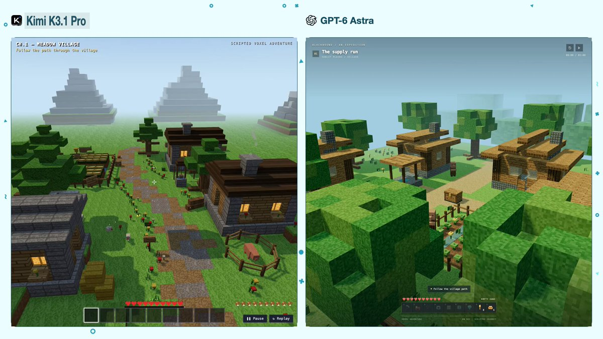</a>

A prompt for a full Minecraft game in the browser, progressing from a village through a blacksmith, mines, the Nether, and a stronghold with a working End portal.

**Prompt**

```text
build a full minecraft game in the browser

village → blacksmith → mines → nether → stronghold with a working end portal
```

[View detail ↗](https://www.tripo3d.ai/3d-prompts/browser-minecraft-game-working-end-portal) · [Original post](https://x.com/starmexxx/status/2113722581610033330) · [Back to examples](#all-prompts)

---

<a id="2113849897438834851"></a>

### Windsock Field interactive pixel-art airfield

[Vib3Coded](https://x.com/vib3coded) · 2026-10-24

<a href="https://www.tripo3d.ai/3d-prompts/windsock-field-interactive-pixel-art-airfield"></a>

A verbatim prompt supplied by the posting author for an interactive Three.js pixel-art 3D airfield diorama. It specifies a simulated runway, taxiway, aircraft flight physics, ground operations, weather, day/night lighting, and interactive camera and traffic controls. The root post says this was the same prompt used in a Kimi K3.1 Pro versus ChatGPT-6 Astra comparison; the linked result is presented as a Kimi page.

**Prompt**

```text
Build a single-file HTML + three.js (r160, import map from jsDelivr) interactive pixel-art diorama called "Windsock Field": a small airfield on a floating rounded-rectangle island, rendered from an orthographic isometric camera into a low-res target (~480×300), upscaled with texelFetch, with depth-based outlines, OKLab quantization to a fixed 64-colour palette, optional Bayer dither, and a "Raw 3D" toggle with MSAA. Everything is built from boxes; no external assets, no real brands.
Layout: runway 09/27 across the front (edge lights, threshold bars, painted numbers, centreline, aiming points, PAPI, running approach lights), a parallel single-lane taxiway with four links and hold-short bars, an apron with three nose-in stands (A1–A3), a terminal with a glass front and canopy, a control tower with a rotating beacon, an arched hangar, a fuel farm, a helipad, a small car park, a service lane behind the stands, a fence with spectators, trees, and a chained windsock that streams with the wind and droops when it is calm.
Aircraft (own physics, not keyframes): airspeed with thrust minus drag, climbs that cost speed, coordinated turns (turn rate = g·tanφ/v), AoA-based pitch, ground roll/rotate/lift-off at Vr, flare, touchdown with a possible bounce. The wind carries them, so on crosswinds they crab and then straighten at touchdown; on final they add half the headwind to their speed.
Sparrow (high-wing trainer): flies circuits Upwind→Crosswind→Downwind→Base→Final, 2–3 touch-and-goes, then a full stop.
Kestrel (light twin, retractable gear): boards 3 passengers plus bags from a baggage tug, departs off-screen, returns inbound for a full stop, then unloads.
Bumblebee (biplane): smoke display with two loops and a roll on passes in front of the crowd, then rejoins and lands.
Rotor 5 (helicopter): lifts from the pad, flies a lap with attitude driven by acceleration, lands.
Operations: a runway lock; departure clearance only when nothing is on final; short-final check with a go-around if the runway is occupied; go-around on a long flare or a missed approach; low pass on click. The taxiway is one lane: each plane reserves the x-span of the taxiway it still has to cover, and arrivals have priority; a plane waiting at a holding point counts as a static obstacle. Planes leave the runway at the first free link ahead. Wind modes: From west / From east / Shifting. A sustained tailwind flips the active runway: circuits rejoin (never straight onto final), and planes already on the taxiway finish to their old holding point, then re-route when clear. Planes never fly below 3 m except over the runway. Watchdog: a plane stuck for 90 s squeezes past.
Ground life: a marshaller with wands guides arrivals onto the stand; pilots and passengers walk to and from the terminal door. A fuel truck refuels each arrival, parked 1.5 m off a wingtip. The tug carries carts with bags to the twin. Both vans keep to a one-way loop (westbound along the apron's front edge, northbound up the gap between stands, back along the service lane), stop for any wing or for the strip a moving plane is about to sweep, and keep going when they are already in a plane's path so it waits for them. The planes treat vans as obstacles with wingtip clearance.
Weather and time: Rain adds streaks, wet darkening and puddles that grow from low spots and show a mirrored second render pass, plus wheel spray. Day / Dusk / Night blend over 1.6 s; at night: edge lights, green/red threshold bars by the active runway, sequenced approach lights, beacon, nav lights and strobes, floodlights, a lit terminal and tower cab.
UI (English, light and dark themes): kicker "Pixel diorama · Airfield", title, short intro. A dark scoreboard with DEPARTURES / clock + status ticker / ARRIVALS and a wind line ("WIND 270° 8 KT · RWY 27"). Right rail: Time & weather (Day/Dusk/Night, Dry/Rain, runway wetness bar), Wind (3 modes plus a windsock readout), Traffic (each aircraft's live state, "Send one up", Pause), a Radio feed of tower/pilot calls in a pixel font (fixed height), View (turn left/right, Pixel art/Raw 3D, pixel size, palette, dither and outlines toggles). Click an aircraft to start it or ask for a low pass, click the windsock to swing the wind, drag to rotate, scroll to zoom. A collapsible "How it's drawn" panel. Mobile: single column with a 16px gutter and the rail below the scene.
```

[View detail ↗](https://www.tripo3d.ai/3d-prompts/windsock-field-interactive-pixel-art-airfield) · [Original post](https://x.com/vib3coded/status/2113850194106167681) · [Back to examples](#all-prompts)

---

<a id="2113900384695755129"></a>

### Complex Procedural 3D Scene in Three.js

[安伈XinAn](https://x.com/AnXin_37) · 2026-10-24

<a href="https://www.tripo3d.ai/3d-prompts/procedural-threejs-3d-scene-2">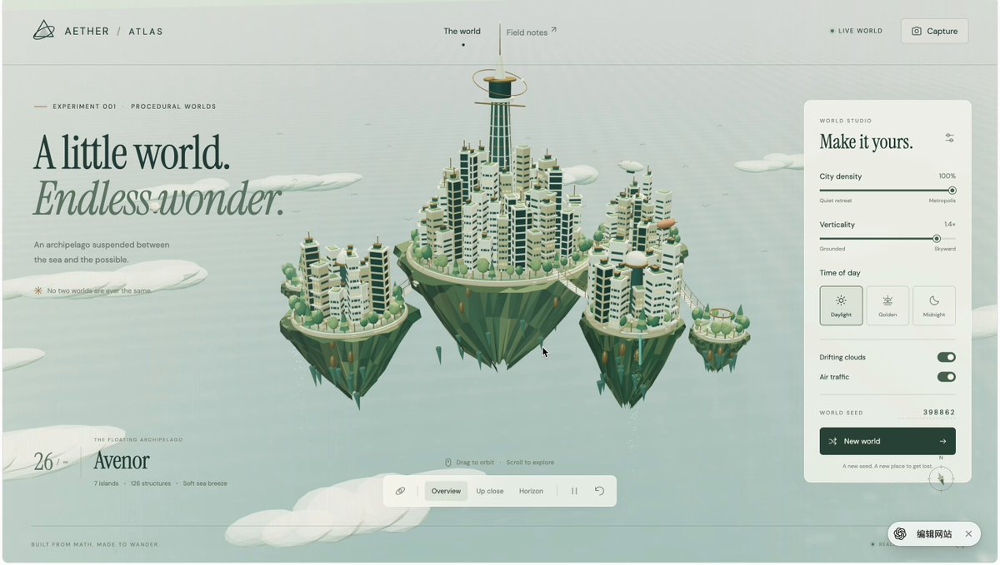</a>

The post’s author says they used the English prompt from the opening of Kimi 3.1 Pro’s pre-release promo video and showcases the interactive procedural 3D floating city they say GPT Astra delivered in Codex. The prompt asks for a complex procedural 3D scene built in Three.js.

**Prompt**

```text
Build a complex procedural 3D scene in Three.js.
```

[View detail ↗](https://www.tripo3d.ai/3d-prompts/procedural-threejs-3d-scene-2) · [Original post](https://x.com/AnXin_37/status/2113900384695755129) · [Back to examples](#all-prompts)

---

<a id="2113978820302708888"></a>

### Interactive Procedural Fluffy Penguin Toy

[Fazley \| AI Lab](https://x.com/itsfazley) · 2026-10-24

<a href="https://www.tripo3d.ai/3d-prompts/interactive-procedural-fluffy-penguin-toy">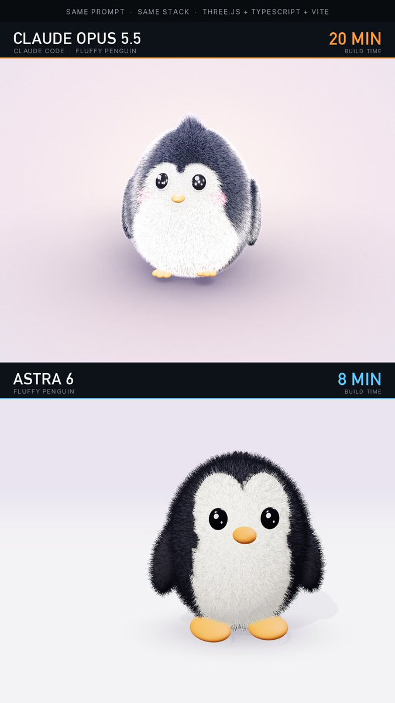</a>

A verified author comment supplies a prompt for an interactive 3D fluffy penguin toy built entirely from procedural geometry. It specifies draggable soft-body interactions, GPU-efficient fur, waddling motion, studio lighting, and a working Three.js, TypeScript, and Vite application without external models or textures. The root post says the same prompt was given to both Opus 5.5 and Astra 6.

**Prompt**

```text
Create an adorable, interactive 3D fluffy penguin toy using Three.js.

Build the penguin entirely from procedural geometry. Give it a
rounded black-and-white body, tiny wings, orange feet, a small beak,
expressive eyes, and thousands of individually animated fur strands.

INTERACTIONS:
- Click and drag to poke, push, and pull the penguin.
- Its soft body should squash, wobble, and bounce.
- It should fall over when pushed and attempt to stand back up.
- Animate a cute waddling idle motion.
- Make the fur react locally to cursor interaction and movement.

VISUALS:
- Realistic fluffy fur using efficient GPU techniques.
- Soft studio lighting, contact shadows, and a clean pastel background.
- Smooth, physically believable movement.
- A polished, minimal interface.

Use Three.js, TypeScript, and Vite. No external models or textures.
Optimize for smooth real-time performance.

Build a working application, not a mockup. Test the interactions
and fix errors.

Prioritize cuteness, tactile physics, detailed fur, and a memorable
10-second visual showcase. Avoid unnecessary features.
```

[View detail ↗](https://www.tripo3d.ai/3d-prompts/interactive-procedural-fluffy-penguin-toy) · [Original post](https://x.com/itsfazley/status/2113978821271523697) · [Back to examples](#all-prompts)

---

<a id="2114049877189480835"></a>

### Disney-Inspired Fairytale Castle on a Rocky Island

[Mugi](https://x.com/reMugi3) · 2026-10-24

<a href="https://www.tripo3d.ai/3d-prompts/fairytale-castle-rocky-island-3d-scene">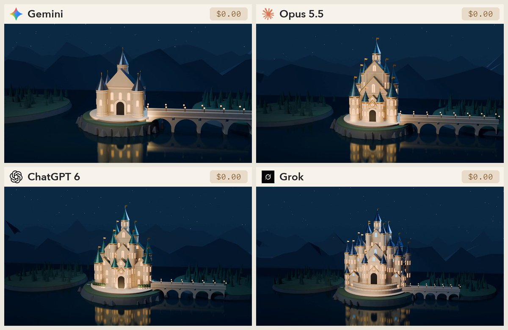</a>

A detailed prompt for a polished stylized 3D castle scene: an ivory fairytale castle with blue-roofed turrets on a rocky island, joined to shore by an arched stone bridge. The requested blue-hour environment includes calm reflective water, pine forest, distant mountains, amber-lit windows, and a slightly elevated front three-quarter composition. The root author states that this same prompt was tested with ChatGPT 6 alongside three other models in Blender.

**Prompt**

```text
Create a detailed Disney-inspired fairytale castle on a circular rocky island surrounded by calm water.

Use warm ivory stone, a tall central keep and multiple levels of smaller towers. Add slender turrets with deep blue conical roofs, gold finials and small golden flags. Build the silhouette around one dominant central spire.

Include a grand arched entrance, glowing amber windows, decorative columns, balconies and stone battlements. Keep the main facade symmetrical, with varied tower heights creating depth behind it.

Connect the entrance to the right shoreline with a long stone bridge supported by several arches. Place small golden lamps along its railings.

Surround the island with dark pine forests and distant mountains. Set the scene at blue hour, with a navy sky, subtle stars, warm lighting and soft reflections in the water.

Show the entire castle and bridge from a slightly elevated front three-quarter view. Use elegant proportions and a polished, stylized 3D appearance with crisp architectural details. No text, logos or interface elements.
```

[View detail ↗](https://www.tripo3d.ai/3d-prompts/fairytale-castle-rocky-island-3d-scene) · [Original post](https://x.com/reMugi3/status/2114049880750465238) · [Back to examples](#all-prompts)

---

<a id="2114056027641413870"></a>

### Cinematic ancient Greek warship in Blender

[kairos](https://x.com/ka1r0seve) · 2026-10-24

<a href="https://www.tripo3d.ai/3d-prompts/ancient-greek-warship-blender-model">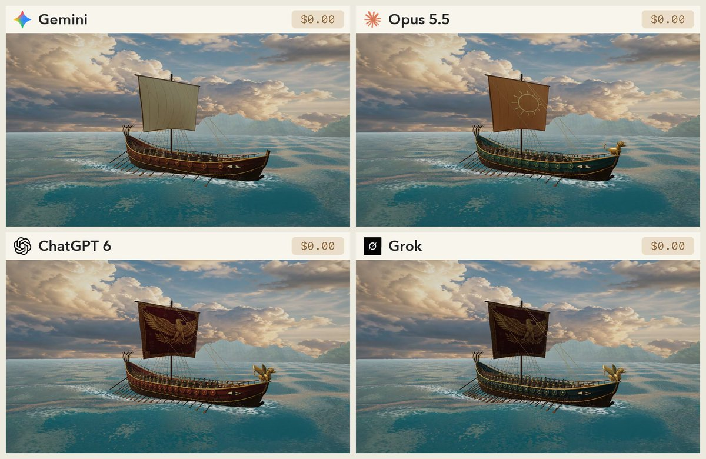</a>

A prompt shared by the posting author as the same task given to several models, including ChatGPT 6. It requests a fully editable Blender Python model of an ancient Greek warship, with detailed hull construction, rigging, physically based materials, and a sea environment.

**Prompt**

```text
Create a cinematic ancient Greek warship in Blender, inspired by Odysseus’s voyage and the Adrestia from Assassin’s Creed Odyssey.

Build a real, fully editable 3D model using Blender Python. Aim for the realism and atmosphere of a historical adventure film.

MODEL
Create an elegant, elongated wooden hull with a curved bow and raised stern. Model individual hull planks, structural ribs, deck boards, railings, rowing benches, a bronze ram, and a sculpted figurehead. Add shields along the sides, rope coils, barrels, cleats, pulleys, and believable rigging.

Use a single main mast with a billowing burgundy square sail, a gold eagle emblem, stitched panels, reinforced edges, and subtle wear. Keep the design distinctly ancient Greek.

MATERIALS
Use physically based materials: weathered timber with visible grain, aged bronze with restrained patina, rough woven sailcloth, and twisted rope. Add realistic bevels and subtle surface imperfections. Keep scale and construction consistent.

SCENE AND ANIMATION
Place the ship on a turquoise sea with rolling waves, a foamy wake, distant rocky islands, atmospheric haze, and warm sunlight.
```

[View detail ↗](https://www.tripo3d.ai/3d-prompts/ancient-greek-warship-blender-model) · [Original post](https://x.com/ka1r0seve/status/2114056030661251276) · [Back to examples](#all-prompts)

---

<a id="2114060132610957601"></a>

### Cinematic Trojan Horse Model in Blender

[cranger](https://x.com/crangerus) · 2026-10-24

<a href="https://www.tripo3d.ai/3d-prompts/cinematic-trojan-horse-blender-model">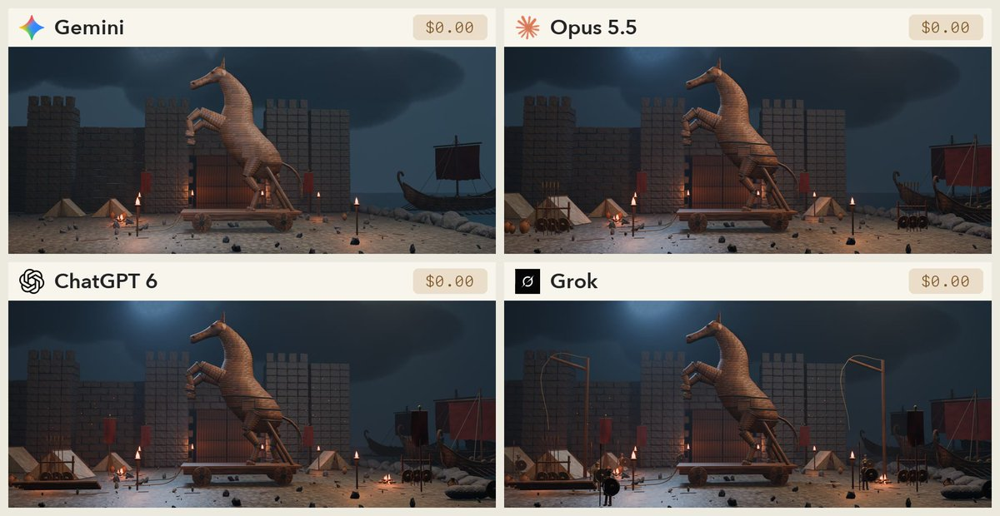</a>

The author shared this complete brief as the common prompt in a comparison that included ChatGPT 6. It requests an editable Blender Trojan horse model with layered wooden construction, internal framework, wheeled platform, and a stormy dusk setting outside Troy’s gates, plus a 1920×1080 still render.

**Prompt**

```text
Create a detailed cinematic Trojan horse model in Blender, inspired by the monumental scale and dark atmosphere of The Odyssey.

Build an enormous wooden horse rearing on its hind legs, with an arched neck, defined muzzle, pointed ears, broad chest and two bent front legs. Keep the silhouette elegant and recognisable.

Construct the body from overlapping horizontal wooden planks that follow its curves. Give each plank thickness, beveled edges, visible grain, narrow gaps and subtle weathering. Use varied dark oak and walnut tones.

Include a believable internal framework of curved ribs, crossbeams and diagonal braces. Add bronze rivets, dark iron straps, reinforced joints, a discreet side hatch and an aged bronze bridle. Build the mane from short wooden ridges and the tail from curved timber sections.

Mount the horse on a heavy rectangular timber platform with visible axles and four large spoked wooden wheels with iron rims. Make all supports and connections structurally convincing.

Place it outside Troy’s massive stone gates beside the sea. Surround it with canvas tents, shield racks, spears, amphorae, stacked timber, coiled ropes, wooden scaffolding and burning torches. Add several ancient Greek ships with dark red square sails along the shoreline. Include a few bronze-armored guards to establish scale.

Set the scene at stormy dusk, with blue-grey clouds, cool ambient light, warm firelight and restrained smoke. Use realistic wood, aged metal and rough stone materials, with clear contact shadows.

Compose a low front three-quarter view. Keep the entire horse visible, its head against the sky, with the gate behind it and ships to one side. Aim for the weight and atmosphere of a practical film set.

Create a static scene only. No animation, text, logos or interface elements.

Deliver an editable .blend file with packed textures and one high-quality 1920×1080 still render. Check for floating props, intersecting geometry and missing materials.
```

[View detail ↗](https://www.tripo3d.ai/3d-prompts/cinematic-trojan-horse-blender-model) · [Original post](https://x.com/crangerus/status/2114060135769252111) · [Back to examples](#all-prompts)

---

<a id="2114080244046954999"></a>

### Build the Eiffel Tower

[Sam](https://x.com/SamgreyAi) · 2026-10-24

<a href="https://www.tripo3d.ai/3d-prompts/eiffel-tower-3d-model">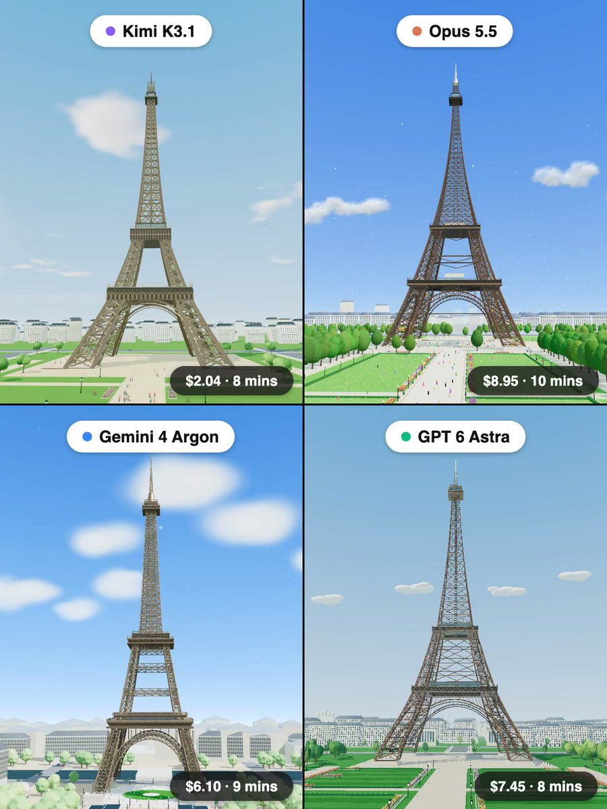</a>

A quoted prompt used in the author's comparison of four AI models, including GPT-6 Astra, to build an Eiffel Tower. The requested result is a 3D Eiffel Tower model.

**Prompt**

```text
build the Eiffel Tower.
```

[View detail ↗](https://www.tripo3d.ai/3d-prompts/eiffel-tower-3d-model) · [Original post](https://x.com/SamgreyAi/status/2114080244046954999) · [Back to examples](#all-prompts)

---

<a id="2114092197595201850"></a>

### Detailed weathered 3D steam train

[BuBBliK](https://x.com/k1rallik) · 2026-10-24

<a href="https://www.tripo3d.ai/3d-prompts/weathered-steam-train-blender-model">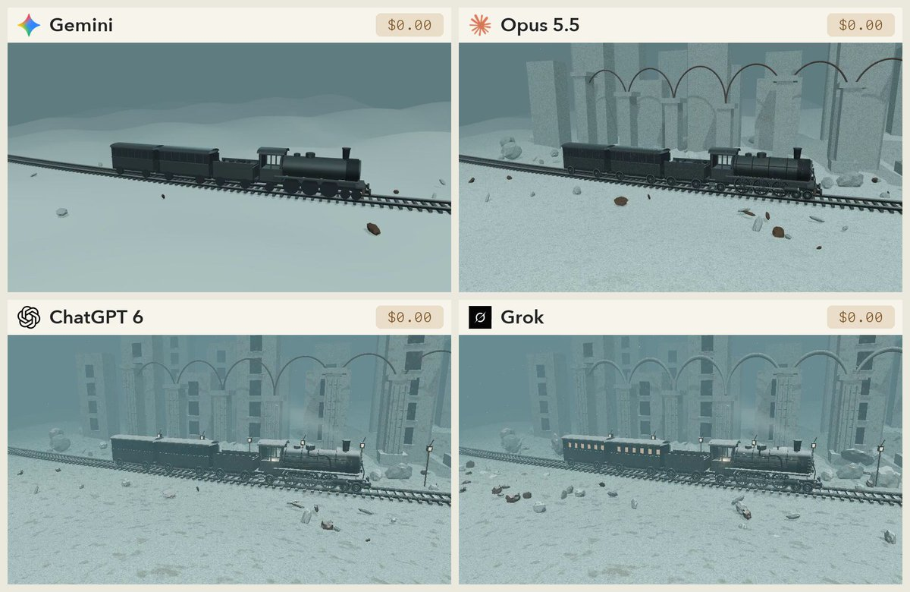</a>

Create an editable Blender scene containing a weathered black steam locomotive, coal tender and two period passenger carriages. The prompt specifies detailed mechanical construction, aged metal materials, snow and soot wear, glowing carriage interiors, and logically named packed-texture parts. The root author says this same prompt was submitted to ChatGPT 6 alongside other models.

**Prompt**

```text
Create one detailed 3D steam train inspired by the atmosphere of Clair Obscur: Expedition 33.

Build a weathered black locomotive with a long cylindrical boiler, flared chimney, open cab and large spoked driving wheels. Include connecting rods, pistons, exposed pipes, valves, rivets, ladders, handrails, buffers and a warm headlamp.

Attach a coal tender and two period passenger carriages. Give the carriages curved roofs, framed windows, visible wheel assemblies, undercarriage details and softly glowing interiors. Connect every vehicle with believable couplings and consistent proportions.

Use aged iron, worn steel, subtle rust, soot and traces of snow on upward-facing surfaces. Keep the materials realistic, with restrained reflections and visible wear around joints and edges.

Prioritise an elegant silhouette, convincing mechanical construction and fine surface detail. All components should feel heavy, functional and properly connected.

Deliver the complete train as one editable Blender scene, with logically named parts and packed textures. Model only the locomotive, tender and two carriages. No surrounding environment, text or logos.

Keep metered API spending below $5 and report the actual cost.
```

[View detail ↗](https://www.tripo3d.ai/3d-prompts/weathered-steam-train-blender-model) · [Original post](https://x.com/k1rallik/status/2114092201240346897) · [Back to examples](#all-prompts)

---

<a id="2114671379455119514"></a>

### Artisanal 1800s pistol with Blender MCP

[patch](https://x.com/patch_gg) · 2026-10-26

<a href="https://www.tripo3d.ai/3d-prompts/artisanal-1800s-pistol-3d-model">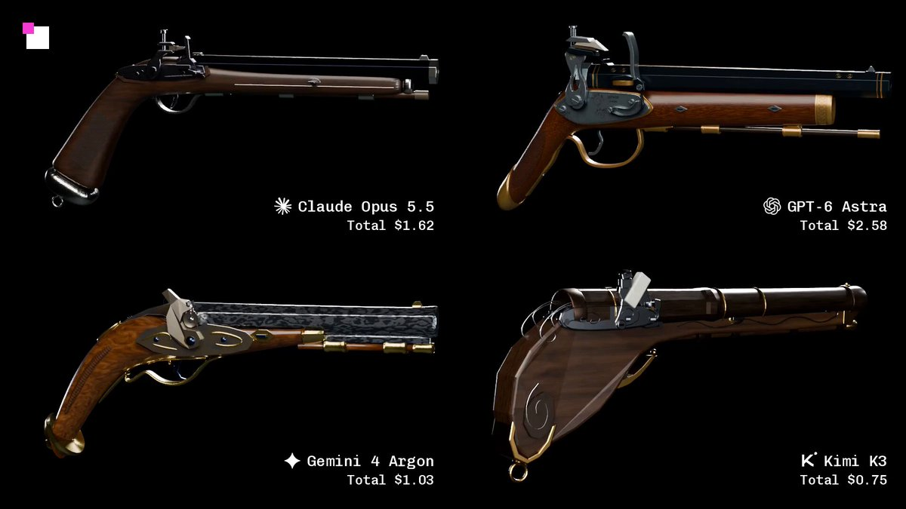</a>

A comparative AI-model post presents a request to make an artisanal 1800s pistol using Blender MCP, with GPT-6 Astra listed among the tested models.

**Prompt**

```text
Make an artisanal 1800s pistol using Blender MCP
```

[View detail ↗](https://www.tripo3d.ai/3d-prompts/artisanal-1800s-pistol-3d-model) · [Original post](https://x.com/patch_gg/status/2114671379455119514) · [Back to examples](#all-prompts)

---

<a id="2114735216686211306"></a>

### Fresh Coat: interactive pixel-art 3D graffiti yard

[Adem Ninja](https://x.com/halfofthemwork) · 2026-10-26

<a href="https://www.tripo3d.ai/3d-prompts/fresh-coat-interactive-3d-graffiti-yard">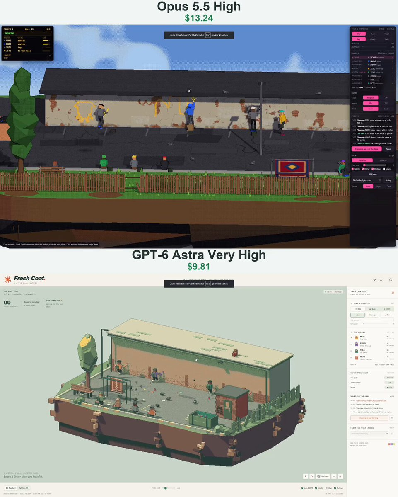</a>

A single-file three.js interactive 3D scene set in a floating-island garage yard, where a crew paints a wall while reacting to weather, a patrolling janitor, wall-painting rules, and one another. It specifies an isometric pixel-art renderer, procedural paint behaviour, character animation, environmental animals, and mobile-friendly controls and UI.

**Prompt**

```text
Build a single-file HTML + three.js (r160) scene called "Fresh Coat": a crew of writers painting a long garage wall in a back yard on a floating island. It is a real 3D scene rendered as crisp pixel art.

Rendering: an orthographic isometric camera (drag to turn in 90° steps, scroll or pinch to zoom). Render into a small low-res target with a depth texture, then upscale with texelFetch to whole screen pixels. Add depth-based outlines and quantize every pixel to a fixed ~60-colour palette in OKLab, with an optional Bayer dither. The palette needs enough saturated spray colours (chrome, fluoro, deep shadows) for the pieces to pop. Toggle "Pixel art / Raw 3D", with a pixel-size slider and Palette / Dither / Outlines checkboxes, plus a "Wall view" button that turns the camera square onto the wall.

Yard: patched, cracked asphalt with a kerb, grass and dirt around the island edge. Around the asphalt:
- a long row of lock-up garages with numbered doors and a flat roof that overhangs them. Their back wall is the canvas, rendered plaster and old brick;
- a brick transformer booth with a warning sign, a good place to hide behind;
- a poplar with a bench and a grandmother on it, who tuts at new tags and nods at good pieces;
- a carpet rack, bushes, a fence with a hole, a rubbish skip full of empty cans;
- a lamp on a pole and a lamp over a garage door.
Pigeons walk and peck, and flap up onto the roofs when a writer or the janitor comes near. A cat on the garage roof follows the hissing can with its head.

Wall: a data texture over the whole wall. Each texel stores colour, layer, wetness, age and its order along its stroke. Pieces are drawn progressively in the real order: a thin sketch outline, the fill, a fade, the final outline, the 3D shadow, highlights, and last of all the tag. Older layers show through where a coat is thin, and old pieces fade and flake with age.

Spray: each can sprays a cone of droplets. Distance sets line width and softness, and speed sets coverage. Moving too slowly or too close makes paint pool and run, and drips flow down the texture under gravity until they dry. Wind blows overspray sideways. Cans run low (the hiss sputters and the line breaks up), get shaken with a rattle, and land in the skip when empty.

Crew (8 writers, each with skill, speed and can control, and a style: tagger / throw-up / piece / characters):
- Four paint at once, four wait on the kerb, sketching in black books. Letters come from an original pixel alphabet, turned into strokes, so every writer has a different name and hand style.
- Each writer scans the wall for a spot, plans a piece that fits the free space, roughs out the sketch, steps back to look, then paints in passes. The crew agrees on the colour scheme, and writers lend cans to each other.
- The wall code: never go over a better piece, only a worse or older one. A tag over someone's piece starts beef: they cross it out, and the two argue. With Code: Off, anything goes.
- After each piece the crew rates it (letters, flow, colours, cleanliness, drips). The best rating moves its writer up the ladder. A writer whose piece gets crossed out or buffed drops to the back of the queue. Everyone below moves up, and the next in line steps up to the wall.

Janitor and AI: a janitor patrols on a timer with a roller and a bucket of grey that never quite matches the wall. One waiting writer keeps lookout. When the janitor appears, the lookout whistles, everyone grabs their cans and hides behind the booth or the skip, and they come back when the janitor has gone. The janitor buffs fresh tags first in uneven grey rectangles, which become clean canvas for the next piece. Errors grow with haste (when the janitor is near), wind, a nearly empty can and lower skill: shaky lines, overspray, drips. Occasionally a nozzle clogs and spits a blob.

Writers: box-rigged with two-bone IK. The can hand follows the stroke path at the right distance from the wall. Poses: walk with a bag of cans, shake the can, crouch to paint the bottom, stretch on tiptoe or stand on a crate to reach the top, step back with arms folded, point out a mistake, fist bump, argue over a crossed-out piece, run and hide, peek out, and sit sketching on the kerb.

Time and weather: Day / Dusk / Night (the lamps light the wall, and painting by lamplight shifts the colours), Dry / Windy / Rain.
- Rain: streaks, splashes, darker asphalt and a wet, darker wall, puddles that mirror the wall via a mirrored render pass. Fresh paint that has not cured runs and washes out in coloured streaks, while cured paint survives.
- The writers shelter under the garage roof overhang. When the wall dries, two of them repaint the damaged parts in the same stroke order, and painting resumes.

UI (English, light and dark themes, mobile layout):
- A lit scoreboard with pieces finished, clock + status ("Painting", "Janitor!", "Rain"), the longest-standing piece and the best-rated piece.
- A side rail with: Time & weather (with wall wetness and paint cure bars); the ladder (King / Writer / Toy / Newbie plus "Next up"); Rules (Code: Respect / Off; Janitor: On / Off; Wind: Calm / Gusty); a feed of events ("Crossed out!", "Buffed", "Drip", "Janitor coming") with "Everyone go over the King" and Pause; View (Replay a piece from its first stroke).
- Click a spot on the wall and the next writer paints there. Click a writer and the whole crew helps them. Original letters and design, no real crews, brands or names.
```

[View detail ↗](https://www.tripo3d.ai/3d-prompts/fresh-coat-interactive-3d-graffiti-yard) · [Original post](https://x.com/halfofthemwork/status/2114738270466695553) · [Back to examples](#all-prompts)

---

<a id="2114961338175033641"></a>

### 2099 3D world with humans, aliens and creatures

[Rey Brando](https://x.com/ReyBrando1) · 2026-10-27

<a href="https://www.tripo3d.ai/3d-prompts/2099-human-alien-creature-3d-world">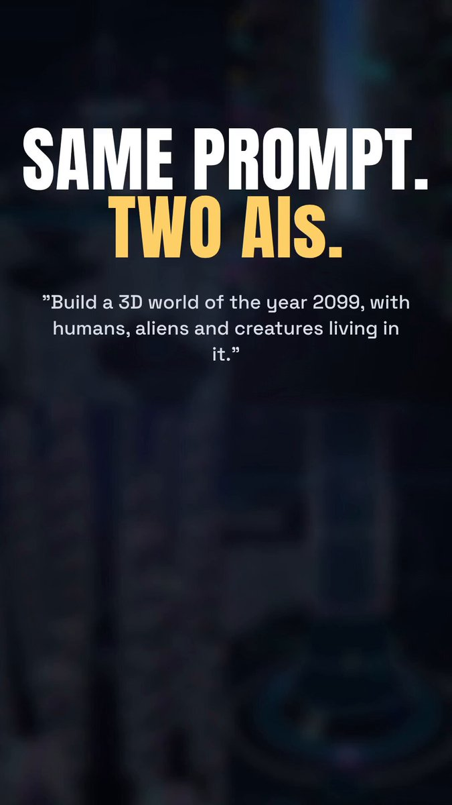</a>

A shared one-shot prompt reported by the posting author as used to compare ChatGPT free (GPT-6 Thinking) and Claude Haiku. It asks for a 3D world set in 2099 inhabited by humans, aliens, and creatures.

**Prompt**

```text
Build a 3D world of 2099 with humans, aliens and creatures living in it.
```

[View detail ↗](https://www.tripo3d.ai/3d-prompts/2099-human-alien-creature-3d-world) · [Original post](https://x.com/ReyBrando1/status/2114961338175033641) · [Back to examples](#all-prompts)

---

<a id="2115035785179148694"></a>

### THE LAST CARRIAGE

[Happycapy](https://x.com/happycapyai) · 2026-10-27

<a href="https://www.tripo3d.ai/3d-prompts/haunted-halloween-train-station-3d-experience">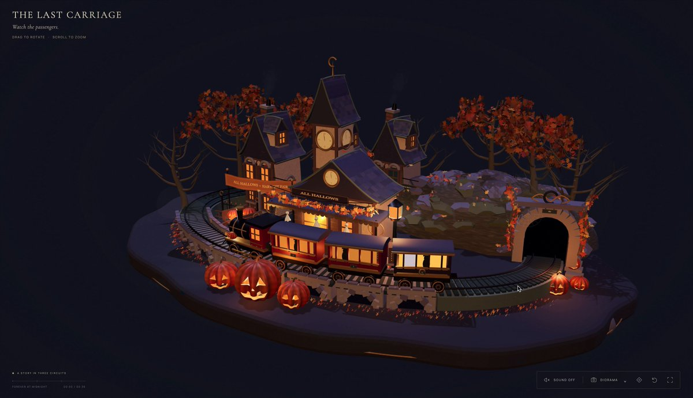</a>

A browser-based interactive 3D Halloween diorama: a miniature ghost train circles an enchanted Victorian railway village while concealed tunnel passages drive a deterministic supernatural narrative. The prompt specifies handcrafted scenery, carved illuminated pumpkins, a detailed steam train, camera presets, drag orbiting, scroll zoom, a 36-second looping story, accessibility controls, sound, and Three.js implementation.

**Prompt**

```text
Build “THE LAST CARRIAGE,” a finished, exquisitely art-directed, interactive 3D Halloween experience for the browser.

A miniature ghost train circles an enchanted Victorian village at midnight. Each time it disappears into a tunnel, something quietly changes.

Deliver a working experience, not a concept, mockup, or technical demo. Treat it as a small piece of interactive cinema with the craftsmanship of an elaborate stop-motion film set.

If working in the existing project, preserve its identity, useful train logic, working interactions, and private access configuration. Improve the existing site rather than creating a duplicate.

1. CREATIVE DIRECTION

The central idea:
“An enchanted Halloween railway village, handcrafted as a museum-quality mechanical diorama.”

Emotional balance:
- 60% enchanted autumn warmth.
- 30% gothic mystery.
- 10% quiet unease.

Make it inviting enough to explore and strange enough to remember.

Use a controlled palette:
- Ink blue and velvet-blue shadows.
- Muted violet and near-black plum.
- Burnt sienna and copper autumn leaves.
- Pumpkin amber and warm ivory.
- Oxblood-red paint.
- Tarnished gold and aged brass.

Warm lights should be the emotional center of the scene. Avoid washing every surface in cyan or dark teal.

Materials must feel tactile and handmade: painted wood, soot-darkened metal, weathered brass, slightly bowed plaster, layered slate shingles, damp cobblestones, waxy pumpkin skin, and delicate glass.

Introduce purposeful asymmetry, small imperfections, and surface variation while maintaining coherent scale.

Avoid generic low-poly assets, placeholder boxes, blob-shaped trees, neon colors, excessive bloom, heavy fog, jump scares, gore, flashing effects, and visual clutter.

2. COMPOSITION AND OPENING FRAME

Make the miniature world occupy approximately 75–85% of the opening viewport. The scene must dominate; typography must remain secondary.

Design an intimate three-quarter composition:
- Foreground: three beautifully carved pumpkin lanterns beside the curved railway.
- Midground: the locomotive passing the warmly illuminated station.
- Background: crooked village roofs, a slender clock tower, and a wooded tunnel entrance.

Arrange these focal points as a visual triangle. Use the railway curve as a strong leading line.

Reduce the exposed empty base and avoid making the model look small inside a large webpage. Preserve quieter areas between detailed clusters.

At time zero, clearly show:
- The locomotive and its passenger carriages on the foreground curve.
- At least three recognizable glowing jack-o’-lantern faces.
- The station entrance and warm ticket-office window.
- The tunnel mouth.
- A readable architectural silhouette.
- A balanced relationship between warm light and cool night.

The first tunnel entry must occur only after viewers have had time to appreciate the train.

The opening frame should work as a finished Halloween illustration before anything moves. Do not hide the best composition twenty seconds into the experience.

Create deliberate desktop and mobile portrait framing. A vertical video composition should retain the train, station, and foreground pumpkins.

3. THE MINIATURE WORLD

Build a compact, richly composed landscape containing:
- A curved railway loop.
- A narrow stone viaduct crossing a dark stream.
- A tunnel through a wooded hillside.
- A small Victorian station.
- A handful of individually designed village houses.
- A slender clock tower.
- Sculptural trees with sparse autumn foliage.
- One solitary figure waiting beneath the platform lamp.

Concentrate detail around the train, station, foreground pumpkins, and tunnel portal rather than distributing decoration uniformly.

Architecture:
- Slightly bowed walls and purposeful asymmetry.
- Steep, subtly curved roofs.
- Layered shingles with visible thickness.
- Dormers, crooked chimneys, and timber framing.
- Recessed doors and window surrounds.
- Aged copper gutters, iron fences, and hanging signs.

Station:
- A scalloped canopy on slender iron supports.
- A warm ticket-office window.
- An old clock approaching midnight.
- A wooden bench and stacked luggage.
- A small sign reading “ALL HALLOWS.”
- Autumn garlands and a restrained strand of warm lanterns.

Tunnel:
- A dressed stone portal and old iron crest.
- Ivy, roots, fallen leaves, and pumpkin-lit steps or a maintenance path.
- An almost completely dark interior.
- Layered terrain, stones, roots, and vegetation that break up the hillside.

Do not leave a large, smooth, empty mound.

Trees must have tapered trunks and branching silhouettes. Use irregular clusters of small copper and russet leaves with varied color and density.

4. SIGNATURE JACK-O’-LANTERNS

Create approximately 12–18 pumpkins, arranged in deliberate clusters:
- Three hero pumpkins beside the foreground track.
- Several on the station steps and beneath the canopy.
- A cluster near the tunnel.
- A few on a cart, in windows, or beside garden gates.

Vary their scale, proportions, ribbing, stem curvature, and carved expressions.

Hero pumpkins require:
- Rounded, deeply ribbed bodies.
- Slightly asymmetrical silhouettes.
- Curled, dry stems.
- Thick carved walls with visible depth.
- Distinct eye and mouth openings.
- Convincing hollow interiors and visible candlelight.
- Subtle skin roughness and color variation.

Use actual openings or convincing recessed cutout geometry with inner walls. Do not paste black triangles onto orange spheres.

At least three carved faces must be immediately readable from the default camera.

Their light must illuminate nearby cobblestones, station steps, and rails. Emissive orange surfaces alone are insufficient.

Use a few strategically placed local lights and efficient supporting techniques. Do not assign an expensive shadow-casting light to every pumpkin.

Candle flicker should be gentle, irregular, and slow.

5. THE TRAIN AS A HERO OBJECT

Create one detailed miniature steam locomotive with three passenger carriages.

Locomotive:
- Oxblood-red painted panels.
- A soot-black boiler.
- Aged brass fittings and thin gold pinstriping.
- A warm headlamp with a restrained beam.
- Layered wheels and animated connecting rods.
- A small brass bell.
- A modest autumn garland and one small pumpkin lantern near the front.

Carriages:
- Detailed frames and rounded roof profiles.
- Warm interior windows.
- Passenger silhouettes that remain legible during normal playback.
- Consistent scale and spacing along the curved track.

Give the last carriage a subtle separate identity:
- Darker paint.
- A small moon emblem.
- One pale interior light among the warm windows.

Use smooth, consistent train motion and convincing wheel rotation. Maintain carriage spacing through curves.

Steam should consist of soft, varied, dissipating wisps, not an obvious chain of opaque spheres.

6. LIGHTING, MATERIALS, AND ATMOSPHERE

Build three complementary lighting layers:

A. Warm focal lighting
Rich amber from the station, train windows, and pumpkins.

B. Cool shape lighting
Soft blue-violet moonlight revealing roof edges, branches, steam, and train silhouettes.

C. Gentle environmental fill
Enough neutral-cool illumination to preserve material colors and make unlit architecture readable on an ordinary laptop or phone.

Keep the brightest highlights small and purposeful. Preserve amber color without clipping it to white.

Ground objects with contact shadows, carefully controlled soft shadows, and restrained ambient occlusion where affordable.

Wet stone, rails, brass, and the stream should catch subtle reflections.

Use thin, localized mist near the tracks, stream, and beneath the bridge. Keep the train, pumpkin faces, and station clear.

Add restrained, asynchronous environmental motion:
- A few drifting leaves.
- Occasional tiny locomotive embers.
- Soft chimney smoke.
- Slight movement in hanging decorations.
- Slow candle flicker.

Use subtle film grain and careful tone mapping. Bloom and depth of field are optional finishing touches, never substitutes for good lighting. Keep the principal train and pumpkin details sharp enough to inspect.

7. HALLOWEEN SET DRESSING

The holiday must be recognizable with all interface text hidden.

Include a curated selection of:
- Glowing carved pumpkins.
- Copper and russet leaves gathered along edges.
- A small wooden pumpkin cart.
- A faded harvest-festival banner.
- Tiny hanging ghost ornaments beneath the canopy.
- Wrought-iron crescent-moon details.
- Fine cobwebs visible where they catch warm light.
- A small black cat near a lantern.

Compose props into meaningful clusters with breathing room between them. Favor craftsmanship and storytelling over decoration density.

8. THE 36-SECOND NARRATIVE LOOP

Create a deterministic, seamless 36-second sequence spanning three approximately 12-second circuits.

Opening circuit:
Three distinct passengers are visible through the carriage windows. A solitary figure waits under the station lamp.

Second circuit:
After a concealed tunnel passage, one passenger is missing. A previously dark window in a distant house is now illuminated.

Third circuit:
After the next concealed tunnel passage, the platform is empty. The waiting figure is now seated in the last carriage, facing outward toward the viewer.

During the third circuit, as the last carriage passes the foreground pumpkin cluster:
- The candle flames briefly lean toward it.
- Its pale window reveals the former waiting figure.
- The station lamp dims slightly.
- The figure turns away.
- A faint ghostly reflection lingers in the glass.

Choreograph this moment around the foreground passage, approximately 25–26 seconds into the loop. It must be subtle but readable at normal playback speed.

During the final passage, the last carriage light slowly fades.

Use the next tunnel passage to conceal the reset into the opening state.

All passenger changes and resets must happen while the affected train is fully hidden inside the tunnel. Avoid visible popping or discontinuities.

The story should reward observation without explanatory captions and work completely without sound.

9. CAMERA, DRAG ROTATION, AND SCROLL ZOOM

Provide three camera presets:
- DIORAMA: the carefully art-directed default three-quarter view.
- FOLLOW: a gentle train-following camera.
- STATION: a closer view of the platform and carriage windows.

Transitions must be smooth and deliberate.

Before manual interaction, allow barely perceptible cinematic drift. Stop that drift once the user manually adjusts the view.

Support direct manipulation in all three presets:

Drag rotation:
- Left mouse drag on desktop.
- Single-finger drag on touchscreens.
- Smooth horizontal rotation through 360 degrees.
- Vertical elevation constrained to approximately 12–65 degrees above the horizon.
- No flipping beneath the scene.
- Pointer capture so a drag remains continuous when crossing controls.
- Clean release and cancellation handling.
- No uncontrolled spinning after release.

Scroll zoom:
- Scroll up to enlarge the model.
- Scroll down to reduce it.
- Support mouse wheels and trackpad two-finger scrolling.
- Ease smoothly toward the requested zoom.
- Limit zoom to approximately 65–185% of the preset’s default size.
- Use optical camera zoom to preserve safe orbit distance and avoid moving the camera through scenery.
- Normalize wheel input across pixel, line, and page delta modes.
- Preserve browser-level zoom shortcuts and modified wheel gestures.

Reset:
- Provide a discreet Reset view button.
- Double-clicking the scene or pressing 0 restores the default Diorama angle and 100% zoom.
- Changing camera presets clears manual rotation and zoom.
- Restart story resets narrative time independently of camera adjustments.

Keyboard accessibility:
- Arrow keys rotate while the canvas is focused.
- + and − adjust zoom while the canvas is focused.
- Provide visible keyboard focus and concise accessible instructions.

Scene gestures must not interfere with interface buttons or the station-lamp interaction.

10. INTERFACE AND SOUND

Open directly onto the scene without an application splash screen or unnecessary onboarding.

Use a small, elegant corner title:
THE LAST CARRIAGE
“Watch the passengers.”

Pair a refined serif title with discreet, widely spaced supporting text. Avoid oversized copy, excessive margins, and decorative labels competing with the model.

Include a subtle initial hint:
“DRAG TO ROTATE · SCROLL TO ZOOM”
Fade it after interaction.

Provide unobtrusive controls for:
- Sound on/off — S.
- Camera preset — C.
- Reset view and zoom — 0.
- Restart story — R.
- Hide interface for recording — H.
- Restore interface — H, Escape, or a discreet restore button.
- Pause/resume — Space when the page background has focus.

Clicking or tapping the platform lamp gently dims it and reveals faint ghostly footprints. This optional detail must not alter the main story.

Respect reduced-motion preferences: start with a still opening frame and offer an explicit Play control. Pause animation and mute audio when the page is in the background.

Audio must begin only after an enabling user gesture.

Create a restrained layered soundscape:
- Soft wheel rhythm.
- Distant steam whistle.
- Autumn wind.
- Faint station bell.
- Subtle muffling or ambience changes inside the tunnel.

11. IMPLEMENTATION AND PRIVATE HOSTING

Use Three.js with clean, maintainable modules.

Prefer procedural geometry, materials, textures, and audio where they support the art direction. Use properly licensed assets when useful and include attribution.

The essential scene, interactions, and story must run without runtime AI calls, API keys, or external inference services.

Bundle essential dependencies and assets locally where practical.

Use:
- Geometry batching for static details.
- Instancing for repeated leaves and props.
- Lower detail for smaller or distant objects.
- Sensible shadow settings.
- A capped device pixel ratio.
- Adaptive rendering quality.
- Graceful fallbacks for expensive effects.
- A clear fallback message when WebGL is unavailable.

Prioritize:
1. Composition and lighting.
2. Hero pumpkins and train craftsmanship.
3. Smooth movement and readable storytelling.
4. Architectural character and material richness.
5. Secondary decoration.

Keep the hosted site private and accessible only to the owner’s account. Preserve platform-managed authentication. Do not make it public or replace the platform’s access controls with a cosmetic login screen.

12. VALIDATION AND DELIVERY

Build, run, and inspect the actual rendered experience.

Work in visual passes:
1. Camera framing and scene scale.
2. Lighting and exposure.
3. Hero pumpkins and locomotive.
4. Station and architectural silhouettes.
5. Materials and clustered set dressing.
6. Atmospheric motion.
7. Interface refinement.

After the first three passes, inspect a real rendered screenshot before adding more decoration.

Review:
- The opening frame.
- The locomotive passing the foreground pumpkins.
- Each passenger-state change.
- The supernatural moment.
- The concealed reset and complete loop.
- Mobile portrait framing.
- Interface-hidden recording mode.
- Alternate camera presets.
- Drag rotation and elevation limits.
- Scroll zoom and zoom limits.
- Reset behavior.
- Keyboard controls.
- Sound and station-lamp interactions.

Check browser errors and rendering performance. Verify consistent train spacing, deterministic narrative states, hidden transitions, and loop continuity.

Revise frames that remain muddy, flat, sparse, overdecorated, or dominated by typography.

Final visual acceptance criteria:
- The scene immediately communicates Halloween without text.
- Pumpkin faces look carved and illuminate their surroundings.
- The train is a beautiful, visible focal object from the opening frame.
- Materials and craftsmanship are appreciable at default viewing distance.
- Warm light remains rich without losing nocturnal mystery.
- Rotation and zoom feel smooth and controlled.
- The opening frame alone could work as an appealing Halloween art print.

Deliver:
- The working private experience.
- Complete source with clear local run instructions.
- A concise controls guide.
- Actual screenshots from the running result.
- A default composition suitable for recording a seamless looping video for X.

The result should feel like discovering a tiny haunted world: beautiful enough to watch before noticing that something is wrong.
```

[View detail ↗](https://www.tripo3d.ai/3d-prompts/haunted-halloween-train-station-3d-experience) · [Original post](https://x.com/happycapyai/status/2115035788891013525) · [Back to examples](#all-prompts)

---

<a id="2115044315777163777"></a>

### 3D Views in 2D UI with Nested UI

[frozenlib](https://x.com/frozenlib) · 2026-10-27

<a href="https://www.tripo3d.ai/3d-prompts/nested-2d-ui-in-3d-display">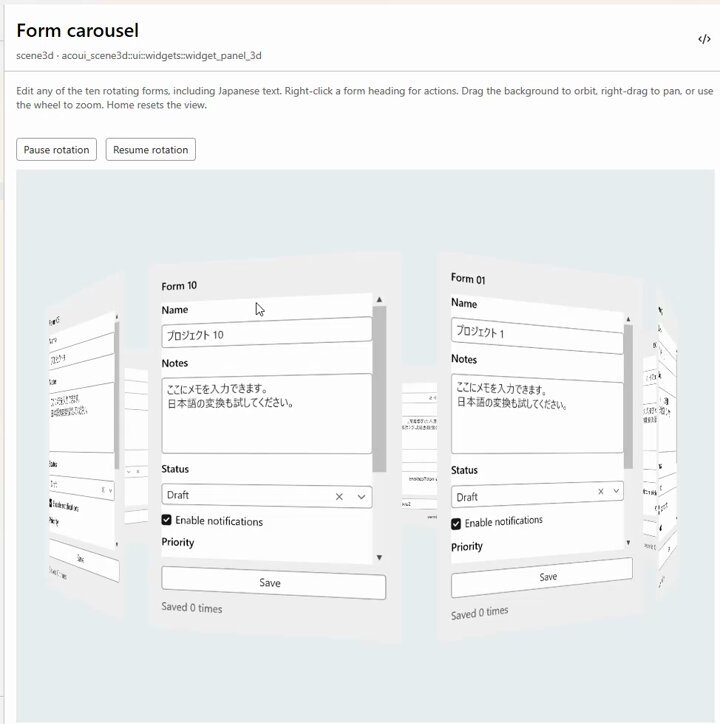</a>

A request to embed a 3D view in a 2D UI and allow 2D UI elements to be placed within that 3D space. It also requires support for IME and keyboard focus, along with integration of the concept of interactive glTF extensions.

**Prompt**

```text
Render 3D content within a 2D UI and allow 2D UI elements to be placed inside it. Support features available in the 2D UI, such as IME and keyboard focus, and integrate the concept of interactive glTF extensions.
```

[View detail ↗](https://www.tripo3d.ai/3d-prompts/nested-2d-ui-in-3d-display) · [Original post](https://x.com/frozenlib/status/2115044315777163777) · [Back to examples](#all-prompts)

---

<a id="2115074545166287075"></a>

### 3D model of a cycle riding a cow riding a human riding a skateboard

[Tim Jayas](https://x.com/TimJayas) · 2026-10-27

<a href="https://www.tripo3d.ai/3d-prompts/cycle-cow-human-skateboard-3d-model">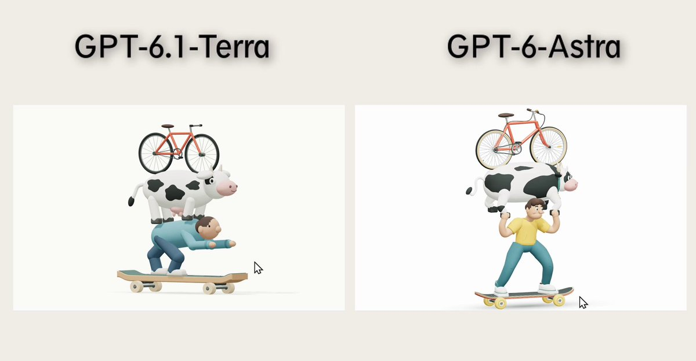</a>

A prompt posted by Tim Jayas for GPT-6-Astra and GPT-6.1-Terra to create a Three.js 3D model of a cycle riding a cow, riding a human, riding a skateboard. It specifies a white background and no UI elements so the main object remains visible.

**Prompt**

```text
create a 3d model of a cycle riding a cow riding a human riding a skateboard using three.js, use white theme background so the main object stays clearly visible and avoid using UI elements
```

[View detail ↗](https://www.tripo3d.ai/3d-prompts/cycle-cow-human-skateboard-3d-model) · [Original post](https://x.com/TimJayas/status/2115074545166287075) · [Back to examples](#all-prompts)

---

<a id="2115164427657904336"></a>

### Cinematic 3D alpine lake scene in Blender

[Lummox](https://x.com/Lummox_eth) · 2026-10-27

<a href="https://www.tripo3d.ai/3d-prompts/cinematic-alpine-lake-blender-scene">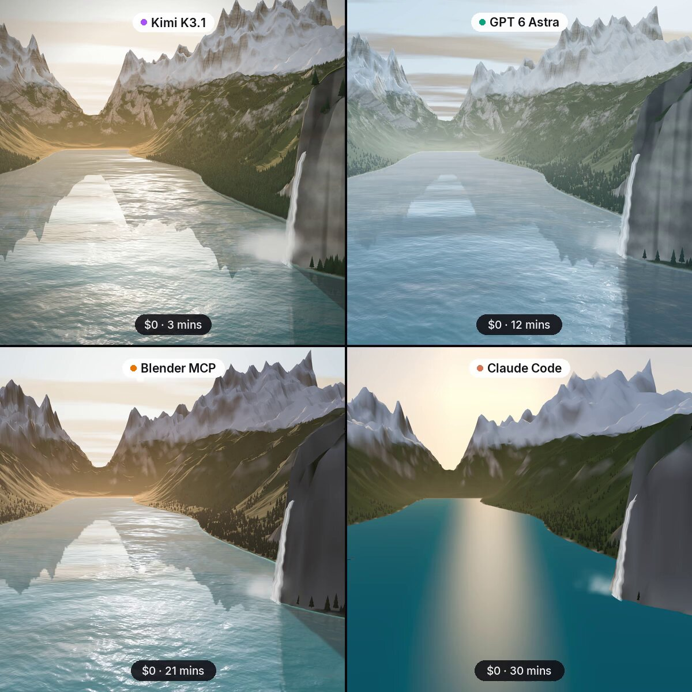</a>

A reusable challenge recommended by the posting author for comparing AI coding agents connected to Blender. It requests a cinematic alpine-lake environment with mountain ranges, a waterfall, reflective water, a moving boat, golden-hour lighting, and a 10-second MP4 camera animation. The post lists GPT 6 Astra among the compared workflows but does not establish that this was the exact input used for its showcased result.

**Prompt**

```text
Create a cinematic 3D alpine lake in Blender with 2 mountain ranges, a 12m waterfall, realistic water reflections, a boat moving at 3 m/s, golden hour lighting and a 10 second camera animation at 30 FPS, export the final scene as MP4
```

[View detail ↗](https://www.tripo3d.ai/3d-prompts/cinematic-alpine-lake-blender-scene) · [Original post](https://x.com/Lummox_eth/status/2115164427657904336) · [Back to examples](#all-prompts)

---

<a id="2115204470573351126"></a>

### Animated lighthouse in a violent storm

[Ivana](https://x.com/ivanainai) · 2026-10-27

<a href="https://www.tripo3d.ai/3d-prompts/animated-lighthouse-violent-storm-scene">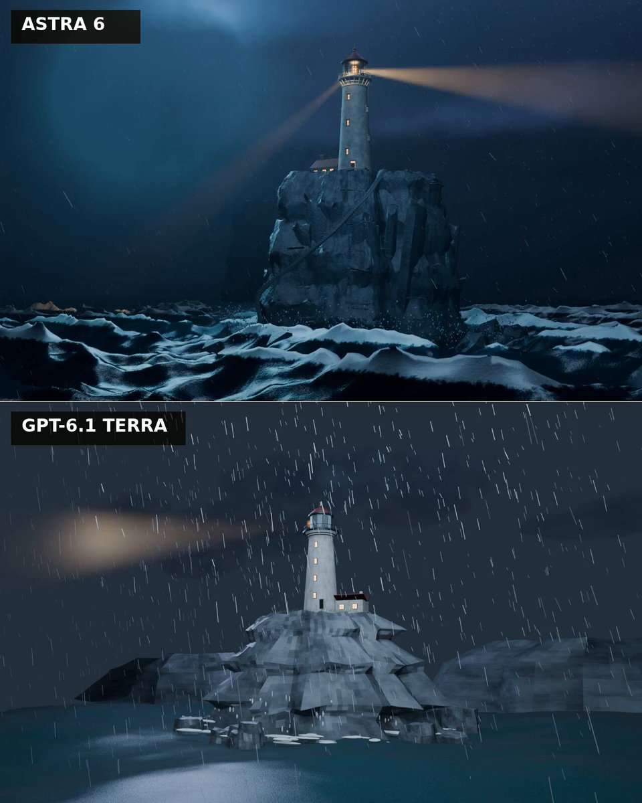</a>

A prompt presented by the post author as the same prompt used for a Blender comparison between GPT-6.1 Terra and Astra 6. It requests a lighthouse scene in a violent storm and animation of that scene.

**Prompt**

```text
build and animate a lighthouse in the middle of a violent storm.
```

[View detail ↗](https://www.tripo3d.ai/3d-prompts/animated-lighthouse-violent-storm-scene) · [Original post](https://x.com/ivanainai/status/2115204470573351126) · [Back to examples](#all-prompts)

---

<a id="2115449826481463529"></a>

### Oasis Jelly: a desert oasis sealed in a wobbly jelly cube

[www.aicontenders.dev](https://www.aicontenders.dev/) · 2026-10-28

<a href="https://www.tripo3d.ai/3d-prompts/oasis-jelly-interactive-desert-diorama">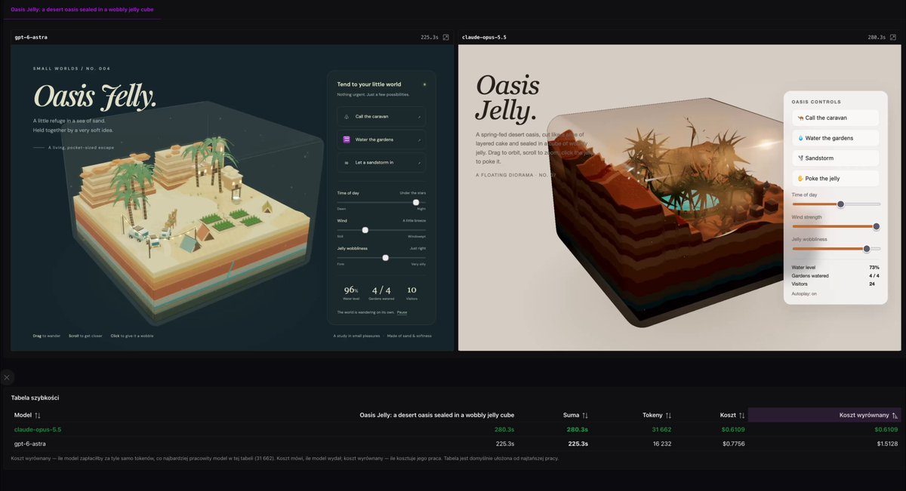</a>

A linked AIContenders comparison publishes this prompt for the shared task tested with GPT-6 Astra and Claude Opus 5.5. It requests a procedural Three.js interactive floating desert-oasis diorama inside a translucent jelly cube, with orbit controls, jelly-poking physics, caravan, garden-watering and sandstorm interactions, and a time-of-day interface.

**Prompt**

```text
Build "Oasis Jelly": a tiny desert oasis world sealed inside a wobbly, translucent cube of jelly, shown as a floating diorama on a calm editorial web page. Single self-contained HTML file; Three.js and its addons from a CDN via an import map are fine; build everything procedurally, no external textures or models.

The diorama:
- A square block of desert cut out like a slice of layered cake. The top is wind-rippled dunes rising to a terraced sandstone cliff along the back, split by a narrow slot canyon. The four cut faces show crisp stratified layers: pale sand, ochre, rust-red sandstone, grey clay, a blue aquifer seam that feeds the spring, and dark bedrock.
- In the middle, a spring-fed lake with clear turquoise water, gentle ripples, bubbling rings where the spring rises, and a green ring of grass on the shore. Around it: a palm grove with swaying fronds, irrigated garden plots with small water channels, a mud-brick village with domes and a tower, a well, a few vintage camper trailers with string lights, colourful tents, and birds circling over the water.
- The whole block is encased in a thick, glossy jelly cube with rounded edges. The cube refracts the world inside, has a faint tint, crisp highlights and tiny suspended bubbles. It wobbles like real jelly: click it to poke it. The cube and everything inside jiggle with damped spring physics, and a ripple runs across its surface, then settles.

Interactions (a control panel on the right):
- Call the caravan: a line of camels followed by a camper van walks along a winding track from the edge of the block to the lake and parks there.
- Water the gardens: water runs from the lake through the channels plot by plot. The soil darkens, the crops turn green and grow, and the lake level drops a little before the spring refills it. Left alone, the gardens slowly dry out again.
- Sandstorm: a dense, swirling, sunlit dust storm sweeps across the diorama. It has thousands of grains and soft dust clouds; the light dims and turns orange, the palms bend and the sand ripples drift. The jelly walls contain it, and it passes after about 15 seconds.
- Sliders:
  - time of day, from dawn through golden hour to night, with lamp-lit windows, glowing string lights and moonlight on the lake;
  - wind strength;
  - jelly wobbliness.
- A small readout of water level, gardens watered and visitors.

Presentation:
- A light, warm-grey editorial page: a large italic serif title "Oasis Jelly." with a short caption on the left, the controls as a clean card on the right, and the diorama floating in the middle above a soft shadow. At night the page itself goes dark.
- Soft sun shadows, ACES tone mapping, a subtle bloom only on lights. Never wash the frame out with glare or haze.
- Drag to orbit, scroll to zoom, click the jelly to poke it.
- Everything starts automatically and is visibly moving from the first frame: a slow camera orbit, and an autoplay loop (paused while the user interacts) that pokes the jelly, calls the caravan, waters the gardens, runs a sandstorm and dips into night.
- Layout works on a phone.

Keep planning brief and write the code. Aim for roughly 700 to 1,000 lines, compact and well structured. Make sure it runs on the first try: declare every constant and uniform your shaders use, and guard against undefined values. No black, untextured or placeholder objects anywhere.
```

[View detail ↗](https://www.tripo3d.ai/3d-prompts/oasis-jelly-interactive-desert-diorama) · [Original post](https://www.aicontenders.dev/c/xGiNFiXftYwHdmT4XJPu7A) · [Back to examples](#all-prompts)

---

<a id="2115478001882374452"></a>

### Interactive Neo-Kowloon neon street market

[Sakata](https://x.com/sakatayasha) · 2026-10-28

<a href="https://www.tripo3d.ai/3d-prompts/neo-kowloon-neon-street-market">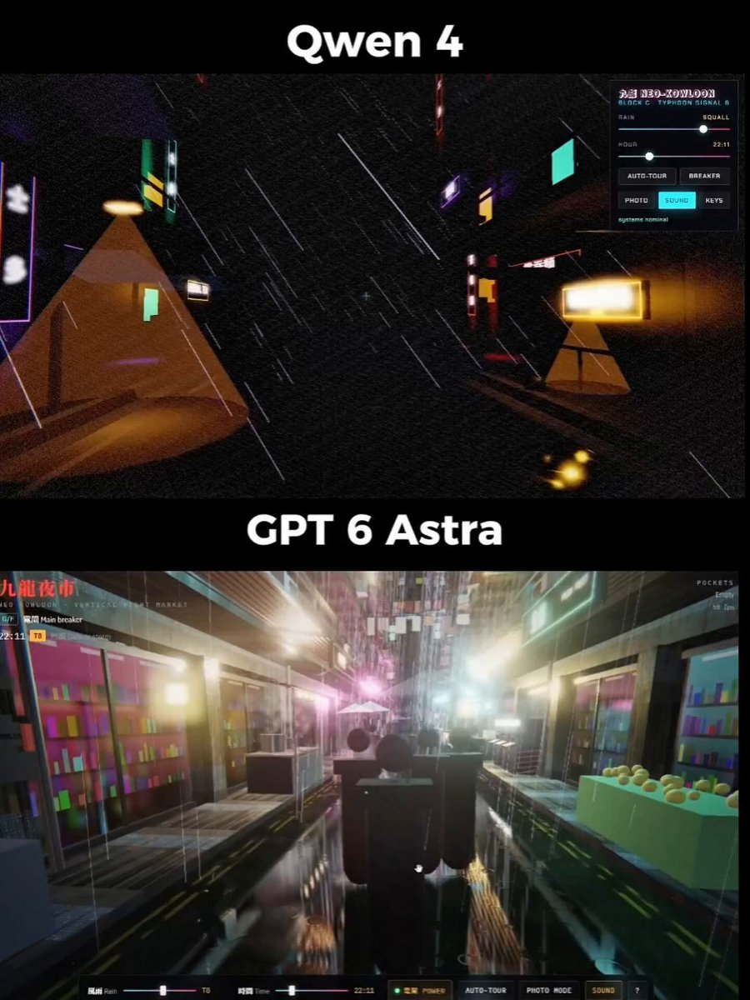</a>

A prompt used in a comparison between Qwen 4 (Kerria) and GPT 6 Astra. It requests a full interactive Three.js neon street market spanning five storeys in Neo-Kowloon during a typhoon night.

**Prompt**

```text
a full interactive Three.js neon street market stacked five storeys in Neo-Kowloon during a typhoon night
```

[View detail ↗](https://www.tripo3d.ai/3d-prompts/neo-kowloon-neon-street-market) · [Original post](https://x.com/sakatayasha/status/2115478001882374452) · [Back to examples](#all-prompts)

---

<a id="2116024691533979940"></a>

### Mangrove Lights interactive WebGL diorama

[Vib3Coded](https://x.com/vib3coded) · 2026-10-30

<a href="https://www.tripo3d.ai/3d-prompts/mangrove-lights-interactive-webgl-diorama">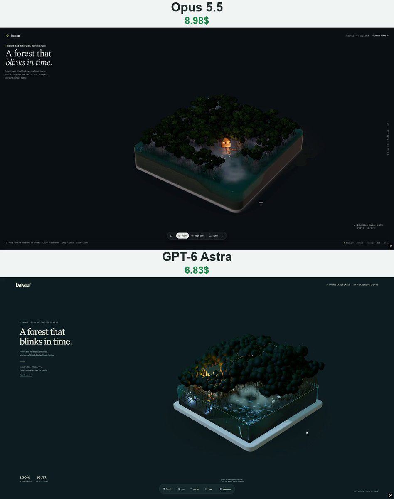</a>

An author-shared prompt that the root post says was given to both Opus 5.5 and GPT-6 Astra. It requests an interactive Three.js/WebGL mangrove-island diorama with procedural terrain and trees, water simulation, synchronized fireflies, wildlife, day/night lighting, and an adjustable interface.

**Prompt**

```text
Build a single-file interactive WebGL diorama called "Mangrove Lights" (Three.js r160 via import map, OrbitControls, no external models or textures, English UI). A mangrove island sits inside a rounded rectangular block of water, about 10×10 units and 1.7 deep, on a cream plinth, over a transparent canvas with a soft contact shadow.

Island: a procedural heightfield with a dry forest floor at the back, shallow mud flats, creeks, and an open inlet at the front corner. Mangrove fringes stand in about 0.5 of water along both glass walls that face the camera, so the stilt roots show above the water and through the glass. The terrain's side walls are a layered mud cross-section with root fibres. Mud below the high-tide line stays dark, wet and glossy.

Trees (about 140): each has a short trunk; 8–11 arching prop roots built as CatmullRom tube geometry that reach into the mud; hanging aerial roots; and a dense crown of displaced icosphere blobs with per-instance AO and dark glossy greens. Bark is algae- and barnacle-stained below the high-tide line. Add pencil-root pneumatophores on the flats, a fisherman's hut on stilts with a lit window and lamp plus a boardwalk, a canoe that bobs on the waves, wading egrets, an egret flying by day, and schools of silver fish that swim between the roots and flee the cursor.

Water: refraction, Beer–Lambert absorption from real thickness, Fresnel sky, screen-space reflections, sun glints, and almost no shore foam. A 256² GPU wave-equation ripple sim responds to the cursor and clicks. Low mist layers part around the cursor.

Fireflies: about 1600 Kuramoto oscillators around the crowns, coupled to a local spatial-hash mean field plus the global field, with a position-dependent phase offset so the synchronized flash sweeps across the forest as a wave. Use an asymmetric flash curve and additive point sprites drawn after the water, with a manual depth test. Mirrored copies show reflections on the water. Two point lights pulse with the average glow. The cursor randomizes the phase of nearby fireflies and pushes them away; a click scatters a wider area; they drift home and resync.

Lighting: day/night palettes with moonlight, a warm hut lamp, ACES tone mapping and tilt-shift.

UI: brand "bakau°"; headline "A forest that blinks in time."; dock buttons Reset, Night/Day, High/Low tide, Tune and Fullscreen; a settings panel (time, fireflies, pull to sync, mist, water color, tide, waves, ripples, clarity, light azimuth, tilt-shift); a live sync % and clock; a "How it's made" note. The page theme turns dark at night. Include adaptive DPR, a low-detail mode for touch devices, reduced-motion support and a WebGL2 fallback.
```

[View detail ↗](https://www.tripo3d.ai/3d-prompts/mangrove-lights-interactive-webgl-diorama) · [Original post](https://x.com/vib3coded/status/2116024829639881137) · [Back to examples](#all-prompts)

---

<a id="red-light-green-light"></a>

### Red Light, Green Light: 3D Survival Game

[jared](https://x.com/jaredliu_bravo) · 2026-10-12

<a href="https://www.tripo3d.ai/3d-prompts/red-light-green-light"></a>

<a href="https://www.tripo3d.ai/3d-prompts/red-light-green-light"></a>

<a href="https://www.tripo3d.ai/3d-prompts/red-light-green-light"></a>

<a href="https://www.tripo3d.ai/3d-prompts/red-light-green-light"></a>

<a href="https://www.tripo3d.ai/3d-prompts/red-light-green-light"></a>

<a href="https://www.tripo3d.ai/3d-prompts/red-light-green-light"></a>

Race a giant doll and armed guards in a tense 42-second stop-and-go game. Sprint, manage stamina, freeze on red, and compare procedural characters with real Tripo models.

**Prompt**

```text
1. Project goal
Build Red Light, Green Light, a single-player 3D playground survival game inspired by the familiar stop-and-go challenge. The player is contestant 456, racing 23 local AI contestants across a 62-metre arena within 42 seconds. Holding a single input advances; releasing stops immediately. There is one life per attempt. Deliver the playable game, not a mockup or a prerecorded scene. This is an independent game, not an official television tie-in.

2. Visual direction and screen hierarchy
Use Three.js with a cinematic third-person perspective: dusty warm sand, tall faded pink walls with mint-green lower panels and painted hills, watchtowers, bare trees, a giant orange-and-yellow doll beyond the finish line, teal tracksuits and masked pink guards. Directional golden light, soft contact shadows, restrained fog, chalk lane marks and sparse dust should establish depth without heavy postprocessing. The arena fills the viewport. Place the recognizable title low left in the opening screen and keep instructions compact. During play show a small timer/alive counter, a central colour-and-text signal, progress and one hold-to-run button. Do not replace gameplay with oversized text panels. Adapt portrait layouts without stretching the 3D view.

3. Movement, sprint and stop judgment
Hold Space, W, Up Arrow or the run button to move. A/D or Left/Right steers, but steering is optional. Hold Shift to sprint; on touch, hold the button and slide upward more than 38 pixels to sprint, with horizontal dragging to steer. Normal speed is 3.6 metres/second; sprint is 5.65 before small streak bonuses. Sprint drains stamina; stopping restores it. Exhaustion disables sprint until enough stamina has returned. Releasing forward input stops immediately, with no hidden inertia. Cancel all movement/sprint on pause, blur, language UI replacement, renderer-style switch, retry and end state. Track multiple held keys and one active pointer correctly.

4. Round rhythm and consequences
Implement ready, countdown, running, paused, dying, lost and won states. A three-second countdown starts a 42-second round. Alternate green running periods, visible amber turning warnings and red surveillance. First green lasts 3.4 seconds; later greens vary and tighten as the round progresses. Amber lasts 0.65–0.95 seconds, never disappears without warning. Red is about 2.1–3.35 seconds. The doll starts turning during amber and faces contestants on red. After a short red transition grace, continued movement fills a visible detection indicator and triggers a guard shot. Do not kill a stationary player randomly. Running out of time also eliminates the player. Show a brief 1.65-second hit/fall camera sequence before results, then immediate retry. Crossing the finish line is safe.

5. Tension, opponents and rewards
Give the 23 AI contestants independent speed and reaction timing. A nearby slow-reacting contestant visibly violates the first red and is shot, establishing the threat without scripting a player loss. Later mistakes trigger bounded bursts of eliminations. Aim a nearby armed guard toward each actual target, align the shot origin to its rifle muzzle, show a brief star-shaped muzzle flash, thin tracer, muted impact dust and non-graphic fall. Use an eight-slot reusable effect pool. A stop in the last 0.34 seconds before red earns perfect-stop points, a streak and a small stamina refill. The final 18 seconds increase audio/visual urgency. Preserve deterministic seeded rules for tests while normal play varies by attempt.

6. Real Tripo characters and procedural comparison
Default to genuine Tripo P2-generated GLB assets: the playground doll, the teal contestant with idle/run/victory skeletal clips, and an armed masked guard. Preserve the source model provenance and reuse supplied originals; do not regenerate equivalent assets without need. Normalize forward axes, scale and feet-to-floor alignment. Rotate the doll head independently. Keep the hero fully skinned; batch distant opponents with shared baked pose instances and freeze them faithfully on red. Provide a prominent top-centre Three.js / Tripo toggle that changes character appearance instantly without resetting distance, time, score or the round. The Three.js mode uses articulated geometric contestants, doll and armed guards. Both modes use Three.js; do not imply that the entire environment was generated by Tripo.

7. Sound and accessibility
Use synthesized Web Audio for warning notes, tense heartbeat, footsteps, directional gunshots and short echoes, perfect-stop chimes and victory. Unlock audio only on interaction, limit amplitude to avoid clipping and offer mute. Red/green meaning must be readable from words as well as colour. Provide reduced motion, suppressing flash/camera shake while retaining understandable outcomes. Support keyboard focus, compact settings, pause/resume and clear error recovery. Asset failure must visibly fall back to the procedural mode, keep the game playable and expose retry.

8. Languages, persistence and author
Include complete English, Simplified Chinese and Spanish UI. On first visit select the first supported browser language, falling back to English; keep manual selection on this device. Localize instructions, status, stamina, errors and results. Title: Red Light, Green Light / 一二三，木头人 / Luz roja, luz verde. Save a local personal best, not a fabricated global leaderboard. Credit jared with https://x.com/jaredliu_bravo. No signup, payment, multiplayer or custom-model upload is required for gameplay.

9. Engineering, performance and acceptance
Use an isolated Vite/Three.js project with a lockfile and bundled same-origin scripts/fonts/GLBs. No API keys or temporary signed URLs in the build. Share textures/materials, merge static architecture, instance repeated props and crowd poses, limit pixel ratio adaptively and bound shadow updates. Separate game logic, input controller, scene, combat effects, audio, localization and UI. Test seeded winnability, sprint exhaustion/recovery, exact stops, detection fairness, safe finish, timeout/death/retry, paused timing, multi-key/pointer ownership and translations. Then verify in a real browser: opening, sprint, red warning and shots, death, win, retry, both character modes, portrait controls, sound and resource errors. Measure actual frame timing instead of claiming 60 FPS from configuration. Produce one smooth 20–60-second real-time gameplay recording and at least four genuine state screenshots; disclose canvas/HUD recording method. Verify the final hosted game, public media playback/seek and CMS asset previews/download policy separately.

```

[View detail ↗](https://www.tripo3d.ai/3d-prompts/red-light-green-light) · [Live demo](https://red-light-green-light.tripo.page/) · [Back to examples](#all-prompts)

---

<a id="golden-miner"></a>

### Golden Miner: 24-Level 3D Mining Game

[jared](https://x.com/jaredliu_bravo) · 2026-10-11

<a href="https://www.tripo3d.ai/3d-prompts/golden-miner"></a>

<a href="https://www.tripo3d.ai/3d-prompts/golden-miner"></a>

<a href="https://www.tripo3d.ai/3d-prompts/golden-miner"></a>

<a href="https://www.tripo3d.ai/3d-prompts/golden-miner"></a>

<a href="https://www.tripo3d.ai/3d-prompts/golden-miner"></a>

Build a one-button 3D gold-mining game with 24 levels, four cave regions, chain explosions, mystery chests, daily challenges, and hold-to-aim touch controls.

**Prompt**

```text
# Golden Miner — a one-button 3D mining adventure

## 1. Project goal
Build a complete, playable browser game called Golden Miner. The player operates a swinging mining claw, times each launch, and hauls treasures out of a cutaway mine before the clock expires. Make the decision about timing and target selection, not complicated controls. Deliver a 24-level campaign across four mining regions, a deterministic daily challenge, and an endless mode. Reproduce the current mobile-first Golden Miner demo rather than an older three-level version. This is an original implementation of a familiar mining-game mechanic, not a request to reuse another game's art or code.

## 2. Visual direction
Use a Three.js perspective camera facing a miniature mine with a slight downward tilt. The game world must dominate the screen. A timber platform spans the top of the mine; the prospector stands left of the central winch and the loaded minecart sits on its right. A visible cable connects the winch to the moving claw. Gold, crystals, stones, explosives, chests, and a relic are distributed through the exposed earth below.

Use warm gold against dark moss-green surroundings in Gilded Hollow; icy blue and cyan in Glacier Grotto; burnt copper and orange in Ember Foundry; violet and lavender in Amethyst Abyss. Use sculpted, hand-painted-looking forms, readable silhouettes, metallic gold highlights, rough wood, worn iron, soft shadows, lantern glow, sparse dust, and short treasure sparkles. Add restrained impact particles, a small camera shake, winch rotation, and subtle prospector motion. Do not cover the scene with excessive bloom or a large marketing sidebar.

During play, place only a compact level indicator, haul/target meter, and countdown above the mine. Put small dynamite and drop controls below it; keyboard shortcuts are secondary hints. Keep the Tripo/Three.js comparison switch clearly visible at the top. The opening screen may use a small translucent invitation card over the mine. Use the attached desktop and portrait screenshots as composition references; they show the current version, not concept art.

## 3. World and progression
Create four regions, six levels per region. Cycle the level emphasis through balanced mining, heavy gold, explosive seams, time-extending crystals, mystery chests, and an ancient relic. Use seeded arrangements with a non-overlapping 20-item starting layout; shuffle item types within depth rows and mirror selected layouts so later levels are not identical boards with renamed labels.

For zero-based campaign level L from 0 to 23, set the target to 650 + floor(L / 6) × 300 + (L modulo 6) × 130. Give the first 12 levels 60 seconds and later levels 68 seconds. Targets rise within each region; the start of a new region can reset the difficulty. Introduce TNT from level 3, chests from level 5, and gently moving crystals from level 7. Keep every board winnable with normal inputs and enough accessible treasure value.

The map displays all 24 levels, region names, earned stars, and locked future levels. Completing a campaign level unlocks the next. The daily mode uses the UTC date as its seed, one shared daily board, a $1,900 target, and 75 seconds; refresh the seed at 00:00 UTC. It has only a device-local daily best, not a fictional online leaderboard. Endless mode is available from camp, or after level 24 while retaining upgrades; beyond the campaign, vary the region and seed, use 70 seconds, and increase targets from $2,300 toward a $3,100 cap.

## 4. Asset inventory and replacement slots
Keep these four independent model slots stable. Each needs a matching procedural version and a replaceable self-contained GLB. Share geometry, materials, and textures across repeated instances. Normalize imported orientation and scale at the slot boundary; do not rewrite gameplay when replacing a model.

- `miner`: one stocky elderly dwarf prospector with a large silver beard, brass helmet and headlamp, teal shirt, brown leather overalls, heavy boots, and short pickaxe. Stand him on the upper platform left of the winch, facing the player. Preserve the full head silhouette below the rear top beam. Highest-priority character replacement.
- `cart`: one weathered walnut minecart overflowing with gold, black iron bands, bolts, and four flanged rail wheels. Place it on the upper-right tracks at a slight three-quarter angle. One model, no baked ground or surrounding rails.
- `gold`: an irregular rounded nugget with angular sculpted facets, rich yellow-metal highlights, and darker crevices. Reuse it at small and large scales throughout the mine. Its collision radius must be independent of visual mesh detail.
- `crystal`: one cluster of sharp turquoise/blue hexagonal crystals of varying heights on a small dark root. Reuse it for stationary and moving gems. Make it readable against every region, without requiring expensive transmission rendering.

Keep `rock`, `tnt`, `chest`, and `relic` procedural in this version: a low-poly grey boulder; three clearly red dynamite sticks with an iron band and fuse; a compact wooden chest with brass bands and lock; and a gold faceted relic with a dark orbital ring and cyan inset. Cache these templates instead of allocating new meshes on every shot.

Also keep the cutaway earth slab, layered rocky edges, timber frame and braces, plank deck, tracks, lantern fittings, rope coils, winch, cable, claw fingers, bolts, dust, particles, lighting, HUD, and collision proxies code-driven. These are scene infrastructure rather than additional mandatory model-generation tasks. The current demo already uses the four generated character/prop slots; maintain that visual quality while preserving the comparison mode.

## 5. Controls, rules, and feedback
The claw swings automatically. Tap/click the mine or press Space/Down to launch; it returns automatically. Holding the pointer or Space slows the aim to 22% of normal swing speed; release launches. The countdown continues while aiming. Ignore extra launch inputs while extending or returning. A cancelled touch must cancel aiming without launching. Use pointer capture so a held touch remains stable when it leaves the original contact point.

Use these base values and relative haul weights: small gold $95 / 1.1; large gold $220 / 2.25; crystal $250 / 0.8; rock $15 / 3.1; chest $190 / 1.35; relic $550 / 3. Crystals add 3 seconds. Heavy cargo reels in more slowly. A chest additionally grants one seeded reward: $220, 8 seconds, or 2 dynamites. TNT detonates on contact, destroys nearby rocks, collects nearby treasure at 75% of its value, and can trigger nearby TNT exactly once each; it is not a carried collectible.

Consecutive valuable catches earn 1.0×, 1.2×, 1.4×, then up to 1.6×. Four valuable catches charge 7 seconds of Gold Fever: 2× value and 1.9× reel speed. A miss, stone, or manual dynamite breaks the normal streak and charging sequence. Start with 3 dynamites; B/Up or the dynamite button discards a currently held catch. Never consume dynamite when the claw is empty.

Clear the level when the haul reaches its target. If time runs out, allow the already-launched claw to finish returning and settle its cargo once before deciding the outcome. Show success, failure, retry, and final victory states. A retry keeps upgrades and replays the same seeded level, without counting the failed haul twice.

Between cleared campaign levels offer one free choice: 13% faster winch, capped at 3.2×; 8% more treasure value, capped at 1.65×; or 3 dynamites, capped at 12. Award one star for clearing, another for at least 25% time remaining, and a third for at least 75% hit accuracy plus 40% time remaining.

Use short synthesized sounds for launch, impact, gold, crystal, explosion, countdown, and result. Unlock audio only after a user gesture and provide mute. Pause with P/Escape or the visible button; automatically pause a hidden page. Pause must freeze the clock, moving items, and claw. Use brief localized toasts, floating gains, and a compact Gold Fever meter rather than intrusive tutorials.

## 6. Technical and mobile requirements
Use plain JavaScript modules, Three.js WebGL rendering, GLTFLoader, and Vite for a static build. Keep the deterministic simulation separate from rendering, UI, sound, and persistence. Use swept line-segment/circle collision to prevent tunnelling, and bounded simulation substeps. Keep the simulation's item state authoritative in both visual modes.

Default to Tripo models once loaded. A visible one-click Three.js mode replaces the four model slots with procedural geometry without changing the level, score, timer, held cargo, dynamite, or upgrade state. If a model fails, state the error honestly and keep Classic playable. Bundle models and dependencies locally with the build; never put generation keys or CMS credentials in the browser.

Support English, Simplified Chinese, and Spanish. Match browser language preferences, including regional variants, and fall back to English; remember an explicit manual selection. Localize the map, upgrades, results, help, model switch feedback, and daily challenge information.

Portrait is a different fitted mine layout, not a small desktop canvas. Reflow the physics and scene together into a narrow, deeper shaft while keeping props correctly proportioned. Apply portrait scaling from stable original coordinates, not previously scaled positions. Defer orientation-driven layout changes until a travelling claw finishes its return, preserving cargo. Keep primary touch controls at least 44px and respect safe-area insets. Provide visible focus, modal focus containment, readable contrast, reduced-motion support, and no horizontal overflow.

Persist unlocked levels, stars, best haul, the last 14 daily best records, language, and sound settings locally. Recover safely from unavailable or corrupt storage. Do not imply cloud saves or persistence of a partly completed catch. A reload resumes access to unlocked levels, not the exact live simulation or equipment state.

Batch static meshes by compatible materials; reuse model resources and a fixed particle pool; use modest shadow maps, bounded device-pixel ratio with adaptive reduction, and no unnecessary full-screen post-processing. Stop rendering hidden pages. Measure actual frame behaviour and memory stability; never equate CPU render-submission time with complete GPU frame time or promise universal 60 FPS.

## 7. Acceptance and handoff
Deliver editable source, locked dependencies, documented development/build commands, and a working static preview. Test the campaign's 24 levels, daily seed repeatability, endless continuation, all chest rewards, TNT chains, Gold Fever, upgrades, retry totals, pause, storage recovery, and all three languages.

Visually compare title, normal play, each region, map, upgrades, failure, and victory against the supplied references. Verify a real keyboard catch and a touch hold/release catch, portrait and landscape layouts, rotation during cargo return, and repeated model switches without resource growth. Label emulated mobile tests separately from real-device tests. Keep the public demo and delivered code on the same version; no simulated UI-only mining scene, placeholder controls, invented cloud leaderboard, forced signup, or unrelated marketing sidebar.

```

[View detail ↗](https://www.tripo3d.ai/3d-prompts/golden-miner) · [Original post](https://golden-miner.tripo.page/) · [Live demo](https://golden-miner.tripo.page/) · [Back to examples](#all-prompts)

---

<a id="crazy-tanks-3d-island-artillery"></a>

### Crazy Tanks — 3D Island Artillery

[jared](https://x.com/jaredliu_bravo) · 2026-09-24

<a href="https://www.tripo3d.ai/3d-prompts/crazy-tanks-3d-island-artillery"></a>

Aim, read the wind and charge from zero in a fully 3D island artillery battle. Choose six shells, carve deep craters and survive the rising chaos.

**Prompt**

```text
1. Project goal
Build Crazy Tanks — Wild Tides, a playable, genuinely three-dimensional turn-based artillery game on a tropical island. The player aims a small tank, reads the wind, times a charge from zero, and reshapes the battlefield with shells. Support solo against AI and local pass-and-play, with a default three-tank free-for-all and an optional two-tank duel. The last surviving tank wins. Use the current reference gameplay and screenshots as the visual target.

2. Visual style
Use a perspective camera and freely orbitable 3D geometry, not flat sprites or a fixed side view. Create a sunny, miniature diorama with rounded jade, coral-orange and blue-violet tanks, creamy sand, pale green grass, turquoise reflective water, soft shadows and a light atmospheric distance haze. Preserve the three tanks' distinct silhouettes and matching barrels. Use a compact cream round/armor panel above the battlefield and a dark teal rounded control deck below it. Gold marks the reference power and firing action; mint marks actual charge and friendly status. Keep the Tripo / Three.js appearance switch prominent at the top, defaulting to Tripo assets. Switching appearances must preserve the match and physics state. Use thin, evenly spaced teal screen-space dashes and a restrained landing circle; do not reflect aiming graphics in the water.

3. World and scene
Use a destructible height-field island approximately 260 by 184 metres, surrounded by ocean at a fixed sea level. Place the starting tanks far apart on stable ground; distribute rocks, palms, cacti and collectible supply crates. Smaller decorative islands provide background depth and never substitute for the destructible main terrain. Blasts deform the surface and can dig below sea level. Keep shoreline color and foam in a single water surface to avoid overlapping planes and flicker. Project tank numbers from world positions every rendered frame. Provide full-trajectory, tank, orbit and tactical overhead views. The trajectory view must fit the firing tank, arc and estimated landing into the space between the HUD and control deck. Before each shot, show the firing tank for about 0.8 seconds, linger at the muzzle, then follow the projectile. Manual camera interaction cancels cinematic following.

4. Asset inventory
Use stable model slots and keep replacement models individually addressable:
- jade-body: rounded green shield-like tracked hull; the player's default body. jade-cannon: matching jade barrel with a dark bore and gold accents, articulated independently.
- ember-body: coral-orange pointed armored hull with a low mechanical profile. ember-cannon: its longer matching orange barrel and dark muzzle.
- bolt-body: blue-violet industrial tracked hull with angular plated armor. bolt-cannon: matching thick blue barrel.
- shell: a brass artillery projectile with a dark tapered tip and cyan accent. Reuse it with weapon-specific tint and scale.
- crate: a yellow armored supply box with cyan marking and reinforced corners; collect it for 20 armor, capped at 100.
- rock: warm rounded sandstone cluster; repeat at varied scale and use a separate collision proxy.
- palm: curved trunk and layered green fronds; repeat as island vegetation.
- cactus: compact green cactus with small flowering details; repeat on dry terrain.
- islet: a rounded grassy background island with pale rock/sand edges; repeat beyond the arena.
Prioritize the three matching body/barrel pairs, followed by shell/crate and environmental props. Keep terrain deformation, ocean, foam, fire, smoke, shockwaves, debris, aim graphics, lighting, UI and collision proxies procedural. Matching body and barrel parts share one design reference and scale. Place the barrel pivot at its mechanical joint, align its forward axis to +X, and use the visible muzzle as the physical launch point. Tank bodies conform to slopes using quaternions; turret aim remains a world-space direction. Preserve source PBR textures and UV seams. Keep full-resolution downloadable models separate from optimized game runtime copies; references and file provenance must identify the actual generation source.

5. Gameplay and feedback
Each living tank receives 18 metres of movement when its turn starts. WASD and the movement pad move relative to the screen; arrow keys and the aiming pad adjust bearing and elevation. Sliders provide bearing, 10–80 degree elevation and 0–100 reference power. Selecting a rival only faces it; it must not solve the shot.
The teal arc estimates the chosen reference power with NO wind. Keep that reference and its gold marker fixed while charging. Hold Fire, Space, or Enter on the focused Fire button to start actual power at 0 every time; increase by 18 percentage points per second, hold at 100, and fire exactly once on release using the actual power at that instant. A quick tap fires a weak shot. The gold band within 3 percentage points is visual feedback only, with no snapping or hidden correction. Cancel on pointer cancellation, window blur or loss of visibility. Lock movement, target and aim changes during a charge. Range-input keyboard controls must not also turn the turret. Zero power represents the lowest launch speed, not a stationary shell.
The arrow and visible drifting wind streaks show where wind pushes the shell. Label wind strength and metres per second; clicking the wind card explains it. Wind blowing left means the player should aim somewhat right. Stronger wind and longer airtime cause greater drift. Wind stays constant during a shot and changes each turn. Never compensate the player preview automatically. Predict terrain landing approximately; do not promise tank/rock collisions, cluster splitting or ricochets in the preview.
Provide six payloads: unlimited HE; a cluster round that splits into five descending submunitions; Seismic with a crater up to 28 metres across and 13 deep; a ricochet round that bounces twice; one Cataclysm round per tank with a crater up to 46 metres across and 22 deep; and Incendiary that leaves a 12-metre-radius fire zone. Fire deals 8 damage at each of six action endings; moving outside avoids damage and overlapping zones do not stack. Seawater extinguishes flames. An entire tank, including its raised barrel, fully below the water is eliminated immediately. Show the real damage, armor loss, terrain collapse, water splash and elimination outcome.
Use layered fireballs, expanding shock rings, emissive sparks, ballistic fragments, dust and smoke with restrained camera shake. Use the provided original ElevenLabs music and cannon, impact, ricochet, heavy blast, fire and splash sounds. Include sound toggle, pause/resume, instructions, replay and return to menu. During projectile flight or AI turns, offer Back to my turn: run the same fixed-step simulation quickly and preserve all damage, terrain and hazard outcomes. Never skip a local friend's input turn.

6. Technical implementation
Use Three.js with ES modules and Vite, local bundled fonts, Web Audio for effects and an HTML audio element for looping music. Keep resources on the same origin and support a static build. Use a perspective renderer with antialiasing, practical shadow and postprocessing budgets, and proper disposal of transient geometry/materials. Distinguish model decoration from gameplay collision.
Keep deterministic physics independent of rendering, with metre/second units, gravity 9.81 m/s² and a 1/120-second fixed step. Use continuous swept collisions for high-speed projectiles against ground, water, tanks and rocks; apply blast impulses and gravity to displaced tanks. Derive launch positions from the actual tank-specific barrel transform. Normal playback and fast-forward must call the same simulation updates. Damage and wind response are stylized game rules, not an engineering blast simulator.
Support Chinese, English, Japanese and Korean UI. Choose from device language initially; Hong Kong, Macau, Taiwan and Traditional Chinese devices default to English. Remember explicit choices and allow a visible language selector. Use responsive desktop, portrait phone and short landscape layouts, scrollable short-screen menus, comfortable touch targets, collapsible panels and no overlapping controls. Do not require keyboard input on touch devices. Keep development-only state mutation and aiming helpers out of production.

7. Completion criteria
Deliver an editable standalone source project, lockfile, npm dev/build instructions and a working static preview. Match the current screenshots and gameplay video, including the cream status panel, gold fixed reference marker, zero-start live charge and fully 3D tank/island presentation. Verify first launch, model loading, a complete turn cycle, each payload's behavior, pause, replay and a real win/loss outcome. Confirm appearance switching preserves state and keyboard/touch cancellation does not fire. At a clear no-wind test shot, releasing at reference power should land close to the reference circle; opposite crosswinds must visibly shift the actual shell while leaving that circle unchanged. Check 30/60/144 Hz behavior, high-speed collision, deep craters, fire expiry, complete submersion elimination and equality of normal/fast-forward turn outcomes. Inspect desktop and narrow layouts in all four languages; identify browser emulation separately from physical-device testing. Validate the hosted page and linked media, not only the local build.

```

[View detail ↗](https://www.tripo3d.ai/3d-prompts/crazy-tanks-3d-island-artillery) · [Live demo](https://super-tanks-aftershock.tripo.page/) · [Back to examples](#all-prompts)

---

<a id="jelly-villa"></a>

### Jelly Villa

[jared](https://x.com/jaredliu_bravo) · 2026-10-08

<a href="https://www.tripo3d.ai/3d-prompts/jelly-villa"></a>

<a href="https://www.tripo3d.ai/3d-prompts/jelly-villa"></a>

<a href="https://www.tripo3d.ai/3d-prompts/jelly-villa"></a>

<a href="https://www.tripo3d.ai/3d-prompts/jelly-villa"></a>

<a href="https://www.tripo3d.ai/3d-prompts/jelly-villa"></a>

Stir a jewel-toned jelly sea, tow a miniature yacht and bend the palms around a tropical villa. Slide between code-built scenery and real Tripo P2 villa and yacht models in the same living island.

**Prompt**

```text
1. Project goal
Build “Jelly Villa”, an interactive miniature tropical paradise on a cut-away block of translucent jelly. The visitor stirs the lagoon, tows a miniature yacht, drops beach toys, bends palm trees and tips the island. Make the setting feel like an elegant architectural model that has unexpectedly come alive. This is jared's independent remix of Vib3Coded's Villa Jelly reference, with real Tripo P2 villa and yacht assets. Credit jared with https://x.com/jaredliu_bravo and keep a separate “Inspired by Vib3Coded” link to the original work. Do not present the reference author's video as a recording of this remix.

2. Visual style and comparison
Use the reference video to establish the square block, diagonal elevated camera, L-shaped lagoon, planted rear plateau, white modern house, lush palms, layered cut faces and gently moving boat. Recreate these relationships rather than making a generic island. The final remix uses Three.js/WebGL2, rather than the original native WebGPU implementation, so it can load real GLB assets through the standard browser pipeline.
Use a warm paper background around #edeae3, dark olive-charcoal type, hairline dividers and restrained evergreen accents. Place a large Georgia-style serif “Jelly / Villa.” masthead at upper left with an italic second line. Keep the central diorama dominant, with breathing room around its edges, a small right-side control panel and quiet instructions at the bottom. UI is English. The primary camera looks from positive x and positive z with a 34-degree perspective field of view. Use soft warm sunlight, cool fill, ambient studio lighting, realistic cast shadows, grounded objects and filmic tone mapping. Keep glass, painted plaster, teak, sand, gelcoat, metal and leaf surfaces distinct. Avoid washed-out foliage and flat opaque water.
Place a conspicuous Before / Compare / After control above the model. Before uses a fully decorated procedural villa and procedural yacht. After replaces only those two object families with the actual Tripo assets. Compare renders both in a draggable split screen, using exactly the same camera, animation time, terrain, palms, water, lighting and toy state. Label both sides honestly: “Before · Code-built” and “After · Tripo 3D”. Moving the divider must not reset the scene. Default to After once models load; retain a visible fallback and an honest loading/error state if an asset is unavailable.

3. World and environment
The block is 5.2 by 5.2 scene units. The top is a continuous height field: lagoon floor near 0.35, default water level 1.04, and planted plateau near 1.50. Keep the island in the rear portion; the connected lagoon follows the two front-facing edges. Shape gently irregular sandy shorelines and a smooth bank, with stairs down from the lawn to the beach. The square cut faces expose thin chocolate, caramel, vanilla and mint strata with tiny pebble inclusions. Transparent vertical water faces sit above the layers with a delicate meniscus rim. The water surface and its cut faces respond to the same palette.
Place the villa behind a pale stone terrace, with garden lamps, low flowering shrubs, lightly striped lawn, scattered rocks and beach grasses. Arrange exactly ten individually bendable coconut palms around the villa, preserving visible architecture between their crowns. Each has a curved ringed trunk, coconuts and a full crown of arching pinnate fronds, not a few flat triangular leaves. Add a scalloped cream parasol, two loungers, a terracotta-red kayak and its paddle near the shore. Their scale must remain subordinate to the house.
Use a continuous route through the lagoon for the yacht: an outer lane, rounded corner, return along an inner lane and gentle U-turns. Keep its hull away from the shore and square walls. The terrain and water remain procedural so they can deform and react; do not replace the whole island with a single static generated mesh.

4. Asset inventory and stable slots
- villa: one modern white tropical resort residence, tiered flat roofs, dark glazed facade, thin frames, balconies, stone base and a furnished sheltered terrace. It occupies the rear terrace and is the primary replacement asset. Preserve the actual imported design and all material maps. Fit and ground the model in the named villa slot, checking its front facade against the camera and stairs. The delivered Tripo model has three facade levels; do not claim that it is an exact duplicate of the reference house.
- yacht: one compact white-and-navy day cruiser with a pointed hull, cream cockpit seating, teak deck, windshield, slim hardtop, bow rail and twin outboard motors. It is independently loaded and moves around the lagoon. Normalize length, verify the bow direction, align waterline, and preserve texture detail. Before and After share the same motion transform and buoyancy sampling.
- palms: ten code-built palms with individually selectable bend springs and shared geometry/material families. Reuse merged static parts for rendering efficiency.
- beach props: procedural umbrella, loungers, kayak, paddle, rocks, grass, lamps, paving and bushes. Their geometry and material detail remain identical in both comparison modes.
- toys: reusable striped beach-ball, yellow rubber-duck and coral starfish families. Start with two balls ashore, two ducks afloat and two starfish on the lagoon floor.
- water, terrain, foam, strata, lighting and UI: remain code-generated. Treat collision and interaction proxies independently from visible generated model detail.
The villa and yacht are actual Tripo P2 text-to-model assets, loaded from same-origin GLB files. Keep their true generation prompts and provenance with the project, separate from this reproduction specification. Do not replace the detailed meshes with images or billboards, and do not claim procedural scenery was generated by Tripo.

5. Interaction and feedback
Drag across water to make moving dents and ripples; release to let them disperse. Implement a bounded finite-difference wave field, damped at the shoreline, with parameter-dependent stiffness and damping. Add small animated surface ripples, refractive-looking depth tint, smooth specular highlights, depth-dependent color and soft wake flecks; never derive water normals from per-triangle screen derivatives or overlay repeated line patterns. Describe these as an artistic real-time water simulation, not a fluid-accuracy claim.
Pull the island or its cut face to shear and squash the entire scene. Anchor the base and use a shared nonlinear elastic field for terrain, water, cut faces, architecture, vegetation and shadows. Release with damped overshoot. A visible “Give the island a wobble” button provides the same effect. Keep the water side geometry above its local terrain floor so no coplanar overlapping faces flicker. Water sampling and pointer coordinates must use the same non-mirrored grid, with smooth interpolated heights and normals. Drag a palm to bend it, then release to restore it with a spring and subtle idle breeze.
The yacht advances automatically around its closed route at approximately 0.38–0.48 scene units per second. Sample the wave surface to drive heave and pitch, add restrained roll, and emit water impulses plus fading foam behind the stern. Let the visitor grab and tow it through navigable water; preserve the grabbed offset and follow a damped inertial target. On release retain actual position and velocity, then smoothly steer toward the route. Never teleport to a path point. Use an independent hull-clearance proxy, shoreline sliding, bounded speed, smooth heading and four-point spring buoyancy so slow, fast and reversing drags remain stable. It pushes nearby floating toys aside.
Drop buttons add one beach ball, duck or starfish from above. Balls float high, ducks stay upright, and starfish sink to the seabed. Toys create a splash and ripples on entry. Support dragging and releasing toys, gravity, damped floating motion, terrain contact and wall limits. Count Afloat, Sunk and Ashore from actual body state. Bound the total toys at 40 by retiring the oldest so repeated use remains responsive.
Provide Turquoise, Curaçao and Raspberry palettes; jelly firmness 10–100 with default 50; damping 5–90 with default 30; tide -10 to +10 cm with default zero. Reset restores toys, physics and defaults. Pause freezes the simulated world and Resume continues. Reset view restores the framing. Orbit by dragging empty space or right-dragging; scroll or pinch to zoom. On narrow screens keep the island usable and collapse controls behind a bottom “Make some waves” bar. Avoid horizontal or page scrolling.
Ocean ambience is synthesized locally and starts only after a user gesture. Include an explicit Sound off/on toggle. Provide fullscreen where permitted and a PNG postcard export on desktop. Keep a clear “Make this paradise yours” link to the Tripo creation workspace with jelly-villa attribution parameters, opening a new tab.

6. Technical implementation
Use a standalone Vite + JavaScript + Three.js project, with its own package lock and no server or secret required by the browser. Bundle JavaScript, styles, GLB files and all runtime resources on the same origin. Use GLTFLoader for the individual model slots, OrbitControls for camera input and a physically based renderer with a studio environment and shadow map. Keep UI as accessible HTML above a full-screen canvas. Do not rely on third-party CDN scripts, inline executable code, external texture requests or signed model URLs at runtime.
Normalize GLB bounds without mutating the private originals; preserve maps, normals and UVs. Record any runtime rotation, scale or compression. Merge static scenery, each palm, procedural model and toy into suitable material batches to limit draw calls; avoid expensive transmission passes and a permanently preserved drawing buffer; bound pixel ratio, wave grid and foam particles, and check actual frame rate instead of promising universal 60 fps. Use requestAnimationFrame with bounded delta time, fixed simulation substeps, damped input and finite-number checks. Freeze animation during Pause; changing comparison mode must not recreate or resimulate the scene.
Expose a small debugging interface for current state, asset readiness, camera projection, water energy, toys, boat position, pause, palette and comparison mode. This is for validation, not a substitute for actual pointer and touch testing. Keep original asset files and provenance private for controlled catalog downloads; include only required runtime copies in the static build.

7. Completion criteria
Deliver an editable source project with installation/build/start commands, a production static build and a working public demo. Verify the reference-inspired composition, lush palms, clear cut-away strata, correctly grounded villa and correctly aligned yacht from the actual camera. Test Before, After and a moved comparison divider, with matching shared scene state. Confirm both GLBs load with their real geometry and embedded textures.
Exercise stirring, tipping, palm dragging, boat towing and resumed cruising, dropped/dragged toys, tally, all palettes and sliders, Reset, Pause/Resume, orbit/zoom, mobile control sheet, optional sound, fullscreen, postcard and the creation link. Run a multi-lap boat check, continuous slow/fast/reversing boat drags, shoreline and boundary pulls, release continuity, held island deformation, overshoot, extreme wave settings and repeated toy drops. Inspect close water, all four sides and rear views for triangle highlights, z-fighting, holes, instability or unbounded growth. Test actual pointer/touch input as well as physics regression tests. Inspect desktop and narrow-screen screenshots and console/network failures. Validate the same interactions after deployment and inside the public prompt-page iframe. Report measured results and device limitations honestly.
Publish a new jelly-villa prompt credited to jared, with the original author in Remix from, link the published Web Page, use current remix screenshots and any current recording, and preserve the reference video only as source evidence. Complete localized CMS titles, descriptions, Meta and asset metadata. The visible Tripo improvement must be the detailed villa and yacht, with the surrounding world held constant.

```

[View detail ↗](https://www.tripo3d.ai/3d-prompts/jelly-villa) · [Live demo](https://jelly-villa.tripo.page/) · [Back to examples](#all-prompts)

---

<table align="center">
<tr><td align="center">
<br>
<p><strong><a href="https://www.tripo3d.ai/3d-prompts/models/gpt-6-astra?utm_source=github&amp;utm_medium=referral&amp;utm_campaign=awesome_astra_prompts&amp;utm_content=catalog_bottom">Explore all 381 examples →</a></strong></p>
<p><sub>To keep GitHub README rendering smooth, only the latest 100 examples are shown here.</sub></p>
<br>
</td></tr>
</table>

## Share a good example

[Suggest an example](https://github.com/TripoGrowthLab/awesome-astra-prompts/issues/new) with the original post, a preview and any available prompt or project repository. See [CONTRIBUTING.md](CONTRIBUTING.md).

## Credits

Curated by [TripoGrowthLab](https://github.com/TripoGrowthLab). Thanks to every creator who shared their work.

The banner is conceptual artwork. Example images belong to their credited creators. The [MIT license](LICENSE) covers our tooling and original documentation; third-party material retains its owners’ rights. [Attribution and removal requests](RIGHTS.md).
