<!-- Generated from Growth CMS. Update content in CMS; run npm run sync. -->

# Awesome Astra Prompts

[](https://github.com/sindresorhus/awesome) [](https://github.com/TripoGrowthLab/awesome-astra-prompts/stargazers) [](../LICENSE) [](https://github.com/TripoGrowthLab/awesome-astra-prompts/actions/workflows/sync-prompts.yml) [](../CONTRIBUTING.md)

<p>
  <a href="../README.md"></a>
  <a href="../README.zh-CN.md"></a>
  <a href="../docs/catalog.zh-Hant.md"></a>
  <a href="../docs/catalog.ja.md"></a>
  <a href="../docs/catalog.ko.md"></a>
  <a href="../docs/catalog.es.md"></a>
  <a href="../docs/catalog.pt.md"></a>
  <a href="../docs/catalog.de.md"></a>
  <a href="../docs/catalog.fr.md"></a>
  <a href="../docs/catalog.it.md"></a>
  <a href="../docs/catalog.ru.md"></a>
  <a href="../docs/catalog.tr.md"></a>
  <a href="../docs/catalog.uk.md"></a>
  <a href="../docs/catalog.vi.md"></a>
</p>

> Claude Opus 5.5 を使うなら、[Awesome Opus 5.5 Prompts](https://github.com/TripoGrowthLab/awesome-opus-5-5-prompts) で出典付きの 3D シーン、ゲーム、シミュレーションを探せます。

<a href="https://www.tripo3d.ai/ja/3d-prompts/models/gpt-6-astra?utm_source=github&amp;utm_medium=referral&amp;utm_campaign=awesome_astra_prompts&amp;utm_content=readme_hero">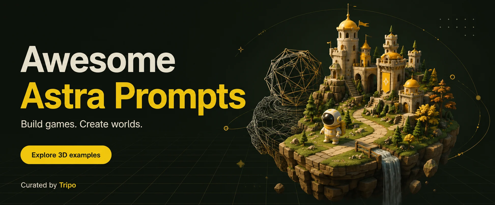</a>

**次のゲーム、シーン、インタラクティブな世界づくりのヒントに。**


**361 · 最新の Astra プロンプト**

## 注目の作品

<table>
<tr>
<td width="50%" valign="top"><a href="https://www.tripo3d.ai/ja/3d-prompts/golden-miner">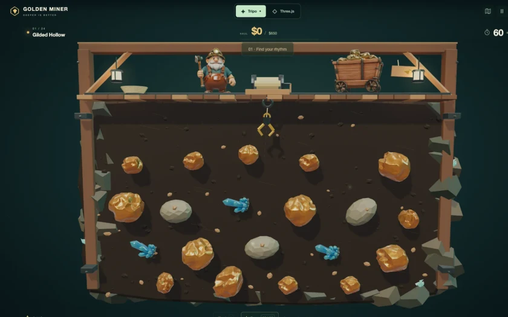</a><br><strong><a href="#golden-miner">Golden Miner：全24レベルの3D採掘ゲーム</a></strong><br><sub><a href="https://x.com/jaredliu_bravo">jared</a></sub><br><a href="#golden-miner">プロンプト →</a></td>
<td width="50%" valign="top"><a href="https://www.tripo3d.ai/ja/3d-prompts/crazy-tanks-3d-island-artillery">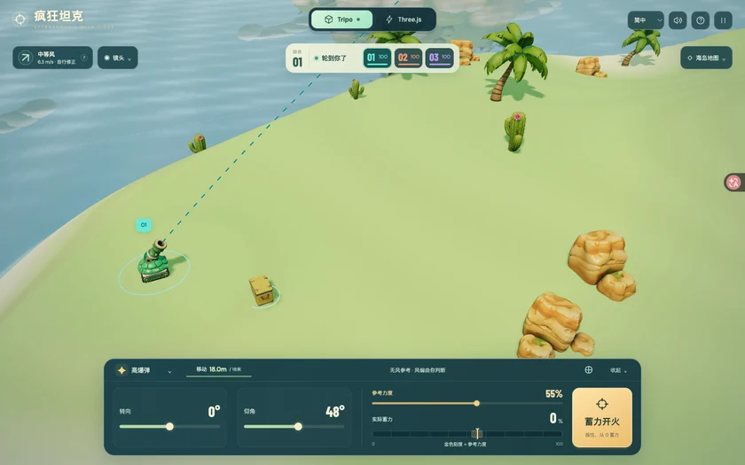</a><br><strong><a href="#crazy-tanks-3d-island-artillery">Crazy Tanks — 3Dアイランド砲撃戦</a></strong><br><sub><a href="https://x.com/jaredliu_bravo">jared</a></sub><br><a href="#crazy-tanks-3d-island-artillery">プロンプト →</a></td>
</tr>
<tr>
<td width="50%" valign="top"><a href="https://www.tripo3d.ai/ja/3d-prompts/battle-city-3d">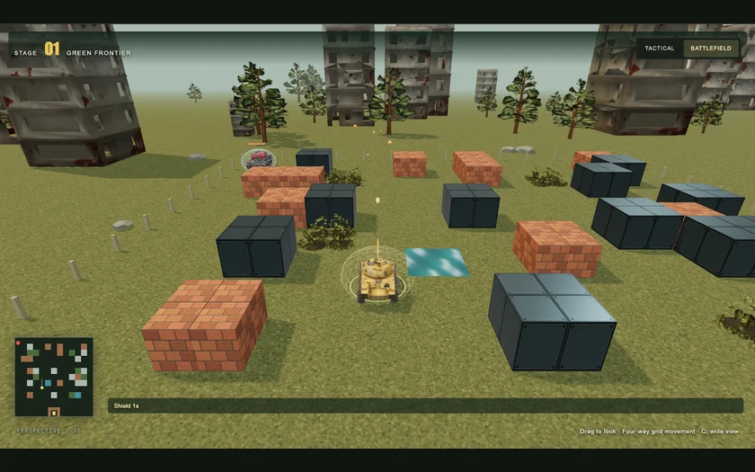</a><br><strong><a href="#battle-city-3d">Battle City 3D：エンドレス戦車ディフェンス</a></strong><br><sub><a href="https://x.com/jaredliu_bravo">jared</a></sub><br><a href="#battle-city-3d">プロンプト →</a></td>
<td width="50%" valign="top"><a href="https://www.tripo3d.ai/ja/3d-prompts/titanic-the-last-light">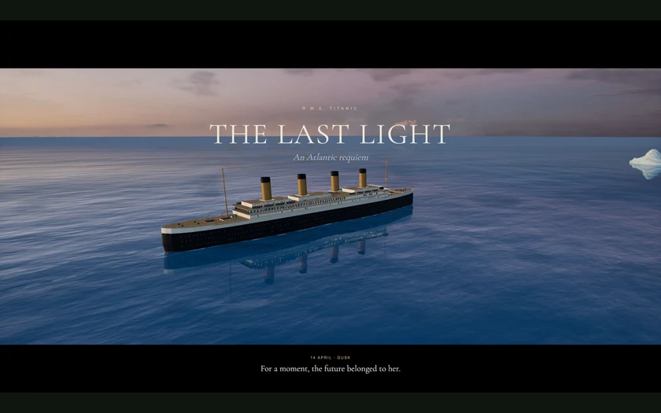</a><br><strong><a href="https://www.tripo3d.ai/ja/3d-prompts/titanic-the-last-light">TITANIC — 最後の光</a></strong><br><sub><a href="https://x.com/jaredliu_bravo">jared</a></sub><br><a href="https://www.tripo3d.ai/ja/3d-prompts/titanic-the-last-light">プロンプト →</a></td>
</tr>
</table>

<a id="all-prompts"></a>

## 最新の Astra プロンプト

<details>
<summary>作例を見る</summary>

- [外洋を進む帆船](#2101616345720787130)
- [Three.jsでWALL-Eの3Dモデルを作成](#2101687900723106104)
- [Verdant — インタラクティブな3D恐竜アイランド](#2101730386711634251)
- [インタラクティブな3D太陽モデルのウェブサイト](#2102038136725377200)
- [Spline Rush：プロシージャル生成ブラウザーレーシングゲーム](#2102150615635816866)
- [インタラクティブな3Dヘリコプター設計プレゼンテーション](#2102215638311694336)
- [東京タワーの昼夜3Dシーンと動画](#2102276620124062065)
- [バブルベイ：3D水風船バトル](#2102300855387205871)
- [Sir, We Have Orc Problems風のTDゲーム](#2102411087002112256)
- [内装付きの郊外の2階建て住宅](#2102473710724919614)
- [1つのHTMLファイルで動く3Dカートレーサー](#2102652927177617564)
- [中世の城のブラウザアニメーション](#2102672926285713456)
- [Orbit Lab：太陽・地球・月の3Dシミュレーション](#2102752217375899659)
- [ブラウザで操作できる中世ヨーロッパ風3D城](#2102780850706567390)
- [チェスのガンビットを学ぶインタラクティブ3D盤](#2102788013902213508)
- [無限に広がるソーラーパンク都市のシェーダー](#2102826333550133520)
- [一人称バーガーシミュレーター](#2102897258983313712)
- [超リアルな砂漠の焚き火HTMLシーン](#2102915300295369208)
- [Three.jsで作るボクセル版Codex](#2102956340482289944)
- [インタラクティブな3Dグミの柑橘スライス](#2103062348168618280)
- [Northbound：ヴァイキングのロングシップで巡るインタラクティブな旅](#2103187935759655167)
- [霧に包まれた秋の探索型Three.js体験](#2103211135214256350)
- [STILLWATER — 月明かりの沼を巡るブラウザ体験](#2103308083242082314)
- [ゴールデンアワーのローマ戦場セットピース](#2103351755971207251)
- [ピタヤゼリー](#2103432732386664591)
- [VRChat用衣装の3Dモデリング](#2103456264785424530)
- [Blenderでモルモットを作成](#2103482826519986544)
- [Three.jsで作るボクセル風の日本庭園](#2103486103831339269)
- [ボクセルのボトルシップ WebGLシーン](#2103855977376125161)
- [森に囲まれた湖畔の村の環境](#2103860776419111285)
- [BlenderでSuper Heavyブースターをキャッチするシーン](#2103966922127630820)
- [インタラクティブな3Dカメラレンズの光路デモ](#2104077535315144878)
- [インタラクティブな3Dゼリー状スイカスライス](#2104504957173153951)
- [原神風ゲームと地形編集ツール](#2104531704740512143)
- [強度試験用3Dプリント対応Jフック](#2104590493191479337)
- [インタラクティブなCRISPR教育用3D表現](#2104605522640970208)
- [月明かりのジャングルを進むインタラクティブなボートライド](#2104613125093998674)
- [X線・分解表示に対応した変形スポーツカー](#2104654448878387313)
- [高精細な3Dの人間の目](#2104841727496323479)
- [時間を、ほどく。](#2105009377002299711)
- [リアルなF-22ラプターモデルとGodot飛行動画](#2105027152617918852)
- [映画的でフォトリアルなロケット打ち上げシーン](#2105047166733746209)
- [Blenderで描くゴールデン・ゲート・ブリッジ](#2105278999861526953)
- [Blenderで3Dミニオンキャラクターを作成](#2105298955307303100)
- [Isaac Simでシーンを再現](#2105323534398763307)
- [金色のミニチュア3Dピラミッド・ジオラマ](#2105412081692352654)
- [3D隕石回避ゲーム](#2105644436659290409)
- [山あいの川を進む操作可能な3Dボートシーン](#2106385060106777043)
- [ブラウザで歩いて見て回れる家の3D空間](#2106737391948235164)
- [架空のゲームのシネマティックトレーラーを作成](#2106824464092770455)
- [夜の小島で星のかけらを10個集める3Dゲーム](#2106944804756275690)
- [ぬいぐるみのクモ — マテリアル研究 No. 015](#2107127712871505976)
- [バナナ・ジェリー](#2107186979502776590)
- [Wild Atlas インタラクティブ野生動物百科](#2107479802152472717)
- [ぬいぐるみのイカ。](#2107533363808485534)
- [Villa Jelly](#2107617244301664483)
- [『見えない都市』のThree.jsビジュアライゼーション](#2107824019999535226)
- [Lealand Teaのスクロール連動型3Dウェブサイト](#2107872378218779067)
- [Atoll Jelly インタラクティブ WebGPU ラグーン・ジオラマ](#2107977531726934288)
- [ドラッグで押しつぶせる物理演算を備えたインタラクティブなThree.jsゼリーラボ](#2108096737537929361)
- [自転車に乗るペリカンの3Dボクセルワールド](#2108203260058259830)
- [Pirate Jelly インタラクティブ WebGPU ジオラマ](#2108336208891801999)
- [シネマティックな3D ORBITスマートウォッチのプロダクトリビール](#2108438685184401904)
- [インタラクティブな教育用3Dジェットエンジン](#2108459952683811167)
- [AH-64E アパッチ・ガーディアンの詳細な3Dビジュアルプレゼンテーション](#2108475056082850278)
- [インタラクティブなハニーキーボード](#2108501256067285443)
- [インタラクティブな3Dグミダイス体験](#2108505251036774875)
- [インタラクティブな浮遊ネオン島](#2108574047948656981)
- [Castle Jelly インタラクティブWebGPUジオラマ](#2108649845405929924)
- [ガウシアンスプラット向けPhotoshop](#2108711089827647965)
- [クローム球体上のインタラクティブな3Dクロスシミュレーション](#2108912938656407888)
- [Three.jsで作るマリオのキャラクター](#2108976915449012592)
- [インタラクティブなリアル系3D高速道路シーン](#2108981890493358527)
- [Tidepool Jelly：インタラクティブな3D沿岸生態系](#2109015574177075610)
- [Three.jsとWebGPUで作る幻想的な3Dビジュアル](#2109060292667982172)
- [ローポリのオープンワールド・ドライビングサンドボックスゲーム](#2109153428635267345)
- [歩行アニメーション付きゴブリンのBlenderモデル](#2109268147068862675)
- [ぬいぐるみペンギン WebGPU マテリアルスタディ](#2109288662319919127)
- [ぬいぐるみタコのインタラクティブWebGPU体験](#2109323102912156142)
- [満潮の鳥居：インタラクティブな神社ジオラマ](#2110014604524896392)
- [インタラクティブなゼリー製スノードームの村](#2110045415412281495)
- [夕暮れの岩だらけの崖に立つ古い石造りの灯台](#2110054195734982817)
- [3Dフラッピーバード風トロピカルゲーム](#2110069699597971828)
- [ロレックスに着想を得た腕時計の分解図](#2110070382002921482)
- [歩行アニメーション付きオーガのBlenderモデル](#2110139804805693469)
- [インタラクティブな3Dゲーミングマウス解説](#2110371046071382042)
- [銀河系を進む太陽系の3Dスクリュー軌道シミュレーション](#2110380365269639613)
- [インタラクティブな3D錦鯉池のウェブサイト](#2111817735181332826)
- [three.jsで作るスチームパンクな時計塔の夜景](#2112137926922686800)
- [ボトルの中の嵐：シネマティックアニメーション](#2112552671890874585)
- [3D高級スケルトンウォッチ](#2112556579153178940)
- [北大西洋の嵐 — リアルな3D海洋・灯台シミュレーション](#2112916773838454922)
- [ゲーム向けわら製訓練用ダミーの3Dモデル](#2113321027325300784)
- [Chalk Square：ピクセルアート風3Dフォースクエアゲーム](#2113602050172785117)
- [浮遊世界：インタラクティブな3D島の楽園](#2113627142772899916)
- [Red Light, Green Light：3Dサバイバルゲーム](#red-light-green-light)
- [Golden Miner：全24レベルの3D採掘ゲーム](#golden-miner)
- [Crazy Tanks — 3Dアイランド砲撃戦](#crazy-tanks-3d-island-artillery)
- [Battle City 3D：エンドレス戦車ディフェンス](#battle-city-3d)
- [ジェリー・ヴィラ](#jelly-villa)

</details>

<a id="2101616345720787130"></a>

### 外洋を進む帆船

[www.aicontenders.dev](https://www.aicontenders.dev/) · 2026-09-20

<a href="https://www.tripo3d.ai/ja/3d-prompts/gpt-6-astra-2101616345720787130">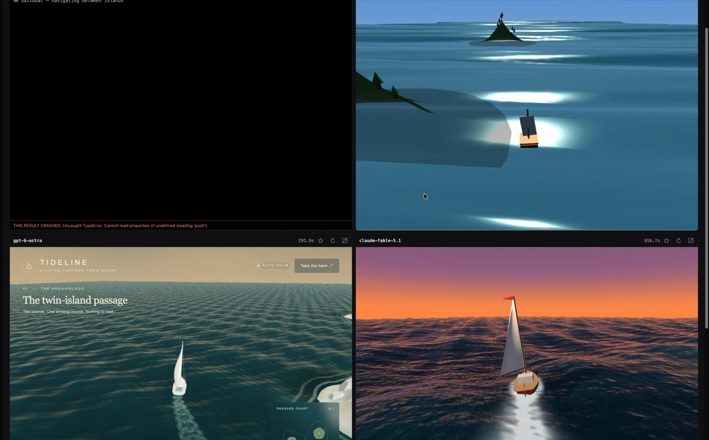</a>

リンク先のAIContenders比較ページに掲載され、他のモデルとともにGPT-6-astraで実行されました。このタスクでは、プロシージャルにアニメーションする水面、2つの島、波に反応するボートの動き、陸地を避ける航路、滑らかな追従カメラを備えた、単一ファイルのインタラクティブな3D帆船シーンが求められます。

**プロンプト**

```text
外洋を進む小さな帆船を描いた3Dシーンを、単一のHTMLファイルで構築してください。2つの見える島を避けて進むコースと、ネイティブな操船操作を実装し、最近のモデルテストで見られた比較用の「ボートゲーム」デモに近いものにします。

機能要件：

水面は、アニメーションする波メッシュ（プロシージャルな水面シェーダー、動く波、見る角度によって変化する光の反射、ボートの後ろに残る航跡）として描画し、平坦で静的なテクスチャにはしないでください。
帆船は単純な形状（船体、マスト、風を受けて膨らむ帆）でモデル化し、水面下の動きと同期して、波に合わせて目に見えて上下に揺れ、わずかに傾くようにしてください。
シーン内の異なる位置に、はっきり区別できる2つの島を配置してください。それぞれに、簡単な地形の起伏（高まり、浜辺、必要に応じて植生）を持たせ、周囲の水面に影が落ちるようにしてください。
ボートは、2つの島を確実に避ける航路（島の輪郭をかすめたり、陸地を横切ったりしない）を進み、角度を瞬時に切り替えるのではなく、滑らかに旋回する必要があります。
カメラはわずかな遅延を伴ってボートを追従し（滑らかなカメラ追従）、真上から固定された視点ではなく、動的に追いかけている印象を与えてください。
空にはグラデーションを付け（夕焼けや昼間の青空など、選択はモデルに任せます）、水面には太陽または光の反射を入れてください。島に落ちる影と光の方向が一致している必要があります。

技術要件：

単一の.htmlファイルとし、cdnjsのthree.jsは使用可能です。その他の外部アセットやテクスチャは使用せず、水面と地形はすべてコードまたはシェーダーでプロシージャルに生成してください。
島を回り込む航路は、あらかじめ計画したパス（島の間を通るベジェ曲線など）でも、位置に応じて反応する単純な操舵でも構いませんが、陸地との衝突は一切禁止です。
アニメーションは少なくとも20秒間、ループまたは連続再生で滑らかに動作し、一般的なノートパソコンで最低30fpsを維持してください。キャンバス解像度はウィンドウサイズを上限とし、負荷の高い高DPI画面に過剰な負荷をかけないよう、devicePixelRatioは1.5以下に制限します。

主な評価基準は、水面が動く流体らしく説得力をもって見えるか（アニメーションするUVオフセットを加えたテクスチャに見えないか）、ボートが実際に波に反応しているか、そして島を避ける航路が偶然のニアミスではなく、意図的な航行として伝わるかです。
```

[詳細を見る ↗](https://www.tripo3d.ai/ja/3d-prompts/gpt-6-astra-2101616345720787130) · [元の投稿](https://www.aicontenders.dev/c/a_TRQpq3LoNVd-M7Xy2DHg) · [作例一覧に戻る](#all-prompts)

---

<a id="2101687900723106104"></a>

### Three.jsでWALL-Eの3Dモデルを作成

[Marcel](https://x.com/marcthecreatorr) · 2026-09-20

<a href="https://www.tripo3d.ai/ja/3d-prompts/gpt-6-astra-2101687900723106104">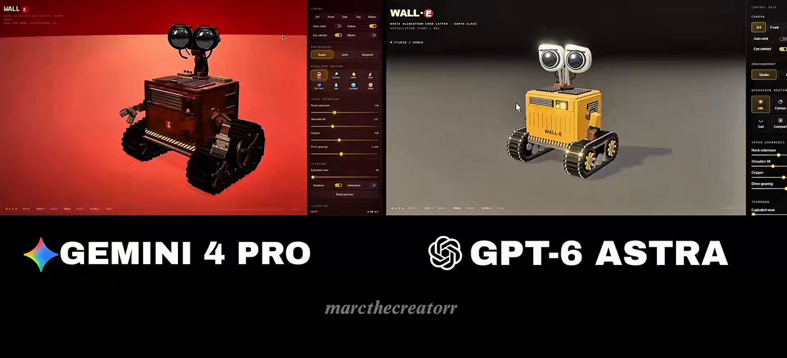</a>

MarcelがAstraに送ったものとまったく同じプロンプト。Three.jsで構築するWALL-Eの3Dモデルをリクエストしています。

**プロンプト**

```text
Three.jsでWALL-Eの3Dモデルを作成してください。
```

[詳細を見る ↗](https://www.tripo3d.ai/ja/3d-prompts/gpt-6-astra-2101687900723106104) · [元の投稿](https://x.com/marcthecreatorr/status/2101687900723106104) · [作例一覧に戻る](#all-prompts)

---

<a id="2101730386711634251"></a>

### Verdant — インタラクティブな3D恐竜アイランド

[vib3coded](https://x.com/vib3coded) · 2026-09-20

<a href="https://www.tripo3d.ai/ja/3d-prompts/interactive-3d-dinosaur-island-diorama">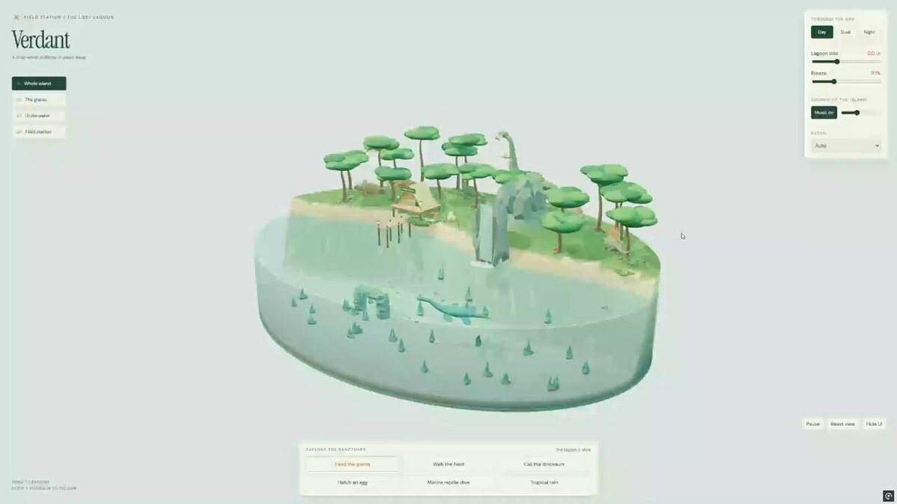</a>

@vib3codedによるVerdantの作者原文リクエスト。Three.jsとWebGLで構築する、インタラクティブな3D恐竜アイランドのジオラマです。恐竜たちが歩き回る島、滝、海生爬虫類が泳ぐ断面表示のラグーン、水中カメラの動き、動物への餌やりと卵の孵化、環境設定、雨、音楽を盛り込み、ブラウザですぐ動く単一のHTMLファイルとして納品する内容が指定されています。

**プロンプト**

```text
Verdant — Three.js + WebGLで構築するインタラクティブな3Dジオラマを作成

恐竜たちが歩き回る緑豊かな島に、滝と、海生爬虫類が泳ぐ断面表示のラグーンを配置します。群れに餌を与え、赤ちゃん恐竜を孵化させ、水中へカメラを移動できます

潮位、風、時間帯を調整したり、リラックスできる音楽を流しながら熱帯の雨を降らせたりできます

すべてブラウザ上で、単一のHTMLファイルとして動作させます
```

[詳細を見る ↗](https://www.tripo3d.ai/ja/3d-prompts/interactive-3d-dinosaur-island-diorama) · [元の投稿](https://x.com/vib3coded/status/2101570806702559235) · [作例一覧に戻る](#all-prompts)

---

<a id="2102038136725377200"></a>

### インタラクティブな3D太陽モデルのウェブサイト

[HIX.AI](https://x.com/HIX_AI_) · 2026-09-21

<a href="https://www.tripo3d.ai/ja/3d-prompts/gpt-6-astra-2102038136725377200">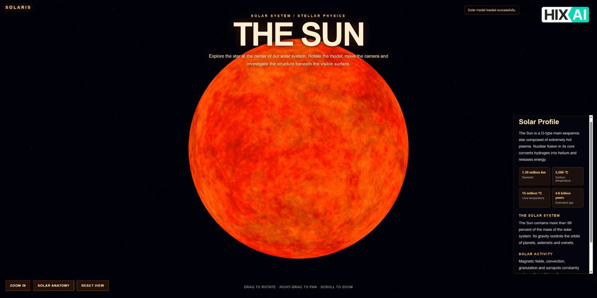</a>

BlenderのPythonスクリプトで制作したリアルな3D太陽を中心に据えた、インタラクティブなThree.jsウェブサイトを作成します。太陽を回転させたり、視点を移動したり、ズームイン・ズームアウトしたりできます。宇宙空間の背景と太陽系に関する情報を備え、太陽の層をラベルと説明付きで確認できるインタラクティブな内部構造ビューも搭載します。

**プロンプト**

```text
Three.jsを使用して、インタラクティブな3D太陽モデルのウェブサイトを制作したいです。

まず、Blenderで直接実行できるPythonスクリプトを作成し、非常にリアルな3D太陽モデルを生成してください。モデルは、球形の形状、表面テクスチャ、色、プラズマのような外観、太陽粒状斑、輝く大気など、太陽の実際の物理的・視覚的な特徴に基づくものにしてください。単純なオレンジ色の球体に見えないようにしてください。適切なマテリアル、シェーダー、テクスチャ、ライティング効果を使って、リアルな太陽の外観を表現してください。

次に、Three.jsを使ったウェブサイトの完全なコードを作成してください。太陽はメインのビジュアル領域の約80%を占めるようにしてください。ユーザーが太陽を回転させたり、視点を移動したり、ズームイン・ズームアウトしたりできるようにしてください。シーンにはリアルなライティングと発光エフェクトを取り入れ、太陽を躍動感のある立体的な表現にしてください。

太陽に近づいて表面のディテールを観察できるズームインボタンを追加してください。

太陽に関する解説と、太陽系における役割を紹介する情報コンテンツもウェブサイトに含めてください。背景全体には、リアルな宇宙の銀河・空間環境を使用してください。

さらに、太陽の内部構造をインタラクティブに表示するビューを開くボタンを追加してください。このビューには、核、放射層、対流層、光球、彩層、コロナなど、太陽の主要な層を表示してください。各層には対応するラベルと短い説明文を付けてください。理想的には、図を操作して異なる層を選択し、それぞれの情報を表示できるようにしてください。

現代的な宇宙テーマのUIを採用し、見た目にインパクトがあり、科学的な情報が充実した、完全にインタラクティブなウェブサイトにしてください。
```

[詳細を見る ↗](https://www.tripo3d.ai/ja/3d-prompts/gpt-6-astra-2102038136725377200) · [元の投稿](https://x.com/HIX_AI_/status/2102038474752766239) · [作例一覧に戻る](#all-prompts)

---

<a id="2102150615635816866"></a>

### Spline Rush：プロシージャル生成ブラウザーレーシングゲーム

[Maharajahu🪢](https://x.com/ToolBraidComp) · 2026-09-21

<a href="https://www.tripo3d.ai/ja/3d-prompts/gpt-6-astra-2102150615635816866">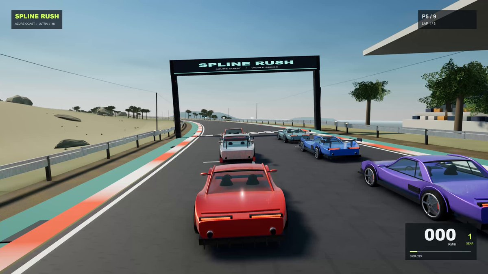</a>

トラック、AI対戦相手、物理演算、グラフィックスプリセット、合成音声を備えたプロシージャル生成のThree.js製ブラウザーレーシングゲーム「Spline Rush」を作成するため、ルート作成者の認証済みコメントに記載されたプロンプトの全文です。

**プロンプト**

```text
最新のThree.js（可能な限りWebGPURenderer + TSL）を使用して、完成度の高いプロダクション品質のブラウザーレーシングゲーム「Spline Rush」を構築してください。100%プロシージャル生成とし、外部のモデル、テクスチャ、音声ファイル、フォントは使用しないでください。すべてを実行時にコードで生成します。

コアゲーム
- 高低差、バンク、トンネル、ヘアピン、名称付きコーナーを備え、異なるバイオーム（海岸の日中、山の夕暮れ、砂漠の日没、雨の森、ネオンが輝く夜の都市、高速オーバル）で構成された、個性の異なる6つのトラック。
- チャンピオンシップモード（予選 + 3レース）、ゴースト付きタイムトライアル、クイックレース。
- 個性、レーシングライン、ブレーキングポイント、追い抜き、ブロックを備えた8台のAI対戦車。
- ベストラップ記録、セクタータイム、ライブイベントフィード、リプレイカメラ。
- ガレージ：クリアコート + メタリックフレーク塗装、パネルの隙間、動作するライト、アニメーションするサスペンション、ダメージ状態を備えたパラメトリックカー5台。

グラフィックス目標（Ultra、4KでRTX 5090にふさわしい品質）
レンダラー：THREE.WebGPURenderer。物理ベースのレンダリングパイプライン。
ライティング：
- レイリー散乱/Mie散乱に基づく物理ベースの空、星空、月、そして完全な昼夜サイクルを駆動する動的な太陽。
- カスケードシャドウマップ（4カスケード、安定したテクセルスナップ、高解像度）。
- 時刻に合わせて更新されるPMREMによるIBL。
- ボリューメトリックフォグ、ゴッドレイ、陽炎。
マテリアル：
- MeshPhysicalMaterial / TSLノード：クリアコート、異方性、ガラスの透過、メタリックフレーク塗装、雨に反応する濡れた路面シェーダー。
ポストプロセスチェーン（RenderPipeline / TSLまたはpostprocessingライブラリ）：
GTAOまたは高品質SSAO → SSR → ブルーム（Karis） → モーションブラー（速度情報） → DOF → ゴッドレイ → 自動露出 → カラーグレーディング + フィルムグレイン + ビネット → SMAAまたはTAA。
エフェクト：
- GPUパーティクルプール：タイヤスモーク、火花、砂ぼこり、雨のしぶき、草や砂利の巻き上げ、熱による歪み。
- 残留して徐々に薄れるスキッドマーク。
- 雨天時に変化する路面の濡れ具合と水たまりの反射。

物理演算と操作感
- 120 Hzの固定ステップシミュレーション。
- レイキャストまたはストラット式サスペンション、荷重移動、コンバインドスリップタイヤ、ABS/TC、路面タイプ（アスファルト、縁石、草地、砂利、ウェット）。
- カメラ：シネマティックなチェイス、フード視点、車載視点。動きと衝突時の揺れに対応。

AUDIO
- 完全に合成するWeb Audio：RPM/負荷に応じた多層エンジン音、風切り音、タイヤのスキール音、縁石の振動音、観客の声、動的な音楽。

品質システム
- プリセット：Low / Medium / High / Ultra。
- UltraはRTX 5090クラスのGPUを想定：4K、高品質シャドウマップ、最大パーティクル数、すべてのポストエフェクトを有効化、積極的なLODなし。
- フレーム時間が目標値を超えた場合にエフェクトを減らせるアダプティブ品質。

まずはプレイ可能な初期バージョン（1トラック、1台の車、基本的なライティング）から始め、その後、指定どおり機能を1つずつ追加・改善してください。すべてを、ローカルで実行できる単一のクリーンなHTML/JS（またはVite）プロジェクトにまとめてください。主要なシステムにはコメントを付けてください。かわいらしい見た目ではなく、高級感のある仕上がりにしてください。
```

[詳細を見る ↗](https://www.tripo3d.ai/ja/3d-prompts/gpt-6-astra-2102150615635816866) · [元の投稿](https://x.com/ToolBraidComp/status/2102150671340327384) · [作例一覧に戻る](#all-prompts)

---

<a id="2102215638311694336"></a>

### インタラクティブな3Dヘリコプター設計プレゼンテーション

[Vib3Coded](https://x.com/vib3coded) · 2026-09-22

<a href="https://www.tripo3d.ai/ja/3d-prompts/gpt-6-astra-2102215638311694336">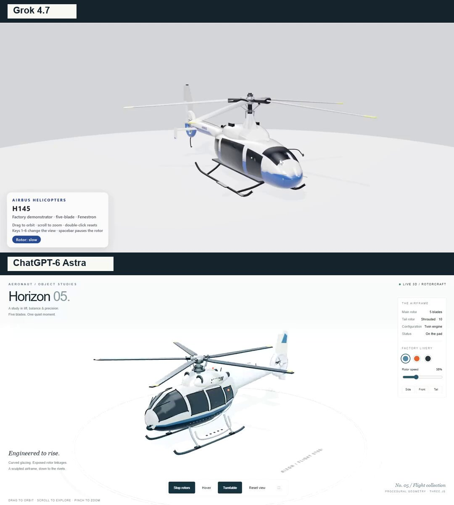</a>

作者は、Grok 4.7とChatGPT-6 Astraの比較記事へのコメントでこのプロンプトを共有しました。プロシージャルなジオメトリ、詳細な航空機能、選択可能な塗装、ローター操作、ホバリング挙動、カメラ操作、レスポンシブなThree.js/WebGLインターフェースを備えた、ブラウザ上で動作するインタラクティブな3Dヘリコプターのプレゼンテーションを求めています。

**プロンプト**

```text
Three.jsとWebGLを使用し、1つのHTMLファイルだけで、現代的なヘリコプターの詳細なインタラクティブ3Dシーンを作成してください。画像ではなく、あらゆる角度から見られる本物の3Dジオメトリを構築します。

ビジュアルスタイル:
明るいグレーのスタジオ背景、円形の展示台、ソフトシャドウ、リアルな反射を備えた、プレミアムな航空デザインのプレゼンテーション。
ヘリコプター:

H145のような軽量双発ヘリコプターを参考にした、滑らかで流線型の胴体。
白い機体に、濃紺の下面と青いアクセントストライプ。
反射を備え、窓枠のシールまで丁寧にフィットした、曲面の着色コックピットウィンドウ。
サイドドア、ハンドル、パネルの継ぎ目、リベット、搭乗ステップ、アンテナ。
エアインテーク、通気グリル、排気口を備えた2基のエンジンハウジング。
詳細なハブ、取り付け金具、ピッチコントロール用リンケージを備えた5枚ブレードのメインローター。
先細りのテールブーム、安定板、そしてハウジングを貫通する本物の開口部を備えたシュラウド付きテールローター。
構造支持部を介して胴体に取り付けられた、曲線状のランディングスキッド。
航法灯と点滅するビーコン。
すべてのコンポーネントは物理的につながっていなければなりません。パーツが宙に浮いたり、セクション間に隙間ができたり、ローターブレードが胴体にめり込んだり、ウィンドウが機体から浮いたりしないようにしてください。

インタラクション:

マウスドラッグでオービット、スクロールでズーム、タッチ操作に対応します。
両方のローターを、段階的に加速・減速しながら始動・停止します。
ローター速度を調整できます。
ホバーモード: 台から滑らかに浮上し、空中で穏やかに揺れ、無効にすると静かに着陸します。
カメラの自動オービット。
正面、側面、尾部のカメラプリセット。
カメラのリセットとフルスクリーン操作。
3種類の塗装: 氷河ブルーとホワイト、レスキューオレンジ、グラファイト。
インターフェース:

左上: 小さな「AERONAUT / OBJECT STUDIES」ラベルと、大きな「Horizon 05.」見出し。
右側: 仕様、ヘリコプターの状態、塗装の選択、ローター速度を表示するコンパクトなパネル。
下部: 操作項目とインタラクションのヒント。
控えめなタイポグラフィ、細いボーダー、ゆとりのある余白。ヘリコプターを遮らないようにしてください。
インターフェース内のすべてのテキストは英語にします。
技術要件:

ダウンロードした既成のヘリコプターモデルを使わず、ジオメトリをプロシージャルに生成します。
PBRマテリアル、スタジオ用の反射環境、ソフトシャドウを使用します。
アニメーションをフレームレートに依存しないようにします。
適切な箇所ではジオメトリとマテリアルを再利用し、パフォーマンス向上のためピクセル比を上限設定します。
デスクトップとモバイルのレイアウトに対応し、初期ビューでローター全体のスパンが見えるようにします。
可能であれば依存関係をHTMLに埋め込み、ファイルをオフラインで動作させます。
WebGLが利用できない場合は、わかりやすいフォールバックメッセージを表示します。
完成前にモデルをあらゆる方向から確認し、すべての操作をテストして、コンソールエラーがないか確認します。シルエット、構造的な接続部、グレージング、ローター機構を特に注意して確認してください。

説明だけでなく、動作するHTMLファイルを納品してください。
```

[詳細を見る ↗](https://www.tripo3d.ai/ja/3d-prompts/gpt-6-astra-2102215638311694336) · [元の投稿](https://x.com/vib3coded/status/2102217028052377910) · [作例一覧に戻る](#all-prompts)

---

<a id="2102276620124062065"></a>

### 東京タワーの昼夜3Dシーンと動画

[Wafffle](https://x.com/wafffle_dev) · 2026-09-22

<a href="https://www.tripo3d.ai/ja/3d-prompts/gpt-6-astra-2102276620124062065">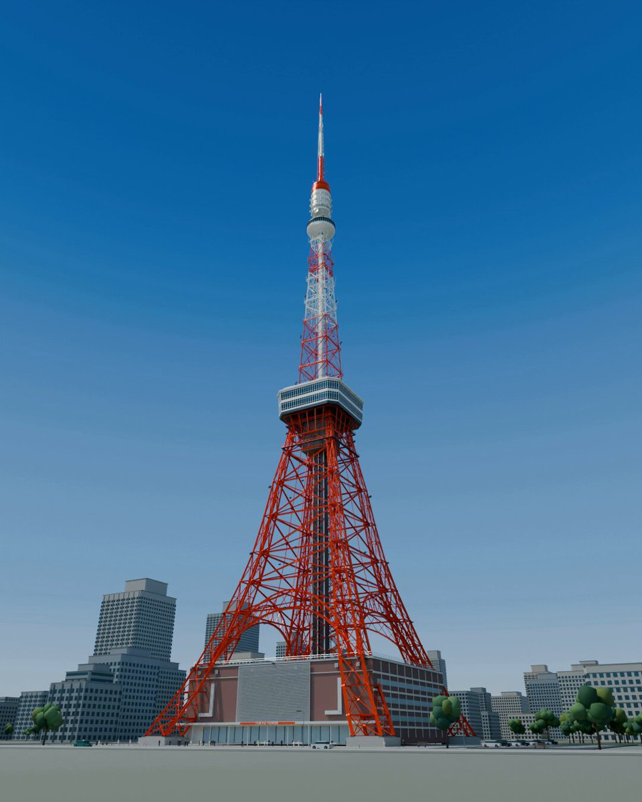</a>

東京タワーの構造的特徴と周辺の雰囲気を調査して反映し、昼夜の見え方を備えた実際の3D形状によるシーンを制作する指示。編集可能なBlenderデータ、約30秒のX投稿用MP4、確認画像、READMEの納品を求めています。投稿者はこれをAstraへの指示プロンプトとして共有しています。

**プロンプト**

```text
東京タワーを主役にした、見応えのある3D作品とX投稿用の約30秒動画を作ってください。

あなたは制作ディレクターです。必要なサブタスクを作成し、調査・制作を依頼してください。依頼内容の具体化、進行管理、成果物の確認、修正指示、最終的な取りまとめまで任せます。

【作ってほしいもの】
地上から見上げた高さと、近づいたときの鉄骨の細かさが伝わる東京タワーです。
昼と夜の両方を用意し、昼は構造や塗装、夜はライトアップの美しさを見せてください。

「東京タワーをよく見て作っている」と感じられる作品にしたいです。塔の形だけでなく、脚の開き方、鉄骨の組み方、展望台、足元の建物など、特徴的な細部を調べて反映してください。周辺の街は、塔の大きさと場所の雰囲気が伝わる範囲に絞って構いません。

【制作の進め方】
・公式資料や写真を調査し、再現する特徴と優先順位を決める。
・その調査を基に、各サブタスクへ具体的な制作指示を出す。
・早い段階で実際の3D試写を確認し、形・構図・明るさを調整する。
・完成画像や動画をメイン自身が見て、違和感や不足を見つけ、修正を依頼する。
・細かな技術選択や撮影構成は自主的に判断して、完成まで進める。

写真や生成画像を貼った背景だけで代用せず、実際の3D形状とカメラ移動で表現してください。確認できた事実と、資料不足による推定部分は記録してください。

【動画】
約30秒。地上からの見上げ、鉄骨や展望台の近接、塔全体が分かる引きを組み合わせ、昼夜の変化も見せてください。
細かな秒割りは、完成したモデルを見て最も魅力が伝わる構成を判断してください。

【納品】
・編集可能なBlenderデータ
・X投稿用MP4動画
・昼夜の全景と細部の確認画像
・短い投稿文案
・素材の出典、再現範囲、検証結果を記したREADME
```

[詳細を見る ↗](https://www.tripo3d.ai/ja/3d-prompts/gpt-6-astra-2102276620124062065) · [元の投稿](https://x.com/wafffle_dev/status/2102276620124062065) · [作例一覧に戻る](#all-prompts)

---

<a id="2102300855387205871"></a>

### バブルベイ：3D水風船バトル

[jared](https://x.com/jaredliu_bravo) · 2026-09-22

<a href="https://www.tripo3d.ai/ja/3d-prompts/bubble-bay">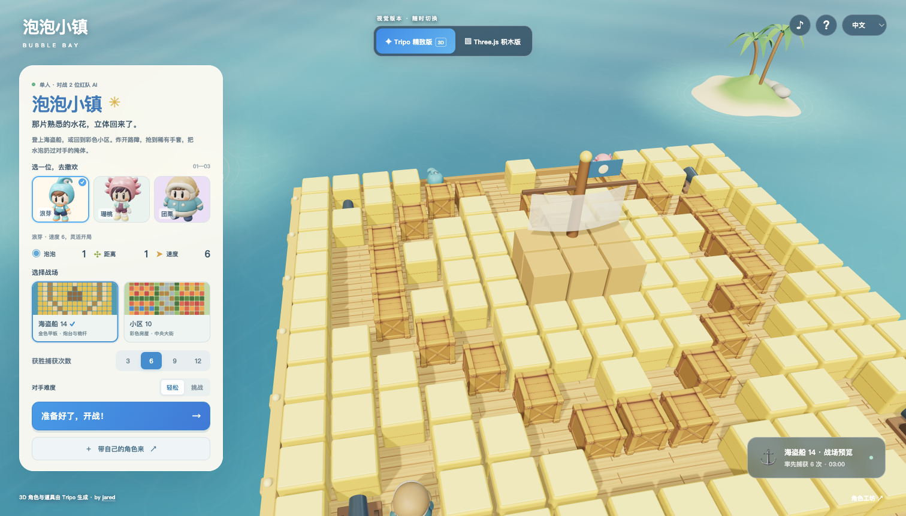</a>

<a href="https://www.tripo3d.ai/ja/3d-prompts/bubble-bay">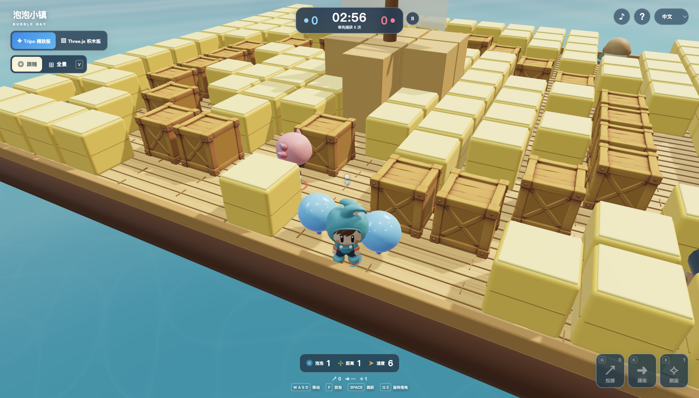</a>

<a href="https://www.tripo3d.ai/ja/3d-prompts/bubble-bay">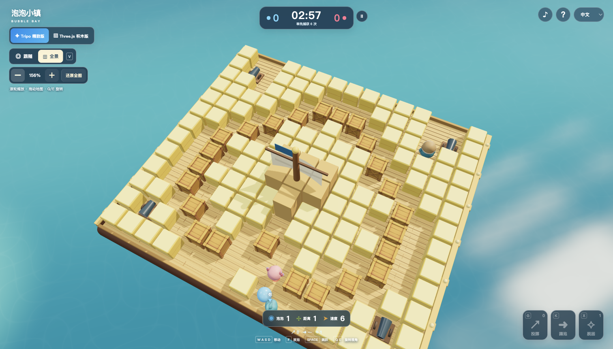</a>

オリジナル衣装キャラクターのLangya、Shantao、Tuanli、アニメーション付きP2モデル、Pirate14とVillage10のアリーナ、近距離追従カメラとズーム可能な俯瞰カメラ、AIライバル、6回捕獲の対戦、カスタムキャラクターのインポート、オリジナルのElevenLabs音楽を備えた3D水風船バトルを構築します。

**プロンプト**

```text
Bubble Bayを、クラシックなバブルゲームでおなじみの、大きな頭と短い体、顔が露出した衣装キャラクターのスタイルを持つ、プレイ可能なThree.js製の水風船アリーナとして構築します。初期状態では詳細なTripoモデルを使用し、対戦内容を維持したまま切り替えられる、Three.jsジオメトリとの比較用スイッチを分かりやすく用意します。新キャラクターとしてLangya、Shantao、Tuanliの3人を使用します。提供された新キャラクターのコンセプト／モデル資料を参照し、シルエット、顔、色、衣装を維持してください。

Langyaは、横向きにつながった波形のトサカが1つ付いたターコイズ色のフード、オレンジ色の襟と袖口、ネイビーのショートパンツ、オレンジ色のソールが付いたターコイズ色の靴を身に着けた、活発な人間の男の子です。Shantaoは、暗いプラム色のボブヘア、両側に短い花びら飾りが3つずつ付いたピーチピンクのボンネット、ミント色のジャケット、プラム色のショートオーバーオール、淡い黄色のブーツを身に着けた、小柄な人間の女の子です。Tuanliは、幅広い洋ナシ型の体つき、クリーム色の顔周りの縁取りが付いたキャラメル色の丸いクッション帽、ティール色のショートジャケット、クリーム色の下腹部、ネイビーのブーツを持つ、ふっくらした人間の男の子です。3人とも、温かみのある肌色の子どもの顔に、シンプルな暗色の楕円形の目と小さな笑顔を備えます。新しくデザインした衣装を着た子どもたちであり、文字どおりの水生生物にしたり、以前の見覚えのあるキャラクター衣装を再利用したりしないでください。各キャラクターはTripo CLIを通じて個別に生成し、tripo-p2を明示するとともに、独立した正面画像と背面画像を使用します。その後、正しい二足歩行スケルトンとスキンをバインドします。待機、走行、ジャンプでは実際のジョイントを動かし、動作を確認して、頭部装備、靴、体のウェイトを修正し、出典情報を正確に保ってください。モーションをローカルで作成した場合は、その旨を明記します。

ローカライズ名：浪芽 / 랑야 / Langya、珊桃 / 산타오 / Shantao、团栗 / 퇀리 / Tuanli。開始時の容量／射程／速度レベル：1/1/6、1/2/5、2/1/4。上限：6/7/9、6/7/8、9/8/8。速度は0.25 + level*0.8ワールド単位／秒に変換し、タイルは2単位とします。キャラクターを選ぶと、残りの2人を異なるライバルとして割り当て、対応するプロフィールを使用します。ふっくらした見た目のシルエットにかかわらず、ゲームプレイ上の当たり判定半径は同一に保ちます。

デフォルトで15x13のPirate/Patrit14とVillage10を用意します。金色のデッキ、黄色い貨物、木箱4個、4門の大砲、中央のマストを見分けられる形で維持してください。村には、4色の住宅地区、中央道路、生け垣、積み木を配置します。パブリッシャーのマップを参考にしつつ、実行時のアートワークは自分で構築し、3D移動とAIの逃走を継続できるように必要な小さな通路の開口部を記録します。明るいマテリアル、影、海の風景、明確なカメラ追従と俯瞰表示を提供します。

1人のプレイヤーが、協力して行動する2体のAIライバルと対戦します。WASD／矢印キーで移動、Fで2.5秒間持続するバブルを設置、Spaceで実際の足場にジャンプ、Shiftでダッシュ、Q/Eで旋回、Vで視点変更、Escapeでポーズします。十字型に広がる水は障害物に沿って進み、最初のソフトブロックを破壊してバブルを連鎖させます。閉じ込め、脱出、敵の捕獲、リスポーン、捕獲数3・6・9・12（初期値6）の選択、または180秒間のスコア制、結果表示とリトライを実装します。タッチジョイスティックとアクションボタンは同時に機能させます。

Tripoで生成したピックアップアイテムを6種類使用します：風船、射程ポーション、ローラースケート、投てきグローブ、キックブーツ、救助ニードル。木箱からは85%の確率でアイテムが出現します。条件付きアイテム出現率は30/30/30/2.5/3.5/4%です。グローブで投げられる回数を3回追加し、上限は6回とします。Gで近くのバブルを遮蔽物越しに最大4タイル先まで投げ、所有者と元の導火時間を維持し、着地点を予約して軌道を表示します。飛行中に導火時間が切れたバブルは、その場に着地して爆発します。Kでバブルを、導火時間をリセットせず、障害物に当たるまで滑らせます。Xで救助ニードルを使い、初期値は1本、上限は3本とします。インベントリと使用可能な操作を明確に表示します。

中国語、英語、韓国語のUIを用意します：中国本土のIANAタイムゾーンでは中国語、韓国／北朝鮮では韓国語、それ以外（香港、マカオ、台湾を含む）では英語を選択します。手動選択は常に優先します。埋め込みテクスチャを使用した、標準の非圧縮形式で、実際にスキニングされたGLBのみを、40 MB以下かつ15万トライアングル以下でアップロードできるようにします。ボーン、ジョイント、ウェイトを検証し、静的モデルは拒否します。存在する場合は埋め込みアニメーションを使用し、クリップがなくても認識済みのヒューマノイドには基本的なジョイント動作を提供します。認識できないスケルトンにはアニメーションが必要です。リギングとアニメーションの違いを平易に説明し、90度の向き調整を用意します。処理はブラウザ内でローカルに行い、ファイルハッシュに基づいて安定したバランスの取れたステータスを割り当てます。

作成CTAには正確にhttps://studio.tripo3d.ai/?utm_source=satellite_invite&utm_medium=bubble-bay&utm_campaign=create-characterを使用します。jaredのクレジットとしてhttps://x.com/jaredliu_bravoにリンクします。

ElevenLabsの効果音を13種類統合し、正規化、短い減衰、距離／パン、同時発音数の制限、音量調整、ミュートに対応します。効果音は、設置、破裂、木箱、ピックアップ、レアアイテム、投てき、着地、トラップ、救助、ジャンプ、勝利、敗北、キックです。ElevenLabs music_v2_5でオリジナルのインストゥルメンタルトラックを2曲作成し、それぞれ90秒で、航海をテーマにした海賊マップと明るい近隣エリアに合わせます。-20 LUFSを目標とする控えめな音量に正規化し、ループ境界はクロスフェードします。音楽専用の音量調整を用意し、マップごとに曲を変更し、ポーズ時はフェードし、マスターのミュート設定に従います。元ゲームのサウンドトラックは再現しないでください。

独立したソース、依存関係、テスト、アセットの出典情報は、CMSプラットフォームのアプリ外で管理します。同一オリジンの静的リソースとMITライセンス通知をバンドルします。Ego Liteで、実際のデスクトップおよびタッチ操作、アップロードの各バリエーション、言語、表示切り替えを検証します。既存のCMS Web Page 12に紐付く不変のレビュー版を作成し、レビュー中は既存の公開リリースを維持します。正確なソース情報とアセット権利の確認が済んだ場合のみ公開し、その後、公開URL、モデルハッシュ、動作を検証します。履歴を保持し、保存済みCMSレコード、プレビュー、公開リリースを区別します。

モデルアセットは進捗を表示しながら読み込み、同時ダウンロード数は最大3、アイドルタイムアウトは30秒、試行回数は2回とします。リトライ時には、正常にダウンロードできたものを保持します。すべてのモデルの準備が完了するまでTripo／Three.jsタブ切り替え全体を非表示にし、完了後に表示します。手続き的に読み込んだプレースホルダーを、読み込み済みのTripoモデルとして表示しないでください。


スポーン地点の外側からアリーナ中央を向いて開始する、近距離のパースペクティブ追従カメラを使用します。Q/Eによる旋回、マウスドラッグによるピッチ調整、Vによる俯瞰表示を維持します。コンパクトなスコアボードを上部、モード切り替えを左上、短い通知を下部付近に配置します。マウス操作のデスクトップではジョイスティックと大きなタッチ操作ボタンを非表示にし、小さなレアアイテム操作だけを残します。狭い画面では、複数のタッチ操作を同時に行えるコンパクトなUIに対応します。ティール色の深度変化を持つアニメーション付きの波シェーダー、曲線的なヤシの木と岩がある有機的な砂の小島、控えめな木目と草のテクスチャを追加します。捕獲された各キャラクターを、サイズに応じた半透明のバブルで包み、虹色に光るフレネルリム、穏やかな浮遊、小さな泡、地面の波紋を加えます。ポーズ状態のスキン頂点が適切に収まることを確認し、救助時に浮き上がり量をリセットし、切り替えを繰り返した後のリソース破棄を確認します。水膜には高コストなシーン全体の透過パスを使用せず、狭い画面ではピクセル比を1.5に制限します。


Follow／Overviewカメラ操作とVによる切り替えを画面上に表示します。Overviewでは、＋／−ボタン、マウスホイール、2本指ピンチを使って100〜300%のズームに対応し、マップのドラッグ範囲を制限するとともに、Fit mapでリセットできるようにします。カメラやレンダリング版を切り替えても、ズーム状態と進行中の対戦を維持します。中国語、英語、韓国語で、コンパクトで重ならないレアアイテム操作を用意します。

```

[詳細を見る ↗](https://www.tripo3d.ai/ja/3d-prompts/bubble-bay) · [元の投稿](https://x.com/jaredliu_bravo/status/2102300855387205871) · [デモ](https://bubble-bay.tripo.page/) · [作例一覧に戻る](#all-prompts)

---

<a id="2102411087002112256"></a>

### Sir, We Have Orc Problems風のTDゲーム

[nkz/ぴたすぽ](https://x.com/nikzu_) · 2026-09-22

<a href="https://www.tripo3d.ai/ja/3d-prompts/orc-tower-defense-game">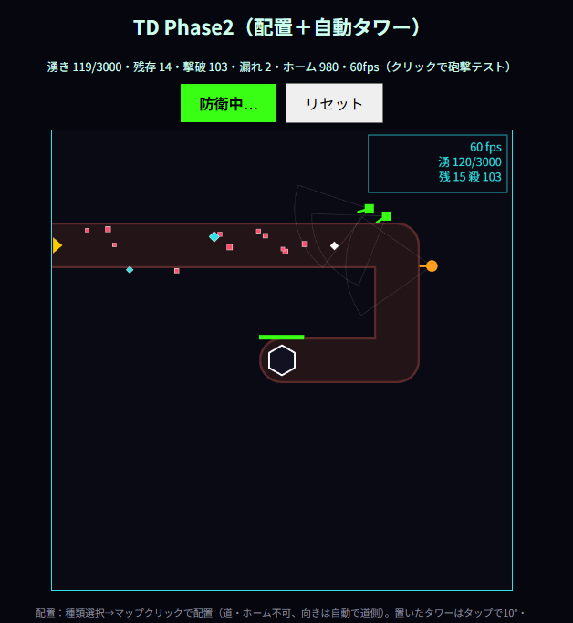</a>

<a href="https://www.tripo3d.ai/ja/3d-prompts/orc-tower-defense-game">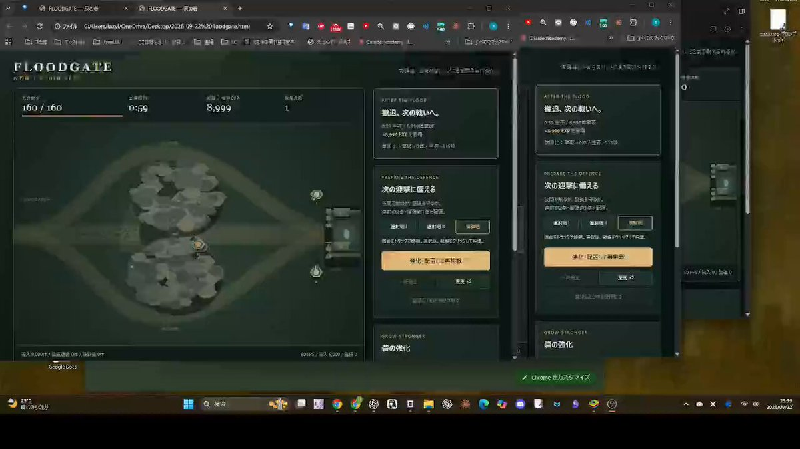</a>

投稿者がAstraに依頼した、Sir, We Have Orc Problemsのようなタワーディフェンスゲームを作るためのプロンプト。

**プロンプト**

```text
Sir, we have orc problemsみたいなTDゲーム作って
```

[詳細を見る ↗](https://www.tripo3d.ai/ja/3d-prompts/orc-tower-defense-game) · [元の投稿](https://x.com/nikzu_/status/2102411087002112256) · [作例一覧に戻る](#all-prompts)

---

<a id="2102473710724919614"></a>

### 内装付きの郊外の2階建て住宅

[Azer](https://x.com/azer0lxm) · 2026-09-22

<a href="https://www.tripo3d.ai/ja/3d-prompts/gpt-6-astra-2102473710724919614">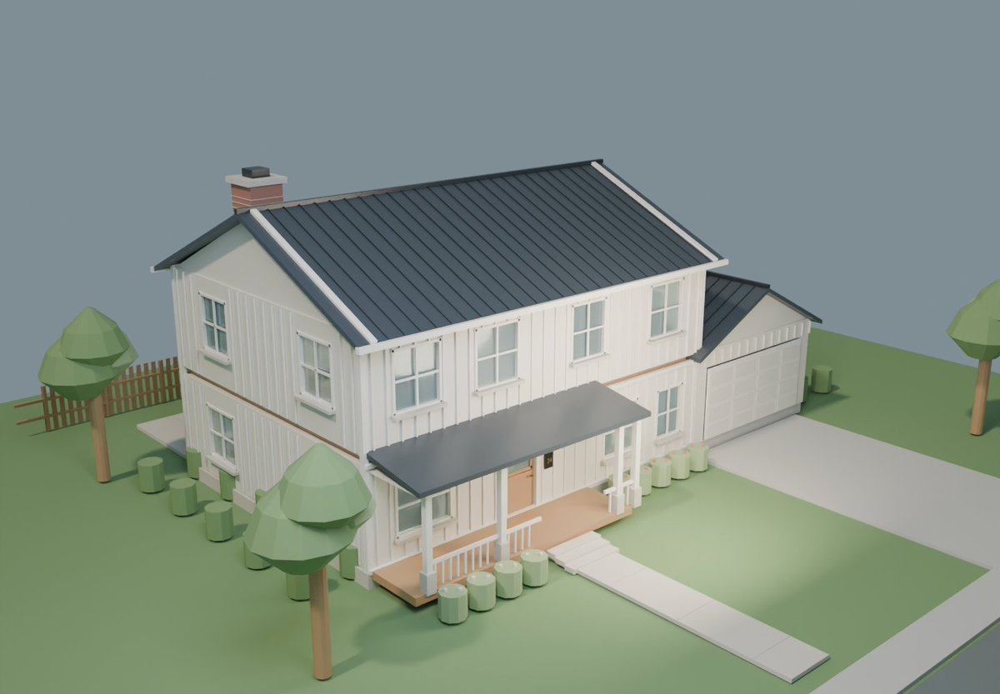</a>

<a href="https://www.tripo3d.ai/ja/3d-prompts/gpt-6-astra-2102473710724919614">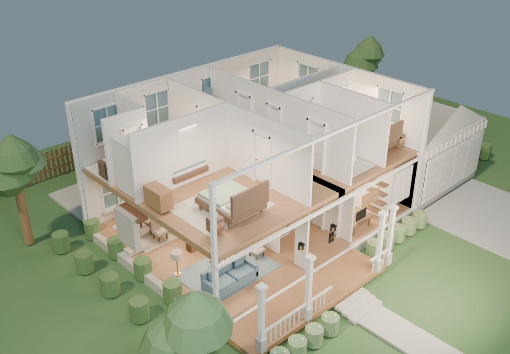</a>

Azerが提示したプロンプトでは、内装を含む郊外の2階建て住宅のBlender用3Dモデルが求められています。

**プロンプト**

```text
こんにちは。Blenderを使って、内装などすべてを含む、できるだけ完成度の高い郊外の2階建て住宅の3Dモデルを制作してください。
```

[詳細を見る ↗](https://www.tripo3d.ai/ja/3d-prompts/gpt-6-astra-2102473710724919614) · [元の投稿](https://x.com/azer0lxm/status/2102473781830909995) · [作例一覧に戻る](#all-prompts)

---

<a id="2102652927177617564"></a>

### 1つのHTMLファイルで動く3Dカートレーサー

[Anshul](https://x.com/realanshull) · 2026-09-23

<a href="https://www.tripo3d.ai/ja/3d-prompts/gpt-6-astra-2102652927177617564">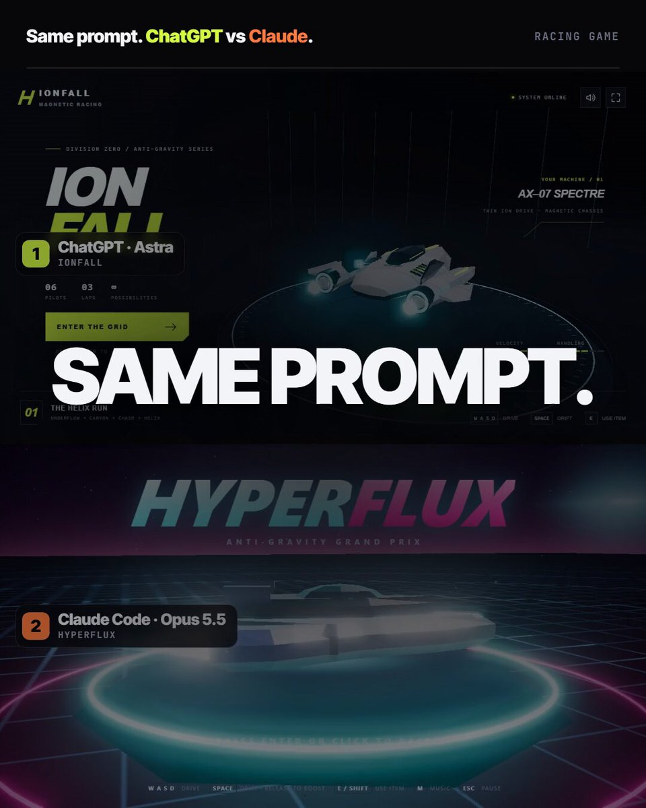</a>

制作者によると、GPT Astra 6とClaude Opus 5.5に同一のまま入力し、3Dカートレースゲームの実装を比較するために使用した再利用可能なプロンプトです。

**プロンプト**

```text
1つのHTMLファイルで動作する3Dカートレーシングゲームを作成してください。
```

[詳細を見る ↗](https://www.tripo3d.ai/ja/3d-prompts/gpt-6-astra-2102652927177617564) · [元の投稿](https://x.com/realanshull/status/2102652927177617564) · [作例一覧に戻る](#all-prompts)

---

<a id="2102672926285713456"></a>

### 中世の城のブラウザアニメーション

[juhapalomaki.fi](https://juhapalomaki.fi/) · 2026-09-23

<a href="https://www.tripo3d.ai/ja/3d-prompts/gpt-6-astra-2102672926285713456">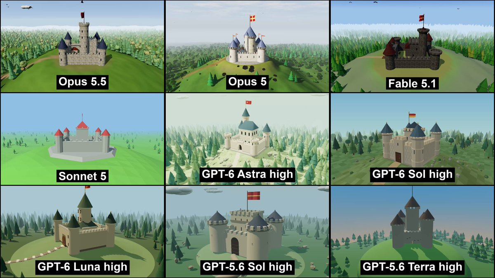</a>

森に覆われた丘の上に建つ中世の城を描いた、ブラウザベースの3Dシーンです。カメラは城の周囲を સતત rotating around the castle, and a tower flag waves in the wind. The linked author post identifies this as the shared one-shot task used for GPT-6 Astra high and other tested models.

**プロンプト**

```text
ブラウザだけで完全に動作する3Dアニメーションを作成してください。広大な森の中にある丘の頂上に建つ中世の城を登場させます。キーボード操作は追加せず、城をあらゆる方向から見られるように、カメラだけが城の周囲を回転するようにしてください。城の塔の頂上には、風になびく旗を設置してください。

実行すると城を表示し、ループアニメーションを開始するindex.htmlファイルを出力してください。
```

[詳細を見る ↗](https://www.tripo3d.ai/ja/3d-prompts/gpt-6-astra-2102672926285713456) · [元の投稿](https://juhapalomaki.fi/blog/castle-model-comparison/) · [作例一覧に戻る](#all-prompts)

---

<a id="2102752217375899659"></a>

### Orbit Lab：太陽・地球・月の3Dシミュレーション

[technewsradio.tokyo](https://technewsradio.tokyo/) · 2026-09-23

<a href="https://www.tripo3d.ai/ja/3d-prompts/gpt-6-astra-2102752217375899659">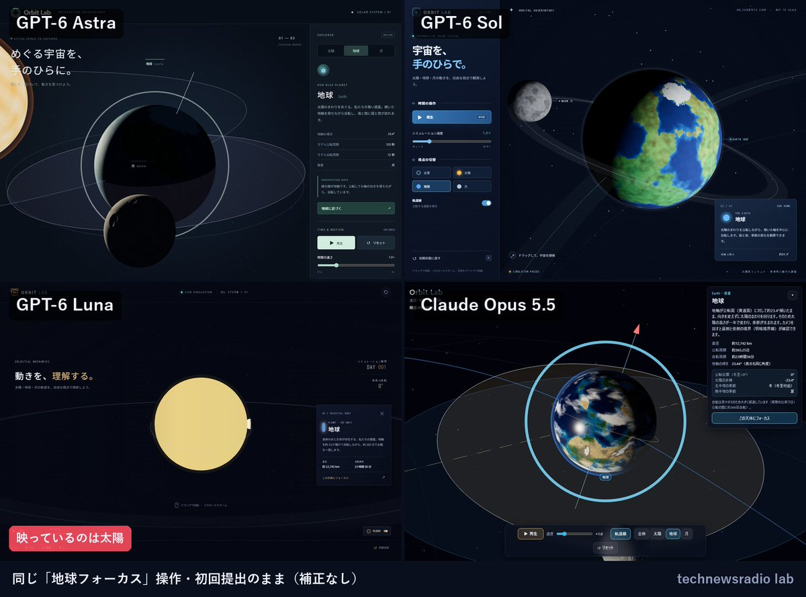</a>

リンク先の記事が、GPT-6 Astra・Sol・Lunaを含む4モデルに共通で投入したと明記する比較用の依頼文です。Three.jsで、手続き的に作る太陽・地球・月、軌道と自転、クリック選択、カメラ操作、再生・速度・フォーカスなどを備えた教育用3DシミュレーションWeb作品を実装します。

**プロンプト**

```text
比較実験です。次の同一仕様のWeb作品を、あなたの作業ディレクトリに実装して完成させてください。名称は「Orbit Lab」。Three.js 0.186.0を使用し、同一バージョンの本体とOrbitControlsを読み込んでください（CDNのimport mapでもnpmでも可）。公開・デプロイは不要です。

要件:
1. 太陽・地球・月の3Dモデルを手続き的なジオメトリとマテリアルで表現。外部画像・3Dアセットは使わない。太陽を点光源とし、地球と月の明暗がカメラ操作で分かること。
2. 地球の公転と自転、地軸の傾き、月の公転をdelta timeで動かす。軌道面の傾きを視覚化し、地球と月の軌道線を表示する。スケールと速度は教育用の誇張でよい。
3. 恒星背景を再現可能な乱数で生成する。OrbitControlsで回転・ズーム。天体をクリックすると選択状態と説明パネルが切り替わる。
4. 再生/停止、速度スライダー、軌道線表示切替、太陽/地球/月へのカメラフォーカス、初期状態に戻すボタンを備える。キーボードでも再生/停止とリセットができる。
5. スマホ幅でも操作できる見た目、WebGL非対応時の案内、リサイズ対応、過剰な描画負荷を避けるピクセル比制限を入れる。
6. READMEに起動手順と操作方法を書く。可能なら実際に起動して動作確認し、できなければ理由を明記する。完了報告には作成ファイル、実装済み項目、確認結果を簡潔に書く。

途中で質問せず、合理的に判断して最後まで実装してください。
```

[詳細を見る ↗](https://www.tripo3d.ai/ja/3d-prompts/gpt-6-astra-2102752217375899659) · [元の投稿](https://technewsradio.tokyo/lab/gpt6-vs-opus55) · [作例一覧に戻る](#all-prompts)

---

<a id="2102780850706567390"></a>

### ブラウザで操作できる中世ヨーロッパ風3D城

[もぎ＠ボードゲーム](https://x.com/luxurytax150) · 2026-09-23

<a href="https://www.tripo3d.ai/ja/3d-prompts/gpt-6-astra-2102780850706567390">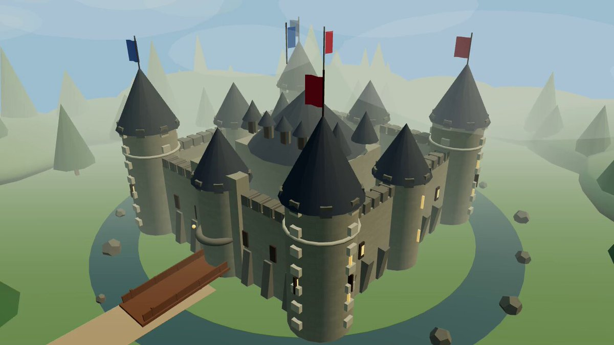</a>

<a href="https://www.tripo3d.ai/ja/3d-prompts/gpt-6-astra-2102780850706567390">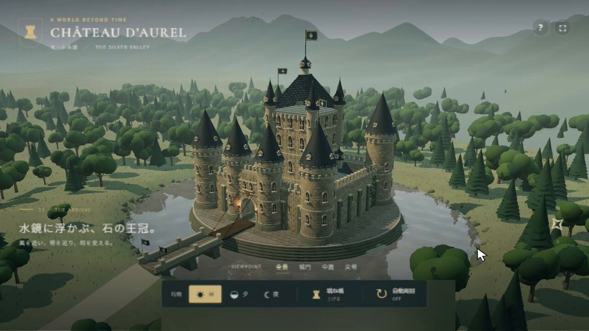</a>

ブラウザで操作できる中世ヨーロッパ風の3D城を制作する。水堀、跳ね橋、塔、石壁、旗、森を備え、昼夜を切り替えられるようにする。3Dモデルの見た目と品質を最大限優先する。

**プロンプト**

```text
ブラウザで操作できる3Dの中世ヨーロッパ風の城を作る。水堀、跳ね橋、塔、石壁、旗、森、昼夜切替を入れる。
これはベンチマークの一種であるから、どこまで見た目を盛れるか、3Dモデルの品質を最大限優先して。
```

[詳細を見る ↗](https://www.tripo3d.ai/ja/3d-prompts/gpt-6-astra-2102780850706567390) · [元の投稿](https://x.com/luxurytax150/status/2102780850706567390) · [作例一覧に戻る](#all-prompts)

---

<a id="2102788013902213508"></a>

### チェスのガンビットを学ぶインタラクティブ3D盤

[Diogo Santos](https://x.com/diogosantosbr) · 2026-09-23

<a href="https://www.tripo3d.ai/ja/3d-prompts/gpt-6-astra-2102788013902213508">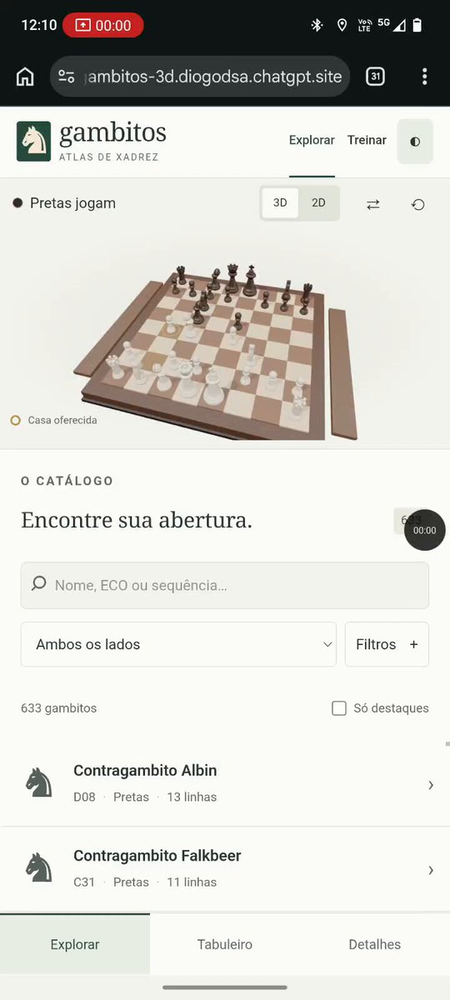</a>

作者が「まずはじめるためのプロンプト」として共有した、ガンビット学習用のインタラクティブな3D盤を備えたWebアプリ向けプロンプト。作者は3D環境を作成し、動画内でベンコー・ギャンビットを探究する様子を紹介したと説明していますが、表示された結果に実際に使われた正確なプロンプトだとは明言していません。

**プロンプト**

```text
主要なチェスのガンビットを学べる、インタラクティブな3D盤を備えたWebアプリを作成してください。指し手のアニメーション、手順を進めたり戻したりする操作、変化手順、それぞれのオープニングの背後にある狙いを解説する機能を含めてください。
```

[詳細を見る ↗](https://www.tripo3d.ai/ja/3d-prompts/gpt-6-astra-2102788013902213508) · [元の投稿](https://x.com/diogosantosbr/status/2102788013902213508) · [作例一覧に戻る](#all-prompts)

---

<a id="2102826333550133520"></a>

### 無限に広がるソーラーパンク都市のシェーダー

[Jonas Fröller](https://x.com/jonasfroeller) · 2026-09-23

<a href="https://www.tripo3d.ai/ja/3d-prompts/gpt-6-astra-2102826333550133520">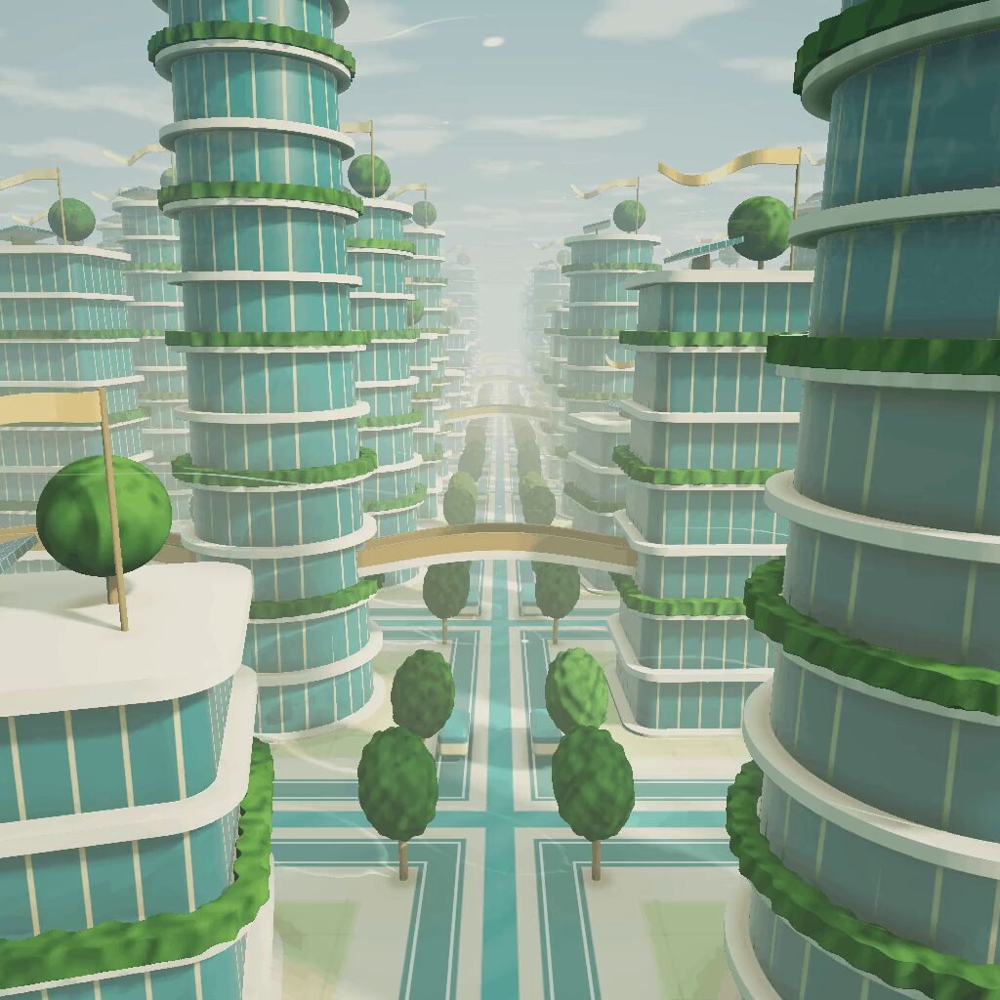</a>

ソーラーパンクの道路とタワーが広がる無限都市を描くシェーダー用プロンプト。そよ風のエフェクトが常に見えるようにし、twigl.appで動作するよう設計されています。

**プロンプト**

```text
twigl.appで実行できる、視覚的に魅力的なシェーダーを作成してください。ソーラーパンクの道路とタワーが広がる無限都市のような表現にし、そよ風が常に見えるようにしてください。
```

[詳細を見る ↗](https://www.tripo3d.ai/ja/3d-prompts/gpt-6-astra-2102826333550133520) · [元の投稿](https://x.com/jonasfroeller/status/2102826333550133520) · [作例一覧に戻る](#all-prompts)

---

<a id="2102897258983313712"></a>

### 一人称バーガーシミュレーター

[noclipepe](https://x.com/noclipepe) · 2026-09-23

<a href="https://www.tripo3d.ai/ja/3d-prompts/first-person-burger-cooking-simulator">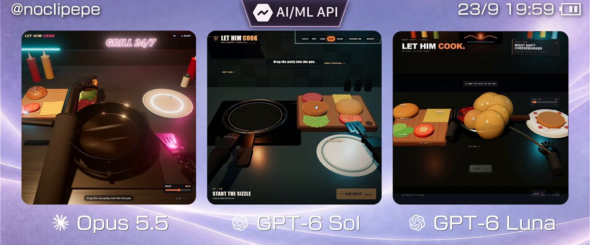</a>

投稿者が、GPT-6 SolとGPT-6 Lunaを含む3つのモデルに、一人称視点のバーガーシミュレーターゲーム用として入力したと説明しているプロンプト。

**プロンプト**

```text
一人称視点のバーガーシミュレーターを作成してください。
```

[詳細を見る ↗](https://www.tripo3d.ai/ja/3d-prompts/first-person-burger-cooking-simulator) · [元の投稿](https://x.com/noclipepe/status/2102897258983313712) · [作例一覧に戻る](#all-prompts)

---

<a id="2102915300295369208"></a>

### 超リアルな砂漠の焚き火HTMLシーン

[Nick Gwood](https://x.com/Nixtrodamis) · 2026-09-24

<a href="https://www.tripo3d.ai/ja/3d-prompts/realistic-desert-campfire-interactive-scene">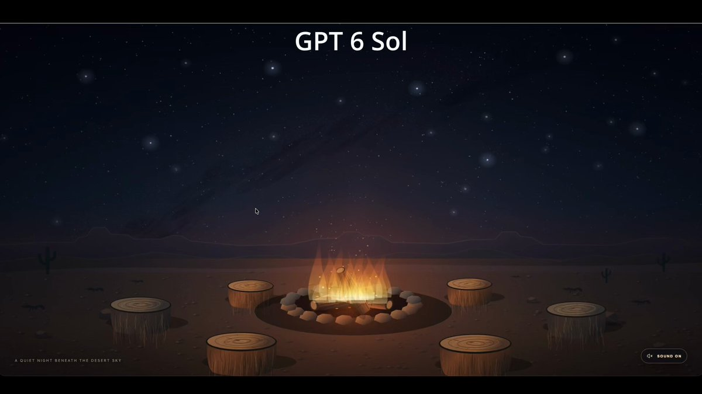</a>

GPT 6 SolとOpus 5.5の評価ハーネスを比較するために投稿されたプロンプトです。夜の砂漠で燃え続ける超リアルな焚き火を中心に、周囲に丸太の切り株の椅子があり、星が見え、ときどき野生動物が姿を現す、シーンに合った高品質なサウンド付きのインタラクティブなHTMLシーンを1つ作成するよう求めています。

**プロンプト**

```text
他のファイルや過去の作品には一切言及しないでください。このタスクは完全にオリジナルである必要があり、ここにある他の作品をもとにした手抜きの再現であってはなりません。

砂漠で燃え続ける焚き火を表現したHTMLファイルを1つ作成してください。夜で、星が見えます。焚き火の周囲には、座席として丸太の切り株が配置されています。画面内に人は登場させないでください。さまざまな野生動物が、ときどき画面内に現れたり画面外へ去ったりします。

音もシーンに合った高品質なものにしてください。
すべてを超リアルにしてください

ファイル名を付けてください（モデルに基づく名前）
```

[詳細を見る ↗](https://www.tripo3d.ai/ja/3d-prompts/realistic-desert-campfire-interactive-scene) · [元の投稿](https://x.com/Nixtrodamis/status/2102915567845794029) · [作例一覧に戻る](#all-prompts)

---

<a id="2102956340482289944"></a>

### Three.jsで作るボクセル版Codex

[Arsh - 16 y/o builder](https://x.com/be_arsh) · 2026-09-24

<a href="https://www.tripo3d.ai/ja/3d-prompts/gpt-6-astra-2102956340482289944">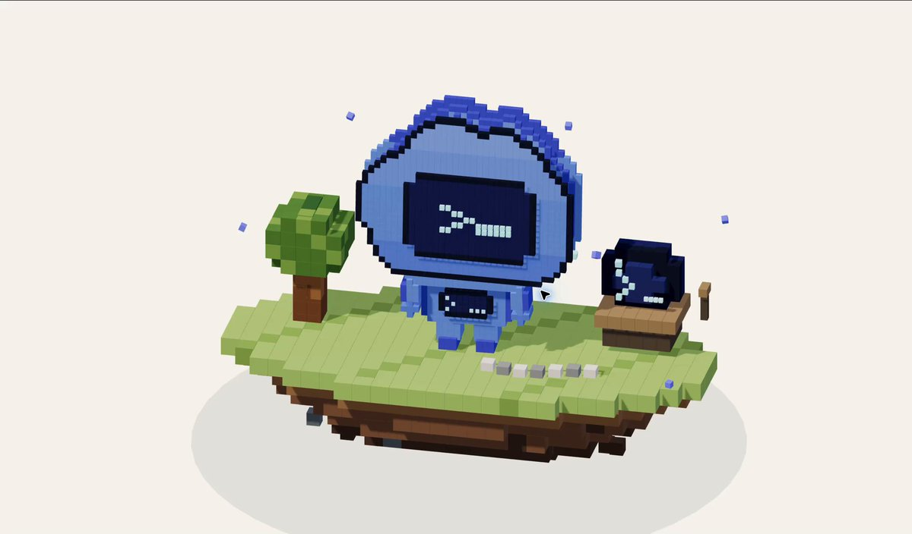</a>

スキルを使わず、CodexをボクセルベースのThree.js表現としてゼロから構築する、再利用可能な作者コメント用プロンプト。

**プロンプト**

```text
CodexをThree.jsでボクセルを使って自作してください。すべてをゼロから作成し、スキルは一切使わないでください。
```

[詳細を見る ↗](https://www.tripo3d.ai/ja/3d-prompts/gpt-6-astra-2102956340482289944) · [元の投稿](https://x.com/be_arsh/status/2102956424120979838) · [作例一覧に戻る](#all-prompts)

---

<a id="2103062348168618280"></a>

### インタラクティブな3Dグミの柑橘スライス

[Vib3Coded](https://x.com/vib3coded) · 2026-09-24

<a href="https://www.tripo3d.ai/ja/3d-prompts/gpt-6-astra-2103062348168618280">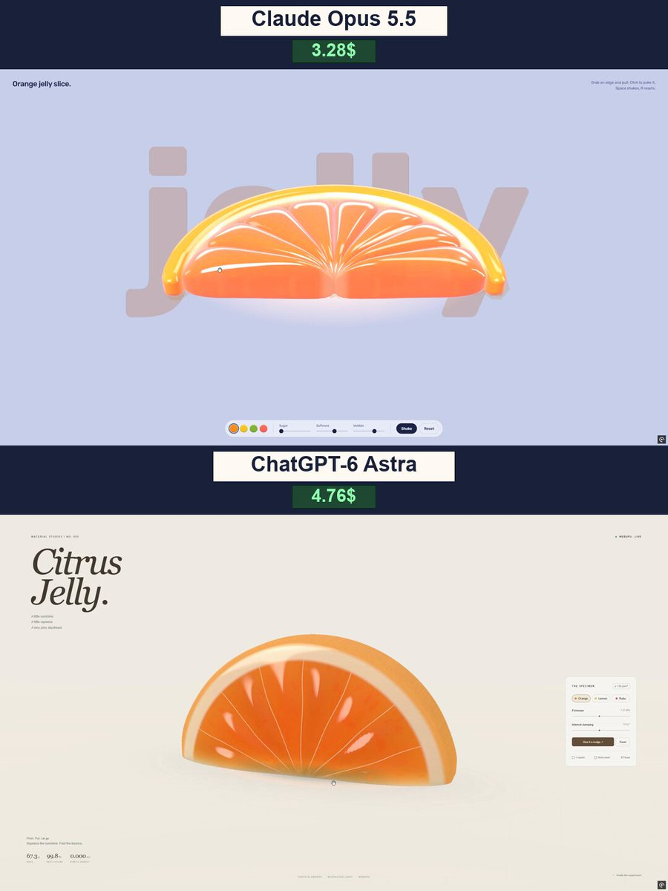</a>

投稿者は、Claude Opus 5.5とChatGPT-6 Astraの比較記事でこのプロンプトを紹介しました。タッチとマウス操作に対応した、変形可能なグミの柑橘スライスによるスタンドアロンのWebGPUソフトボディシミュレーションを求める内容で、プロシージャルなジオメトリ、シェーダーベースのレンダリング、シミュレーション操作を含みます。

**プロンプト**

```text
WebGPUを使って、美しくインタラクティブな3Dグミの柑橘スライスを作成してください。JavaScriptとWGSLシェーダーを埋め込んだ、完全な体験を1つのスタンドアロンHTMLファイルで提供してください。

これは動画、画像、ループアニメーションではなく、リアルタイムの3Dシミュレーションでなければなりません。

APPEARANCE

厚みのある半円形のオレンジスライスを作成し、半透明でみずみずしい果肉、はっきり分かれた8つの房、繊細な内部の薄皮、小さな気泡、淡い白いワタの層、柔らかなオレンジ色の皮を表現してください。

高級感のあるグミキャンディのように見せてください。彩度の高い色、艶やかなハイライト、果肉を通り抜ける光、説得力のある屈折、柔らかな接地影を表現します。過度なブルーム、色あせた色合い、硬いプラスチックのような見た目は避けてください。

暖かみのある明るいスタジオ背景と、余白を十分に取ったクリーンなエディトリアル調のインターフェースを使用してください。大きなイタリック体のセリフフォントで「Citrus Jelly」と表示します。操作パネルはコンパクトにし、スライスが常にはっきり見えるようにしてください。

ソフトボディ物理

最も重要なのは、ゼリーらしい感触です。

- マウスまたは指でスライスのどの部分でもつかめるようにしてください。
- 引っ張る、持ち上げる、伸ばす、ひねる、放すといった操作に対応してください。
- 変形は局所的にしてください。片方の端を引っ張ると、その周辺の果肉が伸び、残りの部分は自然に追従するようにします。
- 放した後はスライスが揺れ、行き過ぎる動きを見せながら、徐々に元の形へ戻るようにしてください。
- 重力、慣性、減衰、地面との衝突、柔らかなバウンドを実装してください。
- 体積をおおむね維持し、メッシュが潰れたり裏返ったりしないようにしてください。
- 皮は果肉より少し硬めにしてください。
- 内部の房、薄皮、気泡は変形に追従し、ボディの外側に浮き出ないようにしてください。

XPBD拘束を用いた四面体メッシュなど、安定した体積ベースのソフトボディソルバーを使用してください。オブジェクト全体を拡大縮小したり回転させたりして、柔らかさを表現するのは避けてください。

CONTROLS

3つのカラープリセット（オレンジ、レモン、ルビー）を用意してください。

以下を追加してください。
- 硬さスライダー
- 内部減衰スライダー
- 「少し揺らす」ボタン
- リセットボタン
- 4分の1速チェックボックス
- メッシュ表示チェックボックス
- 一時停止／再開ボタン

質量、静止時体積に対する割合、運動エネルギーを小さなライブ表示で示してください。

技術要件

WGSLシェーダーによる本物のWebGPUレンダリングを使用してください。インポートしたモデルや画像ファイルは使わず、ジオメトリと視覚的なディテールをすべてプロシージャルに生成してください。

シミュレーションの更新をレンダリングのフレームレートから独立させてください。デスクトップとタッチデバイスに対応します。WebGPUが利用できない場合は、明確なフォールバックメッセージを表示してください。

強くドラッグする操作、繰り返し放す操作、すべてのコントロール、狭い画面での表示をテストしてください。完成したHTMLを納品する前に、不安定な物理挙動、壊れたジオメトリ、視覚的なアーティファクトを修正してください。

小さくて触って遊べる、心から操作を楽しめるキャンディの実験のような仕上がりにしてください。
```

[詳細を見る ↗](https://www.tripo3d.ai/ja/3d-prompts/gpt-6-astra-2103062348168618280) · [元の投稿](https://x.com/vib3coded/status/2103062415533371646) · [作例一覧に戻る](#all-prompts)

---

<a id="2103187935759655167"></a>

### Northbound：ヴァイキングのロングシップで巡るインタラクティブな旅

[Vib3Coded](https://x.com/vib3coded) · 2026-09-24

<a href="https://www.tripo3d.ai/ja/3d-prompts/viking-longship-fjord-threejs-journey">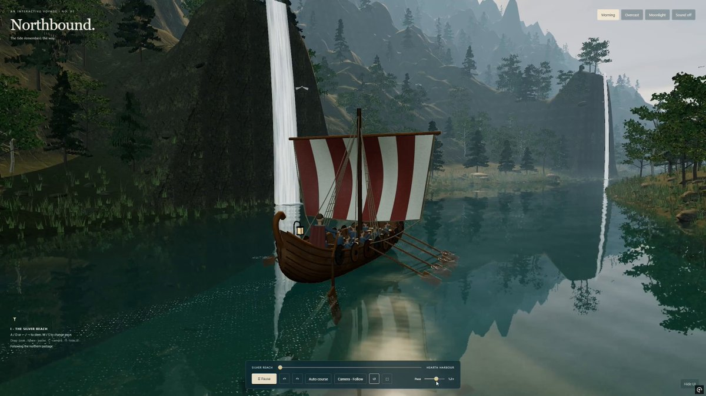</a>

詳細なヴァイキングのロングシップに乗り込み、フィヨルドを航行する、Three.jsとWebGLによるスタンドアロンのインタラクティブ3D体験向けに、作成者が用意したプロンプトです。映画的な北欧の環境、物理的に接続された船体構造、漕ぎ動作と水面接触エフェクト、操舵とカメラ操作、モバイル対応、ライティングモード、音声の挙動、埋め込み形式の配信アセットを指定しています。

**プロンプト**

```text
「Northbound」を制作してください。精巧なヴァイキングのロングシップに乗り込み、北欧のフィヨルドを進む、美しくインタラクティブな3Dの旅です。

Three.jsとWebGLを使った本格的なリアルタイムシーンを構築し、単一のスタンドアロンHTMLファイルとして提供してください。これは探索可能なブラウザ体験であり、プリレンダリング動画や平面イラストではありません。

ビジュアル方針

リアルなマテリアル、自然なプロポーション、抑制の効いた色使いによる、洗練された映画的な環境を目指してください。カートゥーン調やローポリ風の表現は避けてください。

木造のロングシップが、そびえ立つ断崖、深い森、滝、小さな北欧の集落に囲まれた濃い青緑色の水面を進みます。空気遠近法、かすかな霧、柔らかな影、説得力のある奥行きを使ってください。初期カメラ位置からの眺めだけでなく、旅の途中にも美しい景観を構成してください。

ロングシップ

重なり合う木板、目に見える木目、肋材、ベンチ、連続した船内を備えた、精巧で水密な船体を構築してください。
彫刻を施したドラゴンの船首、縞模様の布帆、マスト、ロープ、盾、積み荷、暖かなランタンを追加してください。
厚みのある衣服を着た、プロポーションの整ったヴァイキングの乗客と漕ぎ手を配置し、自然な座り姿勢と、オールの近くに置かれた手を表現してください。
すべてのパーツを物理的に接続してください。浮いて見える乗客、アクセサリー同士の交差、船体越しに見える隙間は禁止です。
わずかな浮力による上下動、ピッチ、ロールをアニメーションさせてください。帆は風に穏やかに反応するようにしてください。

水面と漕ぎ動作

水面をビジュアルの中心的な要素にしてください。

平面反射、屈折、フレネルハイライト、深度に応じた吸収、浅瀬の可視化、レイヤー状の水面の波紋を備えたカスタムシェーダーを使用してください。反射は、移動するカメラと変化するライティングに正しく反応する必要があります。

船の後方に説得力のある航跡を作成してください。

一連の漕ぎ動作を完全にアニメーションさせてください。ブレードが水中に入り、後方へ引かれ、水面から抜け、再び水面上へ戻る動作です。これを漕ぎ手の動きと連動させてください。

実際にブレードが水面に接触する位置で、波紋、泡、小さな水滴を生成してください。軌跡はワールド空間に残り、徐々に消散する必要があります。ブレードが空中にある間にエフェクトが表示されないようにしてください。

環境とマテリアル

詳細な地形、不規則な岩の造形、自然なシルエットの樹木、枝分かれした幹、個々の葉や針葉のクラスターを使用してください。

木材、石、地面には、法線マップとラフネスマップを備えたPBRマテリアルを使用してください。適切なライセンスのテクスチャは埋め込んでも構いませんが、必要に応じてクレジットを記載してください。

水面下の地形が水面の下まで連続するようにしてください。明るい継ぎ目、海岸線の隙間、水面に浮く植生、航行ルートを遮る樹木は禁止です。

CONTROLS

A/Dキーまたは矢印キー：左方向・右方向へ操舵します。
W/Sキー：速度を調整します。
マウスドラッグ：周囲を見回します。
追従、オービット、シネマティックのカメラモードを用意してください。
任意で自動航行モードを追加してください。
一時停止、リセット、フルスクリーン、インターフェース非表示の操作を追加してください。
モバイルでは、タッチによる操舵と速度操作に対応してください。
船が陸地や岩を通り抜けないようにしてください。

雰囲気とインターフェース

「朝」「曇天」「月明かり」の3種類のライティングプリセットを、滑らかに切り替えられるようにしてください。

任意で、水音、風音、鳥の声、漕ぎ音を追加してください。音声はユーザーが操作した後にのみ再生を開始する必要があります。

ミニマルでエディトリアルなインターフェースをデザインしてください。「Northbound.」をエレガントなセリフ体で表示し、控えめな章ラベルとコンパクトな半透明のコントロールバーを配置します。景観を遮らないようにしてください。

パフォーマンスと配信

インスタンシング、適切なジオメトリ予算、距離に応じたディテール調整、適切なサイズの反射用レンダーターゲットを使用してください。固定フレームレートを約束するのではなく、デバイスに応じてレンダリング品質を調整してください。

スクリプトと必要なアセットを埋め込んだHTMLファイル1つで提供し、最新のブラウザで直接開けるようにしてください。

操舵、カメラモード、ライティングの切り替え、漕ぎ動作をテストしてください。複数の角度から船を確認し、低い視点から海岸線もチェックしてください。シーンを完成とみなす前に、ジオメトリの交差、反射のアーティファクト、過度なグレア、コンソールエラーを修正してください。

オブジェクトを増やすことよりも、説得力のある水面、美しく構築されたロングシップ、まとまりのある環境を優先してください。
```

[詳細を見る ↗](https://www.tripo3d.ai/ja/3d-prompts/viking-longship-fjord-threejs-journey) · [元の投稿](https://x.com/vib3coded/status/2103189762672611675) · [作例一覧に戻る](#all-prompts)

---

<a id="2103211135214256350"></a>

### 霧に包まれた秋の探索型Three.js体験

[Simonas](https://x.com/SimonasLTU1) · 2026-09-24

<a href="https://www.tripo3d.ai/ja/3d-prompts/gpt-6-astra-2103211135214256350">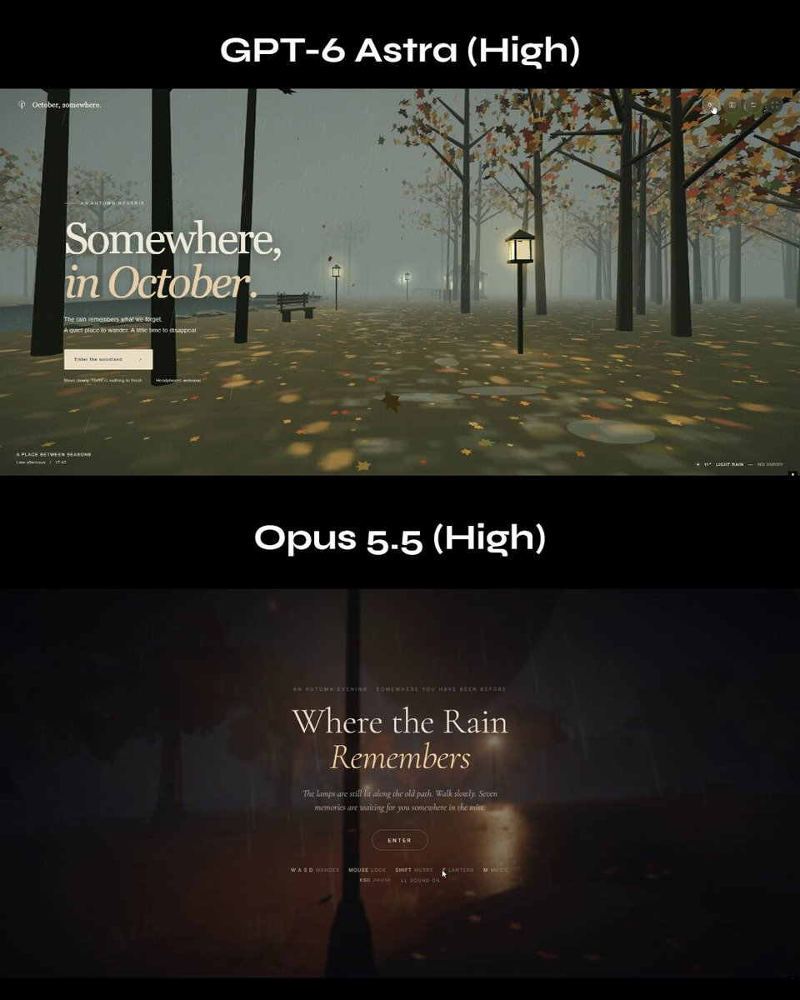</a>

霧と雨に包まれた、秋らしく神秘的でノスタルジックな雰囲気の探索型Three.js体験を、HTML/CSS/JSの単一ファイルで作成します。

**プロンプト**

```text
霧と雨に包まれた、秋らしく神秘的でノスタルジックな雰囲気の探索型Three.js体験を、単一のHTML/CSS/JSファイルで作成してください。
```

[詳細を見る ↗](https://www.tripo3d.ai/ja/3d-prompts/gpt-6-astra-2103211135214256350) · [元の投稿](https://x.com/SimonasLTU1/status/2103211135214256350) · [作例一覧に戻る](#all-prompts)

---

<a id="2103308083242082314"></a>

### STILLWATER — 月明かりの沼を巡るブラウザ体験

[YouWare](https://x.com/YouWareAI) · 2026-09-25

<a href="https://www.tripo3d.ai/ja/3d-prompts/gpt-6-astra-2103308083242082314">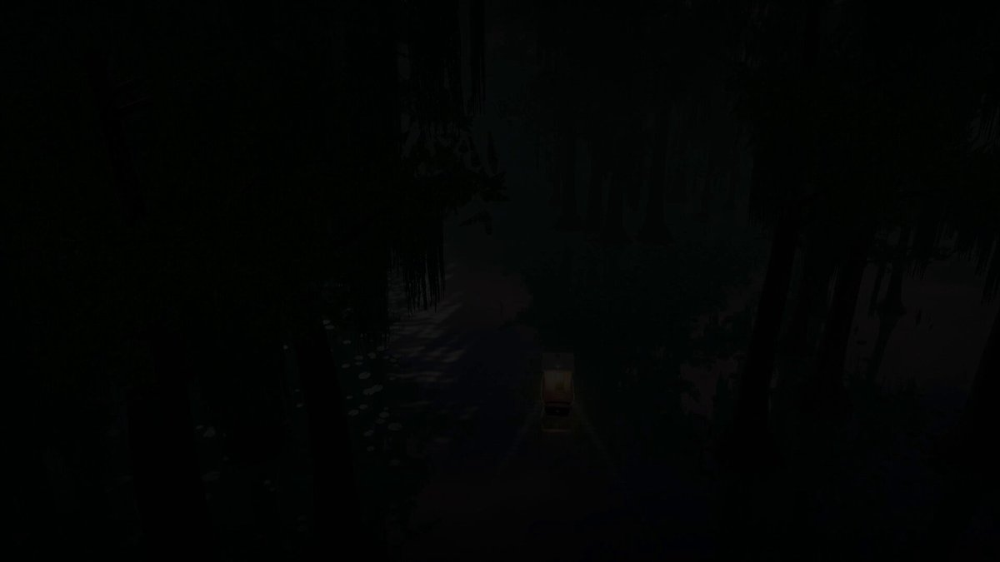</a>

投稿者が返信で提示した、インタラクティブなThree.js製の沼世界向け詳細プロンプト。浸水したラクウショウの森をキャビン付きスキフでゆっくり進むガイドツアー、映画的な水面の反射、空気感のあるライティングとフォグ、ドラッグで視点を動かすカメラ操作、演出的なHUD要素を指定しています。戦闘などのゲームプレイシステムは明確に含めない構成です。

**プロンプト**

```text
STILLWATERという名前のブラウザ体験をThree.jsで構築してください。トーン：迷い込んだまま抜け出せなくなる、月明かりの沼。敵が出てくるゲームではありません。Unrealのフォトリアル表現でもありません。水面の反射を主役にした、静かで高級感のあるウェブワールドです。見る人が不健康なほど長い時間、水面を見つめてしまうようにしてください。

SETTING
- ロケーションタイトル：THE DEEP SWAMP
- HUDに表示する時刻：19:26
- 最初に登場する地名：Heron bend
- 地名の下に表示するタグライン：「野生のために、少しだけ余白を残して。」
- 到着時に表示する発見トースト：「発見：Heron bend」

WORLD
月が昇る頃／夕暮れの終わりの、ラクウショウが水没した沼。
- 黒緑色の水の中に立つ、膝のような根が節くれ立った背の高い木々
- 長く垂れ下がるスパニッシュモス
- 岸沿いに群生するスイレンの葉
- 狭く曲がりくねった水路が、幅の広い湾曲部へと開ける
- 濃いボリューメトリックフォグ、遠景のティールグリーン、紫とピンクの雲が浮かぶ空
- 明るい月と、水面に長く途切れながら続く反射の道
- 空を横切る数羽の鳥
- 暗がりを突き抜ける、ボートからの暖かなキャビンライト

WATER（ここは妥協しないこと）
水面が主役です。
- 木々、月、フォグ、ボートのライトをリアルタイムに反射
- 海のような波ではなく、穏やかなうねり
- 水面に浮かび、上下に揺れるスイレンの葉
- 根元付近の岸辺の泡／暗いタンニン色の水
- 月の反射の道が映画的に見える、十分なスクリーンスペースまたは平面反射
- 60fpsを維持すること。木々はLOD化し、植生はインスタンシングすること。

BOAT
小型の、風雨にさらされたキャビン付きスキフ／作業艇。
- 船尾に船体番号86
- 白いキャビン、濃紺の船体、暖かな室内灯
- 水路をゆっくり漂うアイドルドリフト、必要に応じてゆっくり進むガイドツアー
- HUD上の速度は約15.9 KNOTS
- モード表示：GUIDED DRIFT
プレイヤーは周囲を見回せます。ボートを映画的なチェイス視点／サイドオービット視点で追従できます。

CAMERA
- 木々の間にいるボートを、最初は斜め前方から捉える
- 月明かりの水路を船尾の後ろから漂いながら進む
- 手前の幹を横切るように、時折サイドスライドする
- ドラッグで視点を動かす
- 任意機能としてPHOTO MODE
FPSではなく、ネイチャードキュメンタリーのような感覚にしてください。

UI — ゲームっぽくせず、エディトリアルに
左上：小さなマーク＋STILLWATER
上中央：THE DEEP SWAMP／19:26、コンパス方位（例：314°）
右上：控えめなユーティリティアイコン
左下：
  EXPLORING STILLWATER
  Heron bend
  野生のために、少しだけ余白を残して。
  15.9 KNOTS
  GUIDED DRIFT
右下：PHOTO MODE、fps、一時停止
中央下：小さなトースト「発見：Heron bend」
小さなヒント行：シェーダー／水面／ドラッグで視点移動／写真／野生動物

ルック：暗く映画的なカラーグレーディング、彩度を抑えた緑、マゼンタ色の雲、ひとつの月のハイライト。リアリズムよりもセンスを優先してください。肥大化したデバッグGUIは不要です。

TECH
ブラウザ上のThree.js。プロシージャル／インスタンス化した自然環境。カスタム水面シェーダー。フォグ。柔らかな影、または夕暮れらしく焼き込まれたようなライティング。自作できるなら、アセットストアの沼パックは使わないでください。

戦闘、インベントリ、ジャンプスケア、宝探しは追加しないでください。水中に何かが潜んでいる気配を後から加えることはできますが、今は不要です。
```

[詳細を見る ↗](https://www.tripo3d.ai/ja/3d-prompts/gpt-6-astra-2103308083242082314) · [元の投稿](https://x.com/YouWareAI/status/2103310302993621090) · [作例一覧に戻る](#all-prompts)

---

<a id="2103351755971207251"></a>

### ゴールデンアワーのローマ戦場セットピース

[tonysuri](https://x.com/tonysurix) · 2026-09-25

<a href="https://www.tripo3d.ai/ja/3d-prompts/golden-hour-roman-battlefield-blender-scene">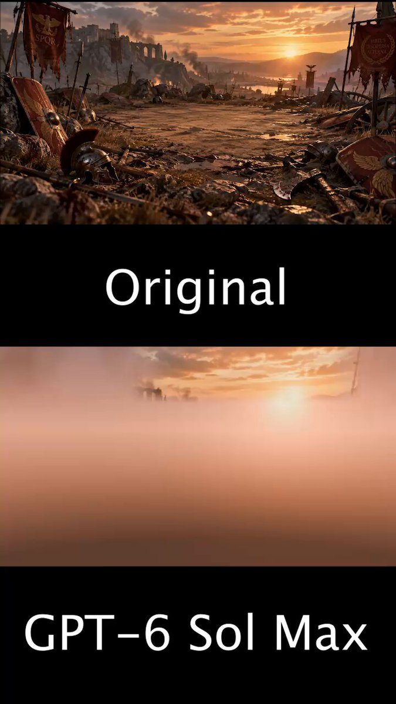</a>

提供されたコンセプト画像をもとに、ゴールデンアワーのローマ戦場をリアルに再現する、Blender向けの詳細な制作タスクです。大きな岩で囲んだ1対1のアリーナ、バンプマップを使用した高精細な地面、可能な限りプロシージャルに生成したアセット、ゴールデンアワーのスカイボックス、硬い影、再利用可能なGLBアセットを指定し、.blendファイルと制作タイムラプスを納品します。

**プロンプト**

```text
タスク
提供されたコンセプト画像をもとに、Blenderでゴールデンアワーのローマ戦場セットピースを制作してください。生成の使用は許可されています。利用可能な生成ツール（https://t.co/JV0K8OtuWC)上のTripo）で環境および各パーツの3Dモデルを生成し、組み立てても構いません。ただし、すべてがスケール、マテリアル、ライティングの統一された、一貫性のある1つのシーンになるようにしてください。要件：地面にバンプマップを使用し、高いディテールを維持すること。
地面に円形の空きスペースを作り、その周囲に大きな岩を配置して1対1のアリーナを形成すること。
すべてをリアルにレンダリングすること。
可能な箇所ではアセットをプロシージャルに生成すること。
ゴールデンアワーの空を表現するスカイボックスを作成すること。
硬い影を使用すること。
オブジェクト（旗、バナー、兜、岩など）を再利用すること。各オブジェクトをGLBとして書き出し、それらのアセットを再利用すること。
提供された画像に、可能な限り近く正確に合わせること。
タイムラプス要件
制作中は、意味のある追加（新しいオブジェクト、モディファイアの適用、マテリアルの工程、ライティングの工程など）を行うたびに、ビューポートのスクリーンショットを順番に番号付けしてtimelapse/フォルダーへ保存してください。作業完了後、それらのフレームを2 fps（1フレームあたり0.5秒）のタイムラプス動画にまとめ、最初から最後まで制作工程を確認できるようにしてください。タイムラプス動画をメインファイルとともに納品してください。
DELIVERABLES
カメラとビューポートを設定し、元画像と完全に一致する視点にした.blendファイル。
制作タイムラプス動画。
```

[詳細を見る ↗](https://www.tripo3d.ai/ja/3d-prompts/golden-hour-roman-battlefield-blender-scene) · [元の投稿](https://x.com/tonysurix/status/2103352274269675532) · [作例一覧に戻る](#all-prompts)

---

<a id="2103432732386664591"></a>

### ピタヤゼリー

[Vib3Coded](https://x.com/vib3coded) · 2026-09-25

<a href="https://www.tripo3d.ai/ja/3d-prompts/gpt-6-astra-2103432732386664591">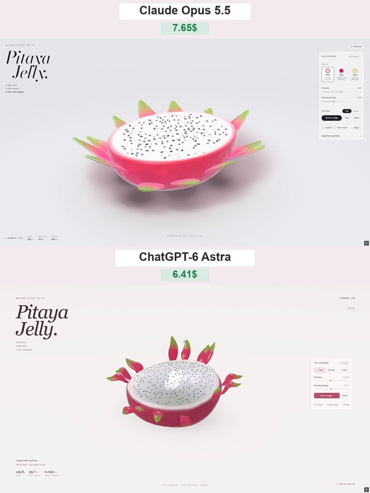</a>

GPT-6 Astra向けに著者が共有するプロンプト。ブラウザ上で動作する、ドラゴンフルーツのゼリー素材を使ったインタラクティブな3D実験を作成します。プロシージャルなWebGPUジオメトリ、半透明のグミ素材、ソフトボディ変形、ドラッグ可能な皮の花びら、タッチ操作、プリセット、シミュレーション情報表示、明るいスタジオ風インターフェースを指定しています。

**プロンプト**

```text
「ピタヤゼリー」というインタラクティブな3Dシーンを作成してください。柔らかく半透明なゼリーでできた、ドラゴンフルーツの半分を表現します。プロジェクト全体を単一のHTMLファイルに実装し、実際のWebGPUレンダリングとWGSLシェーダーを使用してください。既成のモデルや画像アセットは使用しないでください。

APPEARANCE

明るいスタジオのテーブルに、切り口を上にして置かれた大きなドラゴンフルーツの半分。
鮮やかなラズベリーピンクの皮、薄く淡い色の内皮、真珠のように白い果肉。
果肉全体に自然に分布する、約250個の小さな黒い種。
果実の周囲に12～14枚の肉厚な皮の花びらを配置し、根元のピンクから先端の緑へと色を変化させる。
光の屈折、小さな内部気泡、柔らかな接地影を備えた、つややかで濡れた表面。
素材は硬いプラスチックではなく、柔らかなグミキャンディのように見せてください。白飛びさせず、彩度の高い色を保ってください。

物理演算とインタラクション

弾性接続と体積保持制約を備えたボリュームメッシュを使い、XPBDなどによる本格的なソフトボディ変形を実装してください。
ユーザーはマウスまたは指で果肉をつかみ、引き伸ばしてから離せるようにしてください。
変形はオブジェクト全体を単純に移動させるのではなく、つかんだ位置の周囲に集中させてください。
離した後は、果実が揺れ、ぷるぷると振動し、徐々に元の形へ戻るようにしてください。
皮の花びらは1枚ずつドラッグできるようにしてください。果肉より柔らかく、果実に付いたまま曲がって元に戻るようにします。
種は変形する表面に追従し、浮いたり果肉に沈み込んだりしないようにしてください。
強く引っ張った場合もシミュレーションを安定させ、床との接触を維持し、要素の反転を防止してください。

ビジュアルデザイン

ミニマルで明るいテーマのスタジオ風インターフェースにしてください。エディトリアルな美しさを意識し、十分な余白、細いボーダー、控えめなコントロールを用い、不要な装飾は避けます。

左上：
「MATERIAL STUDIES / NO. 019」
大きな斜体のセリフ体見出しを2行で表示：
「ピタヤゼリー。」

その下に：
「ちょっとワイルド。」
「ちょっとスイート。」
「とても柔らかなドラゴン。」
右側には「THE SPECIMEN」というタイトルのフローティングパネルを追加し、以下を含めてください：

密度バッジ：ρ 1.04 g/cm³。
3つのプリセット：
Pearl — 白い果肉とピンクの皮。
Ruby — ラズベリー色の果肉とピンクの皮。
Gold — 淡い色の果肉と黄金色の皮。
現在値を表示するFirmnessスライダーとInternal dampingスライダー。
「軽く揺らす」と「リセット」ボタン。

「¼速度」と「メッシュを表示」のチェックボックス。

「一時停止」ボタン。
さらに以下も含めてください：
終了オプション付きのフルスクリーンボタン。
「WEBGPU · LIVE」ステータスインジケーター。
質量、静止時体積に対する割合、運動エネルギーをリアルタイムで表示。
短い操作ヒント：「果肉を引っ張る。花びらを引く。手を離す。」
実装を正確に説明する、折りたたみ可能な「実験の内部」セクション。
技術要件
pitaya-jelly-webgpu.htmlという名前の、自己完結型のファイルを1つ納品してください。

Canvas 2Dの見せかけではなく、実際のWebGPUレンダリングを使用してください。

すべてのジオメトリをプロシージャルに生成してください。
厚みを考慮した屈折、フレネル反射、柔らかなスタジオ照明を使用してください。
一貫した挙動を実現するため、固定タイムステップでシミュレーションを実行してください。
レスポンシブなレイアウトで、デスクトップとタッチ操作に対応してください。
ドラッグ中に高コストなジオメトリ再構築やシェーダーコンパイルを行わないでください。

WebGPUが利用できない場合は、明確なフォールバックメッセージを表示してください。

ドラッグ、リリース、形状の回復、プリセット、リセット、一時停止、フルスクリーン、モバイルレイアウトを検証してください。
最優先するのは、説得力のあるゼリーらしい挙動、美しい素材表現、そして気持ちよく操作できるインタラクションです。完成物は、洗練されたプレイアブルな素材実験のように感じられるものにしてください。
```

[詳細を見る ↗](https://www.tripo3d.ai/ja/3d-prompts/gpt-6-astra-2103432732386664591) · [元の投稿](https://x.com/vib3coded/status/2103433535604265052) · [作例一覧に戻る](#all-prompts)

---

<a id="2103456264785424530"></a>

### VRChat用衣装の3Dモデリング

[のわ〜る👼🍆🐄](https://x.com/Noir4247) · 2026-09-25

<a href="https://www.tripo3d.ai/ja/3d-prompts/gpt-6-astra-2103456264785424530">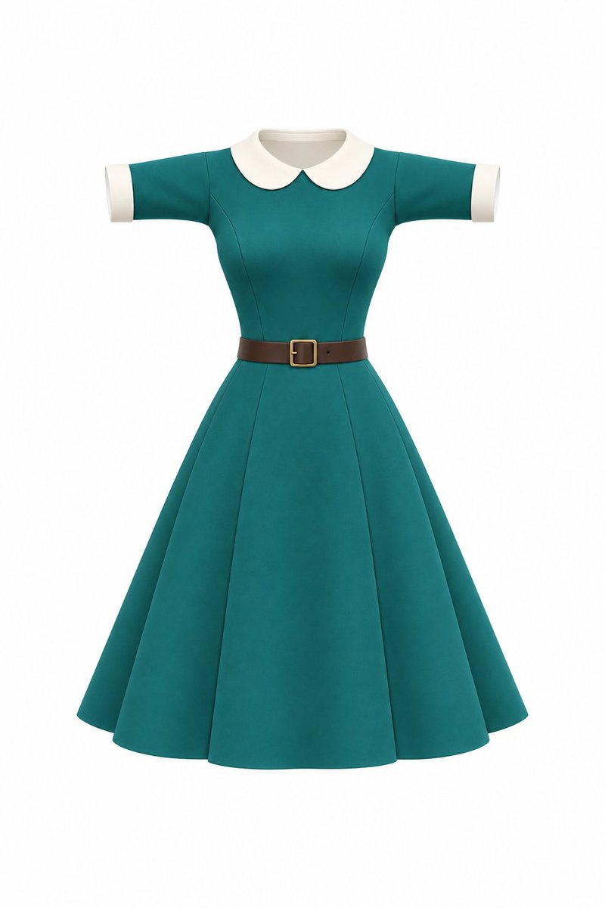</a>

<a href="https://www.tripo3d.ai/ja/3d-prompts/gpt-6-astra-2103456264785424530">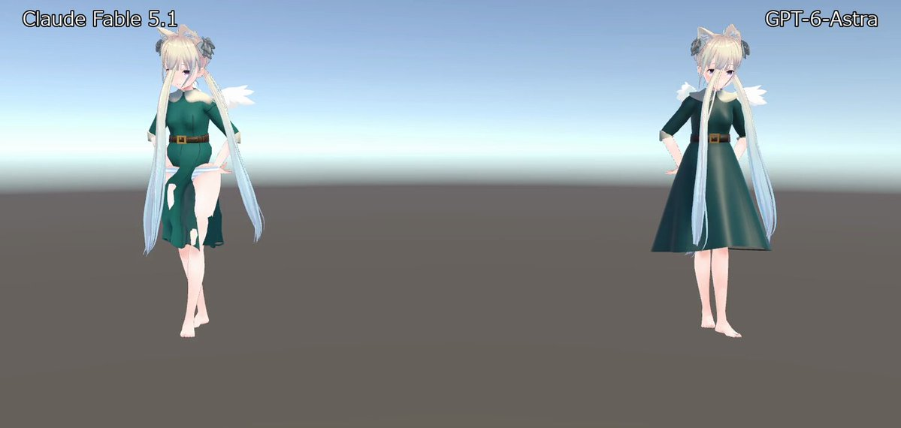</a>

投稿者は、ChatGPTで作ったデザイン画を基に「VRChat用の衣装作って」と指示し、AstraにBlenderで衣装をモデリングさせたと報告している。

**プロンプト**

```text
VRChat用の衣装作って
```

[詳細を見る ↗](https://www.tripo3d.ai/ja/3d-prompts/gpt-6-astra-2103456264785424530) · [元の投稿](https://x.com/Noir4247/status/2103456264785424530) · [作例一覧に戻る](#all-prompts)

---

<a id="2103482826519986544"></a>

### Blenderでモルモットを作成

[かよこ](https://x.com/kayokojoe) · 2026-09-25

<a href="https://www.tripo3d.ai/ja/3d-prompts/gpt-6-astra-2103482826519986544">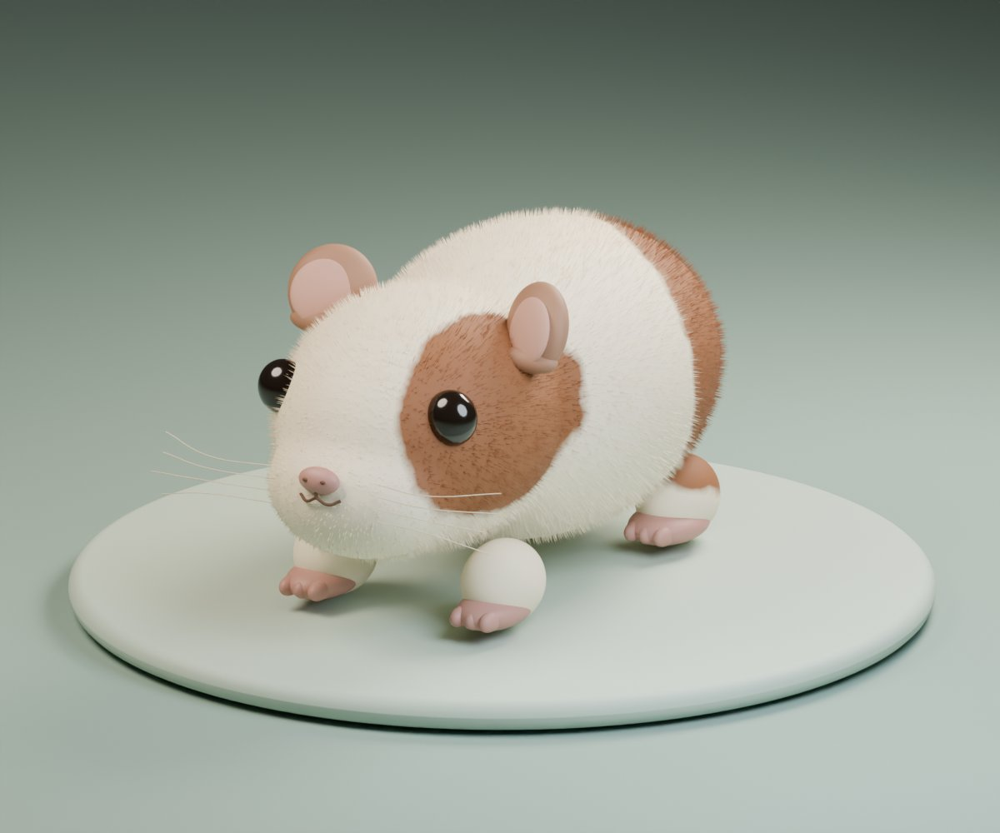</a>

投稿者がCodex（GPT-6 Astra High）に、写真を見せずにモルモットの作成を依頼したプロンプト。

**プロンプト**

```text
Blenderでモルモットを作って
```

[詳細を見る ↗](https://www.tripo3d.ai/ja/3d-prompts/gpt-6-astra-2103482826519986544) · [元の投稿](https://x.com/kayokojoe/status/2103482826519986544) · [作例一覧に戻る](#all-prompts)

---

<a id="2103486103831339269"></a>

### Three.jsで作るボクセル風の日本庭園

[Marcel](https://x.com/marcthecreatorr) · 2026-09-25

<a href="https://www.tripo3d.ai/ja/3d-prompts/gpt-6-astra-2103486103831339269">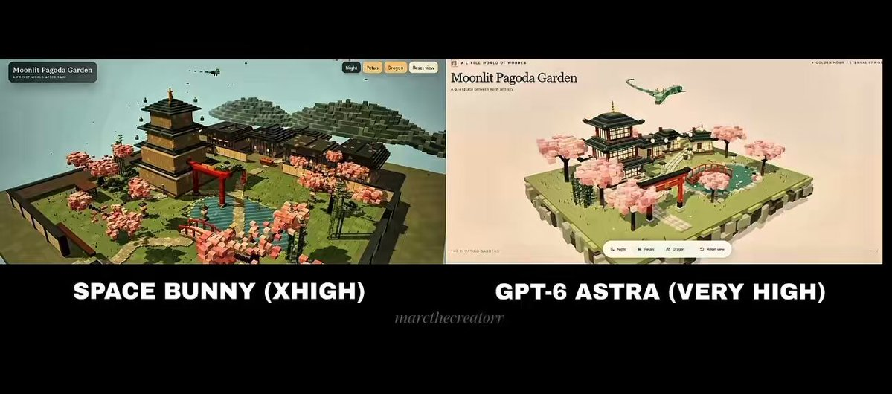</a>

五重塔や小さな村人、空を飛ぶドラゴンが登場する、インタラクティブなボクセル風日本庭園のプロンプトです。投稿者によると、このプロンプトをAstraとSpace Bunnyにそのまま入力し、ワンショットで比較したとのことです。

**プロンプト**

```text
Three.jsで、五重塔、小さな村人、空を飛ぶドラゴン、インタラクティブな仕掛けを備えた、細部まで作り込んだボクセル風の日本庭園を作成してください。
```

[詳細を見る ↗](https://www.tripo3d.ai/ja/3d-prompts/gpt-6-astra-2103486103831339269) · [元の投稿](https://x.com/marcthecreatorr/status/2103486103831339269) · [作例一覧に戻る](#all-prompts)

---

<a id="2103855977376125161"></a>

### ボクセルのボトルシップ WebGLシーン

[PEP PEPICH](https://x.com/Artless101) · 2026-09-26

<a href="https://www.tripo3d.ai/ja/3d-prompts/gpt-6-astra-2103855977376125161">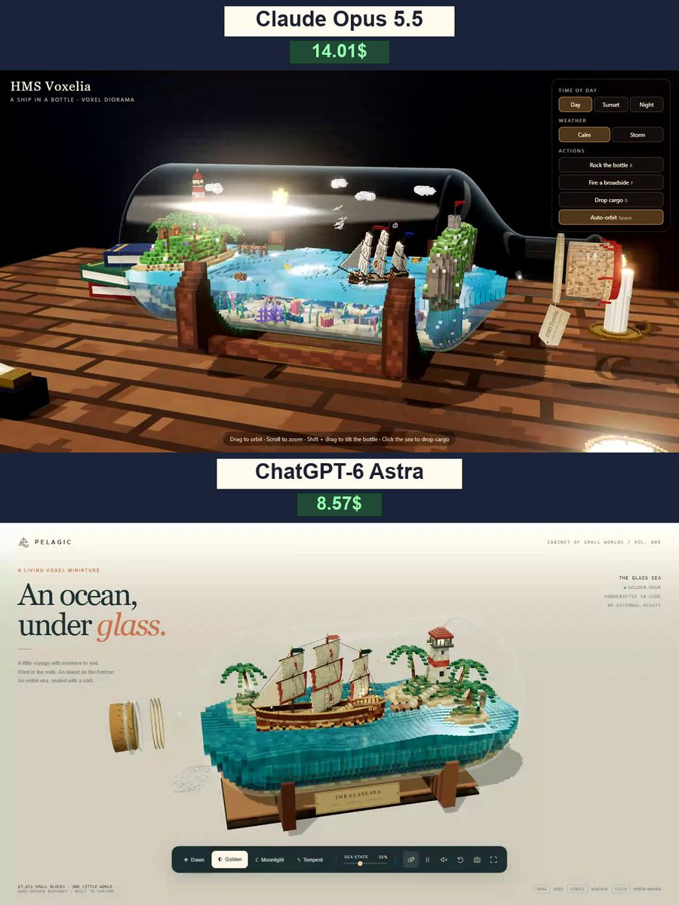</a>

波や物理演算、さまざまな小物や風景を取り入れた、帆船と海をボトルの中に閉じ込めた、色鮮やかで精巧なボクセルアートのシーンを作成します。Chromeで単一のHTMLファイルから実行できるWebGLシーンを目指します。

**プロンプト**

```text
ボトルの中で複雑な帆船が海を航行する、非常にクリエイティブで精巧かつ詳細なボクセルアートのシーンをデザイン・作成してください。波とリアルな物理演算を取り入れ、シーン全体をボトルの中に収めてください。印象的で変化に富んだシーンにするため、カラフルなボクセル、物理演算、小物や風景を組み合わせ、すべてをボトルの中に収めてください。WebGLや必要なライブラリを使って構いませんが、すべてを1つのHTMLファイルに貼り付けて、Chromeで開けるようにしてください。
```

[詳細を見る ↗](https://www.tripo3d.ai/ja/3d-prompts/gpt-6-astra-2103855977376125161) · [元の投稿](https://x.com/Artless101/status/2103856049925071141) · [作例一覧に戻る](#all-prompts)

---

<a id="2103860776419111285"></a>

### 森に囲まれた湖畔の村の環境

[Givros](https://x.com/givros) · 2026-09-26

<a href="https://www.tripo3d.ai/ja/3d-prompts/gpt-6-astra-2103860776419111285">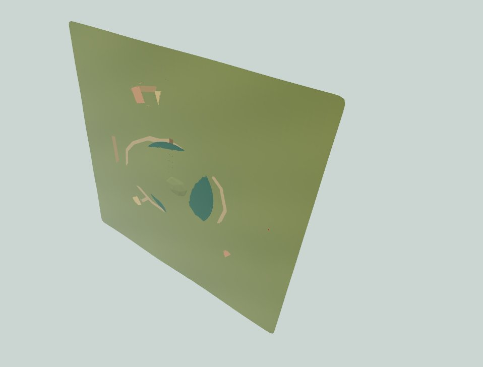</a>

<a href="https://www.tripo3d.ai/ja/3d-prompts/gpt-6-astra-2103860776419111285">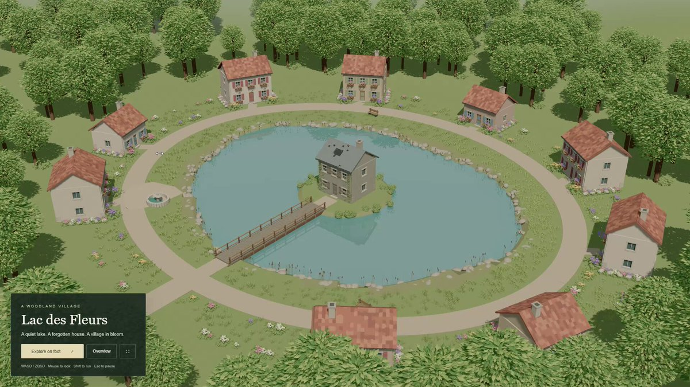</a>

<a href="https://www.tripo3d.ai/ja/3d-prompts/gpt-6-astra-2103860776419111285">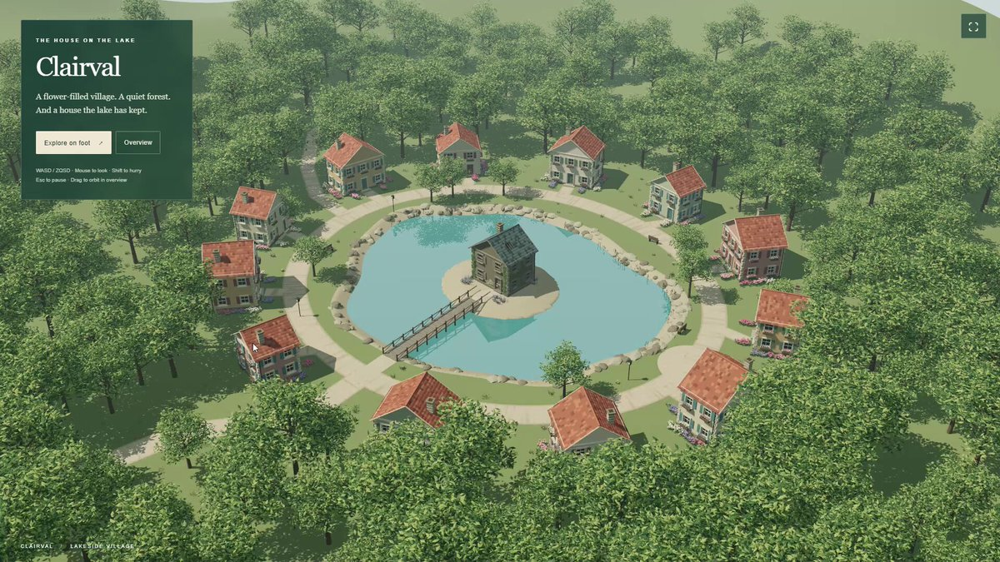</a>

元の作者がLuna Light、Sol Light、Astra Lightを同じプロンプトで比較するために使用する、3D環境の概要です。中央の湖を取り囲む森、湖の中に建つ廃屋、その周囲に広がる花に彩られたフランスの村、そしてそれらをつなぐ道を指定しています。

**プロンプト**

```text
中央に湖がある森。湖の中央には廃屋。湖の周囲には花に彩られたフランスの村。重要な場所をつなぐ道。
```

[詳細を見る ↗](https://www.tripo3d.ai/ja/3d-prompts/gpt-6-astra-2103860776419111285) · [元の投稿](https://x.com/givros/status/2103860776419111285) · [作例一覧に戻る](#all-prompts)

---

<a id="2103966922127630820"></a>

### BlenderでSuper Heavyブースターをキャッチするシーン

[Vortlyn](https://x.com/Vortlyn) · 2026-09-26

<a href="https://www.tripo3d.ai/ja/3d-prompts/gpt-6-astra-2103966922127630820">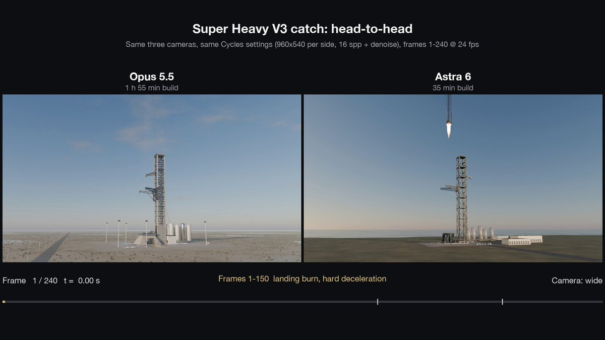</a>

ダウンロードしたモデル、テクスチャ、HDRIを使わず、コードで生成するSuper HeavyブースターのキャッチシーンをBlenderで作成します。

**プロンプト**

```text
Pythonだけを使って、BlenderでSuper Heavyブースターのキャッチシーンを作成する。ダウンロードしたモデル、テクスチャ、HDRIは使用せず、すべてコードで生成する
```

[詳細を見る ↗](https://www.tripo3d.ai/ja/3d-prompts/gpt-6-astra-2103966922127630820) · [元の投稿](https://x.com/Vortlyn/status/2103966922127630820) · [作例一覧に戻る](#all-prompts)

---

<a id="2104077535315144878"></a>

### インタラクティブな3Dカメラレンズの光路デモ

[noah helms](https://x.com/haonv2) · 2026-09-27

<a href="https://www.tripo3d.ai/ja/3d-prompts/gpt-6-astra-2104077535315144878">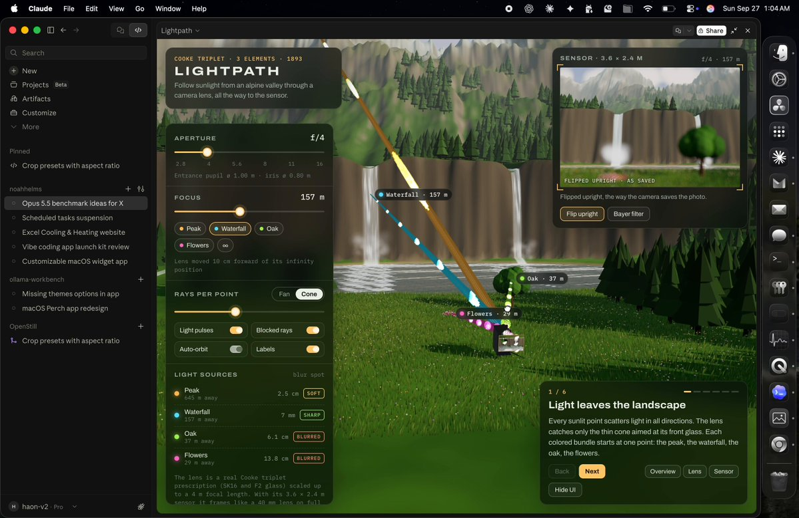</a>

<a href="https://www.tripo3d.ai/ja/3d-prompts/gpt-6-astra-2104077535315144878">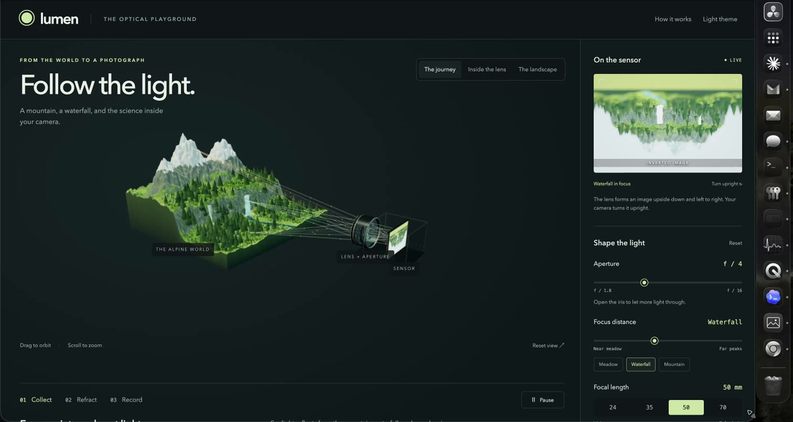</a>

カメラレンズを通ってセンサーに届く光の進み方を示す、インタラクティブな3Dレンダーです。滝と緑豊かな草原が広がる山岳風景を舞台にしています。元の投稿では、Astra-6とOpus 5.5を比較するために使用したプロンプトとして紹介されています。

**プロンプト**

```text
光がカメラレンズを通ってセンサーに届くまでの様子を、インタラクティブな3Dレンダーとして作成してください。滝と美しい緑の草原が広がる、魅力的な山岳風景を舞台にしてください。
```

[詳細を見る ↗](https://www.tripo3d.ai/ja/3d-prompts/gpt-6-astra-2104077535315144878) · [元の投稿](https://x.com/haonv2/status/2104077535315144878) · [作例一覧に戻る](#all-prompts)

---

<a id="2104504957173153951"></a>

### インタラクティブな3Dゼリー状スイカスライス

[基恩-Keane 🌊](https://x.com/esrhengwu) · 2026-09-28

<a href="https://www.tripo3d.ai/ja/3d-prompts/gpt-6-astra-2104504957173153951">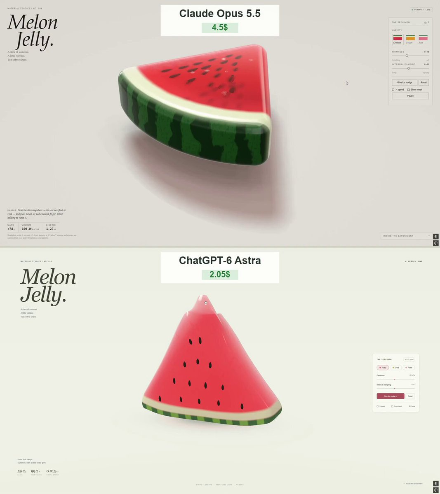</a>

作者がコメント欄で「Melon Jelly」の制作に使ったプロンプトを公開しています。ブラウザ上でWebGPUとWGSLを使い、つかむ、伸ばす、曲げる、ひねる操作に対応した3Dスイカゼリーのソフトボディシミュレーションを制作する内容で、マテリアル、物理演算、UI、検証に関する要件も含まれています。元の投稿によると、Opus 5.5とGPT-6 Astraがそれぞれゼリー状のスイカを制作しており、このコメントでは作者が公開したプロンプトが紹介されています。

**プロンプト**

```text
「Melon Jelly」を制作してください。WebGPUとWGSLシェーダーを実際に使用し、ブラウザ上で直接動作する、完成度の高いインタラクティブな3Dスイカゼリーのスライスです。
JavaScriptとCSSを埋め込んだ、単一の自己完結型HTMLファイルとして納品してください。静的なレンダー、動画、2Dによる疑似表現ではなく、実際に操作できる3Dシミュレーションにしてください。
スイカ
厚みのある、角を丸めた三角形のスイカのくさび形スライスを作成し、次の要素を備えてください。
半透明のルビーレッド色のゼリー状果肉。
果肉と皮の間にある、淡い色でやや半透明の層。
不規則な濃い緑色の縞模様が入った、光沢のある緑色の外皮。

露出した両側の果肉に埋め込まれた、個別にモデリングされた黒い種。
柔らかく丸みを帯びた角と、見た目にも十分な厚み。
スタジオで撮影した高級グミのように見せてください。みずみずしく、柔らかく、今にも食べられそうな質感にします。ハイライトを白飛びさせず、色は鮮やかに保ってください。
ソフトボディ物理
XPBDによる弾性および体積保持の拘束を適用した四面体メッシュなど、体積ベースのソフトボディシミュレーションを使用してください。
ユーザーは次の操作を行える必要があります。
先端、角、果肉、または皮をつかむ。
スライスを伸ばす、曲げる、持ち上げる、そしてゆっくりひねる。

手を離すと、揺れながら徐々に静止する様子を確認できる。
スライス全体が剛体のように移動・拡縮するだけでなく、つかんだ箇所が局所的に目に見えて変形するようにしてください。全体の柔軟性を保ちながら、皮は果肉よりやや硬めにします。
伸ばした際も、体積を適切に維持してください。要素の反転、暴走する動き、恒久的な潰れを防ぎます。安定性のため、固定シミュレーションタイムステップと上限付きのサブステップを使用してください。
手を離した後の動きは自然に減衰させてください。瞬時に元へ跳ね戻ったり、振動がいつまでも続いたりしないようにします。
種は変形する果肉に固定してください。種が独立して浮いたり、空間上の同じ位置に留まったりせず、表面に合わせて移動・回転する必要があります。
地面との接触、穏やかな摩擦、柔らかなバウンスを含めてください。床への目に見えるめり込みは避けます。
RENDERING
ネイティブWebGPUとWGSLシェーダーを使用してください。
次の要素を含めてください。
厚みに応じた光の吸収。
ゼリー内部を通過する屈折。

フレネル反射と光沢のあるハイライト。
薄いエッジを通り抜ける柔らかな透過光。
控えめな内部ディテールと、いくつかの小さな気泡。

スライスの下にできる柔らかな接触影。
明るくニュートラルなスタジオ背景。
果肉、淡い色の皮、緑色の外皮で、それぞれ異なるマテリアルの反応を持たせてください。すべてが透明なガラスや不透明なプラスチックに見える仕上がりは避けます。
スライスは大きく、観察しやすくしてください。果肉、種、厚みが見えるよう、3/4視点のカメラアングルにします。
INTERFACE
余白を十分に取り、細いボーダーと控えめなコントロールを用いた、ミニマルなエディトリアルレイアウトにしてください。装飾的なUIグラデーションは使用しません。
左上：
「MATERIAL STUDIES / NO. 009」
大きなイタリック体のセリフ見出しを2行に分け、「Melon」「Jelly」と表示します。
小さなキャプション：
「夏のひと切れ。」
「少しだけ、ぷるん。」
「分けるには柔らかすぎる。」
右上：
レンダラーの実行中に「WEBGPU · LIVE」と表示する小さなステータスインジケーター。

右側のパネル：
「THE SPECIMEN」
スイカをイメージした、統一感のある3種類のカラープリセット。
現在値付きの硬さスライダー。
現在値付きの内部減衰スライダー。
「少し揺らす」と「リセット」ボタン。
「¼速度」と「メッシュを表示」のチェックボックス。

一時停止／再開ボタン。
左下：
スライスをつかんで伸ばせることを説明する短いヒント。
シミュレーションから算出した質量、相対体積、運動エネルギーのライブ表示。必要に応じて、目安となる単位や概算値であることを明確に説明してください。
右下：

物理演算とレンダリングについて簡潔に説明する、折りたたみ可能な「実験の内部」セクション。
挙動とパフォーマンス
マウスとタッチ入力の両方に対応してください。ポインターがオブジェクトから離れてもドラッグを確実に継続できるよう、ポインターキャプチャを使用します。
コントロールがスライスに重ならないよう、デスクトップとモバイルの両方で機能するレイアウトにしてください。
バッファを再利用し、ドラッグ中にジオメトリの再構築やシェーダーのコンパイルを行わないでください。操作は滑らかでレスポンスよく保ちます。
視覚効果を減らす設定に対応してください。WebGPUが利用できない場合は、偽のレンダラーに黙って置き換えるのではなく、明確な説明を表示します。
VALIDATION
複数の場所からのドラッグ、強く伸ばす操作、連続したリリース、地面との衝突、すべてのスライダー、プリセット、一時停止、リセット、スローモーションをテストしてください。
モデルが安定した静止形状に戻ること、種が固定されたままであること、メッシュが破綻しないこと、レンダリングエラーがないことを確認してください。
ゼリーの反応とライティングの品質を最優先してください。何度もつかんで遊びたくなる仕上がりを目指します。
```

[詳細を見る ↗](https://www.tripo3d.ai/ja/3d-prompts/gpt-6-astra-2104504957173153951) · [元の投稿](https://x.com/esrhengwu/status/2104505413857415515) · [作例一覧に戻る](#all-prompts)

---

<a id="2104531704740512143"></a>

### 原神風ゲームと地形編集ツール

[ふぐあい(ふぐおん)](https://x.com/fuguai1) · 2026-09-28

<a href="https://www.tripo3d.ai/ja/3d-prompts/gpt-6-astra-2104531704740512143">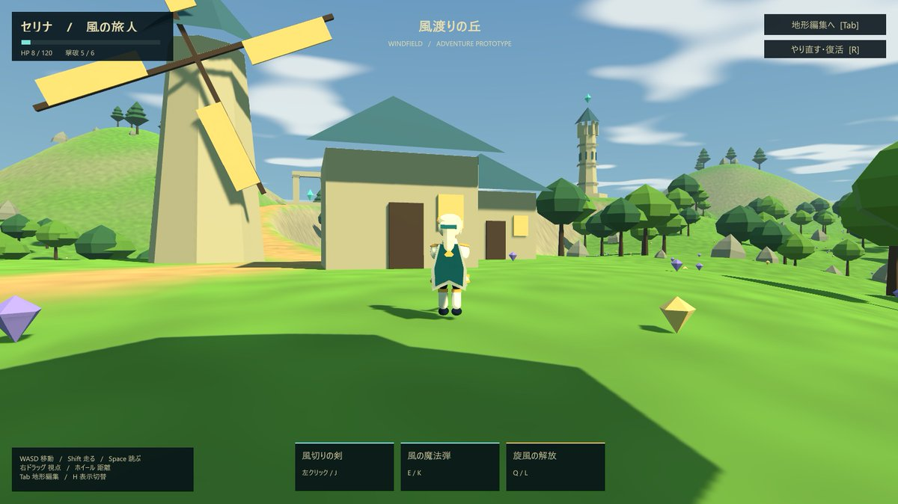</a>

<a href="https://www.tripo3d.ai/ja/3d-prompts/gpt-6-astra-2104531704740512143">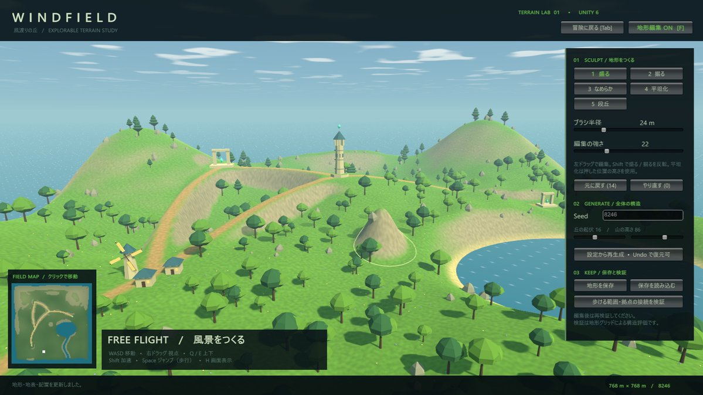</a>

原神のようなゲームと、その地形を編集できるツールを作るよう求めるプロンプト。

**プロンプト**

```text
原神みたいなゲームとそれを地形編集できるツールを作って
```

[詳細を見る ↗](https://www.tripo3d.ai/ja/3d-prompts/gpt-6-astra-2104531704740512143) · [元の投稿](https://x.com/fuguai1/status/2104531704740512143) · [作例一覧に戻る](#all-prompts)

---

<a id="2104590493191479337"></a>

### 強度試験用3Dプリント対応Jフック

[Wësche](https://x.com/WescheNex1q) · 2026-09-28

<a href="https://www.tripo3d.ai/ja/3d-prompts/3d-printable-j-hook-openscad-strength-test">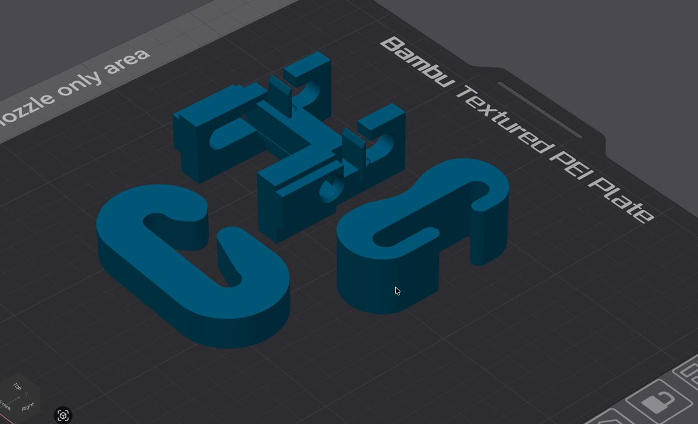</a>

3Dプリントと強度試験用に、PLA製の一体型Jフックを設計します。8 mmのスチールバーに手で取り付け、8 mmの荷重ピンを保持します。寸法、質量、保持力、滑り止めに関する要件を満たす必要があります。出力は、STL書き出しに適した完全なOpenSCADファイルです。

**プロンプト**

```text
強度試験用に、3Dプリント可能なJフックを1個設計してください。
フックは8 mmのスチールバーから吊り下げます。8 mmのピンをフック先端の受け部に載せ、そのピンから荷重を吊り下げます。バーやピンが外れない範囲で、できるだけ高い破断荷重を得たいと考えています。
要件：
- プリントする部品は1個のみ。ねじ、インサート、接着剤、その他の追加部品は使用しない。
- バーとピンの両方に手で取り付けられること。閉じたリング形状は禁止。
- ピンの座面間隔は中心間で40 mm。
- 材料はPLA。プリント後の質量は最大35 g。
- 80 × 60 × 25 mmのサイズに収まること。
- ピンが外れるには、少なくとも10 mm持ち上げる必要があること。側面から転がり出る可能性がある設計は無効。
以下を提示してください：
1. 形状の簡単な説明。
2. コンパイルしてSTLに書き出し、Bambu Studioで使用できる完全なOpenSCADファイル。
STLのテキストやGコードは不要です。OpenSCADのみ提示してください。最初の案が外れてしまう場合は、同じ回答内で別の案に置き換えてください。
```

[詳細を見る ↗](https://www.tripo3d.ai/ja/3d-prompts/3d-printable-j-hook-openscad-strength-test) · [元の投稿](https://x.com/WescheNex1q/status/2104590493191479337) · [作例一覧に戻る](#all-prompts)

---

<a id="2104605522640970208"></a>

### インタラクティブなCRISPR教育用3D表現

[Alejandro](https://x.com/AlejandroRomaan) · 2026-09-28

<a href="https://www.tripo3d.ai/ja/3d-prompts/interactive-crispr-dna-3d-visualization"></a>

<a href="https://www.tripo3d.ai/ja/3d-prompts/interactive-crispr-dna-3d-visualization"></a>

CRISPRによるDNA技術を、インタラクティブかつ分かりやすく学べる3D表現です。DNA鎖と遺伝子編集の全プロセスを示し、各構成要素を識別できるようにします。ユーザーが関連する部分を選択すると、その役割や仕組みを学べるようにしてください。

**プロンプト**

```text
CRISPRによるDNA技術の仕組みを学べる、インタラクティブな教育用3D表現を作成してください。使用する技術は、分かりやすく読みやすく、DNA鎖を表示できるものであれば自由に選んで構いません。遺伝子編集の一連の流れと各構成要素を確認でき、関連する部分を選択して詳しく学べるようにしてください。
```

[詳細を見る ↗](https://www.tripo3d.ai/ja/3d-prompts/interactive-crispr-dna-3d-visualization) · [元の投稿](https://x.com/AlejandroRomaan/status/2104605522640970208) · [作例一覧に戻る](#all-prompts)

---

<a id="2104613125093998674"></a>

### 月明かりのジャングルを進むインタラクティブなボートライド

[Fazley](https://x.com/itsfazley) · 2026-09-28

<a href="https://www.tripo3d.ai/ja/3d-prompts/moonlit-jungle-boat-ride-threejs-scene"></a>

狭いジャングルの水路を進む、フルスクリーン対応のレスポンシブなThree.jsボートライド。プレイヤーはキーボードまたはタッチ操作で、誰も乗っていない木製の手こぎボートを操縦します。アニメーションする水面や航跡、月明かりの反射、環境音を備え、月夜・夜明け・雨の天候を切り替えられます。

**プロンプト**

```text
狭いジャングルの水路を舞台に、フルスクリーン対応のレスポンシブなThree.jsボートライドを構築してください。先端が尖った船首、幅広の側面、平らな船尾、見える床板と座席を備えた、誰も乗っていない木製の手こぎボートを三人称カメラで追従します。オールは配置せず、船内は乾いた状態にし、船体は水面にわずかに沈んでいるようにしてください。WASDキーまたは矢印キー、タッチ操作で操縦できるようにします。シーンは夜の神秘的な雰囲気にし、両岸には密生した種類豊富でリアルな濃い緑色の木々を配置してください。微かな風、精細な満月、アニメーションする水面に途切れながら映る月明かりを表現します。説得力のある動く波、ボートと木々の歪んだ反射、ボートの通過した経路に沿って残り自然に薄れていく航跡を追加してください。固定された発光マークや硬い円形の境界線は使わないでください。月夜、暖かな夜明け、曇り空の雨を切り替えられる天候トグルを追加します。雨モードでは、降る雨粒と、水面の波に合わせた小さく短時間で消える着水の波紋を表示してください。水音、ジャングルの環境音、雨音は、控えめな音量で任意に追加できるようにします。インターフェースは最小限にしてください。デスクトップとモバイルの両方で、ビジュアル、操作、音声、カウンター、3種類すべての天候モードを確認してください。
```

[詳細を見る ↗](https://www.tripo3d.ai/ja/3d-prompts/moonlit-jungle-boat-ride-threejs-scene) · [元の投稿](https://x.com/itsfazley/status/2104613128017522813) · [作例一覧に戻る](#all-prompts)

---

<a id="2104654448878387313"></a>

### X線・分解表示に対応した変形スポーツカー

[Marcel](https://x.com/marcthecreatorr) · 2026-09-28

<a href="https://www.tripo3d.ai/ja/3d-prompts/transforming-sports-car-robot-exploded-view"></a>

MarcelがGPT-6 AstraとSonnet 5.5を比較するために提供したワンショットプロンプトです。人型ロボットに変形する、インタラクティブで詳細なスポーツカーを作成し、X線モードと分解表示モードを搭載するよう指定しています。

**プロンプト**

```text
X線モードとインタラクティブな分解表示を備えた、詳細なスポーツカーを構築し、人型ロボットに変形できるようにする
```

[詳細を見る ↗](https://www.tripo3d.ai/ja/3d-prompts/transforming-sports-car-robot-exploded-view) · [元の投稿](https://x.com/marcthecreatorr/status/2104654448878387313) · [作例一覧に戻る](#all-prompts)

---

<a id="2104841727496323479"></a>

### 高精細な3Dの人間の目

[Simonas](https://x.com/SimonasLTU1) · 2026-09-29

<a href="https://www.tripo3d.ai/ja/3d-prompts/gpt-6-astra-2104841727496323479"></a>

リアルなマクロ写真のような見た目を持つ、高精細な3Dの人間の目をゼロからモデリングしたThree.jsのローカルHTML/CSS/JSファイルを作成します。

**プロンプト**

```text
Three.jsを使用したローカルHTML/CSS/JSファイルを作成してください。実物の目を撮影したマクロ写真のように見える、高精細な3Dモデルの人間の目を作成してください。すべてゼロから作成する必要があります。
```

[詳細を見る ↗](https://www.tripo3d.ai/ja/3d-prompts/gpt-6-astra-2104841727496323479) · [元の投稿](https://x.com/SimonasLTU1/status/2104841727496323479) · [作例一覧に戻る](#all-prompts)

---

<a id="2105009377002299711"></a>

### 時間を、ほどく。

[Paruchh](https://x.com/theparuchh) · 2026-09-29

<a href="https://www.tripo3d.ai/ja/3d-prompts/gpt-6-astra-2105009377002299711"></a>

WebGPUとWGSLで動作する、自己完結型のインタラクティブな3D機械式腕時計を制作します。ブランド名のない手巻き式Calibre 01に、機械的に正確なスイスレバー式ムーブメント、リアルタイムのパワーリザーブ、巻き上げ操作、スクロールで進む7段階の分解表示を実装します。分解中も時計は動き続けます。部品のインスペクション、カメラ操作、ゴールドケースのプリセット、技術検証、マクロ撮影を思わせるエディトリアルなインターフェースも含めます。

**プロンプト**

```text
「Time, Undone.」を制作します。埋め込みのJavaScriptとCSSだけで構成した、単一の自己完結型HTMLファイルです。WebGPU + WGSLによる本格的なインタラクティブ3D機械式腕時計を実装し、スクロールすると時計自身が分解されていきます。分解中も動作は止まりません。3Dエンジンのライブラリは使用せず、すべてのジオメトリをコードで生成します。これは、外側からは誰もが見たことがある一方、内側を見たことがある人はほとんどいない物体を扱うシリーズの第1号です。
物体
オリジナルでブランド名のない、直径40 mmのラウンドケースに収めた手巻き式機械式腕時計。クラシックなスイスレバー式ムーブメントは直径約30 mmとします。
レイアウト：中央に時針と分針、6時位置にスモールセコンドのサブダイヤル、3時位置にリューズ。
文字盤：シルバーオパリン仕上げに繊細なギヨシェのサンバースト模様。アプライドのポリッシュ仕上げインデックス、ドーフィン針、レイルウェイ分目盛り。
ケース：前面にサファイアクリスタル、裏面にムーブメントが見えるシースルーケースバック。
ブランド名、ロゴ、実在するキャリバー名は一切使用しません。「Calibre 01」と呼びます。
機構（装飾ではなく、内部的にも正確であること）
振動数は28,800 vph（テンプは4 Hz）。
歯数に一貫性のある本物の輪列を構成します：香箱96歯 → 1番車ピニオン12。中心車は1時間に1回転し、分針を駆動します。
中心車80歯 → 3番車ピニオン10。
3番車75歯 → 4番車ピニオン10。4番車は1分に1回転し、スモールセコンド針を駆動します。
4番車84歯 → ガンギ車ピニオン7。
ガンギ車は20歯で、5秒に1回転します。

文字盤側のモーションワーク：カノンピニオン12 → ミニッツホイール36。ミニッツピニオン10 → ホイール40（12:1）。
キーレスワーク：リューズ、巻真、コルスホイール、ラチェットホイール、スプリング付きクリック。
脱進機：ガンギ車、2つのルビー爪石とバンキングピンを備えたアンクル、ヒゲゼンマイと振り石を備えたテン輪。
構造：地板、香箱受け、輪列受け、テンプ受け、ルビー製の軸受け、青焼きネジ。
歯車：時計用のサイクロイド歯形、スポークのある輪、リーフ型のピニオン、アーバーとホゾ。中心距離は共通モジュールから算出し、組み立て時にすべての歯車が目に見えて正しく噛み合うようにします。
動作は1つのマスタークロックから駆動します。テンプは θ(t) = A·sin(2π·4·t) で振動し、フルパワー時の振り角Aは約270°とします。
各ビートでアンクルが2本のバンキングピンの間を弾むように移動し、ガンギ車が短くイージングされた衝撃で半歯分進んだ後、ロックします。
その他のすべての歯車は、ガンギ車を基準にした比率どおりに正確にステップします。
秒針は毎秒8回刻み、分針と時針は輪列に従って動きます。
読み込み時には、針を閲覧者のローカル時刻に合わせます。

パワー：約44時間のパワーリザーブをリアルタイムで消費します。残量が減るにつれて振り角は290°から180°まで低下し、0になると時計は停止します。テンプは凍り付くのではなく、ゆっくりと静止します。
巻き上げるとパワーリザーブが回復し、ラチェットとクリックが目に見えて動きます。Web Audioによる柔らかなクリック音は、最初のユーザー操作までミュートします。

ムーブメントは、どの分解状態でも動作し続けます。歯車は空中で回転し、テンプは振動し、秒針は刻み続けます。
分解（停止位置を設けたスクロール連動）
ページのスクロールを0〜1の進行値に変換し、7つのチャプターに分割します。各チャプターはイージングしながら静止する「ストップ」に入り、スクロールは一時的に落ち着きます（ソフトなスナップであり、完全なロックにはしません）。カメラはチャプター間を滑らかに移動します。
チャプター：
I. ケース：正面斜め3/4ビュー、組み立て状態。
II. 文字盤：クリスタルとベゼルが離れて浮き、針と文字盤が上昇。
III. モーションワーク：文字盤下の歯車が分離。
IV. ブリッジ：時計が裏返って背面を見せ、ケースバックが持ち上がる。ブリッジとテンプ受けが上昇し、ネジはそれぞれの穴のすぐ上に浮かびます。
V. 輪列：香箱、中心車、3番車、4番車が、テクニカルドローイングのようにそれぞれの軸に沿って上方向へ広がります。
VI. 脱進機：ガンギ車、アンクル、テンプがさらに少し離れ、カメラが近づきます。
VII. 心臓部：鼓動するテンプとヒゲゼンマイのマクロビュー。背後には完全な分解列を配置します。
すべての部品は明確な軸に沿って動かし、主に各自のアーバー軸、または地板から真上へ移動させます。一体となる部品は一緒に動かします。分解中に部品同士を交差させず、フレーム外にも出しません。
各停止位置で、主要部品に細いヘアラインの引き出し線と小さなキャップス体のラベルを表示し、停止位置間でフェードさせます。
INTERACTION
スクロール（ホイール、トラックパッド、タッチスワイプ）で分解を進めます。
何もない場所をドラッグすると、制限内で時計を回転できます。離すとイージングしながら元に戻ります。
部品にホバーすると、部品の輪郭を柔らかく表示し、名前を出します。
部品をクリックすると、その部品をハイライトし、他の部品を約35%まで減光して、カメラが対象をフレーム内に収めるよう移動します。
横にカードを開き、ヘアラインの引き出し線で対象とつなぎます。カードには、名前、役割を説明する平易な1〜2文、正確な事実を1つ（例：「ガンギ車・20歯・5秒に1回転」）、ライブ値を1つ（現在の速度、角度、またはこれまでのビート数）を表示します。
Escキー、閉じるボタン、または何もない場所のクリックで元に戻ります。

リューズが表示されているときに横へドラッグすると、手応えのあるラチェット操作で時計を巻き上げます。
ポインターキャプチャ、マウス、タッチに対応します。ピッキングにはオブジェクトIDのレンダーパス、または正確なレイテストを使用し、近似的なバウンディングスフィアは使用しません。
レンダリング（本物の金属、マクロ撮影の質感——漫画調にはしない）
物理ベースドマテリアルと、反射用のプロシージャルなスタジオ環境（大きなソフトボックス、ストリップライト、暗く暖色系のフィル）を使用します。
仕上げ：ブリッジにはコート・ド・ジュネーブのストライプ（ストライプに沿って異方性ブラッシュドスペキュラーを整列）。
地板にはペルラージュ（円形の筋目）。
鏡面研磨したベベル（アングラージュ）で、エッジに明るいハイライトを捉えます。
薄膜による熱処理で青焼きしたネジと針。
内部で輝きがきらめく、半透明の赤いルビージュエル。
ロジウムメッキのスチール部品。
かすかな青紫の反射と、わずかなエッジ厚を持つサファイアクリスタル。

ケースは選択したゴールドにします。
ハイライト：スペキュラーハイライトだけに抑制したブルームを適用し、ジュエルやポリッシュ仕上げのエッジには、光や時計の動きに応じて小さな星形のきらめきを表示します。華やかに、ただしラメのようにはしません。
柔らかな接触影、穏やかなアンビエントオクルージョン、フォーカスした部品に追従する控えめな被写界深度。
ハイライトを白飛びさせないフィルミックトーンマッピング。4x MSAAまたは同等の処理。
背景：シームレスな撮影スタジオのような、柔らかなビネットを加えた淡い磁器色の白。黄色やクリーム色にはしません。
UI（貴族的でエディトリアル、余白を贅沢に）
フォント：「Bodoni Moda」を見出しと数字に、「Jost」をUIテキストに使用します（Google Fonts、セリフ体とサンセリフ体のフォールバック付き）。小さなキャップス体ラベルは字間0.16em、数字は等幅数字。
色：磁器色の背景上のインク色は #1B1A17。
ヘアラインはインク色15%の1px。
アクセント色は選択したゴールドに合わせます。

UI要素にグラデーションや強い影を使わず、絵文字も使用しません。
左上：キッカー「OBJECTS, OPENED / NO. 01」。
大きなBodoniの見出しを2行で「Time,」／「Undone.」と表示。
Bodoni斜体のキャプション3行：「Wound by hand.」「Opened by scroll.」「Nothing is hidden.」

右上：小さなドット付きのステータス「WEBGPU · LIVE」。
左端の縦中央：チャプターインデックス「I. The case」「II. The dial」「III. Motion works」「IV. The bridges」「V. The going train」「VI. The escapement」「VII. The heart」。現在のチャプターをハイライトし、ヘアラインの進行ルールを表示します。チャプターをクリックするとその位置までスクロールします。

右パネル「THE MOVEMENT」：3つのケースプリセット（White gold、Yellow gold、Rose gold）と、小さなメタルスウォッチ。
ライブ表示：振動数「28,800 vph」、パワーリザーブ（h、細いバー付き）、振り角（°）、オープン後のビート数。
ボタン「Wind the crown」「Set to local time」。
チェックボックス「¼ speed」「Trace the power」。Trace the powerを有効にすると、エネルギー経路（香ゼンマイ → 香箱 → 中心車 → 3番車 → 4番車 → ガンギ車 → アンクル → テンプ）に沿って光の線がゆっくり流れ、通過する各部品が発光します。
一時停止／再開ボタン。

左下のヒント：「スクロールして分解。部品をクリックして詳しく見る。ドラッグして回す。」
右下：折りたたみ可能な「How it works」。輪列、脱進機、テンプ、パワーリザーブについて、正確で簡潔な説明を表示し、このページでのレンダリング方法も短く説明します。
モバイル：キャンバスは画面上部約65%を占め、チャプターインデックスはローマ数字の横並びになります。パネルは下へ続き、部品カードはボトムシートになります。時計を覆う要素は配置しません。
ENGINEERING
すべてのジオメトリを起動時に一度だけ構築します。繰り返し使用する部品（ネジ、ジュエル、必要に応じて歯）にはインスタンシングを使用します。フレームごとに更新するのはトランスフォームだけとし、操作中にシェーダーのコンパイルやバッファの再構築を行いません。
アニメーション時間は1つのクロックから取得し、¼速度のスケーリングに対応します。一時停止で停止するのは機構であり、UIは停止しません。
prefers-reduced-motionを尊重し、チャプター遷移は即時、カメラ移動ときらめきのアニメーションは無効にします。
WebGPUが利用できない場合は、明確でデザイン性の高い説明を表示します。見せかけのフォールバックレンダラーは使用しません。
デバイスロストに対応します。ピクセル比は2に制限します。ノートPCで60 fpsを目指し、最近のスマートフォンでも滑らかな体験を実現します。
納品前に検証
コード内で輪列比をアサートします。秒針が60秒に1回転、分針が3600秒に1回転、時針が12時間に1回転、ガンギ車が5秒に1回転することを確認し、結果をコンソールに記録します。
すべての噛み合い対で中心距離が正しく、組み立て時に目に見えて噛み合っていること。
分解のどの進行度でも部品同士が交差せず、Zファイティングも発生しないこと。
スクロールの停止、チャプター移動、部品のピッキング、カード、巻き上げ、プリセット、Trace the power、一時停止、¼速度、モバイルレイアウトがすべて動作すること。
カードのテキストが時計機構として正確であること。
コンソールエラーがないこと。
```

[詳細を見る ↗](https://www.tripo3d.ai/ja/3d-prompts/gpt-6-astra-2105009377002299711) · [元の投稿](https://x.com/theparuchh/status/2105009470292013286) · [作例一覧に戻る](#all-prompts)

---

<a id="2105027152617918852"></a>

### リアルなF-22ラプターモデルとGodot飛行動画

[Demetrius Greses Jr](https://x.com/dgresesjr) · 2026-09-29

<a href="https://www.tripo3d.ai/ja/3d-prompts/gpt-6-astra-2105027152617918852"></a>

Lockheed Martin F-22ラプターのリアルな3Dモデルを作成し、その機体がGodot内を飛行する60秒のMP4動画を生成してXにアップロードするための比較用プロンプトです。比較対象のモデルには、ルート投稿で6 Astraが挙げられています。

**プロンプト**

```text
Blender MCPを使用してください。次の機体のリアルな3Dモデルを作成してください：Lockheed Martin F-22ラプター（米国仕様のみ）。その後、Godot内を飛行する様子を60秒のMP4動画にして、Xにアップロードできるようにしてください。
```

[詳細を見る ↗](https://www.tripo3d.ai/ja/3d-prompts/gpt-6-astra-2105027152617918852) · [元の投稿](https://x.com/dgresesjr/status/2105027152617918852) · [作例一覧に戻る](#all-prompts)

---

<a id="2105047166733746209"></a>

### 映画的でフォトリアルなロケット打ち上げシーン

[Matthew Lebo](https://x.com/MatthewLebo_) · 2026-09-29

<a href="https://www.tripo3d.ai/ja/3d-prompts/gpt-6-astra-2105047166733746209"></a>

投稿者がGPT-Astra、GPT-6.1-Sol、Claude Opus 5.5を比較するために使用した、まったく同じ入力として共有した再利用可能なプロンプトです。Three.jsで実装する、映画的でフォトリアルな、テクスチャを施した3Dロケット打ち上げシーンを指定しています。

**プロンプト**

```text
Three.jsを使って、映画的でフォトリアルな、美しくテクスチャを施したロケット打ち上げシーンを制作してください
```

[詳細を見る ↗](https://www.tripo3d.ai/ja/3d-prompts/gpt-6-astra-2105047166733746209) · [元の投稿](https://x.com/MatthewLebo_/status/2105047166733746209) · [作例一覧に戻る](#all-prompts)

---

<a id="2105278999861526953"></a>

### Blenderで描くゴールデン・ゲート・ブリッジ

[EvoLink.ai](https://x.com/EvoLinkAi) · 2026-09-30

<a href="https://www.tripo3d.ai/ja/3d-prompts/gpt-6-astra-2105278999861526953"></a>

Blenderでゴールデン・ゲート・ブリッジを描画するためにEvoLink.aiが共有したベンチマーク用プロンプトです。サンフランシスコ湾から見上げる極端なローアングル、霧の立ち込める朝の情景、複雑な鋼製トラスの主塔、精密な道路上の車両、険しい海岸の岬を指定しています。

**プロンプト**

```text
ゴールデン・ゲート・ブリッジをBlenderで描画。サンフランシスコ湾の水面すれすれから見上げる、広がりのある極端なローアングルショット。巨大で複雑な鋼製トラスの主塔が、霧の立ち込める朝の空を突き抜けています。橋全体に広がる道路には、数え切れないほどの小さく精密な車両を配置し、険しい海岸の岬を背景に、橋の壮大で圧倒的なスケールを際立たせます。
```

[詳細を見る ↗](https://www.tripo3d.ai/ja/3d-prompts/gpt-6-astra-2105278999861526953) · [元の投稿](https://x.com/EvoLinkAi/status/2105279002793345069) · [作例一覧に戻る](#all-prompts)

---

<a id="2105298955307303100"></a>

### Blenderで3Dミニオンキャラクターを作成

[EvoLink.ai](https://x.com/EvoLinkAi) · 2026-09-30

<a href="https://www.tripo3d.ai/ja/3d-prompts/gpt-6-astra-2105298955307303100"></a>

GPT-6.1 Sol、Sonnet 5.5、GPT-6 Astra向けの3D Blenderキャラクターテストとして、検証済みの作者が提供するプロンプトです。マテリアル、左右対称のパーツ、スタジオ照明を設定したミニオン風キャラクターをモデリングし、5秒間の正方形ターンテーブルレンダーを作成する、実行可能なbpyスクリプトを求めます。

**プロンプト**

```text
Blenderのbpyモジュールを使用して3Dミニオンキャラクターを作成し、360度のターンテーブルカメラアニメーションを設定して、5秒間の1:1動画をレンダリングする、完全かつ実行可能なPythonスクリプトを書いてください。
アニメーションとレンダーの仕様:

フレームレートと長さ: フレームレートを30 fpsに設定し、フレーム範囲を1から150まで（正確に5秒）にしてレンダリングします。
アスペクト比: レンダー解像度を1080x1080ピクセル（1:1の正方形）に設定します。
カメラのターンテーブルアニメーション: カメラ（またはカメラを親に設定した空のコントローラーオブジェクト）をアニメーションさせ、150フレームにわたってミニオンの周囲を継ぎ目なく360度回転させます。
キーフレームの補間をLINEARに設定し、滑らかで一定速度の回転にします。

出力設定: 出力形式をFFmpeg動画（H.264 / MP4コンテナ）に設定します。
技術要件とモデル構造:
ベースボディ: メインボディとしてカプセル形状のメッシュを作成します（黄色のマテリアル、サブサーフェススキャッタリング／ラフネス約0.3）。
頭頂部に、まばらで細い黒髪の束を追加します。

ゴーグルと目: 押し出した円柱またはトーラスを使って、2枚のレンズを持つゴーグルを作成します。
ゴーグルフレームのマテリアル: ブラッシュドアルミニウム／金属を再現するため、メタリック約0.9、ラフネス約0.2に設定します。
ボディを一周する黒いゴムストラップを追加します。
フレーム内部に2つの眼球メッシュを生成します（白い強膜、茶色の虹彩、光沢のある瞳孔）。

衣装 - オーバーオール: 独立したメッシュジオメトリまたは押し出したボディの一部を使って、デニムのオーバーオールをモデリングします。
マテリアル: 青いデニム色にし、ラフネスを高め（約0.6）に設定します。
肩ひもと胸元のフロントポケットを含めます。

手足とディテール: 黒い手袋の手と黒い靴を備えた腕と脚を追加します。
該当する箇所（目、ゴーグルフレーム、腕、ストラップ、脚など）では、Mirror Modifier（bpy.ops.object.modifier_add(type='MIRROR')）を使用して、対称性を保ち、コードを簡潔に整えます。

照明とシーン: カメラの子として配置するか均等に配置した3点照明（Key、Fill、Rim）をセットアップし、回転中も照明が一定に保たれるようにします。
レンダーエンジンをCyclesまたはEEVEEに設定し、クリーンなスタジオ背景を使用します。
すべてのマテリアルをノードで作成します（use_nodes = True）。

周囲のテキストやマークダウンによる説明は付けず、マークダウンブロック内に有効なPythonコードのみを返してください。
```

[詳細を見る ↗](https://www.tripo3d.ai/ja/3d-prompts/gpt-6-astra-2105298955307303100) · [元の投稿](https://x.com/EvoLinkAi/status/2105298964027265295) · [作例一覧に戻る](#all-prompts)

---

<a id="2105323534398763307"></a>

### Isaac Simでシーンを再現

[Charles Wong](https://x.com/charleswongzx) · 2026-09-30

<a href="https://www.tripo3d.ai/ja/3d-prompts/gpt-6-astra-2105323534398763307"></a>

Manifoldを使わずに、操作方策の評価用として添付シーンをIsaac Simで再現するプロンプト。

**プロンプト**

```text
操作方策の評価用に、このシーンをIsaac Simで再現してください。Manifoldは使用しないでください。
```

[詳細を見る ↗](https://www.tripo3d.ai/ja/3d-prompts/gpt-6-astra-2105323534398763307) · [元の投稿](https://x.com/charleswongzx/status/2105323534398763307) · [作例一覧に戻る](#all-prompts)

---

<a id="2105412081692352654"></a>

### 金色のミニチュア3Dピラミッド・ジオラマ

[demon](https://x.com/demonugc) · 2026-09-30

<a href="https://www.tripo3d.ai/ja/3d-prompts/gpt-6-astra-2105412081692352654"></a>

作者が共有した、GPT-6 AstraとFable 5を15秒間スプリットスクリーンで比較するプロンプトです。同期した軌道カメラと、ピラミッドが変形するアニメーションを使った、金色のミニチュアのピラミッドと神殿のジオラマを指定します。

**プロンプト**

```text
{
  "task": "ピラミッドを3Dで構築する。カメラを回転させる",
  "video": { "duration": "15s", "ratio": "16:9", "layout": "スプリットスクリーン、左右各1モデル" },
  "scene": "金色のミニチュア・ジオラマ、ティルトシフト、暗い夕暮れのライティング、滑らかに彫刻されたピラミッド、神殿、小さなピラミッド、ひび割れた広場、等高線状の地形",
  "animation": "ピラミッドが底部から頂点へ向かって変形しながら現れる。作業員なし、スロープなし、ブロックなし",
  "camera": "150度の連続オービット、左右で同期",
  "overlay": "モデル名とタイマーのみ"
}
```

[詳細を見る ↗](https://www.tripo3d.ai/ja/3d-prompts/gpt-6-astra-2105412081692352654) · [元の投稿](https://x.com/demonugc/status/2105412081692352654) · [作例一覧に戻る](#all-prompts)

---

<a id="2105644436659290409"></a>

### 3D隕石回避ゲーム

[dubspeak.com](https://dubspeak.com/) · 2026-10-01

<a href="https://www.tripo3d.ai/ja/3d-prompts/gpt-6-astra-2105644436659290409"></a>

OpenAIオリジナル動画のDubSpeak連携トランスクリプトには、矢印キーで移動し、スペースキーでブーストする、隕石を回避する3Dゲームの制作依頼が収録されています。

**プロンプト**

```text
では、矢印キーで移動しながら隕石をかわし、スペースキーでブーストできる3Dゲームを作ってください。
```

[詳細を見る ↗](https://www.tripo3d.ai/ja/3d-prompts/gpt-6-astra-2105644436659290409) · [元の投稿](https://dubspeak.com/gpt-6-astra-intro-20260928-v5/) · [作例一覧に戻る](#all-prompts)

---

<a id="2106385060106777043"></a>

### 山あいの川を進む操作可能な3Dボートシーン

[けんすみ｜海外AI事例編集者](https://x.com/kensumi_ai) · 2026-10-03

<a href="https://www.tripo3d.ai/ja/3d-prompts/mountain-river-boat-interactive-3d-scene"></a>

日本の山あいの川をボートで進むthree.js製3Dシーンを作成する指示です。矢印キーでのボート操作、昼・夜・雨の切り替え、夜間に川沿いの灯籠を発光させる機能を指定しています。投稿者はこの同一指示文をGPT-6 Astraへ1回送ったと述べています。

**プロンプト**

```text
three.jsで、日本の山あいの川をボートで進む3Dシーンを作ってください。矢印キーでボートを操作でき、昼・夜・雨を切り替えられて、夜は川沿いの灯籠が光るようにしてください。
```

[詳細を見る ↗](https://www.tripo3d.ai/ja/3d-prompts/mountain-river-boat-interactive-3d-scene) · [元の投稿](https://x.com/kensumi_ai/status/2106385072266084741) · [作例一覧に戻る](#all-prompts)

---

<a id="2106737391948235164"></a>

### ブラウザで歩いて見て回れる家の3D空間

[けんすみ｜海外AI事例編集者](https://x.com/kensumi_ai) · 2026-10-04

<a href="https://www.tripo3d.ai/ja/3d-prompts/3d-house-browser-walkthrough"></a>

ブラウザで開く1ページとして、家の中を歩いて見て回れる3D空間を作成する指示。

**プロンプト**

```text
家の中を歩いて見て回れる3D空間を、ブラウザで開く1ページとして作ってください
```

[詳細を見る ↗](https://www.tripo3d.ai/ja/3d-prompts/3d-house-browser-walkthrough) · [元の投稿](https://x.com/kensumi_ai/status/2106737391948235164) · [作例一覧に戻る](#all-prompts)

---

<a id="2106824464092770455"></a>

### 架空のゲームのシネマティックトレーラーを作成

[Paruchh](https://x.com/theparuchh) · 2026-10-04

<a href="https://www.tripo3d.ai/ja/3d-prompts/procedural-game-trailer-blender-animation"></a>

35～40秒の架空ゲーム向けシネマティックトレーラーを制作するための、制作者コメント用の完全なプロンプトです。プロシージャル生成された3Dワールド、クリーチャーまたはキャラクターのアニメーション、空気感のあるライティング、合成音声、ストーリーボードに基づくテンポ設計、品質チェック、再現可能なBlender/Pythonのソース一式を求めます。ルート投稿によると、GPT-6 Astraがこのプロンプトから紹介用トレーラーを制作しました。

**プロンプト**

```text
The Game Awardsでの発表映像のようなクオリティで、35～40秒の架空ゲームのシネマティックトレーラーを作成してください

メインルール
視聴者が見るもの、聞くものはすべてコードで作成してください。ジオメトリ、マテリアル、アニメーション、ライティング、パーティクル、タイトル、音楽、サウンドを含みます
インターネット上の既製モデル、テクスチャ、HDRI、画像、動画、音声、ロゴ用フォントは使用しないでください
システムフォントは使用できます

TOOLS

- Blender（ヘッドレス、Python/bpy）：Geometry Nodesとシェーダーノードによるプロシージャル生成、キーフレームとドライバーによるアニメーション
- レンダリング：EEVEE Next（ブルーム、ボリューム、モーションブラー、被写界深度）。時間に余裕があれば、ヒーローショット1～2カットのみCyclesを使用
- 音声：音楽、環境音、インパクト音、ウーシュ音、ランブル、クライマックスの低く響くBRAAAMを、Python（numpy/scipy）またはSuperColliderで合成
- 編集：ffmpegで編集、カラーグレーディング、フィルムグレイン、2.39:1のレターボックス、音声ミックスを行う

STEP 1：コンセプト
ゲームを1本考案してください。タイトル、舞台設定、対立、そして印象に残るビジュアルフックを決めます。たとえば、浮遊する山々の世界や、雲の下に潜む巨大なクリーチャーなどです
CONCEPT.mdに記述してください

STEP 2：ストーリーボード
STORYBOARD.mdにタイムコード付きで8～12カットを計画してください
各カットについて、画面に映るもの、カメラの動き（ドリー、クレーン、オービット、FPVフライスルー、ゆっくりしたプッシュイン）、焦点距離、ライティング、サウンドを記述してください
構成：

- 0～8秒：静けさと空気感。夜明け、ゆっくりとしたワイドショット
- 8～20秒：テンポを上げ、昼から夜へ移り変わる（空と影のタイムラプス）。脅威の最初の兆候を示す
- 20～32秒：クライマックス。ビートに合わせた速いカット、壮大なスケール、パーティクル、光の炸裂、クリーチャーまたは大規模な出来事
- 32～35秒：インパクト、ブラックアウト、アニメーションするゲームロゴ
- 35～40秒：「2027年発売予定」と静かな最後のサウンド

STEP 3：Blenderでのワールドとアニメーション

- プロシージャルな地形（ノイズ＋侵食）、インスタンシングによるプロシージャルな植生または遺跡、水またはボリューム雲
- 少なくとも1体、複雑なキャラクターまたはクリーチャーのアニメーションを作成する。コードでボーンリグを構築し、プロシージャルな歩行または羽ばたきを実装する。尻尾、布、砂ぼこりのパーティクルなどの二次アニメーションも含める
- ダイナミックな空：Nishita Skyまたはカスタムシェーダー、弧を描いて移動する太陽、夜間の星
- 大気表現：フォグ、ゴッドレイ、光芒に漂うほこり、パーティクル（火花、灰、葉）
- カメラ：滑らかなベジェ曲線、イージング、動きのあるカットではノイズ駆動の控えめな手ブレ。直線的な動きは禁止
- ロゴ：3Dテキストまたはプロシージャルなエンブレム。組み上がるアニメーションとエミッシブシェーダーを使用

STEP 4：オーディオ
音楽を編集に同期させてください。テンポとインパクト音はカットのタイムコードに合わせる必要があります
レイヤー：環境パッド、脈打つベース、クライマックスのパーカッション、画面上の具体的な出来事に合わせたサウンドデザイン
最終ミックス：ステレオ、-14 LUFSにノーマライズ

STEP 5：品質管理

- まず各カットを低解像度でプレビューし、各カットにつき静止画を3フレーム書き出してください。自分で確認し、構図、ライティング、視認性、そして高級感があるかを率直に評価します。弱いカットは作り直してください
- その後でのみ、最終レンダリングを実行してください

DELIVERABLES

- trailer.mp4：1920×1080、24 fps、H.264、AAC
- ソースフォルダー：.blendファイル、すべての生成スクリプト、音声スクリプト、アセンブリスクリプト
- https://t.co/vviyxTr1Yi / build.ps1：すべてをゼロから再ビルドする1つのコマンド
- README.md：コンセプト、ストーリーボード、使用技法の説明、レンダリング時間

成功基準
何の前提知識もない人が見ても、技術デモではなく本物のゲームトレーラーだと思えること
優先事項：オブジェクト数よりも、空気感、ライティング、リズムを重視する

これらの制約の範囲内で、使用する技術は自分で選択してください
完成するまで自律的に作業を続けてください
```

[詳細を見る ↗](https://www.tripo3d.ai/ja/3d-prompts/procedural-game-trailer-blender-animation) · [元の投稿](https://x.com/theparuchh/status/2106825162209497583) · [作例一覧に戻る](#all-prompts)

---

<a id="2106944804756275690"></a>

### 夜の小島で星のかけらを10個集める3Dゲーム

[けんすみ｜海外AI事例編集者](https://x.com/kensumi_ai) · 2026-10-05

<a href="https://www.tripo3d.ai/ja/3d-prompts/night-island-star-collecting-3d-game"></a>

投稿者がGPT-6 Astraに指示したと明示する、夜の小さな島を歩き回り、星のかけらを10個集めるブラウザ向け3Dゲームの作成プロンプトです。

**プロンプト**

```text
夜の小さな島を歩き回って、星のかけらを10個集める3Dゲームを、ブラウザで遊べる1ページとして作ってください
```

[詳細を見る ↗](https://www.tripo3d.ai/ja/3d-prompts/night-island-star-collecting-3d-game) · [元の投稿](https://x.com/kensumi_ai/status/2106944821818720302) · [作例一覧に戻る](#all-prompts)

---

<a id="2107127712871505976"></a>

### ぬいぐるみのクモ — マテリアル研究 No. 015

[Vib3Coded](https://x.com/vib3coded) · 2026-10-05

<a href="https://www.tripo3d.ai/ja/3d-prompts/webgpu-plush-spider-soft-body-physics"></a>

自己完結型のネイティブWebGPUによる、インタラクティブなぬいぐるみのクモの研究作品を制作します。プロシージャル生成されたクモは、ソフトボディとワイヤー入り脚の物理演算、ブラシで整えられる外皮の毛、歩行・丸まり・糸で吊られる動作・手を振る動作に対応し、Hand、Finger、Combを直接操作できます。ルート投稿ではChatGPT-6 Astra版とOpus版を比較しており、このプロンプトは作者が認証済みコメントで提供したものです。

**プロンプト**

```text
「Plush Spider」— マテリアル研究 No. 015を制作します。

形式とスタイル：
- アセットもライブラリも使わない、ネイティブWebGPUによる完全にプロシージャルな、自己完結型の単一HTMLファイル。
- シリーズと同じエディトリアルスタイル：セリフ体のマストヘッド、側面の標本パネル、ライブ表示、「実験の内部」メモ。

標本：テーブルの上に座る、かわいらしいぬいぐるみのクモ。
- ボディは1つの符号付き距離場（SDF）で表現する：
  - ニットのような縞模様が入った、大きく丸い腹部。
  - 腹部に収まる小さな頭部と胸部、ふわふわした2つの頬。
  - 色の明るい下面。
- 顔：
  - 白いフェルトの円盤に付いた、大きく光沢のあるビーズ状の目2つ。
  - その上に並ぶ、小さなビーズ状の目4つ。
  - 赤らんだ頬、刺繍の笑顔、フェルト製の小さな牙2本。
- 胸部に沿って縫い付けられた、左右4本ずつ、ポーズ可能なぬいぐるみの脚8本。靴下のような縞模様で、先端は淡い色の小さな足になっており、内部にワイヤーを仕込む。

物理演算 — ボディ：
- 六角形セル格子上のXPBDソフトボディ。共回転型の形状マッチングと四面体の体積制約を組み合わせ、60 Hz、6サブステップで動作させる。
- 重力と床面との摩擦。座った状態でも足元を安定させる。
- 最後に歩いた向き（ヨーを含む姿勢）に向かって、ボディがゆっくり起き上がる。
- 腹部が呼吸するように、セルの静止形状と静止体積を膨らませる。

物理演算 — 脚：
- 各脚は、ボディの格子に埋め込まれた股関節からつま先までをつなぐXPBDロッドチェーン。
- ボディ座標系でブレンドしたポーズ（座る、立つ、吊られる、丸まる、手を振る）によって、各点を目標位置へ引き寄せる。股関節では強く、つま先に近づくほど弱くする。脚は形状を保ちながら、たわみ、揺れる。
- ワイヤーは塑性変形する。手で脚を降伏点以上に曲げると、ポーズ自体が新しい形状になり、「脚を伸ばす」を押すまで曲がった状態を保つ。
- ボディに沿って動く球体で脚がボディに接触しないようにする。つま先はテーブルをつかみ、指は脚を横へ押しのける。
- 脚を可動範囲以上に引くと、その股関節を介してクモ全体が引っ張られる。

動作：
- 歩行：
  - 高さコントローラーで、脚の上にボディを持ち上げる。
  - 弱い引力で目標へ導き、目標の方向を向くように旋回する。
  - つま先をテーブル上の足場へ引き寄せる。
  - 4本ずつ交互に動かす歩容で、最も遅れている脚の組を持ち上げ、少し弧を描いて前方へ着地させる。
  - ときどき自律的に歩き回る。
- 丸まる（ボタンまたは指でつつく）：脚を背中の上へ抱え込むように縮め、クモは接地も転がり抵抗もないボールのように、触れられた方向から転がって離れる。その後、ほどけて起き上がる。
- 糸で吊る：
  - 高い位置のアンカーから背中の一部までをつなぐ、引っ張り方向にのみ働く弾性のある糸。
  - テーブルから巻き上げて持ち上げ、押すと揺れ、脚で空中をかく。
  - もう一度押すと、テーブルまで下ろす。
- 手を振る：前脚の1本を持ち上げ、小刻みに動かす。
- Fingerツールを使うと、クモが指のほうへ素早く移動する。

レンダリング：
- 外皮の毛：ベース形状にN個のインスタンス化シェルを重ね、4×MSAA下でアルファ・トゥ・カバレッジを使用する。
  - 毛の寝る方向は変形勾配で伝播させ、減衰ばねによる毛先の遅れを加える。
  - Kajiya–Kayハイライト、ベルベットの光沢、毛並みを整えるCombツール。
- 静止空間に領域をペイントする：腹部の縞模様、淡い色の下面、フェルト製の目の円盤の周囲の短い毛、頬、笑顔の溝、股関節周りの縫い目。
- 脚は各フレームでぬいぐるみのチューブとして描画する：
  - 各ロッドを通るCatmull–Rom曲線に沿ってスイープし、平行移動フレームを使う。
  - わずかに膨らんだ膝と、丸みのある小さな足。
  - 帯状のカラーと、より短い毛足。
- 細くきらめく絹糸。
- ソフトなPCSSキーライトシャドウ、スタジオ床の接触オクルージョン、Khronos PBR Neutralトーンマッピング。
- NaNセーフなWGSL：powとsmoothstepをクランプし、ポスト処理もクランプする。

UI：
- ツール：
  - Hand：ボディを持ち上げたり押しつぶしたり、脚をつかんで曲げたりする。
  - Finger：クモを指についてこさせ、つついて丸まらせる。
  - Comb：毛足をブラッシングする。
- ボタン：歩く、糸で吊る、丸まる、手を振る、脚を伸ばす、毛並みを整える、リセット。
- スライダー：詰め物、毛足、ワイヤー（柔らかい〜硬い）。
- パレット：Midnight（ライラックの縞模様が入った濃いプラム色）、Tangerine（茶色の縞模様が入ったオレンジ色）、Moss（黄色の縞模様が入った緑色）。
- 表示項目：質量、静止状態に対する体積の割合（%）、歩数、糸の長さ（cm）。
- オービット操作とズーム、スマートフォン向けのレスポンシブな縦積みレイアウト、品質の自動調整、モーション低減への対応。
```

[詳細を見る ↗](https://www.tripo3d.ai/ja/3d-prompts/webgpu-plush-spider-soft-body-physics) · [元の投稿](https://x.com/vib3coded/status/2107128017503830119) · [作例一覧に戻る](#all-prompts)

---

<a id="2107186979502776590"></a>

### バナナ・ジェリー

[NinjaCodex](https://x.com/N1njaCodex) · 2026-10-05

<a href="https://www.tripo3d.ai/ja/3d-prompts/webgpu-banana-jelly-physics-simulation"></a>

みずみずしく半透明なジェリーのバナナの木を題材にした、インタラクティブなWebGPUマテリアルスタディ。Claude Opus 5.5とChatGPT-6 Astraの比較に寄せたコメントで作者が提示したプロンプトで、プロシージャルな植物ジオメトリ、物理ベースの動き、取り外せるバナナ、衝撃で起こる皮むき、パレット操作、タッチ／ポインター操作を指定しています。

**プロンプト**

```text
「Banana Jelly」を構築します。外部リクエスト、ライブラリ、実行時のビルド工程を一切使わない、自己完結型の単一HTMLファイルとして、ネイティブWebGPU＋WGSLで実装してください。これはエディトリアルな「MATERIAL STUDIES」シリーズの一作です。植物のすべてのパーツを半透明の色付きジェリーとして描画する、物理シミュレーション付きのインタラクティブなバナナの木にします。シミュレーションはJS、描画はWebGPUで行い、ページは滑らかに動作させてください（シミュレーションは2 ms/frame未満）。

ページ／レイアウト（エディトリアル、温かみのある紙面）
- 背景は紙色の#ece9e3から少し暗い床へとフェード。インク色は#241f1d、アクセントは#c99a06（バナナゴールド）、細線は#d5d0c8。
- 左上：小文字風のアイブロウ「MATERIAL STUDIES」、大きな斜体セリフ体のH1「Banana / Jelly.」（Iowan Old Style / Palatino / Georgiaのフォントスタック）、短い横線、キャプション「少し揺れて。少し滑って。たわわに。」
- 右上のピル：緑のドット＋「WEBGPU · LIVE」（または「WebGPU · Unavailable」）。
- 右側に浮かぶガラスパネル（紙色のrgba、1pxボーダー）：
  • 「THE TREE」：暗色ボタン「Shake the tree」と、その下の細いゴールドの進捗バー。集計行「On the bunch 31 · Fallen 0 · Peeled 0」（数値は等幅フォント）。
  • 「PALETTE」：それぞれ光沢のあるジェリーボールを添えた3つのスウォッチボタン — Cavendish（黄色）、Red Dacca（赤紫）、Blue Java（パウダーブルー）。
  • スライダー：Firmness 50、Internal damping 40、Breeze 30（値は右側に小さな等幅フォントで表示）。
  • ボタン：Reset · Pause · Reset view。
- 左下：「HOW TO HOLD IT」、斜体の行「房を揺らす。ハートを振る。ひとつを強く投げる。」、小さなグレーの説明文「葉または茎をドラッグして曲げる · バナナを引き抜いて放り投げる — 強く着地すると皮が弾ける · 紫のハートをドラッグして揺らす · 空いた場所をドラッグ、または右ドラッグで周回 · スクロールまたはピンチでズーム」。
- 横幅の広い画面では、ヘッダーとパネルの間の空いた帯の中央に植物を配置（投影をずらし、距離に合わせてフィット）。モバイルではパネルをボトムシートにする（初期状態は閉じ、タップで開く。植物が見え続けるよう3Dビューは上へスライド）。タッチドラッグで周回、ピンチでズーム。ページ全体をスクロールさせない。
- navigator.gpuまたはアダプターが見つからない場合のフォールバックカード：「Banana Jelly.」＋説明文。ピルには「WebGPU · Unavailable」と表示。コンソールエラー／警告はゼロにする。

植物（必ず豊かに茂らせる — 大きな葉を多数配置し、まばらで寂しい木にはしない）
- 低く丸い、光沢のあるクリーム色のジェリー製台座／皿。植物は中央に根付かせる。
- 偽茎：高さ約1.42、9セグメント、半径0.158→0.106。房からわずかに離れる方向へ傾ける。
- 樹冠：大きなパドル状の葉を15枚、黄金角（2.39996 rad）で螺旋状に配置。若い葉はほぼ直立、古い葉ほど外側へアーチを描いて垂れ下がる（仰角は樹齢に応じて1.22→0.02 rad）。長さ1.15–1.7、幅は約0.3·scale、sin^0.38の葉身アウトライン。中肋に沿ってわずかなV字の折れ／カップ形状を付け、風で裂けたようなギザギザのスリットを少数入れる（先細りのくさび形、多すぎない）。縁にはわずかな波打ちを加え、古い葉は先端を少し黄変させる。
- 株元に2本の子株（吸芽）を配置し、それぞれに小さな葉を4枚付ける。
- 房の茎：樹冠の上から少し立ち上がり、アーチを描いて真下へ垂れる（10セグメント、長さ1.18）。その先に細い首とハートを付ける — 重なり合う苞葉で作った、暗い紫がかったマルーン色の涙滴形のつぼみ（ハート花）。苞葉を1〜2枚、持ち上げて後ろへカールさせる。
- 垂れ下がる房の茎に沿って、異なる側へ扇状に広がる5段のバナナ（方位角のステップ2.2 rad）。数は7、7、6、6、5本＝合計31本で、上の段ほど少し大きくする。各バナナは解析的な曲線アーク、リブのある五角形に近い断面、先細りした暗い茎側の端と暗い先端を持ち、光に向かって上へ湾曲させる。暗いそばかすはまばらに入れる。

SIMULATION
- 植物全体を、固定240 Hz（ソルバー反復4回）で位置ベースに動くノードツリーにする。長さ制約＋親フレームに対して保存された静止方向への曲げ制約を使用（フレームは平行移動するクォータニオンフレーム）。剛性は階層に応じて設定（茎は硬く、葉の中肋は弾性を持たせ、房の茎は柔軟、首は柔らかく）。
- 重力荷重：各ノードに、そこから伸びる葉／バナナの重量を負荷する。静止姿勢を事前補正し、3回反復する（静止、たわみを計測、静止方向を事前に曲げる）。完全に荷重された状態でも、植物が設計どおりの形に正確に収まるようにする。バナナが落ちると、軽くなった房が少し持ち上がる。荷重の変化は瞬時ではなく滑らかに補間する。
- ロード時／リセット時は、2.5秒間静かに静止させる（静止中に裂けたり外れたりしない）。
- そよ風：葉ノードに滑らかなノイズによる力を加える（樹冠を通って伝わる突風）。強さはスライダーで調整し、Breeze 0では完全に静止させる。
- 葉身とすべてのメッシュは、ノードの位置＋フレームを格納したストレージバッファからGPU上でスキニングする（各頂点は2つのノード、割合、フレーム内のオフセットを持つ）。
- 房のバナナは、手のノードから小さな減衰付き揺れスプリングで吊り下げる（周波数3.2+2.2·firm Hz、減衰はスライダーから取得）。
- 取り外し：各段の平滑化した加速度を追跡し、加速度が強度（約11+5·firm、果実ごとに変動）を超えるとバナナを外す。繰り返し揺らしたときは疲労を蓄積し、各段に短いクールダウンを設ける — 揺らすたびに数本ずつ段階的に落とし、房全体が一度に落ちないようにする。
- 「Shake the tree」は茎を数秒間揺らし、進捗バーを表示する。
- 外れたバナナは剛体として扱う（アーク上に3つの球）。衝撃による接触と、台座・床・茎・他のバナナとの摩擦を適用し、静止時はスリープさせ、速度をクランプする。
- 皮が弾けるのは衝撃時だけ：外れたバナナが面に当たったとき、接触前の法線方向速度が約5.4+1.2·firmを超えていれば弾ける。房から落ちただけ、またはそっと落としただけでは弾けない。弾けると、皮が先端から4本の帯状に裂け、茎の近くのヒンジを中心に折り返される（アーク状に折れてから直線状になり、重力で垂れ下がる。帯ごとにわずかな変化を付ける）。中からクリーム色の半透明な果肉が現れる。「Peeled」に加算する。

インタラクション（ポインター＋タッチ）
- 房に付いたバナナをつかむ：引っ張ると接続部が伸び、伸びが約0.075を超えた状態を短時間維持すると、手元へ外れる（その1本だけ）。房が遠くまで引っ張られないようにする（保持中の変位を制限し、つかんだ果実が房を引きずらないようにする）。ポインターの速度を保ったまま放して、放り投げる。
- 紫のハートをドラッグ：振り子のように房の茎を揺らし、放した後も揺れ続ける。揺らしてもバナナが外れないようにする。
- 葉または茎をドラッグ：曲げ、放すとバネのように戻る。
- 空いた場所をドラッグ／右ドラッグ：周回。ホイール／ピンチ：ズーム。Reset viewでカメラを初期化（方位角0.55、仰角0.2、FOV 36°）。
- Firmnessは剛性、外れる強度、弾ける閾値を変更する。Internal dampingは揺れ／振り子運動の減衰を変更する。Pauseは時間を停止し、Resetは房全体を再生する。

レンダリング — ジェリーの見た目
- すべてをジェリーとして表現する：厚みに応じたBeer–Lambert吸収（マテリアルごとのsigma RGB）、ラップド・サブサーフェススキャッタリング、柔らかなスタジオ環境の屈折、フレネルリム＋鋭いスペキュラー、柔らかな内部発光。葉は薄い半透明ジェリーとし、逆光で明るく見える葉脈／中肋と、縁に向かって深くなる色を付ける。
- 半透明の葉にはweighted-blended OITを使用。バナナ／茎／ハートは深度を持つ、ほぼ不透明なジェリーとして描画する。
- 色付きシャドウ：光源からトランスミッタンスマップをレンダリング（葉は影を緑に、バナナはゴールドに染める）。ぼかして台座と床へ投影し、右方向に長く柔らかな色付きの影を作る。
- パレット（すべての色味をリアルタイムで切り替え）：
  • Cavendish — 明るい黄色の皮（tint 1.0,0.8,0.08）、緑の先端、クリーム色の果肉、鮮やかな緑の葉（0.22,0.66,0.08）、オリーブ色の茎、濃い紫がかったマルーン色のハート、クリーム色の台座。
  • Red Dacca — 赤いバーガンディ色の皮（0.82,0.1,0.16）、淡いピーチ色の果肉、やや暖色寄りの緑の葉、赤みのある茎、ピンクがかった台座。
  • Blue Java — パウダーブルー〜ティール色の皮（0.56,0.8,0.86）、白い「アイスクリーム」色の果肉、青緑の葉、涼しげなグレーブルーの台座。

QA（SwiftShader WebGPUを使用したヘッドレスChromium）
- デバッグフック（window.__bj: advance, shake, pick, project, setPalette, reset, setPause, counts）を公開し、次を検証する：開始時に31本の完全な房があること。葉が20枚以上あること。アイドル時に何も落ちないこと。そよ風で葉が動き、Breeze 0では静止すること。揺らすとバナナがいくつか落ちるが、皮は弾けないこと。落ちた果実が静止すること。カウンターが更新されること。リセットで復元されること。引っ張ったバナナが1本だけ外れること。強く着地すると皮がむけ、そっと落とした場合はむけないこと。ハートが振り子として揺れ、果実を落とさないこと。葉が曲がって元に戻ること。パレット／スライダー／一時停止／周回／ズームが機能すること。ストレステストでNaNが発生しないこと。シミュレーションコストが5 ms未満であること。ネットワークリクエストがないこと。コンソールエラーがないこと。モバイルのボトムシート＋タッチ操作が機能すること。フォールバックカードが表示されること。
```

[詳細を見る ↗](https://www.tripo3d.ai/ja/3d-prompts/webgpu-banana-jelly-physics-simulation) · [元の投稿](https://x.com/N1njaCodex/status/2107187133173678156) · [作例一覧に戻る](#all-prompts)

---

<a id="2107479802152472717"></a>

### Wild Atlas インタラクティブ野生動物百科

[IamAlam](https://x.com/_IamAlam) · 2026-10-06

<a href="https://www.tripo3d.ai/ja/3d-prompts/wildlife-encyclopedia-interactive-3d-animal-viewer"></a>

5種類の動物の統一感あるレンダリングビュー、選択可能な動物カード、ゆっくりとした回転、ドラッグ操作による回転、クローズアップ表示、動物ごとに更新される情報パネルを備えた、プレミアムなインタラクティブ野生動物百科を作成します。

**プロンプト**

```text
「Wild Atlas」というプレミアムなインタラクティブ野生動物百科のWebアプリを構築します。

動物を生成する前に、まずインターフェース全体をデザインします。
- 柔らかなクリーム色の背景
- セージグリーンのアクセント
- 上品なセリフ体の見出し
- ミニマルな左サイドバー
- 上部を横切る「注目の生きもの」カード列
- ゆっくり回転する3Dクリーチャーを表示する中央の大きなエリア
- 動物ごとに内容が更新される右側の情報パネル（名前、タグ、主な特徴、生息地）
- クリーチャーの下に短いキャプションを1行
- 柔らかなスタジオ照明、穏やかな影、落ち着いた動き
- 16:9レイアウト、滑らかなトランジション

次に、統一感のあるセットとして5種類の主役動物を作成します。同じ照明、背景、ディテールレベルを使い、正面または3/4ビューのクリーンな構図で1種類ずつ生成して、ひとつのコレクションのように見せます。レッサーパンダ、カメレオンに加え、特徴的な動物を3種類、自由に選んで含めてください。

インタラクティブな体験のため、次の要素を追加します。
- クリックすると中央のクリーチャーが切り替わる動物カード
- 選択した動物のゆっくりとした360°回転
- 名前、タグ、主な特徴、生息地が更新される右側の情報パネル
- 各クリーチャーの下にキャプションを1つ
- 選択時に滑らかに切り替わるトランジション

ターンテーブル形式でレンダリングしたクリーチャービューを使用します（ドラッグによる回転とクローズアップに対応していれば十分で、完全にモデリングされた3Dシーンである必要はありません）。プレミアムで静か、百科事典のような雰囲気に仕上げます。完成したら、動作する非公開サイトとして公開してください。
```

[詳細を見る ↗](https://www.tripo3d.ai/ja/3d-prompts/wildlife-encyclopedia-interactive-3d-animal-viewer) · [元の投稿](https://x.com/_IamAlam/status/2107480596926939638) · [作例一覧に戻る](#all-prompts)

---

<a id="2107533363808485534"></a>

### ぬいぐるみのイカ。

[Vib3Coded](https://x.com/vib3coded) · 2026-10-06

<a href="https://www.tripo3d.ai/ja/3d-prompts/webgpu-plush-squid-soft-body-physics"></a>

投稿者は、自己完結型HTMLファイルで動作する、インタラクティブなWebGPU製ぬいぐるみイカのスタディ用プロンプトを提供しました。プロシージャルなイカ、ソフトボディとクロスベースの動き、手・指・くしツールへの反応、噴射と驚きの挙動、エディトリアルな標本パネルUIを指定しています。

**プロンプト**

```text
「Plush Squid.」を制作してください。ネイティブWebGPU/WGSLを使用し、ライブラリ、テクスチャ、ネットワーク接続を使わない、自己完結型のHTMLファイル1つで、ぬいぐるみのイカを題材にしたインタラクティブなWebGPUスタディを構築します。

SPECIMEN
- 1つの符号付き距離場（SDF）で、丸みを帯びた先端へ細くなる柔らかな魚雷形の外套膜、先端で矢じりを形作る厚くふくらんだ三角形のヒレ2枚、えりの付いた丸い頭部、下側の小さな腕のクラウンを表現します。
- 頭部の側面には、大きく光沢のあるガラス製の安全目を配置し、刺しゅうの笑顔、ピンク色の頬の赤み、より淡い腹部、外套膜とヒレに柔らかな色素胞の斑点を加えます。
- クラウンから垂れ下がる、8本の詰め物入りの腕と2本の長い触手：XPBDクロスストリップ（伸縮・せん断・曲げ＋長い曲げリンク＋テザー）を、先細りのぬいぐるみチューブとして描画します。触手は細い柄へ変化してから棍棒状にふくらみ、内側の各面には、フェルト製の吸盤ディスクを互い違いの列で配置します。
- 短いミンキーの毛並みをシェルレイヤーとして使用し（アルファ・トゥ・カバレッジ、4×MSAA）、遅れと揺れを加えます。染色ロットはCoral、Pearl、Inkの3種類です。

物理演算と挙動
- ボディはXPBDの六角セル形状マッチングと四面体体積で構成し、ゆっくりと粘性のある媒体中で中性浮力を保ちます。腕は格子に埋め込まれた接続点へ縫い付け、ボディのSDFによって内部への侵入を防ぎます。
- 骨なしの筋肉表現：セルの静止形状を変化させることで外套膜が呼吸・収縮し、ヒレはセルを台形に曲げてはためきます。弱い姿勢の引力で、ボディを指定した方位へ向けます。
- 噴射：外套膜を方向へ向け、ふくらませて水を取り込み、1回強く絞って外套膜を先頭に推進します。腕は後方へ流れ、波打つヒレで滑走し、直立姿勢へ戻ってから元の位置へ漂います。「Wander」はこれをときどき自動で実行します。
- Strike：2本の触手が、正面にある片側へ向けて棍棒状の先端を投げ出し、静止してから引き戻します。Startle：斑点が濃く咲き、見る側から離れる方向へ噴射します。
- ツール：Hand（外套膜をつかんで振る、腕や触手を引く。スクロールまたは2本目の指でひねる）、Finger（伸ばして押し続けると、触手がそこへStrikeし、腕が巻き付いてしがみつく）、Comb（毛並みを整える）。

UI
- エディトリアルなスタジオレイアウト：「素材研究 / No. 017」、大きなイタリック体のセリフ書体による「Plush Squid.」、短いキャプション、ライブステータスピル、標本パネル（ツール、染色スウォッチ、詰め物、毛足、呼吸；Jet、Strike、Startle、Smooth fur、Reset、Pause；Wander、¼ speed、Mesh）、読み出し（質量、体積％、噴射回数、しがみついている腕の数）、ノートを配置します。オービット／ズーム操作、モバイル向けの縦積みレイアウト、WebGPUフォールバックカードも含めます。
```

[詳細を見る ↗](https://www.tripo3d.ai/ja/3d-prompts/webgpu-plush-squid-soft-body-physics) · [元の投稿](https://x.com/vib3coded/status/2107533605945635233) · [作例一覧に戻る](#all-prompts)

---

<a id="2107617244301664483"></a>

### Villa Jelly

[Vib3Coded](https://x.com/vib3coded) · 2026-10-06

<a href="https://www.tripo3d.ai/ja/3d-prompts/webgpu-tropical-villa-jelly-island-diorama"></a>

モダンなトロピカルヴィラ、ラグーン、ヤシの木、浮かぶおもちゃ、自律航行するボートを収めた、自己完結型のWebGPUインタラクティブ3Dジェリーダイオラマ。ユーザーはゼリーの海をかき混ぜたり傾けたり、フレーバーの色を変えたり、物体を投げたり、ヤシの木を曲げたり、ボートを牽引したり、シーンをオービット操作したりできます。

**プロンプト**

```text
「Villa Jelly」を構築してください。外部リクエストもライブラリも使わない、単一の自己完結型HTMLファイルとして、ネイティブWebGPU + WGSLを使用し、シミュレーションは素のJSで実装します。インタラクティブなジェリーダイオラマによるエディトリアルシリーズ「MATERIAL STUDIES」の一作です。シーンは、トロピカルアイランドを表現した正方形の切り出しゼリーブロックです。奥にはモダンな白いヴィラ、手前の2辺を囲むようにターコイズ色のラグーンを配置し、ミニチュアの不動産ダイオラマのように見せます。ただし海は揺れるゼリーの塊で、切断面からキャンディストライプ状の層が見えます。滑らかに動作すること（シミュレーション約3 ms/frame）。

ページ / レイアウト（温かみのある紙面エディトリアル）
- 紙 #ece9e3、インク #241f1d、罫線 #d5d0c8、アクセント #17a39b（ターコイズ）。表示用はセリフ斜体（Iowan Old Style / Palatino / Georgia）、UIはサンセリフ、数値は等幅フォント。
- 左上：小見出し「MATERIAL STUDIES」、大きな斜体H1「Villa / Jelly.」、短い罫線、キャプション「白い家、10本のヤシ、じっとしていないボート、そして揺れ返す海。」
- 右上のステータスピル：緑のドット + 「WEBGPU · LIVE」（一時停止 / 利用不可の状態あり）。
- 右側のガラスパネル：
  • 「THE SEA」：濃色ボタン3つを横一列に配置 — 「ビーチボール」「ラバーダック」「ヒトデ」（それぞれ上からラグーンに1個落とす）。海の活発さを示す細いアクセントメーター。「浮遊 · 沈下 · 浜辺」の集計。
  • 「FLAVOUR」：光沢のあるゼリーボール付きのスウォッチ3つ — ターコイズ（デフォルト）、キュラソー（鮮やかな青）、ラズベリー（ピンク）。
  • スライダー：硬さ 50、波の減衰 30、潮位 0（±10 cm）。
  • リセット · 一時停止 · ビューをリセット。
- 左下「HOW TO PLAY」：斜体で「海をかき混ぜる。ブロックを傾ける。アヒルを投げる。」+ 小さなグレー文字：「水面をドラッグして波を起こし、ボートが波に乗る様子を見る · ブロックの側面をドラッグして傾け、ラグーンを波立たせる · ボートをつかんで操縦し、手を離すとそのまま進む · ボール、アヒル、ヒトデを拾って投げる · ヤシの木をドラッグして曲げる · 空いた場所をドラッグ、または右ドラッグでオービット操作 · スクロールまたはピンチでズーム」
- マストヘッドとパネルの間の空きスペース中央にダイオラマを配置します。モバイルでは、パネルをボトムシート（デフォルトでは閉じた「Controls」バー）に変更し、タッチでオービット、ピンチでズームできるようにします。ページはスクロールさせません。WebGPUまたはアダプターが見つからない場合は、「Villa Jelly.」のフォールバックカードを表示します。コンソールエラーはゼロにします。

ダイオラマ（ブロック 5.2 × 5.2、海面レベル 1.3）
- 地形ハイトフィールド：島はタイルの奥側約60%を占めます。+z辺と+x辺に沿って波打つ海岸線を走らせ（手前の角はソフトマックスで丸める）、カメラ側の2辺に沿ってL字型のラグーンを形成します（カメラは手前の角から、az ≈0.74、el ≈0.5、FOV 34°）。
- 海から内陸への断面：波紋のある砂地のラグーン底（深さ約0.5）→短い浜の斜面→細い砂浜→急な砂の土手→高くなった芝生の台地（+0.455）。芝生には芝刈り機のストライプを付け、ライムゼリーのように少し光沢を持たせます。淡色の舗装スラブをパティオ、ガラス面前のテラス帯、階段への小道に使用します。
- ブロックの切断面：キャンディ状の地層（チョコレート色の岩盤、キャラメル色の粘土、フレーバーに応じたミント/青/ピンクのシェル層、バニラ色の砂、海の下の濡れた砂。芝生の下は暗い土、その上に緑の草の層）に、押し込まれた小石の粒を加えます。海の切断面は、明るいメニスカスのラインと柔らかな角のラインを持つ半透明のゼリー壁にします。その向こうに海底と地層が見えます。
- ヴィラ（白色、モダンで箱型）：石の基壇。1階は白い方立で分割された全面高のダークガラス正面。ガレージ棟にはダークなルーバー扉。前方に張り出す床スラブを、細い白い4本の柱とダークメタルの手すりによるバルコニーにします。2階には長いガラス帯、左端には白いフィン壁。薄い白い片持ち屋根スラブにはグレーのくぼみと小さな屋根ボックスを設けます。ダークガラスにはスタジオのソフトボックスを反射させ、背後には暗く暖かな室内を見せます。
- パティオ上のパーゴラ：ダークメタルの柱4本、梁、風をはらんで揺れるたるんだベージュのキャンバス。クッション付きのL字屋外ソファ、ローテーブル、ラグ。
- 芝生から土手を下って浜へ続く、頬壁付きの白い階段。最上部にガーデンランプ2基。
- ビーチ：白いパラソル（スカラップ形で揺れる）、白いサンラウンジャー2脚、パドル付きの赤いカヤック。浜の草の茂み。土手、浜、ラグーンの底に岩を配置。
- 豊かな植生（重要 — まばらで寂しい木にしない）：リング状のキャラメルグミの幹（膨らんだ根元、曲がった傾き）を持つ背の高いココヤシ10本。各々に、弓状に伸びる羽状葉16枚の豊かな樹冠（小葉30対、V字に折れ、先端へ掃き寄せ、若葉は直立、古葉は垂れ下がる）と、乾いた麦わら色の垂れ下がる葉2枚を付けます。芝生の縁と家の周囲には、でこぼこしたグミ状の低木を数十株配置し、一部にはピンク、赤、白の花を咲かせます。

物理（「Island Jelly」と同じ）
- 海：120 Hzで動作する168²のスタッガードグリッドによる線形浅水シミュレーション。波速は√(g·depth)とし、浅瀬では波が遅く急になります。弾力のあるゼリー状の波紋のために小さな表面張力項を加え、減衰スライダー、平均水位補正、潮位スライダーを実装します。潮位スライダーは水位と濡れる範囲を変化させます。
- ブロック：側面をドラッグして傾けます（ばね・ダンパー、最大約0.17 rad）。面内重力によって海が低い側へ slosh し、静止します。ゼリーの表面は慣性によってせん断・圧縮され、内部のすべてを頂点シェーダーで揺らします。
- 指でかき混ぜる操作：水面をドラッグすると動くへこみが生じ、波を起こします。
- 浮遊物（ブロック座標系内の剛体球、240 Hz）：表面法線方向の浮力、流れに引かれる重いゼリードラッグ、毎フレーム海へ返される排水体積（物体自身が波紋を生む）。進入時には水しぶきのクレーター、気泡、泡を発生させ、ゼリー内には小さな気泡を浮遊させます。地形、ヤシの幹、ヴィラの箱、他の物体、ボートとの接触を処理します。
  • ビーチボール：r 0.085、非常に軽く、高く浮き、跳ねてスキップし、転がります。白いキャップ付きの6色パネル（赤、青、黄）、光沢のあるビニール。
  • ラバーダック：半分水に浸かって浮き、常に頭を上にして姿勢を戻します（表面または地面の法線に整列）。黄色い本体、オレンジ色のくちばし、黒い目。
  • ヒトデ：ゆっくり沈み、ゼリーの中を滑るように下へ進み、底に平らに接して静止します。砂糖をまぶした突起のある、コーラル/ピンク/紫。
  開始状態：浜にボール1個、芝生にボール1個、浮かぶアヒル2羽、ラグーンの底にヒトデ2個。
- ヤシの木：各樹冠に1つの2D曲げばねを設定し、そよ風、ブロックの傾き、ユーザーのドラッグで駆動します。頂点シェーダーで幹を（∝t²）曲げ、葉の先端をはためかせます。

ボート（自律航行）
- 小型のデイクルーザー（スケール後の船体長約0.62）：深いV字のロフト船体、ネイビーの船底とブートストライプ、白いデッキ、チーク材のコックピット床、船尾ベンチ、操舵席、ダークな傾斜フロントガラスと側面窓を備えた低いキャビン、細い支柱上の白いハードトップ、ダーク色の船外機2基、ステンレス製バウレール。
- シミュレーション上で浮かびます：船体上の8点から局所的な水面に応じて上下動・ピッチ・ロールを生成します（自分で作る波の谷はクランプし、そこへ沈み込まないようにします）。速度が上がると船首を上げ、旋回時には内側へ傾きます。面内では、波の斜面に沿って（上限付きで）押され、流れに引かれ、前後方向の抵抗は小さく、横方向の抵抗はキールによって大きくします。砂に触れた場合は地形ペナルティを与え、ブロックの壁では跳ね返します。
- オートパイロット：L字型ラグーンに沿う閉じたレーストラックループをピュアパシュートで周回します（外側レーンを進み、角を回り、Uターンし、内側レーンを戻る）。カーブでは減速し、巡航速度は約0.78 u/s、座礁は決して起こしません。
- 移動すると水を押しのけ、波シミュレーション内に浜まで遡る実際の航跡を生みます。さらに泡のフィールドとして、船尾から白いレース状の航跡、側面のライン、船首のしぶきを発生させ、数秒かけて消えます。
- ユーザーは船首をつかみ、水上を牽引できます。手を離すと、最も近いループ上の地点を見つけて航行を続けます。浮かぶアヒルやボールは押しのけます。

RENDERING
- パス：サンシャドウマップ（すべてのオブジェクト）、コースティクス（波を通してグリッドを屈折させ、床に投影し、三角形の面積変化で明るさを決定）、距離バッファ付きの不透明シーン、海の裏面、その後シーンのコピー上にゼリーの海を重ねます。Beer–Lambert吸収（光路長とフレーバーのsigmaによる）、散乱色、屈折、コースティクスの光芒、フレネルによるスタジオ反射、太陽のきらめき、砂に寄せる海岸線のレース状フォーム、航跡/水しぶきのフォームフィールド、リムハイライトを実装します。ブロック下の床には、色味が付きコースティクスの斑点が入った影を落とします。
- 柔らかなスタジオ照明：紙の背景、左前方の大きなソフトボックス、背後のクールなストリップライト。半球状のアンビエント、トーンショルダー + ディザリング。
- マテリアル：マットな塗装面と石、反射の強いダークガラス、光沢のあるゲルコート/金属、半透明のキャンバス、半透明でグミ状の低木とヤシの葉（逆光で発光）、マットで斑点のある岩。
- フレーバーを切り替えると、水のsigma/tintと地層の色を変更します：ターコイズ（sigma ≈ 2.1/0.36/0.5、tint 0.07/0.46/0.42）、キュラソー（2.7/1.05/0.26、tint 0.02/0.2/0.52）、ラズベリー（0.34/2.2/1.25、tint 0.44/0.05/0.17）。

QA（ヘッドレスChromium + SwiftShader）
- デバッグフック window.__vj（world、boat、bodies、water、block、advance、drop、pick、project、setPalette、reset、setPause、freezeフラグ）。検証項目：開始時の物体6個と集計2/2/2。ヴィラ + ヤシ10本が構築されていること。ボートが14秒間に6単位以上、座礁せず周回し、泡と波を残すこと。アイドル時の安定性。落としたボールが高く浮き、アヒルが直立し、ヒトデが平らに沈むこと。集計UIが一致すること。かき混ぜると波が起こり、収まること。ブロックを傾けると海が低い側に集まり、元に戻ること。ボートをつかんで牽引でき、航路に復帰すること。ボールを海へ投げると揺れて浮き、アヒルを浜に置くと直立すること。ヤシの木が曲がること。フレーバー、スライダー、一時停止、オービット、ズームが機能すること。NaNが発生しないストレステスト。sim < 5 ms/frame、ネットワークリクエストなし、コンソールエラーなし、ページスクロールなし、モバイルシート + タッチ操作、WebGPUフォールバック。
```

[詳細を見る ↗](https://www.tripo3d.ai/ja/3d-prompts/webgpu-tropical-villa-jelly-island-diorama) · [元の投稿](https://x.com/vib3coded/status/2107617476473164210) · [作例一覧に戻る](#all-prompts)

---

<a id="2107824019999535226"></a>

### 『見えない都市』のThree.jsビジュアライゼーション

[quesma.com](https://quesma.com/) · 2026-10-07

<a href="https://www.tripo3d.ai/ja/3d-prompts/invisible-cities-threejs-interactive-visualization"></a>

Piotr Migdałのリンク先の記事によると、イタロ・カルヴィーノの『見えない都市』をインタラクティブに可視化するため、Codex上のGPT-6 Astraにこのプロンプトを入力したとのことです。

**プロンプト**

```text
イタロ・カルヴィーノの『見えない都市』に登場するすべての都市を、three.js（pnpm）で可視化してください。質問はしないでください。これは一度きりのタスクです。作業時間は6時間あります。傑作になるまで、その時間を使い切ってください。
```

[詳細を見る ↗](https://www.tripo3d.ai/ja/3d-prompts/invisible-cities-threejs-interactive-visualization) · [元の投稿](https://quesma.com/blog/invisible-cities-one-shot/) · [作例一覧に戻る](#all-prompts)

---

<a id="2107872378218779067"></a>

### Lealand Teaのスクロール連動型3Dウェブサイト

[Baretto (tiny.host)⚡](https://x.com/_baretto) · 2026-10-07

<a href="https://www.tripo3d.ai/ja/3d-prompts/lealand-tea-scroll-driven-3d-website"></a>

浮遊するティーカップ、注ぐアニメーション、琥珀色のお茶の中へカメラがダイブする演出、抹茶・ジャスミン茶・ほうじ茶を選べるインタラクティブメニュー、没入感のあるカフェ店内を備えた、プレミアムなスクロール連動型インタラクティブ3Dティーサイト向けのプロンプトです。

**プロンプト**

```text
Lealand Teaのプレミアムなスクロール連動型3Dウェブサイトを制作します。明るいクリーム色の背景、フォレストグリーンのブランドカラー、暖かな日差し、エレガントなタイポグラフィ、簡潔なコピーを使用してください。

中心となるのは、リアルに表現された浮遊するティーカップです。スクロールに合わせて蓋が開き、お茶が注がれ、カメラが縁を滑らかに越えてカップの中へダイブします。渦を巻く琥珀色のお茶で画面を満たし、リアルな反射や波紋、ほのかな湯気を表現してください。さらにスクロールするとカメラが引き、抹茶、ジャスミン茶、ほうじ茶のメニューをインタラクティブな3D表示で見せ、その後に没入感のあるカフェ店内へつなげます。

別々の静的なセクションではなく、ひと続きのシネマティックなプロダクトアニメーションに感じられるようにしてください。クリーンで洗練された、レスポンシブな仕上がりにし、滑らかな動きとリアルなマテリアルで豊かなビジュアルを実現します。
```

[詳細を見る ↗](https://www.tripo3d.ai/ja/3d-prompts/lealand-tea-scroll-driven-3d-website) · [元の投稿](https://x.com/_baretto/status/2107872380047569238) · [作例一覧に戻る](#all-prompts)

---

<a id="2107977531726934288"></a>

### Atoll Jelly インタラクティブ WebGPU ラグーン・ジオラマ

[Vib3Coded](https://x.com/vib3coded) · 2026-10-07

<a href="https://www.tripo3d.ai/ja/3d-prompts/atoll-jelly-interactive-webgpu-lagoon"></a>

モルディブを舞台にした、自己完結型のインタラクティブな WebGPU ジェリー・ラグーン・ジオラマ用プロンプトです。小島のリゾート、海上バンガロー、飛行から着水までを完全に再現する水上飛行機、サンゴ礁の魚とエイ、浮き輪、浅水シミュレーション、タッチによるオービット操作を指定します。

**プロンプト**

```text
「Atoll Jelly」を構築する。自己完結型の単一 HTML ファイル、ネイティブ WebGPU + WGSL、シミュレーションはプレーンな JS で実装し、外部リクエストは使用しない。インタラクティブなジェリー・ジオラマによるエディトリアルシリーズ「MATERIAL STUDIES」の一作。モルディブのターコイズ色のジェリー・ラグーンを四角く切り出したブロックに、ヤシの小島、海上バンガローの桟橋、独自の一日サイクルで動く水上飛行機、ジェリーの下を泳ぐ海洋生物を配置する。

ページ：暖色系の紙（#ece9e3）、インク #241f1d、アクセント #12a2a6、イタリックのセリフ体 H1「Atoll / Jelly.」、アイブロウ「MATERIAL STUDIES」、キャプション「高床式のバンガローが6棟、行き来する水上飛行機、そしてジェリーの下を滑るように進むトビエイ。」ステータスピル「WEBGPU · LIVE」。右側のガラスパネル：「THE LAGOON」に3つの濃色ボタン「Seaplane」「Feed the fish」「Float ring」、細いメーター、集計表示「Landings · Fed · Afloat」。「FLAVOUR」のスウォッチ Turquoise / Sapphire / Lime。スライダー Firmness、Wave damping、Tide（±10 cm）。Reset · Pause · Reset view。左下「HOW TO PLAY」：「ラグーンをかき混ぜる。魚に餌をやる。水上飛行機に手を振って見送る。」＋ジェスチャーを説明するグレーの1行。モバイル用ボトムシート、タッチによるオービット／ピンチ操作、WebGPU フォールバックカード、スクロールなし、コンソールエラーなし。

シーン（ブロック 5.2²、海面 1.3）：白砂のラグーン（深さ約 0.3）が手前の角にある深い「ブルーホール」へ向かって傾斜する。8つのサンゴ群（隆起）に、ピンク／パープル／オレンジ／イエロー／ティールのウミトサカ、枝状サンゴ、シーファンをあしらい、わずかに揺らす。奥左の角には砂地の小島（ビーチの輪、低い樹木の茂った丘、グミのような低木、ラウンジャー付きの茅葺きパラソル2基）を置き、16枚のアーチ状の羽状葉と乾いた垂れ葉を持つ、豊かなココヤシを8本配置する。大きな寄棟造りの茅葺き屋根の下に、開放型のロビー・パビリオンを設ける。細い杭の上に架けた板張りの桟橋を小島からラグーンの対角線上に伸ばし、低い街灯を並べる。桟橋の左右交互に5棟のバンガローを設置し、先端には大型の1棟を置く。いずれも高床式の板張りデッキ、海に面したガラスドア付きの淡色木造ハット、寄棟造りの茅葺き屋根（帯状の藁テクスチャ）、プランジプール、ラウンジャー2脚、水中へ下りるスチール製ラダーを備える。小さな茅葺きシェード付きの浮遊水上飛行機ポンツーンを設け、小島の南のビーチとは高床式の通路でつなぐ。ブロックの切断面には、半透明のジェリーの壁の下にキャンディのような地層（砂、貝殻の層、キャラメル、チョコレート）を見せる。

水（「Island Jelly」として）：線形の浅水シミュレーション（168²の千鳥格子、120 Hz、√(g·depth) の波速、微小な表面張力、減衰）、指でかき混ぜる操作、ブロックの傾きに応じた揺動、浮遊物が排除体積を手動で海へ戻す処理、着水時のクレーター＋気泡、フォームフィールド（薄れていき、レース状に広がる白波）、コースティクス、光芒、屈折、Beer–Lambert によるフレーバー吸収、岸辺のレース模様。

水上飛行機（白地にティールのチートライン、高翼式でティールの翼端、支柱、双フロート、頂点シェーダーで回転する3枚ブレードのプロペラ）：固定された一日のループを実行する。ポンツーンで待機 → フロート上で180°旋回 → 離水滑走 → 離陸滑走（しぶき） → 上昇 → 高度約3.1でジオラマの周囲をバンクしながら周回 → 進入 → クレーター、白波、衝撃を伴う着水 → 着水滑走 → 旋回 → ポンツーンへ戻る滑走。水上ではジェリーに乗る。4つのフロートのサンプルで高さ、ピッチ、ロールを決定し、フロートがシミュレーションへ体積を押し込んで航跡と泡を生む。「Seaplane」ボタンを押すと、待機中ならすぐに出発し、それ以外は周回を短縮して早く着陸する。着陸回数をカウントする。

リーフの生態系：4種類の色（キイロハギ、黄色い尾の青い魚、黒白の縞模様、白いバーのあるオレンジ色）の魚を42体、同種ごとに群れ、さまよいながら、水中（床から離れ、表面下、浅瀬の外側、ブロック内部）に留める。尾は頂点シェーダーで動かす。床の近くを、波打つ翼と鞭のような尾で滑空する斑点模様のトビエイを3体配置する。水中に入れた指、あらゆるしぶき、水上飛行機のフロートが近くを通過する動きによって、魚とエイを散らす。「Feed the fish」では、浮かんだ後に沈むペレットを16個散らす。魚とエイはペレットに寄って食べ、Fed としてカウントする。

浮き輪：インフレータブルのキャンディストライプ柄リング（白地にピンク／オレンジ／ブルー）。軽量で浮力が高く、波の上に平らに浮かび、ジェリーから飛び出さないよう減衰させる。水上飛行機に押しのけられ、つかんで投げられる。デッキやビーチにも着地できる。

QA：window.__aj をフックし、水上飛行機の完全なサイクルと1回の着陸、高度 > 2.8、表面に追従するフロート、着水時の泡＋波、常に水中にいる魚、餌やりで魚が集まり食べられること、指で群れが散ること、浮き輪が平らに浮くこと、かき混ぜると波が生まれて収まること、傾けると揺動して静まること、フレーバー／スライダー／一時停止／オービット／ズーム、負荷テスト、シミュレーション < 5 ms、ネットワーク通信なし、エラーなし、モバイル対応、フォールバックを確認する。
```

[詳細を見る ↗](https://www.tripo3d.ai/ja/3d-prompts/atoll-jelly-interactive-webgpu-lagoon) · [元の投稿](https://x.com/vib3coded/status/2107977713415864782) · [作例一覧に戻る](#all-prompts)

---

<a id="2108096737537929361"></a>

### ドラッグで押しつぶせる物理演算を備えたインタラクティブなThree.jsゼリーラボ

[AIHubmix](https://x.com/AiHubMix) · 2026-10-08

<a href="https://www.tripo3d.ai/ja/3d-prompts/interactive-threejs-jelly-lab-physics"></a>

ベンチマーク投稿によると、同じプロンプトをHaiku 5.5、Haiku 4.5、GPT‑6 Lunaで実行した。求められたのは、局所変形とドラッグで押しつぶせる物理演算を備えたインタラクティブなThree.jsゼリーラボだ。

**プロンプト**

```text
局所変形とドラッグで押しつぶせる物理演算を備えたインタラクティブなThree.jsゼリーラボを構築する
```

[詳細を見る ↗](https://www.tripo3d.ai/ja/3d-prompts/interactive-threejs-jelly-lab-physics) · [元の投稿](https://x.com/AiHubMix/status/2108096737537929361) · [作例一覧に戻る](#all-prompts)

---

<a id="2108203260058259830"></a>

### 自転車に乗るペリカンの3Dボクセルワールド

[filipe](https://x.com/filicroval) · 2026-10-08

<a href="https://www.tripo3d.ai/ja/3d-prompts/pelican-riding-bike-voxel-world"></a>

これはHaiku 5.5とGPT-6 Lunaで使用したものと同じプロンプトだと比較投稿で紹介されています。このプロンプトでは、自転車に乗るペリカンが登場する3Dボクセルワールドを作成します。

**プロンプト**

```text
自転車に乗るペリカンの3Dボクセルワールドを、できる限り高品質に作成してください
```

[詳細を見る ↗](https://www.tripo3d.ai/ja/3d-prompts/pelican-riding-bike-voxel-world) · [元の投稿](https://x.com/filicroval/status/2108203260058259830) · [作例一覧に戻る](#all-prompts)

---

<a id="2108336208891801999"></a>

### Pirate Jelly インタラクティブ WebGPU ジオラマ

[Vib3Coded](https://x.com/vib3coded) · 2026-10-08

<a href="https://www.tripo3d.ai/ja/3d-prompts/pirate-jelly-interactive-webgpu-diorama"></a>

自己完結型のプロシージャルな海賊の入り江のジェリー・ジオラマ。半透明で層状になった海のブロックが、熱帯の島、ドクロ岩、錨泊する海賊船、浜辺のキャンプ、海底の難破船を囲みます。浅水流シミュレーションと剛体シミュレーション、オブジェクトへの直接操作、時刻設定、エディトリアルな WebGPU インターフェースを備えています。

**プロンプト**

```text
自己完結型のインタラクティブな WebGPU/WGSL ページ「Pirate Jelly」を作成してください。「Material Studies」シリーズのジェリー・ジオラマの一作です。単一の HTML ファイルで構成し、外部モデル、テクスチャ、フォント、ライブラリは使用せず、すべてプロシージャルに生成してください。UI は英語です。

ルック＆レイアウト
- 紙張りのスタジオ床に、半透明なジェリー状の海の立方体ブロック（約 5.2 × 5.2 ユニット）を置きます。カメラは正面の角から約 27°の角度で内部を見下ろします。ブロックの切断面には、チョコレート色の岩盤、キャラメル色の粘土、貝殻の層、バニラ色の砂というキャンディのような地層を見せます。海面と壁は背後のものを屈折させ、色を付けます。海底にはコースティクス、光の筋、床に色付きのコースティクス影、海岸線にはレース状の泡、切断面の縁には明るいメニスカスを加えます。
- 奥側には小さな熱帯の島を配置します。砂浜、こちらを向いた入り江、苔むしたジャングルの丘、約 9 本のグミ風ヤシ（輪状のキャラメル色の幹と、揺れる半透明の葉）、花の咲く起伏のあるグミ風の茂み、シダ、浜辺の草、海岸沿いの岩を配置します。
- 島の西端の浅瀬に「SKULL ROCK」を立たせます。符号付き距離場（cranium、頬骨、顎、深い眼窩、ハート形の鼻、頭頂部のひび、岩の層とノイズ、頂部の苔、水面際の濡れた帯）で造形した漫画風のドクロを、サーフェスネットでメッシュ化します。彫り込んだ笑顔には、独立したボックス形の歯を 2 列に埋め込みます。夜には眼窩が、ろうそくに照らされた洞窟のように光ります。
- 島の手前には、錨泊する「PIRATE SHIP」を配置します。船尾側から見た斜め後方の視点にし、黒い船体、黄土色の砲門帯、赤い船底、砲門と大砲、明かりの灯る船尾窓と船尾ランタンを備えた高い船尾楼を作ります。マストは 3 本で、フォアマストとメインマストには横帆とトップスル、ミズンマストにはガフセイル、バウスプリットにはジブを張ります。シュラウドとステーを加え、帆には（ドクロと交差した骨をシェーダーでプロシージャルに描いた）ジョリー・ロジャーを船尾方向になびかせます。錨鎖は船首からジェリーの中を通り、海底に横たわる錨まで伸ばします。
- 入り江の浜辺にキャンプを作ります。焚き火（石の輪、先端が光る丸太を組んだティピー、熾火、鍋を吊るした三脚、腰掛け用の丸太 2 本）、傾いたヤシの木の下に鉄帯付きの宝箱（開閉する蓋と、中に積まれた金貨や宝石）、砂の山に刺さったシャベル、樽、木箱、丸い砲弾のピラミッド、ラム酒のボトル、船首を砂に乗り上げた手漕ぎボート、「X」の印を配置します。
- 海底には、肋材を見せて横倒しになった古い難破船の船首側半分と、その横に折れたマストを置きます。揺れる海藻、数枚のダブロン金貨、ジェリーの中に閉じ込められた泡も加えます。

SIMULATION
- 少しだけ表面張力を持つ、ずらしたグリッド上の線形浅水波を使います（弾むジェリー）。ブロックは傾けられ、海は揺らめき、ジェリーはせん断とスクワッシュで揺れます。
- 船は 10 個の浮力ポイントで浮かび（上下動、ピッチ、ロール）、ゆっくり向きを変える沖風に押され、船首の弾性アンカーロープで係留され、風向きに合わせて向きを変えます。排水した体積を海に戻すことで、航跡を生じさせます。
- 剛体として、砲弾（密度が高く、きれいな弧を描いて飛び、クレーターを穿ち、沈んで床を転がる）、樽（横倒しで浮く）、ダブロン金貨（ひらひら落ちて平らに着地）を実装します。すべて海（浮力、抗力、水しぶき、泡）、地形、ドクロ、プロップ、ヤシの幹、船体と相互作用させます。
- パーティクルシステムは 1 つだけ使い、炎（加算合成）、熾火、煙、砲口炎、白い砲煙、飛沫、砂煙、開いた宝箱の上で輝く金、夜のホタルを表現します。

INTERACTION
- 船をタップすると、こちら側に向いた舷側の次の大砲を発射します（砲弾、閃光、煙、反動による船体の傾き）。船をドラッグすると、アンカーロープに逆らって牽引できます。離すと、船は錨へ向かって漂い戻ります。
- 宝箱をタップすると、蓋がバウンスしながら開閉し、金貨がきらめきます。火をタップすると、炎が燃え上がって火の粉を飛ばします。「X」をタップすると、砂の中からダブロン金貨が 3 枚飛び出します。
- 水面をドラッグして波を起こします。ブロックの側面をドラッグして傾けます。ボール、樽、コインを拾って投げます。ヤシの木をドラッグしてしならせます。何もない場所をドラッグ、または右ドラッグでオービット操作を行います。ホイールまたはピンチでズームします。

時刻
- 正午 → 午後 → ゴールデンアワー → 夕暮れ → 薄暮 → 夜 → 真夜中を切り替えるスライダーを用意します。太陽は低くなり、暖かな色味に変化します。背景は桃色になり、その後、月が（淡い青色で）主役になります。背景に星が現れ、ページ UI はダークテーマに切り替わります。焚き火は主光源となり、砂、ヤシ、帆、金を暖かく照らし、水面に反射する揺らめく点光源として機能します。煙は下から照らします。船尾窓とランタンも光らせます。

UI（シリーズらしいエディトリアルなデザイン）
- 左上のマストヘッドには、アイブロウ「MATERIAL STUDIES」、大きな斜体セリフ体のタイトル「Pirate / Jelly.」、短いコピーを置きます。
- ステータスピル（WebGPU · Live / Paused / Unavailable）。
- 右側のガラスパネル：「The cove」には Fire a gun / Doubloons / Barrel ボタン、活気メーター、Shots · Afloat · Sunk の集計を配置します。「Flavour」には Turquoise、Rum（amber）、Kraken（violet）のジェリーパレットを用意します。スライダーは Firmness、Wave damping、Time of day とし、Reset / Pause / Reset view も配置します。
- 左下には「How to play」の行と簡単な操作説明を置きます。スペースキーで大砲を発射します。
- モバイルではパネルをボトムシートに変更し、タッチでオービット、ピンチでズームできるようにします。
- WebGPU（またはアダプター）が利用できない場合はフォールバックカードを表示します。prefers-reduced-motion を尊重してください。
```

[詳細を見る ↗](https://www.tripo3d.ai/ja/3d-prompts/pirate-jelly-interactive-webgpu-diorama) · [元の投稿](https://x.com/vib3coded/status/2108336611796615233) · [作例一覧に戻る](#all-prompts)

---

<a id="2108438685184401904"></a>

### シネマティックな3D ORBITスマートウォッチのプロダクトリビール

[Maker Evan](https://x.com/maker_evan) · 2026-10-09

<a href="https://www.tripo3d.ai/ja/3d-prompts/orbit-smartwatch-3d-product-reveal"></a>

ORBITというスマートウォッチを主役にした、12秒のシネマティックな3Dプロダクトリビール映像用プロンプト。GPT-6 Astraを含む4モデル比較で使用したものと同じプロンプトとして紹介されています。

**プロンプト**

```text
ORBITというスマートウォッチの12秒間のシネマティックな3Dプロダクトリビール映像
```

[詳細を見る ↗](https://www.tripo3d.ai/ja/3d-prompts/orbit-smartwatch-3d-product-reveal) · [元の投稿](https://x.com/maker_evan/status/2108438685184401904) · [作例一覧に戻る](#all-prompts)

---

<a id="2108459952683811167"></a>

### インタラクティブな教育用3Dジェットエンジン

[Maker Evan](https://x.com/maker_evan) · 2026-10-09

<a href="https://www.tripo3d.ai/ja/3d-prompts/interactive-educational-3d-jet-engine"></a>

ルート投稿者が引用した、ブラウザ上で動作するインタラクティブな教育用3Dジェットエンジン向けの再利用可能なプロンプト。投稿によると、同じプロンプトをGPT-6 AstraとClaude Opus 5.5で実行した。

**プロンプト**

```text
ブラウザ上で動作するインタラクティブな教育用3Dジェットエンジンを構築する
```

[詳細を見る ↗](https://www.tripo3d.ai/ja/3d-prompts/interactive-educational-3d-jet-engine) · [元の投稿](https://x.com/maker_evan/status/2108459952683811167) · [作例一覧に戻る](#all-prompts)

---

<a id="2108475056082850278"></a>

### AH-64E アパッチ・ガーディアンの詳細な3Dビジュアルプレゼンテーション

[Maker Evan](https://x.com/maker_evan) · 2026-10-09

<a href="https://www.tripo3d.ai/ja/3d-prompts/ah-64e-apache-guardian-3d-presentation"></a>

比較投稿では、同じプロンプトをGPT-6 AstraとClaude Opus 5.5で実行したと説明されています。このプロンプトでは、AH-64E アパッチ・ガーディアン ヘリコプターの詳細な3Dビジュアルプレゼンテーションを作成します。

**プロンプト**

```text
AH-64E アパッチ・ガーディアンの詳細な3Dビジュアルプレゼンテーションを作成する
```

[詳細を見る ↗](https://www.tripo3d.ai/ja/3d-prompts/ah-64e-apache-guardian-3d-presentation) · [元の投稿](https://x.com/maker_evan/status/2108475056082850278) · [作例一覧に戻る](#all-prompts)

---

<a id="2108501256067285443"></a>

### インタラクティブなハニーキーボード

[Harry Jackson](https://x.com/keydol123) · 2026-10-09

<a href="https://www.tripo3d.ai/ja/3d-prompts/interactive-honey-keyboard"></a>

ハチミツでできたインタラクティブなキーボードを作成します。ルート投稿では、リンク先のGPT-6 Astraアプリとの比較に使用されたものと同じプロンプトであることが示されています。

**プロンプト**

```text
ハチミツでできたインタラクティブなキーボードを構築します。
```

[詳細を見る ↗](https://www.tripo3d.ai/ja/3d-prompts/interactive-honey-keyboard) · [元の投稿](https://x.com/keydol123/status/2108501256067285443) · [作例一覧に戻る](#all-prompts)

---

<a id="2108505251036774875"></a>

### インタラクティブな3Dグミダイス体験

[Maker Evan](https://x.com/maker_evan) · 2026-10-09

<a href="https://www.tripo3d.ai/ja/3d-prompts/interactive-3d-gummy-dice-experience"></a>

ブラウザ上で楽しめるインタラクティブな3Dグミダイス体験。原作者は、同じプロンプトをGPT-6 AstraとClaude Opus 5.5で使用したと述べています。

**プロンプト**

```text
ブラウザ上でインタラクティブな3Dグミダイス体験を作成する
```

[詳細を見る ↗](https://www.tripo3d.ai/ja/3d-prompts/interactive-3d-gummy-dice-experience) · [元の投稿](https://x.com/maker_evan/status/2108505251036774875) · [作例一覧に戻る](#all-prompts)

---

<a id="2108574047948656981"></a>

### インタラクティブな浮遊ネオン島

[Fazley](https://x.com/itsfazley) · 2026-10-09

<a href="https://www.tripo3d.ai/ja/3d-prompts/floating-neon-island-interactive-3d-scene"></a>

作者が提供した、Three.jsとViteで構築する完全なインタラクティブ3Dシーン用プロンプト。草地と岩肌を備えたプロシージャル生成の浮遊島、ネオンツリー、パーティクル、空気遠近感のあるフォグ、シネマティックライティング、ゆっくりとした回転、マウス操作によるカメラのパララックスを実現します。この投稿では、同じプロンプトを2つのモデルで比較しています。

**プロンプト**

```text
Three.js、JavaScript、Viteを使って、美しくインタラクティブな3Dシーンを構築してください。

コンセプト：浮遊するネオン島

暗い宇宙空間に浮かぶ、小さな浮遊島を作成してください。

要件：
上面を草地、側面を岩肌にした、プロシージャルジオメトリによる浮遊島。
中央には、葉がアニメーションする発光ネオンツリー。
島の周囲を漂う、小さな発光パーティクル。
控えめな空気遠近感のあるフォグを加えた、星空の背景。
リアルなライティング、シャドウ、アンビエントオクルージョン、ブルームエフェクト。
滑らかで自然なアニメーションによる、島のゆっくりとした回転。
控えめなパララックスを伴う、マウス操作対応のカメラ移動。
タイトル「THE LAST ISLAND」と、短い説明「ドラッグして探索」を表示するミニマルなUI。
デスクトップとモバイルの両方で動作するレスポンシブレイアウト。

ビジュアル方針
洗練されたシネマティックでゲームらしい美しさを目指してください。ダークネイビーの背景、シアンとパープルのネオンアクセント、柔らかな空気感のあるライティングを使用してください。

技術要件
Three.jsとViteを使用してください。
すべてのジオメトリをプロシージャルに生成してください。外部の3Dモデルや有料アセットは使用しないでください。
コードはクリーンで整理された状態に保ってください。
最新のブラウザでシーンがスムーズに動作するようにしてください。
必要なセットアップ手順をすべて含めてください。

優先事項：ビジュアル品質、滑らかなアニメーション、統一感のあるアートディレクション。ありがちなデモのような見た目は避けてください。インディーゲームに登場する小さな世界のような雰囲気にしてください。

作り方の説明だけでなく、完全に動作するプロジェクト一式を構築してください。
```

[詳細を見る ↗](https://www.tripo3d.ai/ja/3d-prompts/floating-neon-island-interactive-3d-scene) · [元の投稿](https://x.com/itsfazley/status/2108574052294017509) · [作例一覧に戻る](#all-prompts)

---

<a id="2108649845405929924"></a>

### Castle Jelly インタラクティブWebGPUジオラマ

[Vib3Coded](https://x.com/vib3coded) · 2026-10-09

<a href="https://www.tripo3d.ai/ja/3d-prompts/castle-jelly-interactive-webgpu-diorama"></a>

作者は、同一プロンプトによるGPT-6 AstraとClaudeの比較用に、検証済みコメントでこのプロンプトを提供しました。童話風の断崖城、幾重にも重なるキャンディロックの地形、滝の物理表現、航行するガレオン船を備えた、インタラクティブなWebGPU製ジェリー湖ジオラマを求めています。花火、橋の動き、コイン、波、時刻を操作できるタッチコントロールも含まれます。

**プロンプト**

```text
「Castle Jelly」という名前の単一ファイルWebGPU「マテリアルスタディ」ページを作成してください。私のジェリージオラマシリーズ（Pirate Jelly / Island Jelly）のスタイルで、紙のスタジオに置かれたテーブル上の、ぷるぷるしたジェリー湖の正方形ブロックを表現します。切断面にはキャンディの地層を見せ、右側にガラス製のコントロールパネル、左下に「How to play」の行を配置してください。マストヘッドにはイタリック体のセリフ書体で「Castle / Jelly.」と表示します。UIは英語、モバイルではボトムシートレイアウトにしてください。
ジオラマ：断崖の上に建つ童話風の城。ブロックの左奥は台地になっており、その正面はキャンディストライプ状の岩壁です。ブロックの切断面と揃えたレイヤーケーキ状の地層で、湖の下には崩積土を備えます。SDFからサーフェスネットでメッシュ化し、上向きの面には苔を生やしてください。芝地には、クリーム色の城、丸い塔、光沢のあるピンク／ライラック／ブルーの円錐屋根、金色のフィニアル、はためくペナント、銃眼付きの城壁、大広間、アーチ窓（昼は暗いガラス、夜はランプの明かり）、跳ね橋のある城門塔、門のそばの火鉢、グミのような松、花の咲く茂み、葦を配置します。泉から川が湧き出し、門のそばを通って跳ね橋の下を流れ、縁から滝となって弧を描きながらジェリー湖へ落ちます。さらにジェリー内部まで流れ続け、ほつれたような噴流、下へ運ばれてから浮上する気泡、湖底に沿って流れる明るい水流の筋を表現してください。滝は水面を打ち、浅水波、泡、しぶき、霧を発生させます。小さな王室ガレオン船（青い船体、白い帆、王冠の旗標）が湖を周回します。
インタラクション：花火（塔からロケットが打ち上がり、色とりどりの花火が城と湖を照らす。夜は自動で実行）、橋を下げる／上げる、王室の礼砲（船が砲撃し、水しぶきが上がる）、願い事のコイン（滝の下の水場に投げ入れる）。塔、門、火鉢、船をタップする、水をドラッグして波を起こす、ブロックを傾ける、コインやボールを投げる、松をしならせる操作に対応してください。スライダー：硬さ、滝（流量）、波の減衰、時刻（正午 → 夕暮れ → 星の夜）。フレーバー：Glacier、Rose、Lilac。影、コースティクス、ジェリーを通過する屈折、固定ステップの物理演算を実装してください。
```

[詳細を見る ↗](https://www.tripo3d.ai/ja/3d-prompts/castle-jelly-interactive-webgpu-diorama) · [元の投稿](https://x.com/vib3coded/status/2108649989098594707) · [作例一覧に戻る](#all-prompts)

---

<a id="2108711089827647965"></a>

### ガウシアンスプラット向けPhotoshop

[duck engineer](https://x.com/equacc) · 2026-10-10

<a href="https://www.tripo3d.ai/ja/3d-prompts/photoshop-like-gaussian-splat-editor"></a>

ガウシアンスプラットを編集できる、インタラクティブなPhotoshop風エディターの開発依頼。作者によると、Astraにこのプロジェクトを一晩で依頼したという。

**プロンプト**

```text
ねえ、https://t.co/y592QAHMZHだけじゃ足りないから、ガウシアンスプラット向けのPhotoshopを作ろう
```

[詳細を見る ↗](https://www.tripo3d.ai/ja/3d-prompts/photoshop-like-gaussian-splat-editor) · [元の投稿](https://x.com/equacc/status/2108711089827647965) · [作例一覧に戻る](#all-prompts)

---

<a id="2108912938656407888"></a>

### クローム球体上のインタラクティブな3Dクロスシミュレーション

[EvoLink.ai](https://x.com/EvoLinkAi) · 2026-10-10

<a href="https://www.tripo3d.ai/ja/3d-prompts/interactive-cloth-simulation-chrome-sphere"></a>

EvoLink.aiが著者コメントで公開した、ブラウザベースのインタラクティブな3Dクロスシミュレーション用プロンプトです。コーラルレッドのサテン生地が物理演算によって落下し、クローム球体に drape する様子を指定しています。4〜4,096クワッドまで、6種類のメッシュ密度を正確なラベルで表示し、決定論的な24秒のショーケースと、布を直接ドラッグできる操作に対応します。

**プロンプト**

```text
AIコーディングモデルのビジュアル比較用に、完成度の高いインタラクティブな3Dクロスシミュレーションを構築してください。

中心となるビジュアルは、正方形の布が静止したクローム球体の上に落下する場面です。布のメッシュを段階的に高密度化しながら、まったく同じ落下を繰り返し、変形の違いを示します。

Three.jsとTypeScript/JavaScriptを使って、動作するブラウザアプリケーションを作成してください。現在のワークスペースで実装して実行します。プロジェクトを自律的に完成させ、終了前にテストと問題の修正を行ってください。

ビジュアルの方向性

プレミアム感のある、思わず見入ってしまう3Dアニメーションを目指します。主役は大きく明瞭に表示し、美しい布、説得力のある接触表現、控えめなスタジオ照明で構成してください。

画面比率は16:9にします。完成した録画は、縦長の9:16動画内で他の2本の録画と縦に並べます。そのため、スマートフォン画面の3分の1に縮小しても、すべての要素が判読できるようにしてください。

シーン：
- マットなダークチャコール色の床の上に浮かぶ、静止した光沢のあるクローム球体。
- 球体の上方に水平に吊るした、深みのあるコーラルレッドのサテン生地。
- 布の一辺は球体の直径の約2.6倍とし、端が球体の周囲に垂れ下がるようにします。
- 大きく柔らかなキーライト、穏やかなフィルライト、控えめなリムライト。
- クロームの質感が読み取れる、幅広いスタジオ反射。
- 柔らかな接触影と、視認できる折り目。
- 控えめで暗い背景。布、球体、床がはっきり分離して見えるようにします。

布はゴム、液体、箔、プラスチックではなく、織物のサテンに見えるようにしてください。控えめなテクスチャと抑えた光沢を使います。裏面も正しくレンダリングしてください。

球体の頂点と垂れ下がる布の端が見える、固定したやや高めの3/4カメラアングルを選びます。主役を大きく見せつつ、最初の落下に十分な余白を残してください。

自動ショーケース中にカメラを回転させないでください。装飾的なダッシュボード、ブランディング、モデル名、イントロダクション用のスプラッシュ画面、不要なテキストは表示しません。

リアルなクロスシミュレーション

リアルタイムの物理シミュレーションを使用してください。Position-Based DynamicsまたはExtended Position-Based Dynamicsのソルバーが適していますが、信頼性とパフォーマンスを確保できる実装を選んでください。

動きは重力、拘束、衝突処理から自然に生じる必要があります。

以下は禁止します：
- 事前録画した動画で布を置き換える。
- シェーダーによる波や、定型的な頂点アニメーションをシミュレーションの代わりに使う。
- 事前計算したドレープ形状へ頂点を移動させる。
- メッシュと無関係な任意の面数を表示する。
- 低解像度のラベルを表示しながら、高解像度の布に差し替える。

以下を実装します：
- 重力。
- 伸びを抑える構造拘束。
- せん断抵抗。
- 曲げ抵抗。
- ダンピング。
- 安定した球体および床との衝突。
- 布が浮いて見えない範囲で、目に見える貫通を防ぐ小さな衝突マージン。
- レンダリングのフレームレートに左右されない、一貫したシミュレーションタイミング。

布は解放時に完全に自由な状態にします。四隅をピン留めしないでください。

すべてのメッシュ密度で、物理サイズと目標マテリアル特性を同じにしてください。メッシュ間隔を考慮して質量と拘束を設定し、メッシュ密度を変えても総質量や布の硬さが恣意的に変わらないようにします。

すべてのレベルで、同じ決定論的な初期設定を使用します。球体に対する小さな固定オフセットまたは回転を加えて魅力的な非対称の折り目を作ることは可能ですが、すべての実行で同一に保ってください。

布が球体を突き抜けないことを最優先にしてください。粗いメッシュ解像度では、頂点だけのチェックでは不十分です。頂点がすべて球体の外側にあっても、エッジや三角形が球体と交差する可能性があります。可能な範囲でこれにも対処し、カメラ配置で失敗を隠さないでください。

粗いメッシュは粗いままに見せてください。高解像度では、作為的な「改善」を加えず、自然により細かな変形が見えるようにします。

メッシュ解像度と正確なラベル表示

以下の正方形シミュレーション格子を使用します：

2 × 2セル = 4クワッド
4 × 4セル = 16クワッド
8 × 8セル = 64クワッド
16 × 16セル = 256クワッド
32 × 32セル = 1,024クワッド
64 × 64セル = 4,096クワッド

各クワッドは2枚の三角形としてレンダリングします。

録画中に大きく表示するラベルは、以下のとおりにします：
「4面」
「16面」
「64面」
「256面」
「1,024面」
「4,096面」

小さく一貫したサブタイトルを表示します：
「クワッドグリッド」

展開したコントロールには、クワッド数、三角形数、頂点数を正確に表示します。アクティブなメッシュから算出してください。

表示解像度を誤って表現する隠れたサブディビジョンを追加しないでください。シェーディングはスムーズにしても構いませんが、布の目に見えるジオメトリは選択したグリッドと一致させます。

自動ショーケース — 正確に24秒

決定論的なシーケンスを開始する「ショーケース」ボタンを追加します。

6ステージで、各ステージは正確に4秒です：

1. 4面
2. 16面
3. 64面
4. 256面
5. 1,024面
6. 4,096面

各ステージでは、以下のようにします：
- 最初の0.25秒：布を同一の吊り下げ開始位置にリセットし、更新後のカウントを表示します。
- 次の3.75秒：布を解放し、落下とドレープをシミュレートします。
- ローディング画面や長いトランジションを挟まず、直ちに次のステージへリセットします。

解像度の切り替えで目立った停止が発生しないよう、必要なリソースを事前に作成または準備してください。

カメラ、照明、布の色、オブジェクトの位置、シミュレーションのタイムスケールは、全体を通して同一に保ちます。

フレームレートを維持するために、高解像度でシミュレーションを遅くしないでください。代わりにソルバーを最適化します。

終了時は最後のシーンを保持して操作できるようにします。ワンクリックでリプレイできるようにしてください。

INTERACTION

自動ショーケース以外では、以下に対応してください：
- 任意のメッシュ解像度の選択。
- 布の落下とリセット。
- 一時停止と再開。
- 控えめなワイヤーフレームオーバーレイの切り替え。
- マウスまたはタッチによる布のつかみとドラッグ。
- 布を解放し、通常のシミュレーションを再開。

ドラッグ中は、布全体をテレポートさせるのではなく、つかんだ領域を一時的に拘束します。シミュレーションが安定するよう、ドラッグの動きを制限してください。

解像度を切り替えるときは、布を正しく置き換えて状態をリセットしてください。

非アクティブ時にコントロールとカーソルを隠し、シーンとコンパクトな面数ラベルだけを残す録画モードを用意します。ラベルはすべてのステージでまったく同じ位置に保ってください。

メインシーンはレスポンシブにし、信頼性の高い16:9のキャプチャレイアウトを実現します。スクロールバーやコンテンツの欠落は避けてください。

エンジニアリングとパフォーマンス

ワークスペースで利用できるツールと依存関係を使用してください。プロシージャルマテリアルや環境ライティングは使用して構いませんが、不安定な外部アセットURLへの依存は避けてください。

デスクトップでは60 fpsでの滑らかな再生を目指し、最高解像度でも最低30 fpsを目標にします。可能であれば、実際のブラウザでパフォーマンスを計測してください。計測していないフレームレートを主張しないでください。

固定シミュレーションタイムステップ、適切なサブステップ、効率的なデータ構造を使用します。フレームごとの不要なメモリ確保は避けてください。

以下に対処してください：
- ショーケースの繰り返し開始。
- シミュレーション中のリセット。
- 操作中の解像度切り替え。
- キャンバス外でのポインター解放。
- ウィンドウのリサイズ。
- 置き換えたジオメトリとイベントハンドラーのクリーンアップ。

パフォーマンスに問題が生じた場合は、ビジュアル品質を下げる前に最適化してください。要求されたメッシュ解像度を黙って下げないでください。

PRIORITIES

1. 動作するクロス物理演算と、球体との説得力のある接触。
2. 美しく、判読しやすい布と照明。
3. 同期が安定した24秒のショーケース。
4. 滑らかなパフォーマンス。
5. 最小限で機能的なコントロール。

範囲を絞ってください。関係のないUIや追加シーンの構築に時間を使わないでください。

VALIDATION

完了前に、以下を行ってください：
- アプリケーションを実行する。
- すべてのメッシュ数を確認する。
- ショーケース全体を実行する。
- 低解像度での衝突と、高解像度での折り目を確認する。
- リセット、リプレイ、ワイヤーフレーム、ドラッグをテストする。
- 16:9の録画構成を確認する。
- ブラウザツールが利用できる場合は、ブラウザのエラーを確認する。
- 見つかった問題を修正する。

ブラウザを目視で確認できない場合は、ビジュアル検証を行ったと主張せず、そのことを明確に述べてください。

最後に短い概要を記載してください：
- アプリの起動方法。
- ショーケースと録画モードの開始方法。
- テストした内容。
- 残っている制限事項。

実装計画だけでなく、動作するアプリケーションを納品してください。

@noclipepeにインスパイアされています

エージェントではHaiku 5.5 APIを使用してください：

https://t.co/BmU7fO6uOJ
```

[詳細を見る ↗](https://www.tripo3d.ai/ja/3d-prompts/interactive-cloth-simulation-chrome-sphere) · [元の投稿](https://x.com/EvoLinkAi/status/2108912941328154844) · [作例一覧に戻る](#all-prompts)

---

<a id="2108976915449012592"></a>

### Three.jsで作るマリオのキャラクター

[eliancode](https://x.com/eliancodex) · 2026-10-10

<a href="https://www.tripo3d.ai/ja/3d-prompts/mario-character-threejs-model"></a>

<a href="https://www.tripo3d.ai/ja/3d-prompts/mario-character-threejs-model"></a>

<a href="https://www.tripo3d.ai/ja/3d-prompts/mario-character-threejs-model"></a>

外部アセットを使わず、単一の自己完結型HTMLファイルで、Three.jsを使ってマリオを3Dキャラクターとして再現するプロンプトです。作成者は、GPT-6 Luna HighとGrok 4.7 Highを比較する際に使用したプロンプトとして紹介しています。

**プロンプト**

```text
マリオ（ゲームではなくキャラクター）をThree.jsで再現してください。単一のHTMLファイルで、外部アセットは使用しないでください。
```

[詳細を見る ↗](https://www.tripo3d.ai/ja/3d-prompts/mario-character-threejs-model) · [元の投稿](https://x.com/eliancodex/status/2108976915449012592) · [作例一覧に戻る](#all-prompts)

---

<a id="2108981890493358527"></a>

### インタラクティブなリアル系3D高速道路シーン

[sgarlen](https://x.com/sgarlen01) · 2026-10-10

<a href="https://www.tripo3d.ai/ja/3d-prompts/interactive-realistic-highway-car-scene"></a>

GPT AstraとOpus 5.5を同じプロンプトで比較するために、原作者が一行でそのまま記載したプロンプト。高速道路を走る車を主役にした、リアルでインタラクティブな3Dシーンを求めています。投稿に記載された出力の詳細は、プロンプトには含まれていません。

**プロンプト**

```text
高速道路を高速で走る車のリアルな3Dシーンを作成し、インタラクティブにしてください
```

[詳細を見る ↗](https://www.tripo3d.ai/ja/3d-prompts/interactive-realistic-highway-car-scene) · [元の投稿](https://x.com/sgarlen01/status/2108981890493358527) · [作例一覧に戻る](#all-prompts)

---

<a id="2109015574177075610"></a>

### Tidepool Jelly：インタラクティブな3D沿岸生態系

[Vib3Coded](https://x.com/vib3coded) · 2026-10-10

<a href="https://www.tripo3d.ai/ja/3d-prompts/tidepool-jelly-interactive-3d-ecosystem"></a>

投稿者が公開した、インタラクティブな3Dゼリー状タイドプール生態系のプロンプト。アニメーションする潮汐、反応する水、ゼリーのような海の生き物、生き物カード、カメラ操作、調整可能な環境設定を備えた、断面を見せる浮遊する海岸を描きます。元の投稿では、この同じプロンプトをChatGPT-6 AstraとClaude Opus 5.5で比較したと述べています。

**プロンプト**

```text
「Tidepool Jelly」を制作します。すべてが柔らかく、ぷにぷにしていて、半透明のゼリーでできているように感じられる、インタラクティブな3Dミニチュア沿岸生態系です。
暖かみのあるオフホワイトの背景に、浮遊する海岸の断面を俯瞰気味に表示します。地表の下には重なり合う砂と岩を配置し、浅いターコイズ色の水、岩場のタイドプール、丸い小石、貝殻、小さな海岸植物の群生を加えます。軌道回転とズーム操作に対応した正投影カメラを使用します。
シーンの主役は水にします。説得力のある波、広がる波紋、反射、屈折、水中のコースティクス、濡れた海岸線を表現します。潮が満ち引きするアニメーションを加え、プールに水が満ちたり引いたりするようにします。水上をクリックまたはドラッグすると、その場所を中心とした波紋が生まれ、自然に消えるようにします。
プールに、アニメーションするゼリー状の海の生き物を配置します。小さなカニ、ヒトデ、イソギンチャク、カタツムリ、ムール貝、エビ、小魚を含めます。種ごとに異なる動きと行動を与えます。カニは岩の周りをすばしこく移動し、イソギンチャクは潮流に揺れ、カタツムリはゆっくり這い、小魚はゆるやかな群れで泳ぎます。動くときは、体がやさしく揺れ、変形するようにします。
生き物をクリックすると、カメラがその対象にフォーカスし、簡潔な種カードを表示するようにします。軽く触れるようなインタラクションで、ぷにっとした反応を起こし、その後なめらかに元の形へ戻るようにします。
すっきりしたミニマルなコントロールパネルに、以下を追加します。
潮位と自動潮汐サイクル。
波の強さと水の透明度。
ゼリーの柔らかさ。
昼夜のライティング。
種ごとの表示切り替え。
一時停止、リセット、生態系のランダム化ボタン。
夜間は、水と一部の生き物に控えめな生物発光を加えます。
洗練されたエディトリアル系のタイポグラフィ、ゆとりのある余白、控えめなUIデザインを使用します。「Tidepool Jelly」のタイトルは左上に、コントロールは右側に配置します。画面の大部分はシーンが占めるようにします。
Three.jsと、必要に応じてカスタムシェーダーを使用し、ブラウザ上で完全に動作する体験を構築します。美しい水、説得力のある生き物の動き、触感のあるゼリーマテリアル、滑らかなパフォーマンスを優先します。すべてのコントロールが機能するようにします。静的なモックアップ、プレースホルダーアセット、画面を圧迫する大きなUI要素は避けてください。
```

[詳細を見る ↗](https://www.tripo3d.ai/ja/3d-prompts/tidepool-jelly-interactive-3d-ecosystem) · [元の投稿](https://x.com/vib3coded/status/2109016138030141473) · [作例一覧に戻る](#all-prompts)

---

<a id="2109060292667982172"></a>

### Three.jsとWebGPUで作る幻想的な3Dビジュアル

[ashe](https://x.com/ashebytes) · 2026-10-10

<a href="https://www.tripo3d.ai/ja/3d-prompts/trippy-threejs-webgpu-3d-visual"></a>

AstraまたはOpus 5.5向けに投稿されたプロンプト案。Three.jsとWebGPUで幻想的かつ遊び心のある3Dビジュアルを作成するよう求める内容です。この投稿では、リンク先のNavier–Stokes解説で実際に使われた入力ではなく、汎用的なビジュアライゼーション用プロンプトとして紹介されています。

**プロンプト**

```text
Three.jsとWebGPUを使って、3D表現の実力を見せる本当に幻想的なビジュアルを作ってもらえますか？思いつくままに、ファンタジー感があって遊び心のあるものなら何でも構いません……https://t.co/QLGn7mQK6hに入れてください
```

[詳細を見る ↗](https://www.tripo3d.ai/ja/3d-prompts/trippy-threejs-webgpu-3d-visual) · [元の投稿](https://x.com/ashebytes/status/2109060292667982172) · [作例一覧に戻る](#all-prompts)

---

<a id="2109153428635267345"></a>

### ローポリのオープンワールド・ドライビングサンドボックスゲーム

[nitzan.games](https://nitzan.games/) · 2026-10-11

<a href="https://www.tripo3d.ai/ja/3d-prompts/low-poly-open-world-driving-game"></a>

カラフルで陽光に満ちたローポリ都市を舞台にした、ブラウザで遊べる完全なオープンワールド・ドライビングゲーム。プレイヤーは歩き回り、車を奪い、交通の中を走り、衝突して車を大破させ、車を降りて別の車に乗り換えられます。Nitzanが制作し、元の投稿で共有されたリンク先の実験ページでは、これがAstra 6やその他のエージェントビルドで使われた共通プロンプトだと説明されています。

**プロンプト**

```text
ブラウザで動作する、完成度の高いオープンワールド・ドライビングサンドボックスを構築してください。

小さくカラフルで、陽光に照らされた都市に放り出されます。歩き回り、目に入るほとんどどんな車でも奪い、交通の中をスピードを出して走り、衝突して車を大破させ、車を降り、別の車を奪って、走り続けます。このループそのものがゲームのすべてです。ミッション、武器、警察、歩行者、ストーリー、音楽はありません。

ビジュアルの目標は、クリーンなフラットシェーディングとノイズのないローポリ形状です。シルエットは明確で読み取りやすく、プロポーションは誇張し、時刻はひとつに固定して、暖かく長い影を落とします。リアルなゲームで表面のディテールが担う役割を、色とプロポーションで表現してください。

これは自律的に進めるタスクです。「コンパイルできた」だけで止めないでください。計画を立て、構築し、実行し、スクリーンショットを撮り、厳しいレビュアーになったつもりで批評し、修正して、完成したゲームとして伝わるまで繰り返してください。技術デモの域にとどめてはいけません。

自動レビュアーは人間が立ち会わない状態でビルドを確認します。レビューのためにも自分自身のためにも、ゲームを操作し、スクリーンショットを撮り、状態を確認する手段を構築することがタスクの一部です。チェックリストは用意されません。どこまで品質を高めるかはあなた次第です。
```

[詳細を見る ↗](https://www.tripo3d.ai/ja/3d-prompts/low-poly-open-world-driving-game) · [元の投稿](https://nitzan.games/OneShotGTA.html) · [作例一覧に戻る](#all-prompts)

---

<a id="2109268147068862675"></a>

### 歩行アニメーション付きゴブリンのBlenderモデル

[Cong Le](https://x.com/CongLe) · 2026-10-11

<a href="https://www.tripo3d.ai/ja/3d-prompts/goblin-blender-walking-animation"></a>

Blenderで制作したゴブリンに歩行アニメーションを付ける共通ベンチマーク用プロンプトです。原作者によると、GPT-6 Astraは、同じ依頼を受けた6つのモデルのうちの1つで、毎回新規に開始した15分間のセッションで実行されました。

**プロンプト**

```text
Blenderでゴブリンを制作する（歩行アニメーション付き）。
```

[詳細を見る ↗](https://www.tripo3d.ai/ja/3d-prompts/goblin-blender-walking-animation) · [元の投稿](https://x.com/CongLe/status/2109268147068862675) · [作例一覧に戻る](#all-prompts)

---

<a id="2109288662319919127"></a>

### ぬいぐるみペンギン WebGPU マテリアルスタディ

[Vib3Coded](https://x.com/vib3coded) · 2026-10-11

<a href="https://www.tripo3d.ai/ja/3d-prompts/interactive-plush-penguin-webgpu-material-study"></a>

ぬいぐるみのペンギンのひなを題材にした、単一ファイル構成のWebGPUインタラクティブ3Dマテリアルスタディページです。プロンプトでは、SDFメッシュ化した詰め物入りボディ、布製のフリッパー、XPBDソフトボディ物理、ブラシで整えられるシェルファー、タッチ操作、歩行などのロコモーション、マテリアルコントロール、カラーパレット、レスポンシブなエディトリアルUIを指定しています。ルートの作者は、これをGPT-6 AstraとClaude Opus 5.5で使用した共通プロンプトとして提示しています。

**プロンプト**

```text
「Plush Penguin」という名前の単一ファイルWebGPU「マテリアルスタディ」ページを構築してください。エディトリアルなスタジオレイアウトにし、大きなイタリック体のセリフ見出し「Plush / Penguin.」、キッカー「Material Studies / No. 016」、キャプション「2本のフェルトの足に乗った、ふわふわの卵。よちよち歩き、腹ばいで滑り、転んでも——いつも起き上がる。」、ライブステータスチップ、右側の標本パネル、統計行（質量、体積、ステップ数、滑走距離（cm））、折りたたみ可能な「実験の内部」ノートを配置してください。UIは英語にし、モバイルにも対応させてください。

おもちゃ：丸いぬいぐるみのペンギンのひな。卵形の詰め物入りボディを、表面ネットを使って1つのSDFとしてメッシュ化します。濃い色の頭頂部と背中、淡くふわふわした顔とお腹、大きく光沢のある安全ガラス製の目、小さなフェルトのくちばし、ピンクのほっぺ、平たいフェルトの足を備えます。フリッパーは別パーツの布で、ボディに埋め込んだポイントへ縫い付けたパーティクルクロスとして、垂れたり、はためいたり、伸びたりします。

物理：六角格子上のXPBDソフトボディ（形状マッチングセル＋四面体による体積保持、体積のライブ表示）をメッシュにスキニングし、クーロン摩擦のあるテーブル上に立たせます。ロコモーションは姿勢によって行います。つまり、ボディ全体を弱く静止形状へ引き戻す力を向きを持たせ、重心とともに運ぶことで、詰め物自体が動きを生み出します。挙動：Waddle（左右に揺れながら片足ずつ上げ、前方に踏み出す）、Belly slide（小さく跳ねてお腹から前に倒れ、テーブルの上をそりのように滑ってから、反動をつけて起き上がる）、Flap（楽しそうにはばたき、数回跳ねる）、Topple（仰向け、うつ伏せ、または横向きに倒れ、オーバーシュートしながら自力で起き上がる）、Smooth fur、Reset。指：指のところまでよちよち歩いてきます。押すと倒れます。手：つまみ上げたり、押しつぶしたり、フリッパーを引っ張ったりでき、手の動きについてきます。

ファー：アルファ・トゥ・カバレッジによるリアルタイムのシェルファー。ボディには長くふわふわした産毛、顔には短いファーを使います。Combツールでとかすことができ、毛並みに逆らうと暗く、毛並みに沿うと光沢が増します。スライダー：Stuffing、Pile（mm）、Table（フェルト ↔ 氷の摩擦。氷ではより遠くまで滑ります）。パレット：Chick、Classic、Little blue。¼速度切り替え、メッシュ表示切り替え、Pause。60 fps。
```

[詳細を見る ↗](https://www.tripo3d.ai/ja/3d-prompts/interactive-plush-penguin-webgpu-material-study) · [元の投稿](https://x.com/vib3coded/status/2109288858701455535) · [作例一覧に戻る](#all-prompts)

---

<a id="2109323102912156142"></a>

### ぬいぐるみタコのインタラクティブWebGPU体験

[shmopix](https://x.com/shmopixbzn) · 2026-10-11

<a href="https://www.tripo3d.ai/ja/3d-prompts/interactive-plush-octopus-webgpu-experience"></a>

プロシージャルなベルベット製トイ、ソフトボディ変形、腕の操作、ブラッシング、各種挙動、パレット、コントロール、WebGL 2フォールバックを備えた、レスポンシブな単一ファイルのインタラクティブ3Dぬいぐるみタコ体験を作成します。作者はこのプロンプトを検証済みの作者コメントで提供しています。

**プロンプト**

```text
「Plush Octopus」を、WebGL 2フォールバック付きの単一ファイルのインタラクティブWebGPU体験として構築します。
デザイン：温かみのあるアイボリーの背景に、彩度を抑えたコーラルとセージのアクセント、細いボーダー、ゆとりのある余白、大きなイタリック体のセリフタイトル「Plush / Octopus」を使います。小さなキッカーとして「Material Studies / No. 022」を追加します。テキストは最小限に抑え、UIは英語のままにします。スタジオのブランディングは入れません。左側にタコ、右側にコンパクトなコントロールパネルを配置します。モバイル向けにレイアウトをレスポンシブ対応にします。
タコ：3Dモデルは読み込まず、全体をプロシージャルに生成します。少したわんだ外套膜、先細りでカールした8本の腕、まぶたの重いボタンのような目、小さな側面の漏斗、各腕の下面に2列のクリーム色の吸盤を備えます。繊細な毛並みの方向性と穏やかな赤みの波を持つ、柔らかなベルベットシェーディングを使います。きつい斑点やちらつく表面ノイズは避けます。
物理：軽く綿が詰まった、ゼリーのようなぬいぐるみの感触にします。外套膜は押しつぶされ、体積を保ったまま横方向に広がり、離した後は短時間だけ揺れるようにします。XPBDソフトボディラティスで駆動するサーフェスネットメッシュを使います。変形は中心に収め、意図しない横方向の動きが生じないようにします。腕は滑らかに曲がり、柔らかいワイヤーのように形状を保つようにします。素早くドラッグしても長さの拘束が安定するようにします。重力、床との摩擦、破断可能な吸盤の接着を含めます。
インタラクション：
手：個々の腕を持ち上げ、押しつぶし、離し、曲げられるようにします。つかんだ腕は徐々に手に巻き付きます。
指：腕を引き寄せます。外套膜をタップすると、タコが一瞬驚いて青ざめます。
ブラシ：ベルベットを撫でて毛並みを変えます。
アクション：這う、隠れる、手を伸ばす、赤らむ、毛並みを整える、リセット。
スライダー：綿詰め、ワイヤーの硬さ、グリップ。
パレット：コーラル、ダスク、シーグラス。
4分の1速度とメッシュの切り替え、ライブステータスインジケーター、コンパクトな「Mass」「Volume」「Grip」「Blushes」の読み出しを含めます。
アニメーションとレンダリング：ゆっくりとした呼吸、時折のまばたき、先端の独立した動きを追加します。固定シミュレーションステップとレンダー補間を使い、挙動を滑らかにブレンドします。動きは、揺れ続けたり、スナップしたり、伸びたり、チューブフレームが反転したりせず、自然に収束する必要があります。
ボディと腕に追従する、連続した柔らかな床面の影を1つ描画します。目に見える円形の影スタンプ、暗い重なりの斑点、深度アーティファクトを防ぎます。タコが浮き上がるほど、影は広がって薄くなるようにします。
自己完結型のHTMLファイルを1つ納品します。対応デバイスでは滑らかな60 fpsを目指し、アイドル時の安定性、腕を極端に引っ張る操作、押しつぶして離す操作、持ち上げ、挙動の遷移、モバイル入力をテストします。
```

[詳細を見る ↗](https://www.tripo3d.ai/ja/3d-prompts/interactive-plush-octopus-webgpu-experience) · [元の投稿](https://x.com/shmopixbzn/status/2109323105617281235) · [作例一覧に戻る](#all-prompts)

---

<a id="2110014604524896392"></a>

### 満潮の鳥居：インタラクティブな神社ジオラマ

[Vib3Coded](https://x.com/vib3coded) · 2026-10-13

<a href="https://www.tripo3d.ai/ja/3d-prompts/torii-high-tide-interactive-shrine-diorama"></a>

Three.js WebGLで、ミニチュアの日本の神社島をプロシージャルに生成する単一ファイルのジオラマを作成します。鳥居、社殿、五重塔、季節の植生、錦鯉、リアルな潮汐水面、レスポンシブなエディトリアルUIを備え、潮位、季節、時刻、波、水の各設定を操作できるようにします。

**プロンプト**

```text
単一ファイルのインタラクティブなWebGLジオラマを構築します（index.html 1つ、ビルド手順不要）。Three.js r160はhttps://t.co/lj8MfmK18g,のインポートマップから読み込み、three/examples/jsmのOrbitControlsとBufferGeometryUtils（mergeVertices、mergeGeometries）も使用します。すべてプロシージャルに生成し、外部モデルやテクスチャは使用しません。

CONCEPT
「満潮の鳥居」：厳島をイメージしたミニチュアの日本の神社島。透明な水で満たされた、角を丸めた10×10ブロック（縦方向の角の丸み約0.6、上端の丸み約0.26）の中に配置します。薄い砂色のベーススラブの上に置き、背景は温かみのある和紙。床の柔らかな影は距離に応じて薄く消え、夕暮れの長い影がページ全体を横切らないようにします。

地形（約400×400のハイトフィールド。角を丸めたブロックに合わせてクリップし、水中から断面が見えるよう境界に「スカート」を設ける）
- カメラ正面を向くローカル座標系で作業します（u = 横方向、v = 手前方向）。
- 奥には森に覆われたドーム状の丘（高さ約2.4）、その麓には低く砂地の神社テラス、手前には幅広く緩やかに傾斜する干潟を配置します（約-0.06から-0.46まで下がり、手前と側面では約-1.0まで落ち込む）。
- 入り江を挟む2つの花崗岩の岩場。各岩場には、斜めに傾いた盆栽風の松を1～2本配置します（分節した幹＋平たい樹冠）。
- 丘の斜面には五重塔用の平らな開けた場所を設けます。
- 地形シェーダー：急斜面には花崗岩（斑点模様、水際の少し上には暗い濡れ帯、その下には藻で暗くなった部分）、砂地には濡れたライン、満潮線より下には暗い濡れた潮間帯の砂、丘とテラスの各所には苔や草、冬には上向きの面に雪、水中にはプロシージャルにアニメーションするコースティクスを適用します。頂点ごとにCPUで焼き込んだ地平線AOと、樹冠による暗がりも加えます。

建築（すべてを頂点カラー付きの1つのメッシュと、発光する「グロー」メッシュ1つに統合。色とトランスフォームを指定してボックス、円柱、球、カスタムジオメトリを追加し、mergeGeometriesで統合する小さなBuilderを作成）
- 神社の軸線上、湾内に立つ両部鳥居（高さ約1.9）。朱色で先細りの主柱に黒い根巻きを施し、黒い笠木を持つ4本の袖柱と、それぞれ2本の貫、貫、中央の束、暗い額、島木、反り上がった端部を持つ曲線的な笠木（押し出し形状＋黒い上層）を備えます。主柱の先端は島木の内部で止め、笠木を突き抜けないようにします。
- 干潟の上に柱で建つ神社。海底まで届く木製の束柱を格子状に並べ、その上に床板のデッキ（板の隙間を示す細 stripと暗い縁梁）を載せます。主殿と小さな前殿（白壁、朱色の柱と貫、薄い暗色の格子の背後に発光パネルを置いた障子風の正面パネル）、朱色の手すりを備えた低い前舞台、さらに屋根付きの朱色の回廊2本を配置します。回廊は柱上で横方向に伸びてから岸へ戻ります。
- 屋根：凹面形状と跳ね上がった軒先を持つ寄棟屋根ジェネレーターを使用します。上面は暗い檜皮色、下面は温かみのある木色、破風は淡色の縁取り、棟は黒い棟飾りにします。
- 丘の開けた場所には五重塔を配置します。石の基壇、朱色の柱を持つ白壁、組物の層、上層ほど小さくなる反り屋根、輪が付いた青銅の相輪を備えます。
- テラスと舞台には石灯籠を配置します（六角形の台座、柱、発光する窓を持つ火袋、小さな屋根、宝珠）。

VEGETATION
- 約4～5千個の樹冠ブロブ（頂点ノイズによる変位とフラグメントシェーダーのバンプを施した二十面体球のInstancedMesh）を配置します。1本の木につき2～4個をまとめ、近隣の遮蔽によるインスタンスごとのAOを加え、上面を明るくします。
- インスタンス属性で4種類を切り替えます：広葉樹、桜、カエデ、松（平たい樹冠）。桜は丘の下部と、幹が見えるテラスの主木5本に集めます。松は山頂と岩場を中心に配置します。
- 色は種類ごとの暗色・明色パレットuniformから取得し、JSで季節に応じてブレンドします。

季節（春、夏、秋、冬を表す循環する0..4。ドックボタンからアニメーション付きで切り替え）
- 春：ピンクの桜と舞い落ちる花びら。夏：豊かな緑、パーティクルなし。秋：赤いカエデ、オレンジ／黄色の広葉樹、舞い落ちるカエデの葉。冬：落葉樹のブロブを茶色くして約38%に縮小し、樹冠の上面、屋根、デッキ、岩、地面に雪を積もらせます。水面に落ちた雪は瞬時に溶けます。

水面（ゼリーのようではなく、リアルに）
- 描画パイプライン：不透明なシーン → DepthTexture付きMSAA HalfFloatターゲットへ描画 → 2つ目のターゲットにコピー → 手動でデプステストを行うカスタムShaderMaterialで水面を描画 → 浮遊パーティクル → ACESトーンマッピング、sRGB、控えめなチルトシフトを適用した最終フルスクリーンパス。CSS背景の上に透明キャンバスを重ねます。
- 実際の厚みに基づいて色を決めます。各水面ピクセルの背後にある深度を再構成し、ユーザー指定の水色から導いた深い散乱色に向けてBeer–Lambert吸収を適用します（干潟では淡く、深部では青く）。側壁には経路長を追加し、水の体積として見えるようにします。
- スクリーンスペース屈折、フレネルによる空の反射、細かなアニメーションディテール法線による太陽のきらめきを実装します。
- スクリーンスペース反射（深度バッファに対して約26ステップのレイマーチ。モバイルではステップ数を減らす）を使い、鳥居、神社、灯りの点いた灯籠を水面に反射させます。
- 波紋：256×256のHalfFloatピンポンターゲット上でGPU波動方程式を計算し、固定60Hzでステップを進めます。海岸で波が反射するよう、陸地マスクテクスチャを使用します。カーソルの移動に沿ってカプセル状の波紋を注入し、クリックで水しぶきを発生させます。
- 岸辺の泡は、地形が水面付近にあり、かつ緩やかな傾斜になっている場所だけに表示します（崖、束柱、鳥居の柱の周囲に白い輪郭を出さない）。泡の帯の幅は傾斜に応じて変え、ノイズで途切れさせます。
- 潮位：ドックのトグルで満潮（0）と干潮（-0.55）の間をアニメーションさせます。水ブロックの縁が移動し、側面が伸縮します。干潮時には干潟全体が露出し、鳥居は濡れた砂の上に立ちます。

パーティクル（花びら／葉／雪、インスタンス化した約700個のクアッド、CPUシミュレーション）
- 春は桜のブロブ、秋は落葉樹のブロブ、冬は空から発生させます。落下中はひらひらと揺れ、島から湾へ向かって吹く突風によって水面まで運ばれます。
- 着地：水面では浮遊状態になり（頂点シェーダーで、水面と同じ波紋＋波の高さだけ持ち上げる）、ゆっくり漂います。カーソルの動きで押し流され、クリックの水しぶきで吹き飛ばされます。潮位が下がると座礁し、上がると再び浮かびます。陸地ではその場に留まり、徐々に消えます。
- 形状はフラグメントシェーダーで描画します：切れ込みのある花びら、5裂のカエデの葉、柔らかな雪の円盤。シーン深度に対して手動でデプステストを行います。

KOI
- 錦鯉7匹（ろくろ引きの胴体、二又の扇状の尾、胸びれを統合）をInstancedMeshで配置します。頂点シェーダーで泳ぎの揺らぎを加え、種類ごとにプロシージャルな模様（紅白、三色、昭和三色、黄金、無地のオレンジ）を生成します。鯉は水中を回遊し、浅瀬やブロックの壁から離れるように進路を変え、カーソルや水しぶきから逃げます。水中で描画し、屈折と色味の影響を受けるようにします。

時刻（11:00から約19:10までを時計として表示するスライダー）
- 正午からゴールデンアワーにかけて、太陽の高度・色・強度、半球の色、水面の空の反射を変化させます。夕暮れに近づくと、障子パネルと灯籠が発光し、3つの暖色点光源が神社、舞台、鳥居を照らします。

UI（エディトリアル、最小限、英語）
ブランド名は小さな鳥居マーク付きの「shiosai°」。見出しは「A gate that / stands in the sea.」、アイブロウは「Shrine and tide, in miniature」、縦向きキャプションは「A study of tide and seasons」、ロケーションラベルは「Shrine Cove · 34°16′ N · 132°19′ E」とします。フローティングピル型ドックには、リセット、季節切り替え（現在の季節名を表示）、満潮／干潮トグル、Tune、フルスクリーンを配置します。フッターにはヒントと、適応型FPSおよび「Season · time」の表示を入れます。設定パネルはガラス調にし、季節、時刻、舞い落ちる花びら、水の色、潮位、波の高さ、波紋の強さ、透明度、コースティクス、太陽の方位角、チルトシフトを設定できるようにします。さらに「How it's made」カードも追加します。アクセントカラーは朱色とし、CSSトークンでライトテーマとダークテーマを切り替えます。390px幅に対応し、パネルはボトムシートに変わります。prefers-reduced-motionを尊重し、デバイスに応じてピクセル比を調整します。タッチデバイス向けには軽量モードも用意します。イントロでは水がブロックを満たし、カメラがゆっくり寄ります。
```

[詳細を見る ↗](https://www.tripo3d.ai/ja/3d-prompts/torii-high-tide-interactive-shrine-diorama) · [元の投稿](https://x.com/vib3coded/status/2110014758548078979) · [作例一覧に戻る](#all-prompts)

---

<a id="2110045415412281495"></a>

### インタラクティブなゼリー製スノードームの村

[Paruchh](https://x.com/theparuchh) · 2026-10-13

<a href="https://www.tripo3d.ai/ja/3d-prompts/interactive-jelly-snow-globe-village"></a>

自己完結型のThree.jsインタラクティブ・スノードームを作るために、作者が用意した完全なプロンプトです。ゼリーでできた冬の村を揺らしたり、ナイトモードに切り替えたり、内部から探索したり、テーブルに落としたりできます。元の投稿ではGPT-6 Astraとの比較として扱われていますが、作者コメントでは、表示されている動画はSonnet 5.5で作成されたものだと明記されています。添付動画がGPT-6 Astraの出力であることを示すものではありません。

**プロンプト**

```text
よく振る

shake-well.htmlという自己完結型のHTMLファイルを1つ作成してください。テーブルの上に置かれたガラス製スノードームの中に、小さな冬の村があり、すべてゼリーでできています。完全オリジナルのデザインにし、実在するブランド、ロゴ、キャラクター、実在製品のテキストは使用しないでください。完成前に開いて、正常に動作することを確認してください。

THREE.JSのみ
- すべての描画はThree.jsで行います。CDNからthree@0.180.0をimport mapで正確に読み込み、WebGLRendererを使用してください
- 使用できるのはThree.jsと公式アドオン（three/addons: OrbitControls、EffectComposer、bloom、depth of field、RoomEnvironmentなど）のみです。他のライブラリは使用しないでください
- 生のWebGLやWebGPUコードは使用しないでください。getContextやglへの直接呼び出しも禁止です。カスタムシェーダーは、Three.jsのマテリアル（ShaderMaterialまたはonBeforeCompile）経由でのみ使用してください
- 物理演算とモーションは、すべて自作のプレーンなJavaScriptで実装してください。物理ライブラリ、外部モデル、外部テクスチャは使用せず、すべてのジオメトリとマテリアルをプロシージャルに生成してください

最初に行うこと、何よりも先に
シェルコマンドを実行して一意の実行IDと現在時刻を作成し、HTMLと同じ場所にあるrun-log.txtへ両方保存してください。返信には実行IDを1回だけ表示してください。最後に自分のセッションログを見つけるために必要になります。
主要な各ステップ（ドーム、村、部屋、各おもちゃ、デモ）の完了後、セッションログを読み込み、累計トークン数と現在時刻をrun-log.txtに追記してください。コンテキストが圧縮された場合も、これらのチェックポイントによって、それまでの使用量を維持できます。

最も重要なのはビジュアルです。ハイエンドなハンドメイド・コレクターズアイテムの商品撮影のように見せてください。

ドーム
- ダークウォルナットの挽物の台座に、薄いヘアライン仕上げの真鍮リングを合わせた、大きなガラス球。ガラスは完全に透明で、縁に厚みがあり、柔らかな長方形のスタジオ反射を2つ入れ、曲面の奥へ回り込む箇所には細く明るいリムライトを入れてください
- ドームの中は透明な液体で満たされています。村は実際のレンズ越しのように液体を通して少し拡大して見え、縁では屈折して歪みます
- 小さな気泡が最上部に閉じ込められており、ドームを傾けると必ず最も高い位置へ滑って移動します
- 内部には約6000個の白い雪片を浮かべ、さらに数百個の小さな金色のラメを入れてください。ラメは光の方向を向いたときにきらめきます

村（すべてゼリー製）
- ドームの底を小さな雪の丘で満たします。建物、木、人物はすべて、グミキャンディのような光沢のある半透明のゼリーで作ります。ラズベリー、タンジェリン、レモン、ミント、ブルーベリー、グレープの色を使ってください。光が内部を透過して柔らかく発光し、鋭い濡れたハイライトと、各パーツの中に小さな凍った気泡がいくつか見えるようにします
- 小さな広場の周囲に、急勾配の屋根、丸い窓、煙突を備えた小さな家を8〜10軒配置します。中央には鐘と丸い文字盤のある時計塔を置いてください
- 淡い青色のゼリー氷でできた凍った池に、小さなスケーターを3人配置し、ゆっくりとループ状に滑らせます。アーチ橋のある小川、雪だるま、白い雪の先端を持つ濃い緑色のゼリー製モミの木の輪も作ってください
- 小さなゼリー製の列車（機関車1両＋客車3両、丸いヘッドライト）を村の周囲のループ軌道上で永遠に走らせます
- 屋根と地面の雪は、粉砂糖のような柔らかいマットホワイトにし、光沢のあるゼリーと対比させてください

部屋
- 落ち着いた、清潔感のあるスタジオ風にします。温かみのある木製テーブル、台座の下に柔らかな接地影、背後の遠くにぼかした暖色のボケ光を少し配置した、暗いダスティブルーの背景にしてください
- 左上から暖色のキーライト、右から寒色のフィルライト、ガラスの輪郭を浮かび上がらせるリムライトを使います
- ドームを中央に配置し、フレームの高さの約70%を占めるようにします。正方形クロップでも縦長9:16クロップでも見栄えよくしてください。背景は柔らかいままにして、ドームを目立たせます

おもちゃ（下部に小さなピル型ボタン、最小限のUI、キーは1〜5）
1. Shake。ドームが揺れて傾き、雪が渦を巻く吹雪のように舞い上がり、ゼリー製の家が少し遅れて揺れます（背の高いものほど大きく揺れます）。その後、すべてが落ち着きます。手動でも揺らせるようにしてください。ドーム上をドラッグすると揺れ、強くドラッグするほど大きく揺れます。それ以外の場所をドラッグすると軌道カメラを回転できます
2. Night。部屋が深い青色にフェードします。窓、道のランタン、時計の文字盤、列車のヘッドライトが点灯し、ゼリー越しに暖かく光ります。ドームはランタンになり、テーブル上の真下に柔らかな暖色の光だまりを投げかけます
3. Step Inside。カメラがドーム内部へ飛び込み、短い屈折の波紋を伴ってガラスを通り抜け、小さな村人の目線の高さで村の広場に着地します。雪が周囲に降り、ゼリー製の家が頭上にそびえ、列車が横を通り過ぎます。見上げると、曲面ガラスのドームと、その向こうに大きく歪んで見える巨大な部屋があります。ドラッグで周囲を見回し、WASDで広場を歩き回れます。内部からShakeを押すと、巨大で柔らかい灰色の猫の足が外側からガラスを叩きます。ぼやけて巨大に見え、世界全体が大きく揺れます。ボタンはStep Outに変わります
4. Drop（外側のみ）。ドームが台座から手のひらほどの高さまで浮き上がり、テーブルに落下します。ガラスが曲面状の破片になって砕け、液体がカメラに向かって飛び散ります。数滴がレンズに付着し、画面をゆっくり流れ落ちます。ゼリー製の家は外へ跳ね出し、揺れながらも壊れずに保たれます。雪がテーブル全体にこぼれます。小さな列車はテーブル上で円を描きながら走り続けます。鐘が1回鳴ります
5. Reset

物理演算（リアルだが軽量）
- 雪：各雪片はそれぞれ固有のゆっくりした終端速度で沈み、液体に運ばれます。ドームが動くと液体はガラスに遅れて追従するため、揺らすと渦が生まれ、時間とともに減衰します。屋根や地面に着いた雪片はその場に留まり、次に揺らしたときに再び舞い上がります。完全に落ち着くまで約15〜20秒
- ゼリー：各オブジェクトを、ドームの加速度で駆動される減衰ばね（傾き＋スクワッシュ＆ストレッチ）として扱います。背が高く柔らかいほど大きく揺れます。約2秒で落ち着きます
- 落下：落下には現実的な重力を使い、単純な剛体破片、パーティクルとしての液体、衝撃時に潰れて跳ね返るゼリーを実装します
- 一般的なノートPCで60fps

アイドルとデモ
- 読み込み時は昼間、雪は落ち着いた状態にし、ドームの周囲をゆっくり自動旋回します。これだけで、見栄えのよい20秒の商品映像として成立するようにしてください
- Dキーを押すと、固定ランダムシードによる固定デモを再生し、毎回同じ内容になるようにします。押されたボタンが点灯し、何が起きているか視聴者に伝わるようにしてください：
  0秒 ゆっくり旋回
  5秒 Shake
  12秒 Night
  18秒 Step Inside、広場を見回し、列車が通過
  26秒 ドームと巨大な部屋を見上げる
  29秒 猫の足がガラスを叩く
  36秒 Step Out
  40秒 Drop
  44〜52秒 破損したドームへゆっくりプッシュインし、液体の滴がレンズを流れ落ちる

最後のステップ：実時間とAPIコスト
最終返信の直前に、最後のステップとして実行してください。推測せず、自分のセッションログにある実際の数値を使用してください。

1. ディスク上でセッションログを探します。実行IDを含むファイルです
- Claude（Claude Code、Cowork）：~/.claude/projects/以下にある.jsonlファイル。サブエージェントのログがある場合は、同名のサブフォルダーにある可能性があるため、それらも含めます
- Codex：~/.codex/sessions/以下にあるrolloutの.jsonlファイル
2. 時間：ログ内の最初のタイムスタンプから最後のタイムスタンプまで。ログにタイムスタンプがない場合は、run-log.txtの開始時刻から現在までを使用します
3. トークン
- Claudeのログ：すべてのAPIレスポンスにあるmessage.usageから、input_tokens、cache_creation_input_tokens（存在する場合はcache_creation内の5分と1時間に分割）、cache_read_input_tokens、output_tokensを取得します。同じレスポンスがコンテンツブロックごとに複数行で繰り返されるため、各message idにつき1回だけ数えます
- Codexのログ：最後の累計token_countを使用します。キャッシュ済み入力は通常inputに含まれ、推論トークンはoutputとして課金されます。同じものを二重に数えないでください
4. 下記の表を使って各リクエストの料金を計算します。表にないモデルの場合は、ベンダー公式の料金ページを使用し、そのURLを記載してください

料金、100万トークンあたりの米ドル（Claude API、https://t.co/MumWcfinp3, 2026年10月12日確認）
モデル | 入力 | キャッシュ書き込み 5分 | キャッシュ書き込み 1時間 | キャッシュ読み込み | 出力
Opus 5.5 | 4 | 5 | 8 | 0.20 | 20
Sonnet 5.5 | 2 | 2.50 | 4 | 0.10 | 10
Haiku 5.5、プロンプト100k以下 | 0.10 | 0.125 | 0.20 | 0.01 | 0.50
Haiku 5.5、プロンプト100k超 | 0.50 | 0.625 | 1 | 0.05 | 2.50
- Haikuの料金区分はリクエストごとに決まります。プロンプトサイズは、そのリクエストの入力＋キャッシュ書き込み＋キャッシュ読み込みトークンです
- usageに速度「fast」が表示されている場合（Opusのみ）：入力は$8、出力は$40。inference_geoが「us」の場合は、すべてを1.1倍します

5. ログが圧縮されて以前の使用量が欠落している場合は、run-log.txtのチェックポイントから取得し、ログに残っている分へ加算します。同じものを二重に数えないでください
6. HTMLの隣にcost-report.txtを保存し、最終返信に貼り付けます：
MODEL：ログに記録された正確なモデル名
TIME：X時間Y分（開始・終了タイムスタンプ）
API REQUESTS：一意のレスポンス数
TOKENS：入力 / キャッシュ書き込み 5分 / キャッシュ書き込み 1時間 / キャッシュ読み込み / 出力
COST：カテゴリ別の金額とTOTAL
SOURCE：ログファイルのパス。チェックポイントを使用した場合はrun-log.txtも含めます
ログを見つけられなかった場合は、すべての数値にESTIMATEと明記し、算出方法を説明してください。この最終返信自体は、まだログに含まれていないことに注意してください。

また、最終返信には短いレポートも含めてください。現実の物理演算を使っている部分、見せかけの表現、主要な数値（雪片数、オブジェクト数、静止するまでの時間、ファイルサイズ、Three.jsのバージョン、レンダラー）を記載します。
```

[詳細を見る ↗](https://www.tripo3d.ai/ja/3d-prompts/interactive-jelly-snow-globe-village) · [元の投稿](https://x.com/theparuchh/status/2110046350142235020) · [作例一覧に戻る](#all-prompts)

---

<a id="2110054195734982817"></a>

### 夕暮れの岩だらけの崖に立つ古い石造りの灯台

[JOH](https://x.com/JeurgenHubatsch) · 2026-10-13

<a href="https://www.tripo3d.ai/ja/3d-prompts/old-stone-lighthouse-dusk-threejs-scene"></a>

投稿者が Gemini 4 Argon と GPT-6 Astra の両方に向けて共有したワンショットプロンプトです。index.html 1つで、夕暮れの古い石造りの灯台、回転する光線、灯台守の小屋、曲がりくねった小道、岩に打ち寄せる波、カモメを含む Three.js シーンを作成するよう指示しています。

**プロンプト**

```text
夕暮れの岩だらけの崖に立つ古い石造りの灯台、回転する光線、灯台守の小屋、曲がりくねった小道、岩に打ち寄せる波、カモメ。index.html 1つ、Three.js
```

[詳細を見る ↗](https://www.tripo3d.ai/ja/3d-prompts/old-stone-lighthouse-dusk-threejs-scene) · [元の投稿](https://x.com/JeurgenHubatsch/status/2110054584769302982) · [作例一覧に戻る](#all-prompts)

---

<a id="2110069699597971828"></a>

### 3Dフラッピーバード風トロピカルゲーム

[Ivana](https://x.com/ivanainai) · 2026-10-13

<a href="https://www.tripo3d.ai/ja/3d-prompts/tropical-3d-flappy-bird-game"></a>

Three.js/WebGLを使い、1つのHTMLファイルで動作する、プレイ可能なサイドビュー型3Dフラッピーバード風ゲームを作るための完全なプロンプトです。色鮮やかな南国の海岸環境、オリジナルのアニメーション付き黄色い鳥、決定論的なパイプ生成、固定された物理パラメータ、手動操作、スコア計算、衝突判定、リスタート処理、Auto Demoモードを指定しています。

**プロンプト**

```text
Three.js/WebGLを使用し、完全にプレイ可能なサイドビュー型3Dフラッピーバード風ゲームを、コピー＆ペーストしてそのまま使える1つの完全なHTMLファイルとして作成してください。

オリジナルで色鮮やかな鳥と環境を作成してください。スクリーンショットで美しく見え、プレイ時にはレスポンスよく感じられるゲームにしてください。

完全なHTML全体を、1つのhtmlコードブロック内に返してください。コードは<!DOCTYPE html>で始まり、</html>で終わる必要があります。CSSとJavaScriptはすべて含めてください。説明、断片的なコード、追加ファイルは提供しないでください。

ビジュアル方針

ターコイズブルーの海、暖かな日差し、柔らかな白い雲、遠くの島々、さりげない空気遠近感を備えた、明るく色彩豊かな南国の海岸世界を作成してください。

前景はくっきりと鮮やかに保ってください。鳥と障害物が見やすいように、緩やかなパララックスを取り入れた、構図の整った背景にしてください。

主人公は、オレンジ色のくちばし、表情豊かな目、小さくアニメーションする翼、一本一本形の異なる尾羽を持つ、魅力的な金色の3Dの鳥です。丁寧にデザインされたゲームキャラクターらしく仕上げてください。

羽ばたき、わずかな体の動き、上昇時と下降時に体の角度が滑らかに変化する動きをアニメーションさせてください。

障害物は、厚みのある丸い縁、視認できる肉厚、説得力のある影、美しいハイライトを備えた、光沢のあるエメラルドグリーンのパイプにしてください。進行可能な隙間のある、実体を持つオブジェクトとして明確に見える必要があります。

上品なライティング、滑らかなジオメトリ、柔らかな影、控えめな反射を使用してください。黄色い鳥、緑のパイプ、青い環境のコントラストを強く保ってください。

開始画面には、完成した世界、鳥、複数のパイプを最初から表示してください。UIは小さくすっきりと保ってください。

GAMEPLAY

実際の3Dジオメトリと奥行きを持つ、サイドビューのゲームプレイ平面を使用してください。開口部と衝突を判断しやすいよう、カメラは固定してください。

クリック、タップ、またはSpaceキーを押すと、鳥が上方向に羽ばたきます。羽ばたきの合間は重力によって下降します。

パイプは一定速度で鳥に向かって移動します。各パイプ対の隙間の高さは変えてください。鳥がパイプ対を無事に通過したとき、ちょうど1点を加算してください。

パイプ、地面、またはゲームプレイ領域上端との衝突でプレイを終了してください。短く明確な衝突リアクションを表示し、最終スコアと機能するRestartボタンを備えたGame Overパネルを表示してください。

Restartでは、ページを再読み込みせずに、鳥、パイプ、スコア、障害物の順序、シミュレーション状態をリセットしてください。

以下のゲームプレイパラメータをそのまま使用してください。

鳥の位置：x = -4.5。
鳥の衝突半径：0.35ワールド単位。
ゲームプレイの垂直境界：y = -5.4および+5.4。
重力：毎秒18ワールド単位、下向き。
羽ばたくたびに、上向き速度を毎秒6.8ワールド単位に設定。
パイプの移動速度：毎秒3ワールド単位。
パイプ幅：1.2ワールド単位。
垂直方向の隙間：3.4ワールド単位。
パイプ対間の水平距離：5.5ワールド単位。
隙間の中心は、y = -2から+2の間で変化。

固定シミュレーションタイムステップを使用し、画面上で見える鳥の本体とパイプのジオメトリに対応した衝突判定を行ってください。

専用のシード付き乱数生成器を使って障害物の高さを決定論的に生成し、シードは42から開始してください。Restart後も同じ障害物の順序を再現する必要があります。装飾用の乱数がこの順序に影響しないようにしてください。

自動デモ

小さな操作ボタンを3つ用意してください：Play、Auto Demo、Restart。

Auto Demoでは、実際のゲームを自動的にプレイしてください。コントローラーが実行できるのは、人間のプレイヤーが使えるものと同じ羽ばたき操作だけです。

手動プレイと同じ重力、障害物、衝突判定、スコア計算を使用する必要があります。鳥を直接移動させたり、衝突判定を無効にしたり、無敵状態にしたりしてはいけません。

少なくとも20秒間続く、滑らかで見応えのあるデモを目指してください。コントローラーが失敗した場合は、実際のGame Over状態を表示してください。

Dキーを押すとゲームをリセットし、最初からAuto Demoを開始してください。

メニューとボタンを非表示にしつつ、スコアは保持するHide UIトグルを用意してください。クリーンな画面録画に使用します。

技術要件

インストールやビルド手順なしでデスクトップブラウザから直接開ける、1つのHTMLファイルとして納品してください。Three.jsの固定バージョンCDNインポートは使用可能です。

画面に表示されるアセットはすべてコードで生成してください。インポートしたモデル、画像ファイル、オリジナルのFlappy Birdスプライト、外部フォントは使用しないでください。

正方形の1080 × 1080ビューポートを主な対象として構成しつつ、レスポンシブなリサイズにも対応してください。プレイ中は鳥と接近する障害物が常に見えるようにしてください。

鮮明なレンダリングと滑らかな60 fpsの動きを目指してください。ブラウザのタブが非表示になったときはシミュレーションを一時停止し、戻った際に突然状態が進まないようにしてください。

ブラウザのツールが利用できる場合は、レンダリング結果を確認し、手動での羽ばたき、スコア計算、パイプとの衝突、境界との衝突、Restart、Auto Demoをテストしてください。

美しいビジュアル、レスポンスのよい操作、正確な衝突判定、そして本当にプレイ可能なゲームを優先してください。

完全なHTMLのみを、1つのhtmlコードブロック内に返してください。
```

[詳細を見る ↗](https://www.tripo3d.ai/ja/3d-prompts/tropical-3d-flappy-bird-game) · [元の投稿](https://x.com/ivanainai/status/2110073220946592038) · [作例一覧に戻る](#all-prompts)

---

<a id="2110070382002921482"></a>

### ロレックスに着想を得た腕時計の分解図

[bluumik](https://x.com/bluumik) · 2026-10-13

<a href="https://www.tripo3d.ai/ja/3d-prompts/exploded-rolex-inspired-watch-visualization"></a>

bluumikがGPT-6とOpus 5.5に提示した、同じ7語のリクエスト。腕時計を分解図で可視化する内容で、投稿ではGPT-6の成果物を、腕時計のパーツが空中で離れていくダークグリーンのインタラクティブサイトとして紹介しています。

**プロンプト**

```text
ロレックスに着想を得た腕時計の分解図。
```

[詳細を見る ↗](https://www.tripo3d.ai/ja/3d-prompts/exploded-rolex-inspired-watch-visualization) · [元の投稿](https://x.com/bluumik/status/2110070382002921482) · [作例一覧に戻る](#all-prompts)

---

<a id="2110139804805693469"></a>

### 歩行アニメーション付きオーガのBlenderモデル

[Cong Le](https://x.com/CongLe) · 2026-10-13

<a href="https://www.tripo3d.ai/ja/3d-prompts/ogre-blender-model-walking-animation"></a>

Blenderで歩行アニメーション付きのオーガを作成するための再利用可能なブリーフです。原作者によると、この同じブリーフはGPT-6 Astraを含む5つのAIモデルで、新規の15分セッションに使用されました。

**プロンプト**

```text
Blenderでオーガを作成します（歩行アニメーション付き）。
```

[詳細を見る ↗](https://www.tripo3d.ai/ja/3d-prompts/ogre-blender-model-walking-animation) · [元の投稿](https://x.com/CongLe/status/2110139804805693469) · [作例一覧に戻る](#all-prompts)

---

<a id="2110371046071382042"></a>

### インタラクティブな3Dゲーミングマウス解説

[shmopix](https://x.com/shmopixbzn) · 2026-10-14

<a href="https://www.tripo3d.ai/ja/3d-prompts/interactive-3d-gaming-mouse-explainer"></a>

ルート作成者は引用文をプロンプトとして示し、インタラクティブな3D Superlightマウスの解説を提示しています。リクエストでは、ユーザーの手からコンピューターまで、ゲーミングマウスがどのように動作するかを示します。

**プロンプト**

```text
ゲーミングマウスが、手の動きからコンピューターへの入力に至るまでどのように動作するかを見せてください
```

[詳細を見る ↗](https://www.tripo3d.ai/ja/3d-prompts/interactive-3d-gaming-mouse-explainer) · [元の投稿](https://x.com/shmopixbzn/status/2110371046071382042) · [作例一覧に戻る](#all-prompts)

---

<a id="2110380365269639613"></a>

### 銀河系を進む太陽系の3Dスクリュー軌道シミュレーション

[AI TANUKI（AIたぬき）](https://x.com/ecsamuraigold) · 2026-10-14

<a href="https://www.tripo3d.ai/ja/3d-prompts/solar-system-3d-screw-orbit-simulation"></a>

銀河系内を前進する太陽と、進行方向に対して約60°傾いた黄道面を保ちながら公転する8惑星を描く、単一HTMLのインタラクティブな3Dアニメーションを作成するプロンプトです。各惑星のらせんトレイル、星空、軌道ガイド、側面波形モニター、速度・周回数HUD、カメラ操作と再生コントロールを指定しています。投稿者は複数モデルでこの題材を試したうえで、コメントにこのプロンプトを掲載しています。

**プロンプト**

```text
銀河系の中を秒速約220kmで進む太陽と、それを追いかけながら3次元空間をスクリュー（らせん）状に公転する太陽系8惑星の3Dアニメーションを、単一ファイルのHTML（HTML5 Canvas または Three.js）で作成し、Artifactsでプレビューできるようにしてください。

【視覚化・物理モデルの要件】
1. 太陽の移動と黄道面の傾き（重要）
   - 太陽は銀河系内の進行方向ベクトル（黄金色の矢印つき軸）に沿って前進し続ける。
   - 惑星の公転面（黄道面）は、太陽の進行方向に対して「約60°傾いた同一平面」を保ったまま太陽と一緒に前進する（惑星が太陽の後ろに円錐状に遅れて引っ張られるのではなく、常に太陽と同じ傾いた平面上を公転しながら進むため、3次元空間でコルク抜きのようならせん軌跡を描く）。
   - 太陽の現在位置には、約60°傾いた黄道面のガイドリング（各惑星の公転軌道円）と十字軸を半透明で表示する。

2. 8惑星と3Dらせん軌跡（スクリュー軌道）
   - 水星・金星・地球（＋月）・火星・木星・土星（＋環）・天王星・海王星の8惑星を描画する。
   - ケプラーの法則に基づき、内惑星ほど公転周期が短く細かいピッチのらせんを描き、外惑星ほどゆったりした大きなピッチのらせんを描くように周期バランスを設定する。
   - 各惑星の過去の位置を繋いだ鮮やかな3Dらせんトレイル（末尾に向かってフェードアウトするリボンまたはライン）を空間に残す。
   - 各惑星の横に日本語ラベル（太陽、水星、金星、地球、火星、木星、土星、天王星、海王星）を表示する。
   - 背景には銀河空間の移動感が伝わるよう、流れる星々（スターフィールド）と円筒状の奥行きガイドリングを配置する。

3. 画面レイアウトとUIパネル（ダークテーマ・16:9構成）
   - 左〜中央エリア（メイン3Dビュー）：
     - 左上にタイトル「銀河系を進む太陽系：3Dスクリュー（らせん）軌道シミュレーション」とサブタイトル「秒速約220kmで進む太陽を、約60°傾いた黄道面上で公転する惑星が追いかけ、3D空間にらせん軌跡を描きます」を表示。
     - 左下に解説バッジ「ポイント：惑星は太陽の後ろに遅れて引っ張られるのではなく、進行方向に対し約60°傾いた同一平面（黄道面）を保ったまま太陽と一緒に進むため、3次元空間全体で見るとコルク抜き（スクリュー）のようならせん軌道を描きます。」を表示。
   - 右側エリア（HUD情報パネル）：
     - 上部：「横から見たスクリュー波形（側面投影）」のサブモニター枠を設け、太陽の進行軸（水平線）に対して各惑星が上下に描くサイン波状の波形をリアルタイム描画する。
     - 中部：「太陽の銀河系公転速度: 約 220 km/s」および「銀河空間の移動距離（百万km単位・地球換算年数）」のリアルタイムカウンターを表示。
     - 下部：8惑星それぞれの色ドット、名前（日英）、実際の平均公転速度（水星 47.4 km/s〜海王星 5.4 km/s）、累計周回数（〇〇周）、および現在の1周の進捗バーを表示。

4. インタラクティブ操作
   - マウスドラッグで3Dカメラのアングルを自由に回転、ホイールでズームできるようにする（カメラは常に前進する太陽を追従する）。
   - 再生/一時停止ボタン、シミュレーション速度スライダー、カメラ視点リセットボタンを設ける。
```

[詳細を見る ↗](https://www.tripo3d.ai/ja/3d-prompts/solar-system-3d-screw-orbit-simulation) · [元の投稿](https://x.com/ecsamuraigold/status/2110381109494354145) · [作例一覧に戻る](#all-prompts)

---

<a id="2111817735181332826"></a>

### インタラクティブな3D錦鯉池のウェブサイト

[Harry Jackson](https://x.com/keydol123) · 2026-10-18

<a href="https://www.tripo3d.ai/ja/3d-prompts/interactive-3d-koi-pond-website"></a>

投稿者によると、美しくインタラクティブな3D錦鯉池のウェブサイトを作るという同じ課題を、GPT Astra 6とClaude Opus 5.5にも提示したプロンプトです。

**プロンプト**

```text
美しくインタラクティブな3D錦鯉池のウェブサイトを作成してください。
```

[詳細を見る ↗](https://www.tripo3d.ai/ja/3d-prompts/interactive-3d-koi-pond-website) · [元の投稿](https://x.com/keydol123/status/2111817735181332826) · [作例一覧に戻る](#all-prompts)

---

<a id="2112137926922686800"></a>

### three.jsで作るスチームパンクな時計塔の夜景

[AgentSky](https://x.com/agentsky_dev) · 2026-10-19

<a href="https://www.tripo3d.ai/ja/3d-prompts/steampunk-clock-tower-threejs-night-scene"></a>

作者が、GPT-6 Astraやその他の指定エージェントで読者自身が実行できるプロンプトを公開しています。霧に包まれた街の上にそびえるスチームパンクな時計塔を中心に、真鍮の飛行船が周囲を旋回し、現在時刻を示す時計盤、霧、ライティング、自動カメラ旋回を備えた、自己完結型のthree.jsによる夜景を作成します。

**プロンプト**

```text
three.jsを使い、現在のフォルダーに単一ファイルのindex.htmlとして3D夜景を構築してください。

シーン：夜の小さな霧の街を見下ろす、スチームパンクな時計塔。プロペラが回転する真鍮の飛行船が、時計塔の周囲をゆっくり旋回します。月明かり、暖かく照らされた窓、実際の現在時刻を針で示す光る時計盤、漂う霧または雲、ゆっくりと自動旋回するカメラを配置し、入力がなくてもシーンが動き続けるようにしてください。

ルール：
- three.jsはhttps://unpkg.com/three@0.170.0/からのみ読み込んでください（import map経由のESモジュール）。その他の外部ファイルは使用せず、すべてのモデルをthree.jsのプリミティブからコード内で構築してください。
- ページの読み込み時にレンダリングを開始し、滑らかなフレームレートでアニメーションを継続してください。

動作したら、完了後も起動したままになるよう、このフォルダーをバックグラウンドで配信してください：nohup python3 -m http.server 8000 >/dev/null 2>&1 &
その後、構築したものを説明する一文だけで返信してください。
```

[詳細を見る ↗](https://www.tripo3d.ai/ja/3d-prompts/steampunk-clock-tower-threejs-night-scene) · [元の投稿](https://x.com/agentsky_dev/status/2112137931498688982) · [作例一覧に戻る](#all-prompts)

---

<a id="2112552671890874585"></a>

### ボトルの中の嵐：シネマティックアニメーション

[AI Fun](https://x.com/ai_funss) · 2026-10-20

<a href="https://www.tripo3d.ai/ja/3d-prompts/cinematic-storm-in-a-bottle-animation"></a>

認証済みコメントでルート作成者が共有したBlender用プロンプトです。ミニチュアの海と帆船が入ったガラス瓶の中で嵐が発生し、やがて収まっていく、リアルでシネマティックなアニメーションを作成します。

**プロンプト**

```text
Blenderで、リアルでシネマティックな「ボトルの中の嵐」アニメーションを一から作成します。居心地のよい薄暗い部屋の中、木製の机の上にガラス瓶が横向きに置かれています。瓶の中には小さな海と帆船があります。アニメーションが進むにつれて、瓶の中で嵐が発生します。水面が盛り上がってうねる波となり、ガラス越しに暗い雲が集まり、雨が降り、稲妻が走って部屋全体を照らします。小さな船は激しく揺れ、傾きながらも嵐を乗り切ります。その後、嵐は静まり、水面はゆっくりと穏やかに揺れる状態へ戻ります。
```

[詳細を見る ↗](https://www.tripo3d.ai/ja/3d-prompts/cinematic-storm-in-a-bottle-animation) · [元の投稿](https://x.com/ai_funss/status/2112552780707815467) · [作例一覧に戻る](#all-prompts)

---

<a id="2112556579153178940"></a>

### 3D高級スケルトンウォッチ

[Havis \| Claude Code](https://x.com/HavisT83099) · 2026-10-20

<a href="https://www.tripo3d.ai/ja/3d-prompts/luxury-skeleton-watch-3d-model"></a>

ゴールドケース、時を刻む針、文字盤の奥で回転する歯車を備えた、3Dの高級スケルトンウォッチを作成します。

**プロンプト**

```text
3Dの高級スケルトンウォッチ。ゴールドケース、時を刻む針、文字盤の奥で回転する歯車
```

[詳細を見る ↗](https://www.tripo3d.ai/ja/3d-prompts/luxury-skeleton-watch-3d-model) · [元の投稿](https://x.com/HavisT83099/status/2112556579153178940) · [作例一覧に戻る](#all-prompts)

---

<a id="2112916773838454922"></a>

### 北大西洋の嵐 — リアルな3D海洋・灯台シミュレーション

[Kunal](https://x.com/kunal_twts) · 2026-10-21

<a href="https://www.tripo3d.ai/ja/3d-prompts/north-atlantic-storm-ocean-lighthouse-simulation"></a>

投稿者がモデル比較用に提供したテストプロンプトです。物理的に反応する漁船、レイヤー構造の海洋波、回転する灯台の光、嵐の天候、シネマティックなカメラビュー、調整可能な嵐の強さ、待機時のオートパイロットを備えた、リアルタイムでインタラクティブな北大西洋の3D嵐シミュレーションを求めています。

**プロンプト**

```text
# プロンプト：北大西洋の嵐 — リアルな3D海洋・灯台シミュレーション

夕暮れの北大西洋の嵐を、リアルでリアルタイムに動作する3Dシミュレーションとして構築してください。巨大な波をかき分けて進む漁船が、岩礁の島に建つ灯台のそばを通過します。

**海洋**

ノイズを加えた平面ではなく、物理的に説得力のある外洋にしてください。高さ8〜12メートルの大きなうねりを、重ね合わせた波スペクトル（Gerstner波やFFT方式など）で生成し、その上に細かな波しぶきを重ねます。波頭は白波となって崩れ、泡の筋が風向きに沿って伸び、波頭からはしぶきが風に吹き飛ばされます。水面には深度に応じた色（波の谷では深い青灰色、光が波頭を通過する場所では半透明の緑）が現れ、嵐の空のフレネル反射とサブサーフェス・スキャタリングを表現してください。

**漁船**

赤い船体、明かりのついた窓を持つ白い操舵室、マスト、リギング、漁網、デッキライトを備えた全長30メートルの鋼製漁船にしてください。うねりに合わせてピッチングとローリングを行い、波に船首を突っ込んで白いしぶきを巻き上げ、緑色の海水がデッキを洗い、船尾には航跡が渦巻くように、物理的に波に乗る必要があります。

**灯台**

険しく暗い岩礁の島に建つ、白と赤の石造りの灯台にしてください。灯火は回転し、光の筋が雨としぶきの中を目に見える形で掃くように動きます。波が岩に激しく打ち付け、巨大な泡のしぶきとなって上空へ弾けます。

**天候**

風に吹き付けられる激しい雨、頭上を駆け抜ける低く暗い嵐雲、雲と海を一瞬照らす時折の稲妻を表現してください。音声を追加する場合は、その後に雷鳴が低く響くようにします。海鳥も風にあらがいながら飛びます。

**ライティングとカメラ**

厚い雲に覆われた空からの、暗く自然な青灰色の夕暮れの光にしてください。暖色の光源は、暖かな灯台の光と漁船のデッキライトだけにします。物理ベースのマテリアルと自然な色を使用してください。カメラはゆっくりとシネマティックに動かします。水面すれすれの低い視点から、レンズの前で波がせり上がるショット、漁船の後方から追うショット、船が灯台のそばを通過するワイドショットを用意してください。

**操作**

マウスでオービット、スクロールでズーム、キー操作でカメラショットを切り替え、嵐の強さを上げ下げできるようにしてください。

**プレゼンテーション要件**

- 物理的にもっともらしい自然なライティングと色にし、画面全体への人工的な色かぶせや過度なカラーグレーディングは使用しないでください。
- 現実世界のスケールと比率にし、物理ベースのマテリアルを使用してください。
- スタートボタンを1回クリックするかEnterキーを押すと開始します（スタート画面は任意です）。
- オートプレイ：開始後3秒間プレイヤーの入力がない場合は、組み込みのオートパイロットが引き継ぎ、シミュレーションをシネマティックに自動再生します。画面録画でも見栄えよくなるようにしてください。キーまたはマウスを入力すると操作がプレイヤーに戻ります。
- 画面上には、小さくすっきりしたHUDと簡潔な操作ヒントを表示してください。
```

[詳細を見る ↗](https://www.tripo3d.ai/ja/3d-prompts/north-atlantic-storm-ocean-lighthouse-simulation) · [元の投稿](https://x.com/kunal_twts/status/2112916777244197347) · [作例一覧に戻る](#all-prompts)

---

<a id="2113321027325300784"></a>

### ゲーム向けわら製訓練用ダミーの3Dモデル

[Max](https://x.com/maxt3chno) · 2026-10-22

<a href="https://www.tripo3d.ai/ja/3d-prompts/straw-training-dummy-game-ready-3d-model"></a>

添付画像をもとにした、ゲーム向けわら製訓練用ダミーのBlender用プロンプトです。頭部と両腕をゲーム内で破壊・分離できる別オブジェクトとして作成し、実寸1.85 m、ポリゴン数とテクスチャ解像度の上限、GLB・Blend・レンダリング画像の出力を指定しています。作者によると、この同じプロンプトをGPT-6 AstraとClaude Opus 5.5の両方で使用しています。

**プロンプト**

```text
Blender MCPを介してBlenderを使い、添付画像のわら製訓練用ダミーをゲーム向けの3Dモデルとして作成してください。Blender上で直接作業し、モデルを組み立て、結果を確認し、参照画像と比較して修正してください。形状、プロポーション、マテリアル、色をできる限り参照画像に忠実に再現してください。

要件:
実寸スケール: 全高約1.85 m。原点は支柱の底面中央に配置してください。
総ポリゴン数は15,000三角形以下。
テクスチャは2048 px以下: ベースカラー、ノーマル、ラフネス。わらには透明を使用できます。
リアルな南国の島を舞台にしたシューターゲームにそのまま配置できる仕様にしてください。

パーツ（ゲーム内で分離・破壊できるよう、名前付きの別オブジェクトにする）:
「head」（麻布の布部分を含む）、ピボットは首の付け根に配置。
「arm_left」と「arm_right」（胴体部分で2つに分割した竹の棒）、それぞれ胴体との接続部にピボットを配置。
「body」: その他すべて（支柱、わらの胴体、ロープ、スカーフ）を1つのオブジェクトにまとめる。
パーツの接合部の表面を閉じ、頭部や腕が外れた状態でも穴が見えないようにしてください。

出力:
すべてのパーツとテクスチャを埋め込んだ1つの.glbファイル。
.blendファイル。
参照画像と比較できるよう、無地の背景で正面ビューと斜め前方ビューのレンダリング画像。
```

[詳細を見る ↗](https://www.tripo3d.ai/ja/3d-prompts/straw-training-dummy-game-ready-3d-model) · [元の投稿](https://x.com/maxt3chno/status/2113321949090717982) · [作例一覧に戻る](#all-prompts)

---

<a id="2113602050172785117"></a>

### Chalk Square：ピクセルアート風3Dフォースクエアゲーム

[Vib3Coded](https://x.com/vib3coded) · 2026-10-23

<a href="https://www.tripo3d.ai/ja/3d-prompts/chalk-square-pixel-art-3d-game"></a>

浮遊島の裏庭を舞台にした、単一ファイルのThree.js製3Dフォースクエアゲームです。8人のAIキッズ、ボールの物理演算とコートルール、ピクセルアートの描画設定、チョークを洗い流して描き直す天候、モバイル対応の英語UIを指定しています。ルート作成者は、この同じプロンプトをGPT-6 AstraとClaude Opus 5.5で使用したと明記しています。

**プロンプト**

```text
「Chalk Square」という名前の、単一ファイルのHTML + three.js（r160）シーンを構築してください。浮遊島の裏庭でサッカーボールを使って遊ぶフォースクエアです。鮮明なピクセルアートとしてレンダリングされる、実際の3Dシーンにしてください。

描画：正投影のアイソメトリックカメラを使用します（ドラッグで90°刻みに回転、スクロールまたはピンチでズーム）。深度テクスチャ付きの小さな低解像度レンダーターゲットに描画し、texelFetchで画面全体のピクセルへ整数倍に拡大します。深度ベースのアウトラインを追加し、OKLabで全ピクセルを約60色の固定パレットに量子化します。オプションでBayerディザリングも使えるようにしてください。「Pixel art / Raw 3D」を切り替えられるようにし、ピクセルサイズのスライダーと、Palette / Dither / Outlinesのチェックボックスを用意します。

庭：補修跡やひび割れのあるアスファルト、縁石、島の端を囲む芝生と土を配置します。アスファルトの周囲には次のものを置きます。
- 塗装された番号付きドアが並ぶ簡易ガレージの列と、それらに覆いかぶさる平らな屋根。
- 警告標識の付いたレンガ造りの変圧器小屋。
- ベンチと、そこに座る祖母があるポプラ。
- 懸垂バー、ラグの掛かったカーペット干し、茂み。
- ポールの街灯と、ガレージドアの上の照明。
ハトが歩き回って地面をついばみ、ボールやキッズが近づくと屋根へ羽ばたいて上がります。ガレージの屋根にいる猫は、頭を動かしてボールを追います。

チョーク：アスファルト上にデータテクスチャを用意します。4.8m四方のコートを4つのゾーン（King、Queen、Jack、Dunce）に分割し、文字と王冠を描きます。さらに、けんけんぱのマス目や落書きも含めます。各テクセルにはストローク上の順序を格納し、線を段階的に描き直せるようにします。

ゲーム（8人のキッズ。それぞれにskill、power、style：power / trick / safe / lobを設定）：
- 4人がプレイし、4人が列で待ちます。Kingはボールを落とし、バウンドした後に蹴ってサーブします。
- ボールは自分のゾーンで1回バウンドしてから、別のゾーンへ蹴り込まなければなりません。ツータッチルールでは、最初にボールをクッションしてコントロールできます。
- 次の場合はアウトです：ボールがコート外に着地した、自分のゾーンに着地した、2回目のバウンドをした、または（設定時に）中央のライン上に着地した場合。それ以外でライン上に乗ったボールはやり直しです。
- アウトになったキッズは列の最後尾へ移動します。その下にいる全員が1つ上のゾーンへ移動し、列の次のキッズがDunceに入ります。キッズがボールを拾い、Kingへ投げます。

ボールとAI：重力、バウンド、転がり、水たまりで弱くなるバウンド、壁との衝突を含む、リアルなボール物理を実装します。各レシーバーはボールの軌道を先読みし、足の高さに来るタイミングを選び、ボールの後ろまで走って立ち、キックします。シュートは強いボール、ロブ、ラインをわずかに越えるディンクとし、ターゲットのキッズから離れた位置を狙います。全員がKingを狙います。速いボール、伸びたコンタクト時間、低いskillほど、狙いと威力の誤差が大きくなり、時折キックをミスして大きく外します。

キッズ：2ボーンIKを使ったボックスリグで構成します。ポーズは、走る、構えた低い姿勢、ボールの高さを捉えるキック、クッション、保持、投げる、拍手、判定に抗議する、チョークを描きながらかがんで歩く、を用意します。

時間帯と天候：Day / Dusk / Night（夜は照明がコートを照らします）、Dry / Rain。
- Rain：雨筋、水しぶき、暗くなったアスファルト、ミラーレンダーパスで庭を反射する水たまり、そして洗い流されていくチョークを表現します。
- キッズはガレージの屋根の下に避難します。アスファルトが乾くと、2人がスクエアを描き直し、プレイが再開します。

UI（英語、ライト／ダークテーマ、モバイルレイアウト）：
- ラリー数、時計＋ステータス、Kingの現在の在位期間、最長在位期間を表示する点灯式スコアボード。
- 次の項目を含むサイドレール：Time & weather（アスファルトとチョークのバー付き）、ラダー（King / Queen / Jack / Dunceおよび「Next up」）、Rules（One/Two touches、Liners：Replay/Out）、判定ログ（「Gang up on the King」とPause付き）、View。
- スクエア内のキッズをクリックすると、全員がそのキッズを狙います。オリジナルデザインとし、実在のブランドは使用しないでください。
```

[詳細を見る ↗](https://www.tripo3d.ai/ja/3d-prompts/chalk-square-pixel-art-3d-game) · [元の投稿](https://x.com/vib3coded/status/2113602161607069911) · [作例一覧に戻る](#all-prompts)

---

<a id="2113627142772899916"></a>

### 浮遊世界：インタラクティブな3D島の楽園

[SiliconFlow](https://x.com/SiliconFlowAI) · 2026-10-23

<a href="https://www.tripo3d.ai/ja/3d-prompts/floating-world-interactive-3d-island"></a>

DeepSeek V4.1 Flash 1017とGPT-6 Astraで同じThree.js製インタラクティブ3Dワールドを比較するために、SiliconFlowが公開した再利用可能なプロンプトです。浮遊する東洋風ファンタジーの島、東屋、ムーンブリッジ、池、滝、アニメーションする犬、名所を巡るカメラビュー、ゴールデンアワーからトワイライトへ移り変わる雰囲気を操作できる、単一ファイルのプロシージャルWebGL体験を求めています。

**プロンプト**

```text
「FLOATING WORLD」という完全な単一ファイルのThree.js/WebGL体験を構築してください。黄金色の時間帯、果てしない雲海の上に浮かぶ、映画的でインタラクティブな東洋ファンタジーの島の聖域です。プロシージャル生成したジオメトリとテクスチャのみを使用し、外部3Dアセット、画像、有料API、プレースホルダー、TODOは使用しないでください。Three.jsはCDNから読み込んで構いません。WebGL非対応、リサイズ、モバイルレイアウトを適切に処理してください。画面に表示するテキストはすべて英語のみとし、中国語の文字は一切使用しないでください。

SCENE
中央に大きな島を配置し、層状の岩の裏面、苔むした縁、つる植物、段々畑、遠くに浮かぶ島々を表現してください。
中央には二層構造の楼閣を置き、手前右側の池にはアーチ状の月橋、その左には小さな草地の池、左側には古い松、島の縁には2本の滝を配置してください。
風化した石、濃色の木材、釉薬を施した濃い青緑色の瓦、深い緑の苔と植生、水、控えめな金色のアクセントによる豊かなマテリアルを使用してください。
前景・中景・背景を明確に分離し、空気遠近法の霧、柔らかな影、暖色のリムライト、抑制したブルームを使ってください。
島全体のリグを、上下にゆっくり浮遊させてください（振幅±0.3ユニット、周期11～18秒）。雲海、遠景の島々、空、ライティングは固定してください。
GRASS
短い草の株を約20,000個配置し、それぞれに約8本の湾曲した葉を付けてください。株同士は密に重なり、淡いトゲの集まりではなく、連続した深い森のような緑色の芝生として見えるようにしてください。
高さ、向き、彩度、明度に変化を付けてください。
地形自体にも暗色のプロシージャルな芝生のカーペット状テクスチャを施し、隙間から茶色い土が見えないようにしてください。
楼閣、橋、池、流れ、メインパスには草を生やさないでください。
PAVILION
石の基壇、木の柱、欄干、階段、祭壇、鐘、暖かなランタン、金色の縁取りがある濃い赤色の旗2枚を備えた、二層構造の東洋風の楼閣を作ってください。
両方の屋根は濃い釉薬仕上げの青緑色または緑色にし、白色や未テクスチャの状態には絶対にしないでください。
棟から軒先まで明確な縦方向の瓦の溝を加え、強い瓦のテクスチャ、バンプマッピング、実際に隆起した3Dの瓦のリブを使用してください。
屋根は白いスペキュラーを低くしたマットな質感にしてください。濃色の隅棟、金色の隅飾り、金色の棟飾りを加えてください。
旗のモノグラムは中国語の文字ではなく、英字の「F」と「W」にしてください。
池と水
メインの池は(10, 8)付近を中心に、半径約5で配置し、隆起した石の縁とアーチ状の石造りの月橋を設けてください。
左側の草地の池は(5.5, 15.1)付近、半径約2で配置し、石の縁、葦、石、周囲の草を加えてください。
両方の池とすべての岸辺の石は、島のシルエットの完全な内側に収めてください。水や石の張り出しと、小さな余分の歩道橋を取り除き、流れを短くしてください。
両方の池の縁を石、葦、草で完全に覆い、紙のように平坦でむき出しの水際が見えないようにしてください。
水のシェーダーには、プロシージャルな波紋、フレネル反射、空の反射、太陽のハイライト、控えめな泡を実装してください。
昼は暖かな青緑色・緑色の反射にし、夕暮れは濃い藍色・青緑色にしてください。濁った黄緑色には絶対にしないでください。
水色の斑点状のきらめきを取り除いてください。夜間の流れの速度は昼間の約4%だけにしてください。
昼から夕暮れへの水の変化は、滑らかかつ単調に減速させ、一時的に加速しないようにしてください。累積式の水相クロックを使用してください。
WATERFALLS
左の滝は約70°にし、上端をおよそy=-2.6まで下げ、始点を苔むした大きな崖の岩のカーテンの裏に隠してください。下側の流れだけが見えるようにします。
右の滝は約36°にし、橋のある池につなげてください。見えている上端の位置は変更しないでください。
下向きに流れる筋、泡、柔らかな縁、基部の霧を使用してください。
CLOUDS
雲海をおよそy=-20.4まで上げ、島の基部を包み込むようにしてください。
島の近くの雲の層、遠くの入道雲、低い薄雲、霧から成る、密度の高い多層の白い雲を作ってください。
雲は重なり合う綿のような塊に見えるようにし、平らな紙の層にはしないでください。中央に見える穴も作らないでください。
手前左の雲の塊は約18個の雲玉で構成し、島を部分的に覆う、ふんわりとした立体的な表現にしてください。
島の上方には、より高い雲のグループを4つ配置し、それぞれ約17～21個の雲玉で構成してください。サイズと奥行きを変え、密に詰めてください。
すべての雲を白色または暖色系の白色にしてください。灰色の雲マテリアルや灰色の影の雲玉は使用しないでください。以前の右側の島を覆う雲を復元しないでください。
植生とディテール
濃い緑色の松や盆栽風の木を複数配置してください。そのうち1本は、曲がった幹、気品のある樹冠、吊り下げランタン、小さな石の祠を備えた大きな「Ancestor Pine」にしてください。
苔むした低木、野花、葦、睡蓮、つる植物、暖かな光の粒、遠くを飛ぶ鳥を少数加えてください。
下記の黄色い犬以外の動物は登場させないでください。
黄色い犬
小さな金色がかった黄色い犬を作ってください。短く太い脚は丸みのあるカプセル形状にし、股関節は滑らかにつなげます。短い尾、丸みのある胴体と頭、黒い鼻、目、耳、舌、赤い首輪、金色のタグを付けてください。
走る脚、体の上下動、尾の振り、頭の動きをアニメーションさせてください。
犬は実際の移動方向を向くようにし、横向きや後ろ向きには絶対にしないでください。
(-2.3, 9.2)付近を中心とする、明確な草地の専用エリアを与えてください。楕円の大きさはおよそrx=3.0、rz=2.0とします。
(-5.1, 10.5)付近の石灯籠と、半径約4.6以内にある飛び石をすべて取り除き、取り除いた石の代わりに暗色の草の株を約24個配置してください。
犬はこの草地の内部でランダムに目標地点を選び、停止してから再び選ぶようにしてください。固定ループにはしないでください。草地から出たり、石、建物、池、段々畑と交差したりしてはいけません。島の上下動には追従させてください。
カメラとインタラクション
低い側面アングルからヒーロービューへ移行する、約8秒の映画的なオープニングリビールを作ってください。
ヒーローカメラをおよそ(44, 31, 65)、注視点をおよそ(0, 2.8, 0)、FOVを43°にしてください。
減衰付きのOrbitControls、ドラッグによるオービット、ホイールズームを実装し、パンは無効にしてください。カメラを滑らかにリセットするボタンも追加してください。
クリック可能なランドマークを3つ用意し、滑らかなカメラのクローズアップと英語のコンテキストカードを表示してください。
The Jade Pavilion: およそ(18.5, 12.2, 17.2) → (0, 7.4, -2.6)、FOV 40。
The Moon Bridge: およそ(25, 10, 32) → (10, 4.2, 8)、FOV 42。
The Ancestor Pine: およそ(10, 15, 38) → (-10.5, 7, 5.4)、FOV 42。
ランドマークには小さなホバーラベルを表示し、ドラッグ操作で選択が発生しないようにしてください。
ライティングとUI
黄金色の時間帯：左後方から暖かな太陽光を当て、長い影、桃色の地平線、クリーム色の雲を表現してください。
夕暮れ：藍色の空、オレンジ・ピンクの地平線、光量を落とした太陽、明るくなったランタン、濃い藍色の水にしてください。
Atmosphereトグルで、3.6秒かけてライティングを滑らかに切り替えてください。
ACESトーンマッピング、抑制したブルーム、霧、柔らかな影を使用してください。
英語のみのUIにしてください：「FLOATING WORLD」、「A Sanctuary Above the Clouds」、「The Realm of Drifting Clouds」、Fのシール、雰囲気切り替え、リセット操作、3つの静かな場所へのリンクを表示します。クリーム、インク、金色を基調に、エレガントなセリフ体とサンセリフ体を組み合わせてください。
UI、旗、ラベル、ローダー、フォールバックのいずれにも中国語のテキストを入れないでください。
TECHNICAL
石、草、木、瓦、雲玉、水、滝、旗には、プロシージャルなCanvasTextureまたはシェーダーを使用してください。
デスクトップで60 FPSを目標とし、レスポンシブ対応、ピクセル比の上限設定、正常に動作するインタラクション、ランタイムエラーのない実装にしてください。
洗練された単一のHTMLファイルとして納品してください。
```

[詳細を見る ↗](https://www.tripo3d.ai/ja/3d-prompts/floating-world-interactive-3d-island) · [元の投稿](https://x.com/SiliconFlowAI/status/2113627339318042713) · [作例一覧に戻る](#all-prompts)

---

<a id="red-light-green-light"></a>

### Red Light, Green Light：3Dサバイバルゲーム

[jared](https://x.com/jaredliu_bravo) · 2026-10-12

<a href="https://www.tripo3d.ai/ja/3d-prompts/red-light-green-light"></a>

<a href="https://www.tripo3d.ai/ja/3d-prompts/red-light-green-light"></a>

<a href="https://www.tripo3d.ai/ja/3d-prompts/red-light-green-light"></a>

<a href="https://www.tripo3d.ai/ja/3d-prompts/red-light-green-light"></a>

<a href="https://www.tripo3d.ai/ja/3d-prompts/red-light-green-light"></a>

<a href="https://www.tripo3d.ai/ja/3d-prompts/red-light-green-light"></a>

巨大な人形と武装した警備員を相手に、緊張感のある42秒間のストップ＆ゴーゲームに挑戦します。ダッシュし、スタミナを管理し、赤信号で静止しながら、プロシージャル生成キャラクターと本物のTripoモデルを比較できます。

**プロンプト**

```text
1. プロジェクトの目標
おなじみのストップ＆ゴー形式のチャレンジに着想を得た、1人用の3Dプレイグラウンド・サバイバルゲーム「Red Light, Green Light」を制作します。プレイヤーは456番の参加者となり、62メートルのアリーナを23人のローカルAI参加者と競争しながら、42秒以内のゴールを目指します。単一の入力を押している間だけ前進し、離すと即座に停止します。挑戦ごとのライフは1つです。モックアップや録画済みシーンではなく、実際にプレイできるゲームとして完成させてください。公式テレビ番組とのタイアップではなく、独立したゲームです。

2. ビジュアル方針と画面構成
Three.jsを使い、シネマティックな三人称視点で表現します。暖色系の砂地、色あせたピンクの高い壁、ミントグリーンの腰壁と描かれた丘、見張り塔、枯れ木、ゴールの向こうに立つオレンジと黄色の巨大な人形、ティール色のトラックスーツ、ピンクのマスクを着けた警備員を配置します。指向性のある金色の光、柔らかな接地影、控えめなフォグ、チョークで引いたレーンマーク、わずかな砂ぼこりで、重いポストプロセスに頼らず奥行きを表現します。アリーナがビューポート全体を占めるようにします。開始画面では認識しやすいタイトルを左下に配置し、説明はコンパクトにまとめます。プレイ中は、小さなタイマー／生存者数カウンター、中央の色とテキストによる合図、進行状況、長押しで走るボタンを表示します。大きなテキストパネルでゲームプレイを置き換えないでください。3Dビューを引き伸ばさず、縦長レイアウトに適応させます。

3. 移動、ダッシュ、停止判定
Space、W、上矢印キー、または走るボタンを押している間、移動します。A／Dまたは左右矢印キーで方向転換できますが、方向転換は任意です。Shiftを押している間はダッシュします。タッチ操作では、ボタンを押したまま38ピクセルを超えて上方向にスライドするとダッシュし、横方向へのドラッグで方向転換します。通常速度は毎秒3.6メートル、ダッシュ速度は小さな連続成功ボーナス適用前で毎秒5.65メートルです。ダッシュするとスタミナを消費し、停止すると回復します。スタミナが尽きると、十分に回復するまでダッシュできません。前進入力を離したら即座に停止し、隠れた慣性は発生させません。ポーズ、フォーカス喪失、言語UIの切り替え、レンダラースタイルの切り替え、リトライ、終了状態では、移動とダッシュをすべてキャンセルします。複数のキーが押されている状態と、アクティブなポインター1つを正しく管理します。

4. ラウンドのリズムと結果
ready、countdown、running、paused、dying、lost、wonの状態を実装します。3秒のカウントダウン後、42秒のラウンドを開始します。緑の移動可能時間、視認できる黄色の切り替え警告、赤の監視時間を交互に設定します。最初の緑は3.4秒とし、その後の緑はラウンドの進行に合わせて長さを変え、徐々に短くします。黄色は0.65～0.95秒とし、警告なしに消えないようにします。赤は約2.1～3.35秒とします。人形は黄色の間に振り向き始め、赤で参加者の方を向きます。赤への切り替え後に短い猶予時間を設け、その後も動き続けると検知インジケーターが表示されて増加し、警備員の発砲を引き起こします。静止しているプレイヤーをランダムに倒さないでください。時間切れでもプレイヤーを脱落させます。結果表示の前に、1.65秒間の短い被弾／転倒カメラ演出を表示し、その後すぐにリトライできるようにします。ゴールラインを越えれば安全です。

5. 緊張感、対戦相手、報酬
23人のAI参加者には、それぞれ異なる速度と反応時間を与えます。近くにいる反応の遅い参加者が最初の赤で明らかに違反して撃たれることで、プレイヤーを脱落させるスクリプトに頼らず脅威を示します。その後のミスでは、人数を制限した脱落の連鎖を発生させます。実際の標的ごとに近くの武装警備員が狙いを定め、射線の始点をライフルの銃口に合わせます。星形の短いマズルフラッシュ、細いトレーサー、控えめな着弾時の砂ぼこり、グラフィックになりすぎない転倒を表示します。再利用可能なエフェクトプールは8スロットにします。赤になる直前0.34秒以内に停止すると、パーフェクトストップのポイント、連続成功、少量のスタミナ回復を獲得します。最後の18秒では音声とビジュアルの緊迫感を高めます。テストではシード値による決定論的なルールを維持し、通常プレイでは挑戦ごとに変化させます。

6. 本物のTripoキャラクターとプロシージャル生成との比較
デフォルトでは、本物のTripo P2生成GLBアセットを使用します。対象はプレイグラウンドの人形、待機・走行・勝利のスケルタルクリップを備えたティール色の参加者、武装したマスク姿の警備員です。元モデルの出自を保持し、提供されたオリジナルを再利用します。必要のない限り、同等のアセットを再生成しないでください。前方軸、スケール、足元と床の位置合わせを正規化します。人形の頭部は独立して回転させます。プレイヤーキャラクターは完全にスキニングした状態を保ち、遠距離の対戦相手は共有するベイク済みポーズのインスタンスでまとめ、赤では正確に静止させます。画面上部中央に目立つThree.js／Tripo切り替えを配置し、距離、時間、スコア、ラウンドをリセットせずにキャラクターの見た目を即座に変更できるようにします。Three.jsモードでは、関節で動く幾何学的な参加者、人形、武装警備員を使用します。どちらのモードもThree.jsを使用します。環境全体がTripoで生成されたと誤解させないでください。

7. サウンドとアクセシビリティ
警告音、緊張感のある心拍音、足音、方向感のある銃声と短い反響音、パーフェクトストップのチャイム、勝利音には合成Web Audioを使用します。操作をきっかけに音声を有効化し、クリッピングを防ぐため振幅を制限し、ミュート機能を用意します。赤と緑の意味は、色だけでなく言葉でも理解できるようにします。フラッシュとカメラシェイクを抑えつつ結果を理解できるようにする、モーション軽減機能を用意します。キーボードフォーカス、コンパクトな設定、ポーズ／再開、明確なエラー復旧をサポートします。アセットの読み込みに失敗した場合は、プロシージャルモードへ視認できる形でフォールバックし、ゲームをプレイ可能なままにして、リトライ手段を表示します。

8. 言語、永続化、作者
英語、簡体字中国語、スペイン語のUIを完全に収録します。初回訪問時は、対応しているブラウザ言語のうち最初の言語を選択し、対応言語がない場合は英語にします。手動選択はこのデバイスに保存します。説明、ステータス、スタミナ、エラー、結果をローカライズします。タイトル：Red Light, Green Light / 一二三，木头人 / Luz roja, luz verde。グローバルランキングを捏造せず、個人のベストスコアをローカルに保存します。作者としてjaredをクレジットし、https://x.com/jaredliu_bravo.ゲームプレイにサインアップ、支払い、マルチプレイ、カスタムモデルのアップロードは必要ありません。

9. エンジニアリング、パフォーマンス、受け入れ基準
ロックファイルを備え、同一オリジンのスクリプト、フォント、GLBをバンドルした、分離されたVite／Three.jsプロジェクトを使用します。ビルドにAPIキーや一時的な署名付きURLを含めないでください。テクスチャとマテリアルを共有し、静的な建築物を結合し、繰り返し配置する小物と群衆のポーズにはインスタンシングを使い、ピクセル比を適応的に制限し、シャドウの更新回数を抑えます。ゲームロジック、入力コントローラー、シーン、戦闘エフェクト、オーディオ、ローカライズ、UIを分離します。シード値による勝利可能性、ダッシュの消耗と回復、正確な停止、検知の公平性、安全なゴール、時間切れ／死亡／リトライ、ポーズ中の時間計測、複数キー／ポインターの所有権、翻訳をテストします。その後、実際のブラウザで、起動、ダッシュ、赤の警告と発砲、死亡、勝利、リトライ、両方のキャラクターモード、縦長画面の操作、サウンド、リソースエラーを検証します。設定から60 FPSだと主張するのではなく、実際のフレーム時間を計測します。滑らかな20～60秒のリアルタイムゲームプレイ録画を1本制作し、本物の状態スクリーンショットを少なくとも4枚用意します。キャンバス／HUDの録画方法を明記します。最終的にホスティングしたゲーム、公開メディアの再生／シーク、CMSアセットのプレビュー／ダウンロードポリシーをそれぞれ検証します。

```

[詳細を見る ↗](https://www.tripo3d.ai/ja/3d-prompts/red-light-green-light) · [デモ](https://red-light-green-light.tripo.page/) · [作例一覧に戻る](#all-prompts)

---

<a id="golden-miner"></a>

### Golden Miner：全24レベルの3D採掘ゲーム

[jared](https://x.com/jaredliu_bravo) · 2026-10-11

<a href="https://www.tripo3d.ai/ja/3d-prompts/golden-miner"></a>

<a href="https://www.tripo3d.ai/ja/3d-prompts/golden-miner"></a>

<a href="https://www.tripo3d.ai/ja/3d-prompts/golden-miner"></a>

<a href="https://www.tripo3d.ai/ja/3d-prompts/golden-miner"></a>

<a href="https://www.tripo3d.ai/ja/3d-prompts/golden-miner"></a>

ワンボタン操作で遊べる3D金鉱採掘ゲームを制作します。全24レベル、4つの洞窟エリア、連鎖爆発、謎の宝箱、デイリーチャレンジ、長押しで狙いを定めるタッチ操作を実装します。

**プロンプト**

```text
# Golden Miner — ワンボタン操作の3D採掘アドベンチャー

## 1. プロジェクトの目的
Golden Minerという、完成度の高いプレイ可能なブラウザゲームを制作します。プレイヤーは揺れる採掘クローを操作し、発射のタイミングを見極めて、制限時間内に断面表示された鉱山から財宝を運び出します。重視するのは複雑な操作ではなく、タイミングと狙う対象の選択です。4つの採掘地域にまたがる全24レベルのキャンペーン、決定論的なデイリーチャレンジ、エンドレスモードを実装します。古い3レベル版ではなく、現在のモバイルファースト版Golden Minerのデモを再現してください。これはおなじみの採掘ゲームメカニクスを独自に実装するものであり、他ゲームのアートやコードの再利用を求めるものではありません。

## 2. ビジュアル方針
Three.jsのパースペクティブカメラを使い、やや下向きの角度から小さな鉱山を見下ろします。画面の大部分をゲームワールドが占める構成にしてください。鉱山の上部には木材の足場を横切らせ、中央の巻き上げ機の左に採掘者、右に財宝を積んだトロッコを配置します。巻き上げ機から動くクローまで、ケーブルが見えるようにします。露出した下部の地層には、金塊、クリスタル、石、爆薬、宝箱、遺物を配置します。

Gilded Hollowでは、暗い苔むした周囲に温かみのあるゴールドを配色します。Glacier Grottoでは氷のようなブルーとシアン、Ember Foundryでは焼けた銅色とオレンジ、Amethyst Abyssではバイオレットとラベンダーを使います。彫刻的で手描き風の形状、読み取りやすいシルエット、金属的なゴールドのハイライト、粗い木材、使い込まれた鉄、柔らかな影、ランタンの光、控えめなほこり、短い財宝のきらめきを取り入れます。控えめな衝撃パーティクル、小さなカメラシェイク、巻き上げ機の回転、採掘者のさりげない動きを加えます。過剰なブルームや大きなマーケティング用サイドバーでシーンを覆わないでください。

プレイ中は、鉱山の上部にコンパクトなレベル表示、運搬量／ターゲットメーター、カウントダウンだけを配置します。その下に小さなダイナマイト操作とドロップ操作を置き、キーボードショートカットは補助的なヒントとして扱います。Tripo／Three.jsの比較切り替えは、画面上部ではっきり見えるようにします。開始画面では、鉱山の上に小さな半透明の案内カードを表示してもかまいません。添付されたデスクトップ版と縦長画面のスクリーンショットを構成の参考にしてください。これらはコンセプトアートではなく、現行版を示すものです。

## 3. ワールドと進行
4つの地域を作り、各地域に6レベルを用意します。レベルの主題は、バランス重視の採掘、大量の金、爆発性の鉱脈、時間を延長するクリスタル、謎の宝箱、古代の遺物の順で循環させます。開始時に重複しない20アイテムの配置をシード値から生成し、深さごとの行内でアイテム種別をシャッフルします。また、選択したレイアウトを反転して、後半のレベルが名前を変えただけの同一ボードにならないようにします。

0から23までの0始まりキャンペーンレベルLについて、目標値を650 + floor(L / 6) × 300 + (L modulo 6) × 130に設定します。最初の12レベルは60秒、後半のレベルは68秒にします。目標値は各地域内で上昇させますが、新しい地域の開始時には難易度をリセットしてもかまいません。レベル3からTNT、レベル5から宝箱、レベル7からゆっくり動くクリスタルを導入します。通常の操作でクリア可能で、十分な価値の財宝にアクセスできるよう、すべてのボードを調整してください。

マップには全24レベル、地域名、獲得スター、ロックされた先のレベルを表示します。キャンペーンレベルをクリアすると次のレベルがアンロックされます。デイリーモードではUTC日付をシードに使い、全員共通のデイリーボード、目標値$1,900、制限時間75秒を設定します。シードはUTC 00:00に更新します。記録するのは端末内だけのデイリーベストであり、架空のオンラインランキングは用意しません。エンドレスモードはキャンプから、またはレベル24クリア後からプレイ可能にし、アップグレードを引き継ぎます。キャンペーン終了後は地域とシードを変化させ、制限時間を70秒にし、目標値を$2,300から$3,100の上限に向けて上昇させます。

## 4. アセット一覧と差し替えスロット
次の4つの独立したモデルスロットを安定して維持します。それぞれに対応するプロシージャル版と、差し替え可能な自己完結型GLBを用意します。繰り返し使うインスタンス間では、ジオメトリ、マテリアル、テクスチャを共有します。インポートした向きとスケールはスロット境界で正規化し、モデルを差し替える際にゲームプレイ側を書き換えないでください。

- `miner`：がっしりした年配のドワーフ採掘者を1体。大きな銀色のひげ、真鍮製ヘルメットとヘッドランプ、ティール色のシャツ、茶色の革製オーバーオール、頑丈なブーツ、短いツルハシを持たせます。巻き上げ機の左にある上部足場に立たせ、プレイヤーの方を向けます。後方上部の梁より下に、頭部全体のシルエットが見える状態を保ちます。キャラクター差し替えの最優先対象です。
- `cart`：金であふれた、風雨にさらされたウォールナット製のトロッコを1台。黒い鉄のバンド、ボルト、フランジ付きのレール車輪4個を備えます。上部右側の線路に、やや斜めの3/4アングルで配置します。モデルは1つだけとし、焼き付けられた地面や周囲のレールは含めません。
- `gold`：不規則で丸みを帯びた金塊を1個。角のある彫刻的な面、鮮やかなイエローメタルのハイライト、暗い割れ目を備えます。鉱山全体で小型・大型のスケールにして再利用します。コリジョン半径は、ビジュアルメッシュの細部とは独立させてください。
- `crystal`：高さの異なる、鋭いターコイズ／ブルーの六角形クリスタルの塊を1つ。小さな暗色の根元に載せます。静止した宝石と動く宝石の両方に再利用します。高価な透過レンダリングを必要とせず、すべての地域で見やすくしてください。

このバージョンでは、`rock`、`tnt`、`chest`、`relic`をプロシージャルのままにします。内容は、ローポリの灰色の岩、大きく赤いダイナマイト3本と鉄のバンドおよび導火線、真鍮のバンドと錠前を備えた小型の木製宝箱、暗い軌道リングとシアンのインセットを持つ金色の多面体遺物です。射出のたびに新しいメッシュを割り当てるのではなく、これらのテンプレートをキャッシュしてください。

断面表示の地層スラブ、層状の岩の縁、木材のフレームと補強材、板張りのデッキ、線路、ランタンの金具、ロープの束、巻き上げ機、ケーブル、クローの指、ボルト、ほこり、パーティクル、ライティング、HUD、コリジョンプロキシもコード駆動のままにします。これらはシーンの基盤であり、追加で必須となるモデル生成タスクではありません。現行デモでは、生成済みの4つのキャラクター／プロップスロットをすでに使用しています。比較モードを維持しながら、同等のビジュアル品質を保ってください。

## 5. 操作、ルール、フィードバック
クローは自動で振り子運動します。鉱山をタップ／クリックするか、Space／Downを押して発射します。クローは自動で戻ります。ポインターまたはSpaceを長押しすると狙いを定める速度が通常の22%に低下し、離すと発射します。狙いを定めている間もカウントダウンは進みます。伸長中または帰還中は、追加の発射入力を無視します。キャンセルされたタッチでは、発射せずに狙いだけをキャンセルします。ポインターキャプチャを使用し、長押し中のタッチが最初の接触点から離れても安定するようにします。

基本値と相対的な運搬重量は次のとおりです：小さな金塊 $95 / 1.1、大きな金塊 $220 / 2.25、クリスタル $250 / 0.8、岩 $15 / 3.1、宝箱 $190 / 1.35、遺物 $550 / 3。クリスタルは3秒加算します。重い荷物ほど巻き上げ速度が遅くなります。宝箱からは追加で、シードによって決まる報酬を1つ獲得します：$220、8秒、またはダイナマイト2本。TNTは接触時に爆発し、近くの岩を破壊し、近くの財宝を価値の75%で回収します。また、近くのTNTをそれぞれ正確に1回だけ連鎖起爆できます。TNTは運搬可能な収集アイテムではありません。

価値のあるアイテムを連続して捕まえると、倍率が1.0倍、1.2倍、1.4倍、最大1.6倍と上昇します。価値のあるアイテムを4回捕まえると、Gold Feverが7秒間チャージされ、価値が2倍、巻き上げ速度が1.9倍になります。ミス、石、手動でのダイナマイト使用によって、通常の連続記録とチャージ進行は途切れます。開始時のダイナマイトは3本です。B／Upまたはダイナマイトボタンで、現在つかんでいるアイテムを放棄します。クローが空のときは、ダイナマイトを絶対に消費しません。

運搬量が目標値に達するとレベルクリアです。時間切れになった場合は、すでに発射済みのクローが帰還を完了し、荷物を1回確定するまで待ってから結果を判定します。成功、失敗、リトライ、最終勝利の状態を表示します。リトライではアップグレードを維持し、同じシードのレベルを再プレイします。失敗した運搬量を二重に加算しないでください。

キャンペーンのレベルをクリアするたびに、次の無料アップグレードを1つ選べるようにします：巻き上げ機が13%高速化（上限3.2倍）、財宝の価値が8%増加（上限1.65倍）、またはダイナマイト3本（上限12本）。クリアでスターを1つ、残り時間が25%以上でさらに1つ、命中率75%以上かつ残り時間40%以上でさらに1つ獲得します。

発射、衝突、金、クリスタル、爆発、カウントダウン、結果には短い合成音を使います。音声はユーザー操作後にのみ有効化し、ミュート機能を用意します。P／Escapeまたは表示されたボタンで一時停止できるようにし、非表示になったページは自動的に一時停止します。一時停止中は時計、動くアイテム、クローを停止させます。押しつけがましいチュートリアルではなく、短いローカライズ済みトースト、浮かび上がる獲得表示、コンパクトなGold Feverメーターを使います。

## 6. 技術要件とモバイル対応
プレーンなJavaScriptモジュール、Three.jsによるWebGLレンダリング、GLTFLoader、静的ビルド用のViteを使用します。決定論的なシミュレーションを、レンダリング、UI、サウンド、永続化から分離します。トンネリングを防ぐため、掃引線分／円コリジョンと上限付きのシミュレーションサブステップを使います。どちらのビジュアルモードでも、シミュレーション側のアイテム状態を正とします。

読み込み後はTripoモデルをデフォルトにします。表示されたワンクリックのThree.jsモードでは、4つのモデルスロットをプロシージャルジオメトリに置き換えますが、レベル、スコア、タイマー、保持中の荷物、ダイナマイト、アップグレードの状態は変更しません。モデルの読み込みに失敗した場合はエラーを正直に示し、Classicをプレイ可能な状態に保ちます。モデルと依存関係はビルドにローカルで同梱し、生成キーやCMS認証情報をブラウザに置かないでください。

英語、簡体字中国語、スペイン語に対応します。地域バリエーションを含めてブラウザの言語設定に合わせ、該当しない場合は英語にフォールバックします。手動で選択した言語は記憶します。マップ、アップグレード、結果、ヘルプ、モデル切り替えのフィードバック、デイリーチャレンジ情報をローカライズします。

縦向き表示では、小さなデスクトップキャンバスを使い回すのではなく、画面に合わせた別の鉱山レイアウトにします。プロップの比率を正しく保ちながら、物理演算とシーンを狭く奥行きのある縦穴へ一体的に再配置します。縦向きのスケーリングは、すでに拡大縮小された座標ではなく、安定した元の座標から適用します。方向に応じたレイアウト変更は、移動中のクローが帰還を完了するまで遅延させ、荷物を維持します。主要なタッチ操作のサイズは最低44pxとし、セーフエリアのインセットを尊重します。視認できるフォーカス、モーダル内へのフォーカス閉じ込め、読みやすいコントラスト、減速モーション対応、横方向のオーバーフローなしを実現します。

アンロック済みレベル、スター、ベスト運搬量、直近14件のデイリーベスト記録、言語、サウンド設定をローカルに保存します。利用できないストレージや破損したストレージから安全に復旧できるようにします。クラウドセーブや、途中までの荷物の永続化を示唆しないでください。再読み込み後に再開できるのはアンロック済みレベルへのアクセスであり、実行中のシミュレーションや装備の状態そのものではありません。

互換性のあるマテリアルごとに静的メッシュをバッチ化し、モデルリソースと固定サイズのパーティクルプールを再利用します。控えめなシャドウマップ、適応的に削減できる上限付きのデバイスピクセル比、不要なフルスクリーンポストプロセスなしで構成します。非表示ページではレンダリングを停止します。実際のフレーム挙動とメモリの安定性を計測し、CPUのレンダー送信時間をGPUの完全なフレーム時間と決して同一視しないでください。また、普遍的な60 FPSを保証しないでください。

## 7. 受け入れ条件と引き渡し
編集可能なソース、固定済みの依存関係、開発／ビルドコマンドのドキュメント、動作する静的プレビューを納品します。キャンペーン全24レベル、デイリーシードの再現性、エンドレス継続、宝箱の全報酬、TNT連鎖、Gold Fever、アップグレード、リトライ時の集計、ポーズ、ストレージ復旧、3言語をテストします。

提供されたリファレンスを基準に、タイトル、通常プレイ、各地域、マップ、アップグレード、失敗、勝利の画面を目視比較します。実際のキーボードによるキャッチ、タッチの長押し／離しによるキャッチ、縦向きと横向きのレイアウト、荷物の帰還中の回転、リソース使用量を増加させずに繰り返すモデル切り替えを検証します。エミュレートしたモバイルテストと実機テストは別々に明記します。公開デモと納品コードは同じバージョンに保ちます。シミュレーションだけのUI用採掘シーン、プレースホルダー操作、架空のクラウドランキング、強制サインアップ、無関係なマーケティング用サイドバーは使用しません。

```

[詳細を見る ↗](https://www.tripo3d.ai/ja/3d-prompts/golden-miner) · [元の投稿](https://golden-miner.tripo.page/) · [デモ](https://golden-miner.tripo.page/) · [作例一覧に戻る](#all-prompts)

---

<a id="crazy-tanks-3d-island-artillery"></a>

### Crazy Tanks — 3Dアイランド砲撃戦

[jared](https://x.com/jaredliu_bravo) · 2026-09-24

<a href="https://www.tripo3d.ai/ja/3d-prompts/crazy-tanks-3d-island-artillery"></a>

完全3Dの島の砲撃戦で、狙いを定め、風を読み、ゼロからチャージして戦おう。6種類の砲弾を選び、深いクレーターを刻み、激しさを増す戦場を生き残れ。

**プロンプト**

```text
1. プロジェクトの目的
熱帯の島を舞台にした、プレイ可能で本格的な3Dターン制砲撃ゲーム「Crazy Tanks — Wild Tides」を制作する。プレイヤーは小型戦車を操り、風を読み、ゼロからチャージするタイミングを見極め、砲弾で戦場の地形を変形させる。AIとのソロプレイと、ローカルで交代しながら遊ぶパス＆プレイに対応し、デフォルトでは3台の戦車によるバトルロイヤル形式、任意で2台のデュエルを選べるようにする。最後まで生き残った戦車が勝者となる。現在のリファレンスゲームプレイとスクリーンショットをビジュアルの目標にする。

2. ビジュアルスタイル
パースペクティブカメラと自由に回転できる3Dジオメトリを使い、平面スプライトや固定されたサイドビューにはしない。明るい日差しのミニチュアジオラマとして、丸みを帯びた翡翠色、コーラルオレンジ、青紫色の戦車、クリーム色の砂、淡い緑の草、ターコイズ色の反射する水面、柔らかな影、遠景の薄い大気ハイズを表現する。3台の戦車はそれぞれ異なるシルエットと、対応する砲身を維持する。戦場の上にはコンパクトなクリーム色の円形／装甲パネル、下には濃いティール色の丸みを帯びたコントロールデッキを配置する。ゴールドはリファレンスのパワーと発射アクション、ミント色は実際のチャージ量と味方ステータスに使う。Tripo / Three.jsの外観切り替えを画面上部で目立たせ、初期状態ではTripoアセットを使用する。外観を切り替えても、対戦状態と物理状態は維持する。画面空間上に細く均等な間隔のティール色の破線を使い、着弾円は控えめにする。照準グラフィックを水面に反射させない。

3. ワールドとシーン
およそ260×184メートルの破壊可能なハイトフィールドの島を使用し、一定の海面高度の海で周囲を囲む。開始時の戦車は安定した地面に離して配置し、岩、ヤシ、サボテン、収集可能な補給クレートを分散させる。小さな装飾用の島は背景に奥行きを加えるためのものであり、破壊可能なメイン地形の代わりにはしない。爆発で地表を変形させ、海面より下まで掘り下げられるようにする。重なった平面によるちらつきを避けるため、海岸線の色と波の泡は1つの水面で表現する。毎フレームのレンダリング時に、ワールド座標から戦車番号を投影表示する。全軌道、戦車、オービット、戦術オーバーヘッドの各カメラビューを用意する。軌道ビューでは、発射する戦車、弧を描く軌道、推定着弾位置がHUDとコントロールデッキの間に収まるようにする。各射撃の前に約0.8秒間、発射する戦車を表示し、砲口付近で一瞬止まってから砲弾を追従する。手動でカメラを操作した場合は、シネマティックな追従をキャンセルする。

4. アセット一覧
安定したモデルスロットを使用し、差し替えモデルを個別に指定できるようにする。
- jade-body：丸みを帯びた緑色の盾型履帯ボディ。プレイヤーの初期ボディ。jade-cannon：対応する翡翠色の砲身。暗い砲腔とゴールドのアクセントを備え、独立して可動させる。
- ember-body：先端が尖ったコーラルオレンジ色の装甲ボディ。低いメカニカルなシルエット。ember-cannon：対応する、より長いオレンジ色の砲身と暗い砲口。
- bolt-body：青紫色の工業的な履帯ボディ。角張った装甲プレートを備える。bolt-cannon：対応する太い青色の砲身。
- shell：暗い先細りの弾頭とシアン色のアクセントを備えた真鍮製の砲弾。武器ごとの色味とスケールを適用して再利用する。
- crate：シアン色のマーキングと補強された角を備えた黄色い装甲補給ボックス。回収するとアーマーを20回復する（上限100）。
- rock：温かみのある丸い砂岩の塊。スケールを変えて繰り返し配置し、別のコリジョンプロキシを使用する。
- palm：曲がった幹と層状の緑の葉。島の植生として繰り返し配置する。
- cactus：小さな花のディテールを備えたコンパクトな緑色のサボテン。乾いた地形に繰り返し配置する。
- islet：淡い岩／砂の縁を持つ、丸みを帯びた草地の背景島。アリーナの外側に繰り返し配置する。
対応する3組のボディ／砲身を最優先し、次に砲弾／クレート、環境プロップを作成する。地形変形、海、泡、炎、煙、衝撃波、破片、照準グラフィック、ライティング、UI、コリジョンプロキシはプロシージャルにする。対応するボディと砲身のパーツは、1つのデザインリファレンスとスケールを共有する。砲身のピボットは機械的な接合部に置き、前方軸を+Xに合わせ、見た目の砲口を物理的な発射位置として使用する。戦車のボディはクォータニオンで斜面に沿わせ、砲塔の照準はワールド空間の方向として維持する。元データのPBRテクスチャとUVシームを保持する。フル解像度でダウンロード可能なモデルは、最適化したゲーム実行時コピーと分離する。リファレンスとファイルの出典情報には、実際の生成元を明記する。

5. ゲームプレイとフィードバック
生存している各戦車は、ターン開始時に18メートル移動できる。WASDと移動パッドは画面基準で移動し、矢印キーと照準パッドは方位角と仰角を調整する。スライダーでは方位角、10～80度の仰角、0～100のリファレンスパワーを設定する。ライバルを選択するとその方向を向くだけで、射撃解を自動計算してはならない。
ティール色の弧は、風がない場合に選択したリファレンスパワーでの軌道を予測する。チャージ中はそのリファレンス値とゴールドのマーカーを固定する。Fire、Space、Enter、またはフォーカス中のFireボタンを長押しすると、実際のパワーを毎回0から開始する。1秒あたり18パーセントポイントずつ増加させ、100で保持し、離した瞬間の実際のパワーで1回だけ発射する。素早くタップした場合は弱い射撃になる。リファレンス値の±3パーセントポイントにあるゴールドの帯は視覚的なフィードバックにのみ使い、スナップや隠れた補正は行わない。ポインターのキャンセル、ウィンドウのフォーカス喪失、表示状態の喪失時はキャンセルする。チャージ中は移動、ターゲット、照準の変更をロックする。range inputのキーボード操作で砲塔まで回転させない。パワー0は最低発射速度を意味し、砲弾が静止するわけではない。
矢印と目に見える風の流線で、風が砲弾を押す方向を示す。風力とメートル毎秒を表示し、風のカードをクリックすると説明を表示する。風が左から吹く場合、プレイヤーはやや右を狙う必要がある。風が強いほど、また飛翔時間が長いほど、横流れは大きくなる。1回の射撃中は風を一定に保ち、ターンごとに変化させる。プレイヤーのプレビューに自動補正を加えない。地形への着弾位置は概算で予測し、プレビューで戦車／岩との衝突、クラスターの分裂、跳弾を保証しない。
6種類のペイロードを用意する：無制限のHE弾、5個の子弾に分裂して降下するクラスター弾、直径最大28メートル・深さ最大13メートルのクレーターを作るSeismic、2回跳ね返る跳弾、戦車1台につき1発で直径最大46メートル・深さ最大22メートルのクレーターを作るCataclysm、半径12メートルの炎上エリアを残すIncendiary。炎上エリアは6回のアクション終了時にそれぞれ8ダメージを与える。外へ移動すればダメージを回避でき、重なったエリアの効果は累積しない。海水で炎は消える。砲身を上げた状態も含め、戦車全体が完全に水中に入ると即座に撃破する。実際のダメージ、アーマーの減少、地形の崩壊、水しぶき、撃破結果を表示する。
多層の火球、拡大する衝撃リング、発光する火花、弾道の破片、土煙、煙を使い、カメラシェイクは控えめにする。提供されたオリジナルのElevenLabs製の音楽と、砲撃、着弾、跳弾、大爆発、炎、水しぶきの効果音を使用する。サウンド切り替え、一時停止／再開、説明、リプレイ、メニューに戻る機能を含める。砲弾の飛翔中やAIターン中は「自分のターンに戻る」を選べるようにし、同じ固定ステップのシミュレーションを高速実行して、ダメージ、地形、危険エリアの結果をすべて保持する。ローカル対戦の友達の入力ターンは絶対にスキップしない。

6. 技術実装
ES modulesとViteを使用したThree.js、ローカルにバンドルしたフォント、エフェクト用のWeb Audio、ループ音楽用のHTML audio要素を使う。リソースは同一オリジンに置き、静的ビルドに対応する。アンチエイリアスを有効にしたパースペクティブレンダラーを使用し、シャドウとポストプロセスの予算を現実的に設定する。使い捨てのジオメトリ／マテリアルは適切に破棄する。モデルの装飾とゲームプレイ用のコリジョンを区別する。
レンダリングとは独立した決定論的な物理演算を行い、単位はメートル／秒、重力は9.81 m/s²、固定ステップは1/120秒とする。高速な砲弾と地面、水、戦車、岩との衝突には連続スイープ衝突判定を使い、吹き飛ばされた戦車には爆発の衝撃と重力を適用する。発射位置は実際の戦車固有の砲身トランスフォームから求める。通常再生と早送りは同じシミュレーション更新処理を呼び出す。ダメージと風の反応は、工学的な爆発シミュレーターではなく、ゲーム用にデフォルメしたルールとする。
UIは中国語、英語、日本語、韓国語に対応する。初回はデバイスの言語を使用し、香港、マカオ、台湾、繁体字中国語のデバイスでは英語を初期設定にする。明示的な選択を記憶し、表示状態の言語セレクターを用意する。デスクトップ、縦向きスマートフォン、短い横向きレイアウトに対応し、画面の短い端末ではメニューをスクロール可能にする。タッチしやすいサイズの操作ターゲット、折りたたみ可能なパネル、操作要素が重ならないレイアウトを採用する。タッチデバイスでキーボード入力を必須にしない。開発専用の状態変更処理と照準ヘルパーは本番環境から除外する。

7. 完了条件
編集可能なスタンドアロンのソースプロジェクト、ロックファイル、npmでの開発／ビルド手順、動作する静的プレビューを納品する。クリーム色のステータスパネル、固定されたゴールドのリファレンスマーカー、ゼロから始まる実チャージ、完全3Dの戦車／島の表現を含め、現在のスクリーンショットとゲームプレイ動画に合わせる。初回起動、モデルの読み込み、ターンサイクル全体、各ペイロードの挙動、一時停止、リプレイ、実際の勝敗結果を検証する。外観切り替えで状態が維持されること、キーボード／タッチ操作のキャンセルで発射されないことを確認する。風のない明確なテスト射撃では、リファレンスパワーで離すとリファレンス円の近くに着弾するようにする。逆向きの横風では、円を固定したまま実際の砲弾が目に見えて横にずれることを確認する。30/60/144 Hzでの挙動、高速衝突判定、深いクレーター、炎の消滅、完全な水没による撃破、通常再生と早送りでのターン結果の一致を確認する。4言語すべてでデスクトップと狭い画面のレイアウトを確認し、ブラウザエミュレーションと実機テストを分けて記録する。ローカルビルドだけでなく、ホスティングされたページとリンク先メディアも検証する。

```

[詳細を見る ↗](https://www.tripo3d.ai/ja/3d-prompts/crazy-tanks-3d-island-artillery) · [デモ](https://super-tanks-aftershock.tripo.page/) · [作例一覧に戻る](#all-prompts)

---

<a id="battle-city-3d"></a>

### Battle City 3D：エンドレス戦車ディフェンス

[jared](https://x.com/jaredliu_bravo) · 2026-09-22

<a href="https://www.tripo3d.ai/ja/3d-prompts/battle-city-3d"></a>

果てしなく続く草原、雪原、工業地帯の戦場、または35種類のクラシックマップで、鷲を守り抜け。補給物資を10個集め、4発当てなければ倒せない重戦車を撃破しよう。

**プロンプト**

```text
1. プロジェクトの目標
1985年のファミコン名作に着想を得た、ブラウザで遊べる戦車防衛ゲーム「Battle City 3D」を制作します。プレイヤーは戦車を操縦し、20体の敵からなるウェーブを撃破して物資を集め、イーグル司令部を守ります。リファレンスメディアに示された現在のパースペクティブ3D版を再構築し、シード値に基づくエンドレスキャンペーンと、選択可能なクラシックレイアウト35種を含めます。分かりやすいアーケードのルールを維持しながら、戦車、壁、背景に本物の立体感を与えます。

2. ビジュアルスタイル
Three.jsのPerspectiveCameraを使い、視野角は60度にします。デフォルトの戦場ビューは、プレイヤーの後方かつ上方、距離約13ワールド単位、高さ0.43ラジアンに配置します。戦車の位置と、その前方の一点を滑らかに追従します。戦車が旋回してもカメラは自動回転させません。より高い戦術ビュー、手動ドラッグによるオービット、ホイールズームを用意します。移動と射撃には、マップの4つの基本方位軸を使います。オービット後は、方向キーをカメラ基準で最も近い基本方位に割り当てます。キーボード入力を斜め移動に変換してはいけません。車体の向きは射撃方向に即座に一致させ、砲弾とマズルフラッシュの高さは各モデルの実際の砲身に合わせて調整します。
接地感のある履帯付き戦車、金属製の砲塔、テラコッタ色のレンガ、暗いスチールブロック、青い水、低い草木、反射する氷を使います。プレイ可能エリアの外側にも地面を延長し、木々、廃墟、霞を配置します。暖色系の指向性ライト、ソフトシャドウ、アンビエントフィル、ACESトーンマッピングを使い、マズルフラッシュ、反動、火花、跳ねる破片は控えめに表現します。雪のステージでは地面と木々の配色を変え、工業ステージではスチールと廃墟を主体にします。
ゲーム画面は、ダークオリーブ色の司令部インターフェースで構成し、暖色の黄色を主要アクション、スコア、共有残機、残り敵アイコン、ステージ名、レーダーに使います。大きな「Tripo 3D / Three.js」モデル切り替えUIを戦場の上に配置し、選択中のモードと回転する戦車プレビューを表示します。ローカライズしたイラスト付きの物資ガイドと、効果の残り時間インジケーターを用意します。狭い画面でもプレイフィールドと必須のタッチ操作を表示できるようにします。

3. ワールドとシーン
戦場は26×26タイルのグリッドとして表現し、戦車の衝突判定に使う半幅は0.72とします。イーグルは(13,25)に配置し、破壊可能なU字型のレンガ防衛で囲みます。プレイヤーの出現位置は(9,25)と(17,25)、敵ゲートは(1,1)、(13,1)、(25,1)です。
2種類のキャンペーンを用意します。1つ目はクラシックレイアウト35種すべてと、それぞれの20体の敵ウェーブテーブルです。2つ目は、草原・雪・工業バイオームを順番に切り替える、シード値ベースのエンドレス生成です。車体全体が通れる幅の連結した通路を生成し、プレイヤーの出現位置、敵ゲート、アイテム取得地点の間に通行可能な接続を確保します。中央には位置をずらしたスチール製の遮蔽物を追加し、出現地点からイーグルへ直接射線が通るのを防ぎつつ、通りを横断できる経路は残します。開始バイオームまたはクラシックステージを選択でき、ランダムマップを再生成できるようにします。ランのシード、スコア、残機、ステージを生き残ったプレイヤーの強化状態を次のステージへ引き継ぎます。
レンガは破壊可能、スチールブロックは通常弾と戦車を遮り、水は戦車を通さず砲弾を通します。草木は敵モデルを隠し、氷はグリップを低下させます。遠景の環境は装飾として扱い、ゲームプレイの衝突判定から分離します。

4. アセット一覧
安定して個別に差し替えられる、次の3Dモデルスロットを使います。プレイヤー、敵、重戦車、イーグルを優先し、その後に物資モデル10種すべてを用意します。各アセットは最低点で接地させ、正面方向、中心、スケールを統一します。敵ごとにモデルを読み込むのではなく、テンプレートを再利用します。
- player：見分けやすい砲塔と前方を向いた砲身を持つ、からし色の履帯付き戦車。プレイヤー戦車に使用し、2Pには別のリングカラーを使います。
- enemy：小型の履帯付き敵戦車。通常型、高速型、強力型で異なる色味にして再利用します。
- heavy：標準の敵メッシュとは別の、明らかに重装甲な戦車。その上部に、4つの装甲セグメントを見える形で配置します。
- eagle：司令部の台座に立つ、金属製の黄金のイーグル像。
- pickup-star：金色の五芒星型の強化アイテム。
- pickup-helmet：一時的なシールド効果を持つ、防護用の軍用ヘルメット。
- pickup-clock：敵の動きを停止させる、見やすい時計。
- pickup-shovel：司令部を強化するシャベル。
- pickup-life：残機1つを表す小型戦車。
- pickup-grenade：活動中の敵を破壊する手榴弾。
- pickup-ammo：連射を付与する弾薬箱。
- pickup-repair：装甲を回復する修理工具箱。
- pickup-magnet：遠距離から物資を回収する馬蹄形磁石。
- pickup-boost：一時的な速度上昇を付与するエネルギーバッテリー。
- environment-building：風雨にさらされた廃アパート。Tripo P2.0、指定予算1,800トライアングル。
- environment-tree：幹が見える不規則な松。Tripo P2.0、指定予算1,100トライアングル。
- environment-bush：低い葉の茂みと草の房。Tripo P2.0、指定予算650トライアングル。
物資は、回転しながら浮遊する取得可能なモデルとして表示し、色付きリングと対応するガイド用サムネイルを付けます。建物、木、茂みを繰り返し配置する際は、共有ジオメトリとマテリアルのインスタンスを使います。建物と木の根元は接地させ、茂みの根元は少し地面に埋めて地形になじませます。雪のステージでは、上向きの面に雪を追加します。タイル壁、水、氷、砲弾メッシュ、UI、ライト、パーティクル、衝突プロキシはプロシージャルに生成します。水はワールド空間で流れる波としてアニメーションさせ、法線を変化させ、小さな表面変位を加えます。隣接タイル間でも連続して見えるようにします。Tripo版では生成モデル17種を使用し、比較版では戦車と環境をコードで構築したジオメトリに切り替えます。ルールと衝突判定は共通です。どちらもThree.jsでレンダリングします。

5. ゲームプレイとフィードバック
共有残機3つで、1人プレイとローカル2人協力プレイに対応します。1人プレイではWASDまたは矢印キーで移動し、Space/Jで射撃します。協力プレイでは、1PがWASDとSpace/J、2Pが矢印キーとEnter/Numpad 0を使います。P/Escapeで一時停止、Cでカメラ変更、1/2でモデルモードを選択します。タッチスクリーンでは方向パッドと射撃ボタンを同時に押し続けられるようにし、ポインターキャンセル時には入力を解除します。スクロールせずに、一時停止、再開、次のステージ、リトライを実行できるようにします。
プレイヤーの速度は毎秒4.2単位、ブースト中は6.3単位です。敵には通常型、高速型、強力型、重戦車があり、重戦車は4ヒットポイントを持ち、シールドなしでは最初の3発に耐えます。同時出現数は1人プレイで4体、協力プレイで6体とし、時間差をつけて出現させます。撃破時の得点は、タイプごとに100、200、300、400点です。物資を1つ取得すると500点を獲得します。敵を20体撃破するとステージクリアです。イーグルが破壊されるか、プレイヤーが誰も生き残っていない状態で共有残機が尽きると敗北です。即時リトライ、明示的な次ステージへの進行、ローカル保存されるハイスコアを用意します。
10種類の物資をすべて実装します。スターは3段階まで強化でき、順に高速弾、同時発射弾数2、スチールを破壊できる砲弾を付与します。ヘルメットは12秒間シールドを付与します。時計は9秒間敵を停止させます。シャベルは16秒間基地を強化します。ミニ戦車は残機を1つ追加します。手榴弾は活動中の敵を破壊します。弾薬は14秒間の連射を付与し、アクティブな砲弾は最大4発までにします。修理はヒットポイントを2追加しますが、上限は3です。磁石は20秒間、5単位以内に見えている物資を回収します。ブーストは12秒間持続します。物資モデルの表示時間は25秒とし、到達可能な場所に出現させます。種類に変化を持たせるため、シャッフルしたデッキを使います。磁石による回収は、固体の障害物を無視してはいけません。
ステージ開始、射撃、走行、待機の4.333秒の音声、レンガ・スチールへの着弾、敵・プレイヤーの爆発、物資の出現・取得、残機追加、装甲への被弾、氷、ポーズ、ゲームオーバーには、収録済みのNES風サンプルを使います。現在のプロジェクトでは、JustoSenka/BattleCityのOGGキュー15個、コミット3a07004ba8e53baea74ff70d2ecc22b017eb9b20を使用しています。帰属表示とリポジトリのライセンス表記を維持し、ビット単位で完全なハードウェア録音だと主張せず、収録済みのリメイク音源として説明します。ユーザー操作で音声を有効化し、サンプルの音量を調整して、イベントと音を同期させます。無関係な連続バトルBGMは追加しません。

6. 技術実装
TypeScript、Three.js 0.180.0、Vite 7を使い、分離されたpackage.jsonとロックファイルを用意します。シミュレーションはレンダリングから独立させ、120 Hzでステップ実行します。車体にはソリッドなAABBを使い、軸分離移動、境界処理、戦車同士の分離、最寄り接触点を連続的に探索する砲弾スイープを実装します。敵味方の砲弾同士の相対運動による衝突も含めます。砲弾は車体から発射し、前方へスイープさせることで、至近距離で壁をすり抜ける問題を防ぎます。氷上の加速・減速と、減衰するバウンドを伴う破片の重力を追加します。これはアーケード向けの地上物理であり、サスペンションシミュレーターではありません。
GLTFLoaderを使って、同一オリジンのGLBアセットを読み込みます。衝突プロキシはアセットのジオメトリから独立させます。現在のランタイムでは、量子化属性とWebPテクスチャ（車両・基地は1024 px、物資・環境は512 px）を使用し、ジオメトリ簡略化やWASMデコーダーは使いません。読み込みに使うワーカーは4個までに制限し、ハッシュ付きバージョンURLと、20秒タイムアウト、各レンジ最大3回試行の256 KiBレンジリクエストを使用します。コアモデル4種と音声の準備が完了したらプレイを解禁します。物資と環境のアセットはバックグラウンドで読み込み、モデルの準備ができた物資タイプだけを出現させます。モデルモードを切り替えてもゲームプレイの状態を保持します。
UIは英語、簡体字中国語、日本語、韓国語に対応します。端末の言語からデフォルトを選択しますが、zh-TW、zh-HK、zh-MO、zh-Hantの場合は英語をデフォルトにします。ユーザーが明示的に選んだ言語は保存します。キーボード、デスクトップのポインター、マルチタッチに対応し、フォーカスを失ったら一時停止します。すべてのアセット、クレジット、再現可能なスクリプトをソースプロジェクト内に置き、非公開の認証情報や実行時バックエンド依存なしで、静的なdistディレクトリを出荷します。

7. 完了基準
編集可能なソース、アセットの出典情報とライセンス表記、npmによる開発・ビルド手順、プレイ可能な静的プレビューを納品します。デフォルトのTripoシーン、モデル比較、すべてのバイオーム、4発に耐える重戦車、各物資の効果、ポーズ・再開、敗北・リトライ、ステージ進行を検証します。車体幅の接続性と安全な出現位置についてシード付きマップ1,000個をテストし、さらにクラシックマップ全種、壁抜け、斜め撃ち、戦車同士の分離、氷上の慣性、複数のヨー角でのカメラ相対入力、状態を保持したモード切り替えをテストします。ローカライズ済みUIと狭い画面での2本指操作を検証します。ただし、実機テストをエミュレーションだけで行った場合は、実機で検証したとは記載しません。実際の開始フレームと戦闘フレームをリファレンス画像・動画と比較し、モデル17種と音声キュー15個がすべて読み込まれることを確認します。既存のCMS Web Pageワークフローで公開し、保存済みCMSレコードをデプロイ完了とみなさず、最終的な公開ページを確認します。

```

[詳細を見る ↗](https://www.tripo3d.ai/ja/3d-prompts/battle-city-3d) · [デモ](https://battle-city-3d.tripo.page/) · [作例一覧に戻る](#all-prompts)

---

<a id="jelly-villa"></a>

### ジェリー・ヴィラ

[jared](https://x.com/jaredliu_bravo) · 2026-10-08

<a href="https://www.tripo3d.ai/ja/3d-prompts/jelly-villa"></a>

<a href="https://www.tripo3d.ai/ja/3d-prompts/jelly-villa"></a>

<a href="https://www.tripo3d.ai/ja/3d-prompts/jelly-villa"></a>

<a href="https://www.tripo3d.ai/ja/3d-prompts/jelly-villa"></a>

<a href="https://www.tripo3d.ai/ja/3d-prompts/jelly-villa"></a>

宝石のような色合いのゼリーの海をかき混ぜ、ミニチュアヨットを引っぱり、トロピカルヴィラを囲むヤシの木を曲げます。コードで構築した風景と、実在するTripo P2のヴィラやヨットのモデルを、ひとつの生き生きとした島で切り替えて楽しめます。

**プロンプト**

```text
1. プロジェクトの目標
「Jelly Villa」を制作する。半透明のジェリーを切り出したブロックの上に、インタラクティブな南国のミニチュア・パラダイスを構築する。訪問者はラグーンをかき混ぜ、ミニチュアヨットを牽引し、ビーチトイを落とし、ヤシの木を曲げ、島全体を傾けられる。突然命を吹き込まれた、洗練された建築模型のように感じられる舞台にする。これはVib3CodedのVilla Jellyリファレンスをjaredが独自にリミックスしたもので、実際のTripo P2製ヴィラとヨットのアセットを使用する。jaredのクレジットはhttps://x.com/jaredliu_bravoで付与し、元作品への「Inspired by Vib3Coded」リンクは別に保持する。リファレンス作者の動画を、このリミックスの記録映像として提示しない。

2. ビジュアルスタイルと比較
リファレンス動画を基に、正方形のブロック、斜め上方からのカメラ、L字型のラグーン、植栽された奥側の高台、白いモダンハウス、豊かなヤシの木、層状の切断面、ゆっくり動くボートを構成する。一般的な島にするのではなく、これらの関係性を再現する。最終リミックスでは、元のネイティブWebGPU実装ではなくThree.js/WebGL2を使用し、標準的なブラウザのパイプラインで実際のGLBアセットを読み込めるようにする。
#edeae3付近の温かみのある紙の背景、ダークなオリーブ・チャコール色の文字、極細の区切り線、控えめなエバーグリーンのアクセントを使う。左上には、Georgia風のセリフ体による大きな「Jelly / Villa.」のマストヘッドを置き、2行目はイタリック体にする。中央のジオラマを主役にし、周囲には余白を取り、右側には小さな操作パネル、下部には目立たない説明を配置する。UIは英語にする。メインカメラは正のx方向および正のz方向から見込み、透視視野角は34度にする。柔らかな暖色の直射光、クールなフィルライト、スタジオ環境光、リアルなキャストシャドウ、接地感のあるオブジェクト、フィルミックなトーンマッピングを使う。ガラス、塗装プラスター、チーク、砂、ゲルコート、金属、葉の各表面が明確に区別できるようにする。白飛びした植生や、平坦で不透明な水は避ける。
モデルの上部に、目立つ「Before / Compare / After」コントロールを配置する。Beforeでは、装飾を完全に施したプロシージャルなヴィラとプロシージャルなヨットを使う。Afterでは、この2種類のオブジェクトだけを実際のTripoアセットに置き換える。Compareでは、カメラ、アニメーション時刻、地形、ヤシの木、水、ライティング、トイの状態を完全に同一にして、ドラッグ可能な分割画面で両方をレンダリングする。両側には正直に「Before · Code-built」「After · Tripo 3D」とラベルを付ける。仕切りを動かしてもシーンをリセットしない。モデルの読み込み後はAfterを初期状態にし、アセットが利用できない場合でも、表示可能なフォールバックと正確な読み込み中／エラー状態を維持する。

3. ワールドと環境
ブロックのサイズはシーン単位で5.2×5.2とする。上面は連続したハイトフィールドにし、ラグーンの床を約0.35、デフォルトの水位を1.04、植栽された高台を約1.50にする。島は奥側に配置し、つながったラグーンは手前側の2辺に沿わせる。砂浜の輪郭は適度に不規則にし、岸辺は滑らかにする。芝生からビーチへ下りる階段を設ける。正方形の切断面には、チョコレート、キャラメル、バニラ、ミントの薄い層と、小さな小石の含有物を露出させる。層の上には透明な垂直の水面を置き、繊細なメニスカスの縁を付ける。水面と切断面には同じカラーパレットを反映する。
ヴィラは淡い色の石造テラスの奥に置き、ガーデンライト、低い開花 shrub、薄いストライプ状の芝生、点在する岩、ビーチグラスを配置する。ヴィラの周囲には、個別に曲げられるココヤシを正確に10本配置し、樹冠の間から建築が見える状態を保つ。それぞれに、湾曲した節のある幹、ココナッツ、弓なりに広がる羽状葉の豊かな樹冠を持たせ、平らな三角形の葉を数枚置くだけにはしない。クリーム色のスカラップ付きパラソル、ラウンジャー2台、テラコッタレッドのカヤックとパドルを岸辺の近くに追加する。これらのスケールは家より控えめにする。
ヨット用に、ラグーン内を連続して通るルートを設定する。外周レーン、丸みのあるコーナー、内側レーンに沿う復路、緩やかなUターンで構成する。船体を岸や正方形の壁から離して保つ。地形と水は変形・反応できるようプロシージャルのままにし、島全体を単一の静的な生成メッシュに置き換えない。

4. アセット一覧と固定スロット
- ヴィラ：段状のフラットルーフ、ダークなガラス張りのファサード、細いフレーム、バルコニー、石造の基部、家具を備えた屋根付きテラスを持つ、モダンな白い南国リゾート住宅を1棟。奥側のテラスを占め、主要な置換アセットとなる。実際にインポートしたデザインとすべてのマテリアルマップを保持する。指定されたヴィラ用スロットにモデルを配置・接地し、カメラから見た正面ファサードと階段との位置関係を確認する。納品されたTripoモデルはファサードが3層構成になっている。リファレンスの家と完全に同一だとは主張しない。
- ヨット：尖った船首を持つ白とネイビーのコンパクトなデイクルーザーを1隻。クリーム色のコックピットシート、チークデッキ、ウインドシールド、スリムなハードトップ、バウレール、船外機2基を備える。個別に読み込み、ラグーン内を移動させる。全長を正規化し、船首方向を確認し、水線を合わせ、テクスチャのディテールを保持する。BeforeとAfterでは同じモーション変換と浮力サンプリングを共有する。
- ヤシの木：曲げ用スプリングを個別に選択でき、ジオメトリとマテリアルのファミリーを共有する、コード生成のヤシの木を10本。描画効率のため、静的パーツは結合したものを再利用する。
- ビーチ小物：プロシージャルなパラソル、ラウンジャー、カヤック、パドル、岩、草、ライト、舗装、茂み。比較モードが変わっても、ジオメトリとマテリアルのディテールは同一に保つ。
- トイ：ストライプ柄のビーチボール、黄色いラバーダック、サンゴ色のヒトデを再利用可能なファミリーとして用意する。初期状態では、ボール2個を陸上、アヒル2個を水面、ヒトデ2個をラグーンの底に置く。
- 水、地形、泡、地層、ライティング、UI：コード生成のままにする。衝突判定用およびインタラクション用のプロキシは、表示される生成モデルのディテールから独立して扱う。
ヴィラとヨットは、実際のTripo P2テキスト・トゥ・モデルアセットであり、同一オリジンのGLBファイルから読み込む。実際の生成プロンプトと出所情報は、この再現仕様とは分けてプロジェクト内に保持する。詳細なメッシュを画像やビルボードに置き換えず、プロシージャルな風景をTripoが生成したとは主張しない。

5. インタラクションとフィードバック
水面をドラッグして動くへこみや波紋を作り、離すと拡散させる。岸辺で減衰する、境界付きの有限差分ウェーブフィールドを実装し、パラメータに応じて剛性と減衰を変化させる。小さなアニメーション付きの水面波紋、屈折を思わせる深度ティント、滑らかなスペキュラハイライト、深度に応じた色、船尾の柔らかな航跡の飛沫を追加する。水の法線を三角形ごとのスクリーン微分から求めたり、同じ線模様を重ねたりしない。これらは芸術的なリアルタイム水面シミュレーションとして説明し、流体としての正確さを主張しない。
島または切断面を引っ張り、シーン全体をせん断・圧縮する。基部を固定し、地形、水、切断面、建築物、植生、影に共通する非線形弾性フィールドを使う。離すと減衰しながらオーバーシュートする。表示された「Give the island a wobble」ボタンでも同じ効果を発生させる。水側面のジオメトリはローカルな地形の床より上に保ち、同一平面上の面が重なってちらつかないようにする。水のサンプリングとポインター座標には、同じミラーリングしていないグリッドを使い、補間された滑らかな高さと法線を使用する。ヤシの木をドラッグして曲げ、離すとスプリングと控えめなそよ風で元に戻す。
ヨットは、約0.38～0.48シーン単位／秒で閉じたルートを自動的に航行する。波面をサンプリングして上下動とピッチを駆動し、控えめなロールを加え、船尾の後ろに水へのインパルスと徐々に消える泡を発生させる。訪問者がヨットをつかみ、航行可能な水域を牽引できるようにする。つかんだオフセットを保持し、減衰する慣性ターゲットに追従させる。離した時点の実際の位置と速度を保持し、その後ルートへ滑らかに舵を切る。パス上の点へテレポートさせない。独立した船体クリアランス用プロキシ、岸辺に沿ったスライド、速度制限、滑らかな向き、4点式スプリング浮力を使い、低速・高速・逆方向のドラッグでも安定させる。近くに浮かぶトイは押しのける。
ドロップボタンを押すと、ビーチボール、アヒル、ヒトデのいずれかを上方から1個追加する。ボールは高い位置で浮き、アヒルは直立し、ヒトデは海底に沈む。トイが入るときに水しぶきと波紋を発生させる。トイのドラッグとリリース、重力、減衰する浮遊運動、地形との接触、壁の制限に対応する。Afloat、Sunk、Ashoreの数は、実際の剛体の状態から集計する。トイの総数は40個に制限し、繰り返し使用しても応答性を保てるよう、古いものから削除する。
Turquoise、Curaçao、Raspberryのパレットを用意する。ジェリーの硬さは10～100、デフォルト50。減衰は5～90、デフォルト30。潮位は-10～+10cm、デフォルト0。リセットでトイ、物理演算、デフォルト値を復元する。Pauseではシミュレーション中の世界を停止し、Resumeで再開する。Reset viewでは構図を元に戻す。空白部分をドラッグ、または右ドラッグでオービットする。スクロールまたはピンチでズームする。狭い画面では島を操作可能な大きさに保ち、下部の「Make some waves」バーの背後に操作項目を折りたたむ。横スクロールやページスクロールは発生させない。
海の環境音はローカルで合成し、ユーザー操作があるまで開始しない。Soundのオフ／オンを明示的に切り替えられるようにする。許可される環境ではフルスクリーンに対応し、デスクトップではPNG形式のポストカードを書き出せるようにする。Tripoの制作ワークスペースへ移動する「Make this paradise yours」リンクを明確に表示し、jelly-villaのアトリビューション用パラメータを付けて新しいタブで開く。

6. 技術実装
独立したVite + JavaScript + Three.jsプロジェクトとして構築し、専用のパッケージロックを用意する。ブラウザ側でサーバーやシークレットを必要としない構成にする。JavaScript、スタイル、GLBファイル、すべての実行時リソースを同一オリジンにバンドルする。個別のモデルスロットにはGLTFLoader、カメラ入力にはOrbitControls、スタジオ環境とシャドウマップを備えた物理ベースレンダラーを使用する。UIはフルスクリーンのキャンバス上にアクセシブルなHTMLとして配置する。サードパーティCDNのスクリプト、インラインの実行可能コード、外部テクスチャリクエスト、実行時の署名付きモデルURLには依存しない。
GLBのバウンディングをプライベートなオリジナルを変更せずに正規化し、マップ、法線、UVを保持する。実行時の回転、スケール、圧縮があれば記録する。描画コールを抑えるため、静的な風景、各ヤシの木、プロシージャルモデル、トイを適切なマテリアルバッチにまとめる。高コストな透過パスや、常時保持される描画バッファは避ける。ピクセル比、ウェーブグリッド、泡パーティクルに上限を設け、全環境で60fpsを保証すると約束するのではなく、実際のフレームレートを確認する。requestAnimationFrameを上限付きのdelta time、固定シミュレーションサブステップ、減衰する入力、有限数値チェックとともに使用する。Pause中はアニメーションを停止し、比較モードを変更してもシーンを再生成・再シミュレーションしない。
現在の状態、アセットの準備状況、カメラ投影、水のエネルギー、トイ、ボートの位置、Pause、パレット、比較モードを確認できる小さなデバッグインターフェースを用意する。これは検証用であり、実際のポインター操作やタッチ操作のテストの代替にはしない。管理されたカタログ向けダウンロードでは元のアセットファイルと出所情報を非公開にし、静的ビルドには必要な実行時コピーだけを含める。

7. 完了条件
インストール、ビルド、起動コマンドを含む編集可能なソースプロジェクト、本番用の静的ビルド、動作する公開デモを納品する。リファレンスに着想を得た構図、豊かなヤシの木、明瞭な切断面の地層、正しく接地されたヴィラ、実際のカメラから見て正しく位置合わせされたヨットを確認する。Before、After、移動後の比較仕切りをテストし、共有されるシーン状態が一致していることを確認する。2つのGLBが実際のジオメトリと埋め込みテクスチャを伴って読み込まれることを確認する。
かき混ぜ、傾け、ヤシの木のドラッグ、ボートの牽引と航行再開、トイのドロップ／ドラッグ、集計、すべてのパレットとスライダー、Reset、Pause/Resume、オービット／ズーム、モバイル操作シート、任意のサウンド、フルスクリーン、ポストカード、制作リンクを実行して確認する。ボートを複数周航行させるチェック、低速・高速・逆方向の連続したボートドラッグ、岸辺と境界の引っ張り、リリース後の連続性、島を押し続けたときの変形、オーバーシュート、極端な波設定、トイの繰り返しドロップをテストする。水面の近接表示、4方向すべて、背面ビューを確認し、三角形状のハイライト、Zファイティング、穴、不安定な挙動、無制限な増加がないかを調べる。実際のポインター／タッチ入力だけでなく、物理演算のリグレッションテストも行う。デスクトップと狭い画面のスクリーンショット、コンソールおよびネットワークの失敗も確認する。デプロイ後と公開プロンプトページのiframe内でも同じ操作を検証する。測定結果とデバイス上の制限は正直に報告する。
jaredのクレジットを付けた新しいjelly-villaプロンプトを公開し、元作者をRemix fromに設定し、公開Webページへのリンクを付け、現在のリミックスのスクリーンショットと現行の録画があればそれを使用する。リファレンス動画はソースの証拠としてのみ保持する。ローカライズ済みのCMSタイトル、説明、Meta、アセットメタデータを完成させる。目に見えるTripoの改善点は詳細なヴィラとヨットであり、周囲の世界は一定に保つ。

```

[詳細を見る ↗](https://www.tripo3d.ai/ja/3d-prompts/jelly-villa) · [デモ](https://jelly-villa.tripo.page/) · [作例一覧に戻る](#all-prompts)

---

<table align="center">
<tr><td align="center">
<br>
<p><strong><a href="https://www.tripo3d.ai/ja/3d-prompts/models/gpt-6-astra?utm_source=github&amp;utm_medium=referral&amp;utm_campaign=awesome_astra_prompts&amp;utm_content=catalog_bottom">全 361 件の作例を公式サイトで見る →</a></strong></p>
<p><sub>GitHub README をスムーズに表示するため、ここでは最新の作例 100 件のみを掲載しています。</sub></p>
<br>
</td></tr>
</table>
