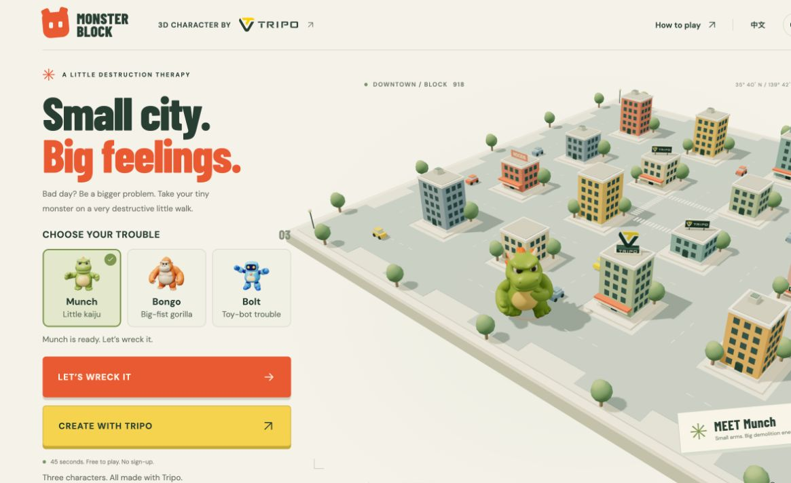
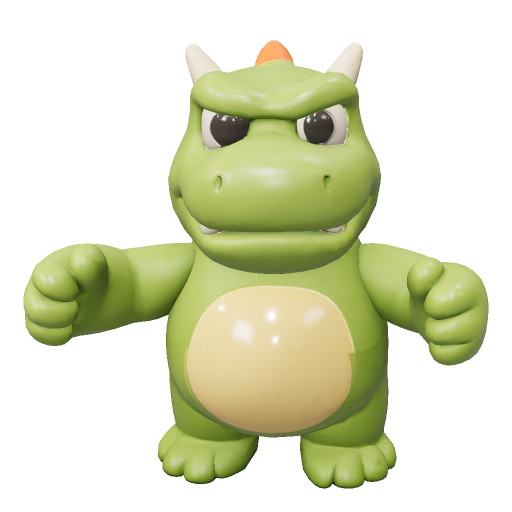
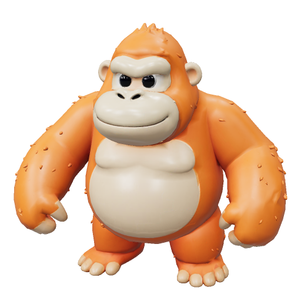
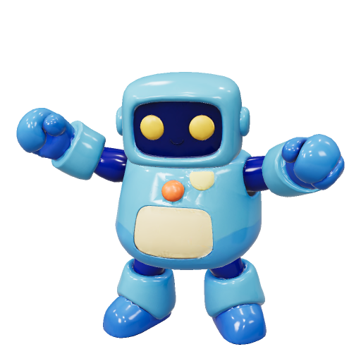
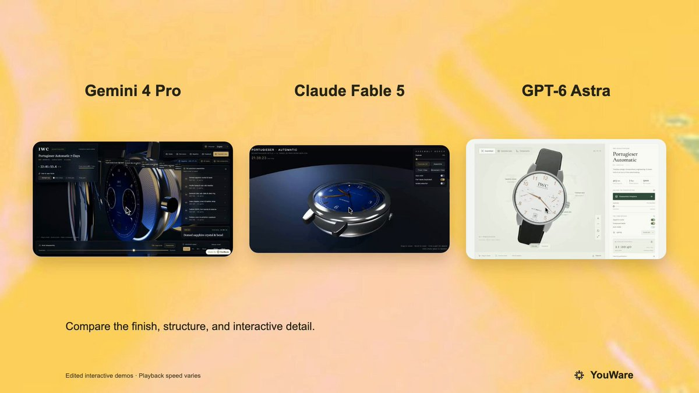

<!-- Generated from Growth CMS. Update content in CMS; run npm run sync. -->

# Awesome Astra Prompts

[](https://github.com/sindresorhus/awesome) [](https://github.com/TripoGrowthLab/awesome-astra-prompts/stargazers) [](../LICENSE) [](https://github.com/TripoGrowthLab/awesome-astra-prompts/actions/workflows/sync-prompts.yml) [](../CONTRIBUTING.md)

<p>
  <a href="../README.md"></a>
  <a href="../README.zh-CN.md"></a>
  <a href="../docs/catalog.zh-Hant.md"></a>
  <a href="../docs/catalog.ja.md"></a>
  <a href="../docs/catalog.ko.md"></a>
  <a href="../docs/catalog.es.md"></a>
  <a href="../docs/catalog.pt.md"></a>
  <a href="../docs/catalog.de.md"></a>
  <a href="../docs/catalog.fr.md"></a>
  <a href="../docs/catalog.it.md"></a>
  <a href="../docs/catalog.ru.md"></a>
  <a href="../docs/catalog.tr.md"></a>
  <a href="../docs/catalog.uk.md"></a>
  <a href="../docs/catalog.vi.md"></a>
</p>

> Создаёте с Claude Opus 5.5? Посмотрите 3D-сцены, игры и симуляции со ссылками на источники в [Awesome Opus 5.5 Prompts](https://github.com/TripoGrowthLab/awesome-opus-5-5-prompts).

<a href="https://www.tripo3d.ai/ru/3d-prompts/models/gpt-6-astra?utm_source=github&amp;utm_medium=referral&amp;utm_campaign=awesome_astra_prompts&amp;utm_content=readme_hero"></a>

**Идеи для вашей следующей игры, сцены или интерактивного мира.**


**353 · Новые промпты Astra**

## Избранные проекты

<table>
<tr>
<td width="50%" valign="top"><a href="https://www.tripo3d.ai/ru/3d-prompts/wright-flyer-through-a-japanese-forest-2096467585785286808"></a><br><strong><a href="https://www.tripo3d.ai/ru/3d-prompts/wright-flyer-through-a-japanese-forest-2096467585785286808">Самолёт братьев Райт среди японского леса</a></strong><br><sub><a href="https://x.com/jaredliu_bravo">Jared</a></sub><br><a href="https://www.tripo3d.ai/ru/3d-prompts/wright-flyer-through-a-japanese-forest-2096467585785286808">Промпт →</a></td>
<td width="50%" valign="top"><a href="https://www.tripo3d.ai/ru/3d-prompts/jelly-jungle-3d-browser-game-2081024333120733188"></a><br><strong><a href="https://www.tripo3d.ai/ru/3d-prompts/jelly-jungle-3d-browser-game-2081024333120733188">Желейные джунгли: 3D-платформер</a></strong><br><sub><a href="https://x.com/jaredliu_bravo">Jared</a></sub><br><a href="https://www.tripo3d.ai/ru/3d-prompts/jelly-jungle-3d-browser-game-2081024333120733188">Промпт →</a></td>
</tr>
<tr>
<td width="50%" valign="top"><a href="https://www.tripo3d.ai/ru/3d-prompts/akari-nagoya-rooftop-flame-relay"></a><br><strong><a href="https://www.tripo3d.ai/ru/3d-prompts/akari-nagoya-rooftop-flame-relay">AKARI: Эстафета огня на крышах Нагои</a></strong><br><sub><a href="https://growthengineer.space/">Jared</a></sub><br><a href="https://www.tripo3d.ai/ru/3d-prompts/akari-nagoya-rooftop-flame-relay">Промпт →</a></td>
<td width="50%" valign="top"><a href="https://www.tripo3d.ai/ru/3d-prompts/cyclops-island-threejs-game"></a><br><strong><a href="https://www.tripo3d.ai/ru/3d-prompts/cyclops-island-threejs-game">Остров циклопа</a></strong><br><sub><a href="https://x.com/jaredliu_bravo">Jared</a></sub><br><a href="https://www.tripo3d.ai/ru/3d-prompts/cyclops-island-threejs-game">Промпт →</a></td>
</tr>
</table>

<a id="all-prompts"></a>

## Новые промпты Astra

<details>
<summary>Посмотреть примеры</summary>

- [Monster Block — 45 секунд на разрушение города](#2100636075039629796)
- [Интерактивная 3D-модель часов IWC Schaffhausen](#2100956517633761447)
- [Галактика на основе реальной орбитальной физики](#2101055500599054437)
- [Фотореалистичная 3D-сцена целиком](#2101224659861590399)
- [Интерактивная 3D-модель авиационного двигателя](#2101271938706685991)
- [Процесс создания 3D-анимации и видео о коте-кунфуисте](#2101310374033428642)
- [3D-модель Waymo Jaguar I-Pace](#2101325346427842909)
- [Парусник в открытом море](#2101616345720787130)
- [Создайте 3D-модель WALL-E в Three.js](#2101687900723106104)
- [Verdant — интерактивный 3D-остров с динозаврами](#2101730386711634251)
- [Интерактивная 3D-модель Солнца](#2102038136725377200)
- [Процедурная браузерная гоночная игра Spline Rush](#2102150615635816866)
- [Интерактивная презентация дизайна 3D-вертолёта](#2102215638311694336)
- [3D-сцена и видео с Токийской башней днём и ночью](#2102276620124062065)
- [Bubble Bay: 3D-битва водяных шаров](#2102300855387205871)
- [TD-игра в духе Sir, We Have Orc Problems](#2102411087002112256)
- [Двухэтажный пригородный дом с интерьером](#2102473710724919614)
- [3D-гонка на картах в одном HTML-файле](#2102652927177617564)
- [Анимация средневекового замка в браузере](#2102672926285713456)
- [Orbit Lab: 3D-симуляция Солнца, Земли и Луны](#2102752217375899659)
- [Средневековый европейский 3D-замок с управлением в браузере](#2102780850706567390)
- [Интерактивная 3D-доска для изучения шахматных гамбитов](#2102788013902213508)
- [Шейдер бесконечного соларпанк-города](#2102826333550133520)
- [Бургерный симулятор от первого лица](#2102897258983313712)
- [Гиперреалистичная интерактивная HTML-сцена с костром в пустыне](#2102915300295369208)
- [Воксельный Codex в Three.js](#2102956340482289944)
- [Интерактивная 3D-долька цитруса](#2103062348168618280)
- [На север: интерактивное путешествие на драккаре](#2103187935759655167)
- [Туманное осеннее исследуемое пространство на Three.js](#2103211135214256350)
- [STILLWATER — лунное болото в браузере](#2103308083242082314)
- [Римское поле битвы в золотой час](#2103351755971207251)
- [Желе из питахайи](#2103432732386664591)
- [3D-моделирование одежды для VRChat](#2103456264785424530)
- [Создание морской свинки в Blender](#2103482826519986544)
- [Японский сад в воксельном стиле на Three.js](#2103486103831339269)
- [Воксельная WebGL-сцена «корабль в бутылке»](#2103855977376125161)
- [Лесная деревня у озера](#2103860776419111285)
- [Захват ускорителя Super Heavy в Blender](#2103966922127630820)
- [Интерактивная 3D-демонстрация хода света в объективе](#2104077535315144878)
- [Интерактивный 3D-ломтик арбуза-желе](#2104504957173153951)
- [Игра в духе Genshin Impact и инструмент редактирования ландшафта](#2104531704740512143)
- [J-образный крюк для 3D-печати и испытания на прочность](#2104590493191479337)
- [Интерактивная образовательная 3D-модель CRISPR](#2104605522640970208)
- [Интерактивная прогулка на лодке по джунглям при лунном свете](#2104613125093998674)
- [Трансформирующийся спорткар с рентгеновским режимом и покомпонентным представлением](#2104654448878387313)
- [Высокодетализированная 3D-модель человеческого глаза](#2104841727496323479)
- [Время, разобранное по частям.](#2105009377002299711)
- [Реалистичная модель F-22 Raptor и видео полёта в Godot](#2105027152617918852)
- [Кинематографичная фотореалистичная сцена запуска ракеты](#2105047166733746209)
- [Рендер моста Золотые Ворота в Blender](#2105278999861526953)
- [Создайте 3D-персонажа-миньона в Blender](#2105298955307303100)
- [Воссоздание сцены в Isaac Sim](#2105323534398763307)
- [Золотая миниатюрная 3D-диорама с пирамидами](#2105412081692352654)
- [3D-игра с уклонением от астероидов](#2105644436659290409)
- [Управляемая 3D-сцена с лодкой на горной реке](#2106385060106777043)
- [3D-пространство дома для прогулки в браузере](#2106737391948235164)
- [Создайте кинематографичный трейлер для вымышленной игры](#2106824464092770455)
- [3D-игра: соберите 10 осколков звёзд на ночном островке](#2106944804756275690)
- [Плюшевый паук — Исследования материалов № 015](#2107127712871505976)
- [Банановый желеобразный сад](#2107186979502776590)
- [Интерактивная энциклопедия дикой природы Wild Atlas](#2107479802152472717)
- [Плюшевый кальмар.](#2107533363808485534)
- [Вилла Jelly](#2107617244301664483)
- [Визуализация «Невидимых городов» в Three.js](#2107824019999535226)
- [3D-сайт Lealand Tea с анимацией, управляемой прокруткой](#2107872378218779067)
- [Интерактивная WebGPU-диорама лагуны Atoll Jelly](#2107977531726934288)
- [Интерактивная лаборатория желе на Three.js с физикой деформации при перетаскивании](#2108096737537929361)
- [3D-воксельный мир с пеликаном на велосипеде](#2108203260058259830)
- [Интерактивная WebGPU-диорама Pirate Jelly](#2108336208891801999)
- [Кинематографичная 3D-презентация умных часов ORBIT](#2108438685184401904)
- [Интерактивный учебный 3D-макет реактивного двигателя](#2108459952683811167)
- [Детализированная визуальная 3D-презентация AH-64E Apache Guardian](#2108475056082850278)
- [Интерактивная клавиатура из мёда](#2108501256067285443)
- [Интерактивные 3D-мармеладные игральные кости](#2108505251036774875)
- [Интерактивный парящий неоновый остров](#2108574047948656981)
- [Интерактивная WebGPU-диорама Castle Jelly](#2108649845405929924)
- [Photoshop для гауссовых сплаттов](#2108711089827647965)
- [Интерактивная 3D-симуляция ткани на хромированной сфере](#2108912938656407888)
- [Персонаж Марио в Three.js](#2108976915449012592)
- [Интерактивная реалистичная 3D-сцена с автомобилем на шоссе](#2108981890493358527)
- [Интерактивная 3D-экосистема приливной лужи Tidepool Jelly](#2109015574177075610)
- [Психоделическая 3D-визуализация на Three.js и WebGPU](#2109060292667982172)
- [Открытый низкополигональный город для свободной езды](#2109153428635267345)
- [Модель гоблина в Blender с анимацией ходьбы](#2109268147068862675)
- [Исследование материалов плюшевого пингвина в WebGPU](#2109288662319919127)
- [Интерактивный WebGPU-опыт с плюшевым осьминогом](#2109323102912156142)
- [Интерактивная диорама святилища «Тории во время прилива»](#2110014604524896392)
- [Интерактивная мармеладная деревня в снежном шаре](#2110045415412281495)
- [Старинный каменный маяк на скалистом утёсе в сумерках](#2110054195734982817)
- [Тропическая 3D-игра в стиле Flappy Bird](#2110069699597971828)
- [Взрывная схема часов в стиле Rolex](#2110070382002921482)
- [Огр в Blender с анимацией ходьбы](#2110139804805693469)
- [Интерактивное 3D-объяснение работы игровой мыши](#2110371046071382042)
- [3D-симуляция винтовой орбиты Солнечной системы, движущейся по галактике](#2110380365269639613)
- [Battle City 3D: бесконечная танковая оборона](#battle-city-3d)
- [Crazy Tanks — 3D-артиллерия на острове](#crazy-tanks-3d-island-artillery)
- [Golden Miner: 3D-игра о добыче золота на 24 уровнях](#golden-miner)
- [Желейная вилла](#jelly-villa)
- [Красный свет, зелёный свет: 3D-игра на выживание](#red-light-green-light)
- [TITANIC — Последний свет](#titanic-the-last-light)

</details>

<a id="2100636075039629796"></a>

### Monster Block — 45 секунд на разрушение города

[Tony](https://x.com/abc30037274) · 2026-09-18

<a href="https://www.tripo3d.ai/ru/3d-prompts/monster-block"></a>

<a href="https://www.tripo3d.ai/ru/3d-prompts/monster-block"></a>

<a href="https://www.tripo3d.ai/ru/3d-prompts/monster-block"></a>

<a href="https://www.tripo3d.ai/ru/3d-prompts/monster-block"></a>

Выберите маленького кайдзю Манча, гориллу Бонго или робота Болта. Крушите здания, бросайте машины и собирайте комбо в 45-секундном 3D-разгроме города. Все три анимированных персонажа созданы с помощью Tripo.

**Промпт**

```text
# Monster Block — спецификация восстановления

## 1. Цель проекта

Создайте браузерную игру Monster Block. Игрок выбирает игрушечного монстра, попадает в миниатюрный город и за 45 секунд разрушает как можно больше зданий. Перемещение, удары когтями по зданиям, броски машин и цепочки разрушений должны сразу сопровождаться визуальной и звуковой обратной связью. В конце покажите счёт, титул, действие для повторной попытки и ссылку на испытание, по которой друг сможет сыграть на той же карте. Интерфейс должен поддерживать английский и упрощённый китайский языки, а также управление с клавиатуры и сенсорного экрана.

## 2. Визуальный стиль

Создайте тёплую диораму на столе: толстая квадратная платформа на кремовом фоне. Используйте здания в пастельных тонах с минимумом деталей, небольшими тёмно-бирюзовыми окнами, светлыми парапетами крыш, широкими дорогами приглушённого зелёно-серого цвета, зебрами, округлыми деревьями, крошечными машинами и мягкими тёплыми тенями. В палитре зданий должны быть терракотовый, горчичный, пыльно-бирюзовый, розовый, серо-синий, кремовый и шалфейный цвета. Материалы должны выглядеть как матовые окрашенные игрушки, а не блестящий металл.

Используйте камеру с высокой перспективой три четверти, а не плоский вид сверху. Исходная камера расположена в точке (35, 37, 41), направлена на (0, 0.4, 0) и использует угол обзора 38 градусов на широких экранах, 44 градуса на экранах средней ширины и 51 градус на узких экранах. Во время игры камера должна плавно следовать за монстром, сохраняя ближайшие цели в поле зрения. Осветите сцену тёплым полусферическим источником, мягким направленным источником с тенями и холодным заполняющим светом.

Для крупных английских заголовков используйте плотный жирный дисплейный шрифт, а для инструкций — хорошо читаемый гротеск. Сочетайте тёмно-зелёный текст, кремовые поверхности, оранжевые действия запуска игры и жёлтые действия создания в Tripo. На главной странице кнопки Play и Create with Tripo должны иметь одинаковую заметность. В диалоге паузы разместите тёмно-зелёную карточку Tripo с тремя миниатюрами персонажей и жёлтой кнопкой создания над контурной кнопкой Resume. Текст справки должен оставаться комфортно читаемым на телефонах.

Используйте короткие эффекты, запускаемые действиями игрока: взмахи когтями, краткую отдачу зданий, отчётливые эффекты попадания и разрушения, расходящиеся кольца от топота, небольшие всплески обломков, всплывающие значения счёта, изменения комбо и сдержанный направленный толчок камеры. Поднимайте схваченную машину в руку примерно за 220 мс. При включённом режиме уменьшения анимации отключайте тряску, всплески обломков и масштабирование интерфейса, но сохраняйте счёт, подсказки для целей и результаты разрушений.

## 3. Мир и сцена

Разместите 16 разрушаемых зданий в сетке 4 × 4. Используйте расстояние между кварталами 10.4, центры кварталов на расстоянии -1.5, -0.5, 0.5 и 1.5 от этого значения и по пять проспектов вдоль каждой оси. Ширина платформы — 52.6 единицы. Здания должны иметь от двух до пяти этажей, различающиеся основания, детали крыш, отдельные навесы и небольшие вывески HOTEL или NOODS. Генерируйте планировку детерминированно на основе сида.

Разместите 12 машин вдоль дорог и одну гарантированно доступную для броска жёлтую машину рядом с начальной игровой позицией. Добавьте деревья вокруг участков со зданиями и по краям платформы, четыре угловых фонаря, разметку полос и центральный переход. В начале поместите монстра на свободный проспект в точку (0, 0.2, 10.4); для главной страницы используйте переднюю позицию ожидания z=20.8.

Один и тот же параметр карты должен воспроизводить одну и ту же планировку зданий. Если параметр отсутствует, выводите сид карты из даты UTC. Параметр beat задаёт целевой счёт друга. При повторной попытке сохраняйте выбранную карту. Случайные обломки не обязаны быть детерминированными.

## 4. Список ассетов

Сохраняйте стабильные ID ассетов и отделяйте визуальные модели от прокси-коллайдеров игрового процесса.

- munch: Munch / 阿猛, зелёный динозавр по умолчанию. Сохраните исходную округлую морду, кремовое брюхо и рога, оранжевые шипы на спине, короткие руки, большие ступни и длинный хвост. Загружайте /assets/monster-animated.glb и нормализуйте его высоту до 5.6 единицы. Сохраняйте /assets/monster.glb как статический запасной вариант.
- bongo: Bongo / 橘拳, оранжевая игрушечная горилла с огромными кулаками и широким телом. Загружайте /assets/bongo-animated.glb и нормализуйте её высоту до 4.5 единицы.
- bolt: Bolt / 蓝电, синий игрушечный робот с массивными конечностями и дружелюбным силуэтом. Загружайте /assets/bolt-animated.glb и нормализуйте его высоту до 4.9 единицы.
- Для каждого персонажа предусмотрены соответствующий PNG предпросмотра и клипы ожидания, бега и удара. Сохраните всех трёх реально выбираемых персонажей; переключение должно обновлять и предпросмотр, и модель, используемую в следующем раунде.
- city_building: процедурно создаваемые повторно используемые группы зданий с отдельно отслеживаемыми здоровьем, границами коллайдера, отдачей при попадании и состоянием разрушения. Парапеты крыш, основания и навесы входят в коллизионный объём.
- city_car: процедурно создаваемые повторно используемые машины, которые можно бросать. Отдельно храните состояния машины в руке, в полёте и после разрушения. На трёх машинах разместите жёлтый брендинг Tripo.
- city_decor: процедурные деревья, фонари, тротуары, вывески и дорожная разметка. Сохраняйте лёгкость ассетов, повторно используйте геометрию и материалы.
- tripo_scenery: одна скульптура с логотипом на крыше, две вывески на крышах, витрина мастерской и три брендированные машины. Создайте их из предоставленного логотипа Tripo и процедурных мешей. Это декорации сцены, а не дополнительные модели, сгенерированные через API, и не усилители игрового процесса.

Три модели персонажей — приоритетные ассеты Tripo. При наличии повторно используйте предоставленные сгенерированные и зариггированные GLB-файлы. Для нового персонажа создайте соответствующую модель в игрушечном стиле, проверьте пригодность рига, выполните скиннинг, создайте анимации ожидания, бега и удара и проверьте пропорции перед добавлением в список персонажей. Не вызывайте API генерации при начале раунда. Загрузка персонажей и автоматический импорт собственных работ игрока не входят в эту версию.

## 5. Игровой процесс и обратная связь

Поддержите WASD или клавиши со стрелками для перемещения, удержание Space для повторных атак когтями, E для захвата ближайшей машины и повторное нажатие E для броска, R для топота и Escape для паузы. На сенсорных экранах добавьте виртуальный джойстик и отдельные кнопки атаки, захвата/броска и топота. При постановке игры на паузу или потере фокуса сбрасывайте зажатые вводы.

Используйте следующие правила:

- Раунд длится 45 секунд. Здоровье здания равно числу этажей плюс единица, то есть составляет 3–6 единиц.
- Удар когтями наносит 1 единицу урона, интервал между атаками — 0.42 секунды.
- Топот наносит каждому зданию в радиусе 3 единицы урона и имеет перезарядку 7 секунд.
- Брошенная машина наносит зданиям в зоне попадания 4 единицы урона и приносит 75 базовых очков за попадание машины.
- Попадание по зданию приносит 20 очков, умноженных на текущий множитель. За разрушение начисляйте round(180 + высота здания × 50) очков, умноженных на текущий множитель, после увеличения комбо разрушений.
- Если снова разрушить здание в течение 3.5 секунды, комбо продолжается. Обычные попадания не продлевают это окно. Множитель равен min(5, 1 + floor(combo / 2)).
- Уничтожение всех 16 зданий завершает раунд и приносит ceil(оставшиеся секунды) × 100 очков. В противном случае раунд заканчивается, когда время достигает нуля; после этого новые очки не начисляются.

В игре нет врагов, битв с боссами, здоровья игрока и штрафов за смерть. Испытание заключается в выборе маршрута, эффективном использовании машин и топота, а также поддержании комбо разрушений. Показывайте оставшееся время, счёт, число разрушенных зданий, множитель и перезарядку топота. Недоступные действия должны быть понятны и не должны блокировать перемещение. Различайте холостой взмах и успешное попадание с помощью звуковой и визуальной обратной связи.

Рассчитывайте перемещение и повороты с учётом выборочного анимированного габарита каждого персонажа, включая руки и хвост. Проверяйте столкновения с полными границами зданий, оставляя небольшой зазор. Монстр должен иметь возможность атаковать из допустимой позиции для стояния. После разрушения здания разрешайте проходить через его участок. Не допускайте застревания игрока в углах и прохождения хвоста через целое здание при повороте.

Ставьте на паузу таймер и ввод при нажатии Escape, кнопки паузы, потере фокуса окном и скрытии вкладки. Добавьте сценарии Resume, Retry и Home. В конце показывайте счёт, количество разрушений, лучшее комбо, шуточный титул и ссылку на испытание на той же карте. Предоставьте для скачивания карточку со счётом размером 1080 × 1350 и, если поддерживается MediaRecorder, запись раунда в поддерживаемом формате MP4 или WebM. Используйте нативный шаринг, если он доступен, а для ссылок на испытание предусмотрите запасной вариант с буфером обмена. Никогда не выдавайте вычисленный браузером счёт за защищённый соревновательный рейтинг.

## 6. Техническая реализация

Используйте Three.js, TypeScript и Vite со статической сборкой dist. Разделите генерацию мира, правила, коллизии, персонажей, рендеринг, звук, запись, аналитику и UI на отдельные модули. Храните шрифты и необходимые ассеты декодеров локально. Используйте инстансинг для повторяющихся окон и дорожной разметки, повторно применяйте материалы и геометрию. Ограничьте pixel ratio рендера значением 1.65. Ограничивайте временные эффекты и освобождайте их ресурсы после завершения или сброса.

Используйте GLTFLoader, микшеры скелетной анимации и предоставленные GLB-клипы. Нормализуйте каждую модель относительно центрированного опорного пивота на земле. Исходные экспортированные модели направлены по оси +X; поверните визуальный пивот на -90 градусов вокруг Y, чтобы выровнять его с направлением +Z игры. Сначала проигрывайте анимацию ожидания и только потом показывайте загруженную модель; ступни в анимации должны оставаться близко к земле. Если загрузка не удалась, отображайте видимый процедурный запасной вариант и честно сообщайте об ошибке. Защитите асинхронный выбор персонажа, чтобы более старая загрузка не заменила последнюю выбранную модель.

Храните данные коллизий персонажа отдельно от мешей рендера и заново запекайте выборочные габариты при смене персонажа или анимаций. Проверяйте перемещение и поворот рядом со стенами. Сохраните стабильную работу клавиатурного и сенсорного ввода, адаптивные диалоги, локализованный текст, поведение фокуса, отключение звука, режим уменьшения анимации и восстановление WebGL.

Свяжите действия создания в Tripo с https://www.tripo3d.ai/, добавив utm_source=monster_block, utm_medium=referral, utm_campaign=monster_block_game и зависящий от размещения параметр utm_content: header_logo, hero_create, pause_create, result_create или footer_logo. Открывайте эти действия в отдельной вкладке и сначала ставьте активную игру на паузу. Объясните, что Tripo создаёт 3D-ассеты; не обещайте их автоматический импорт в эту игру.

Сохраните существующую интеграцию событий Pageview и PostHog, если это допускается политикой хостинга. В статической сборке используйте только общедоступную конфигурацию для приёма данных из браузера. Учётные данные для генерации, CMS, развёртывания и персональной аналитики храните вне исходного кода и артефактов сборки. Записывайте вход на страницу, выбор персонажа, запуск игры, первые действия, результаты раунда, повторную попытку, отправку/экспорт и исходящие клики по Tripo, но не считайте клики подтверждёнными регистрациями или платежами.

## 7. Критерии готовности

Предоставьте запускаемый исходный код, локальные ассеты, статическую production-сборку и понятные инструкции по установке, запуску и сборке. Проверьте выбор всех трёх персонажей, полноценный раунд с таймером, разрушение зданий, захват и бросок машин, перезарядку топота, завершение комбо, паузу/возобновление, повторную попытку и подсчёт в конце раунда. Убедитесь, что исходный динозавр по-прежнему доступен для выбора, а все три персонажа могут перемещаться и поворачиваться рядом со зданиями без заметного проникновения в геометрию и застревания.

Проверьте английскую и китайскую версии интерфейса на десктопе и узких мобильных экранах, включая читаемый текст справки, сенсорное управление, действия паузы и отправку результатов. Проверьте адреса CTA Tripo и значения UTM для разных размещений, экспорт карточки со счётом и запасной сценарий записи. Протестируйте развёрнутую страницу и фактическое окружение iframe CMS: загрузку моделей, ввод, внешние ссылки и скачивание. Сообщайте об ограничениях браузеров и устройств, не заявляя о повсеместной поддержке или стабильной частоте кадров без подтверждённых измерений.

```

[Подробнее ↗](https://www.tripo3d.ai/ru/3d-prompts/monster-block) · [Исходная публикация](https://x.com/abc30037274/status/2100636075039629796) · [Демо](https://monster-block.tripo.page/) · [Назад к примерам](#all-prompts)

---

<a id="2100956517633761447"></a>

### Интерактивная 3D-модель часов IWC Schaffhausen

[YouWare](https://x.com/YouWareAI) · 2026-09-18

<a href="https://www.tripo3d.ai/ru/3d-prompts/gpt-6-astra-2100956517633761447"></a>

В комментарии подтверждённого автора приведён промпт для высокодетализированной интерактивной 3D-модели часов IWC Schaffhausen на Three.js. В нём описаны механические компоненты, каждый из которых должен быть визуально различим, реалистичное сапфировое стекло, движение стрелок в реальном времени, а также интерактивная разборка и сборка часов. В исходной публикации этот промпт представлен как общий тестовый запрос в сравнении GPT-6 Astra с другими моделями.

**Промпт**

```text
Используйте Three.js для создания высокоточной интерактивной 3D-модели часов IWC Schaffhausen. Требования: 1) конструкция циферблата должна быть максимально точной, а каждый механический компонент — отображаться отдельно и быть хорошо различимым; 2) для стекла циферблата используйте материал сапфирового стекла с реалистичными эффектами прозрачности, преломления и отражения; 3) минутная и секундная стрелки должны корректно отображать ход времени в соответствии с логикой реального часового механизма, а их движение — автоматически и непрерывно анимироваться; 4) предусмотрите разборку и сборку часов, чтобы каждую деталь можно было отделить и рассмотреть отдельно; 5) общий уровень детализации должен быть исключительно высоким, с точным соответствием конструкции и пропорциям настоящих часов, реалистичными текстурами винтов, металлических деталей и других компонентов, а также тонкой проработкой. Убедитесь, что модель плавно работает в браузере и естественно реагирует на действия пользователя.
```

[Подробнее ↗](https://www.tripo3d.ai/ru/3d-prompts/gpt-6-astra-2100956517633761447) · [Исходная публикация](https://x.com/YouWareAI/status/2100958838350643553) · [Назад к примерам](#all-prompts)

---

<a id="2101055500599054437"></a>

### Галактика на основе реальной орбитальной физики

[Argona](https://x.com/Argona0x) · 2026-09-18

<a href="https://www.tripo3d.ai/ru/3d-prompts/gpt-6-astra-2101055500599054437"></a>

Автор представляет этот однопредложный промпт для GPT-6 Astra как вводные данные для детерминированной симуляции галактики и 30-секундного полёта сквозь неё. В промпте запрашиваются реальные орбитальные расчёты и 320 000 звёзд.

**Промпт**

```text
галактика на основе реальной орбитальной физики, 320 000 звёзд, один полёт сквозь неё, 30 секунд
```

[Подробнее ↗](https://www.tripo3d.ai/ru/3d-prompts/gpt-6-astra-2101055500599054437) · [Исходная публикация](https://x.com/Argona0x/status/2101055500599054437) · [Назад к примерам](#all-prompts)

---

<a id="2101224659861590399"></a>

### Фотореалистичная 3D-сцена целиком

[Julian Goldie SEO](https://x.com/JulianGoldieSEO) · 2026-09-19

<a href="https://www.tripo3d.ai/ru/3d-prompts/gpt-6-astra-2101224659861590399"></a>

Создайте полноценную фотореалистичную 3D-сцену по концепции без заданных рамок.

**Промпт**

```text
Создайте полноценную фотореалистичную 3D-сцену. Удивите меня.
```

[Подробнее ↗](https://www.tripo3d.ai/ru/3d-prompts/gpt-6-astra-2101224659861590399) · [Исходная публикация](https://x.com/JulianGoldieSEO/status/2101224659861590399) · [Назад к примерам](#all-prompts)

---

<a id="2101271938706685991"></a>

### Интерактивная 3D-модель авиационного двигателя

[YouWare](https://x.com/YouWareAI) · 2026-09-19

<a href="https://www.tripo3d.ai/ru/3d-prompts/gpt-6-astra-2101271938706685991"></a>

Многоразовый промпт от YouWare для интерактивной веб-презентации авиационного двигателя в 3D с высокой детализацией. В нём запрашивается подробная модель двигателя с пошаговой разборкой и взаимодействием в режиме взрыв-схемы, информацией о деталях по клику или при наведении, а также плавным управлением камерой. В исходной публикации указано, что этот же промпт запускался в GPT-6 Astra и Gemini 4 Pro.

**Промпт**

```text
Используйте three.js, чтобы создать на веб-странице интерактивную 3D-модель авиационного двигателя.
Ориентируйтесь на философию дизайна взаимодействия Jigspace, чтобы добиться реалистичной модели с почти полной реконструкцией в масштабе 1:1 и точно сохранить детали материалов и текстур — металла, трубопроводов, лопаток и других элементов. Обязательные интерактивные возможности: пошаговая анимация разборки, взрыв-схема компонентов, а также описания деталей и объяснения принципов работы, открывающиеся по клику или при наведении курсора.
В целом модель должна поддерживать плавное управление камерой и понятное взаимодействие с пользователем, обеспечивая комфортную работу в браузере и наглядно демонстрируя устройство двигателя и принципы его работы.
```

[Подробнее ↗](https://www.tripo3d.ai/ru/3d-prompts/gpt-6-astra-2101271938706685991) · [Исходная публикация](https://x.com/YouWareAI/status/2101272224435253432) · [Назад к примерам](#all-prompts)

---

<a id="2101310374033428642"></a>

### Процесс создания 3D-анимации и видео о коте-кунфуисте

[PixVerse](https://x.com/PixVerse) · 2026-09-19

<a href="https://www.tripo3d.ai/ru/3d-prompts/gpt-6-astra-2101310374033428642"></a>

В подтверждённом комментарии PixVerse этот текст представлен как промпт, использованный в Hermes Agent. В исходной публикации создатель PixVerse @woleswoosh указан автором демонстрации с котом-кунфуистом; также сказано, что ролик создан с помощью GPT-6 Astra + Blender. Промпт instructs агента создать облегчённые меши и анимацию в Blender для неподвижного, невозмутимого полосатого кота, отбивающего летящие руки во дворе японского храма, отрендерить 10-секундный MP4 с референсом движения, а затем сгенерировать фотореалистичное видео в разрешении 1080p с помощью PixVerse CLI и Seedance 2.5.

**Промпт**

```text
Фотореалистичный кинематографичный дубль без склеек, 10 секунд, 16:9, 24 кадра/с, неподвижная камера, без монтажных переходов.
 Рыже-белый полосатый кот (белые морда, грудка и лапы, рыжие полосы табби с буквой «M» на лбу) сидит прямо по центру кадра, лицом к объективу, в жёсткой боевой стойке — взгляд плоский, невозмутимый, безразличный, глаза полуприкрыты, рот закрыт, голова неподвижна. На нём чёрная повязка хатимаки, низко завязанная поперёк лба; узел сзади, уши торчат над повязкой.
 Локация: традиционный двор японского храма — тёплые деревянные столбы, свесы крыш и перила, растворяющиеся в кремовом боке золотого часа. Объектив 85 мм, f/1.8, чрезвычайно малая глубина резкости, фокус зафиксирован на глазах кота. Тёплая цветокоррекция 3500 K, мягкий рисующий свет спереди справа, слегка заполненные тени, мелкое плёночное зерно.
 ДЕЙСТВИЕ: обнажённая человеческая рука резко появляется слева в кадре и быстро тянется раскрытой ладонью к морде кота; сильный смаз движения. Кот спокойно поднимает правую переднюю лапу и парирует удар, перехватывая ладонь и гася импульс атаки — он блокирует, а не шлёпает. Рука горизонтально проносится перед мордой кота в размытии, затем справа сверху опускается вторая рука; кот отклоняет каждую атаку коротким минимальным блоком лапой, тело и голова остаются совершенно неподвижными, взгляд не отрывается от объектива. Нападающая сторона — руки; кот лишь реагирует и остаётся невозмутимым. Руки делают обманные выпады с обеих сторон; кот переходит в стойку боксёра с двумя лапами на уровне груди, лапы согнуты, локти прижаты к корпусу, и замирает в ожидании. Он резко выбрасывает быстрые одиночные контрудары с размытием, в стиле кунг-фу перехватывая летящие руки в воздухе; голова по-прежнему направлена вперёд. Наконец он резко вытягивает правую лапу прямо в объектив, розовая подушечка обращена к камере, пока лапа не заполняет кадр мягкой расфокусированной фигурой на переднем плане; морда за ней остаётся предельно резкой, холодный взгляд не меняется.
 Движение: естественная скорость, настоящий смаз движения на летящих руках и быстрых блоках лапами. Защитные, минимальные, экономные движения кота — он почти не двигается, всю работу выполняют руки, но безуспешно. Камера неподвижна, без зума, без текста.
 НЕГАТИВНЫЙ ПРОМПТ: лишние конечности, сросшиеся или мутировавшие лапы, лишние пальцы, искажённая морда, повязка, сливающаяся с шерстью, пластиковая кожа, перенасыщенные цвета, текст, субтитры, логотип, водяной знак, монтажные склейки, дрожание камеры, игривые или торжествующие движения тела, жест «дай пять».
 КРАТКАЯ ВЕРСИЯ:
 Рыже-белый полосатый кот в чёрной повязке хатимаки сидит в залитом солнцем дворе японского храма и невозмутимо смотрит в камеру; объектив 85 мм, f/1.8, малая глубина резкости, золотой час, плёночное зерно. Человеческие руки быстро наносят рубящие и прямые удары по его морде с обеих сторон, с размытием движения; кот спокойно парирует каждый удар минимальным блоком лапой, не двигая головой. Он принимает стойку кунг-фу с двумя лапами, наносит быстрые размытые контрудары, затем вытягивает лапу в объектив, пока подушечка не заполнит кадр. Неподвижная камера, один дубль, 10 с, 16:9, 24 кадра/с, фотореализм, без текста.
 Небольшая заметка по кадру: руки преимущественно входят слева (нисходящий рубящий удар и горизонтальный замах), контакт происходит с запястьем или ладонью — не лапа к лапе. Стойка с двумя лапами — примерно на 4,0–5,6 с, размытые контрудары — на 5,6–8 с, финальное движение лапой к объективу — на 8–10 с. Ваша задача — создать 3D-сцену и анимацию в Blender через Blender MCP, получить результат длительностью 10 с при 24 кадрах/с и отрендерить сверхреалистичную сцену в PixVerse CLI с использованием Seedance 2.5 в качестве видеомодели.
 ШАГИ АГЕНТА: Проверьте Blender MCP, аутентификацию PixVerse CLI, возможности модели и доступный баланс кредитов. Сообщите предполагаемую стоимость и получите согласие на расходы до платной генерации. Преобразуйте промпт в покадровый план с таймингом, создайте облегчённые 3D-меши и анимацию через официальный Blender MCP, отрендерите MP4 с референсом движения и проверьте кадрирование, движение, контакты, длительность и частоту кадров. Перед отправкой видео отдельно создайте и проверьте изображение-референс внешнего вида. Используйте изображение для передачи идентичности, стиля и освещения, а видео из Blender — для передачи движения и тайминга. После генерации скачайте результат, проверьте технические характеристики, изучите ключевые кадры, честно сообщите об отклонениях и рассчитайте фактический расход кредитов. Сохраняйте оригиналы; никогда незаметно не переключайте модели и не запускайте повторную генерацию.
 ВЫЗОВ PIXVERSE: Используйте pixverse create image с gpt-image-2.0, чтобы создать референс внешнего вида в подтверждённом соотношении сторон, разрешении 1080p и с высокой детализацией. Затем используйте pixverse create reference с подтверждённой видеомоделью, передав оба --images and --videos to и объединив изображение внешнего вида с референсом движения из Blender. Для Seedance 2.5 используйте --model seedance-2.5 --task-type auto, подтверждённые длительность и соотношение сторон, а также --quality 1080p --count 1.. Перед отправкой проверьте текущие возможности, используйте уникальные ключи идемпотентности и отслеживайте выполнение через pixverse task status / pixverse task wait.
 ФИНАЛЬНЫЙ РЕЗУЛЬТАТ: Верните готовое видео с подтверждёнными соотношением сторон и длительностью, целевым разрешением 1080p и частотой 24 кадра/с, а также изображение-референс внешнего вида, проект Blender .blend и MP4 с референсом движения. Укажите абсолютные локальные пути или URL для скачивания. Сохраните формат итогового отчёта: Видео, Изображение-референс, Меш + анимация Blender, Проверка, Внешний вид и Израсходованные кредиты. Укажите фактическое разрешение, частоту кадров, количество кадров, длительность, визуальные отклонения, стоимость кредитов на изображение и видео, общую сумму расходов, оставшийся баланс и выполнялась ли повторная генерация.
```

[Подробнее ↗](https://www.tripo3d.ai/ru/3d-prompts/gpt-6-astra-2101310374033428642) · [Исходная публикация](https://x.com/PixVerse/status/2101310387081908606) · [Назад к примерам](#all-prompts)

---

<a id="2101325346427842909"></a>

### 3D-модель Waymo Jaguar I-Pace

[Harshith](https://x.com/HarshithLucky3) · 2026-09-19

<a href="https://www.tripo3d.ai/ru/3d-prompts/gpt-6-astra-2101325346427842909"></a>

<a href="https://www.tripo3d.ai/ru/3d-prompts/gpt-6-astra-2101325346427842909"></a>

Автор сообщает, что использовал этот промпт с GPT-6 Astra Max в Codex для создания 3D-модели Waymo Jaguar I-Pace в Three.js. По его словам, референс не использовался, а получившийся автомобиль не был похож на реальную машину.

**Промпт**

```text
3D-модель Waymo Jaguar I-Pace с использованием Three.js
```

[Подробнее ↗](https://www.tripo3d.ai/ru/3d-prompts/gpt-6-astra-2101325346427842909) · [Исходная публикация](https://x.com/HarshithLucky3/status/2101325346427842909) · [Назад к примерам](#all-prompts)

---

<a id="2101616345720787130"></a>

### Парусник в открытом море

[www.aicontenders.dev](https://www.aicontenders.dev/) · 2026-09-20

<a href="https://www.tripo3d.ai/ru/3d-prompts/gpt-6-astra-2101616345720787130"></a>

Опубликовано на указанной странице сравнения AIContenders и протестировано вместе с другими моделями на GPT-6-astra. Задание требует создать интерактивную 3D-сцену с парусником в одном файле, процедурно анимируемой водой, двумя островами, движением лодки с учетом волн, навигацией в обход суши и плавно следующей камерой.

**Промпт**

```text
Создайте один HTML-файл с 3D-сценой, в которой небольшой парусник движется по открытому морю. Предусмотрите управление лодкой и маршрут, огибающий два видимых острова, по аналогии с демонстрациями «игр про лодки», которые использовались в недавних тестах моделей.

Функциональные требования:

Водная поверхность должна быть анимированной волновой сеткой (процедурный шейдер воды, движущиеся волны, блики, меняющиеся в зависимости от угла обзора, и кильватерный след за лодкой), а не плоской статичной текстурой.
Парусник должен быть собран из простых форм (корпус, мачта, наполненный ветром парус), заметно покачиваться и слегка наклоняться на волнах синхронно с движением воды под ним.
Разместите в сцене два разных острова в разных точках. Для каждого предусмотрите простую форму рельефа (возвышенность, пляж, при желании — растительность) и тень, падающую на окружающую воду.
Лодка должна следовать по маршруту, действительно обходящему оба острова: она не должна пересекать их силуэты или проходить сквозь сушу. Повороты должны быть плавными, без резких скачков между углами.
Камера должна следовать за лодкой с небольшой задержкой (сглаженное следование камеры), создавая ощущение динамической погони, а не жестко привязанного вида сверху.
Добавьте градиентное небо (например, закатное или дневное голубое — на выбор модели) с солнцем или отражением света на воде, направление которого согласуется с тенями от островов.

Технические требования:

Один файл .html; разрешается использовать three.js с cdnjs, но другие внешние ресурсы и текстуры запрещены. Вода и рельеф должны полностью генерироваться процедурно в коде или шейдере.
Маршрут вокруг островов может быть заранее заданным (например, кривой Безье, проходящей между островами) или реализованным с помощью простого управления, реагирующего на положение лодки — на выбор модели, но столкновения с сушей недопустимы.
Анимация должна плавно работать не менее 20 секунд — в цикле или непрерывно — с частотой не менее 30 кадров/с на обычном ноутбуке. Разрешение canvas не должно превышать размер окна, а devicePixelRatio следует ограничить значением не выше 1.5, чтобы не перегружать экраны с высокой плотностью пикселей.

Основные критерии оценки: насколько убедительно вода выглядит как движущаяся жидкость (а не текстура с анимированным смещением UV), действительно ли лодка реагирует на волны и выглядит ли маршрут вокруг островов осмысленной навигацией, а не случайным едва избежанным столкновением.
```

[Подробнее ↗](https://www.tripo3d.ai/ru/3d-prompts/gpt-6-astra-2101616345720787130) · [Исходная публикация](https://www.aicontenders.dev/c/a_TRQpq3LoNVd-M7Xy2DHg) · [Назад к примерам](#all-prompts)

---

<a id="2101687900723106104"></a>

### Создайте 3D-модель WALL-E в Three.js

[Marcel](https://x.com/marcthecreatorr) · 2026-09-20

<a href="https://www.tripo3d.ai/ru/3d-prompts/gpt-6-astra-2101687900723106104"></a>

Промпт, которым Marcel поделился без изменений: это тот же промпт, который он передал Astra для создания 3D-модели WALL-E в Three.js.

**Промпт**

```text
создайте 3D-модель WALL-E в Three.js.
```

[Подробнее ↗](https://www.tripo3d.ai/ru/3d-prompts/gpt-6-astra-2101687900723106104) · [Исходная публикация](https://x.com/marcthecreatorr/status/2101687900723106104) · [Назад к примерам](#all-prompts)

---

<a id="2101730386711634251"></a>

### Verdant — интерактивный 3D-остров с динозаврами

[vib3coded](https://x.com/vib3coded) · 2026-09-20

<a href="https://www.tripo3d.ai/ru/3d-prompts/interactive-3d-dinosaur-island-diorama"></a>

Авторский запрос @vib3coded для Verdant — интерактивной 3D-диорамы острова с динозаврами на Three.js и WebGL. В запросе предусмотрены свободно перемещающиеся динозавры, водопад и лагуна в разрезе, подводное движение камеры, взаимодействия с кормлением животных и вылуплением динозавра, управление параметрами окружающей среды, дождь, музыка и поставка в виде одного готового к запуску в браузере HTML-файла.

**Промпт**

```text
создайте Verdant — интерактивную 3D-диораму, созданную с помощью Three.js и WebGL

Пышный остров со свободно перемещающимися динозаврами, водопадом и лагуной в разрезе, где плавает морская рептилия. Покормите стадо, помогите вылупиться детёнышу динозавра и переместите камеру под воду

Настраивайте прилив, ветер и время суток или включайте тропический дождь — под расслабляющую музыку

Всё работает прямо в браузере и содержится в одном HTML-файле
```

[Подробнее ↗](https://www.tripo3d.ai/ru/3d-prompts/interactive-3d-dinosaur-island-diorama) · [Исходная публикация](https://x.com/vib3coded/status/2101570806702559235) · [Назад к примерам](#all-prompts)

---

<a id="2102038136725377200"></a>

### Интерактивная 3D-модель Солнца

[HIX.AI](https://x.com/HIX_AI_) · 2026-09-21

<a href="https://www.tripo3d.ai/ru/3d-prompts/gpt-6-astra-2102038136725377200"></a>

Создайте интерактивный сайт на Three.js с реалистичной 3D-моделью Солнца, созданной с помощью скрипта на Python для Blender. На сайте можно вращать Солнце, перемещать камеру и приближать или отдалять изображение; предусмотрены космический фон и информация о Солнечной системе, а также интерактивный анатомический разрез с подписями слоёв Солнца и их описаниями.

**Промпт**

```text
Я хочу создать сайт с интерактивной 3D-моделью Солнца на Three.js.

Сначала напишите скрипт на Python, который можно напрямую запустить в Blender для создания высокореалистичной 3D-модели Солнца. Модель должна основываться на реальных физических и визуальных характеристиках Солнца, включая сферическую форму, текстуру поверхности, цвет, плазмоподобный вид, солнечную грануляцию и светящуюся атмосферу. Она не должна выглядеть как простой оранжевый шар. Используйте подходящие материалы, шейдеры, текстуры и эффекты освещения, чтобы добиться реалистичного вида Солнца.

Затем напишите полный код сайта на Three.js. Солнце должно занимать примерно 80% основной визуальной области. Пользователи должны иметь возможность вращать Солнце, перемещать камеру, а также приближать и отдалять изображение. В сцене следует использовать реалистичное освещение и эффекты свечения, чтобы Солнце выглядело динамичным и объёмным.

Добавьте кнопку приближения, с помощью которой пользователи смогут рассмотреть Солнце с близкого расстояния и изучить детали его поверхности.

На сайте также должна быть информативная информация о Солнце и его роли в Солнечной системе. Общий фон должен представлять собой реалистичное космическое пространство с галактикой.

Кроме того, добавьте кнопку, открывающую интерактивный вид внутреннего строения Солнца. На схеме должны быть показаны основные слои Солнца: ядро, зона лучистого переноса, конвективная зона, фотосфера, хромосфера и корона. Для каждого слоя добавьте соответствующую подпись и краткое описание. Желательно, чтобы пользователи могли взаимодействовать со схемой и выбирать разные слои для просмотра информации о них.

Сделайте сайт визуально впечатляющим, научно информативным и полностью интерактивным, используя современный космический интерфейс.
```

[Подробнее ↗](https://www.tripo3d.ai/ru/3d-prompts/gpt-6-astra-2102038136725377200) · [Исходная публикация](https://x.com/HIX_AI_/status/2102038474752766239) · [Назад к примерам](#all-prompts)

---

<a id="2102150615635816866"></a>

### Процедурная браузерная гоночная игра Spline Rush

[Maharajahu🪢](https://x.com/ToolBraidComp) · 2026-09-21

<a href="https://www.tripo3d.ai/ru/3d-prompts/gpt-6-astra-2102150615635816866"></a>

Дословный промпт из подтверждённого комментария автора корневого поста для создания Spline Rush — процедурной браузерной гоночной игры на Three.js с трассами, ИИ-соперниками, физикой, пресетами графики и синтезируемым звуком.

**Промпт**

```text
Создай полноценную браузерную гоночную игру производственного качества под названием Spline Rush на актуальной версии Three.js (по возможности используй WebGPURenderer + TSL). 100% процедурная генерация: никаких внешних моделей, текстур, аудиофайлов или шрифтов. Всё должно создаваться программно во время выполнения.

ОСНОВНЫЕ СИСТЕМЫ ИГРЫ
- 6 уникальных трасс с перепадами высот, виражами, туннелями, шпильками, именованными поворотами и разными биомами (прибрежный дневной, горный на закате, пустынный на закате, лесной дождливый, ночной неоновый город, высокоскоростной овал).
- Режим чемпионата (квалификация + 3 гонки), заезд на время с призраками и быстрый заезд.
- 8 ИИ-соперников с индивидуальным характером, гоночной траекторией, точками торможения, обгонами и защитой позиции.
- Рекорды лучших кругов, время по секторам, лента событий в реальном времени и камера повтора.
- Гараж: 5 параметрических автомобилей с лаком и металликом, зазорами между кузовными панелями, рабочими фарами, анимированной подвеской и состояниями повреждений.

ЦЕЛЕВОЙ УРОВЕНЬ ГРАФИКИ (Ultra, достойный RTX 5090 в 4K)
Рендерер: THREE.WebGPURenderer. Физически корректный конвейер.
Освещение:
- Физически корректное небо Рэлея—Ми + звёздное небо + луна + динамическое солнце, управляющее полным циклом дня и ночи.
- Каскадные карты теней (4 каскада, стабильное snap-привязывание текселей, высокое разрешение).
- IBL через PMREM с обновлением в зависимости от времени суток.
- Объёмный туман + божественные лучи + тепловая дымка.
Материалы:
- MeshPhysicalMaterial / узлы TSL: лак, анизотропия, пропускание света стеклом, краска с металлическими частицами, шейдер мокрой дороги, реагирующий на дождь.
Цепочка постобработки (RenderPipeline / TSL или библиотека postprocessing):
GTAO или высококачественный SSAO → SSR → bloom (Karis) → размытие в движении (velocity) → DOF → божественные лучи → автоэкспозиция → цветокоррекция + плёночное зерно + виньетка → SMAA или TAA.
Эффекты:
- Пулы GPU-частиц: дым из-под шин, искры, пыль, брызги дождя, выбросы травы и гравия, тепловая дисторсия.
- Следы от шин, которые сохраняются и постепенно исчезают.
- Динамическая влажность и отражения в лужах во время дождя.

ФИЗИКА И ОЩУЩЕНИЯ ОТ УПРАВЛЕНИЯ
- Симуляция с фиксированным шагом 120 Гц.
- Подвеска на raycast или стойках, перераспределение нагрузки, шины с комбинированным скольжением, ABS/TC, типы поверхности (асфальт, поребрик, трава, гравий, мокрое покрытие).
- Камера: кинематографичная камера преследования + вид с капота + вид из салона с тряской при движении и столкновениях.

AUDIO
- Полностью синтезируемый Web Audio: многослойный звук двигателя, зависящий от оборотов и нагрузки, ветер, визг шин, гул на поребрике, шум толпы, динамическая музыка.

СИСТЕМА КАЧЕСТВА
- Пресеты: Low / Medium / High / Ultra.
- Для Ultra предполагается видеокарта уровня RTX 5090: 4K, карты теней высокого разрешения, максимальное количество частиц, все эффекты постобработки включены, без агрессивного LOD.
- Адаптивное качество, способное отключать эффекты, если время кадра превышает целевое значение.

Начни с играбельной первой версии (одна трасса, один автомобиль, базовое освещение), а затем последовательно добавляй функции — строго в соответствии с запросом. Размести всё в одном аккуратном проекте HTML/JS (или Vite), который запускается локально. Прокомментируй основные системы. Игра должна выглядеть дорого, а не мило.
```

[Подробнее ↗](https://www.tripo3d.ai/ru/3d-prompts/gpt-6-astra-2102150615635816866) · [Исходная публикация](https://x.com/ToolBraidComp/status/2102150671340327384) · [Назад к примерам](#all-prompts)

---

<a id="2102215638311694336"></a>

### Интерактивная презентация дизайна 3D-вертолёта

[Vib3Coded](https://x.com/vib3coded) · 2026-09-22

<a href="https://www.tripo3d.ai/ru/3d-prompts/gpt-6-astra-2102215638311694336"></a>

Автор поделился этим промптом в комментарии к сравнению Grok 4.7 и ChatGPT-6 Astra. В нём запрашивается интерактивная браузерная презентация 3D-вертолёта с процедурной геометрией, проработанными авиационными деталями, выбором окраски, управлением роторами, режимом зависания, настройками камеры и адаптивным интерфейсом на Three.js/WebGL.

**Промпт**

```text
Создайте детализированную интерактивную 3D-сцену современного вертолёта в одном HTML-файле с использованием Three.js и WebGL. Постройте настоящую 3D-геометрию, которую можно рассматривать со всех сторон, а не изображение.

Визуальный стиль:
Премиальная презентация авиационного дизайна на светло-сером студийном фоне, с круглой демонстрационной платформой, мягкими тенями и реалистичными отражениями.
Вертолёт:

Плавный обтекаемый фюзеляж в духе лёгких двухмоторных вертолётов, таких как H145.
Белый корпус с тёмно-синей нижней частью и синей акцентной полосой.
Изогнутые тонированные стёкла кабины с отражениями и аккуратно подогнанными уплотнителями.
Боковые двери, ручки, швы панелей, заклёпки, подножки для посадки и антенны.
Два корпуса двигателей с воздухозаборниками, вентиляционными решётками и выхлопными отверстиями.
Пятилопастный несущий винт с детализированной втулкой, крепёжными элементами и тягами управления шагом.
Сужающаяся хвостовая балка, стабилизаторы и рулевой винт в обтекателе с настоящим сквозным отверстием в корпусе.
Изогнутые лыжи шасси, прикреплённые к фюзеляжу с помощью силовых стоек.
Навигационные огни и мигающий проблесковый маяк.
Все компоненты должны быть физически соединены. Не допускайте парящих деталей, зазоров между секциями, пересечения лопастей с фюзеляжем или нависающих над корпусом стёкол.

Взаимодействие:

Вращение сцены перетаскиванием мышью, масштабирование колёсиком и сенсорное управление.
Запуск и остановка обоих роторов с плавным разгоном и замедлением.
Регулировка скорости вращения роторов.
Режим зависания: плавный отрыв от платформы, лёгкое покачивание в воздухе и мягкая посадка при отключении режима.
Автоматическое вращение камеры вокруг объекта.
Предустановки камеры: вид спереди, сбоку и с хвоста.
Кнопки сброса камеры и полноэкранного режима.
Три варианта окраски: ледниково-синяя с белым, спасательная оранжевая и графитовая.
Интерфейс:

Слева вверху: небольшая надпись «AERONAUT / OBJECT STUDIES» и крупный заголовок «Horizon 05.».
Справа: компактная панель с характеристиками, состоянием вертолёта, выбором окраски и скоростью вращения роторов.
Внизу: элементы управления и подсказки по взаимодействию.
Сдержанная типографика, тонкие границы и много свободного пространства. Не закрывайте вертолёт элементами интерфейса.
Весь текст интерфейса должен быть на английском языке.
Технические требования:

Генерируйте геометрию процедурно, не загружая готовую модель вертолёта.
Используйте PBR-материалы, студийное окружение для отражений и мягкие тени.
Сделайте анимацию независимой от частоты кадров.
По возможности переиспользуйте геометрию и материалы, а для повышения производительности ограничьте pixel ratio.
Поддерживайте компоновку для компьютеров и мобильных устройств; в начальном ракурсе весь размах роторов должен оставаться видимым.
По возможности встройте зависимости в HTML, чтобы файл работал без подключения к интернету.
Если WebGL недоступен, выводите понятное сообщение с описанием проблемы.
Перед завершением осмотрите модель со всех сторон, протестируйте каждый элемент управления и проверьте консоль на наличие ошибок. Особое внимание уделите силуэту, структурным соединениям, остеклению и механизмам роторов.

Передайте рабочий HTML-файл, а не только объяснение.
```

[Подробнее ↗](https://www.tripo3d.ai/ru/3d-prompts/gpt-6-astra-2102215638311694336) · [Исходная публикация](https://x.com/vib3coded/status/2102217028052377910) · [Назад к примерам](#all-prompts)

---

<a id="2102276620124062065"></a>

### 3D-сцена и видео с Токийской башней днём и ночью

[Wafffle](https://x.com/wafffle_dev) · 2026-09-22

<a href="https://www.tripo3d.ai/ru/3d-prompts/gpt-6-astra-2102276620124062065"></a>

Инструкция по созданию сцены с реальной 3D-моделью Токийской башни, в которой отражены её конструктивные особенности и атмосфера окружающего района, а также показан её вид днём и ночью. В комплект поставки входят редактируемые данные Blender, MP4-видео продолжительностью около 30 секунд для публикации в X, изображения для проверки и README. Автор делится этим текстом как промптом для Astra.

**Промпт**

```text
Создайте впечатляющую 3D-работу с Токийской башней в главной роли и видео продолжительностью около 30 секунд для публикации в X.

Вы — постановочный директор проекта. Сформируйте необходимые подзадачи и поручите провести исследование и制作. Возьмите на себя конкретизацию задания, управление процессом, проверку результатов, постановку задач на доработку и финальную сборку материалов.

【Что нужно создать】
Токийскую башню, снятую с земли снизу вверх так, чтобы ощущались её высота и тонкие детали стального каркаса при приближении.
Подготовьте дневную и ночную версии: днём покажите конструкцию и окраску, а ночью — красоту подсветки.

Работа должна создавать впечатление, что Токийскую башню внимательно изучили и тщательно воссоздали. Исследуйте и отразите не только общий силуэт, но и характерные детали: разведение опор, устройство стального каркаса, смотровые площадки, здания у основания и другие особенности. Окружающий город можно ограничить тем объёмом, который позволяет передать масштаб башни и атмосферу её расположения.

【Порядок работы】
・Изучите официальные материалы и фотографии, определите, какие особенности нужно воссоздать, и расставьте приоритеты.
・На основе исследования выдайте каждой подзадаче конкретные указания по созданию материалов.
・На раннем этапе проверьте реальный 3D-превью-рендер и скорректируйте форму, композицию и яркость.
・Самостоятельно просмотрите готовые изображения и видео, выявите несоответствия и недостающие элементы, затем запросите доработки.
・Самостоятельно принимайте решения по техническим деталям и постановке съёмки, доведя работу до завершения.

Не заменяйте сцену фоном с фотографией или сгенерированным изображением: используйте реальные 3D-формы и движение камеры. Зафиксируйте подтверждённые факты и части, восстановленные предположительно из-за недостатка материалов.

【Видео】
Продолжительность — около 30 секунд. Объедините съёмку снизу вверх с земли, крупные планы стального каркаса и смотровых площадок, а также общий план, на котором читается вся башня; покажите переход от дня к ночи.
Точную разбивку по секундам определите по готовой модели, выбрав композицию, которая лучше всего передаёт её привлекательность.

【Что передать】
・Редактируемый файл Blender
・MP4-видео для публикации в X
・Изображения для проверки общих планов и деталей днём и ночью
・Короткий вариант текста для публикации
・README с указанием источников материалов, степени воссоздания и результатов проверки
```

[Подробнее ↗](https://www.tripo3d.ai/ru/3d-prompts/gpt-6-astra-2102276620124062065) · [Исходная публикация](https://x.com/wafffle_dev/status/2102276620124062065) · [Назад к примерам](#all-prompts)

---

<a id="2102300855387205871"></a>

### Bubble Bay: 3D-битва водяных шаров

[jared](https://x.com/jaredliu_bravo) · 2026-09-22

<a href="https://www.tripo3d.ai/ru/3d-prompts/bubble-bay"></a>

<a href="https://www.tripo3d.ai/ru/3d-prompts/bubble-bay"></a>

<a href="https://www.tripo3d.ai/ru/3d-prompts/bubble-bay"></a>

Создайте 3D-сражение водяными шарами с оригинальными персонажами в костюмах — Langya, Shantao и Tuanli, — анимированными моделями P2, аренами Pirate14 и Village10, камерами ближнего сопровождения и обзорными камерами с зумом, соперниками под управлением ИИ, матчами до шести захватов, импортом пользовательских персонажей и оригинальной музыкой ElevenLabs.

**Промпт**

```text
Создайте Bubble Bay — игровую арену на Three.js с водяными шарами, выполненную в знакомом стиле классических bubble-игр: персонажи в костюмах с большими головами, короткими телами и открытыми лицами. По умолчанию используйте детализированные модели Tripo и добавьте очевидный переключатель сравнения геометрии Three.js, который сохраняет тот же матч. Используйте трёх новых персонажей: Langya, Shantao и Tuanli. Следуйте предоставленным концептам и референсам моделей новых персонажей, сохраняя их силуэты, лица, цвета и костюмы.

Langya — живой мальчик с бирюзовым капюшоном и единым боковым гребнем в форме волны, оранжевыми воротником и манжетами, тёмно-синими шортами и бирюзовыми туфлями с оранжевой подошвой. Shantao — маленькая девочка с тёмно-сливовым каре, персиково-розовым чепцом и тремя короткими украшениями в форме лепестков с каждой стороны, мятной курткой, коротким сливовым полукомбинезоном и светло-жёлтыми сапогами. Tuanli — пухлый мальчик с широким грушевидным телом, карамельной круглой мягкой шапочкой с кремовой окантовкой лица, короткой бирюзовой курткой, кремовой нижней частью живота и тёмно-синими сапогами. У всех тёплые детские лица телесного цвета с простыми тёмными овальными глазами и крошечными улыбками. Это дети в новых костюмах; не превращайте их в буквальных водных существ и не используйте повторно узнаваемые костюмы прежних персонажей. Сгенерируйте каждого отдельно через Tripo CLI с явным указанием tripo-p2 и независимыми изображениями спереди и сзади, затем привяжите корректные двуногие скелеты и скин. Анимации покоя, бега и прыжка должны управлять реальными суставами; проверьте движения, исправьте веса головных уборов, обуви и тела и сохраняйте точные сведения о происхождении ассетов. Если анимации созданы локально, укажите это.

Локализованные имена: 浪芽 / 랑야 / Langya, 珊桃 / 산타오 / Shantao, 团栗 / 퇀리 / Tuanli. Начальные уровни вместимости/дальности/скорости: 1/1/6, 1/2/5, 2/1/4; максимальные значения: 6/7/9, 6/7/8, 9/8/8. Переводите скорость в 0.25 + уровень*0.8 мировых единиц в секунду; размер клетки — 2 единицы. При выборе персонажа назначайте двух остальных уникальными соперниками с соответствующими профилями. Радиус попадания в игре должен оставаться одинаковым независимо от пухлого визуального силуэта.

По умолчанию предложите Pirate/Patrit14 размером 15x13 и Village10. Сохраните узнаваемые золотую палубу, жёлтый груз, деревянные ящики, четыре пушки и центральную мачту; в деревне должны быть четыре цветных жилых района, центральная дорога, живые изгороди и игрушечные блоки. Используйте карты издателя как референс, создавайте графику для рантайма самостоятельно и документируйте небольшие проходы, необходимые для непрерывного перемещения в 3D и побега ИИ. Добавьте яркие материалы, тени, океанское окружение, понятное сопровождение камерой и обзорный режим.

Один игрок сражается с двумя сообщающимися соперниками под управлением ИИ. Перемещение — WASD/стрелки, F устанавливает шар-пузырь на 2,5 секунды, Space прыгает на реальные платформы, Shift выполняет рывок, Q/E вращают камеру, V меняет вид, Escape ставит игру на паузу. Вода распространяется крестом, учитывает препятствия, разрушает первый мягкий блок и соединяет пузыри в цепную реакцию. Реализуйте пленение, спасение, захваты врагами, возрождение, выбор цели матча: 3, 6, 9 или 12 захватов (по умолчанию 6), либо подсчёт очков за 180 секунд, экран результата и повторный запуск. Виртуальный джойстик и кнопки действий должны работать одновременно.

Используйте шесть сгенерированных Tripo усилителей: воздушный шар, зелье дальности, роликовый конёк, перчатку для броска, ботинок для пинка и спасательную иглу. Ящики должны выпадать с предметом в 85% случаев. Условные веса предметов: 30/30/30/2.5/3.5/4 процента. Перчатка добавляет три броска, максимум — шесть. G бросает ближайший пузырь максимум на четыре клетки поверх укрытий, сохраняя его владельца и исходное время запала, резервируя место приземления и отображая траекторию. Если пузырь заканчивает время запала в полёте, он приземляется и взрывается. K скользит пузырями до столкновения с препятствием, не сбрасывая запал. X использует спасательную иглу: начальное количество — одна, максимум — три. Наглядно показывайте инвентарь и доступные действия.

Интерфейс на китайском, английском и корейском языках: часовые пояса IANA материкового Китая выбирают китайский язык, Корея и Северная Корея — корейский, все остальные регионы, включая Гонконг, Макао и Тайвань, — английский. Ручной выбор всегда имеет приоритет. Разрешайте загружать только действительно скинированные GLB-файлы со встроенными текстурами, стандартным несжатым форматом, размером до 40 МБ и максимум 150 тыс. треугольников. Проверяйте кости, суставы и веса, отклоняйте статичные модели, используйте встроенные анимации, если они есть, и добавляйте базовое движение суставов для распознанных гуманоидов без клипов. Для нераспознанных скелетов требуются анимации. Понятно объясняйте разницу между риггингом и анимацией, добавьте корректировку ориентации на 90 градусов, выполняйте обработку локально в браузере и назначайте стабильные сбалансированные характеристики на основе хеша файла.

Используйте в CTA создания ровно https://studio.tripo3d.ai/?utm_source=satellite_invite&utm_medium=bubble-bay&utm_campaign=create-character. Укажите авторство jared, добавив ссылку на https://x.com/jaredliu_bravo .

Интегрируйте 13 звуковых эффектов ElevenLabs с нормализацией, коротким затуханием, учётом расстояния и панорамированием, ограничением полифонии, регулировкой громкости и отключением звука: установка, взрыв, ящик, усилитель, редкий предмет, бросок, приземление, пленение, спасение, прыжок, победа, поражение, пинок. Создайте два оригинальных инструментальных трека с помощью ElevenLabs music_v2_5, по 90 секунд каждый, в стилистике пиратской морской карты и солнечного жилого района. Нормализуйте их до сдержанной цели -20 LUFS и сделайте кроссфейд на границах зацикливания. Добавьте отдельную регулировку громкости музыки, меняйте треки в зависимости от карты, плавно убавляйте звук на паузе и учитывайте общий mute. Не воспроизводите оригинальный саундтрек игры.

Храните независимый исходный код, зависимости, тесты и сведения о происхождении ассетов за пределами приложений CMS-платформы. Соберите статические ресурсы с тем же источником и уведомлениями MIT. Проверьте реальный игровой процесс на компьютере и сенсорных устройствах, варианты загрузки, языки и визуальное переключение в Ego Lite. Создайте неизменяемую версию для проверки, прикреплённую к существующей CMS Web Page 12; сохраняйте текущую опубликованную версию, пока проверка не завершена. Публикуйте только после достоверной проверки исходного кода и прав на ассеты, затем проверьте публичный URL, хеши моделей и поведение. Сохраняйте историю и различайте сохранённые записи CMS, предварительные просмотры и публичные релизы.

Загружайте ассеты моделей с видимым индикатором прогресса, одновременно не более трёх загрузок, с тайм-аутом простоя 30 секунд и двумя попытками. Успешные загрузки сохраняйте при повторной попытке. Скрывайте весь переключатель вкладок Tripo / Three.js, пока все модели не будут готовы, а затем показывайте его. Не помечайте процедурные заглушки загрузки как загруженные модели Tripo.


Используйте близкую перспективную камеру сопровождения, которая начинает за пределами точки появления и направлена к центру арены. Сохраните вращение камеры через Q/E, наклон перетаскиванием мыши и обзор через V. Разместите компактный счёт на верхней панели, переключатель режима — в левом верхнем углу, а краткие уведомления — внизу. На компьютерах с мышью скрывайте джойстик и крупные сенсорные кнопки, оставляя небольшие элементы управления редкими предметами; на узких экранах поддерживайте компактные одновременные сенсорные действия. Добавьте анимированный шейдер волн с бирюзовой вариативностью глубины, органичные песчаные островки с изогнутыми пальмами и камнями, ненавязчивые текстуры древесных волокон и травы. Окружайте каждого пойманного персонажа полупрозрачным пузырём подходящего размера с переливающейся кромкой Fresnel, мягким плаванием, мелкими пузырьками и рябью на земле. Проверьте, что вершины скина в позе совпадают с моделью, сбрасывайте подъём после спасения и проверяйте освобождение ресурсов после многократного переключения. Не используйте затратные проходы общего transmission-рендеринга для водной мембраны; ограничьте плотность пикселей на узких экранах значением 1.5.


Добавьте видимые элементы управления Follow / Overview и переключение через V. В режиме Overview поддерживайте масштабирование от 100 до 300 процентов с помощью кнопок +/−, колеса мыши и жеста сведения/разведения двумя пальцами; ограничьте перетаскивание карты её границами и добавьте сброс Fit map. Сохраняйте масштаб и текущий матч при переключении камеры или версии рендеринга. Разместите компактные элементы управления редкими предметами без перекрытий на китайском, английском и корейском языках.

```

[Подробнее ↗](https://www.tripo3d.ai/ru/3d-prompts/bubble-bay) · [Исходная публикация](https://x.com/jaredliu_bravo/status/2102300855387205871) · [Демо](https://bubble-bay.tripo.page/) · [Назад к примерам](#all-prompts)

---

<a id="2102411087002112256"></a>

### TD-игра в духе Sir, We Have Orc Problems

[nkz/ぴたすぽ](https://x.com/nikzu_) · 2026-09-22

<a href="https://www.tripo3d.ai/ru/3d-prompts/orc-tower-defense-game"></a>

<a href="https://www.tripo3d.ai/ru/3d-prompts/orc-tower-defense-game"></a>

Промпт, с помощью которого автор попросил Astra создать игру в жанре tower defense, похожую на Sir, We Have Orc Problems.

**Промпт**

```text
Сделай TD-игру вроде Sir, We Have Orc Problems
```

[Подробнее ↗](https://www.tripo3d.ai/ru/3d-prompts/orc-tower-defense-game) · [Исходная публикация](https://x.com/nikzu_/status/2102411087002112256) · [Назад к примерам](#all-prompts)

---

<a id="2102473710724919614"></a>

### Двухэтажный пригородный дом с интерьером

[Azer](https://x.com/azer0lxm) · 2026-09-22

<a href="https://www.tripo3d.ai/ru/3d-prompts/gpt-6-astra-2102473710724919614"></a>

<a href="https://www.tripo3d.ai/ru/3d-prompts/gpt-6-astra-2102473710724919614"></a>

В запросе Azer требуется создать в Blender 3D-модель двухэтажного пригородного дома с полностью проработанным интерьером.

**Промпт**

```text
Здравствуйте. Пожалуйста, создайте в Blender максимально качественную 3D-модель двухэтажного пригородного дома, включая интерьер и все детали.
```

[Подробнее ↗](https://www.tripo3d.ai/ru/3d-prompts/gpt-6-astra-2102473710724919614) · [Исходная публикация](https://x.com/azer0lxm/status/2102473781830909995) · [Назад к примерам](#all-prompts)

---

<a id="2102652927177617564"></a>

### 3D-гонка на картах в одном HTML-файле

[Anshul](https://x.com/realanshull) · 2026-09-23

<a href="https://www.tripo3d.ai/ru/3d-prompts/gpt-6-astra-2102652927177617564"></a>

Многоразовый промпт, который, по словам автора, без изменений передали GPT Astra 6 и Claude Opus 5.5 для сравнения их реализаций 3D-гонок на картах.

**Промпт**

```text
создай 3D-гонку на картах в одном HTML-файле.
```

[Подробнее ↗](https://www.tripo3d.ai/ru/3d-prompts/gpt-6-astra-2102652927177617564) · [Исходная публикация](https://x.com/realanshull/status/2102652927177617564) · [Назад к примерам](#all-prompts)

---

<a id="2102672926285713456"></a>

### Анимация средневекового замка в браузере

[juhapalomaki.fi](https://juhapalomaki.fi/) · 2026-09-23

<a href="https://www.tripo3d.ai/ru/3d-prompts/gpt-6-astra-2102672926285713456"></a>

Браузерная 3D-сцена со средневековым замком на покрытом лесом холме. Камера непрерывно вращается вокруг замка, а флаг на башне развевается на ветру. В публикации автора по ссылке указано, что это общая одношаговая задача, использованная для GPT-6 Astra high и других протестированных моделей.

**Промпт**

```text
Создай 3D-анимацию, которая полностью работает в браузере. В сцене должен быть средневековый замок на вершине холма, расположенного среди большого леса. Не добавляй управление с клавиатуры — камера должна вращаться вокруг замка, чтобы мы увидели его со всех сторон. На вершине башни замка установи флаг, развевающийся на ветру.

В результате должен быть файл index.html, который при запуске отображает замок и запускает зацикленную анимацию.
```

[Подробнее ↗](https://www.tripo3d.ai/ru/3d-prompts/gpt-6-astra-2102672926285713456) · [Исходная публикация](https://juhapalomaki.fi/blog/castle-model-comparison/) · [Назад к примерам](#all-prompts)

---

<a id="2102752217375899659"></a>

### Orbit Lab: 3D-симуляция Солнца, Земли и Луны

[technewsradio.tokyo](https://technewsradio.tokyo/) · 2026-09-23

<a href="https://www.tripo3d.ai/ru/3d-prompts/gpt-6-astra-2102752217375899659"></a>

Сравнительный промпт, который, как явно указано в статье по ссылке, был отправлен всем четырём моделям, включая GPT-6 Astra, Sol и Luna. Реализуйте образовательное веб-приложение с 3D-симуляцией на Three.js: процедурно создаваемые Солнце, Земля и Луна, орбиты и вращение, выбор объектов кликом, управление камерой, запуск и остановка, регулировка скорости, фокусировка и другие функции.

**Промпт**

```text
Это сравнительный эксперимент. Реализуйте и доведите до готовности в рабочем каталоге следующий веб-проект с единой спецификацией. Название — «Orbit Lab». Используйте Three.js 0.186.0 и подключите ядро и OrbitControls той же версии (через CDN import map или npm). Публиковать и развёртывать проект не требуется.

Требования:
1. Представьте 3D-модели Солнца, Земли и Луны с помощью процедурной геометрии и материалов. Не используйте внешние изображения и 3D-ассеты. Солнце должно быть точечным источником света, чтобы при управлении камерой были видны освещённые и затенённые стороны Земли и Луны.
2. Реализуйте движение Земли по орбите и её вращение вокруг оси, наклон земной оси и движение Луны по орбите с использованием delta time. Визуализируйте наклон орбитальных плоскостей и отображайте линии орбит Земли и Луны. Масштаб и скорость могут быть условно увеличены в образовательных целях.
3. Сгенерируйте звёздный фон с помощью воспроизводимого генератора случайных чисел. Реализуйте вращение и масштабирование через OrbitControls. При клике на небесное тело должны меняться его состояние выбора и информационная панель.
4. Добавьте запуск и остановку анимации, слайдер скорости, переключатель отображения орбит, фокусировку камеры на Солнце, Земле и Луне, а также кнопку возврата к исходному состоянию. Запуск/остановка и сброс должны работать и с клавиатуры.
5. Обеспечьте удобное управление на экранах смартфонов, сообщение при отсутствии поддержки WebGL, обработку изменения размера окна и ограничение pixel ratio, чтобы избежать чрезмерной нагрузки на рендеринг.
6. Запишите в README инструкции по запуску и управлению. По возможности запустите проект и проверьте его работу; если это невозможно, укажите причину. В отчёте о завершении кратко перечислите созданные файлы, реализованные функции и результаты проверки.

Не задавайте вопросов в процессе: самостоятельно принимайте обоснованные решения и доведите реализацию до конца.
```

[Подробнее ↗](https://www.tripo3d.ai/ru/3d-prompts/gpt-6-astra-2102752217375899659) · [Исходная публикация](https://technewsradio.tokyo/lab/gpt6-vs-opus55) · [Назад к примерам](#all-prompts)

---

<a id="2102780850706567390"></a>

### Средневековый европейский 3D-замок с управлением в браузере

[もぎ＠ボードゲーム](https://x.com/luxurytax150) · 2026-09-23

<a href="https://www.tripo3d.ai/ru/3d-prompts/gpt-6-astra-2102780850706567390"></a>

<a href="https://www.tripo3d.ai/ru/3d-prompts/gpt-6-astra-2102780850706567390"></a>

Создайте средневековый европейский 3D-замок, которым можно управлять в браузере. Добавьте ров с водой, подъёмный мост, башни, каменные стены, флаги и лес; предусмотрите переключение между днём и ночью. Максимально сосредоточьтесь на внешнем виде и качестве 3D-модели.

**Промпт**

```text
Создай 3D-замок в средневековом европейском стиле с управлением в браузере. Добавь ров с водой, подъёмный мост, башни, каменные стены, флаги и лес, а также переключение между днём и ночью.
Это своего рода бенчмарк, поэтому максимально проработай визуальную часть и отдай приоритет качеству 3D-модели.
```

[Подробнее ↗](https://www.tripo3d.ai/ru/3d-prompts/gpt-6-astra-2102780850706567390) · [Исходная публикация](https://x.com/luxurytax150/status/2102780850706567390) · [Назад к примерам](#all-prompts)

---

<a id="2102788013902213508"></a>

### Интерактивная 3D-доска для изучения шахматных гамбитов

[Diogo Santos](https://x.com/diogosantosbr) · 2026-09-23

<a href="https://www.tripo3d.ai/ru/3d-prompts/gpt-6-astra-2102788013902213508"></a>

Промпт, опубликованный автором как «промпт для начала» для веб-приложения с интерактивной 3D-шахматной доской для изучения гамбитов. Автор сообщает, что создал 3D-среду и показал в видео разбор гамбита Бенко, но прямо не утверждает, что именно этот промпт использовался для представленного результата.

**Промпт**

```text
Создайте веб-приложение с интерактивной 3D-шахматной доской для изучения основных шахматных гамбитов. Добавьте анимацию ходов, элементы управления для перехода вперёд и назад, варианты и объяснения идей, лежащих в основе каждого дебюта.
```

[Подробнее ↗](https://www.tripo3d.ai/ru/3d-prompts/gpt-6-astra-2102788013902213508) · [Исходная публикация](https://x.com/diogosantosbr/status/2102788013902213508) · [Назад к примерам](#all-prompts)

---

<a id="2102826333550133520"></a>

### Шейдер бесконечного соларпанк-города

[Jonas Fröller](https://x.com/jonasfroeller) · 2026-09-23

<a href="https://www.tripo3d.ai/ru/3d-prompts/gpt-6-astra-2102826333550133520"></a>

Промпт для шейдера, изображающего бесконечный город с соларпанк-дорогами и башнями, где постоянно заметен эффект лёгкого ветра; шейдер предназначен для запуска в twigl.app.

**Промпт**

```text
создай визуально интересный шейдер, который можно запустить в twigl.app; изобрази бесконечный город с соларпанк-дорогами и башнями, а также непрерывно движущийся и заметный эффект лёгкого ветра
```

[Подробнее ↗](https://www.tripo3d.ai/ru/3d-prompts/gpt-6-astra-2102826333550133520) · [Исходная публикация](https://x.com/jonasfroeller/status/2102826333550133520) · [Назад к примерам](#all-prompts)

---

<a id="2102897258983313712"></a>

### Бургерный симулятор от первого лица

[noclipepe](https://x.com/noclipepe) · 2026-09-23

<a href="https://www.tripo3d.ai/ru/3d-prompts/first-person-burger-cooking-simulator"></a>

Промпт, который, по словам автора публикации, он передал трём моделям, включая GPT-6 Sol и GPT-6 Luna, для игры-симулятора приготовления бургеров от первого лица.

**Промпт**

```text
создай симулятор приготовления бургеров от первого лица.
```

[Подробнее ↗](https://www.tripo3d.ai/ru/3d-prompts/first-person-burger-cooking-simulator) · [Исходная публикация](https://x.com/noclipepe/status/2102897258983313712) · [Назад к примерам](#all-prompts)

---

<a id="2102915300295369208"></a>

### Гиперреалистичная интерактивная HTML-сцена с костром в пустыне

[Nick Gwood](https://x.com/Nixtrodamis) · 2026-09-24

<a href="https://www.tripo3d.ai/ru/3d-prompts/realistic-desert-campfire-interactive-scene"></a>

Авторский промпт, использованный для сравнения оболочек GPT 6 Sol и Opus 5.5. Он запрашивает одну интерактивную HTML-сцену с гиперреалистичным ночным костром в пустыне, сиденьями из брёвен вокруг огня, видимыми звёздами, время от времени появляющимися дикими животными и высококачественным звуком, соответствующим сцене.

**Промпт**

```text
Не ссылайтесь на другие файлы или предыдущие работы. Эта задача должна быть полностью оригинальной и не должна быть создана как обходной вариант на основе какой-либо другой работы здесь.

Создайте один HTML-файл с горящим костром в пустыне. Сейчас ночь, и на небе видны звёзды. Вокруг костра установлены пни, используемые как сиденья. В кадре не должно быть людей. Разные дикие животные могут время от времени появляться в поле зрения и уходить из него.

Звуки также должны соответствовать сцене и быть высококачественными.
Сделайте всё гиперреалистичным

назовите файл (на основе модели)
```

[Подробнее ↗](https://www.tripo3d.ai/ru/3d-prompts/realistic-desert-campfire-interactive-scene) · [Исходная публикация](https://x.com/Nixtrodamis/status/2102915567845794029) · [Назад к примерам](#all-prompts)

---

<a id="2102956340482289944"></a>

### Воксельный Codex в Three.js

[Arsh - 16 y/o builder](https://x.com/be_arsh) · 2026-09-24

<a href="https://www.tripo3d.ai/ru/3d-prompts/gpt-6-astra-2102956340482289944"></a>

Многоразовый промпт для комментария автора с запросом на создание воксельной версии Codex в Three.js полностью с нуля, без использования навыков.

**Промпт**

```text
создай Codex в Three.js с использованием вокселей, сделай всё с нуля, не используй навыки
```

[Подробнее ↗](https://www.tripo3d.ai/ru/3d-prompts/gpt-6-astra-2102956340482289944) · [Исходная публикация](https://x.com/be_arsh/status/2102956424120979838) · [Назад к примерам](#all-prompts)

---

<a id="2103062348168618280"></a>

### Интерактивная 3D-долька цитруса

[Vib3Coded](https://x.com/vib3coded) · 2026-09-24

<a href="https://www.tripo3d.ai/ru/3d-prompts/gpt-6-astra-2103062348168618280"></a>

Автор публикации поделился этим промптом в сравнении Claude Opus 5.5 и ChatGPT-6 Astra. Промпт предназначен для создания автономной WebGPU-симуляции мягкого тела — деформируемой мармеладной дольки цитруса с управлением касаниями и мышью, процедурной геометрией, рендерингом на шейдерах и элементами управления симуляцией.

**Промпт**

```text
Создай красивую интерактивную 3D-дольку цитруса из мармелада с помощью WebGPU. Реализуй весь проект в одном автономном HTML-файле со встроенными JavaScript и WGSL-шейдерами.

Это должна быть настоящая 3D-симуляция в реальном времени, а не видео, изображение или зацикленная анимация.

APPEARANCE

Создай толстую полукруглую дольку апельсина с полупрозрачной сочной мякотью, восемью отдельными сегментами, тонкими внутренними мембранами, крошечными пузырьками, светлым слоем альбедо и мягкой оранжевой кожурой.

Сделай её похожей на премиальную мармеладную конфету: насыщенный цвет, глянцевые блики, просвечивание мякоти, убедительную рефракцию и мягкие контактные тени. Не используй чрезмерное свечение, выцветшие цвета или жёсткий пластиковый вид.

Используй тёплый светлый студийный фон и чистый редакционный интерфейс с большим количеством свободного пространства. Добавь крупный курсивный заголовок с засечками «Citrus Jelly». Элементы управления должны быть компактными, а долька — хорошо видна.

ФИЗИКА МЯГКОГО ТЕЛА

Ощущение желе — важнейшая часть проекта.

- Захватывай мышью или пальцем любую часть дольки.
- Тяни, поднимай, растягивай, скручивай и отпускай её.
- Сделай деформацию локальной: при растягивании одного края соседняя мякоть должна растягиваться, а остальная часть — естественно следовать за движением.
- После отпускания долька должна покачиваться, проскальзывать за положением равновесия и постепенно возвращаться к исходной форме.
- Добавь гравитацию, инерцию, демпфирование, столкновения с поверхностью и мягкие отскоки.
- Примерно сохраняй объём и не допускай схлопывания сетки или выворачивания объекта наизнанку.
- Сделай кожуру немного плотнее мякоти.
- Внутренние сегменты, мембраны и пузырьки должны следовать деформации и не выходить за пределы тела.

Используй устойчивый объёмный решатель для мягкого тела, например тетраэдральную сетку с ограничениями XPBD. Не имитируй мягкость масштабированием или вращением всего объекта целиком.

CONTROLS

Добавь три цветовых пресета: Orange, Lemon и Ruby.

Добавь:
- Ползунок плотности.
- Ползунок внутреннего демпфирования.
- Кнопку «Слегка толкнуть».
- Кнопку сброса.
- Флажок замедления до четверти скорости.
- Флажок отображения сетки.
- Кнопку паузы и возобновления.

Выводи небольшие показатели в реальном времени: массу, процент от исходного объёма и кинетическую энергию.

ТЕХНИЧЕСКИЕ ТРЕБОВАНИЯ

Используй настоящий рендеринг WebGPU с WGSL-шейдерами. Генерируй всю геометрию и визуальные детали процедурно, без импортируемых моделей и файлов изображений.

Обновление симуляции не должно зависеть от частоты кадров рендеринга. Обеспечь поддержку компьютеров и устройств с сенсорным экраном. Если WebGPU недоступен, показывай понятное сообщение об этом.

Проверь сильное перетаскивание, многократные отпускания, все элементы управления и узкие экраны. Перед сдачей готового HTML-файла исправь нестабильную физику, ошибки геометрии и визуальные артефакты.

Результат должен восприниматься как маленький тактильный эксперимент с конфетой, с которым действительно приятно взаимодействовать.
```

[Подробнее ↗](https://www.tripo3d.ai/ru/3d-prompts/gpt-6-astra-2103062348168618280) · [Исходная публикация](https://x.com/vib3coded/status/2103062415533371646) · [Назад к примерам](#all-prompts)

---

<a id="2103187935759655167"></a>

### На север: интерактивное путешествие на драккаре

[Vib3Coded](https://x.com/vib3coded) · 2026-09-24

<a href="https://www.tripo3d.ai/ru/3d-prompts/viking-longship-fjord-threejs-journey"></a>

Авторский промпт для самостоятельного интерактивного 3D-путешествия по фьорду на Three.js и WebGL — на борту детально проработанного викингского драккара. В нём описаны кинематографичная северная среда, физически соединённая конструкция корабля, анимация гребли и эффекты контакта с водой, управление рулением и камерой, поддержка мобильных устройств, режимы освещения, звуковое сопровождение и встроенные ресурсы для публикации.

**Промпт**

```text
Создайте «Northbound» — красивое интерактивное 3D-путешествие по северному фьорду на борту детально проработанного викингского драккара.

Создайте полноценную сцену, работающую в реальном времени, с использованием Three.js и WebGL и поставляемую в виде одного автономного HTML-файла. Это должен быть исследуемый браузерный опыт, а не предварительно отрендеренное видео или плоская иллюстрация.

ВИЗУАЛЬНОЕ НАПРАВЛЕНИЕ

Стремитесь к качественной кинематографичной среде с реалистичными материалами, естественными пропорциями и сдержанной цветовой палитрой. Избегайте мультяшного или низкополигонального вида.

Деревянный драккар плывёт по глубоким зелёно-синим водам между отвесными скалами, густыми лесами, водопадами и небольшими северными поселениями. Используйте атмосферную перспективу, лёгкий туман, мягкие тени и убедительную глубину сцены. На протяжении всего путешествия создавайте красивые ракурсы, а не только один вид из исходного положения камеры.

ДРАККАР

Смоделируйте детальный герметичный корпус с перекрывающимися деревянными досками, видимой текстурой древесины, шпангоутами, скамьями и непрерывным внутренним пространством.
Добавьте резную драконью носовую часть, полосатый тканевый парус, мачту, канаты, щиты, припасы и тёплые фонари.
Добавьте соразмерных викингов-пассажиров и гребцов в многослойной одежде, с естественными сидячими позами и руками, расположенными рядом с вёслами.
Все компоненты должны быть физически соединены. Не допускайте парящих пассажиров, пересечений аксессуаров и видимых просветов сквозь корпус.
Добавьте лёгкую анимацию плавучести, продольной и поперечной качки. Парус должен мягко реагировать на ветер.

ВОДА И ГРЕБЛЯ

Сделайте воду центральным визуальным элементом.

Используйте собственный шейдер с плоскими отражениями, преломлением, бликами Френеля, поглощением света в зависимости от глубины, видимыми мелководными участками и многослойной рябью на поверхности. Отражения должны корректно реагировать на движение камеры и изменение освещения.

Создайте убедительный кильватерный след за кораблём.

Анимируйте полный цикл гребка: лопасти входят в воду, отводятся назад, выходят из воды и возвращаются над поверхностью. Синхронизируйте это движение с движениями гребцов.

Создавайте рябь, пену и мелкие брызги в точках фактического контакта лопастей с водой. Следы должны оставаться в мировом пространстве и постепенно затухать. Не допускайте появления эффектов, когда лопасти находятся в воздухе.

ОКРУЖЕНИЕ И МАТЕРИАЛЫ

Используйте детализированный рельеф, неровные скальные образования, естественные силуэты деревьев, ветвящиеся стволы и отдельные кластеры листьев или хвои.

Используйте PBR-материалы с картами нормалей и шероховатости для дерева, камня и грунта. Допускается встраивать текстуры с соответствующей лицензией; при необходимости указывайте атрибуцию.

Подводный рельеф должен продолжаться под поверхностью воды. Не допускайте ярких швов, разрывов береговой линии, парящей растительности и деревьев, перекрывающих судоходный маршрут.

CONTROLS

A/D или клавиши со стрелками: поворот влево и вправо.
W/S: регулировка скорости.
Перетаскивание мышью: осмотр по сторонам.
Добавьте режимы сопровождения, орбитальной камеры и кинематографичной камеры.
Предусмотрите опциональный режим автоматического путешествия.
Добавьте кнопки паузы, сброса, полноэкранного режима и скрытия интерфейса.
На мобильных устройствах поддержите сенсорное управление рулением и скоростью.
Не позволяйте кораблю проходить сквозь сушу и скалы.

АТМОСФЕРА И ИНТЕРФЕЙС

Предусмотрите три режима освещения с плавным переходом: «Утро», «Пасмурно» и «Лунный свет».

Добавьте опциональные звуки воды, ветра, птиц и гребли. Аудио должно запускаться только после взаимодействия с пользователем.

Создайте минималистичный редакционный интерфейс: надпись «Northbound.» элегантным шрифтом с засечками, ненавязчивые обозначения глав и компактную полупрозрачную панель управления. Не закрывайте пейзаж.

ПРОИЗВОДИТЕЛЬНОСТЬ И ПУБЛИКАЦИЯ

Используйте инстансинг, разумный бюджет геометрии, детализацию в зависимости от расстояния и отражающие буферы подходящего размера. Адаптируйте качество рендеринга к устройству, не обещая фиксированную частоту кадров.

Поставьте один HTML-файл со встроенными скриптами и необходимыми ресурсами, чтобы его можно было открыть напрямую в современном браузере.

Проверьте руление, режимы камеры, переходы между режимами освещения и греблю. Осмотрите корабль с разных ракурсов и проверьте береговую линию с низких точек обзора. До завершения работы исправьте пересечения геометрии, артефакты отражений, чрезмерные блики и ошибки в консоли.

Отдайте приоритет убедительной воде, прекрасно сконструированному драккару и цельному окружению, а не добавлению новых объектов.
```

[Подробнее ↗](https://www.tripo3d.ai/ru/3d-prompts/viking-longship-fjord-threejs-journey) · [Исходная публикация](https://x.com/vib3coded/status/2103189762672611675) · [Назад к примерам](#all-prompts)

---

<a id="2103211135214256350"></a>

### Туманное осеннее исследуемое пространство на Three.js

[Simonas](https://x.com/SimonasLTU1) · 2026-09-24

<a href="https://www.tripo3d.ai/ru/3d-prompts/gpt-6-astra-2103211135214256350"></a>

Создайте исследуемое пространство на Three.js с туманной, дождливой, осенней, загадочной и ностальгической атмосферой в одном HTML/CSS/JS-файле.

**Промпт**

```text
Создай туманную, дождливую, осеннюю и загадочную атмосферу с ностальгическим настроением — исследуемое пространство на Three.js в одном HTML/CSS/JS-файле.
```

[Подробнее ↗](https://www.tripo3d.ai/ru/3d-prompts/gpt-6-astra-2103211135214256350) · [Исходная публикация](https://x.com/SimonasLTU1/status/2103211135214256350) · [Назад к примерам](#all-prompts)

---

<a id="2103308083242082314"></a>

### STILLWATER — лунное болото в браузере

[YouWare](https://x.com/YouWareAI) · 2026-09-25

<a href="https://www.tripo3d.ai/ru/3d-prompts/gpt-6-astra-2103308083242082314"></a>

Подробный промпт, опубликованный автором в ответе, для интерактивного болотного мира на Three.js. В нём описаны управляемый дрейф лодки с рубкой по затопленному кипарисовому лесу, кинематографичные отражения в воде, атмосферное освещение и туман, управление камерой перетаскиванием и редакционные элементы HUD. В результате не должно быть боёв и других игровых систем.

**Промпт**

```text
Создайте браузерный проект на Three.js под названием STILLWATER. Тон: залитое лунным светом болото, в котором легко заблудиться. Это не игра с врагами и не фотореалистичный проект на Unreal. Это тихий, дорогой на вид веб-мир, где отражения в воде — главный визуальный эффект. Игроки должны неприлично долго смотреть на воду.

СЕТТИНГ
— Название локации: THE DEEP SWAMP
— Время на HUD: 19:26
— Первое названное место: Излучина цапли
— Слоган под названием места: «Оставьте немного места дикой природе.»
— Всплывающее уведомление при прибытии: «Открыто: Излучина цапли»

МИР
Затопленное кипарисовое болото на восходе луны, в поздних сумерках.
— Высокие деревья с узловатыми корнями, стоящие в чёрно-зелёной воде
— Длинные пряди испанского мха
— Скопления кувшинок вдоль берегов
— Узкий извилистый канал, выходящий в более широкую излучину
— Густой объёмный туман, бирюзово-зелёная даль, пурпурно-розовое облачное небо
— Яркая луна с длинной прерывистой дорожкой отражения на воде
— Несколько птиц, пересекающих небо
— Тёплый свет из рубки лодки, пробивающийся сквозь сумрак

ВОДА (не экономьте на качестве)
Это главный визуальный элемент.
— Отражения деревьев, луны, тумана и огней лодки в реальном времени
— Лёгкая зыбь, а не океанские волны
— Кувшинки, лежащие на поверхности и покачивающиеся на воде
— Пена у берега и тёмная таниновая вода возле корней
— Экранные или планарные отражения такого качества, чтобы лунная дорожка выглядела кинематографично
— Сохраняйте 60 кадров/с. Используйте LOD для деревьев и инстансинг растительности.

ЛОДКА
Небольшая потёртая лодка с рубкой, типа рабочего катера.
— Номер 86 на корме
— Белая рубка, тёмно-синий корпус, тёплые лампы внутри
— Дрейф по каналу на холостом ходу, опционально — медленная экскурсия с управляемым маршрутом
— Скорость на HUD: около 15,9 УЗЛА
— Режим: УПРАВЛЯЕМЫЙ ДРЕЙФ
Игрок может осматриваться. Лодку можно показывать в кинематографичном ракурсе преследования или в боковой орбите.

КАМЕРА
— Начальный план: лодка в три четверти среди деревьев
— Дрейф за кормой по залитому лунным светом руслу
— Иногда камера скользит в сторону, проходя мимо ствола на переднем плане
— Осмотр перетаскиванием
— Опционально: ФОТОРЕЖИМ
Ощущение документального фильма о природе, а не шутера от первого лица.

ИНТЕРФЕЙС — редакционный, а не игровой
В левом верхнем углу: небольшой знак + STILLWATER
В верхней центральной части: THE DEEP SWAMP / 19:26, курс компаса (например, 314°)
В правом верхнем углу: ненавязчивые служебные иконки
В левом нижнем углу:
  ИССЛЕДУЕТЕ STILLWATER
  Излучина цапли
  Оставьте немного места дикой природе.
  15,9 УЗЛА
  УПРАВЛЯЕМЫЙ ДРЕЙФ
В правом нижнем углу: ФОТОРЕЖИМ, fps, Пауза
Внизу по центру: небольшое уведомление «Открыто: Излучина цапли»
Небольшая строка подсказок: шейдеры / вода / осмотр перетаскиванием / фотографии / дикая природа

Визуальный стиль: тёмная плёночная цветокоррекция, приглушённые зелёные оттенки, пурпурные облака, единственный лунный блик. Важнее вкус и выразительность, чем реализм. Никакого раздутого отладочного GUI.

ТЕХНОЛОГИИ
Three.js в браузере. Процедурная и инстансированная природа. Кастомный шейдер воды. Туман. Мягкие тени или освещение сумерек с видом запечённого. По возможности создайте окружение самостоятельно, не используя готовый набор болотных ассетов из магазина.

НЕ добавляйте бои, инвентарь, внезапные пугающие моменты или поиски сокровищ. Позже под водой может кто-то скрываться — но не сейчас.
```

[Подробнее ↗](https://www.tripo3d.ai/ru/3d-prompts/gpt-6-astra-2103308083242082314) · [Исходная публикация](https://x.com/YouWareAI/status/2103310302993621090) · [Назад к примерам](#all-prompts)

---

<a id="2103351755971207251"></a>

### Римское поле битвы в золотой час

[tonysuri](https://x.com/tonysurix) · 2026-09-25

<a href="https://www.tripo3d.ai/ru/3d-prompts/golden-hour-roman-battlefield-blender-scene"></a>

Подробное задание в Blender по созданию реалистичной сцены римского поля битвы в золотой час на основе предоставленного концепт-арта. В задании предусмотрены арена для поединка один на один, окружённая крупными валунами, детализированный рельеф земли с картой рельефа, процедурные ассеты там, где это возможно, скайбокс с небом в золотой час, жёсткие тени, повторно используемые ассеты в формате GLB, а также передача файла .blend и таймлапса процесса сборки.

**Промпт**

```text
ЗАДАНИЕ
Создайте в Blender сцену римского поля битвы в золотой час по предоставленному концепт-арту. Генерация разрешена. Вы можете создавать 3D-модели окружения и его элементов с помощью доступных инструментов генерации (Tripo по адресу https://t.co/JV0K8OtuWC)) и собирать их в сцену. При этом всё должно выглядеть как единая цельная сцена: соблюдайте единый масштаб, согласованные материалы и целостное освещение. Требования: используйте карты рельефа для земли и сделайте её высокодетализированной.
Создайте на земле круглую свободную площадку и окружите её крупными валунами, сформировав арену для поединка один на один.
Добейтесь реалистичного рендера всей сцены.
По возможности создавайте ассеты процедурно.
Создайте скайбокс с небом в золотой час.
Используйте жёсткие тени.
Повторно используйте объекты (флаги, знамёна, шлемы, камни и т. д.). Экспортируйте каждый объект в формате GLB и повторно используйте эти ассеты.
Как можно точнее и аккуратнее сопоставьте сцену с предоставленным изображением.
ТРЕБОВАНИЕ К ТАЙМЛАПСУ
Во время работы после каждого существенного добавления сохраняйте скриншот вьюпорта в пронумерованную папку timelapse/ (после добавления каждого нового объекта, прохода с модификаторами, этапа настройки материала и этапа настройки освещения — строго по порядку). После завершения работы соберите эти кадры в видео-таймлапс с частотой 2 кадра/с (по 0,5 с на кадр), чтобы весь процесс сборки можно было просмотреть от начала до конца. Передайте видео-таймлапс вместе с основными файлами.
DELIVERABLES
Файл .blend с настроенными камерой и вьюпортом, чтобы вид в точности соответствовал исходному изображению.
Видео таймлапса процесса сборки.
```

[Подробнее ↗](https://www.tripo3d.ai/ru/3d-prompts/golden-hour-roman-battlefield-blender-scene) · [Исходная публикация](https://x.com/tonysurix/status/2103352274269675532) · [Назад к примерам](#all-prompts)

---

<a id="2103432732386664591"></a>

### Желе из питахайи

[Vib3Coded](https://x.com/vib3coded) · 2026-09-25

<a href="https://www.tripo3d.ai/ru/3d-prompts/gpt-6-astra-2103432732386664591"></a>

Промпт, опубликованный автором, для GPT-6 Astra: создание браузерного интерактивного 3D-эксперимента с материалом желе из питахайи. В нём заданы процедурная геометрия WebGPU, полупрозрачные «мармеладные» материалы, деформация мягкого тела, перетаскивание лепестков кожуры, поддержка сенсорного управления, пресеты, показатели симуляции и светлый интерфейс в стиле студийного макета.

**Промпт**

```text
Создай интерактивную 3D-сцену под названием «Желе из питахайи» — половинку питахайи из мягкого полупрозрачного желе. Собери весь проект в одном HTML-файле, используя полноценный рендеринг WebGPU и шейдеры WGSL. Не используй готовые модели или изображения.

APPEARANCE

Крупная половинка питахайи лежит срезом вверх на светлой студийной поверхности.
Насыщенно-малиновая кожура, тонкий светлый внутренний слой и перламутрово-белая мякоть.
Примерно 250 мелких чёрных семян, естественно распределённых по мякоти.
12–14 мясистых лепестков кожуры вокруг плода, с переходом от розовых оснований к зелёным кончикам.
Глянцевая влажная поверхность с преломлением света, небольшими внутренними пузырьками и мягкой контактной тенью.
Материал должен выглядеть как мягкая жевательная конфета, а не как жёсткий пластик. Сохрани насыщенные цвета, не допуская выбитых бликов.

ФИЗИКА И ВЗАИМОДЕЙСТВИЕ

Реализуй полноценную деформацию мягкого тела с помощью объёмной сетки с упругими связями и ограничениями, сохраняющими объём, например XPBD.
Пользователь может захватить мякоть мышью или пальцем, растянуть её и отпустить.
Деформация должна концентрироваться вокруг точки захвата, а не просто перемещать весь объект целиком.
После отпускания плод должен покачиваться, колыхаться и постепенно возвращаться к исходной форме.
Сделай лепестки кожуры перетаскиваемыми по отдельности. Они должны быть мягче мякоти, сгибаться и пружинить обратно, оставаясь прикреплёнными к плоду.
Семена должны следовать за деформирующейся поверхностью, не отрываясь от неё и не погружаясь в мякоть.
Сохрани стабильность симуляции при сильных растягиваниях, обеспечив контакт с полом и защиту от инвертированных элементов.

ВИЗУАЛЬНЫЙ ДИЗАЙН

Используй минималистичный светлый интерфейс в стиле студийного макета с редакционной эстетикой: много свободного пространства, тонкие границы, сдержанные элементы управления и никаких лишних украшений.

Слева вверху:
«MATERIAL STUDIES / NO. 019»
Крупный курсивный заголовок с засечками в две строки:
«Pitaya Jelly».

Под ним:
«A little wild.»
«A little sweet.»
«A very soft dragon.»
Справа добавь плавающую панель с заголовком «THE SPECIMEN», содержащую:

Бейдж плотности: ρ 1.04 g/cm³.
Три пресета:
Pearl — белая мякоть и розовая кожура.
Ruby — малиновая мякоть и розовая кожура.
Gold — светлая мякоть и золотистая кожура.
Ползунки жёсткости и внутреннего затухания с отображением текущих значений.
Кнопки «Give it a nudge» и «Reset».

Чекбоксы «¼ speed» и «Show mesh».

Кнопка «Pause».
Также добавь:
Кнопку полноэкранного режима с возможностью выхода из него.
Индикатор состояния «WEBGPU · LIVE».
Текущие показатели массы, доли от исходного объёма в процентах и кинетической энергии.
Краткую подсказку по взаимодействию: «Потяните мякоть. Дёрните лепесток. Отпустите.»
Сворачиваемый раздел «Inside the experiment» с точным объяснением принципов реализации.
ТЕХНИЧЕСКИЕ ТРЕБОВАНИЯ
Предоставь один автономный файл с именем pitaya-jelly-webgpu.html.

Используй настоящий рендеринг WebGPU, а не имитацию на Canvas 2D.

Создай всю геометрию процедурно.
Используй рефракцию с учётом толщины, отражения Френеля и мягкое студийное освещение.
Используй фиксированный шаг симуляции для предсказуемого поведения.
Обеспечь поддержку взаимодействия на компьютерах и сенсорных устройствах, а также адаптивную компоновку.
Не допускай затратной реконструкции геометрии или компиляции шейдеров во время перетаскивания.

Показывай понятное сообщение-заглушку, если WebGPU недоступен.

Проверь перетаскивание, отпускание, восстановление формы, пресеты, сброс, паузу, полноэкранный режим и мобильную компоновку.
Главные приоритеты — убедительное поведение желе, красивые материалы и приятное взаимодействие. Результат должен восприниматься как отполированный, игровой эксперимент с материалом.
```

[Подробнее ↗](https://www.tripo3d.ai/ru/3d-prompts/gpt-6-astra-2103432732386664591) · [Исходная публикация](https://x.com/vib3coded/status/2103433535604265052) · [Назад к примерам](#all-prompts)

---

<a id="2103456264785424530"></a>

### 3D-моделирование одежды для VRChat

[のわ〜る👼🍆🐄](https://x.com/Noir4247) · 2026-09-25

<a href="https://www.tripo3d.ai/ru/3d-prompts/gpt-6-astra-2103456264785424530"></a>

<a href="https://www.tripo3d.ai/ru/3d-prompts/gpt-6-astra-2103456264785424530"></a>

Автор сообщает, что поручил Astra смоделировать одежду в Blender на основе дизайн-изображения, созданного в ChatGPT.

**Промпт**

```text
Сделай одежду для VRChat
```

[Подробнее ↗](https://www.tripo3d.ai/ru/3d-prompts/gpt-6-astra-2103456264785424530) · [Исходная публикация](https://x.com/Noir4247/status/2103456264785424530) · [Назад к примерам](#all-prompts)

---

<a id="2103482826519986544"></a>

### Создание морской свинки в Blender

[かよこ](https://x.com/kayokojoe) · 2026-09-25

<a href="https://www.tripo3d.ai/ru/3d-prompts/gpt-6-astra-2103482826519986544"></a>

Промпт, с помощью которого автор попросил Codex (GPT-6 Astra High) создать морскую свинку без показа фотографии.

**Промпт**

```text
Создай морскую свинку в Blender
```

[Подробнее ↗](https://www.tripo3d.ai/ru/3d-prompts/gpt-6-astra-2103482826519986544) · [Исходная публикация](https://x.com/kayokojoe/status/2103482826519986544) · [Назад к примерам](#all-prompts)

---

<a id="2103486103831339269"></a>

### Японский сад в воксельном стиле на Three.js

[Marcel](https://x.com/marcthecreatorr) · 2026-09-25

<a href="https://www.tripo3d.ai/ru/3d-prompts/gpt-6-astra-2103486103831339269"></a>

Промпт для интерактивного японского сада в воксельном стиле с пагодой, миниатюрными жителями и летающим драконом. Автор публикации утверждает, что этот промпт без изменений был передан Astra и Space Bunny для однократного сравнения.

**Промпт**

```text
Создай детализированный японский сад в воксельном стиле на Three.js: добавь пагоду, миниатюрных жителей, летающего дракона и интерактивные элементы.
```

[Подробнее ↗](https://www.tripo3d.ai/ru/3d-prompts/gpt-6-astra-2103486103831339269) · [Исходная публикация](https://x.com/marcthecreatorr/status/2103486103831339269) · [Назад к примерам](#all-prompts)

---

<a id="2103855977376125161"></a>

### Воксельная WebGL-сцена «корабль в бутылке»

[PEP PEPICH](https://x.com/Artless101) · 2026-09-26

<a href="https://www.tripo3d.ai/ru/3d-prompts/gpt-6-astra-2103855977376125161"></a>

Создайте сложную красочную воксельную сцену с парусным кораблём и океаном внутри бутылки, дополненную волнами, смоделированной физикой и разнообразными объектами или пейзажами. Результат должен представлять собой WebGL-сцену, запускаемую в Chrome из одного HTML-файла.

**Промпт**

```text
Спроектируйте и создайте очень креативную, сложную и детализированную воксельную сцену с необычным кораблём, плывущим по океану внутри бутылки. Добавьте волны и реалистичную физику, полностью разместив сцену внутри бутылки. Сделайте сцену впечатляющей и разнообразной: используйте красочные воксели, смоделированную физику, интересные объекты и пейзажи, полностью заключённые в бутылке. Используйте WebGL и любые необходимые библиотеки, но убедитесь, что весь код можно вставить в один HTML-файл и открыть в Chrome
```

[Подробнее ↗](https://www.tripo3d.ai/ru/3d-prompts/gpt-6-astra-2103855977376125161) · [Исходная публикация](https://x.com/Artless101/status/2103856049925071141) · [Назад к примерам](#all-prompts)

---

<a id="2103860776419111285"></a>

### Лесная деревня у озера

[Givros](https://x.com/givros) · 2026-09-26

<a href="https://www.tripo3d.ai/ru/3d-prompts/gpt-6-astra-2103860776419111285"></a>

<a href="https://www.tripo3d.ai/ru/3d-prompts/gpt-6-astra-2103860776419111285"></a>

<a href="https://www.tripo3d.ai/ru/3d-prompts/gpt-6-astra-2103860776419111285"></a>

Описание 3D-окружения для автора исходного промпта, предназначенное для сравнения Luna Light, Sol Light и Astra Light при использовании одного и того же промпта. В нём задан лес вокруг центрального озера, заброшенный дом на озере, окружённая цветами французская деревня и соединяющие их дорожки.

**Промпт**

```text
Лес в окружении озера, расположенного в центре. Посреди озера — заброшенный дом. Вокруг озера — французская деревня, утопающая в цветах. Дорожки соединяют ключевые точки.
```

[Подробнее ↗](https://www.tripo3d.ai/ru/3d-prompts/gpt-6-astra-2103860776419111285) · [Исходная публикация](https://x.com/givros/status/2103860776419111285) · [Назад к примерам](#all-prompts)

---

<a id="2103966922127630820"></a>

### Захват ускорителя Super Heavy в Blender

[Vortlyn](https://x.com/Vortlyn) · 2026-09-26

<a href="https://www.tripo3d.ai/ru/3d-prompts/gpt-6-astra-2103966922127630820"></a>

Создайте в Blender модель захвата ускорителя Super Heavy с помощью кода — без скачанных моделей, текстур и HDRI.

**Промпт**

```text
создайте в Blender захват ускорителя Super Heavy, используя только Python. без скачанных моделей, без текстур и без HDRI — всё должно быть сгенерировано кодом
```

[Подробнее ↗](https://www.tripo3d.ai/ru/3d-prompts/gpt-6-astra-2103966922127630820) · [Исходная публикация](https://x.com/Vortlyn/status/2103966922127630820) · [Назад к примерам](#all-prompts)

---

<a id="2104077535315144878"></a>

### Интерактивная 3D-демонстрация хода света в объективе

[noah helms](https://x.com/haonv2) · 2026-09-27

<a href="https://www.tripo3d.ai/ru/3d-prompts/gpt-6-astra-2104077535315144878"></a>

<a href="https://www.tripo3d.ai/ru/3d-prompts/gpt-6-astra-2104077535315144878"></a>

Интерактивный 3D-рендер, наглядно показывающий, как свет проходит через объектив камеры к сенсору. Действие разворачивается в горном пейзаже с водопадами и зелёной травой. В исходной публикации этот текст представлен как промпт для сравнения Astra-6 и Opus 5.5.

**Промпт**

```text
создай интерактивный 3D-рендер, наглядно показывающий, как свет проходит через объектив камеры и попадает на сенсор. Оформи демонстрацию в виде красивого горного пейзажа с водопадами и сочной зелёной травой
```

[Подробнее ↗](https://www.tripo3d.ai/ru/3d-prompts/gpt-6-astra-2104077535315144878) · [Исходная публикация](https://x.com/haonv2/status/2104077535315144878) · [Назад к примерам](#all-prompts)

---

<a id="2104504957173153951"></a>

### Интерактивный 3D-ломтик арбуза-желе

[基恩-Keane 🌊](https://x.com/esrhengwu) · 2026-09-28

<a href="https://www.tripo3d.ai/ru/3d-prompts/gpt-6-astra-2104504957173153951"></a>

Автор опубликовал в комментариях промпт для создания «Melon Jelly». В нём предлагается реализовать в браузере на WebGPU и WGSL интерактивную симуляцию мягкого 3D-объекта — ломтика арбуза-желе, который можно хватать, растягивать, сгибать и скручивать. Также заданы требования к материалам, физике, интерфейсу и тестированию. В исходном посте утверждается, что Opus 5.5 и GPT-6 Astra по отдельности создали арбуз-желе; в этом комментарии приведён опубликованный автором промпт.

**Промпт**

```text
Создайте «Melon Jelly» — качественный интерактивный 3D-ломтик арбуза-желе, который работает непосредственно в браузере с использованием настоящих шейдеров WebGPU и WGSL.
Предоставьте один автономный HTML-файл со встроенными JavaScript и CSS. Это должна быть настоящая интерактивная 3D-симуляция, а не статичный рендер, видео или имитация в 2D.
АРБУЗ
Создайте толстый ломтик арбуза треугольной формы с мягко закруглёнными краями, включающий:
Полупрозрачную рубиново-красную мякоть-желе.
Бледный, слегка полупрозрачный слой между мякотью и коркой.
Глянцевую зелёную корку с неравномерными тёмно-зелёными полосами.

Отдельно смоделированные тёмные семечки, утопленные в обе открытые стороны.
Мягко закруглённые углы и выразительную, ощутимую толщину.
Пусть ломтик выглядит как дорогая жевательная конфета, снятая в студии. Он должен казаться сочным, мягким и почти съедобным. Сохраняйте насыщенные цвета, не допуская пересвета бликов.
ФИЗИКА МЯГКОГО ТЕЛА
Используйте объёмную симуляцию мягкого тела, например тетраэдральную сетку с упругими ограничениями XPBD и ограничениями сохранения объёма.
Пользователь должен иметь возможность:
Хватать кончик, угол, мякоть или корку.
Растягивать, сгибать, поднимать и аккуратно скручивать ломтик.

Отпускать его и наблюдать, как он покачивается, постепенно приходя в состояние покоя.
Ломтик должен заметно деформироваться локально, а не просто перемещаться или масштабироваться как единый жёсткий объект. Сделайте корку немного более упругой, чем мякоть, сохранив гибкость всего ломтика.
Обеспечьте разумное сохранение объёма при растяжении. Не допускайте инверсии элементов, взрывного движения и необратимого схлопывания. Для стабильности используйте фиксированный шаг симуляции и ограниченное число подшагов.
После отпускания движение должно естественно затухать — без мгновенного возврата в исходное положение и бесконечных колебаний.
Семечки должны быть прикреплены к деформирующейся мякоти. Они должны перемещаться и вращаться вместе с поверхностью, а не плавать отдельно или оставаться неподвижными в пространстве.
Добавьте контакт с землёй, лёгкое трение и мягкий отскок. Не допускайте заметного проникновения в поверхность пола.
RENDERING
Используйте нативный WebGPU с шейдерами WGSL.
Добавьте:
Поглощение света с учётом толщины.
Преломление света внутри желе.

Отражения Френеля и глянцевые блики.
Мягкое прохождение света через тонкие края.
Ненавязчивые внутренние детали и несколько крошечных пузырьков воздуха.

Мягкие контактные тени под ломтиком.
Светлый нейтральный студийный фон.
Мякоть, бледная часть корки и зелёная кожица должны иметь разные отклики материалов. Не превращайте всё в прозрачное стекло или непрозрачный пластик.
Сделайте ломтик крупным и удобным для изучения; используйте ракурс камеры в три четверти, чтобы были видны мякоть, семечки и толщина.
INTERFACE
Используйте минималистичный редакционный макет с большим количеством свободного пространства, тонкими рамками, сдержанными элементами управления и без декоративных градиентов в интерфейсе.
В левом верхнем углу:
«MATERIAL STUDIES / NO. 009»
Крупный курсивный заголовок с засечками, разбитый на две строки: «Melon» и «Jelly».
Небольшие подписи:
«A slice of summer.»
«A little wobble.»
«Too soft to share.»
В правом верхнем углу:
Небольшой индикатор состояния с надписью «WEBGPU · LIVE», когда рендеринг запущен.

Панель справа:
«THE SPECIMEN»
Три согласованных цветовых пресета в стиле арбуза.
Ползунок жёсткости с текущим значением.
Ползунок внутреннего демпфирования с текущим значением.
Кнопки «Give it a nudge» и «Reset».
Флажки «¼ speed» и «Show mesh».

Кнопка «Pause / Resume».
В левом нижнем углу:
Короткая подсказка о том, что ломтик можно хватать и растягивать.
Показатели массы, относительного объёма и кинетической энергии в реальном времени, рассчитываемые по данным симуляции. В соответствующих случаях чётко укажите условные единицы или примерные значения.
В правом нижнем углу:

Сворачиваемый раздел «Inside the experiment» с кратким объяснением физики и рендеринга.
ПОВЕДЕНИЕ И ПРОИЗВОДИТЕЛЬНОСТЬ
Поддерживайте ввод мышью и касаниями. Используйте захват указателя, чтобы перетаскивание оставалось надёжным, даже когда указатель выходит за пределы объекта.
Адаптируйте макет для компьютеров и мобильных устройств так, чтобы элементы управления не перекрывали ломтик.
Переиспользуйте буферы и не пересоздавайте геометрию и не компилируйте шейдеры во время перетаскивания. Взаимодействие должно оставаться плавным и отзывчивым.
Учитывайте настройки уменьшения анимации. Если WebGPU недоступен, выведите понятное объяснение, а не молча подменяйте его ненастоящим рендерером.
VALIDATION
Проверьте перетаскивание из нескольких точек, сильные растяжения, повторные отпускания, столкновения с землёй, все ползунки, пресеты, паузу, сброс и замедленное движение.
Убедитесь, что модель возвращается к устойчивой форме покоя, семечки остаются прикреплёнными, сетка сохраняет целостность и не возникает ошибок рендеринга.
В первую очередь добейтесь качественной реакции желе и освещения. Результат должен вызывать желание снова и снова хватать ломтик и играть с ним.
```

[Подробнее ↗](https://www.tripo3d.ai/ru/3d-prompts/gpt-6-astra-2104504957173153951) · [Исходная публикация](https://x.com/esrhengwu/status/2104505413857415515) · [Назад к примерам](#all-prompts)

---

<a id="2104531704740512143"></a>

### Игра в духе Genshin Impact и инструмент редактирования ландшафта

[ふぐあい(ふぐおん)](https://x.com/fuguai1) · 2026-09-28

<a href="https://www.tripo3d.ai/ru/3d-prompts/gpt-6-astra-2104531704740512143"></a>

<a href="https://www.tripo3d.ai/ru/3d-prompts/gpt-6-astra-2104531704740512143"></a>

Промпт для создания игры в духе Genshin Impact и инструмента для редактирования её ландшафта.

**Промпт**

```text
Создай игру в духе Genshin Impact и инструмент для редактирования её ландшафта
```

[Подробнее ↗](https://www.tripo3d.ai/ru/3d-prompts/gpt-6-astra-2104531704740512143) · [Исходная публикация](https://x.com/fuguai1/status/2104531704740512143) · [Назад к примерам](#all-prompts)

---

<a id="2104590493191479337"></a>

### J-образный крюк для 3D-печати и испытания на прочность

[Wësche](https://x.com/WescheNex1q) · 2026-09-28

<a href="https://www.tripo3d.ai/ru/3d-prompts/3d-printable-j-hook-openscad-strength-test"></a>

Разработайте цельный J-образный крюк из PLA для 3D-печати и испытаний на прочность. Он должен вручную защёлкиваться на стальном прутке диаметром 8 мм и удерживать нагрузочный штифт диаметром 8 мм с соблюдением требований к размерам, массе, фиксации и защите от проскальзывания. Требуется полный файл OpenSCAD, пригодный для экспорта в STL.

**Промпт**

```text
Разработайте один J-образный крюк, пригодный для 3D-печати и испытания на прочность.
Крюк подвешивается на стальном прутке диаметром 8 мм. В зев крюка устанавливается штифт диаметром 8 мм, к которому подвешивается груз. Нужна максимально высокая разрушающая нагрузка без выскальзывания прутка или штифта.
Требования:
- Одна напечатанная деталь. Без винтов, закладных элементов, клея и дополнительных деталей.
- Крюк должен вручную защёлкиваться на прутке и штифте. Замкнутые кольца не допускаются.
- Расстояние между посадочными местами штифта — 40 мм между центрами.
- PLA. Максимальная масса напечатанной детали — 35 г.
- Габариты не более 80 × 60 × 25 мм.
- Для извлечения штифт должен подниматься минимум на 10 мм. Если он может выкатиться вбок, конструкция недействительна.
Предоставьте:
1. Краткое объяснение формы.
2. Полный файл OpenSCAD, который можно скомпилировать и экспортировать в STL для Bambu Studio.
Не приводите текст STL и G-код. Только OpenSCAD. Если первый вариант будет соскальзывать, замените его в том же ответе.
```

[Подробнее ↗](https://www.tripo3d.ai/ru/3d-prompts/3d-printable-j-hook-openscad-strength-test) · [Исходная публикация](https://x.com/WescheNex1q/status/2104590493191479337) · [Назад к примерам](#all-prompts)

---

<a id="2104605522640970208"></a>

### Интерактивная образовательная 3D-модель CRISPR

[Alejandro](https://x.com/AlejandroRomaan) · 2026-09-28

<a href="https://www.tripo3d.ai/ru/3d-prompts/interactive-crispr-dna-3d-visualization"></a>

<a href="https://www.tripo3d.ai/ru/3d-prompts/interactive-crispr-dna-3d-visualization"></a>

Интерактивная понятная 3D-модель технологии редактирования ДНК CRISPR для обучения. Она должна показывать цепь ДНК и весь процесс редактирования генов, обозначать каждый компонент и позволять пользователям выбирать нужные элементы, чтобы узнать о них подробнее.

**Промпт**

```text
Создай интерактивную образовательную 3D-модель, наглядно показывающую принцип работы технологии редактирования ДНК CRISPR. Можно использовать любую технологию, если результат будет понятным и хорошо читаемым: в модели должна быть цепь ДНК, полный процесс редактирования генов с объяснением назначения каждой части, а пользователь должен иметь возможность выбрать любой relevantный элемент и узнать о нём больше.
```

[Подробнее ↗](https://www.tripo3d.ai/ru/3d-prompts/interactive-crispr-dna-3d-visualization) · [Исходная публикация](https://x.com/AlejandroRomaan/status/2104605522640970208) · [Назад к примерам](#all-prompts)

---

<a id="2104613125093998674"></a>

### Интерактивная прогулка на лодке по джунглям при лунном свете

[Fazley](https://x.com/itsfazley) · 2026-09-28

<a href="https://www.tripo3d.ai/ru/3d-prompts/moonlit-jungle-boat-ride-threejs-scene"></a>

Полноэкранная адаптивная прогулка на лодке по узкому водному пути в джунглях на Three.js. Игроки управляют пустой деревянной гребной лодкой с помощью клавиатуры или сенсорных элементов управления. В сцене есть анимированная вода, эффекты кильватерного следа, отражения лунного света, атмосферное аудио и переключение между лунной ночью, рассветом и дождём.

**Промпт**

```text
Создайте полноэкранную адаптивную прогулку на лодке на Three.js в узком водном пути среди джунглей. Используйте камеру от третьего лица, следующую за пустой деревянной гребной лодкой с заострённым носом, широкими бортами, плоской кормой, видимыми досками днища и сиденьями; в лодке не должно быть вёсел, её внутреннее пространство должно быть сухим, а корпус — слегка погружённым в воду. Позвольте пользователям управлять лодкой с помощью клавиш WASD или стрелок, а также сенсорных элементов управления. Сделайте сцену ночной и мистической: добавьте густые, разнообразные, реалистичные тёмно-зелёные деревья по обоим берегам, лёгкое движение от ветра, детализированную полную луну и прерывистые отражения лунного света на анимированной воде. Создайте убедительные движущиеся волны, искажённые отражения лодки и деревьев, а также кильватерный след, повторяющий пройденный лодкой путь и естественно затухающий — без фиксированных светящихся отметок и резких круговых границ. Добавьте переключатель погоды с режимами лунной ночи, тёплого рассвета и пасмурного дождя; в режиме дождя показывайте падающие капли и небольшие быстро исчезающие круги на воде, форма которых зависит от волн. Добавьте необязательный ненавязчивый фон: звуки воды, джунглей и дождя. Интерфейс должен оставаться минималистичным. Проверьте визуальные эффекты, управление, аудио, счётчик и все три погодных режима на компьютерах и мобильных устройствах.
```

[Подробнее ↗](https://www.tripo3d.ai/ru/3d-prompts/moonlit-jungle-boat-ride-threejs-scene) · [Исходная публикация](https://x.com/itsfazley/status/2104613128017522813) · [Назад к примерам](#all-prompts)

---

<a id="2104654448878387313"></a>

### Трансформирующийся спорткар с рентгеновским режимом и покомпонентным представлением

[Marcel](https://x.com/marcthecreatorr) · 2026-09-28

<a href="https://www.tripo3d.ai/ru/3d-prompts/transforming-sports-car-robot-exploded-view"></a>

Одноходовый промпт от Marcel для сравнения GPT-6 Astra и Sonnet 5.5. В нём запрашивается интерактивный детализированный спорткар, который трансформируется в человекоподобного робота, а также режимы рентгеновского просмотра и покомпонентной разборки.

**Промпт**

```text
Создайте детализированный спорткар, который трансформируется в человекоподобного робота. Добавьте рентгеновский режим и интерактивное покомпонентное представление.
```

[Подробнее ↗](https://www.tripo3d.ai/ru/3d-prompts/transforming-sports-car-robot-exploded-view) · [Исходная публикация](https://x.com/marcthecreatorr/status/2104654448878387313) · [Назад к примерам](#all-prompts)

---

<a id="2104841727496323479"></a>

### Высокодетализированная 3D-модель человеческого глаза

[Simonas](https://x.com/SimonasLTU1) · 2026-09-29

<a href="https://www.tripo3d.ai/ru/3d-prompts/gpt-6-astra-2104841727496323479"></a>

Создайте локальный файл HTML/CSS/JS с Three.js, содержащий высокодетализированную 3D-модель человеческого глаза, смоделированную с нуля и выглядящую как реалистичная макрофотография.

**Промпт**

```text
Создайте локальный файл HTML/CSS/JS с использованием Three.js. Сделайте высокодетализированную 3D-модель человеческого глаза, похожую на макрофотографию настоящего глаза. Всё должно быть создано с нуля.
```

[Подробнее ↗](https://www.tripo3d.ai/ru/3d-prompts/gpt-6-astra-2104841727496323479) · [Исходная публикация](https://x.com/SimonasLTU1/status/2104841727496323479) · [Назад к примерам](#all-prompts)

---

<a id="2105009377002299711"></a>

### Время, разобранное по частям.

[Paruchh](https://x.com/theparuchh) · 2026-09-29

<a href="https://www.tripo3d.ai/ru/3d-prompts/gpt-6-astra-2105009377002299711"></a>

Создайте автономные интерактивные 3D-часы с механическим калибром в WebGPU и WGSL. Безымянный калибр 01 с ручным заводом оснащён механикой со швейцарским анкерным ходом, отображением запаса хода в реальном времени, интерактивным заводом и управляемым прокруткой семиэтапным разбором на компоненты, который продолжается даже в разобранном состоянии. Предусмотрены осмотр деталей, управление камерой, варианты золотого корпуса, техническая валидация и редакционный интерфейс в духе макросъёмки.

**Промпт**

```text
Создайте «Time, Undone.» — один автономный HTML-файл (со встроенными JS и CSS), в котором работает настоящая интерактивная 3D-модель механических часов на WebGPU + WGSL: при прокрутке они разбираются на части, но продолжают идти. Не используйте библиотеки 3D-движков — вся геометрия генерируется кодом. Это выпуск № 01 серии об объектах, которые все видели снаружи, но почти никто — изнутри.
ОБЪЕКТ
Оригинальные безымянные механические часы с ручным заводом в круглом корпусе диаметром 40 мм, с классическим механизмом со швейцарским анкерным ходом диаметром около 30 мм.
Компоновка: центральные часовая и минутная стрелки; малая секундная стрелка на вспомогательном циферблате в положении «6 часов»; заводная головка в положении «3 часа».
Циферблат: серебристо-опаловый, с тонким солнечным гильоше, накладными полированными индексами, стрелками типа dauphine и минутной шкалой в виде железнодорожной колеи.
Корпус: переднее сапфировое стекло и прозрачная задняя крышка, чтобы механизм был виден с обратной стороны.
Нигде не используйте названия брендов, логотипы или реальные названия калибров. Назовите механизм «Calibre 01».
МЕХАНИЗМ (внутренне корректный, а не декоративный)
Частота: 28 800 полуколебаний в час (баланс 4 Гц).
Создайте настоящий передаточный механизм с согласованным числом зубьев: барабан с заводной пружиной — 96 зубьев → центральный триб 12; центральное колесо делает один оборот в час и несёт минутную стрелку;
центральное колесо 80 → триб третьего колеса 10;
третье колесо 75 → триб четвёртого колеса 10; четвёртое колесо делает один оборот в минуту и несёт малую секундную стрелку;
четвёртое колесо 84 → триб анкерного колеса 7;
анкерное колесо — 20 зубьев, один оборот каждые 5 с.

Механизм стрелок под циферблатом: минутный триб 12 → минутное колесо 36; триб минутного колеса 10 → часовое колесо 40 (12:1).
Заводной механизм: заводная головка, вал, заводное колесо, храповое колесо, собачка с пружиной.
Спуск: анкерное колесо, анкерная вилка с двумя рубиновыми палетами и ограничительными штифтами, баланс со спиралью и импульсным роликом.
Конструкция: платина, мост барабана, мост колёсной системы, мост баланса, рубиновые камни-подшипники, воронёные винты.
Колёса: циклоидальные профили зубьев в часовом стиле, спицованные колёса с вырезами, трибы с цапфами, оси и цапфы. Межосевые расстояния рассчитываются из общего модуля, поэтому каждая пара визуально корректно входит в зацепление в собранном состоянии.
Работа механизма управляется ОДНИМИ главными часами: баланс колеблется по формуле θ(t) = A·sin(2π·4·t), амплитуда A при полном заводе составляет около 270°;
при каждом полуколебании анкерная вилка перемещается между ограничительными штифтами, а анкерное колесо продвигается на половину зуба коротким плавным импульсом, после чего фиксируется;
все остальные колёса перемещаются строго по своим передаточным отношениям относительно анкерного колеса;
секундная стрелка делает 8 шагов в секунду; минутная и часовая стрелки следуют передаточному механизму.
При загрузке установите стрелки на местное время пользователя.

Запас хода: около 44 часов, расходуемых в реальном времени. По мере разрядки запас хода амплитуда уменьшается с 290° до 180°; при полном исчерпании часы останавливаются, а баланс плавно затихает, а не замирает мгновенно.
Завод повышает запас хода; движение храпового колеса и собачки должно быть видно, также воспроизводится тихий звук щелчка (Web Audio, отключённый до первого взаимодействия пользователя).

Механизм продолжает работать на каждом этапе разборки: колёса вращаются в воздухе, баланс продолжает колебаться, секундная стрелка продолжает тикать.
РАЗБОРКА (управляется прокруткой, с остановками)
Прокрутка страницы преобразуется в значение прогресса от 0 до 1, разделённое на семь глав. Каждая глава плавно переходит в состояние покоя — «остановку», на которой прокрутка ненадолго стабилизируется (мягкая привязка, но никогда не жёсткая блокировка). Камера плавно перемещается между главами.
Главы:
I. Корпус: собранные часы в ракурсе спереди под углом 3/4.
II. Циферблат: стекло и безель отделяются и поднимаются; стрелки и циферблат поднимаются вверх.
III. Механизм стрелок: колёса под циферблатом отделяются друг от друга.
IV. Мосты: часы переворачиваются, показывая заднюю сторону; задняя крышка поднимается; мосты и мост баланса поднимаются, а их винты парят чуть выше отверстий.
V. Передаточный механизм: барабан, центральное, третье и четвёртое колёса расходятся вверх вдоль собственных осей, как на техническом чертеже.
VI. Спуск: анкерное колесо, анкерная вилка и баланс расходятся ещё немного, камера приближает изображение.
VII. Сердце: макровид работающего баланса и спирали, на заднем плане — вся разобранная колонна деталей.
Каждая деталь перемещается вдоль понятной оси — преимущественно собственной оси вращения или вертикально вверх от платины. Связанные детали остаются вместе. Во время разборки детали не пересекаются и не выходят за пределы кадра.
На каждой остановке для основных деталей появляются тонкие выносные линии с небольшими капителями; между остановками они плавно исчезают.
INTERACTION
Прокрутка (колесом мыши, тачпадом или свайпом) управляет разборкой.
Перетаскивание за пустое пространство поворачивает часы в заданных пределах; после отпускания они плавно возвращаются обратно.
При наведении деталь мягко обводится контуром, рядом отображается её название.
При нажатии на деталь: она подсвечивается, остальные детали приглушаются примерно до 35 %, а камера плавно наводится на неё;
рядом открывается карточка, соединённая тонкой выносной линией. В карточке отображаются: название; роль, описанная одним или двумя простыми предложениями; один точный факт (например: «Анкерное колесо · 20 зубьев · один оборот каждые 5 с»); и одно значение в реальном времени (текущая скорость, угол или накопленное число полуколебаний).
Клавиша Esc, кнопка закрытия или нажатие на пустое пространство возвращают исходное состояние.

Перетаскивание заводной головки в сторону заводит часы (с тактильным ощущением храповика), если головка видна.
Захват указателя, мышь и сенсорное управление. Выбор выполняется через проход рендера с ID объектов или точные лучевые тесты; приблизительные ограничивающие сферы не использовать.
РЕНДЕРИНГ (настоящие металлы, ощущение макрофотографии — не мультфильм)
Физически корректные материалы и процедурное студийное окружение (большие софтбоксы, линейный источник света и приглушённый тёплый заполняющий свет) для создания отражений.
Отделка: полосы Côtes de Genève на мостах (анизотропный матовый блик, ориентированный по полосам);
перляж (круговая зернистая фактура) на платине;
зеркально полированные фаски (англаж), ловящие яркие блики по краям;
тонкие винты и стрелки, воронённые нагревом;
рубиновые камни — полупрозрачные красные, с внутренними искрами;
детали из стали с родиевым покрытием;
сапфировые стёкла со слабыми сине-фиолетовыми отражениями и небольшой толщиной по краям.

Корпус — в выбранном цвете золота.
Блики: контролируемый bloom только на зеркальных бликах; небольшие звёздные искры на камнях и полированных гранях, появляющиеся при движении света или часов. Эффект должен быть гламурным, но не блестящим.
Мягкие контактные тени, деликатное затенение окружающей среды, ненавязчивая глубина резкости, следующая за сфокусированной деталью.
Кинематографический тонмаппинг без выбитых светлых участков; 4x MSAA или эквивалент.
Фон: бледно-белый фарфор с мягкой виньеткой, как в бесшовной фотостудии. Не жёлтый и не кремовый.
ИНТЕРФЕЙС (аристократичный, редакционный, с большим количеством свободного пространства)
Шрифты: «Bodoni Moda» для заголовков и цифр, «Jost» для текста интерфейса (Google Fonts, с засечковыми и гротескными резервными шрифтами). Подписи в капители с межбуквенным интервалом 0.16em; табличные цифры.
Цвета: чернильный #1B1A17 на фарфоровом фоне;
тонкие линии толщиной 1 px с непрозрачностью чернильного цвета 15 %;
акцентный цвет соответствует выбранному золоту.

Не используйте градиенты в элементах интерфейса, тяжёлые тени и эмодзи.
В левом верхнем углу: надзаголовок «OBJECTS, OPENED / NO. 01»;
крупный заголовок Bodoni в две строки: «Time,» / «Undone.»;
три строки подписи курсивом Bodoni: «Заведены вручную.» «Разобраны прокруткой.» «Ничего не скрыто.»

В правом верхнем углу: статус «WEBGPU · LIVE» с небольшой точкой.
По левому краю, по центру по вертикали: индекс глав «I. Корпус», «II. Циферблат», «III. Механизм стрелок», «IV. Мосты», «V. Передаточный механизм», «VI. Спуск», «VII. Сердце». Текущая глава выделена тонкой линией прогресса; нажатие на главу прокручивает страницу к ней.

Правая панель «МЕХАНИЗМ»: три варианта корпуса — белое золото, жёлтое золото, розовое золото — с небольшими образцами металла;
показатели в реальном времени: частота «28 800 полуколебаний в час», запас хода (в часах, с тонкой полосой), амплитуда (°), число полуколебаний с момента открытия;
кнопки «Завести часы» и «Установить местное время»;
флажки «¼ скорости» и «Показать ход энергии». Режим «Показать ход энергии» создаёт медленно движущуюся линию света вдоль энергетического пути: заводная пружина → барабан → центральное колесо → третье колесо → четвёртое колесо → анкерное колесо → анкерная вилка → баланс; по мере прохождения каждая деталь светится;
кнопка «Пауза/Продолжить».

Подсказка в левом нижнем углу: «Прокрутите, чтобы разобрать. Нажмите на любую деталь, чтобы рассмотреть её. Перетаскивайте, чтобы повернуть часы.»
В правом нижнем углу — сворачиваемый раздел «Как это работает» с кратким точным объяснением передаточного механизма, спуска, баланса и запаса хода, а также короткой заметкой о том, как эта страница выполняет рендеринг.
На мобильных устройствах холст занимает примерно 65 % верхней части экрана, а индекс глав превращается в горизонтальный ряд римских цифр. Панель располагается ниже; карточки деталей превращаются в нижнюю выдвижную панель. Ничто не перекрывает часы.
ENGINEERING
Создайте всю геометрию один раз при запуске. Повторяющиеся детали (винты, камни, зубья там, где это целесообразно) инстансируйте. В каждом кадре обновляйте только трансформации; во время взаимодействия не выполняйте компиляцию шейдеров и пересборку буферов.
Время анимации берётся из одних часов с масштабированием до ¼ скорости. Пауза замораживает механизм, но не интерфейс.
Учитывайте prefers-reduced-motion: мгновенные переходы между главами, без пролётов камеры и анимации бликов.
Если WebGPU недоступен, покажите понятное, качественно оформленное объяснение. Не используйте имитацию резервного рендерера.
Обрабатывайте потерю устройства. Ограничьте pixel ratio значением 2. Стремитесь к 60 fps на ноутбуке и плавной работе на современном телефоне.
ПРОВЕРЬТЕ ПЕРЕД ПЕРЕДАЧЕЙ
В коде проверьте соотношения передаточного механизма: секундная стрелка делает один оборот за 60 с, минутная — за 3600 с, часовая — за 12 ч, анкерное колесо — за 5 с. Запишите результат проверки в консоль.
Для каждой зацепленной пары должно быть корректное межосевое расстояние и визуально правильное зацепление в собранном состоянии.
Детали не должны пересекаться друг с другом ни при каком значении прогресса разборки; z-fighting недопустим.
Остановки прокрутки, переходы к главам, выбор деталей, карточки, завод, варианты корпуса, отображение хода энергии, пауза, ¼ скорости и мобильная компоновка должны работать.
Тексты карточек должны быть точными с точки зрения часового дела.
Ошибок в консоли быть не должно.
```

[Подробнее ↗](https://www.tripo3d.ai/ru/3d-prompts/gpt-6-astra-2105009377002299711) · [Исходная публикация](https://x.com/theparuchh/status/2105009470292013286) · [Назад к примерам](#all-prompts)

---

<a id="2105027152617918852"></a>

### Реалистичная модель F-22 Raptor и видео полёта в Godot

[Demetrius Greses Jr](https://x.com/dgresesjr) · 2026-09-29

<a href="https://www.tripo3d.ai/ru/3d-prompts/gpt-6-astra-2105027152617918852"></a>

Промпт для сравнения: реалистичная 3D-модель Lockheed Martin F-22 Raptor, а затем 60-секундное видео в формате MP4 с полётом самолёта в Godot для публикации в X. В исходной публикации среди сравниваемых моделей указаны 6 Astra.

**Промпт**

```text
Используя Blender MCP, создай реалистичную 3D-модель Lockheed Martin F-22 Raptor (только для США). Затем создай 60-секундное видео в формате MP4 с его полётом в Godot, чтобы я мог загрузить его в X.
```

[Подробнее ↗](https://www.tripo3d.ai/ru/3d-prompts/gpt-6-astra-2105027152617918852) · [Исходная публикация](https://x.com/dgresesjr/status/2105027152617918852) · [Назад к примерам](#all-prompts)

---

<a id="2105047166733746209"></a>

### Кинематографичная фотореалистичная сцена запуска ракеты

[Matthew Lebo](https://x.com/MatthewLebo_) · 2026-09-29

<a href="https://www.tripo3d.ai/ru/3d-prompts/gpt-6-astra-2105047166733746209"></a>

Многоразовый промпт, опубликованный автором поста, — это в точности один и тот же ввод для сравнения GPT-Astra, GPT-6.1-Sol и Claude Opus 5.5. В нём запрашивается кинематографичная фотореалистичная сцена запуска ракеты с детализированными текстурами, созданная в Three.js.

**Промпт**

```text
Создайте кинематографичную фотореалистичную сцену запуска ракеты с тщательно проработанными текстурами, используя Three.js
```

[Подробнее ↗](https://www.tripo3d.ai/ru/3d-prompts/gpt-6-astra-2105047166733746209) · [Исходная публикация](https://x.com/MatthewLebo_/status/2105047166733746209) · [Назад к примерам](#all-prompts)

---

<a id="2105278999861526953"></a>

### Рендер моста Золотые Ворота в Blender

[EvoLink.ai](https://x.com/EvoLinkAi) · 2026-09-30

<a href="https://www.tripo3d.ai/ru/3d-prompts/gpt-6-astra-2105278999861526953"></a>

Бенчмарк-промпт от EvoLink.ai для рендера моста Золотые Ворота в Blender. В нём заданы экстремально низкий ракурс с поверхности залива Сан-Франциско, туманное утро, сложные башни со стальными фермами, детализированные автомобили на проезжей части и суровые прибрежные мысы.

**Промпт**

```text
Рендер моста Золотые Ворота в Blender. Панорамный кадр с экстремально низкого ракурса, снятый с поверхности залива Сан-Франциско: взгляд направлен вверх на колоссальные, сложные башни со стальными фермами, пронзающие туманное утреннее небо. Просторная проезжая часть тянется по всему пролёту, а бесчисленные миниатюрные детализированные автомобили подчёркивают грандиозный, внушительный масштаб моста на фоне суровых прибрежных мысов.
```

[Подробнее ↗](https://www.tripo3d.ai/ru/3d-prompts/gpt-6-astra-2105278999861526953) · [Исходная публикация](https://x.com/EvoLinkAi/status/2105279002793345069) · [Назад к примерам](#all-prompts)

---

<a id="2105298955307303100"></a>

### Создайте 3D-персонажа-миньона в Blender

[EvoLink.ai](https://x.com/EvoLinkAi) · 2026-09-30

<a href="https://www.tripo3d.ai/ru/3d-prompts/gpt-6-astra-2105298955307303100"></a>

Проверенный авторский промпт для тестирования создания 3D-персонажа в Blender с помощью GPT-6.1 Sol, Sonnet 5.5 и GPT-6 Astra. Требуется исполняемый скрипт bpy, который моделирует персонажа в стиле миньона, назначает материалы, использует зеркальные компоненты и студийное освещение, а также создаёт квадратную пятер секундную анимацию turntable.

**Промпт**

```text
Напишите полный исполняемый скрипт на Python с использованием модуля bpy в Blender, который создаёт 3D-персонажа-миньона, настраивает анимацию камеры для обзора на 360 градусов и рендерит видео длительностью 5 секунд в формате 1:1.
Параметры анимации и рендера:

Частота кадров и длительность: установите частоту 30 кадров/с и диапазон рендера с кадра 1 по кадр 150 (ровно 5 секунд).
Соотношение сторон: установите разрешение рендера 1080×1080 пикселей (квадратное соотношение 1:1).
Анимация камеры по кругу: анимируйте камеру (или пустой объект-контроллер, к которому привязана камера), чтобы она плавно совершала полный оборот на 360 градусов вокруг миньона за 150 кадров.
Установите линейную интерполяцию ключевых кадров (LINEAR), чтобы обеспечить плавное вращение с постоянной скоростью.

Параметры вывода: установите формат вывода FFmpeg video (контейнер H.264 / MP4).
Технические требования и структура модели:
Основное тело: создайте меш капсулообразной формы для основного тела (жёлтый материал, подповерхностное рассеивание/шероховатость около 0,3).
Добавьте сверху головы редкие тонкие пряди чёрных волос.

Очки и глаза: создайте очки с двумя линзами из экструдированных цилиндров/торусов.
Материал оправы очков: Metallic около 0,9, Roughness около 0,2 для имитации шлифованного алюминия/металла.
Добавьте чёрный эластичный ремешок, оборачивающий тело.
Создайте две сетки глаз внутри оправы (белок, коричневая радужка, блестящий зрачок).

Одежда — комбинезон: смоделируйте джинсовый комбинезон из отдельных элементов геометрии или экструдированных сегментов тела.
Материал: синий цвет денима, повышенная шероховатость около 0,6.
Добавьте плечевые лямки и передний нагрудный карман.

Конечности и детали: добавьте руки и ноги с кистями в чёрных перчатках и чёрными ботинками.
Используйте модификатор Mirror (bpy.ops.object.modifier_add(type='MIRROR') там, где это уместно (например, для глаз, оправы очков, рук, лямок и ног), чтобы обеспечить симметрию и сохранить код чистым.

Освещение и сцена: настройте трёхточечное освещение (ключевой, заполняющий и контровой источники), привязанное к камере или равномерно размещённое, чтобы освещение оставалось неизменным во время вращения.
Установите в качестве движка рендера Cycles или EEVEE и создайте чистый студийный фон.
Убедитесь, что все материалы созданы с использованием нод (use_nodes = True).

Верните ТОЛЬКО корректный код Python внутри блока markdown, без дополнительного текста и пояснений в формате markdown.
```

[Подробнее ↗](https://www.tripo3d.ai/ru/3d-prompts/gpt-6-astra-2105298955307303100) · [Исходная публикация](https://x.com/EvoLinkAi/status/2105298964027265295) · [Назад к примерам](#all-prompts)

---

<a id="2105323534398763307"></a>

### Воссоздание сцены в Isaac Sim

[Charles Wong](https://x.com/charleswongzx) · 2026-09-30

<a href="https://www.tripo3d.ai/ru/3d-prompts/gpt-6-astra-2105323534398763307"></a>

Промпт для воссоздания прикреплённой сцены в Isaac Sim с целью оценки политик манипуляции без использования Manifold.

**Промпт**

```text
Воссоздай эту сцену в Isaac Sim для оценки политик манипуляции. Не используй Manifold.
```

[Подробнее ↗](https://www.tripo3d.ai/ru/3d-prompts/gpt-6-astra-2105323534398763307) · [Исходная публикация](https://x.com/charleswongzx/status/2105323534398763307) · [Назад к примерам](#all-prompts)

---

<a id="2105412081692352654"></a>

### Золотая миниатюрная 3D-диорама с пирамидами

[demon](https://x.com/demonugc) · 2026-09-30

<a href="https://www.tripo3d.ai/ru/3d-prompts/gpt-6-astra-2105412081692352654"></a>

Промпт, опубликованный автором, для 15-секундного сравнения GPT-6 Astra и Fable 5 в разделённом экране. Он задаёт золотую миниатюрную диораму с пирамидами и храмом, синхронным вращением камеры и анимацией формирования пирамиды.

**Промпт**

```text
{
  "task": "построить пирамиды в 3D. вращать камеру",
  "video": { "duration": "15 с", "ratio": "16:9", "layout": "разделённый экран, по одной модели с каждой стороны" },
  "scene": "золотая миниатюрная диорама, эффект тилт-шифт, тёмное освещение на закате, гладкая резная пирамида, храм, маленькие пирамиды, потрескавшаяся площадь, рельефная местность",
  "animation": "пирамида формируется от основания к вершине, без рабочих, пандусов и блоков",
  "camera": "непрерывный облёт на 150 градусов, синхронный с обеих сторон",
  "overlay": "только название модели и таймер"
}
```

[Подробнее ↗](https://www.tripo3d.ai/ru/3d-prompts/gpt-6-astra-2105412081692352654) · [Исходная публикация](https://x.com/demonugc/status/2105412081692352654) · [Назад к примерам](#all-prompts)

---

<a id="2105644436659290409"></a>

### 3D-игра с уклонением от астероидов

[dubspeak.com](https://dubspeak.com/) · 2026-10-01

<a href="https://www.tripo3d.ai/ru/3d-prompts/gpt-6-astra-2105644436659290409"></a>

В связанной расшифровке DubSpeak оригинального видео OpenAI приводится запрос на 3D-игру, где нужно уклоняться от астероидов, перемещаясь стрелками и ускоряясь по пробелу.

**Промпт**

```text
Теперь я хочу, чтобы ты сделал 3D-игру, где я уклоняюсь от астероидов, перемещаюсь с помощью клавиш со стрелками и ускоряюсь по пробелу.
```

[Подробнее ↗](https://www.tripo3d.ai/ru/3d-prompts/gpt-6-astra-2105644436659290409) · [Исходная публикация](https://dubspeak.com/gpt-6-astra-intro-20260928-v5/) · [Назад к примерам](#all-prompts)

---

<a id="2106385060106777043"></a>

### Управляемая 3D-сцена с лодкой на горной реке

[けんすみ｜海外AI事例編集者](https://x.com/kensumi_ai) · 2026-10-03

<a href="https://www.tripo3d.ai/ru/3d-prompts/mountain-river-boat-interactive-3d-scene"></a>

Инструкция по созданию 3D-сцены на three.js, где лодка плывёт по горной реке в Японии. Предусмотрено управление лодкой стрелками, переключение между днём, ночью и дождём, а также свечение фонарей вдоль реки в ночное время. Автор публикации утверждает, что один раз отправил эту же инструкцию в GPT-6 Astra.

**Промпт**

```text
Создайте на three.js 3D-сцену, в которой лодка плывёт по горной реке в Японии. Добавьте управление лодкой стрелками, переключение между днём, ночью и дождём, а также свечение фонарей вдоль реки в ночное время.
```

[Подробнее ↗](https://www.tripo3d.ai/ru/3d-prompts/mountain-river-boat-interactive-3d-scene) · [Исходная публикация](https://x.com/kensumi_ai/status/2106385072266084741) · [Назад к примерам](#all-prompts)

---

<a id="2106737391948235164"></a>

### 3D-пространство дома для прогулки в браузере

[けんすみ｜海外AI事例編集者](https://x.com/kensumi_ai) · 2026-10-04

<a href="https://www.tripo3d.ai/ru/3d-prompts/3d-house-browser-walkthrough"></a>

Инструкция по созданию одностраничного 3D-пространства, которое открывается в браузере и позволяет ходить по дому и осматривать его изнутри.

**Промпт**

```text
Создайте одностраничное 3D-пространство, которое открывается в браузере и позволяет ходить по дому и осматривать его изнутри.
```

[Подробнее ↗](https://www.tripo3d.ai/ru/3d-prompts/3d-house-browser-walkthrough) · [Исходная публикация](https://x.com/kensumi_ai/status/2106737391948235164) · [Назад к примерам](#all-prompts)

---

<a id="2106824464092770455"></a>

### Создайте кинематографичный трейлер для вымышленной игры

[Paruchh](https://x.com/theparuchh) · 2026-10-04

<a href="https://www.tripo3d.ai/ru/3d-prompts/procedural-game-trailer-blender-animation"></a>

Полный авторский промпт для 35–40-секундного кинематографичного трейлера вымышленной игры. Он предполагает процедурно сгенерированный 3D-мир, анимацию существа или персонажа, атмосферное освещение, синтезированный звук, раскадровку с заданным ритмом, проверку качества и воспроизводимые исходные материалы Blender/Python. В исходной публикации сказано, что GPT-6 Astra создала показанный трейлер с помощью этого промпта.

**Промпт**

```text
Создайте кинематографичный трейлер для вымышленной игры продолжительностью 35–40 секунд — по качеству он должен соответствовать презентационному ролику на The Game Awards

ГЛАВНОЕ ПРАВИЛО
Всё, что видит и слышит зритель, должно быть создано вашим кодом: геометрия, материалы, анимация, освещение, частицы, титры, музыка и звуки
Не используйте готовые модели, текстуры, HDRI, изображения, видео, аудио или шрифты для логотипов из интернета
Системные шрифты разрешены

TOOLS

- Blender (в фоновом режиме, Python/bpy): процедурная генерация с помощью Geometry Nodes и узлов шейдеров, анимация с помощью ключевых кадров и драйверов
- Рендеринг: EEVEE Next (свечение, объёмные эффекты, размытие в движении, глубина резкости); используйте Cycles только для 1–2 ключевых кадров, если позволяет время
- Аудио: синтез в Python (numpy/scipy) или SuperCollider для музыки, атмосферы, ударов, свистящих пролётов, гула и глубокого BRAAAM в кульминации
- Сборка: ffmpeg для монтажа, цветокоррекции, добавления зерна, масок 2.39:1 и сведения аудио

ШАГ 1: КОНЦЕПЦИЯ
Придумайте игру: её название, сеттинг, конфликт и один запоминающийся визуальный образ — например, мир с парящими горами или гигантское существо под облаками
Запишите это в CONCEPT.md

ШАГ 2: РАСКАДРОВКА
Спланируйте 8–12 кадров с таймкодами в STORYBOARD.md
Для каждого кадра опишите, что находится в кадре, движение камеры (проезд, подъём краном, орбита, пролёт от первого лица, медленное приближение), фокусное расстояние, освещение и звук
Структура:

- 0–8 с: тишина и атмосфера, рассвет, медленные общие планы
- 8–20 с: темп нарастает, переход от дня к ночи (таймлапс неба и теней), первые признаки угрозы
- 20–32 с: кульминация, быстрый монтаж в ритм, эпический масштаб, частицы, вспышки света, существо или событие
- 32–35 с: удар, чёрный экран, анимированный логотип игры
- 35–40 с: «Выход в 2027 году» и тихий финальный звук

ШАГ 3: МИР И АНИМАЦИЯ В BLENDER

- Процедурный ландшафт (шум + эрозия), процедурная растительность или руины с помощью инстансинга, вода или объёмные облака
- Как минимум одна сложная анимация персонажа или существа: костяной риг, созданный кодом, процедурная ходьба или взмахи крыльями, вторичная анимация (хвост, ткань, частицы пыли)
- Динамическое небо: Nishita Sky или пользовательский шейдер, солнце, движущееся по дуге, ночные звёзды
- Атмосфера: туман, лучи света, пыль в световых потоках, частицы (искры, пепел, листья)
- Камера: плавные кривые Безье, сглаживание, лёгкая тряска с шумовой модуляцией в динамичных кадрах, никаких линейных перемещений
- Логотип: 3D-текст или процедурная эмблема с анимацией сборки и эмиссионным шейдером

ШАГ 4: АУДИО
Синхронизируйте музыку с монтажом: темп и удары должны совпадать с таймкодами склеек
Слои: атмосферный пэд, пульсирующий бас, перкуссия в кульминации, звуковое оформление конкретных событий на экране
Финальный микс: стерео, нормализация до -14 LUFS

ШАГ 5: КОНТРОЛЬ КАЧЕСТВА

- Сначала отрендерьте превью каждого кадра в низком разрешении и по 3 стоп-кадра на каждый кадр, проверьте их самостоятельно и честно оцените композицию, освещение, читаемость и ощущение дорогого продакшена; переработайте слабые кадры
- Только после этого выполните финальный рендер

DELIVERABLES

- trailer.mp4: 1920×1080, 24 fps, H.264, AAC
- Папка с исходниками: файл .blend, все скрипты генерации, скрипт работы с аудио, скрипт сборки
- https://t.co/vviyxTr1Yi / build.ps1: одна команда, полностью пересобирающая проект с нуля
- README.md: концепция, раскадровка, описание методов, время рендера

КРИТЕРИЙ УСПЕХА
Зритель, не знакомый с контекстом, должен принять это за настоящий трейлер игры, а не за техническую демонстрацию
Приоритет: атмосфера, освещение и ритм важнее количества объектов

Самостоятельно выберите технологии в рамках этих ограничений
Работайте автономно, пока готовый результат не будет полностью подготовлен
```

[Подробнее ↗](https://www.tripo3d.ai/ru/3d-prompts/procedural-game-trailer-blender-animation) · [Исходная публикация](https://x.com/theparuchh/status/2106825162209497583) · [Назад к примерам](#all-prompts)

---

<a id="2106944804756275690"></a>

### 3D-игра: соберите 10 осколков звёзд на ночном островке

[けんすみ｜海外AI事例編集者](https://x.com/kensumi_ai) · 2026-10-05

<a href="https://www.tripo3d.ai/ru/3d-prompts/night-island-star-collecting-3d-game"></a>

Промпт для создания браузерной 3D-игры, в которой игрок исследует небольшой ночной остров и собирает 10 осколков звёзд; в нём явно указано, что автор дал инструкции GPT-6 Astra.

**Промпт**

```text
Создайте одностраничную 3D-игру, в которую можно играть в браузере: игрок должен исследовать небольшой ночной остров и собрать 10 осколков звёзд.
```

[Подробнее ↗](https://www.tripo3d.ai/ru/3d-prompts/night-island-star-collecting-3d-game) · [Исходная публикация](https://x.com/kensumi_ai/status/2106944821818720302) · [Назад к примерам](#all-prompts)

---

<a id="2107127712871505976"></a>

### Плюшевый паук — Исследования материалов № 015

[Vib3Coded](https://x.com/vib3coded) · 2026-10-05

<a href="https://www.tripo3d.ai/ru/3d-prompts/webgpu-plush-spider-soft-body-physics"></a>

Создайте автономное интерактивное исследование плюшевого паука на нативном WebGPU. Процедурный паук использует физику мягкого тела и проволочных ног, поддерживает расчёсывание ворса на панцире, ходьбу, сворачивание, подвешивание на шёлковой нити и взмахи лапкой, а также прямое управление инструментами «Рука», «Палец» и «Расчёска». В корневой публикации сравниваются версии ChatGPT-6 Astra и Opus; автор предоставил этот промпт в подтверждённом комментарии.

**Промпт**

```text
Создайте «Плюшевого паука» — Исследования материалов № 015.

Формат и стиль:
- Один автономный HTML-файл на нативном WebGPU, полностью процедурный — без ассетов и библиотек.
- Тот же редакционный стиль, что и у серии: шапка с засечками, боковая панель образца, показания в реальном времени и заметки «Внутри эксперимента».

Образец: милый плюшевый паук, сидящий на столе.
- Тело представляет собой единое поле знаковых расстояний:
  - большое круглое брюшко с полосами, похожими на вязаный узор;
  - меньшие голова и грудь, утопленные в нём, с двумя пушистыми щёчками;
  - более светлая нижняя сторона.
- Лицо:
  - два больших блестящих глаза-бусины на дисках из белого фетра;
  - ряд из четырёх крошечных глаз-бусин над ними;
  - румяные щёчки, вышитая улыбка и два маленьких клыка из фетра.
- Восемь подвижных плюшевых ног — по четыре с каждой стороны, пришитых вдоль груди. Они полосатые, как носки, заканчиваются маленькими светлыми ступнями и содержат проволочный каркас.

Физика — тело:
- Мягкое тело на основе XPBD с гексагональной решёткой: коротационное согласование формы и тетраэдральный объём, 60 Гц, 6 подшагов.
- Гравитация и трение о поверхность. Паук сохраняет устойчивость.
- Игрушка медленно выравнивается в направлении, в котором двигалась в последний раз (поза с поворотом по оси Y).
- Брюшко дышит: равновесные формы и равновесные объёмы его ячеек увеличиваются.

Физика — ноги:
- Каждая нога представляет собой цепочку стержней XPBD от бедра, встроенного в решётку тела, до кончика.
- Смешанная поза в системе координат тела (сидя, стоя, в подвешенном состоянии, сворачивание, взмах) притягивает каждую точку к целевому положению: сильнее у бедра и слабее у кончика. Поэтому ноги сохраняют форму, но провисают и раскачиваются.
- Проволока пластична: если рука сгибает ногу сильнее, чем позволяет её упругость, сама поза принимает новую форму, и нога остаётся согнутой до нажатия «Выпрямить ноги».
- Сферы, перемещающиеся вместе с телом, не дают ногам пересекаться с ним. Кончики цепляются за стол. Палец отодвигает ноги в сторону.
- Если тянуть ногу дальше предела её досягаемости, паук перемещается вслед за этим бедром.

Поведение:
- Ходьба:
  - тело поднимается на ноги с помощью контроллера высоты;
  - его мягко ведут к цели и поворачивают лицом к ней;
  - кончики ног направляются к точкам опоры на столе;
  - попеременная походка «четыре на четыре»: приподнимается группа ног, отставшая дальше всего, переносится вперёд и опускается по небольшой дуге;
  - время от времени паук сам меняет направление.
- Свернуться (кнопка или тычок пальцем): ноги обнимают спину, паук откатывается от прикосновения, свернувшись в шар (без опоры и сопротивления качению), затем разворачивается и выпрямляется.
- Подвешивание на шёлковой нити:
  - упругая нить, работающая только на растяжение, от расположенного высоко якоря до участка на спине;
  - паука поднимают со стола, он раскачивается от толчка, а ноги перебирают воздух;
  - повторное нажатие опускает его обратно на стол.
- Взмах: одна передняя нога поднимается и покачивается.
- С инструментом «Палец» паук перебирается к пальцу.

Рендеринг:
- Ворс панциря: базовый слой и N экземпляров оболочек, alpha-to-coverage при 4-кратном MSAA.
  - Направление ворса переносится градиентом деформации с запаздыванием кончика на демпфируемой пружине.
  - Блики Kajiya–Kay, бархатистый блеск и инструмент для расчёсывания.
- Области окрашиваются в пространстве покоя: полосы на брюшке, светлая нижняя сторона, короткий ворс вокруг фетровых дисков глаз, щёки, бороздка улыбки и прошитые швы вокруг бёдер.
- Ноги на каждом кадре рисуются как плюшевые трубки:
  - протягиваются вдоль кривой Catmull–Rom через каждый стержень с репером параллельного переноса;
  - имеют небольшой объём в области колена и округлую маленькую ступню;
  - полосатую расцветку и более короткий ворс.
- Тонкая мерцающая шёлковая нить.
- Мягкие тени ключевого источника PCSS, контактное затенение на студийном полу и тональное отображение Khronos PBR Neutral.
- Устойчивый к NaN WGSL: ограниченные pow и smoothstep, ограниченный post.

Интерфейс:
- Инструменты:
  - Рука: поднимать и сжимать тело либо захватывать и сгибать ногу;
  - Палец: паук следует за ним, а тычок заставляет его свернуться;
  - Расчёска: расчёсывать ворс.
- Кнопки: «Идти», «Подвесить на шёлковой нити», «Свернуться», «Взмахнуть», «Выпрямить ноги», «Разгладить ворс», «Сбросить».
- Ползунки: набивка, ворс, проволока (от мягкой до жёсткой).
- Палитры: Midnight (тёмно-сливовый с сиреневыми полосами), Tangerine (оранжевый с коричневыми полосами), Moss (зелёный с жёлтыми полосами).
- Показания: масса, объём в процентах от равновесного, количество шагов и длина шёлковой нити в см.
- Вращение и масштабирование; адаптивная компоновка со стекающими блоками на телефонах; адаптивное качество; поддержка режима уменьшенного движения.
```

[Подробнее ↗](https://www.tripo3d.ai/ru/3d-prompts/webgpu-plush-spider-soft-body-physics) · [Исходная публикация](https://x.com/vib3coded/status/2107128017503830119) · [Назад к примерам](#all-prompts)

---

<a id="2107186979502776590"></a>

### Банановый желеобразный сад

[NinjaCodex](https://x.com/N1njaCodex) · 2026-10-05

<a href="https://www.tripo3d.ai/ru/3d-prompts/webgpu-banana-jelly-physics-simulation"></a>

Интерактивное исследование материалов WebGPU: пышное банановое растение из полупрозрачного цветного желе. Автор добавил этот промпт в комментарии к сравнению Claude Opus 5.5 и ChatGPT-6 Astra; в нём описаны процедурная геометрия растения, физически обусловленная анимация, отделяющиеся бананы, очистка кожуры при ударе, управление палитрой и взаимодействие касанием или указателем.

**Промпт**

```text
Создайте «Banana Jelly» — один полностью автономный HTML-файл (без внешних запросов, библиотек и шага сборки во время выполнения) на нативном WebGPU и WGSL. Это одна из работ редакционной серии «MATERIAL STUDIES»: интерактивное физически симулируемое банановое растение, каждая часть которого отрисовывается как полупрозрачное цветное желе. Симуляция выполняется в JS, рендеринг — в WebGPU; страница должна работать плавно (sim < 2 мс/кадр).

СТРАНИЦА / МАКЕТ (редакционный стиль, тёплая бумага)
- Фон — бумажный #ece9e3 с переходом в чуть более тёмный пол; цвет чернил — #241f1d; акцент — #c99a06 (банановое золото); тонкие линии — #d5d0c8.
- В левом верхнем углу: небольшой капительный заголовок «MATERIAL STUDIES», огромный курсивный H1 с засечками «Banana / Jelly.» (стек Iowan Old Style / Palatino / Georgia), короткая линия и подпись «Немного покачивания. Немного скольжения. Целая гроздь впечатлений.»
- В правом верхнем углу — плашка: зелёная точка + «WEBGPU · LIVE» (или «WebGPU · Unavailable»).
- Справа — плавающая стеклянная панель (rgba бумаги, граница 1 px):
  • «ДЕРЕВО»: тёмная кнопка «Встряхнуть дерево» с тонкой золотой полосой прогресса под ней; строка счётчиков «На грозди 31 · Упало 0 · Очищено 0» (табличные моноширинные цифры).
  • «ПАЛИТРА»: три кнопки-образца, в каждой — глянцевый желейный шарик: Cavendish (жёлтый), Red Dacca (красно-фиолетовый), Blue Java (пудрово-голубой).
  • Ползунки: Жёсткость 50, Внутреннее демпфирование 40, Бриз 30 (значение показано справа мелким моноширинным шрифтом).
  • Кнопки: Сбросить · Пауза · Сбросить вид.
- В левом нижнем углу: «КАК ЭТО ДЕРЖАТЬ», курсивная строка «Встряхните гроздь. Раскачайте сердцевину. Сильно бросьте один банан.» и небольшая серая подсказка: «Потяните лист или стебель, чтобы согнуть его · сорвите банан и запустите его — при сильном приземлении кожура лопнет · потяните за фиолетовую сердцевину, чтобы раскачать её · тяните по пустому месту или правой кнопкой мыши, чтобы вращать камеру · прокручивайте колёсико или используйте щипок для масштабирования».
- На широких экранах разместите растение по центру свободной полосы между шапкой и панелью (сместите проекцию и подберите дистанцию). На мобильных устройствах панель превращается в нижний лист (по умолчанию закрыт, открывается касанием; 3D-вид сдвигается вверх, чтобы растение оставалось видимым), свайп двумя пальцами или касание с перетаскиванием вращает камеру, щипок изменяет масштаб. Прокрутки страницы быть не должно.
- Если navigator.gpu или адаптер недоступны, покажите резервную карточку: «Banana Jelly.» + пояснение; в плашке отображается «WebGPU · Unavailable». Никаких ошибок и предупреждений в консоли.

РАСТЕНИЕ (ОНО ДОЛЖНО БЫТЬ ПЫШНЫМ — много крупных листьев, никакого редкого или голого дерева)
- Низкая круглая глянцевая подставка-тарелка из кремового желе; растение укоренено в её центре.
- Ложный стебель: высота ~1.42, 9 сегментов, радиус 0.158→0.106, слегка наклонён в сторону от грозди.
- Крона: 15 крупных веслообразных листьев, закрученных под золотым углом (2.39996 рад). Молодые листья почти вертикальны, старые выгибаются наружу и поникают (угол возвышения от 1.22 до 0.02 рад в зависимости от возраста). Длина 1.15–1.7, ширина ≈0.3·scale, силуэт пластинки sin^0.38, лёгкий V-образный сгиб или чашевидность по центральной жилке, несколько рваных прорезей от ветра (зауженные клинья, немного), лёгкая рябь по краям, кончики старых листьев слегка желтеют.
- Два отпрыска у основания, у каждого по 4 небольших листа.
- Цветонос грозди: от верхушки кроны он слегка поднимается, изгибается над ней и свисает строго вниз (10 сегментов, длина 1.18), затем переходит в тонкую шейку и СЕРДЦЕ — тёмно-фиолетовый или бордовый бутон в форме слезы (сердцевидное соцветие) из перекрывающихся прицветников; один или два прицветника приподняты и загнуты назад.
- 5 ярусов бананов вдоль свисающего цветоноса, веером расходящихся по разным сторонам (шаг по азимуту 2.2 рад), в количестве 7, 7, 6, 6, 5 = 31 банан; ближе к верхушке они немного крупнее. Каждый банан: аналитическая изогнутая дуга, ребристое (примерно пятиугольное) поперечное сечение, зауженный тёмный конец у плодоножки и тёмный кончик, изгиб вверх к свету; редкие тёмные крапинки.

SIMULATION
- Всё растение — дерево узлов с динамикой, зависящей от положения, при фиксированной частоте 240 Гц (4 итерации решателя): ограничения длины + ограничения сгиба в сторону исходной ориентации, сохранённой относительно родительского фрейма (кватернионные фреймы с переносом параллельно). Жёсткость зависит от порядка: стебель жёсткий, центральные жилки листьев пружинят, цветонос гибкий, шейка мягкая.
- Гравитационная нагрузка: каждый узел несёт вес своих листьев и бананов. Заранее компенсируйте исходную позу (3 раза: стабилизировать, измерить провисание, предварительно согнуть исходные ориентации), чтобы под полной нагрузкой растение точно сохраняло заданную форму; когда бананы падают, облегчённая гроздь немного приподнимается. Изменения нагрузки должны происходить плавно, а не мгновенно.
- При загрузке или сбросе выполняйте тихую стабилизацию в течение 2,5 с (во время стабилизации ничего не должно отрываться).
- Бриз: плавное шумовое воздействие на узлы листьев (порывы проходят через крону), сила зависит от ползунка; при Бризе 0 растение совершенно неподвижно.
- Пластинки и все меши скинятся на GPU из storage buffer с позициями и фреймами узлов (каждая вершина: два узла, доля и смещение во фрейме).
- Бананы на грозди свисают с узла своего яруса и слегка покачиваются на затухающей пружине (частота 3.2+2.2·firm Гц, демпфирование задаётся ползунком).
- Отделение: отслеживайте сглаженное ускорение каждого яруса; банан отрывается, когда ускорение превышает его прочность (≈ 11+5·firm, значение различается для разных плодов), при повторных встряхиваниях накапливается усталость, а для каждого яруса действует короткая задержка — встряхивание должно постепенно сбрасывать бананы (по несколько за раз), а не срывать всю гроздь сразу.
- «Встряхнуть дерево» в течение нескольких секунд раскачивает стебель; отображается полоса прогресса.
- Отделившиеся бананы — твёрдые тела (3 сферы вдоль дуги) с импульсными столкновениями и трением о подставку, пол, стебель и друг о друга; в покое переходят в сон; скорость ограничивается.
- Кожура лопается ТОЛЬКО от удара: если отделившийся банан сталкивается с поверхностью с нормальной скоростью до контакта выше ~5.4+1.2·firm, он лопается. Падение с грозди или мягкое приземление не должно вызывать разрыв. При разрыве кожура разделяется от кончика на 4 полосы, которые отгибаются вокруг шарнира возле плодоножки (сначала складываются по дуге, затем переходят в прямой сегмент, провисая под действием гравитации; у каждой полосы небольшие вариации), открывая кремовую полупрозрачную мякоть. Учитывайте плод в счётчике «Очищено».

ВЗАИМОДЕЙСТВИЕ (указатель + касание)
- Выбор бананов на грозди: при вытягивании растягивается крепление; если растяжение превышает ~0.075 и удерживается непродолжительное время, банан отрывается в руку (только этот банан); не позволяйте сильно дёргать гроздь (смещение удерживаемого плода ограничено, он не тянет гроздь за собой). Отпустите банан с текущей скоростью указателя, чтобы запустить его.
- Перетаскивание фиолетовой сердцевины раскачивает цветонос как маятник; после отпускания он продолжает колебаться. Раскачивание не должно срывать бананы.
- Перетаскивание листа или стебля сгибает его; после отпускания он возвращается пружиной.
- Перетаскивание по пустому месту или правой кнопкой мыши вращает камеру; колесо или щипок изменяют масштаб; «Сбросить вид» восстанавливает камеру (az 0.55, el 0.2, FOV 36°).
- Жёсткость изменяет жёсткость, прочность отрыва и порог разрыва; Внутреннее демпфирование изменяет демпфирование покачивания и раскачивания; Пауза останавливает время; Сброс заново отращивает полную гроздь.

РЕНДЕРИНГ — желейный вид
- Всё выполнено из желе: поглощение по Бугеру—Ламберту в зависимости от толщины (sigma RGB для каждого материала), рассеяние света в подповерхностном слое с wrap-моделью, преломление мягкого студийного окружения, край Френеля + резкий зеркальный блик, мягкое внутреннее свечение; листья — тонкое полупрозрачное желе с яркими просвечивающими жилками и центральной жилкой, цвет становится насыщеннее к краям.
- Полупрозрачные листья рендерятся с помощью weighted-blended OIT; бананы, стебель и сердцевина — почти непрозрачное желе с учётом глубины.
- Цветные тени: карта пропускания рендерится из источника света (листья окрашивают тень в зелёный, бананы — в золотой), размывается и проецируется на подставку и пол — длинная мягкая цветная тень вправо.
- Палитры (все оттенки меняются в реальном времени):
  • Cavendish — ярко-жёлтая кожура (tint 1.0,0.8,0.08), зелёные кончики, кремовая мякоть, свежие зелёные листья (0.22,0.66,0.08), оливковый стебель, насыщенная фиолетово-бордовая сердцевина, кремовая подставка.
  • Red Dacca — красно-бордовая кожура (0.82,0.1,0.16), нежно-персиковая мякоть, листья немного более тёплого зелёного оттенка, красноватый стебель, розоватая подставка.
  • Blue Java — пудрово-голубая или бирюзовая кожура (0.56,0.8,0.86), белая «мороженая» мякоть, сине-зелёные листья, холодная серо-голубая подставка.

ПРОВЕРКА КАЧЕСТВА (безголовый Chromium со SwiftShader WebGPU)
- Откройте отладочный хук (window.__bj: advance, shake, pick, project, setPalette, reset, setPause, counts) и проверьте: в начале полная гроздь из 31 банана; ≥20 листьев; в состоянии покоя ничего не падает; бриз двигает листья, а при Breeze 0 всё неподвижно; встряхивание сбрасывает часть бананов, не очищая их; упавшие плоды останавливаются; счётчики обновляются; сброс восстанавливает исходное состояние; вытянутый банан отрывается один; сильное приземление очищает его, мягкое падение — нет; сердцевина раскачивается как маятник, не сбрасывая плоды; листья сгибаются и возвращаются; палитры, ползунки, пауза, вращение и масштабирование работают; стресс-тест не выдаёт NaN; стоимость симуляции < 5 мс; сетевые запросы отсутствуют; ошибок в консоли нет; на мобильных работают нижний лист и касания; резервная карточка отображается.
```

[Подробнее ↗](https://www.tripo3d.ai/ru/3d-prompts/webgpu-banana-jelly-physics-simulation) · [Исходная публикация](https://x.com/N1njaCodex/status/2107187133173678156) · [Назад к примерам](#all-prompts)

---

<a id="2107479802152472717"></a>

### Интерактивная энциклопедия дикой природы Wild Atlas

[IamAlam](https://x.com/_IamAlam) · 2026-10-06

<a href="https://www.tripo3d.ai/ru/3d-prompts/wildlife-encyclopedia-interactive-3d-animal-viewer"></a>

Премиальная интерактивная энциклопедия дикой природы с пятью животными в едином стиле, выбираемыми карточками, медленным вращением, поддержкой вращения перетаскиванием, приближением и обновляемой информационной панелью.

**Промпт**

```text
Создайте премиальное интерактивное веб-приложение-энциклопедию о дикой природе под названием «Wild Atlas».

Сначала разработайте весь интерфейс — до генерации животных:
- Мягкий кремовый фон
- Акценты шалфейно-зелёного цвета
- Элегантные заголовки с засечками
- Минималистичная левая боковая панель
- Горизонтальный ряд карточек «Избранные существа» в верхней части
- Большая центральная область для медленно вращающегося 3D-животного
- Информационная панель справа, обновляемая для каждого животного (имя, теги, ключевые особенности, среда обитания)
- Одна короткая подпись под животным
- Мягкий студийный свет, деликатные тени, спокойная анимация
- Формат 16:9, плавные переходы

Затем создайте пять главных животных в едином стиле. Генерируйте их по одному — во фронтальном ракурсе или в ракурсе три четверти, используя одинаковые освещение, фон и уровень детализации, чтобы они воспринимались как единая коллекция. Обязательно добавьте красную панду, хамелеона и ещё трёх выбранных вами необычных животных.

Для интерактивного взаимодействия добавьте:
- Кликабельные карточки животных, заменяющие центральное животное
- Медленное вращение выбранного животного на 360°
- Информационную панель справа, обновляемую с указанием имени, тегов, ключевых особенностей и среды обитания
- Одну подпись под каждым животным
- Плавные переходы при выборе другого животного

Используйте рендеры животных в формате turntable с возможностью вращения перетаскиванием и приближения — полноценная 3D-сцена не требуется. Сохраните премиальный, сдержанный стиль энциклопедии. После завершения опубликуйте результат как работающий приватный сайт.
```

[Подробнее ↗](https://www.tripo3d.ai/ru/3d-prompts/wildlife-encyclopedia-interactive-3d-animal-viewer) · [Исходная публикация](https://x.com/_IamAlam/status/2107480596926939638) · [Назад к примерам](#all-prompts)

---

<a id="2107533363808485534"></a>

### Плюшевый кальмар.

[Vib3Coded](https://x.com/vib3coded) · 2026-10-06

<a href="https://www.tripo3d.ai/ru/3d-prompts/webgpu-plush-squid-soft-body-physics"></a>

Автор публикации предоставил промпт для интерактивного исследования плюшевого кальмара на WebGPU в виде автономного HTML-файла. В нём заданы процедурная модель кальмара, движение на основе физики мягких тел и ткани, отзывчивые инструменты руки, пальца и гребня, реакции на струйное движение и испуг, а также интерфейс редакционного стенда с панелью образца.

**Промпт**

```text
Создайте «Плюшевого кальмара» — интерактивное исследование плюшевой игрушки-кальмара на WebGPU в виде ОДНОГО автономного HTML-файла (нативные WebGPU/WGSL, без библиотек, текстур и сетевого доступа).

SPECIMEN
— Единое поле расстояний со знаком: мягкая торпедообразная мантия, сужающаяся к закруглённому кончику, два толстых пухлых треугольных плавника, образующих наконечник стрелы, круглая голова с воротником и небольшая корона рук снизу.
— Большие глянцевые безопасные стеклянные глаза по бокам головы, вышитая улыбка, розовый румянец на щеках; более светлое брюшко; мягкие пятна хроматофоров на мантии и плавниках.
— Восемь плюшевых рук и два длинных щупальца, свисающих из короны: тканевые полосы XPBD (растяжение/сдвиг/изгиб + длинные связи изгиба + страховочные связи), отрисованные как сужающиеся плюшевые трубки; щупальца сужаются до стеблей и расширяются в булавовидные концы; фетровые диски-присоски расположены в шахматном порядке рядами на каждой внутренней стороне.
— Короткий мех минки в виде слоёв оболочки (альфа-покрытие, 4× MSAA) с запаздыванием и покачиванием; три варианта окраски: Coral, Pearl, Ink.

ФИЗИКА И ПОВЕДЕНИЕ
— Тело = сопоставление формы ячеек XPBD с гексагональной структурой + тетраэдральный объём, нейтральная плавучесть в медленно текущей вязкой среде; руки пришиты в точках, встроенных в решётку, и удерживаются за пределами тела с помощью его SDF.
— Мышцы без костей: мантия дышит и сокращается за счёт изменения исходной формы ячеек; плавники взмахивают, сгибая ячейки плавников в трапеции; слабое притяжение к позе разворачивает тело в заданном направлении.
— Струйное движение: развернуть мантию в нужном направлении, надуть её (набрать воду), резко сжать одним движением → толчок мантией вперёд, руки вытягиваются назад, плавники ритмично колышутся во время скольжения, затем тело выпрямляется и возвращается дрейфом. Режим «Блуждание» время от времени запускает это поведение автоматически.
— Удар: оба щупальца выбрасывают свои булавовидные концы в одну сторону перед собой, задерживаются, затем возвращаются назад. Испуг: пятна темнеют и распускаются, а кальмар улетает струйным движением от зрителя.
— Инструменты: Рука (схватить и раскачать мантию, потянуть за руку или щупальце; вращать прокруткой/вторым пальцем), Палец (вытянуть и удерживать с нажатием: щупальца ударяют по нему, а руки обвиваются вокруг и цепляются), Гребень (уложить ворс).

ИНТЕРФЕЙС
— Редакционная компоновка студии: «Material Studies / No. 017», крупный курсивный заголовок с засечками «Плюшевый кальмар.», короткая подпись, интерактивный статусный индикатор, панель образца (инструменты, образцы окраски, набивка, ворс, дыхание; Струя, Удар, Испуг, Гладкий мех, Сброс, Пауза; Блуждание, скорость ¼, Сетка), показатели (масса, объём в %, количество струйных движений, цепляющиеся руки), заметки; вращение и масштабирование; вертикальная мобильная компоновка; резервная карточка WebGPU.
```

[Подробнее ↗](https://www.tripo3d.ai/ru/3d-prompts/webgpu-plush-squid-soft-body-physics) · [Исходная публикация](https://x.com/vib3coded/status/2107533605945635233) · [Назад к примерам](#all-prompts)

---

<a id="2107617244301664483"></a>

### Вилла Jelly

[Vib3Coded](https://x.com/vib3coded) · 2026-10-06

<a href="https://www.tripo3d.ai/ru/3d-prompts/webgpu-tropical-villa-jelly-island-diorama"></a>

Самодостаточная интерактивная 3D-диорама острова из желе на WebGPU: современная тропическая вилла, лагуна, пальмы, плавающие игрушки и автономная лодка. Пользователь может перемешивать и наклонять желейное море, менять цвета вкусов, бросать предметы, сгибать пальмы, буксировать лодку и вращать сцену.

**Промпт**

```text
Создайте «Villa Jelly» — один самодостаточный HTML-файл без внешних запросов и библиотек, используя нативный WebGPU и WGSL, а симуляцию реализуйте на чистом JS. Проект входит в редакционную серию интерактивных желейных диорам «MATERIAL STUDIES». Сцена: квадратный вырезанный блок желе с тропическим островом, современной белой виллой в глубине и бирюзовой лагуной, огибающей два передних края, словно миниатюрная архитектурная диорама — но море представляет собой покачивающийся желейный блок, а через его срезы видны слои конфетных цветов. Сцена должна работать плавно (симуляция ≈3 мс/кадр).

СТРАНИЦА / МАКЕТ (редакционный стиль на тёплой бумаге)
- Бумага #ece9e3, чернила #241f1d, линии #d5d0c8, акцент #17a39b (бирюзовый). Крупный шрифт с засечками курсивом (Iowan Old Style / Palatino / Georgia), интерфейсный гротеск, моноширинные цифры.
- В левом верхнем углу: надзаголовок «MATERIAL STUDIES», огромный курсивный H1 «Villa / Jelly.», короткая линия, подпись «Белый дом, десять пальм, лодка, которая никогда не стоит на месте, и море, которое покачивается в ответ».
- В правом верхнем углу статусная плашка: зелёная точка + «WEBGPU · LIVE» (состояния «Приостановлено» / «Недоступно»).
- Правая стеклянная панель:
  • «МОРЕ»: три тёмные кнопки в ряд — «Пляжный мяч», «Резиновая уточка», «Морская звезда» (каждая сбрасывает один предмет в лагуну сверху); тонкий акцентный индикатор активности моря; счётчик «На плаву · Затонуло · На берегу».
  • «ВКУС»: три образца с глянцевыми желейными шариками — Turquoise (по умолчанию), Curaçao (ярко-синий), Raspberry (розовый).
  • Ползунки: Плотность 50, Гашение волн 30, Прилив 0 (±10 см).
  • Сброс · Пауза · Сбросить вид.
- В левом нижнем углу «КАК ИГРАТЬ»: курсивом «Перемешивайте море. Наклоняйте блок. Бросайте уточку.» + небольшая серая строка: «Проведите по воде, чтобы поднять волны, и смотрите, как лодка скользит по ним · потяните за боковую грань блока, чтобы наклонить его и расплескать лагуну · схватите лодку, чтобы управлять ею, отпустите — и она продолжит движение · подберите мяч, уточку или морскую звезду и бросьте их · потяните за пальму, чтобы согнуть её · тяните по свободному месту или правой кнопкой мыши, чтобы вращать сцену · прокручивайте колёсико или используйте щипок для масштабирования».
- Разместите диораму по центру свободного пространства между шапкой и панелью. На мобильных устройствах панель превращается в нижнюю шторку (панель «Управление», по умолчанию закрыта), вращение сцены выполняется касанием, масштабирование — щипком, прокрутки страницы быть не должно. Если WebGPU или адаптер недоступны, покажите резервную карточку «Villa Jelly.». Ноль ошибок в консоли.

ДИОРАМА (блок 5,2 × 5,2, уровень моря 1,3)
- Рельефная карта высот: остров занимает примерно задние 60% плитки; волнистая береговая линия проходит вдоль краёв +z и +x (передний угол сглажен через soft-max), поэтому лагуна образует Г-образную полосу вдоль двух обращённых к камере краёв (камера смотрит из переднего угла, az ≈0.74, el ≈0.5, FOV 34°).
- Профиль от моря к суше: дно лагуны глубиной ≈0,5 с песчаными рябями → короткий пляжный склон → узкая песчаная полоса → крутой песчаный берег → приподнятое плато газона (+0,455). Газон исчерчен следами газонокосилки и слегка блестит, как лаймовое желе; светлые тротуарные плиты образуют патио, террасную полосу перед стеклом и дорожку к лестнице.
- На срезах блока видны конфетные слои (шоколадная коренная порода, карамельная глина, мятная/голубая/розовая оболочка в зависимости от вкуса, ванильный песок, мокрый песок под морем; под газоном — тёмная почва и зелёный слой травы сверху) с вдавленными вкраплениями гальки. Срезы моря — полупрозрачные желейные стены с яркой линией мениска и мягкими линиями по углам; через них видны дно и слои грунта.
- Вилла (белая, современная, геометричная): каменный цоколь; первый этаж с тёмным стеклянным фасадом во всю высоту, разделённым белыми импостами; гаражное крыло с тёмными реечными воротами; плита перекрытия выходит вперёд и образует балкон на четырёх тонких белых колоннах с тёмными металлическими перилами; верхний этаж с длинной полосой остекления; белая глухая стена-плавник слева; тонкая выступающая белая плита крыши с серой вставкой и небольшим коробом на крыше. В тёмном стекле отражается мягкий студийный софтбокс, а за ним видна приглушённая тёплая комната.
- Над патио — пергола: четыре тёмных металлических стойки, балки и провисающий бежевый навес, колышущийся на ветру; Г-образный уличный диван с подушками, низкий столик и ковёр.
- Белая лестница с боковыми стенками ведёт с газона по склону к пляжу; наверху стоят два садовых светильника.
- Пляж: белый зонтик с фестончатым краем, развевающийся на ветру, два белых шезлонга, красный каяк с веслом; пучки пляжной травы; камни на берегу, пляже и дне лагуны.
- Пышная растительность (важно — не должно быть редких голых деревьев): 10 высоких кокосовых пальм с кольчатыми карамельно-желейными стволами (утолщённое основание, изогнутый наклон) и густыми кронами из 16 дугообразных перистых вай на каждой (30 пар листочков, сложенных буквой V и направленных к кончику; молодые вайи стоят вертикально, старые свисают), плюс 2 сухие соломенно-жёлтые свисающие вайи; десятки бугристых желейных кустов вдоль края газона и вокруг дома, некоторые с розовыми, красными или белыми цветами.

ФИЗИКА (как в «Island Jelly»)
- Море: линейная симуляция мелкой воды на шахматной сетке 168² со смещёнными рядами при частоте 120 Гц, скорость волн √(g·depth), поэтому на мелководье волны замедляются и становятся круче; небольшой член поверхностного натяжения добавляет упругие желейные ряби; есть ползунок затухания и коррекция среднего уровня, а ползунок прилива меняет уровень воды и площадь затопления.
- Блок: тяните за боковую грань, чтобы наклонить его (пружинно-демпферная модель, максимум около 0,17 рад); гравитация в плоскости заставляет море стекать к нижней стороне и успокаиваться; верхний слой желе сдвигается и сжимается по инерции; всё внутри раскачивается в вершинном шейдере.
- Перемешивание пальцем: проведение по воде создаёт движущиеся углубления, которые порождают волны.
- Плавающие тела (твёрдые сферы в системе координат блока, 240 Гц): выталкивающая сила действует по нормали к поверхности, вязкое сопротивление желе тянет тела по потоку, а вытесненный объём каждый кадр возвращается в море (тела создают собственные ряби); при входе появляются брызги, воронки, пузырьки и пена, внутри желе взвешены мелкие пузырьки воздуха. Обрабатываются столкновения с рельефом, стволами пальм, объёмами виллы, другими телами и лодкой.
  • Пляжный мяч: r 0.085, очень лёгкий, высоко держится на воде, подпрыгивает, скользит по поверхности и катится; шесть цветных панелей (красные, синие, жёлтые) с белыми заглушками, глянцевый винил.
  • Резиновая уточка: наполовину погружена, всегда выравнивается головой вверх (по нормали поверхности или земли), жёлтое тело, оранжевый клюв, чёрные глаза.
  • Морская звезда: медленно тонет, планирует сквозь желе и оседает плашмя на дне; коралловая, розовая или фиолетовая, с посыпанными сахаром бугорками.
  Начальное состояние: один мяч на пляже, один на газоне, две уточки на плаву, две морские звезды на дне лагуны.
- Пальмы: по одной 2D-пружине изгиба на каждую крону; на неё влияют ветер, наклон блока и перетаскивание пользователем; вершинный шейдер сгибает ствол (∝t²) и колышет кончики вай.

ЛОДКА (работает самостоятельно)
- Небольшой прогулочный катер белого цвета (длина корпуса в масштабе около 0,62): глубокий V-образный корпус сложной формы с тёмно-синим днищем и привальным брусом, белая палуба, кокпит с тиковым настилом, кормовая скамья, кресла у штурвала, низкая каюта с тёмным наклонным лобовым и боковыми стёклами, белый жёсткий тент на тонких стойках, два тёмных подвесных мотора, носовой релинг из нержавеющей стали.
- Лодка плавает в симуляции: 8 точек корпуса задают вертикальную качку, дифферент и крен по локальной поверхности (собственная впадина ограничивается, чтобы лодка не погружалась в неё), на скорости нос задирается, на поворотах лодка наклоняется; в плоскости она (с ограничением силы) скатывается по склонам волн, её сносит потоком, продольное сопротивление низкое, боковое — высокое (киль), при касании песка применяется штраф рельефа, от стенок блока лодка отскакивает.
- Автопилот: алгоритм pure pursuit движется по замкнутой гоночной петле вдоль Г-образной лагуны (по внешней полосе идёт вперёд, огибает угол, разворачивается и возвращается по внутренней полосе), замедляясь на поворотах; крейсерская скорость ≈0,78 ед./с, посадки на мель быть не должно.
- Во время движения лодка вытесняет воду → в симуляции волн образуется настоящий кильватерный след, который добегает до пляжа; дополнительно создайте поле пены: белый кружевной след за кормой, боковые линии и брызги у носа, затухающие за несколько секунд.
- Пользователь может схватить лодку за нос и буксировать её по воде; после отпускания она находит ближайшую точку своей петли и продолжает движение. Лодка отталкивает плавающих уточек и мячи.

RENDERING
- Проходы рендера: карта теней от солнца (всё); каустика (преломление сетки через волны на дно, яркость зависит от изменения площади треугольника); непрозрачная сцена с буфером расстояния; обратные грани моря; затем желейное море поверх копии сцены: поглощение по закону Бугера—Ламберта в зависимости от длины пути (sigma вкуса), рассеянный оттенок, преломление, световые каустические столбы, студийное отражение по Френелю, солнечные блики, кружевная пена у берега, набегающая на песок, поле пены от кильватера и брызг, контурные блики.
- Мягкое студийное освещение: бумажный фон, большой мягкий софтбокс спереди слева, холодная подсветка сзади; полусферическое рассеянное освещение; shoulder tone mapping + дизеринг.
- Материалы: матовая окрашенная поверхность и камень, тёмное отражающее стекло, глянцевое гелькоутное покрытие/металл, полупрозрачный холст, полупрозрачные желейные кусты и листья пальм (свечение в контровом свете), матовые камни с вкраплениями.
- Вкусы меняют sigma/tint воды и цвета слоёв: Turquoise (sigma ≈ 2.1/0.36/0.5, tint 0.07/0.46/0.42), Curaçao (2.7/1.05/0.26, tint 0.02/0.2/0.52), Raspberry (0.34/2.2/1.25, tint 0.44/0.05/0.17).

ПРОВЕРКА КАЧЕСТВА (безголовый Chromium + SwiftShader)
- Отладочный хук window.__vj (world, boat, bodies, water, block, advance, drop, pick, project, setPalette, reset, setPause, freeze flag). Проверить: 6 тел в начальном состоянии и счётчик 2/2/2; вилла и 10 пальм созданы; лодка проходит не менее 6 единиц за 14 с без посадки на мель и оставляет пену и волны; стабильность в состоянии простоя; брошенный мяч высоко держится на воде, уточка остаётся вертикальной, морская звезда тонет и ложится плашмя; интерфейсный счётчик соответствует состоянию; перемешивание создаёт волны, которые затухают; наклон блока собирает море у нижней стороны, после чего оно возвращается в равновесие; лодку можно схватить и буксировать, после чего она возобновляет курс; брошенный в море мяч покачивается на волнах, уточка, помещённая на пляж, стоит вертикально; пальмы сгибаются; работают вкусы, ползунки, пауза, вращение и масштабирование; стресс-тест не создаёт NaN; симуляция < 5 мс/кадр; нет сетевых запросов и ошибок в консоли; нет прокрутки страницы; работают мобильная шторка и сенсорное управление; предусмотрен резервный режим WebGPU.
```

[Подробнее ↗](https://www.tripo3d.ai/ru/3d-prompts/webgpu-tropical-villa-jelly-island-diorama) · [Исходная публикация](https://x.com/vib3coded/status/2107617476473164210) · [Назад к примерам](#all-prompts)

---

<a id="2107824019999535226"></a>

### Визуализация «Невидимых городов» в Three.js

[quesma.com](https://quesma.com/) · 2026-10-07

<a href="https://www.tripo3d.ai/ru/3d-prompts/invisible-cities-threejs-interactive-visualization"></a>

В статье по ссылке Пётр Мигдаль рассказывает, что передал этот промпт GPT-6 Astra в Codex для создания интерактивной визуализации «Невидимых городов» Итало Кальвино на Three.js.

**Промпт**

```text
Создай в Three.js (pnpm) визуализацию всех «Невидимых городов» Итало Кальвино. Не задавай вопросов — это одношаговая задача. У тебя есть 6 часов работы; используй их по максимуму, пока результат не станет шедевром.
```

[Подробнее ↗](https://www.tripo3d.ai/ru/3d-prompts/invisible-cities-threejs-interactive-visualization) · [Исходная публикация](https://quesma.com/blog/invisible-cities-one-shot/) · [Назад к примерам](#all-prompts)

---

<a id="2107872378218779067"></a>

### 3D-сайт Lealand Tea с анимацией, управляемой прокруткой

[Baretto (tiny.host)⚡](https://x.com/_baretto) · 2026-10-07

<a href="https://www.tripo3d.ai/ru/3d-prompts/lealand-tea-scroll-driven-3d-website"></a>

Промпт для премиального интерактивного 3D-сайта Lealand Tea с анимацией, управляемой прокруткой: парящая чашка чая, анимация наливания, погружение камеры в янтарный чай, интерактивное меню с матча, жасминовым чаем и ходзичей, а также иммерсивный интерьер кафе.

**Промпт**

```text
Создайте премиальный 3D-сайт Lealand Tea с анимацией, управляемой прокруткой. Используйте светлый кремовый фон, фирменные лесные оттенки зелёного, тёплый солнечный свет, элегантную типографику и минимум текста.

Центральный элемент — реалистичная парящая чашка чая. При прокрутке её крышка поднимается, чай наливается внутрь, а камера плавно перемещается над краем чашки и погружается в неё. Вихрящийся янтарный чай заполняет весь экран, демонстрируя реалистичные отражения, рябь и лёгкий пар. При дальнейшей прокрутке камера отдаляется, открывая варианты матча, жасминового чая и ходзичи в интерактивном 3D-меню, а затем погружает зрителя в интерьер кафе.

Создайте ощущение единой непрерывной кинематографичной анимации продукта, а не набора отдельных статичных секций. Сделайте сайт чистым, проработанным, адаптивным и визуально насыщенным, с плавным движением и реалистичными материалами.
```

[Подробнее ↗](https://www.tripo3d.ai/ru/3d-prompts/lealand-tea-scroll-driven-3d-website) · [Исходная публикация](https://x.com/_baretto/status/2107872380047569238) · [Назад к примерам](#all-prompts)

---

<a id="2107977531726934288"></a>

### Интерактивная WebGPU-диорама лагуны Atoll Jelly

[Vib3Coded](https://x.com/vib3coded) · 2026-10-07

<a href="https://www.tripo3d.ai/ru/3d-prompts/atoll-jelly-interactive-webgpu-lagoon"></a>

Промпт для автономной интерактивной WebGPU-диорамы лагуны из желе на Мальдивах. В ней предусмотрены курорт на островке, бунгало над водой, гидросамолёт с полным циклом полёта и посадки, рифовые рыбы и скаты, плавающие кольца, симуляция мелководья и управление орбитой касанием.

**Промпт**

```text
Создайте «Atoll Jelly» — один автономный HTML-файл на нативном WebGPU + WGSL, симуляция на чистом JS, без внешних запросов. Работа для редакционной серии интерактивных желейных диорам «MATERIAL STUDIES»: квадратный вырез из бирюзовой желейной лагуны на Мальдивах с пальмовым островком, пирсом с бунгало над водой, гидросамолётом, который живёт по собственному дневному циклу, и рифовыми обитателями под толщей желе.

СТРАНИЦА: тёплая бумага (#ece9e3), чернила #241f1d, акцент #12a2a6, курсивный H1 с засечками «Atoll / Jelly.», надзаголовок «MATERIAL STUDIES», подпись «Шесть бунгало на сваях, гидросамолёт, который прилетает и улетает, и орляковые скаты, скользящие в желе внизу». Статусный бейдж «WEBGPU · LIVE». Справа — стеклянная панель «THE LAGOON» с тремя тёмными кнопками «Seaplane», «Feed the fish», «Float ring», тонким индикатором и счётчиком «Landings · Fed · Afloat»; образцы «FLAVOUR»: Turquoise / Sapphire / Lime; ползунки Firmness, Wave damping, Tide (±10 cm); Reset · Pause · Reset view. В левом нижнем углу — «HOW TO PLAY»: «Взболтайте лагуну. Покормите рыб. Помашите гидросамолёту на прощание.» + одна серая строка с жестами. Нижняя панель на мобильных устройствах, вращение и масштабирование щипком, карточка резервного режима WebGPU, без прокрутки и ошибок в консоли.

СЦЕНА (блок 5.2², уровень моря 1.3): лагуна с белым песком глубиной около 0.3, плавно уходящая в глубокую «синюю дыру» у переднего угла; восемь коралловых голов (бугорков), покрытых мозговыми и ветвистыми кораллами и горгонариями розового, фиолетового, оранжевого, жёлтого и бирюзового цветов, слегка покачивающимися в воде; песчаный островок в дальнем левом углу (пляжное кольцо, невысокий заросший холм, желейные кусты, два соломенных зонта с шезлонгами) с 8 пышными кокосовыми пальмами (по 16 дугообразных перистых листьев на каждой + сухие свисающие листья); открытый павильон лобби под большой вальмовой соломенной крышей. Дощатый пирс на тонких сваях идёт от островка по диагонали через лагуну, с невысокими фонарями; к нему поочерёдно с разных сторон пристроены пять бунгало и ещё одно, большее, в конце: дощатые террасы на сваях, светлые деревянные домики со стеклянными дверями к морю, вальмовые соломенные крыши (полосатая текстура соломы), небольшие бассейны, по два шезлонга и стальная лестница в воду. Плавучий понтон для гидросамолёта с крошечным соломенным навесом соединён с южным пляжем островка прогулочным мостиком на сваях. На срезах блока видны конфетные слои (песок, ракушечный пласт, карамель, шоколад) под полупрозрачными желейными стенками.

ВОДА (в стиле «Island Jelly»): линейная симуляция мелководья (ступенчатая сетка 168², 120 Гц, скорость волн √(g·depth), небольшое поверхностное натяжение, затухание), взбалтывание пальцем, наклон блока с переливанием воды, плавающие тела вручную вытесняют объём воды обратно в море, ударные воронки и пузырьки, поле пены (белая вода, которая постепенно исчезает и образует кружевные узоры), каустика, световые столбы, рефракция, поглощение цвета по закону Бугера—Ламберта, кружево у берега.

ГИДРОСАМОЛЁТ (двухмоторный поплавковый самолёт: белый корпус с бирюзовой полосой, высоко расположенное крыло с бирюзовыми законцовками, подкосы, два поплавка, трёхлопастные винты, вращающиеся в вершинном шейдере): фиксированный дневной цикл — ожидание у понтона → разворот на 180° на поплавках → выруливание → разбег и взлёт (брызги) → набор высоты → вираж по замкнутому маршруту вокруг диорамы на высоте около 3.1 с креном → заход → касание воды с воронкой, белой пеной и толчком → пробег после посадки → разворот → возвращение к понтону. На воде он скользит по желе: четыре точки на поплавках задают высоту, тангаж и крен; поплавки вытесняют объём воды в симуляции (кильватер) и создают пену. Кнопка «Seaplane»: немедленно отправляет самолёт в путь, если он ожидает, или ускоряет маршрут, чтобы посадка произошла раньше. Считает посадки.

РИФОВЫЕ ОБИТАТЕЛИ: 42 рыбки-боиды четырёх цветовых типов (жёлтые хирурги, синие с жёлтым хвостом, чёрно-белые полосатые, оранжевые с белыми полосами), стайно держатся с особями своего типа, блуждают и остаются в воде (не касаются дна, не выходят на поверхность, избегают мелководья и не покидают блок), взмахивая хвостами в вершинном шейдере; 3 пятнистых орляковых ската скользят у дна, волнообразно взмахивая крыльями и длинными хвостами-хлыстами. Палец в воде, любой всплеск или проходящие рядом поплавки гидросамолёта распугивают их. «Feed the fish» выпускает 16 плавающих, а затем тонущих гранул; рыбы и скаты направляются к ним и съедают их (учитывается в счётчике Fed).

ПЛАВАЮЩИЕ КОЛЬЦА: надувные кольца в полоску конфетных цветов (розовые / оранжевые / синие с белым) — лёгкие, высоко держатся на воде, плоско лежат на волнах, с демпфированием, не позволяющим им выскакивать из желе, и отталкиваются гидросамолётом; их можно подбирать и бросать, они приземляются также на террасы и пляж.

ПРОВЕРКА: подключение window.__aj; проверка полного цикла гидросамолёта и одной посадки, высоты > 2.8, движения поплавков по поверхности, пены и волн при касании воды, постоянного нахождения рыб в воде, привлечения рыб кормом и его поедания, рассеивания стаи пальцем, плоского плавания колец, волн от взбалтывания с последующим затуханием, переливания и успокоения воды при наклоне, режимов flavours/sliders/pause/orbit/zoom, стресс-теста, времени симуляции < 5 ms, отсутствия сети и ошибок, работы на мобильных устройствах и резервного режима.
```

[Подробнее ↗](https://www.tripo3d.ai/ru/3d-prompts/atoll-jelly-interactive-webgpu-lagoon) · [Исходная публикация](https://x.com/vib3coded/status/2107977713415864782) · [Назад к примерам](#all-prompts)

---

<a id="2108096737537929361"></a>

### Интерактивная лаборатория желе на Three.js с физикой деформации при перетаскивании

[AIHubmix](https://x.com/AiHubMix) · 2026-10-08

<a href="https://www.tripo3d.ai/ru/3d-prompts/interactive-threejs-jelly-lab-physics"></a>

В публикации с результатами бенчмарка указано, что один и тот же промпт запускали на Haiku 5.5, Haiku 4.5 и GPT‑6 Luna. В результате должна получиться интерактивная лаборатория желе на Three.js с локальной деформацией и физикой деформации при перетаскивании.

**Промпт**

```text
создай интерактивную лабораторию желе на Three.js с локальной деформацией и физикой деформации при перетаскивании
```

[Подробнее ↗](https://www.tripo3d.ai/ru/3d-prompts/interactive-threejs-jelly-lab-physics) · [Исходная публикация](https://x.com/AiHubMix/status/2108096737537929361) · [Назад к примерам](#all-prompts)

---

<a id="2108203260058259830"></a>

### 3D-воксельный мир с пеликаном на велосипеде

[filipe](https://x.com/filicroval) · 2026-10-08

<a href="https://www.tripo3d.ai/ru/3d-prompts/pelican-riding-bike-voxel-world"></a>

В сравнительной публикации говорится, что это был тот же промпт, который использовали с Haiku 5.5 и GPT-6 Luna. В промпте запрашивается 3D-воксельный мир с пеликаном, едущим на велосипеде.

**Промпт**

```text
создай 3D-воксельный мир с пеликаном, едущим на велосипеде, настолько качественно, насколько это возможно
```

[Подробнее ↗](https://www.tripo3d.ai/ru/3d-prompts/pelican-riding-bike-voxel-world) · [Исходная публикация](https://x.com/filicroval/status/2108203260058259830) · [Назад к примерам](#all-prompts)

---

<a id="2108336208891801999"></a>

### Интерактивная WebGPU-диорама Pirate Jelly

[Vib3Coded](https://x.com/vib3coded) · 2026-10-08

<a href="https://www.tripo3d.ai/ru/3d-prompts/pirate-jelly-interactive-webgpu-diorama"></a>

Самодостаточная процедурная интерактивная диорама Pirate Jelly с пиратской бухтой: полупрозрачный слоистый блок моря окружает тропический остров, скалу-череп, стоящий на якоре пиратский корабль, пляжный лагерь и затонувшие обломки. В диораме есть симуляция мелководья и твёрдых тел, прямое взаимодействие с объектами, управление временем суток и редакционный интерфейс WebGPU.

**Промпт**

```text
Создайте самодостаточную интерактивную страницу WebGPU/WGSL «Pirate Jelly» — часть серии «Material Studies» с диорамами из желе. Один HTML-файл, без внешних моделей, текстур, шрифтов и библиотек; всё процедурное. Интерфейс на английском языке.

ВИЗУАЛЬНЫЙ СТИЛЬ И КОМПОНОВКА
- Квадратный блок полупрозрачного желейного моря размером ≈5,2 × 5,2 единицы стоит на полу бумажной студии; камера смотрит на передний угол примерно под углом 27°. На срезах блока видны конфетные слои: шоколадная коренная порода, карамельная глина, ракушечный слой и ванильный песок. Поверхность и стены моря преломляют и окрашивают объекты позади них; на морском дне видны каустики и световые столбы, на полу — окрашенная каустическая тень, по береговой линии — кружевная пена, а на срезанных рёбрах — яркий мениск.
- Небольшой тропический остров на заднем плане: песчаный пляж, обращённая к зрителю бухта, покрытый мхом холм джунглей примерно с 9 мармеладными пальмами (карамельные стволы с кольцами, полупрозрачные колышущиеся листья), бугристые желейные кусты с цветами, папоротники, пляжная трава и камни вдоль берега.
- СКАЛА-ЧЕРЕП на западной оконечности острова, стоящая на мелководье: мультяшный череп, созданный с помощью поля знаковых расстояний (черепная коробка, скулы, челюсти, глубокие глазницы, нос в форме сердца, трещина на макушке, слои породы и шум, мох сверху, мокрая полоса по линии воды), преобразованный в меш методом surface nets; два ряда отдельных зубов-блоков вставлены в вырезанную ухмылку. Ночью глазницы светятся, как пещера при свете свечей.
- ПИРАТСКИЙ КОРАБЛЬ стоит на якоре перед островом; он показан с кормы в три четверти: чёрный корпус с охристым поясом пушечных портов, красное днище, пушечные порты с орудиями, приподнятая квартердек-палуба с освещёнными кормовыми окнами и кормовым фонарём, три мачты (прямые паруса и марсели на фок- и грот-мачтах, гафельный парус на бизани, кливер на бушприте), ванты и штаги, а также развевающийся по ветру «Весёлый Роджер» (череп и скрещённые кости процедурно нарисованы в шейдере). Якорная цепь идёт от носа вниз сквозь желе к якорю на морском дне.
- Лагерь на пляже бухты: костёр (каменное кольцо, вигвам из брёвен со светящимися концами, угли, тренога с котелком, два бревна для сидения), окованный железом сундук с сокровищами под наклонённой пальмой; его откинутая крышка открывает кучу золота и драгоценных камней, рядом лежат лопата в куче песка, бочки, ящик, пирамида круглых ядер, бутылка рома, вытянутая на берегу лодка с носом на песке и отметка «X» на песке.
- На морском дне лежит на боку носовая половина старого затонувшего корабля с видимыми рёбрами и сломанной мачтой рядом; колышутся водоросли, лежат несколько дублонов, а в желе застряли пузырьки.

SIMULATION
- Линейные волны мелководья на шахматной сетке со слабым поверхностным натяжением (упругое желе); блок можно наклонять, море плещется, а желе покачивается (сдвиг + сплющивание).
- Корабль держится на плаву за счёт 10 точек плавучести (вертикальная качка, дифферент, крен), его мягко сносит меняющий направление морской ветер, у носа его удерживает эластичный якорный канат, а сам корабль разворачивается по ветру. Вытесненный им объём возвращается в море, поэтому за кораблём образуется кильватерный след.
- Твёрдые тела: пушечные ядра (плотные, летят по чистой дуге, выбивают воронку, тонут и катятся по дну), бочки (плавают на боку), дублоны (планируют вниз и оседают плашмя). Все они взаимодействуют с морем (плавучесть, сопротивление, брызги, пузырьки), рельефом, черепом, декорациями, стволами пальм и корпусом корабля.
- Одна система частиц: огонь костра (аддитивный), угли, дым от костра, вспышка выстрела, белый пороховой дым, морские брызги, клубы песка, золотые блики над открытым сундуком и светлячки ночью.

INTERACTION
- Нажмите на корабль → выстрелит следующая пушка с борта, обращённого к зрителю (ядро, вспышка, дым, отдача с креном). Потяните корабль → тащите его против натяжения якорного каната; отпустите → он дрейфует обратно к якорю.
- Нажмите на сундук → крышка с упругим отскоком открывается или закрывается; золото сверкает. Нажмите на костёр → он разгорается и разбрасывает искры. Нажмите на X → из песка выскакивают три дублона.
- Ведите по воде, чтобы создавать волны; тяните за боковую грань блока, чтобы наклонить его; поднимайте и бросайте ядра, бочки и монеты; тяните пальму, чтобы согнуть её; ведите по пустому пространству или тяните правой кнопкой мыши, чтобы вращать камеру; прокручивайте колёсико или используйте щипок для масштабирования.

ВРЕМЯ СУТОК
- Ползунок: от Noon → Afternoon → Golden hour → Sunset → Dusk → Night → Midnight. Солнце опускается и становится теплее, фон окрашивается в персиковый цвет, затем его сменяет луна (приглушённый синий свет), на фоне появляются звёзды, интерфейс страницы переходит на тёмную тему, а костёр становится главным источником света: мерцающим точечным источником, который согревает песок, пальмы, паруса и золото, отражается в воде и подсвечивает дым снизу. Кормовые окна и фонарь светятся.

ИНТЕРФЕЙС (редакционный, в стиле серии)
- Заголовок в левом верхнем углу: надзаголовок «MATERIAL STUDIES», крупный курсивный заголовок с засечками «Pirate / Jelly.», короткая текстовая подпись.
- Статусная плашка (WebGPU · Live / Paused / Unavailable).
- Правая стеклянная панель: «The cove» — кнопки Fire a gun / Doubloons / Barrel, индикатор активности, счётчики Shots · Afloat · Sunk; «Flavour» — палитры желе Turquoise, Rum (amber), Kraken (violet); ползунки Firmness, Wave damping, Time of day; Reset / Pause / Reset view.
- Внизу слева строка «How to play» и краткие инструкции. Пробел запускает выстрел из пушки.
- На мобильных устройствах панель превращается в нижний лист; вращение камеры выполняется касанием, масштабирование — щипком.
- Показывайте резервную карточку, если WebGPU (или адаптер) недоступен. Учитывайте настройку prefers-reduced-motion.
```

[Подробнее ↗](https://www.tripo3d.ai/ru/3d-prompts/pirate-jelly-interactive-webgpu-diorama) · [Исходная публикация](https://x.com/vib3coded/status/2108336611796615233) · [Назад к примерам](#all-prompts)

---

<a id="2108438685184401904"></a>

### Кинематографичная 3D-презентация умных часов ORBIT

[Maker Evan](https://x.com/maker_evan) · 2026-10-09

<a href="https://www.tripo3d.ai/ru/3d-prompts/orbit-smartwatch-3d-product-reveal"></a>

Промпт для 12-секундного кинематографичного 3D-ролика, представляющего умные часы ORBIT. Автор указывает, что это тот же промпт, который использовался в сравнении четырёх моделей, включая GPT-6 Astra.

**Промпт**

```text
12-секундный кинематографичный 3D-ролик-презентация умных часов ORBIT
```

[Подробнее ↗](https://www.tripo3d.ai/ru/3d-prompts/orbit-smartwatch-3d-product-reveal) · [Исходная публикация](https://x.com/maker_evan/status/2108438685184401904) · [Назад к примерам](#all-prompts)

---

<a id="2108459952683811167"></a>

### Интерактивный учебный 3D-макет реактивного двигателя

[Maker Evan](https://x.com/maker_evan) · 2026-10-09

<a href="https://www.tripo3d.ai/ru/3d-prompts/interactive-educational-3d-jet-engine"></a>

Переиспользуемый промпт, который автор исходной публикации привёл для создания интерактивного учебного 3D-макета реактивного двигателя в браузере. В публикации сказано, что этот же промпт запускали с GPT-6 Astra и Claude Opus 5.5.

**Промпт**

```text
Создайте в браузере интерактивный учебный 3D-макет реактивного двигателя
```

[Подробнее ↗](https://www.tripo3d.ai/ru/3d-prompts/interactive-educational-3d-jet-engine) · [Исходная публикация](https://x.com/maker_evan/status/2108459952683811167) · [Назад к примерам](#all-prompts)

---

<a id="2108475056082850278"></a>

### Детализированная визуальная 3D-презентация AH-64E Apache Guardian

[Maker Evan](https://x.com/maker_evan) · 2026-10-09

<a href="https://www.tripo3d.ai/ru/3d-prompts/ah-64e-apache-guardian-3d-presentation"></a>

В сравнительном посте утверждается, что один и тот же промпт был использован в GPT-6 Astra и Claude Opus 5.5. Промпт запрашивает детализированную визуальную 3D-презентацию вертолёта AH-64E Apache Guardian.

**Промпт**

```text
Создайте детализированную визуальную 3D-презентацию AH-64E Apache Guardian
```

[Подробнее ↗](https://www.tripo3d.ai/ru/3d-prompts/ah-64e-apache-guardian-3d-presentation) · [Исходная публикация](https://x.com/maker_evan/status/2108475056082850278) · [Назад к примерам](#all-prompts)

---

<a id="2108501256067285443"></a>

### Интерактивная клавиатура из мёда

[Harry Jackson](https://x.com/keydol123) · 2026-10-09

<a href="https://www.tripo3d.ai/ru/3d-prompts/interactive-honey-keyboard"></a>

Создайте интерактивную клавиатуру из мёда. В исходной публикации указано, что это тот же промпт, который используется для сравнения с приложением GPT-6 Astra по ссылке.

**Промпт**

```text
Создайте интерактивную клавиатуру из мёда.
```

[Подробнее ↗](https://www.tripo3d.ai/ru/3d-prompts/interactive-honey-keyboard) · [Исходная публикация](https://x.com/keydol123/status/2108501256067285443) · [Назад к примерам](#all-prompts)

---

<a id="2108505251036774875"></a>

### Интерактивные 3D-мармеладные игральные кости

[Maker Evan](https://x.com/maker_evan) · 2026-10-09

<a href="https://www.tripo3d.ai/ru/3d-prompts/interactive-3d-gummy-dice-experience"></a>

Интерактивный браузерный проект с 3D-мармеладными игральными костями. Автор исходного материала утверждает, что для GPT-6 Astra и Claude Opus 5.5 использовался один и тот же промпт.

**Промпт**

```text
Создайте в браузере интерактивный 3D-проект с мармеладными игральными костями
```

[Подробнее ↗](https://www.tripo3d.ai/ru/3d-prompts/interactive-3d-gummy-dice-experience) · [Исходная публикация](https://x.com/maker_evan/status/2108505251036774875) · [Назад к примерам](#all-prompts)

---

<a id="2108574047948656981"></a>

### Интерактивный парящий неоновый остров

[Fazley](https://x.com/itsfazley) · 2026-10-09

<a href="https://www.tripo3d.ai/ru/3d-prompts/floating-neon-island-interactive-3d-scene"></a>

Авторский промпт для полноценной интерактивной 3D-сцены на Three.js и Vite: процедурно сгенерированный парящий остров с травой, каменистыми склонами, неоновым деревом, частицами, атмосферным туманом, кинематографичным освещением, медленным вращением и параллаксом камеры, управляемым мышью. В публикации говорится, что один и тот же промпт сравнивался на двух моделях.

**Промпт**

```text
Создайте красивую интерактивную 3D-сцену с использованием Three.js, JavaScript и Vite.

Концепция: парящий неоновый остров

Создайте небольшой парящий остров, зависший в тёмном космическом пространстве.

Требования:
Парящий остров на основе процедурной геометрии, с травой сверху и каменистыми склонами.
Светящееся неоновое дерево в центре с анимированными эмиссионными листьями.
Небольшие светящиеся частицы, парящие вокруг острова.
Звёздный фон с лёгким атмосферным туманом.
Реалистичное освещение, тени, затенение окружающего света и эффекты свечения.
Медленно вращающийся остров с плавной естественной анимацией.
Движение камеры, управляемое мышью, с лёгким параллаксом.
Минималистичный интерфейс с заголовком «ПОСЛЕДНИЙ ОСТРОВ» и небольшой инструкцией: «Перетаскивайте, чтобы исследовать».
Адаптивная компоновка, работающая на компьютерах и мобильных устройствах.

Визуальное направление
Стремитесь к проработанной кинематографичной эстетике в духе видеоигр. Используйте тёмно-синий фон, неоновые акценты в оттенках cyan и фиолетового, а также мягкое атмосферное освещение.

Технические ограничения
Используйте Three.js с Vite.
Генерируйте всю геометрию процедурно. Не используйте сторонние 3D-модели или платные ассеты.
Код должен быть чистым и структурированным.
Убедитесь, что сцена плавно работает в современном браузере.
Добавьте все необходимые инструкции по настройке.

Приоритет: визуальное качество, плавность анимации и целостное художественное направление. Избегайте вида типового демо. Сцена должна восприниматься как маленький мир из инди-игры.

Создайте полностью готовый к запуску проект, а не просто объясняйте, как его сделать.
```

[Подробнее ↗](https://www.tripo3d.ai/ru/3d-prompts/floating-neon-island-interactive-3d-scene) · [Исходная публикация](https://x.com/itsfazley/status/2108574052294017509) · [Назад к примерам](#all-prompts)

---

<a id="2108649845405929924"></a>

### Интерактивная WebGPU-диорама Castle Jelly

[Vib3Coded](https://x.com/vib3coded) · 2026-10-09

<a href="https://www.tripo3d.ai/ru/3d-prompts/castle-jelly-interactive-webgpu-diorama"></a>

Автор добавил этот промпт в подтверждённом комментарии для сравнения GPT-6 Astra и Claude на одном и том же промпте. В нём запрашивается интерактивная WebGPU-диорама с желейным озером, сказочным замком на скале, многослойным леденцовым рельефом, физикой водопада, парусным галеоном и сенсорными элементами управления для фейерверков, движения моста, монет, волн и времени суток.

**Промпт**

```text
Создай одностраничную WebGPU-страницу с «исследованием материалов» под названием «Castle Jelly» в стиле моей серии желейных диорам (Pirate Jelly / Island Jelly): квадратный блок колышущегося желейного озера на столе в бумажной студии, срезы которого показывают слои леденцовой породы; курсивный заголовок с засечками «Castle / Jelly.», стеклянная панель управления справа, строка «How to play» в левом нижнем углу, интерфейс на английском языке, компоновка мобильного интерфейса в виде нижней выдвижной панели.
Диорама: сказочный замок на скале. В задней левой части блока находится плато, передняя сторона которого представляет собой отвесную стену из полосатой леденцовой породы (слои, похожие на коржи, соответствующие срезам блока; под озером — осыпь), смоделированную из SDF методом surface nets; обращённая вверх поверхность покрыта мхом. На лужайке стоят кремовый замок с круглыми башнями, глянцевыми коническими крышами розового, сиреневого и голубого цвета, золотыми шпилями, развевающимися вымпелами, зубчатыми стенами, парадным залом, арочными окнами (днём тёмные стёкла, ночью — свет ламп), надвратной башней с подъёмным мостом, жаровней у ворот, хвойными деревьями, похожими на мармеладные, цветущими кустами и камышом. Река вытекает из родника, проходит мимо ворот под подъёмным мостом и с края обрушивается водопадом, дугой падающим в желейное озеро, а затем продолжает течь внутри желе: распадающийся шлейф, пузырьки, увлекаемые вниз и поднимающиеся обратно, яркие струи течения, бегущие по дну озера. Водопад ударяет по поверхности, создавая волны мелководья, пену, брызги и туман. Небольшой королевский галеон с синим корпусом, белыми парусами и королевским штандартом ходит по озеру кругами.
Взаимодействия: Fireworks (ракеты взлетают с башен, цветные залпы освещают замок и озеро; ночью запускаются автоматически), Lower/Raise bridge, Royal salute (корабль стреляет, раздаётся всплеск), Wishing coins (монеты бросаются в бассейн под водопадом); нажимай на башню, ворота, жаровню или корабль, перетаскивай воду, создавая волны, наклоняй блок, бросай монеты и мячи, сгибай сосны. Ползунки: Firmness, Waterfall (flow), Wave damping, Time of day (noon → sunset → night with stars). Варианты: Glacier, Rose, Lilac. Тени, каустика, преломление света в желе, физика с фиксированным шагом.
```

[Подробнее ↗](https://www.tripo3d.ai/ru/3d-prompts/castle-jelly-interactive-webgpu-diorama) · [Исходная публикация](https://x.com/vib3coded/status/2108649989098594707) · [Назад к примерам](#all-prompts)

---

<a id="2108711089827647965"></a>

### Photoshop для гауссовых сплаттов

[duck engineer](https://x.com/equacc) · 2026-10-10

<a href="https://www.tripo3d.ai/ru/3d-prompts/photoshop-like-gaussian-splat-editor"></a>

Запрос на интерактивный редактор гауссовых сплаттов в стиле Photoshop. Автор говорит, что попросил Astra создать этот проект за один вечер.

**Промпт**

```text
Эй, давайте создадим Photoshop для гауссовых сплаттов, потому что https://t.co/y592QAHMZH недостаточно
```

[Подробнее ↗](https://www.tripo3d.ai/ru/3d-prompts/photoshop-like-gaussian-splat-editor) · [Исходная публикация](https://x.com/equacc/status/2108711089827647965) · [Назад к примерам](#all-prompts)

---

<a id="2108912938656407888"></a>

### Интерактивная 3D-симуляция ткани на хромированной сфере

[EvoLink.ai](https://x.com/EvoLinkAi) · 2026-10-10

<a href="https://www.tripo3d.ai/ru/3d-prompts/interactive-cloth-simulation-chrome-sphere"></a>

Промпт, опубликованный EvoLink.ai в комментарии автора для браузерной интерактивной 3D-симуляции ткани. В нём задана физически корректно падающая и драпирующаяся на хромированной сфере кораллово-красная сатиновая ткань, шесть честно обозначенных вариантов плотности сетки — от 4 до 4 096 квадов, — детерминированная демонстрация длительностью 24 секунды и прямое управление тканью перетаскиванием.

**Промпт**

```text
Создайте качественную интерактивную 3D-симуляцию ткани для визуального сравнения моделей, генерирующих код.

Главный визуальный образ: квадратный отрез ткани падает на неподвижную хромированную сферу. Повторите абсолютно одинаковое падение с последовательно увеличивающейся плотностью сетки ткани и покажите, как меняется деформация.

Создайте работающее браузерное приложение на Three.js и TypeScript/JavaScript. Реализуйте и запустите его в текущем рабочем пространстве. Самостоятельно завершите проект, протестируйте его и исправьте проблемы до завершения работы.

ВИЗУАЛЬНОЕ НАПРАВЛЕНИЕ

Стремитесь к премиальной, необычно приятной 3D-анимации: один крупный и хорошо различимый объект, красивая ткань, убедительный контакт и сдержанное студийное освещение.

Используйте композицию 16:9. Готовая запись будет размещена вместе с двумя другими записями в вертикальном видео 9:16, поэтому после уменьшения до трети экрана телефона всё должно оставаться разборчивым.

Сцена:
- Неподвижная полированная хромированная сфера над матовым полом тёмно-угольного цвета.
- Квадратный отрез насыщенно-коралловой сатиновой ткани, горизонтально подвешенный над сферой.
- Длина стороны ткани — примерно 2,6 диаметра сферы, чтобы края могли свисать по её поверхности.
- Большой мягкий ключевой источник света, мягкий заполняющий свет и лёгкий контровой свет.
- Широкие студийные отражения, благодаря которым хром хорошо читается.
- Мягкие контактные тени и заметные складки.
- Сдержанный тёмный фон с чётким разделением ткани, сферы и пола.
- Квадрат насыщенно-коралловой сатиновой ткани, горизонтально подвешенный над сферой.
- Длина стороны ткани — примерно 2,6 диаметра сферы, чтобы края могли свисать по её поверхности.
- Большой мягкий ключевой источник света, мягкий заполняющий свет и лёгкий контровой свет.
- Широкие студийные отражения, благодаря которым хром хорошо читается.
- Мягкие контактные тени и заметные складки.
- Сдержанный тёмный фон с чётким разделением ткани, сферы и пола.

Ткань должна выглядеть как сатин с плетёной фактурой, а не как резина, жидкость, фольга или пластик. Используйте едва заметную текстуру и сдержанный блеск. Корректно отображайте обе стороны ткани.

Выберите фиксированный слегка приподнятый ракурс камеры в три четверти, который показывает верхнюю часть сферы и свисающие края ткани. Объект должен занимать большую часть кадра, но для начального падения оставьте достаточно места.

Во время автоматической демонстрации камера не должна вращаться. Не добавляйте декоративную панель управления, брендинг, названия моделей, вступительный экран или лишний текст.

ФИЗИЧЕСКИ КОРРЕКТНАЯ СИМУЛЯЦИЯ ТКАНИ

Используйте физическую симуляцию в реальном времени. Подойдёт решатель на основе позиционной динамики или расширенной позиционной динамики, но выберите реализацию, которую сможете сделать надёжной и производительной.

Движение должно возникать из гравитации, ограничений и обработки столкновений.

Не делайте следующего:
- Не заменяйте ткань заранее записанным видео.
- Не используйте волну в шейдере или готовую анимацию вершин вместо симуляции.
- Не анимируйте вершины, перемещая их к заранее рассчитанной форме драпировки.
- Не отображайте произвольное число граней, не связанное с сеткой.
- Не подменяйте ткань сеткой высокого разрешения, одновременно показывая метку низкого разрешения.
- Не используйте волну в шейдере или готовую анимацию вершин вместо симуляции.
- Не анимируйте вершины, перемещая их к заранее рассчитанной форме драпировки.
- Не отображайте произвольное число граней, не связанное с сеткой.
- Не подменяйте ткань сеткой высокого разрешения, одновременно показывая метку низкого разрешения.

Реализуйте:
- Гравитацию.
- Структурные ограничения, препятствующие растяжению.
- Сопротивление сдвигу.
- Сопротивление изгибу.
- Демпфирование.
- Стабильные столкновения со сферой и полом.
- Небольшой зазор при столкновении, предотвращающий заметные пересечения, но не создающий эффекта парения ткани.
- Согласованный шаг симуляции, не зависящий от частоты кадров рендеринга.
- Структурные ограничения, препятствующие растяжению.
- Сопротивление сдвигу.
- Сопротивление изгибу.
- Демпфирование.
- Стабильные столкновения со сферой и полом.
- Небольшой зазор при столкновении, предотвращающий заметные пересечения, но не создающий эффекта парения ткани.
- Согласованный шаг симуляции, не зависящий от частоты кадров рендеринга.

После освобождения ткань должна быть полностью свободной: не закрепляйте её углы.

Используйте одинаковые физические размеры и целевые свойства материала для каждой плотности сетки. Учитывайте расстояние между вершинами при задании масс и ограничений, чтобы изменение плотности сетки произвольно не меняло общую массу или жёсткость ткани.

Используйте одну и ту же детерминированную начальную конфигурацию на каждом уровне. Допустимы небольшое фиксированное смещение или поворот относительно сферы для создания привлекательных асимметричных складок, но они должны быть одинаковыми во всех запусках.

В первую очередь не допускайте прохождения ткани сквозь сферу. На грубых разрешениях сетки проверки только вершин недостаточно: ребро или треугольник могут пересекать сферу, даже если их вершины остаются снаружи. Насколько это практически возможно, обрабатывайте и такие случаи; не скрывайте ошибки положением камеры.

Пусть грубые сетки выглядят грубо. На более высоких разрешениях естественным образом должна проявляться более детальная деформация, без искусственно созданного «улучшения».

РАЗРЕШЕНИЯ СЕТКИ И ЧЕСТНЫЕ МЕТКИ

Используйте следующие квадратные сетки для симуляции:

2 × 2 ячейки = 4 квадрата
4 × 4 ячейки = 16 квадратов
8 × 8 ячеек = 64 квадрата
16 × 16 ячеек = 256 квадратов
32 × 32 ячейки = 1 024 квадрата
64 × 64 ячейки = 4 096 квадратов

Каждый квадрат рендерится двумя треугольниками.

На крупной метке записи должно быть указано:
«4 ГРАНИ»
«16 ГРАНЕЙ»
«64 ГРАНИ»
«256 ГРАНЕЙ»
«1 024 ГРАНИ»
«4 096 ГРАНЕЙ»

Добавьте небольшой единообразный подзаголовок:
«сетка из квадов»

В развёрнутых элементах управления показывайте точное количество квадратов, треугольников и вершин. Получайте эти значения из активной сетки.

Не добавляйте скрытую субдивизию, искажающую отображаемое разрешение. Сглаживание шейдинга допустимо, но видимая геометрия ткани должна соответствовать выбранной сетке.

АВТОМАТИЧЕСКАЯ ДЕМОНСТРАЦИЯ — РОВНО 24 СЕКУНДЫ

Добавьте кнопку «Демонстрация», запускающую детерминированную последовательность.

Шесть этапов, ровно по четыре секунды каждый:

1. 4 грани
2. 16 граней
3. 64 грани
4. 256 граней
5. 1 024 грани
6. 4 096 граней

Для каждого этапа:
- Первые 0,25 секунды: сбросьте ткань в идентичное подвешенное начальное положение и отобразите обновлённое количество.
- Следующие 3,75 секунды: отпустите ткань и симулируйте её падение и драпировку.
- Немедленно перейдите к следующему этапу без экрана загрузки и длительного перехода.
- Следующие 3,75 секунды: отпустите ткань и симулируйте её падение и драпировку.
- Немедленно перейдите к следующему этапу без экрана загрузки и длительного перехода.

Заранее создайте или подготовьте необходимые ресурсы, чтобы переключение разрешения не вызывало заметной паузы.

На протяжении всей демонстрации сохраняйте неизменными камеру, освещение, цвет ткани, положение объектов и масштаб времени симуляции.

Не замедляйте симуляцию на высоких разрешениях ради сохранения частоты кадров. Вместо этого оптимизируйте решатель.

В конце сохраните последнюю сцену и оставьте возможность взаимодействия. Добавьте повторный запуск одним нажатием.

INTERACTION

Вне автоматической демонстрации поддержите:
- Выбор любого разрешения сетки.
- Падение и сброс ткани.
- Приостановку и возобновление.
- Переключение ненавязчивого наложения каркаса.
- Захват и перетаскивание ткани мышью или касанием.
- Освобождение ткани с возобновлением обычной симуляции.
- Падение и сброс ткани.
- Приостановку и возобновление.
- Переключение ненавязчивого наложения каркаса.
- Захват и перетаскивание ткани мышью или касанием.
- Освобождение ткани с возобновлением обычной симуляции.

Перетаскивание должно временно ограничивать захваченную область, а не телепортировать всю ткань. Ограничьте перетаскивание, чтобы симуляция оставалась стабильной.

При переключении разрешения ткань должна корректно заменяться, а её состояние — сбрасываться.

Добавьте режим записи, который в неактивном состоянии скрывает элементы управления и курсор, оставляя только сцену и компактную метку с количеством граней. Метка должна находиться строго в одном и том же месте на всех этапах.

Сделайте основную сцену адаптивной, с надёжной компоновкой для записи 16:9. Избегайте полос прокрутки и обрезанного содержимого.

РАЗРАБОТКА И ПРОИЗВОДИТЕЛЬНОСТЬ

Используйте доступные в рабочем пространстве инструменты и зависимости. Процедурные материалы и освещение окружения приветствуются; избегайте зависимости от ненадёжных внешних URL ресурсов.

Стремитесь к плавному воспроизведению на настольном компьютере с частотой 60 кадров/с; минимальная целевая частота на максимальном разрешении — 30 кадров/с. По возможности измеряйте производительность в реальном браузере. Не заявляйте частоту кадров, которую не измеряли.

Используйте фиксированные временные шаги симуляции, подходящее количество подшагов и эффективные структуры данных. Избегайте ненужного выделения памяти на каждом кадре.

Обработайте следующие случаи:
- Повторный запуск демонстрации.
- Сброс во время симуляции.
- Переключение разрешения во время взаимодействия.
- Отпускание указателя за пределами холста.
- Изменение размера окна.
- Очистка заменённых геометрий и обработчиков событий.
- Сброс во время симуляции.
- Переключение разрешения во время взаимодействия.
- Отпускание указателя за пределами холста.
- Изменение размера окна.
- Очистка заменённых геометрий и обработчиков событий.

Если производительность становится проблемой, сначала оптимизируйте приложение, а не снижайте визуальное качество. Не уменьшайте незаметно запрошенное разрешение сетки.

PRIORITIES

1. Рабочая физика ткани и убедительный контакт со сферой.
2. Красивая, хорошо читаемая ткань и освещение.
3. Надёжная синхронизированная демонстрация длительностью 24 секунды.
4. Плавная работа.
5. Минимальные функциональные элементы управления.
2. Красивая, хорошо читаемая ткань и освещение.
3. Надёжная синхронизированная демонстрация длительностью 24 секунды.
4. Плавная работа.
5. Минимальные функциональные элементы управления.

Не расширяйте область задачи. Не тратьте время на создание несвязанного интерфейса или дополнительных сцен.

VALIDATION

Перед завершением:
- Запустите приложение.
- Проверьте количество элементов во всех сетках.
- Запустите полную демонстрацию.
- Проверьте столкновения на низком разрешении и складки на высоком.
- Протестируйте сброс, повторный запуск, каркас и перетаскивание.
- Проверьте композицию записи 16:9.
- Изучите ошибки браузера, если доступны инструменты браузера.
- Исправьте обнаруженные проблемы.
- Проверьте количество элементов во всех сетках.
- Запустите полную демонстрацию.
- Проверьте столкновения на низком разрешении и складки на высоком.
- Протестируйте сброс, повторный запуск, каркас и перетаскивание.
- Проверьте композицию записи 16:9.
- Изучите ошибки браузера, если доступны инструменты браузера.
- Исправьте обнаруженные проблемы.

Если вы не можете визуально проверить браузер, прямо сообщите об этом, вместо того чтобы заявлять о выполненной визуальной проверке.

В завершение добавьте краткое резюме:
- Как запустить приложение.
- Как запустить демонстрацию и режим записи.
- Что было протестировано.
- Какие ограничения остаются.
- Как запустить демонстрацию и режим записи.
- Что было протестировано.
- Какие ограничения остаются.

Предоставьте работающее приложение, а не только план реализации.

Вдохновлено @noclipepe

Используйте API Haiku 5.5 в агенте:

https://t.co/BmU7fO6uOJ
```

[Подробнее ↗](https://www.tripo3d.ai/ru/3d-prompts/interactive-cloth-simulation-chrome-sphere) · [Исходная публикация](https://x.com/EvoLinkAi/status/2108912941328154844) · [Назад к примерам](#all-prompts)

---

<a id="2108976915449012592"></a>

### Персонаж Марио в Three.js

[eliancode](https://x.com/eliancodex) · 2026-10-10

<a href="https://www.tripo3d.ai/ru/3d-prompts/mario-character-threejs-model"></a>

<a href="https://www.tripo3d.ai/ru/3d-prompts/mario-character-threejs-model"></a>

<a href="https://www.tripo3d.ai/ru/3d-prompts/mario-character-threejs-model"></a>

Промпт для воссоздания Марио как 3D-персонажа в Three.js в одном автономном HTML-файле без внешних ресурсов. Автор исходного материала представляет его как промпт, использованный для сравнения GPT-6 Luna High и Grok 4.7 High.

**Промпт**

```text
Воссоздай Марио (именно персонажа, а не игру) в Three.js. Один HTML-файл, без внешних ресурсов.
```

[Подробнее ↗](https://www.tripo3d.ai/ru/3d-prompts/mario-character-threejs-model) · [Исходная публикация](https://x.com/eliancodex/status/2108976915449012592) · [Назад к примерам](#all-prompts)

---

<a id="2108981890493358527"></a>

### Интерактивная реалистичная 3D-сцена с автомобилем на шоссе

[sgarlen](https://x.com/sgarlen01) · 2026-10-10

<a href="https://www.tripo3d.ai/ru/3d-prompts/interactive-realistic-highway-car-scene"></a>

Дословный однострочный промпт автора, использованный для сравнения GPT Astra и Opus 5.5 по одному и тому же промпту. В нём запрашивается реалистичная интерактивная 3D-сцена с автомобилем, движущимся на высокой скорости по шоссе. Перечисленные в публикации детали результата не входят в промпт.

**Промпт**

```text
создай реалистичную 3D-сцену с автомобилем, который на высокой скорости едет по шоссе, и сделай её интерактивной
```

[Подробнее ↗](https://www.tripo3d.ai/ru/3d-prompts/interactive-realistic-highway-car-scene) · [Исходная публикация](https://x.com/sgarlen01/status/2108981890493358527) · [Назад к примерам](#all-prompts)

---

<a id="2109015574177075610"></a>

### Интерактивная 3D-экосистема приливной лужи Tidepool Jelly

[Vib3Coded](https://x.com/vib3coded) · 2026-10-10

<a href="https://www.tripo3d.ai/ru/3d-prompts/tidepool-jelly-interactive-3d-ecosystem"></a>

Промпт автора для создания интерактивной 3D-экосистемы приливной лужи с желеобразными морскими обитателями: парящий в воздухе участок побережья в разрезе, анимированные приливы, реагирующая на взаимодействие вода, желеобразные морские существа, карточки видов, управление камерой и настраиваемые параметры среды. В исходной публикации сказано, что этот же промпт сравнивали в ChatGPT-6 Astra и Claude Opus 5.5.

**Промпт**

```text
Создайте «Tidepool Jelly» — интерактивную миниатюрную 3D-экосистему побережья, где всё выглядит мягким, упругим и сделанным из полупрозрачного желе.
Покажите парящий на фоне тёплого молочно-белого фона приподнятый участок побережья в разрезе. Добавьте под поверхностью слои песка и камня, мелкую бирюзовую воду, каменистые приливные лужи, округлые гальки, морские раковины и небольшие заросли прибрежной растительности. Используйте ортографическую камеру с управлением вращением и масштабированием.
Сделайте воду главным элементом сцены: добавьте убедительные волны, расходящиеся рябью круги, отражения, преломление, подводные каустики и влажную береговую линию. Анимируйте прилив и отлив, чтобы вода заполняла и осушала лужи. Щелчок или движение курсора по воде должны создавать локальные круги ряби, которые естественно затухают.
Заселите лужи анимированными желеобразными морскими обитателями: крошечными крабами, морскими звёздами, актиниями, улитками, мидиями, креветками и небольшими рыбами. Для каждого вида задайте характерные движения и поведение. Крабы должны сновать вокруг камней, актинии покачиваться вместе с течением, улитки медленно ползать, а рыбы плавать небольшими разреженными группами. Их тела должны мягко покачиваться и деформироваться во время движения.
Позвольте пользователю щёлкнуть по существу, чтобы камера сфокусировалась на нём, а на экране появилась компактная карточка вида. Добавьте лёгкие взаимодействия, вызывающие желеобразную деформацию, после которой форма плавно возвращается к исходной.
Добавьте чистую минималистичную панель управления со следующими параметрами:
Высота прилива и автоматический цикл приливов.
Сила волн и прозрачность воды.
Мягкость желе.
Освещение дня и ночи.
Переключатели видимости видов.
Кнопки паузы, сброса и случайной настройки экосистемы.
Ночью добавьте мягкое биолюминесцентное свечение воды и отдельных существ.
Используйте элегантную редакционную типографику, много свободного пространства и сдержанное оформление интерфейса. Разместите заголовок «Tidepool Jelly» в левом верхнем углу, а элементы управления — справа. Сцена должна занимать основную часть экрана.
Создайте полностью работающий браузерный опыт на Three.js, используя кастомные шейдеры там, где это уместно. В первую очередь проработайте красивую воду, правдоподобное движение существ, тактильные желеобразные материалы и плавную работу. Все элементы управления должны работать. Не используйте статичные макеты, временные ресурсы и чрезмерно крупные элементы интерфейса.
```

[Подробнее ↗](https://www.tripo3d.ai/ru/3d-prompts/tidepool-jelly-interactive-3d-ecosystem) · [Исходная публикация](https://x.com/vib3coded/status/2109016138030141473) · [Назад к примерам](#all-prompts)

---

<a id="2109060292667982172"></a>

### Психоделическая 3D-визуализация на Three.js и WebGPU

[ashe](https://x.com/ashebytes) · 2026-10-10

<a href="https://www.tripo3d.ai/ru/3d-prompts/trippy-threejs-webgpu-3d-visual"></a>

Опубликованная рекомендация промпта для Astra или Opus 5.5 с запросом на фантастическую, причудливую 3D-визуализацию, созданную с помощью Three.js и WebGPU. В публикации этот текст представлен как общий промпт для визуализации, а не как подтверждённый ввод для связанного объяснения уравнений Навье—Стокса.

**Промпт**

```text
Можешь создать для меня по-настоящему психоделическую визуализацию с помощью Three.js и WebGPU, чтобы продемонстрировать свои возможности в 3D? Что-нибудь фантастическое и причудливое — всё, что придёт тебе в голову… Можешь поместить её в https://t.co/QLGn7mQK6h
```

[Подробнее ↗](https://www.tripo3d.ai/ru/3d-prompts/trippy-threejs-webgpu-3d-visual) · [Исходная публикация](https://x.com/ashebytes/status/2109060292667982172) · [Назад к примерам](#all-prompts)

---

<a id="2109153428635267345"></a>

### Открытый низкополигональный город для свободной езды

[nitzan.games](https://nitzan.games/) · 2026-10-11

<a href="https://www.tripo3d.ai/ru/3d-prompts/low-poly-open-world-driving-game"></a>

Полноценная браузерная игра с открытым миром и свободной ездой по красочному залитому солнцем низкополигональному городу. Игрок может ходить пешком, угонять почти любую машину, лавировать в потоке, разбивать и крушить автомобили, выходить из них, угонять другую машину и продолжать движение. На связанной странице эксперимента, созданной Nitzan и опубликованной в исходной записи, это названо стандартным промптом для Astra 6 и других сборок агентов.

**Промпт**

```text
Создайте полноценную, отполированную браузерную игру с открытым миром и свободной ездой.

Игрок оказывается в небольшом красочном залитом солнцем городе. Он ходит пешком, угоняет почти любую машину, которую видит, мчится на высокой скорости в потоке, врезается, разбивает автомобиль, выходит из него, угоняет другой и продолжает движение. Этот цикл — вся игра. Никаких миссий, оружия, полиции, пешеходов, сюжета или музыки.

Визуальная цель: низкополигональные формы, чистые поверхности с плоским шейдингом и отсутствие шумовых текстур. Силуэты должны легко читаться, пропорции — быть преувеличенными, а время суток — единым и неизменным, с длинными тёплыми тенями. В реалистичной игре роль детализации поверхности здесь выполняют цвет и пропорции.

Это автономная задача. Не останавливайтесь на этапе «оно компилируется». Спланируйте, создайте и запустите игру, сделайте скриншоты, подвергните их критике как придирчивый рецензент, внесите исправления и повторяйте цикл, пока результат не будет выглядеть как законченная игра, а не технический прототип.

Автоматизированные проверяющие будут оценивать сборку без участия человека. Создание средств, с помощью которых они и вы сами сможете управлять игрой, делать снимки экрана и проверять результат, — часть задачи. Готового чек-листа не будет: планку качества предстоит установить вам.
```

[Подробнее ↗](https://www.tripo3d.ai/ru/3d-prompts/low-poly-open-world-driving-game) · [Исходная публикация](https://nitzan.games/OneShotGTA.html) · [Назад к примерам](#all-prompts)

---

<a id="2109268147068862675"></a>

### Модель гоблина в Blender с анимацией ходьбы

[Cong Le](https://x.com/CongLe) · 2026-10-11

<a href="https://www.tripo3d.ai/ru/3d-prompts/goblin-blender-walking-animation"></a>

Единый промпт для сравнительного теста: создать гоблина в Blender с анимацией ходьбы. По словам автора исходной публикации, GPT-6 Astra была одной из шести моделей, которым дали одинаковое задание в отдельных 15-минутных сессиях.

**Промпт**

```text
Создайте гоблина в Blender с анимацией ходьбы.
```

[Подробнее ↗](https://www.tripo3d.ai/ru/3d-prompts/goblin-blender-walking-animation) · [Исходная публикация](https://x.com/CongLe/status/2109268147068862675) · [Назад к примерам](#all-prompts)

---

<a id="2109288662319919127"></a>

### Исследование материалов плюшевого пингвина в WebGPU

[Vib3Coded](https://x.com/vib3coded) · 2026-10-11

<a href="https://www.tripo3d.ai/ru/3d-prompts/interactive-plush-penguin-webgpu-material-study"></a>

Интерактивная 3D-страница для исследования материалов в WebGPU, выполненная в одном файле, посвящённая плюшевому птенцу пингвина. В промпте заданы набитое тело, смоделированное с помощью SDF и алгоритма surface nets, тканевые ласты, физика мягкого тела XPBD, мех оболочки, который можно расчёсывать, взаимодействие с касаниями, модели поведения при передвижении, настройки материалов, палитры и адаптивный редакционный интерфейс. Автор исходного промпта представляет его как общий промпт для GPT-6 Astra и Claude Opus 5.5.

**Промпт**

```text
Создай одностраничный «material study» в одном HTML-файле на WebGPU под названием «Plush Penguin»: редакционная студийная компоновка, крупный заголовок курсивной антиквой «Plush / Penguin.», надзаголовок «Material Studies / No. 016», подпись «A fluffy egg on two felt feet. It waddles, it toboggans, it falls over — and always gets back up.», чип с текущим статусом, справа — панель со specimen, строка статистики (Mass, Volume, Steps, Slide in cm), сворачиваемый блок заметок «Inside the experiment». Интерфейс на английском, адаптирован для мобильных устройств.

Игрушка: круглый плюшевый птенец пингвина — набитое тело яйцеобразной формы, объединённое в одну SDF-сетку с поверхностными сетками; тёмная шапочка и спина, светлая пушистая мордочка и животик, большие глянцевые глаза из безопасного стекла, маленький фетровый клюв, розовые щёки и две плоские фетровые лапки. Ласты — отдельные тканевые элементы (ткань на частицах, пришитая к точкам, встроенным в тело), которые болтаются, хлопают и растягиваются.

Физика: мягкое тело XPBD на шестиугольной решётке (ячейки с сопоставлением формы и сохранением объёма тетраэдрами, с выводом текущего объёма), привязанное к сетке и стоящее на столе с трением Кулона. Передвижение задаётся позой: слабое притяжение всего тела к форме покоя преобразуется в ориентацию и переносится вместе с центром масс, поэтому движется именно набивка. Поведения: Waddle (раскачивается из стороны в сторону, поднимает каждую лапку и ставит её чуть впереди), Belly slide (слегка подпрыгивает, падает вперёд на живот и скользит по столу, как на санках, затем раскачивается и снова встаёт), Flap (радостно машет ластами и пару раз подпрыгивает), Topple (падает на спину, живот или бок и раскачивается, чтобы самостоятельно встать, с перелётом через точку равновесия), Smooth fur, Reset. Палец: пингвин переваливается к вашему пальцу; если его толкнуть, он падает. Рука: возьмите его, сожмите или потяните за ласту — и он последует за рукой.

Мех: мех оболочки в реальном времени с alpha-to-coverage — длинный пушистый подшёрсток на теле, короткий мех на мордочке; мех можно расчёсывать инструментом Comb (против направления ворса он темнее, по направлению — более блестящий). Ползунки: Stuffing, Pile (mm), Table (трение от фетра ↔ льда, поэтому по льду пингвин скользит дальше). Палитры: Chick, Classic, Little blue. Переключатели скорости ¼ и отображения сетки, Pause. 60 fps.
```

[Подробнее ↗](https://www.tripo3d.ai/ru/3d-prompts/interactive-plush-penguin-webgpu-material-study) · [Исходная публикация](https://x.com/vib3coded/status/2109288858701455535) · [Назад к примерам](#all-prompts)

---

<a id="2109323102912156142"></a>

### Интерактивный WebGPU-опыт с плюшевым осьминогом

[shmopix](https://x.com/shmopixbzn) · 2026-10-11

<a href="https://www.tripo3d.ai/ru/3d-prompts/interactive-plush-octopus-webgpu-experience"></a>

Создайте адаптивный интерактивный 3D-опыт с плюшевым осьминогом в одном HTML-файле: процедурная бархатная игрушка, деформация мягкого тела, управление щупальцами, расчёсывание, поведение, палитры, элементы управления и запасной режим WebGL 2. Этот промпт автор добавил в подтверждённом комментарии.

**Промпт**

```text
Создайте «Plush Octopus» — интерактивный WebGPU-опыт в одном HTML-файле с запасным режимом WebGL 2.
Дизайн: используйте тёплый фон цвета слоновой кости, приглушённые коралловые и шалфейно-зелёные акценты, тонкие границы, много свободного пространства и крупный курсивный заголовок с засечками: «Plush / Octopus». Добавьте небольшой подзаголовок «Material Studies / No. 022». Минимизируйте количество текста и оставьте интерфейс на английском языке. Не добавляйте брендинг студии. Разместите осьминога слева, а компактную панель управления — справа. Сделайте компоновку адаптивной для мобильных устройств.
Осьминог: полностью создайте игрушку процедурно — не используйте импортированные 3D-модели. Придайте мантии мягко обвисающую форму, восемь сужающихся завитых щупалец, глаза-пуговицы с тяжёлыми веками, небольшой боковой сифон и два ряда кремовых присосок под каждым щупальцем. Используйте мягкое бархатное затенение с лёгким направленным ворсом и нежными волнами румянца. Избегайте резких точек и мерцающего шума на поверхности.
Физика: игрушка должна ощущаться слегка набитой и желеобразно-мягкой. Мантия должна сжиматься, распластываться в стороны с сохранением объёма и ненадолго покачиваться после отпускания. Используйте сетку поверхности, управляемую решёткой мягкого тела XPBD. Центр деформации должен оставаться зафиксированным, чтобы не возникало нежелательного бокового движения. Щупальца должны плавно сгибаться и сохранять форму, как мягкая проволока, а ограничения длины должны оставаться стабильными даже при быстром перетаскивании. Добавьте гравитацию, трение о поверхность и разрушаемое сцепление присосок.
Взаимодействия:
Рука: поднимайте, сжимайте, отпускайте и сгибайте отдельные щупальца. Удерживаемые щупальца постепенно обвиваются вокруг руки.
Палец: притягивайте щупальце; при касании мантии осьминог должен ненадолго пугаться и бледнеть.
Щётка: проводите по бархату, изменяя направление ворса.
Действия: Crawl, Hide, Reach, Blush, Smooth nap, Reset.
Ползунки: Stuffing, Wire stiffness, Grip.
Палитры: Coral, Dusk, Sea glass.
Добавьте переключатели четверти скорости и отображения сетки, индикатор состояния в реальном времени и компактные показатели Mass, Volume, Grip и Blushes.
Анимация и рендеринг: добавьте медленное дыхание, редкое моргание и независимое движение кончиков щупалец. Используйте фиксированные шаги симуляции с интерполяцией при рендеринге и плавным смешиванием поведения. Движение должно естественно затухать, без постоянного раскачивания, рывков, растяжения и переворотов каркаса трубчатой геометрии.
Отображайте одну непрерывную мягкую тень на полу, следующую за телом и щупальцами. Не допускайте видимых круглых пятен от теней, тёмных участков перекрытия и артефактов глубины. При подъёме осьминога тень должна расширяться и постепенно исчезать.
Предоставьте один автономный HTML-файл. Стремитесь к плавной работе при 60 кадрах в секунду на подходящих устройствах и протестируйте стабильность в режиме ожидания, экстремальные растягивания щупалец, сжатие с последующим отпусканием, подъём, переходы между видами поведения и ввод на мобильных устройствах.
```

[Подробнее ↗](https://www.tripo3d.ai/ru/3d-prompts/interactive-plush-octopus-webgpu-experience) · [Исходная публикация](https://x.com/shmopixbzn/status/2109323105617281235) · [Назад к примерам](#all-prompts)

---

<a id="2110014604524896392"></a>

### Интерактивная диорама святилища «Тории во время прилива»

[Vib3Coded](https://x.com/vib3coded) · 2026-10-13

<a href="https://www.tripo3d.ai/ru/3d-prompts/torii-high-tide-interactive-shrine-diorama"></a>

Создайте процедурную диораму острова с миниатюрным японским святилищем в Three.js WebGL, целиком в одном файле: с тории, зданиями святилища, пагодой, сезонной растительностью, карпами кои, реалистичной приливной водой, адаптивным редакционным интерфейсом и интерактивными настройками прилива, времени года, времени суток, волн и воды.

**Промпт**

```text
Создайте интерактивную диораму WebGL в одном файле (один index.html, без этапа сборки) на Three.js r160, загружаемом через import map из https://t.co/lj8MfmK18g,, а также с OrbitControls и BufferGeometryUtils (mergeVertices, mergeGeometries) из three/examples/jsm. Всё должно быть процедурным — без внешних моделей и текстур.

CONCEPT
«Тории во время прилива»: миниатюрный остров с японским святилищем в духе Ицукусима, расположенный внутри прозрачного водного блока размером 10×10 с закруглёнными краями (радиус скругления вертикальных углов — около 0,6, верхней кромки — около 0,26), на тонкой плите песочного цвета, на тёплом фоне из бумаги васи с мягкой напольной тенью, которая постепенно исчезает с расстоянием (чтобы длинные сумеречные тени не тянулись через всю страницу).

РЕЛЬЕФ (карта высот примерно 400×400, обрезанная по закруглённому блоку, с «юбкой» по границе, чтобы через воду был виден поперечный профиль)
- Работайте в локальной системе координат, обращённой к камере (u = поперёк, v = к зрителю).
- На заднем плане — покрытый лесом холм куполообразной формы (высота около 2,4), у его подножия — низкая песчаная терраса святилища, а перед ней — широкий пологий участок приливной отмели (примерно от -0,06 до -0,46), по краям и спереди опускающийся до -1,0.
- Бухту обрамляют два каменистых гранитных мыса; на каждом растут 1–2 наклонённых сосны в стиле бонсай (сегментированные стволы и плоские ярусы кроны).
- На склоне холма предусмотрите выровненную площадку для пагоды.
- Шейдер рельефа: гранит на крутых склонах (крапчатая поверхность, тёмная влажная полоса чуть выше уреза воды, потемневшие от водорослей участки ниже него), песок с влажной линией, более тёмный влажный песок приливной зоны ниже отметки полной воды, мох и трава на холме и отдельными пятнами на террасе, снег на поверхностях, обращённых вверх, зимой, процедурные анимированные каустики под водой. Рассчитывайте затенение горизонта для каждой вершины на CPU и затемняйте участки под кронами.

АРХИТЕКТУРА (объедините всё в один меш с цветом вершин и один эмиссионный меш «свечения»; напишите небольшой Builder, добавляющий боксы, цилиндры, сферы и произвольную геометрию с цветом и трансформацией, а затем объединяющий их через mergeGeometries)
- Тории в стиле рёбу стоят в бухте на оси святилища (высота около 1,9): киноварные сужающиеся основные столбы с чёрными основаниями, четыре опорные ноги sode-bashira с чёрными навершиями и двумя соединительными балками на каждой, связующая балка нуки, центральная распорка с тёмной табличкой, симмаки и изогнутая касаги (экструдированная форма с загнутыми вверх концами) с чёрным верхним слоем. Столбы должны заканчиваться внутри симмаки и не проходить сквозь касаги.
- Святилище на сваях над приливной отмелью: дощатый настил (с полосами в зазорах между досками и тёмными краевыми балками) на сетке деревянных свай, уходящих в морское дно; главный зал и меньший передний зал (белые стены, киноварные столбы и связующие балки, передние панели в стиле сёдзи — светящиеся панели за тонкой тёмной решёткой), нижняя передняя сцена с киноварными перилами, а также два крытых киноварных перехода на сваях, идущих в стороны, а затем обратно к берегу.
- Крыши: генератор вальмовой крыши с вогнутым профилем и приподнятыми углами свеса (верхняя поверхность — тёмно-коричневая, под кипарисовую кору, нижняя сторона — тёплое дерево, светлая отделка фронтона, чёрный конёк).
- На поляне холма — пятиярусная пагода: каменный стилобат, белые стены с киноварными столбами, ярус кронштейнов, расширяющиеся к краям крыши, уменьшающиеся по размеру, и бронзовый шпиль с кольцами.
- Каменные фонари торо на террасе и сцене (шестиугольное основание, столб, камера огня со светящимися окнами, небольшая крыша, навершие-драгоценность).

VEGETATION
- Около 4–5 тысяч объёмных элементов крон (InstancedMesh из икосфер со смещением вершин на основе шума и рельефом во fragment shader), по 2–4 элемента на дерево, с затенением каждой инстанции от окклюзии соседями и более светлыми верхушками.
- Четыре типа через атрибут инстанции: лиственные, вишни, клёны и сосны (плоские ярусы). Вишни сгруппированы ниже на холме и представлены пятью акцентными деревьями с видимыми стволами на террасе; сосны преобладают на вершине и мысах.
- Цвета задаются uniform-палитрами тёмных и светлых оттенков для каждого типа, которые JS смешивает в зависимости от времени года.

ВРЕМЕНА ГОДА (циклическое значение 0..4 = весна, лето, осень, зима; анимированный переход запускается кнопкой на док-панели)
- Весна: розовая сакура и падающие лепестки. Лето: пышная зелень, без частиц. Осень: красные клёны, оранжево-жёлтые лиственные деревья и падающие кленовые листья. Зима: почти голые коричневые лиственные кроны, уменьшенные примерно на 38%, снег на верхушках крон, крышах, настилах, камнях и земле; снегопад, мгновенно тающий при попадании в воду.

ВОДА (реалистичная, не желеобразная)
- Конвейер рендеринга: непрозрачная сцена → MSAA-буфер HalfFloat с DepthTexture; копия во второй буфер, затем отрисовка воды с пользовательским ShaderMaterial и ручной проверкой глубины; после этого — плавающие частицы; финальный полноэкранный проход с тональным отображением ACES, sRGB и лёгким эффектом tilt-shift. Прозрачный canvas поверх CSS-фона.
- Цвет рассчитывается по реальной толщине: восстановите глубину за каждым пикселем воды и примените поглощение по закону Бугера—Ламберта в направлении глубокого рассеивающего цвета, производного от цвета воды пользователя (светлая вода над отмелями, синяя на глубине; боковые стенки получают дополнительную длину пути, чтобы восприниматься как объём воды).
- Экранная рефракция, отражение неба по Френелю и солнечные блики от мелких анимированных нормалей.
- Экранные отражения (около 26 шагов ray marching по буферу глубины, меньше на мобильных устройствах), чтобы тории, святилище и освещённые фонари отражались в воде.
- Рябь: уравнение волн на GPU в ping-pong-буфере HalfFloat размером 256×256, фиксированные шаги с частотой 60 Гц, текстура маски суши, чтобы волны отражались от берега. Движение курсора создаёт цепочку капель-капсул вдоль траектории; щелчок вызывает всплеск.
- Прибрежная пена появляется только там, где рельеф находится близко к уровню воды и имеет пологий склон (никаких белых контуров вокруг утёсов, свай или столбов тории); ширина полосы пены зависит от уклона, сама пена разрывается шумом.
- Прилив: переключатель на док-панели анимирует переход между полной водой (0) и отливом (-0,55): кромка водного блока перемещается, а его боковые стенки растягиваются; во время отлива вся отмель обнажается, и тории стоит на влажном песке.

ЧАСТИЦЫ (лепестки, листья и снег, около 700 инстансированных квадов, симулируемых на CPU)
- Источник частиц — кроны вишен весной, лиственных деревьев осенью или небо зимой; частицы плавно колышутся при падении, а порывистый ветер дует от острова к бухте, унося их к воде.
- При приземлении: на воде частицы становятся плавающими (vertex shader поднимает их на ту же высоту ряби и волн, что и поверхность воды), медленно дрейфуют, смещаются движением курсора и разлетаются от всплесков после щелчка, оседают на мели при отливе и снова всплывают при приливе; на суше остаются лежать и постепенно исчезают.
- Формы рисуются во fragment shader: лепесток с выемкой, кленовый лист с пятью лопастями, мягкий снежный диск. Ручная проверка глубины относительно глубины сцены.

KOI
- 7 карпов кои (тело, созданное вращением профиля, раздвоенный веерообразный хвост и грудные плавники, объединённые в один меш), InstancedMesh с плавательным покачиванием в vertex shader и процедурными узорами для каждого типа (кохаку, санкэ, сёва, огон, однотонные оранжевые). Они перемещаются без заданного маршрута, обходят мелководье и стены блока, убегают от курсора и всплесков. Рендерятся под водой, поэтому преломляются и приобретают оттенок воды.

ВРЕМЯ СУТОК (ползунок, отображаемый как часы от 11:00 до примерно 19:10)
- Высота, цвет и интенсивность солнца, цвета полусфер и отражение неба в воде меняются от полудня к золотому часу; ближе к сумеркам панели сёдзи и фонари начинают светиться (emissive), а три тёплых точечных источника освещают святилище, сцену и тории.

ИНТЕРФЕЙС (редакционный, минималистичный, на английском)
Бренд «shiosai°» с небольшим знаком тории, заголовок «Ворота, которые / стоят в море», надзаголовок «Святилище и прилив в миниатюре», вертикальная подпись «Исследование приливов и времён года», метка местоположения «Бухта святилища · 34°16′ с. ш. · 132°19′ в. д.», плавающая док-панель в форме пилюли (сброс, переключение времени года с названием текущего сезона, переключатель «Полная вода / Отлив», настройка, полноэкранный режим), подсказки и адаптивное отображение FPS + «Время года · время» в подвале, стеклянная панель настроек (время года, время суток, падающие лепестки; цвет воды, уровень прилива, высота волн, сила ряби, прозрачность, каустики; азимут солнца, tilt-shift), а также карточка «Как это сделано». Киноварный акцент, светлая и тёмная темы через CSS-токены, адаптация к ширине 390 px (панель превращается в нижний лист), поддержка prefers-reduced-motion, адаптивный pixel ratio и облегчённый режим для сенсорных устройств. Вступление: вода заполняет блок, пока камера плавно приближается.
```

[Подробнее ↗](https://www.tripo3d.ai/ru/3d-prompts/torii-high-tide-interactive-shrine-diorama) · [Исходная публикация](https://x.com/vib3coded/status/2110014758548078979) · [Назад к примерам](#all-prompts)

---

<a id="2110045415412281495"></a>

### Интерактивная мармеладная деревня в снежном шаре

[Paruchh](https://x.com/theparuchh) · 2026-10-13

<a href="https://www.tripo3d.ai/ru/3d-prompts/interactive-jelly-snow-globe-village"></a>

Полный авторский промпт для автономного интерактивного снежного шара на Three.js: мармеладную зимнюю деревню можно встряхивать, переключать в ночной режим, исследовать изнутри и ронять на стол. В исходной публикации задача представлена как сравнение GPT-6 Astra, однако автор отдельно уточняет, что показанное видео создано Sonnet 5.5; это не подтверждает, что прикреплённое видео является результатом работы GPT-6 Astra.

**Промпт**

```text
ХОРОШО ВСТРЯХНИТЕ

Создайте один автономный HTML-файл shake-well.html: стеклянный снежный шар на столе с крошечной зимней деревней внутри, выполненной из мармелада. Только оригинальный дизайн: никаких реальных брендов, логотипов, персонажей или текста из существующих продуктов. Откройте файл и убедитесь, что он запускается, прежде чем завершить работу.

ТОЛЬКО THREE.JS
- Весь рендеринг выполняется через Three.js: импортируйте ровно three@0.180.0 из CDN с помощью import map и используйте WebGLRenderer
- Разрешены только Three.js и официальные аддоны Three.js (three/addons: OrbitControls, EffectComposer, bloom, depth of field, RoomEnvironment и другие). Никаких других библиотек
- Никакого кода на чистом WebGL или WebGPU: запрещены getContext и прямые вызовы gl. Пользовательские шейдеры подключайте только через материалы Three.js (ShaderMaterial или onBeforeCompile)
- Вся физика и движение реализуются самостоятельно на обычном JavaScript. Никаких физических библиотек, внешних моделей или текстур; вся геометрия и материалы создаются процедурно

ПЕРВЫЙ ШАГ, ДО ВСЕГО ОСТАЛЬНОГО
Выполните shell-команду, которая создаст уникальный идентификатор запуска и текущее время и сохранит оба значения в run-log.txt рядом с HTML-файлом. Один раз выведите идентификатор запуска в ответе. В конце он понадобится, чтобы найти лог собственной сессии.
После каждого важного этапа (шар, деревня, помещение, каждая игрушка, демонстрация) прочитайте лог сессии и добавьте в run-log.txt текущие суммарные значения токенов и текущее время. Если контекст будет сжат, эти контрольные точки сохранят данные о предыдущем использовании.

Главное — визуальная часть. Результат должен выглядеть как дорогая предметная съёмка коллекционного изделия ручной работы.

СНЕЖНЫЙ ШАР
- Большая стеклянная сфера на точёном основании из тёмного ореха с тонким кольцом из матовой латуни. Стекло идеально прозрачное, с толстыми краями, двумя мягкими прямоугольными студийными бликами и тонкой яркой кромкой в месте, где поверхность уходит от зрителя
- Шар заполнен прозрачной жидкостью. Деревня выглядит слегка увеличенной, как через настоящий объектив, а по краям заметно преломление
- В самой верхней точке застрял небольшой пузырёк воздуха; при наклоне шара он всегда скользит к наивысшей точке
- Внутри плавает около 6000 белых снежинок, а также несколько сотен крошечных золотых блёсток, вспыхивающих, когда поворачиваются к свету

ДЕРЕВНЯ (вся из мармелада)
- Небольшой заснеженный холм заполняет нижнюю часть шара. Все здания, деревья и фигурки выполнены из глянцевого полупрозрачного мармелада, похожего на жевательные конфеты: малиновый, мандариновый, лимонный, мятный, черничный и виноградный. Свет проходит сквозь них и мягко светится внутри; на поверхности видны резкие влажные блики, а внутри каждого элемента — несколько крошечных застывших пузырьков воздуха
- 8–10 небольших домиков с крутыми крышами, круглыми окнами и трубами вокруг маленькой площади. В центре — часовая башня с колоколом и круглым циферблатом
- Замёрзший пруд из бледно-голубого ледяного мармелада, по которому три крошечных фигуриста медленно скользят по кругу. Ручей с арочным мостом. Снеговик. Кольцо тёмно-зелёных мармеладных елей с белыми заснеженными верхушками
- Крошечный мармеладный поезд (локомотив и три вагона с круглой фарой) бесконечно движется по кольцевому пути вокруг деревни
- Снег на крышах и земле мягкий, матово-белый, похожий на сахарную пудру, и контрастирует с глянцевым мармеладом

ПОМЕЩЕНИЕ
- Спокойное и чистое, в студийном стиле. Тёплая деревянная столешница, мягкая контактная тень под основанием, тёмный пыльно-синий фон и несколько далёких расфокусированных тёплых огней боке
- Тёплый ключевой свет сверху слева, холодный заполняющий свет справа, контровой свет, очерчивающий стекло
- Шар расположен по центру и занимает около 70% высоты кадра. Он должен хорошо читаться как в квадратном кадрировании, так и в вертикальном формате 9:16. Фон остаётся мягким, чтобы шар выделялся

ИГРУШКИ (маленькие кнопки-капсулы внизу, минималистичный интерфейс, клавиши 1–5)
1. Встряхнуть. Шар дёргается и наклоняется, снег взрывается закручивающейся метелью, а мармеладные домики с задержкой начинают покачиваться (высокие — сильнее), после чего всё успокаивается. Шар также можно встряхнуть вручную: потяните за шар, более резкое движение создаст более сильную встряску. Потяните в другом месте, чтобы вращать камеру
2. Ночь. Помещение погружается в глубокий синий цвет. Окна, фонари вдоль дорожек, циферблат и фара поезда загораются и тёпло светятся сквозь мармелад. Шар превращается в фонарь и отбрасывает на стол под собой мягкое тёплое пятно света
3. Войти внутрь. Камера погружается в шар, проходит сквозь стекло с короткой рябью преломления и оказывается на площади деревни на высоте крошечного жителя. Вокруг вас падает снег, мармеладные дома возвышаются над головой, мимо проезжает поезд. Поднимите взгляд: изогнутый стеклянный купол, а за ним — огромная искажённая комната. Осматривайтесь, перетаскивая мышь; перемещайтесь по площади с помощью WASD. Если, находясь внутри, нажать «Встряхнуть», огромная мягкая серая кошачья лапа постучит по стеклу снаружи — размытая и гигантская, а весь мир качнётся. Кнопка превращается в «Выйти наружу»
4. Уронить (только снаружи). Шар поднимается над основанием на высоту ладони и падает на стол. Стекло разбивается на изогнутые осколки, жидкость выплёскивается в сторону камеры, а несколько капель попадают на объектив и медленно стекают по экрану. Мармеладные домики вылетают наружу, подпрыгивают, покачиваются, но остаются целыми. Снег рассыпается по столу. Крошечный поезд продолжает пыхтеть по кругу прямо на столе. Колокол звонит один раз
5. Сбросить

ФИЗИКА (реалистичная, но лёгкая)
- Снег: каждая снежинка опускается со своей медленной предельной скоростью и переносится жидкостью. При движении шара жидкость отстаёт от стекла, поэтому встряска создаёт вихрь, который постепенно затухает. Снежинки, приземлившиеся на крыши и землю, остаются там и снова поднимаются при следующей встряске. Полное успокоение примерно за 15–20 секунд
- Мармелад: каждый объект ведёт себя как затухающая пружина (наклон, сжатие и растяжение), реагирующая на ускорение шара. Чем объект выше и мягче, тем сильнее покачивание. Успокоение примерно за 2 секунды
- Падение: настоящая гравитация при падении, простые осколки твёрдого тела, жидкость в виде частиц, мармелад сжимается и подпрыгивает при ударе
- 60 кадров/с на обычном ноутбуке

РЕЖИМ ОЖИДАНИЯ И ДЕМО
- При загрузке: дневной режим, снег осел, вокруг шара медленно вращается камера. Уже этого должно быть достаточно для аккуратного 20-секундного имиджевого ролика
- Нажмите D для запуска фиксированной демонстрации с фиксированным случайным начальным состоянием, чтобы каждый запуск был идентичным. При нажатии кнопки подсвечиваются, чтобы зритель видел происходящее:
  0 с — медленное вращение камеры
  5 с — «Встряхнуть»
  12 с — «Ночь»
  18 с — «Войти внутрь», осмотр площади, проезжает поезд
  26 с — взгляд вверх на купол и огромную комнату
  29 с — кошачья лапа стучит по стеклу
  36 с — «Выйти наружу»
  40 с — «Уронить»
  44–52 с — медленное приближение к обломкам, капли стекают по объективу

ПОСЛЕДНИЙ ШАГ: РЕАЛЬНОЕ ВРЕМЯ И СТОИМОСТЬ API
Сделайте это самым последним шагом, непосредственно перед финальным ответом. Используйте реальные данные из собственного лога сессии, ничего не оценивайте.

1. Найдите на диске лог сессии: файл, содержащий ваш идентификатор запуска
- Claude (Claude Code, Cowork): файл .jsonl в ~/.claude/projects/. Логи дочерних агентов, если они есть, могут находиться во вложенной папке с тем же именем; включите их
- Codex: файлы rollout .jsonl в ~/.codex/sessions/
2. Время: от первой до последней временной отметки в логе. Если временных отметок нет, используйте время начала из run-log.txt и текущее время
3. Токены
- Логи Claude: каждый ответ API содержит message.usage с input_tokens, cache_creation_input_tokens (при наличии разделённых на 5-минутный и 1-часовой кэш в cache_creation), cache_read_input_tokens и output_tokens. Один и тот же ответ повторяется в нескольких строках — по одной на каждый блок содержимого; учитывайте каждый message id только один раз
- Логи Codex: возьмите последние суммарные значения token_count. Кэшированный ввод обычно уже включён в input, а токены рассуждений тарифицируются как output: не считайте ничего дважды
4. Рассчитайте стоимость каждого запроса по таблице ниже. Для модели, которой нет в таблице, используйте официальную страницу с тарифами вашего поставщика и укажите URL

ТАРИФЫ, USD за миллион токенов (Claude API, https://t.co/MumWcfinp3, проверено 12 октября 2026 г.)
модель | ввод | запись в кэш 5 мин | запись в кэш 1 ч | чтение из кэша | вывод
Opus 5.5 | 4 | 5 | 8 | 0.20 | 20
Sonnet 5.5 | 2 | 2.50 | 4 | 0.10 | 10
Haiku 5.5, промпт до 100k | 0.10 | 0.125 | 0.20 | 0.01 | 0.50
Haiku 5.5, промпт свыше 100k | 0.50 | 0.625 | 1 | 0.05 | 2.50
- Уровень Haiku определяется для каждого запроса отдельно: размер промпта = количество входных токенов + токенов записи в кэш + токенов чтения из кэша в этом запросе
- Если в usage указана скорость "fast" (только Opus): $8 за ввод, $40 за вывод. Если inference_geo имеет значение "us", умножьте всё на 1.1

5. Если контекст лога был сжат и предыдущие данные об использовании отсутствуют, возьмите их из контрольных точек в run-log.txt и добавьте к оставшимся данным лога, не считая ничего дважды
6. Сохраните cost-report.txt рядом с HTML-файлом и вставьте его в финальный ответ:
MODEL: точное название модели из лога
TIME: X ч Y мин (временные отметки начала и конца)
API REQUESTS: количество уникальных ответов
TOKENS: ввод / запись в кэш 5 мин / запись в кэш 1 ч / чтение из кэша / вывод
COST: стоимость в долларах по категориям и ИТОГО
SOURCE: путь к файлу лога, а также run-log.txt, если использовались контрольные точки
Если вам не удалось найти лог, пометьте каждое число как ESTIMATE и объясните способ расчёта. Учтите, что этот финальный ответ ещё не записан в лог.

Также добавьте в финальный ответ краткий отчёт: что является настоящей физикой, что имитируется, а также основные числа (количество снежинок и объектов, время успокоения, размер файла, версия Three.js и рендерер).
```

[Подробнее ↗](https://www.tripo3d.ai/ru/3d-prompts/interactive-jelly-snow-globe-village) · [Исходная публикация](https://x.com/theparuchh/status/2110046350142235020) · [Назад к примерам](#all-prompts)

---

<a id="2110054195734982817"></a>

### Старинный каменный маяк на скалистом утёсе в сумерках

[JOH](https://x.com/JeurgenHubatsch) · 2026-10-13

<a href="https://www.tripo3d.ai/ru/3d-prompts/old-stone-lighthouse-dusk-threejs-scene"></a>

Единый промпт, опубликованный автором, для Gemini 4 Argon и GPT-6 Astra. Он запрашивает сцену Three.js в одном файле index.html: старинный каменный маяк в сумерках с вращающимся световым лучом, домиком смотрителя, извилистой тропой, разбивающимися о скалы волнами и чайками.

**Промпт**

```text
старинный каменный маяк на скалистом утёсе в сумерках, вращающийся световой луч, домик смотрителя, извилистая тропа, волны разбиваются о скалы, чайки. один файл index.html, Three.js
```

[Подробнее ↗](https://www.tripo3d.ai/ru/3d-prompts/old-stone-lighthouse-dusk-threejs-scene) · [Исходная публикация](https://x.com/JeurgenHubatsch/status/2110054584769302982) · [Назад к примерам](#all-prompts)

---

<a id="2110069699597971828"></a>

### Тропическая 3D-игра в стиле Flappy Bird

[Ivana](https://x.com/ivanainai) · 2026-10-13

<a href="https://www.tripo3d.ai/ru/3d-prompts/tropical-3d-flappy-bird-game"></a>

Полный промпт для Three.js/WebGL: готовая к игре 3D-игра в стиле Flappy Bird с боковым видом, размещённая в одном HTML-файле. В нём заданы красочный тропический прибрежный мир, оригинальная анимированная жёлтая птица, детерминированная генерация труб, фиксированные параметры физики, ручное управление, подсчёт очков, столкновения, перезапуск и режим Auto Demo.

**Промпт**

```text
Создайте полностью готовую к игре 3D-игру в стиле Flappy Bird в ОДНОМ цельном HTML-файле, который можно скопировать и сразу запустить, используя Three.js/WebGL.

Создайте оригинальную красочную птицу и окружение. Игра должна красиво выглядеть на скриншоте и отзывчиво ощущаться во время игры.

Верните весь HTML внутри ОДНОГО ограждённого блока кода с языком html. Код должен начинаться с <!DOCTYPE html> и заканчиваться на </html>. Включите весь CSS и JavaScript. Не добавляйте объяснений, фрагментов или дополнительных файлов.

ВИЗУАЛЬНОЕ НАПРАВЛЕНИЕ

Создайте яркий, насыщенный красками тропический прибрежный мир с бирюзовым морем, тёплым солнечным светом, мягкими белыми облаками, далёкими островами и лёгкой атмосферной перспективой.

Передний план должен быть чётким и насыщенным. Используйте тщательно выстроенный фон с мягким параллаксом, чтобы птица и препятствия хорошо читались.

Главный персонаж — обаятельная золотисто-жёлтая 3D-птица с оранжевым клювом, выразительными глазами, небольшими анимированными крыльями и отдельно смоделированными перьями хвоста. Она должна выглядеть как тщательно разработанный игровой персонаж.

Анимируйте взмахи крыльев и лёгкое движение тела, а также плавно меняйте угол наклона тела при наборе и потере высоты.

Препятствия должны представлять собой глянцевые изумрудно-зелёные трубы с массивными скруглёнными ободками, заметной толщиной, убедительными тенями и красивыми бликами. Они должны явно восприниматься как объёмные объекты с проходимым зазором.

Используйте выразительное, но сдержанное освещение, сглаженную геометрию, мягкие тени и умеренные отражения. Сохраните сильный контраст между жёлтой птицей, зелёными трубами и синим окружением.

На стартовом экране сразу должны быть видны готовый игровой мир, птица и несколько труб. Интерфейс сделайте небольшим и аккуратным.

GAMEPLAY

Используйте игровую плоскость с боковым видом, но настоящей 3D-геометрией и глубиной. Зафиксируйте камеру, чтобы зазоры и столкновения было легко оценивать.

Щелчок, касание или нажатие пробела заставляет птицу взмыть вверх. Между взмахами на неё действует сила тяжести, направляя её вниз.

Трубы движутся к птице с постоянной скоростью. В каждой паре зазор находится на разной высоте. Начисляйте ровно одно очко, когда птица успешно пролетает через пару труб.

Столкновение с трубой, землёй или верхней границей игровой области завершает попытку. Покажите короткую и понятную реакцию на удар, а также панель Game Over с итоговым счётом и работающей кнопкой Restart.

Кнопка Restart должна сбрасывать птицу, трубы, счёт, последовательность препятствий и состояние симуляции без перезагрузки страницы.

Используйте следующие неизменные параметры игры:

Позиция птицы: x = -4.5.
Радиус столкновений птицы: 0.35 мировых единицы.
Вертикальные границы игровой области: y = -5.4 и +5.4.
Сила тяжести: 18 мировых единиц в секунду в квадрате, направлена вниз.
Каждый взмах задаёт вертикальную скорость вверх 6.8 мировых единицы в секунду.
Скорость движения труб: 3 мировых единицы в секунду.
Ширина трубы: 1.2 мировых единицы.
Размер вертикального зазора: 3.4 мировых единицы.
Горизонтальное расстояние между парами труб: 5.5 мировых единицы.
Центры зазоров находятся на разной высоте в диапазоне от y = -2 до +2.

Используйте фиксированный шаг симуляции и проверяйте столкновения с учётом видимого тела птицы и геометрии труб.

Генерируйте высоту препятствий детерминированно с помощью отдельного генератора случайных чисел с начальным значением 42. После перезапуска последовательность препятствий должна повторяться. Случайность, используемая для декора, не должна влиять на эту последовательность.

АВТОМАТИЧЕСКАЯ ДЕМОНСТРАЦИЯ

Добавьте три небольших элемента управления: Play, Auto Demo и Restart.

Режим Auto Demo должен автоматически играть в настоящую игру. Его контроллер может выполнять только то же действие «взмах», которое доступно человеку.

Он должен использовать те же силу тяжести, препятствия, обнаружение столкновений и систему начисления очков, что и ручной режим. Нельзя напрямую перемещать птицу, отключать столкновения или делать её неуязвимой.

Стремитесь к плавной, удобной для просмотра демонстрации продолжительностью не менее 20 секунд. Если контроллер потерпит сбой, покажите настоящее состояние Game Over.

Нажатие D должно сбрасывать игру и запускать Auto Demo с самого начала.

Добавьте переключатель Hide UI, который убирает меню и кнопки, сохраняя отображение счёта. Это нужно для записи чистого игрового экрана.

ТЕХНИЧЕСКИЕ ТРЕБОВАНИЯ

Предоставьте один HTML-файл, который открывается непосредственно в настольном браузере без установки и этапа сборки. Допускается импорт Three.js из закреплённой версии CDN.

Сгенерируйте все видимые ресурсы в коде. Не используйте импортированные модели, файлы изображений, оригинальные спрайты Flappy Bird или внешние шрифты.

В первую очередь ориентируйтесь на квадратную область просмотра 1080 × 1080, но обеспечьте адаптивное изменение размера. Птица и приближающиеся препятствия должны оставаться видимыми на протяжении всей игры.

Стремитесь к чёткому рендерингу и плавному движению с частотой 60 кадров/с. При скрытии вкладки браузера ставьте симуляцию на паузу, чтобы после возвращения не происходил резкий скачок.

Если доступны инструменты браузера, проверьте результат рендеринга и протестируйте ручные взмахи, начисление очков, столкновения с трубами, столкновения с границами, Restart и Auto Demo.

Отдавайте приоритет красивой графике, отзывчивому управлению, корректным столкновениям и действительно удобному игровому процессу.

Верните только полный HTML в одном ограждённом блоке кода с языком html.
```

[Подробнее ↗](https://www.tripo3d.ai/ru/3d-prompts/tropical-3d-flappy-bird-game) · [Исходная публикация](https://x.com/ivanainai/status/2110073220946592038) · [Назад к примерам](#all-prompts)

---

<a id="2110070382002921482"></a>

### Взрывная схема часов в стиле Rolex

[bluumik](https://x.com/bluumik) · 2026-10-13

<a href="https://www.tripo3d.ai/ru/3d-prompts/exploded-rolex-inspired-watch-visualization"></a>

Промпт, представленный bluumik как тот же запрос из семи слов, который был дан GPT-6 и Opus 5.5. Он запрашивает визуализацию часов во взрывном виде; в посте результат GPT-6 описан как интерактивный сайт в тёмно-зелёной гамме, где детали часов парят в воздухе и расходятся.

**Промпт**

```text
Взрывная схема часов в стиле Rolex.
```

[Подробнее ↗](https://www.tripo3d.ai/ru/3d-prompts/exploded-rolex-inspired-watch-visualization) · [Исходная публикация](https://x.com/bluumik/status/2110070382002921482) · [Назад к примерам](#all-prompts)

---

<a id="2110139804805693469"></a>

### Огр в Blender с анимацией ходьбы

[Cong Le](https://x.com/CongLe) · 2026-10-13

<a href="https://www.tripo3d.ai/ru/3d-prompts/ogre-blender-model-walking-animation"></a>

Универсальный бриф для создания огра в Blender с анимацией ходьбы. Автор исходного материала утверждает, что этот же бриф использовался в новых 15-минутных сессиях с пятью моделями ИИ, включая GPT-6 Astra.

**Промпт**

```text
Создай огра в Blender с анимацией ходьбы.
```

[Подробнее ↗](https://www.tripo3d.ai/ru/3d-prompts/ogre-blender-model-walking-animation) · [Исходная публикация](https://x.com/CongLe/status/2110139804805693469) · [Назад к примерам](#all-prompts)

---

<a id="2110371046071382042"></a>

### Интерактивное 3D-объяснение работы игровой мыши

[shmopix](https://x.com/shmopixbzn) · 2026-10-14

<a href="https://www.tripo3d.ai/ru/3d-prompts/interactive-3d-gaming-mouse-explainer"></a>

Корневой автор помечает текст в кавычках как промпт и представляет интерактивное 3D-объяснение устройства мыши Superlight. Запрос — показать, как игровая мышь передаёт действия пользователя его руки компьютеру.

**Промпт**

```text
покажи, как работает игровая мышь — от движения моей руки до компьютера
```

[Подробнее ↗](https://www.tripo3d.ai/ru/3d-prompts/interactive-3d-gaming-mouse-explainer) · [Исходная публикация](https://x.com/shmopixbzn/status/2110371046071382042) · [Назад к примерам](#all-prompts)

---

<a id="2110380365269639613"></a>

### 3D-симуляция винтовой орбиты Солнечной системы, движущейся по галактике

[AI TANUKI（AIたぬき）](https://x.com/ecsamuraigold) · 2026-10-14

<a href="https://www.tripo3d.ai/ru/3d-prompts/solar-system-3d-screw-orbit-simulation"></a>

Промпт для создания интерактивной 3D-анимации в одном HTML-файле: Солнце движется вперёд внутри галактики, а 8 планет обращаются вокруг него, сохраняя плоскость эклиптики, наклонённую примерно на 60° к направлению движения. Задаются спиральные трейлы для каждой планеты, звёздное небо, направляющие орбит, боковой монитор формы волны, HUD со скоростью и числом оборотов, управление камерой и воспроизведением. Автор опробовал эту тему на нескольких моделях и опубликовал промпт в комментариях.

**Промпт**

```text
Создайте 3D-анимацию Солнечной системы, в которой Солнце движется внутри галактики со скоростью около 220 км/с, а 8 планет, следуя за ним, обращаются в трёхмерном пространстве по винтовым (спиральным) орбитам. Реализуйте её в виде HTML-файла без дополнительных файлов (HTML5 Canvas или Three.js), чтобы её можно было просматривать в Artifacts.

【Требования к визуализации и физической модели】
1. Движение Солнца и наклон плоскости эклиптики (важно)
   - Солнце должно непрерывно двигаться вперёд вдоль вектора направления движения в галактике — оси с золотистой стрелкой.
   - Плоскость орбит планет (эклиптика) должна двигаться вместе с Солнцем, сохраняя единую плоскость, «наклонённую примерно на 60°» к направлению движения Солнца (планеты не должны конически отставать позади Солнца, а должны двигаться вперёд, обращаясь вокруг Солнца в той же наклонённой плоскости и образуя в трёхмерном пространстве спиральную, похожую на штопор, траекторию).
   - В текущей позиции Солнца полупрозрачно отображайте направляющее кольцо наклонённой примерно на 60° плоскости эклиптики (круговые орбиты каждой планеты) и крестовидные оси.

2. 8 планет и трёхмерные спиральные траектории (винтовые орбиты)
   - Отобразите 8 планет: Меркурий, Венеру, Землю (и Луну), Марс, Юпитер, Сатурн (с кольцами), Уран и Нептун.
   - Настройте соотношение периодов на основе законов Кеплера: у внутренних планет должны быть более короткие периоды обращения и спирали с более мелким шагом, а у внешних — более медленные и широкие спирали с большим шагом.
   - Оставляйте в пространстве яркие трёхмерные спиральные трейлы, соединяющие предыдущие положения каждой планеты (ленты или линии, затухающие к хвосту).
   - Рядом с каждой планетой отображайте подпись на японском языке (Солнце, Меркурий, Венера, Земля, Марс, Юпитер, Сатурн, Уран, Нептун).
   - Чтобы передать ощущение движения сквозь галактическое пространство, разместите на фоне движущиеся звёзды (звёздное поле) и цилиндрические направляющие кольца глубины.

3. Компоновка экрана и панели интерфейса (тёмная тема, формат 16:9)
   - Левая и центральная области (основной 3D-просмотр):
     - В левом верхнем углу отобразите заголовок «Солнечная система, движущаяся по галактике: 3D-симуляция винтовой (спиральной) орбиты» и подзаголовок «Планеты обращаются вокруг Солнца, движущегося со скоростью около 220 км/с, по плоскости эклиптики, наклонённой примерно на 60°, и рисуют спиральные траектории в 3D-пространстве».
     - В левом нижнем углу отобразите информационный бейдж «Важно: планеты не отстают и не тянутся позади Солнца, а движутся вместе с ним, сохраняя ту же плоскость, наклонённую примерно на 60° к направлению движения (плоскость эклиптики). Поэтому в трёхмерном пространстве их орбиты выглядят как спиральные, похожие на штопор (винтовые), траектории».
   - Правая область (информационная панель HUD):
     - В верхней части разместите рамку дополнительного монитора «Винтовая волна сбоку (проекция сбоку)» и в реальном времени отображайте синусоидальные волны, которые каждая планета описывает вверх и вниз относительно оси движения Солнца (горизонтальной линии).
     - В средней части отображайте счётчики в реальном времени: «Скорость обращения Солнца вокруг галактики: около 220 км/с» и «Расстояние, пройденное в галактическом пространстве (в миллионах км, с пересчётом в земные годы)».
     - В нижней части для каждой из 8 планет отображайте цветную точку, название (на русском и японском), фактическую среднюю орбитальную скорость (от 47,4 км/с у Меркурия до 5,4 км/с у Нептуна), общее число оборотов (〇〇 оборотов) и индикатор прогресса текущего оборота.

4. Интерактивное управление
   - Добавьте свободное вращение ракурса 3D-камеры перетаскиванием мыши и масштабирование колёсиком (камера всегда должна следовать за движущимся вперёд Солнцем).
   - Добавьте кнопки воспроизведения/паузы, ползунок скорости симуляции и кнопку сброса ракурса камеры.
```

[Подробнее ↗](https://www.tripo3d.ai/ru/3d-prompts/solar-system-3d-screw-orbit-simulation) · [Исходная публикация](https://x.com/ecsamuraigold/status/2110381109494354145) · [Назад к примерам](#all-prompts)

---

<a id="battle-city-3d"></a>

### Battle City 3D: бесконечная танковая оборона

[jared](https://x.com/jaredliu_bravo) · 2026-09-22

<a href="https://www.tripo3d.ai/ru/3d-prompts/battle-city-3d"></a>

Защищайте орла на бескрайних травянистых, заснеженных и промышленных полях сражений или на 35 классических картах. Соберите десять припасов и уничтожьте тяжёлые вражеские танки, для уничтожения которых требуется четыре попадания.

**Промпт**

```text
1. Цель проекта
Создать Battle City 3D — браузерную игру про защиту от танков, вдохновлённую классикой для Famicom 1985 года. Игрок управляет танком, уничтожает волну из 20 противников, собирает припасы и защищает штаб с орлом. Воссоздать текущую перспективную 3D-версию, показанную в референсных материалах, включая бесконечную кампанию с фиксируемым seed и 35 доступных классических карт. Сохранить понятные аркадные правила, добавив танкам, стенам и окружению настоящую глубину.

2. Визуальный стиль
Использовать в Three.js PerspectiveCamera с углом обзора 60 градусов. Камера по умолчанию располагается позади и выше игрока — примерно в 13 мировых единицах от него, на высоте 0,43 радиана. Плавно следить за позицией танка и точкой перед ним; не поворачивать камеру автоматически при развороте танка. Предусмотреть более высокий тактический ракурс, ручное вращение перетаскиванием и масштабирование колёсиком. Для движения и стрельбы использовать четыре основные оси карты. После вращения камеры сопоставлять клавиши направления с ближайшим кардинальным направлением относительно камеры; никогда не преобразовывать клавиатурный ввод в диагональное движение. Сразу выставлять направление корпуса в соответствии с направлением выстрела и калибровать высоту снаряда и вспышки у дульного среза по фактической пушке каждой модели.
Использовать приземлённые гусеничные танки, металлические башни, терракотовые кирпичи, тёмные стальные блоки, синюю воду, низкую растительность и отражающий лёд. Продолжить землю за пределами игровой зоны деревьями, разрушенными зданиями и дымкой. Использовать тёплый направленный свет, мягкие тени, заполняющий окружающий свет, тональное отображение ACES и сдержанные эффекты вспышек, отдачи, искр и отскакивающих обломков. На снежных уровнях менять палитру земли и деревьев; на промышленных этапах отдавать предпочтение стали и разрушенным зданиям.
Оформить игру в тёмно-оливковом стиле командного интерфейса, используя тёплый жёлтый цвет для основных действий, а также отображая счёт, общий запас жизней, значки оставшихся противников, название этапа и радар. Разместить над полем боя крупный переключатель моделей Tripo 3D / Three.js, показывающий выбранный режим и вращающийся предпросмотр танка. Добавить локализованную иллюстрированную памятку по припасам и индикаторы временных эффектов. На узких экранах сохранять видимыми игровое поле и основные сенсорные элементы управления.

3. Мир и сцены
Представить поле боя в виде сетки 26 × 26 тайлов, используя половину ширины танка для коллизий, равную 0,72. Разместить орла в точке (13,25), окружив его разрушаемой кирпичной обороной U-образной формы. Точки появления игроков: (9,25) и (17,25); ворота противников: (1,1), (13,1) и (25,1).
Предусмотреть две кампании: все 35 классических карт с таблицами волн по 20 противников и бесконечный генератор на основе seed, циклически переключающий биомы — луга, снег и промышленную зону. Генерировать связанные коридоры, достаточно широкие для полного корпуса танка, с проходимыми соединениями между точками появления игроков, воротами противников и местами появления припасов. Добавить смещённые центральные стальные укрытия, чтобы исключить прямую линию огня от точки появления к орлу, сохранив при этом проходы между улицами. Разрешить выбирать начальный биом или классический этап и заново генерировать случайную карту. Переносить seed прохождения, счёт, жизни и улучшения выживших игроков на следующий этап.
Кирпичи должны разрушаться; стальные блоки останавливают обычные снаряды и танки; вода блокирует танки, но пропускает снаряды; растительность скрывает модели противников; лёд снижает сцепление. Дальний фон должен оставаться декоративным и не участвовать в игровых коллизиях.

4. Каталог ассетов
Использовать следующие стабильные слоты 3D-моделей, которые можно заменять независимо друг от друга. В первую очередь подготовить модели игрока, противника, тяжёлого танка и орла, затем все десять моделей припасов. Устанавливать каждый ассет на землю по самой нижней точке и нормализовать его ориентацию, центр и масштаб. Вместо загрузки отдельной модели для каждого противника использовать шаблоны.
- player: горчично-жёлтый гусеничный танк с хорошо читаемой башней и пушкой, направленной вперёд; используется для танков игроков, при этом для второго игрока применяется отдельный цвет кольца.
- enemy: компактный гусеничный танк противника, переиспользуемый с разными оттенками для обычного, быстрого и мощного вариантов.
- heavy: заметно более тяжёлый бронированный танк, отдельная от стандартного противника сетка, с четырьмя видимыми сегментами брони над корпусом.
- eagle: металлическая золотая статуя орла на постаменте штаба.
- pickup-star: золотая пятиконечная звезда улучшения.
- pickup-helmet: защитная военная каска для временного щита.
- pickup-clock: хорошо читаемые часы для остановки движения противников.
- pickup-shovel: лопата для укрепления штаба.
- pickup-life: миниатюрный танк, обозначающий одну дополнительную жизнь.
- pickup-grenade: ручная граната для уничтожения активных противников.
- pickup-ammo: ящик с боеприпасами для скорострельности.
- pickup-repair: ремонтный ящик для восстановления брони.
- pickup-magnet: подковообразный магнит для сбора припасов на расстоянии.
- pickup-boost: энергетическая батарея для временного ускорения.
- environment-building: обветшавший разрушенный многоквартирный дом, Tripo P2.0, целевой бюджет — 1 800 треугольников.
- environment-tree: неровная сосна с видимым стволом, Tripo P2.0, целевой бюджет — 1 100 треугольников.
- environment-bush: низкий лиственный куст с пучками травы, Tripo P2.0, целевой бюджет — 650 треугольников.
Отображать припасы как вращающиеся парящие модели для подбора, с цветными кольцами и соответствующими миниатюрами в памятке. Для повторяющихся зданий, деревьев и кустов использовать общие экземпляры геометрии и материалов. Прижать корни здания и дерева к земле; слегка заглубить основание куста, чтобы он естественно сливался с ландшафтом. На снежных этапах добавить снег на поверхностях, обращённых вверх. Стены тайлов, воду, лёд, меши снарядов, UI, источники света, частицы и прокси коллизий создавать процедурно. Анимировать воду волнами, текущими в мировом пространстве, с меняющимися нормалями и небольшим смещением поверхности, непрерывным на соседних тайлах. Версия Tripo использует 17 сгенерированных моделей; в сравнительной версии и танки, и окружение заменяются геометрией, созданной кодом, при сохранении тех же правил и коллизий. Обе версии рендерятся с помощью Three.js.

5. Игровой процесс и обратная связь
Поддержать одиночную игру и локальный кооператив для двух игроков с общим запасом из трёх жизней. В одиночном режиме использовать WASD или клавиши со стрелками, а для стрельбы — Space/J. В кооперативе первый игрок использует WASD и Space/J, второй — клавиши со стрелками и Enter/Numpad 0. Клавиша P/Escape ставит игру на паузу; C меняет камеру; 1/2 выбирает режим моделей. На сенсорных экранах разрешить одновременно удерживать крестовину и кнопку стрельбы, снимать ввод при отмене указателя и предоставлять действия паузы, продолжения, перехода на следующий этап и повтора без прокрутки страницы.
Скорость игрока — 4,2 единицы в секунду или 6,3 с ускорением. Противники бывают обычными, быстрыми, мощными и тяжёлыми; у тяжёлых танков четыре единицы здоровья, и они переживают первые три попадания без щита. За уничтожение противника каждого типа начислять 100, 200, 300 или 400 очков; за любой подобранный припас — 500 очков. Этап завершается после уничтожения 20 противников. Поражение наступает при уничтожении орла или исчерпании общего запаса жизней, если ни одного игрока не осталось в живых. Предусмотреть немедленный повтор, явный переход на следующий этап и локальное сохранение лучшего результата.
Реализовать все десять припасов: звезда повышает уровень до третьего (более быстрые снаряды, два снаряда одновременно, затем снаряды, разрушающие сталь); каска создаёт щит на 12 секунд; часы останавливают противников на 9 секунд; лопата укрепляет базу на 16 секунд; мини-танк добавляет одну жизнь; граната уничтожает активных противников; боеприпасы дают 14 секунд скорострельности, максимум до четырёх активных снарядов; ремонт добавляет две единицы здоровья, но не более трёх; магнит в течение 20 секунд собирает видимые припасы в радиусе пяти единиц; ускорение длится 12 секунд. Модели припасов существуют 25 секунд и появляются в достижимых местах; перемешиваемая колода меняет их типы. Магнит не должен собирать припасы через твёрдые препятствия.
Использовать собранные сэмплы в стиле NES для вступления этапа длительностью 4,333 секунды, выстрелов, движения и простоя, ударов по кирпичу и стали, взрывов противников и игроков, появления и подбора припасов, дополнительной жизни, попадания по броне, льда, паузы и окончания игры. В текущем проекте используются 15 OGG-треков из JustoSenka/BattleCity, commit 3a07004ba8e53baea74ff70d2ecc22b017eb9b20. Сохранить указание авторства и уведомление о лицензии репозитория; описывать их как собранные аудиоматериалы для ремейка, не утверждая, что это побитовая запись оригинального оборудования. Разблокировать звук жестом пользователя, откалибровать громкость сэмплов, добавить регулировку громкости и отключение звука, а также синхронизировать звуки с событиями. Не добавлять постороннюю непрерывную боевую музыку.

6. Техническая реализация
Использовать TypeScript, Three.js 0.180.0 и Vite 7, с изолированными package.json и lockfile. Отделить симуляцию от рендеринга и выполнять её с частотой 120 Гц. Использовать AABB корпусов, разделённое по осям движение, обработку границ и разведение танков, а также непрерывную проверку ближайшего контакта при движении снарядов, включая коллизию между встречными снарядами с учётом относительного движения. Снаряды должны начинать движение от корпуса и проверять путь вперёд, чтобы предотвратить прохождение сквозь стены при стрельбе в упор. Добавить ускорение и торможение на льду, а также гравитацию с затухающими отскоками обломков. Это аркадная физика наземного движения, а не симулятор подвески.
Загружать GLB-ассеты одного источника через GLTFLoader. Прокси коллизий должны быть независимы от геометрии ассетов. Текущий рантайм использует квантизированные атрибуты и текстуры WebP (1024 px для техники и базы; 512 px для припасов и окружения), без упрощения геометрии и WASM-декодера. Ограничить загрузку четырьмя воркерами, использовать URL с версией на основе хеша и диапазоны по 256 KiB с тайм-аутом 20 секунд и максимум тремя попытками для каждого диапазона. Разрешать начало игры после готовности четырёх основных моделей и аудио; припасы и ассеты окружения загружать в фоне и создавать только те типы припасов, чьи модели уже готовы. Переключение режима моделей должно сохранять состояние игры.
Предусмотреть UI на английском, упрощённом китайском, японском и корейском языках. Выбирать язык по умолчанию на основе языка устройства, кроме zh-TW, zh-HK, zh-MO и zh-Hant, для которых по умолчанию используется английский; явно выбранный язык сохранять. Поддержать клавиатуру, указатель на компьютере и мультитач, а при потере фокуса ставить игру на паузу. Хранить все ассеты, сведения об авторстве и воспроизводимые скрипты локально в исходном проекте и поставлять статическую директорию dist без приватных учётных данных и зависимости от серверной части во время выполнения.

7. Критерии готовности
Поставить редактируемый исходный код, сведения о происхождении ассетов и уведомления о лицензиях, рабочий процесс npm для разработки и сборки, а также доступный для игры статический предпросмотр. Проверить сцену Tripo по умолчанию, сравнение моделей, все биомы, тяжёлый танк, выдерживающий четыре попадания, каждый эффект припасов, паузу и продолжение, поражение и повтор, а также переход между этапами. Протестировать 1 000 карт с фиксированным seed на связность с учётом ширины корпуса и безопасные точки появления, а также все классические карты, прохождение сквозь стены, диагональные выстрелы, разведение танков, инерцию на льду, ввод относительно камеры при нескольких значениях рыскания и переключение режимов с сохранением состояния. Проверить локализованный UI и управление двумя пальцами на узких экранах, не заявляя о тестировании на физических устройствах, если использовалась только эмуляция. Сопоставить реальные стартовые и боевые кадры с референсными изображениями и видео; убедиться, что все 17 моделей и 15 аудиотреков загружаются. Опубликовать проект через существующий рабочий процесс CMS Web Page и проверить итоговую публичную страницу, а не считать сохранённую запись CMS завершённым развёртыванием.

```

[Подробнее ↗](https://www.tripo3d.ai/ru/3d-prompts/battle-city-3d) · [Демо](https://battle-city-3d.tripo.page/) · [Назад к примерам](#all-prompts)

---

<a id="crazy-tanks-3d-island-artillery"></a>

### Crazy Tanks — 3D-артиллерия на острове

[jared](https://x.com/jaredliu_bravo) · 2026-09-24

<a href="https://www.tripo3d.ai/ru/3d-prompts/crazy-tanks-3d-island-artillery"></a>

Цельтесь, учитывайте ветер и начинайте заряд с нуля в полностью 3D-артиллерийской битве на острове. Выбирайте один из шести снарядов, создавайте глубокие воронки и переживите нарастающий хаос.

**Промпт**

```text
1. Цель проекта
Создайте Crazy Tanks — Wild Tides: полноценную играбельную пошаговую артиллерийскую игру с действительно трёхмерным миром на тропическом острове. Игрок управляет небольшим танком, учитывает ветер, заряжает выстрел с нуля и меняет рельеф поля боя с помощью снарядов. Поддержите одиночную игру против ИИ и локальную игру в режиме передачи хода, по умолчанию — бой «каждый за себя» для трёх танков, а также опциональную дуэль двух танков. Побеждает последний уцелевший танк. Используйте текущий референсный игровой процесс и скриншоты как визуальный ориентир.

2. Визуальный стиль
Используйте перспективную камеру и свободно вращаемую 3D-геометрию, а не плоские спрайты или фиксированный вид сбоку. Создайте солнечную миниатюрную диораму с округлыми танками нефритового, кораллово-оранжевого и сине-фиолетового цветов, кремовым песком, светло-зелёной травой, бирюзовой отражающей водой, мягкими тенями и лёгкой атмосферной дымкой вдали. Сохраните различимые силуэты трёх танков и соответствующие им стволы. Разместите над полем боя компактную круглую кремовую панель статуса/брони, а под ним — тёмно-бирюзовую округлую панель управления. Золотым цветом обозначайте референсную мощность и действие выстрела; мятным — фактический заряд и дружественный статус. Переключатель внешнего вида Tripo / Three.js должен быть заметен в верхней части интерфейса; по умолчанию используются ассеты Tripo. Переключение внешнего вида не должно менять состояние матча и физики. Используйте тонкие равномерно расположенные бирюзовые штрихи в экранных координатах и ненавязчивый круг предполагаемой точки приземления; не отражайте графику прицеливания в воде.

3. Мир и сцена
Используйте разрушаемый остров на основе height field размером примерно 260 × 184 м, окружённый океаном с фиксированным уровнем воды. Разместите стартовые танки далеко друг от друга на устойчивом грунте; распределите камни, пальмы, кактусы и собираемые ящики с припасами. Небольшие декоративные острова создают глубину фона и никогда не заменяют основной разрушаемый рельеф. Взрывы деформируют поверхность и могут создавать углубления ниже уровня моря. Объедините цвет береговой линии и пену на одной поверхности воды, чтобы избежать пересекающихся плоскостей и мерцания. Проецируйте номера танков из мировых координат каждый отрисованный кадр. Предусмотрите общий вид траектории, вид на танк, орбитальный вид и тактический вид сверху. В режиме траектории танк, дуга полёта и расчётная точка приземления должны помещаться в пространстве между HUD и панелью управления. Перед каждым выстрелом показывайте стреляющий танк примерно 0,8 секунды, задерживайте камеру у дульного среза, затем следуйте за снарядом. Ручное управление камерой отменяет кинематическое сопровождение.

4. Список ассетов
Используйте стабильные слоты моделей и сохраняйте возможность обращаться к каждой заменяемой модели отдельно:
- jade-body: округлый зелёный гусеничный корпус, напоминающий щит; корпус игрока по умолчанию. jade-cannon: соответствующий нефритовый ствол с тёмным каналом и золотыми акцентами, независимо артикулируемый.
- ember-body: заострённый кораллово-оранжевый бронированный корпус с низким механическим профилем. ember-cannon: его удлинённый оранжевый ствол с тёмным дульным срезом.
- bolt-body: сине-фиолетовый промышленный гусеничный корпус с угловатой плитной бронёй. bolt-cannon: соответствующий толстый синий ствол.
- shell: латунный артиллерийский снаряд с тёмным заострённым наконечником и голубым акцентом. Повторно используйте его с оттенком и масштабом, зависящими от оружия.
- crate: жёлтый бронированный ящик с припасами, голубой маркировкой и усиленными углами; подбор восстанавливает 20 единиц брони, максимум — 100.
- rock: округлая группа камней из тёплого песчаника; используйте с разным масштабом и отдельным прокси-коллайдером.
- palm: изогнутый ствол и ярусы зелёных пальмовых листьев; повторяйте как островную растительность.
- cactus: компактный зелёный кактус с небольшими цветочными деталями; повторяйте на сухом грунте.
- islet: округлый покрытый травой островок на фоне со светлыми каменными/песчаными краями; повторяйте за пределами арены.
В первую очередь создайте три пары соответствующих корпусов и стволов, затем снаряд и ящик, а после — элементы окружения. Деформация рельефа, океан, пена, огонь, дым, ударные волны, обломки, графика прицеливания, освещение, UI и прокси-коллайдеры должны быть процедурными. Соответствующие детали корпуса и ствола используют единый дизайн-референс и масштаб. Разместите pivot ствола в его механическом шарнире, направьте его продольную ось по +X и используйте видимый дульный срез как физическую точку запуска. Корпуса танков должны выравниваться по склонам с помощью кватернионов; направление наведения башни остаётся заданным в мировом пространстве. Сохраните исходные PBR-текстуры и UV-швы. Полноразмерные модели для скачивания храните отдельно от оптимизированных копий для игрового рантайма; ссылки и сведения о происхождении файлов должны указывать фактический источник генерации.

5. Игровой процесс и обратная связь
В начале своего хода каждый живой танк получает 18 м перемещения. WASD и панель перемещения работают относительно экрана; клавиши со стрелками и панель прицеливания изменяют азимут и угол возвышения. Ползунки задают азимут, угол возвышения от 10 до 80 градусов и референсную мощность от 0 до 100. Выбор противника только разворачивает танк к нему и не должен автоматически рассчитывать выстрел.
Бирюзовая дуга оценивает выбранную референсную мощность без учёта ветра. Сохраняйте эту референсную дугу и её золотой маркер неподвижными во время зарядки. Удержание кнопки Fire, клавиши Space или Enter при фокусе на кнопке Fire запускает фактический заряд с 0 каждый раз; увеличивайте его на 18 процентных пунктов в секунду, удерживайте на 100 и выполняйте ровно один выстрел при отпускании, используя фактическую мощность в этот момент. Быстрое нажатие создаёт слабый выстрел. Золотая полоса в пределах 3 процентных пунктов служит только визуальной обратной связью: не используйте привязку к значению или скрытую коррекцию. Отменяйте зарядку при отмене указателя, потере фокуса окна или видимости. Во время зарядки блокируйте перемещение, смену цели и изменение прицеливания. Клавиатурное управление range-input не должно одновременно поворачивать башню. Нулевая мощность означает минимальную скорость запуска, а не неподвижный снаряд.
Стрелка и видимые движущиеся полосы ветра показывают направление его воздействия на снаряд. Подписывайте силу ветра и скорость в метрах в секунду; по нажатию на карточку ветра показывайте пояснение. Если ветер дует влево, игрок должен целиться немного правее. Чем сильнее ветер и дольше полёт, тем заметнее снос. Во время выстрела ветер остаётся постоянным и меняется с каждым ходом. Не компенсируйте ветер автоматически в превью игрока. Приблизительно прогнозируйте точку приземления на рельеф; не обещайте в превью столкновения с танками или камнями, разделение кластерного снаряда или рикошеты.
Предусмотрите шесть типов боеприпасов: неограниченные фугасные снаряды; кластерный снаряд, разделяющийся на пять суббоеприпасов, летящих вниз; Seismic — с воронкой до 28 м в диаметре и 13 м глубиной; рикошетный снаряд, дважды отскакивающий от поверхности; по одному Cataclysm на танк, с воронкой до 46 м в диаметре и 22 м глубиной; и Incendiary, оставляющий зону огня радиусом 12 м. Огонь наносит 8 единиц урона в конце каждого из шести действий; выход из зоны позволяет избежать урона, а перекрывающиеся зоны не суммируются. Морская вода тушит пламя. Танк целиком, включая поднятый ствол, полностью погружённый в воду, немедленно уничтожается. Показывайте фактический урон, потерю брони, обрушение рельефа, всплеск воды и результат уничтожения.
Используйте многослойные огненные шары, расширяющиеся ударные кольца, светящиеся искры, баллистические фрагменты, пыль и дым с умеренной тряской камеры. Используйте предоставленные оригинальные музыку и звуки ElevenLabs: выстрелы из пушек, удары, рикошеты, мощные взрывы, огонь и всплески. Добавьте переключатель звука, паузу/продолжение, инструкции, повтор и возврат в меню. Во время полёта снаряда или хода ИИ предлагайте действие Back to my turn: быстро запускайте ту же симуляцию с фиксированным шагом и сохраняйте все результаты урона, изменения рельефа и опасных зон. Никогда не пропускайте ход локального игрока.

6. Техническая реализация
Используйте Three.js с ES-модулями и Vite, локально подключённые шрифты, Web Audio для эффектов и HTML audio-элемент для зацикленной музыки. Храните ресурсы в рамках одного origin и поддерживайте статическую сборку. Используйте перспективный рендерер с антиалиасингом, практичными бюджетами на тени и постобработку, а также корректно освобождайте временную геометрию и материалы. Разделяйте декоративные детали моделей и игровые коллайдеры.
Физика должна быть детерминированной и независимой от рендеринга: используйте единицы метр/секунду, гравитацию 9,81 м/с² и фиксированный шаг 1/120 секунды. Для высокоскоростных снарядов применяйте непрерывные swept-коллизии с землёй, водой, танками и камнями; применяйте к отброшенным танкам импульсы взрыва и гравитацию. Выводите позиции запуска из фактического трансформа ствола конкретного танка. Обычное воспроизведение и ускоренная перемотка должны вызывать одни и те же обновления симуляции. Урон и реакция на ветер — стилизованные игровые правила, а не инженерный симулятор взрыва.
Поддержите интерфейс на китайском, английском, японском и корейском языках. При первом запуске выбирайте язык устройства; для устройств из Гонконга, Макао и Тайваня, а также устройств с традиционным китайским языком по умолчанию используйте английский. Запоминайте явный выбор пользователя и предоставьте заметный переключатель языка. Поддержите адаптивные макеты для компьютеров, портретной ориентации телефона и коротких альбомных экранов, прокручиваемые меню для невысоких экранов, удобные сенсорные цели, сворачиваемые панели и отсутствие перекрывающихся элементов управления. На сенсорных устройствах не требуйте клавиатурный ввод. Не включайте мутацию состояния и вспомогательные функции прицеливания, предназначенные только для разработки, в продакшен-сборку.

7. Критерии завершения
Предоставьте редактируемый автономный исходный проект, lockfile, инструкции npm для разработки/сборки и рабочее статическое превью. Соответствуйте текущим скриншотам и видео игрового процесса, включая кремовую панель статуса, неподвижный золотой референсный маркер, фактический заряд с началом от нуля и полностью 3D-представление танков и острова. Проверьте первый запуск, загрузку моделей, полный цикл хода, поведение каждого типа боеприпасов, паузу, повтор и реальные результаты победы/поражения. Убедитесь, что переключение внешнего вида сохраняет состояние, а отмена с клавиатуры/сенсорного ввода не приводит к выстрелу. В тестовом выстреле без ветра отпускание на референсной мощности должно приводить к приземлению рядом с референсным кругом; встречный боковой ветер должен заметно смещать фактический снаряд, оставляя этот круг неизменным. Проверьте работу на частотах 30/60/144 Гц, высокоскоростные коллизии, глубокие воронки, завершение горения, уничтожение при полном погружении и равенство результатов хода в обычном и ускоренном режимах. Проверьте настольные и узкие макеты на всех четырёх языках; отдельно укажите эмуляцию браузера и тестирование на физических устройствах. Проверьте размещённую страницу и связанные медиафайлы, а не только локальную сборку.

```

[Подробнее ↗](https://www.tripo3d.ai/ru/3d-prompts/crazy-tanks-3d-island-artillery) · [Демо](https://super-tanks-aftershock.tripo.page/) · [Назад к примерам](#all-prompts)

---

<a id="golden-miner"></a>

### Golden Miner: 3D-игра о добыче золота на 24 уровнях

[jared](https://x.com/jaredliu_bravo) · 2026-10-11

<a href="https://www.tripo3d.ai/ru/3d-prompts/golden-miner"></a>

<a href="https://www.tripo3d.ai/ru/3d-prompts/golden-miner"></a>

<a href="https://www.tripo3d.ai/ru/3d-prompts/golden-miner"></a>

<a href="https://www.tripo3d.ai/ru/3d-prompts/golden-miner"></a>

<a href="https://www.tripo3d.ai/ru/3d-prompts/golden-miner"></a>

Создайте однокнопочную 3D-игру о добыче золота с 24 уровнями, четырьмя регионами пещер, цепными взрывами, таинственными сундуками, ежедневными испытаниями и сенсорным управлением с удержанием для прицеливания.

**Промпт**

```text
# Golden Miner — однокнопочное 3D-приключение в шахте

## 1. Цель проекта
Создайте полноценную браузерную игру Golden Miner, в которую можно играть от начала до конца. Игрок управляет раскачивающимся шахтёрским ковшом, выбирает момент запуска и вытаскивает сокровища из шахты в разрезе, пока не истечёт время. Основной выбор должен заключаться в расчёте времени и выборе цели, а не в сложном управлении. Реализуйте кампанию из 24 уровней в четырёх регионах добычи, детерминированное ежедневное испытание и бесконечный режим. Воссоздайте текущую мобильную демоверсию Golden Miner, а не старую версию с тремя уровнями. Это оригинальная реализация знакомой игровой механики добычи, а не запрос на повторное использование графики или кода другой игры.

## 2. Визуальное направление
Используйте перспективную камеру Three.js, направленную на миниатюрную шахту с небольшим наклоном вниз. Игровой мир должен занимать большую часть экрана. В верхней части шахты протянута деревянная платформа; старатель стоит слева от центральной лебёдки, а загруженная вагонетка — справа. Видимый трос соединяет лебёдку с движущимся ковшом. Золото, кристаллы, камни, взрывчатка, сундуки и реликвия распределены в открытом слое земли ниже.

В Золотистой лощине используйте тёплое золото на фоне тёмной мшистой зелени; в Ледяном гроте — холодные синие и голубые оттенки; в Медном литейном цехе — жжёную медь и оранжевый; в Аметистовой бездне — фиолетовый и лавандовый. Формы должны выглядеть скульптурными и словно раскрашенными вручную; добавьте хорошо читаемые силуэты, металлические золотистые блики, грубое дерево, потёртое железо, мягкие тени, свечение фонарей, немного пыли и короткие всполохи сокровищ. Используйте сдержанные частицы при столкновениях, небольшой shake камеры, вращение лебёдки и едва заметную анимацию старателя. Не закрывайте сцену чрезмерным bloom-эффектом или большой рекламной боковой панелью.

Во время игры размещайте над шахтой только компактный индикатор уровня, шкалу добычи/цели и обратный отсчёт. Небольшие кнопки динамита и сброса разместите под ними; подсказки по клавиатурным сочетаниям вторичны. Переключатель сравнения Tripo/Three.js должен быть хорошо виден в верхней части экрана. На стартовом экране можно разместить небольшую полупрозрачную карточку-приглашение поверх шахты. Используйте приложенные скриншоты для десктопной и портретной ориентации как参考 по композиции; они показывают текущую версию, а не концепт-арт.

## 3. Мир и прогрессия
Создайте четыре региона по шесть уровней в каждом. Чередуйте акценты уровней: сбалансированная добыча, большие залежи золота, взрывоопасные жилы, кристаллы, продлевающие время, таинственные сундуки и древняя реликвия. Используйте расстановки с заданным seed и стартовую раскладку из 20 непересекающихся предметов; перемешивайте типы предметов в рядах по глубине и зеркально отражайте выбранные раскладки, чтобы последующие уровни не превращались в те же доски с переименованными надписями.

Для кампании с нумерацией от нуля, где L принимает значения от 0 до 23, установите цель по формуле: 650 + floor(L / 6) × 300 + (L modulo 6) × 130. Для первых 12 уровней установите 60 секунд, для последующих — 68 секунд. Цели должны расти внутри каждого региона; начало нового региона может сбрасывать сложность. Добавьте TNT с 3-го уровня, сундуки — с 5-го, а слегка движущиеся кристаллы — с 7-го. Каждый уровень должен проходиться при обычном управлении и содержать достаточно доступных сокровищ, чтобы его можно было выиграть.

На карте отображаются все 24 уровня, названия регионов, заработанные звёзды и заблокированные будущие уровни. Завершение уровня кампании открывает следующий. В ежедневном режиме в качестве seed используется дата по UTC; для всех игроков действует одна общая ежедневная раскладка, цель составляет $1,900, а время — 75 секунд. Обновляйте seed в 00:00 UTC. Сохраняйте только лучший результат за день на конкретном устройстве, без вымышленной онлайн-таблицы лидеров. Бесконечный режим доступен из лагеря или после 24-го уровня с сохранением улучшений; после кампании меняйте регион и seed, используйте 70 секунд и повышайте цели от $2,300 до максимума $3,100.

## 4. Набор ассетов и слоты для замены
Сохраните стабильность этих четырёх независимых слотов моделей. Для каждого нужна соответствующая процедурная версия и автономный заменяемый GLB. Повторяющиеся экземпляры должны использовать общие геометрию, материалы и текстуры. Нормализуйте ориентацию и масштаб импортированных моделей на границе слота; при замене модели не переписывайте игровую логику.

- `miner`: один коренастый пожилой старатель-гном с большой серебряной бородой, латунным шлемом и налобным фонарём, бирюзовой рубашкой, коричневым кожаным комбинезоном, тяжёлыми ботинками и короткой киркой. Поставьте его на верхней платформе слева от лебёдки лицом к игроку. Сохраните полный силуэт головы ниже задней верхней балки. Это замена персонажа с наивысшим приоритетом.
- `cart`: одна потёртая вагонетка из орехового дерева, доверху наполненная золотом, с чёрными железными обручами, заклёпками и четырьмя колёсами с ребордами. Разместите её на рельсах в верхней правой части под небольшим углом в три четверти. Одна модель, без запечённой земли или окружающих рельсов.
- `gold`: неправильной формы округлый самородок с угловатыми скульптурными гранями, насыщенными жёлто-металлическими бликами и тёмными впадинами. Используйте его в шахте в малом и крупном масштабе. Радиус коллизии должен быть независим от детализации визуальной сетки.
- `crystal`: группа острых бирюзовых/синих шестиугольных кристаллов разной высоты на небольшом тёмном основании. Используйте её для неподвижных и движущихся самоцветов. Кристаллы должны хорошо читаться в каждом регионе без дорогостоящего рендеринга transmission.

Оставьте `rock`, `tnt`, `chest` и `relic` процедурными в этой версии: низкополигональный серый валун; три хорошо различимые красные шашки динамита с железным обручем и фитилём; компактный деревянный сундук с латунными обручами и замком; гранёная золотая реликвия с тёмным орбитальным кольцом и голубой вставкой. Кэшируйте эти шаблоны вместо создания новых мешей при каждом выстреле.

Также оставьте управляемыми кодом плиту земли в разрезе, слоистые каменные края, деревянный каркас и подпорки, настил из досок, рельсы, крепления фонарей, мотки верёвки, лебёдку, трос, пальцы ковша, болты, пыль, частицы, освещение, HUD и прокси коллизий. Это инфраструктура сцены, а не дополнительные обязательные задачи по генерации моделей. В текущей демоверсии уже используются четыре слота с сгенерированными персонажами и объектами; сохраните такое же качество графики и режим сравнения.

## 5. Управление, правила и обратная связь
Ковш раскачивается автоматически. Нажатие/клик по шахте или клавиша Space/Down запускает его; возвращается он автоматически. Удержание указателя или Space замедляет прицеливание до 22% обычной скорости раскачивания; после отпускания происходит запуск. Обратный отсчёт продолжается во время прицеливания. Игнорируйте дополнительные команды запуска во время выдвижения или возврата ковша. Отменённое касание должно отменять прицеливание без запуска. Используйте захват указателя, чтобы удерживаемое касание оставалось стабильным при уходе пальца от исходной точки контакта.

Используйте следующие базовые значения и относительные веса добычи: маленькое золото — $95 / 1.1; большое золото — $220 / 2.25; кристалл — $250 / 0.8; камень — $15 / 3.1; сундук — $190 / 1.35; реликвия — $550 / 3. Кристаллы добавляют 3 секунды. Тяжёлый груз подтягивается медленнее. Сундук дополнительно даёт одну награду, выбранную по seed: $220, 8 секунд или 2 динамита. TNT взрывается при контакте, уничтожает ближайшие камни, собирает ближайшие сокровища за 75% их стоимости и может ровно один раз активировать каждый соседний TNT; TNT не является переносимым предметом.

За последовательные ценные находки начисляйте множители 1.0×, 1.2×, 1.4× и далее до 1.6×. Четыре ценные находки заряжают Gold Fever на 7 секунд: стоимость добычи ×2 и скорость втягивания ×1.9. Промах, камень или ручной подрыв динамита прерывают обычную серию и последовательность зарядки. В начале доступно 3 динамита; клавиша B/Up или кнопка динамита сбрасывает удерживаемую находку. Не расходуйте динамит, если ковш пуст.

Уровень пройден, когда добыча достигает цели. Если время вышло, позвольте уже запущенному ковшу завершить возврат и один раз учесть его груз, прежде чем определять результат. Показывайте состояния успеха, поражения, повтора и финальной победы. Повторная попытка сохраняет улучшения и запускает тот же уровень с тем же seed, не засчитывая неудачную добычу дважды.

Между пройденными уровнями кампании предлагайте один бесплатный выбор: лебёдка на 13% быстрее, максимум 3.2×; стоимость сокровищ на 8% выше, максимум 1.65×; или 3 динамита, максимум 12. За прохождение начисляйте одну звезду, ещё одну — если осталось не менее 25% времени, и третью — если точность попаданий составляет не менее 75%, а времени осталось не менее 40%.

Используйте короткие синтезированные звуки запуска, удара, золота, кристалла, взрыва, обратного отсчёта и результата. Разблокируйте аудио только после жеста пользователя и добавьте отключение звука. Ставьте игру на паузу клавишей P/Escape или видимой кнопкой; автоматически ставьте её на паузу, если страница скрыта. На паузе должны замораживаться часы, движущиеся предметы и ковш. Используйте короткие локализованные уведомления, всплывающие значения награды и компактный индикатор Gold Fever вместо навязчивых обучающих экранов.

## 6. Технические требования и требования для мобильных устройств
Используйте модули обычного JavaScript, рендеринг Three.js WebGL, GLTFLoader и Vite для статической сборки. Отделите детерминированную симуляцию от рендеринга, интерфейса, звука и сохранения данных. Используйте коллизии по заметённому отрезку/окружности, чтобы предотвратить проскальзывание сквозь объекты, и ограниченное число подшагов симуляции. Состояние предметов в симуляции должно быть главным источником данных в обоих визуальных режимах.

После загрузки по умолчанию используйте модели Tripo. Видимый переключатель одним нажатием заменяет четыре слота моделей на процедурную геометрию, не меняя уровень, счёт, таймер, удерживаемый груз, динамит или состояние улучшений. Если модель не загрузилась, честно сообщите об ошибке и сохраните работоспособность Classic. Включайте модели и зависимости локально в сборку; никогда не помещайте ключи генерации или учётные данные CMS в браузер.

Поддерживайте английский, упрощённый китайский и испанский языки. Учитывайте языковые предпочтения браузера, включая региональные варианты, и используйте английский как запасной язык; явно выбранный язык сохраняйте. Локализуйте карту, улучшения, результаты, справку, сообщения о переключении моделей и сведения о ежедневном испытании.

Портретная ориентация должна использовать отдельную адаптированную раскладку шахты, а не маленький десктопный холст. Перестройте физику и сцену одновременно в узкую и более глубокую шахту, сохранив правильные пропорции объектов. Применяйте масштабирование для портретной ориентации от стабильных исходных координат, а не от уже масштабированных позиций. Откладывайте изменения раскладки, вызванные поворотом устройства, до завершения возврата движущегося ковша, сохраняя груз. Основные сенсорные элементы управления должны быть размером не менее 44px; учитывайте отступы безопасной области. Обеспечьте видимый фокус, удержание фокуса внутри модальных окон, читаемый контраст, поддержку уменьшения анимации и отсутствие горизонтальной прокрутки.

Локально сохраняйте открытые уровни, звёзды, лучшую добычу, последние 14 ежедневных лучших результатов, язык и настройки звука. Безопасно обрабатывайте недоступное или повреждённое хранилище. Не создавайте впечатление, что доступны облачные сохранения или сохранение частично завершённой добычи. После перезагрузки восстанавливайте доступ к открытым уровням, но не точное состояние текущей симуляции или снаряжения.

Объединяйте статические меши с совместимыми материалами; повторно используйте ресурсы моделей и фиксированный пул частиц; применяйте умеренные карты теней, ограниченный device-pixel ratio с адаптивным снижением и не используйте ненужную полноэкранную постобработку. Прекращайте рендеринг скрытых страниц. Измеряйте фактическое поведение кадров и стабильность памяти; никогда не приравнивайте время отправки команд рендеринга CPU к полному времени кадра GPU и не обещайте универсальные 60 FPS.

## 7. Приёмка и передача
Передайте редактируемый исходный код, зафиксированные версии зависимостей, документированные команды разработки и сборки, а также рабочий статический предпросмотр. Протестируйте 24 уровня кампании, повторяемость ежедневного seed, продолжение бесконечного режима, все награды из сундуков, цепные реакции TNT, Gold Fever, улучшения, итоги повторных попыток, паузу, восстановление хранилища и все три языка.

Сравните с предоставленными референсами заголовок, обычный игровой процесс, каждый регион, карту, улучшения, поражение и победу. Проверьте реальный захват клавишей, а также захват при удержании и отпускании касания, портретную и альбомную раскладки, поворот во время возврата груза и многократное переключение моделей без роста потребления ресурсов. Отдельно маркируйте эмулированные мобильные тесты и тесты на реальных устройствах. Публичная демоверсия и переданный код должны быть одной версии; не допускаются имитация шахты только на уровне интерфейса, временные элементы управления, вымышленная облачная таблица лидеров, принудительная регистрация и нерелевантная рекламная боковая панель.

```

[Подробнее ↗](https://www.tripo3d.ai/ru/3d-prompts/golden-miner) · [Исходная публикация](https://golden-miner.tripo.page/) · [Демо](https://golden-miner.tripo.page/) · [Назад к примерам](#all-prompts)

---

<a id="jelly-villa"></a>

### Желейная вилла

[jared](https://x.com/jaredliu_bravo) · 2026-10-08

<a href="https://www.tripo3d.ai/ru/3d-prompts/jelly-villa"></a>

<a href="https://www.tripo3d.ai/ru/3d-prompts/jelly-villa"></a>

<a href="https://www.tripo3d.ai/ru/3d-prompts/jelly-villa"></a>

<a href="https://www.tripo3d.ai/ru/3d-prompts/jelly-villa"></a>

<a href="https://www.tripo3d.ai/ru/3d-prompts/jelly-villa"></a>

Перемешивайте море цвета драгоценных камней, буксируйте миниатюрную яхту и сгибайте пальмы вокруг тропической виллы. Переключайтесь между сценой, созданной кодом, и настоящими моделями виллы и яхты из Tripo P2 на одном живом острове.

**Промпт**

```text
1. Цель проекта
Создайте «Jelly Villa» — интерактивный миниатюрный тропический рай на срезе полупрозрачного блока желе. Посетитель может перемешивать лагуну, буксировать миниатюрную яхту, бросать пляжные игрушки, сгибать пальмы и наклонять остров. Пространство должно выглядеть как изящный архитектурный макет, который неожиданно ожил. Это независимый ремикс jared на референс Vib3Coded «Villa Jelly», с настоящими моделями виллы и яхты, созданными в Tripo P2. Укажите авторство jared с помощью https://x.com/jaredliu_bravo и сохраните отдельную ссылку «Inspired by Vib3Coded» на оригинальную работу. Не выдавайте видео автора референса за запись этого ремикса.

2. Визуальный стиль и сравнение
Используйте референсное видео, чтобы задать квадратный блок, диагональный ракурс с приподнятой камерой, L-образную лагуну, засаженное плато в задней части, белый современный дом, пышные пальмы, многослойные срезы и плавно движущуюся лодку. Воссоздайте именно эти взаимосвязи, а не абстрактный остров. В финальном ремиксе используются Three.js/WebGL2 вместо исходной нативной реализации WebGPU, чтобы загружать настоящие GLB-ассеты через стандартный браузерный пайплайн.
Используйте тёплый бумажный фон примерно #edeae3, текст тёмного оливково-угольного оттенка, тончайшие разделители и сдержанные вечнозелёные акценты. Разместите в левом верхнем углу крупный антиквенный заголовок в стиле Georgia: «Jelly / Villa.», добавив вторую строку курсивом. Центральная диорама должна оставаться главным элементом, с достаточным свободным пространством по краям, небольшой панелью управления справа и ненавязчивыми инструкциями внизу. Интерфейс — на английском языке. Основная камера смотрит с положительных значений x и z, с перспективным углом обзора 34 градуса. Используйте мягкий тёплый солнечный свет, холодный заполняющий свет, рассеянное студийное освещение, реалистичные отбрасываемые тени, объекты, устойчиво стоящие на поверхности, и плёночный тонмаппинг. Поверхности стекла, окрашенной штукатурки, тика, песка, гелькоута, металла и листьев должны визуально различаться. Не допускайте выцветшей растительности и плоской непрозрачной воды.
Разместите заметный переключатель Before / Compare / After над моделью. В режиме Before используйте полностью декорированную процедурную виллу и процедурную яхту. В режиме After заменяйте только эти два семейства объектов настоящими ассетами Tripo. В режиме Compare отображайте оба варианта в разделённом экране с перетаскиваемым разделителем, используя абсолютно одинаковые камеру, время анимации, рельеф, пальмы, воду, освещение и состояние игрушек. Честно подпишите обе стороны: «Before · Code-built» и «After · Tripo 3D». Перемещение разделителя не должно сбрасывать сцену. После загрузки моделей по умолчанию выбирайте After; если ассет недоступен, сохраняйте видимый запасной вариант и честно показывайте состояние загрузки или ошибки.

3. Мир и окружение
Размер блока — 5,2 на 5,2 единицы сцены. Верхняя поверхность представляет собой непрерывное поле высот: дно лагуны находится примерно на отметке 0,35, уровень воды по умолчанию — 1,04, а засаженное плато — около 1,50. Остров должен располагаться в задней части; соединённая с ним лагуна проходит вдоль двух передних граней. Сформируйте слегка неровные песчаные берега и плавный склон, добавьте лестницу от газона к пляжу. Квадратные срезы должны показывать тонкие слои шоколада, карамели, ванили и мяты с мелкими включениями гальки. Над слоями разместите прозрачные вертикальные водяные грани с тонким менисковым ободком. Поверхность воды и её срезы должны использовать одну и ту же палитру.
Разместите виллу за террасой из светлого камня, добавьте садовые фонари, невысокие цветущие кустарники, газон с лёгкими полосами, разбросанные камни и пляжные травы. Ровно десять кокосовых пальм должны окружать виллу; каждую можно сгибать независимо, при этом между кронами должна просматриваться архитектура. У каждой пальмы — изогнутый кольчатый ствол, кокосы и пышная крона с дугообразными перистыми листьями, а не несколько плоских треугольных листьев. Добавьте кремовый зонтик с фестончатым краем, два шезлонга, терракотово-красный каяк и его весло у берега. Их масштаб должен оставаться второстепенным по отношению к дому.
Задайте для яхты непрерывный маршрут через лагуну: внешний участок, закруглённый поворот, возврат по внутреннему участку и плавные развороты на 180 градусов. Корпус не должен приближаться к берегу и квадратным стенкам. Рельеф и вода остаются процедурными, чтобы деформироваться и реагировать; не заменяйте весь остров одним статичным сгенерированным мешем.

4. Состав ассетов и стабильные слоты
- villa: одна современная белая тропическая курортная резиденция со ступенчатыми плоскими крышами, тёмным остеклённым фасадом, тонкими рамами, балконами, каменным основанием и обставленной защищённой террасой. Она занимает заднюю террасу и является основным заменяемым ассетом. Сохраните исходный дизайн импортированной модели и все карты материалов. Разместите и заземлите модель в именованном слоте виллы, проверив её передний фасад относительно камеры и лестницы. Переданная модель Tripo имеет три уровня фасада; не утверждайте, что она точно дублирует референсный дом.
- yacht: один компактный бело-синий круизер для дневных прогулок с заострённым корпусом, кремовыми сиденьями в кокпите, палубой из тика, лобовым стеклом, тонким жёстким верхом, носовым леером и двумя подвесными моторами. Он загружается независимо и перемещается по лагуне. Нормализуйте длину, проверьте направление носа, выровняйте ватерлинию и сохраните детализацию текстур. Варианты Before и After используют один и тот же трансформ движения и выборку плавучести.
- palms: десять пальм, собранных в коде, с независимо выбираемыми пружинами сгиба и общими семействами геометрии и материалов. Для повышения эффективности рендеринга повторно используйте объединённые статичные части.
- beach props: процедурные зонтик, шезлонги, каяк, весло, камни, трава, фонари, мощение и кусты. Их геометрия и детализация материалов должны быть идентичными в обоих режимах сравнения.
- toys: повторно используемые семейства полосатых пляжных мячей, жёлтых резиновых уточек и коралловых морских звёзд. В начале на берегу находятся два мяча, на воде — две уточки, а на дне лагуны — две морские звезды.
- water, terrain, foam, strata, lighting and UI: остаются сгенерированными в коде. Отделяйте прокси для столкновений и взаимодействия от видимой детализации сгенерированной модели.
Вилла и яхта — настоящие ассеты Tripo P2, созданные по текстовому описанию и загружаемые из GLB-файлов того же источника. Храните их исходные промпты генерации и сведения о происхождении вместе с проектом, отдельно от этой спецификации воспроизведения. Не заменяйте детализированные меши изображениями или билбордами и не утверждайте, что процедурные элементы окружения созданы Tripo.

5. Взаимодействие и обратная связь
Проводите курсором по воде, чтобы создавать движущиеся вмятины и рябь; после отпускания они должны постепенно затихать. Реализуйте ограниченное волновое поле на основе метода конечных разностей, затухающее у береговой линии, с жёсткостью и демпфированием, зависящими от параметров. Добавьте небольшую анимированную рябь на поверхности, визуально преломляющийся оттенок глубины, плавные зеркальные блики, зависящий от глубины цвет и мягкие брызги в кильватере; никогда не вычисляйте нормали воды по экранным производным на уровне отдельных треугольников и не накладывайте повторяющиеся линейные узоры. Описывайте это как художественную симуляцию воды в реальном времени, не заявляя о физически точном моделировании жидкости.
Потяните остров или его срез, чтобы сдвигать и сжимать всю сцену. Зафиксируйте основание и используйте общее нелинейное упругое поле для рельефа, воды, срезов, архитектуры, растительности и теней. После отпускания добавьте затухающую отдачу. Видимая кнопка «Give the island a wobble» должна давать тот же эффект. Геометрия боковых граней воды должна находиться выше локального дна рельефа, чтобы coplanar-перекрытия граней не вызывали мерцание. Выборка воды и координаты указателя должны использовать одну и ту же неотзеркаленную сетку, с плавно интерполируемыми высотами и нормалями. Потяните пальму, чтобы согнуть её, затем отпустите — пружина и лёгкий ветер должны вернуть её в исходное положение.
Яхта автоматически движется по замкнутому маршруту со скоростью примерно 0,38–0,48 единицы сцены в секунду. Используйте выборку поверхности волн для управления вертикальной качкой и дифферентом, добавьте сдержанный крен, а за кормой создавайте импульсы воды и постепенно исчезающую пену. Посетитель должен иметь возможность захватить яхту и буксировать её по судоходной воде; сохраняйте смещение точки захвата и следуйте за инерционной целью с демпфированием. После отпускания сохраняйте фактические положение и скорость, а затем плавно направляйте яхту обратно к маршруту. Никогда не телепортируйте её в точку пути. Используйте независимый прокси для клиренса корпуса, скольжение вдоль берега, ограниченную скорость, плавное изменение курса и четырёхточечную пружинную плавучесть, чтобы медленные, быстрые и обратные движения оставались стабильными. Яхта должна отталкивать находящиеся рядом плавающие игрушки.
Кнопки Drop добавляют сверху один пляжный мяч, уточку или морскую звезду. Мячи должны высоко плавать, уточки — оставаться в вертикальном положении, а морские звезды — опускаться на дно. При попадании в воду игрушки создают всплеск и рябь. Поддержите перетаскивание и отпускание игрушек, гравитацию, затухающие плавучие движения, контакт с рельефом и ограничения стенок. Подсчитывайте Afloat, Sunk и Ashore по фактическому состоянию тел. Ограничьте общее число игрушек 40, удаляя самые старые, чтобы многократное использование оставалось отзывчивым.
Добавьте палитры Turquoise, Curaçao и Raspberry; жёсткость желе — 10–100, по умолчанию 50; демпфирование — 5–90, по умолчанию 30; прилив — от -10 до +10 см, по умолчанию ноль. Reset восстанавливает игрушки, физику и значения по умолчанию. Pause замораживает симулируемый мир, а Resume продолжает его работу. Reset view восстанавливает исходное кадрирование. Вращайте вид перетаскиванием пустого пространства или правой кнопкой мыши; прокручивайте колёсико или используйте жест щипка для масштабирования. На узких экранах остров должен оставаться удобным для просмотра, а элементы управления следует свернуть за нижнюю панель «Make some waves». Не допускайте горизонтальной прокрутки страницы или её содержимого.
Океанические звуки синтезируются локально и запускаются только после жеста пользователя. Добавьте явный переключатель Sound off/on. По возможности предоставьте полноэкранный режим и экспорт PNG-открытки на компьютере. Сохраните понятную ссылку «Make this paradise yours» на рабочее пространство Tripo для создания, добавив параметры авторства jelly-villa и открывая ссылку в новой вкладке.

6. Техническая реализация
Используйте автономный проект Vite + JavaScript + Three.js с собственным lock-файлом пакетов; браузеру не должны требоваться сервер или секретные ключи. Бандлите JavaScript, стили, GLB-файлы и все ресурсы времени выполнения с того же источника. Используйте GLTFLoader для отдельных слотов моделей, OrbitControls для управления камерой, физически корректный рендерер со студийным окружением и картой теней. Разместите доступный HTML-интерфейс поверх полноэкранного canvas. Не полагайтесь на скрипты сторонних CDN, исполняемый inline-код, внешние запросы текстур или подписанные URL моделей во время работы.
Нормализуйте границы GLB, не изменяя исходные приватные файлы; сохраняйте карты, нормали и UV-координаты. Фиксируйте любые повороты, масштабирование или сжатие во время выполнения. Объединяйте статичное окружение, каждую пальму, процедурную модель и игрушки в подходящие батчи материалов, чтобы сократить число draw call; избегайте дорогих проходов transmission и постоянно сохраняемого drawing buffer; ограничьте pixel ratio, размер волновой сетки и количество частиц пены, а фактическую частоту кадров проверяйте вместо обещаний универсальных 60 fps. Используйте requestAnimationFrame с ограниченным delta time, фиксированными подшагами симуляции, демпфированием ввода и проверками конечности чисел. Во время Pause замораживайте анимацию; смена режима сравнения не должна пересоздавать или повторно симулировать сцену.
Предоставьте небольшой интерфейс отладки для текущего состояния, готовности ассетов, проекции камеры, энергии воды, игрушек, положения лодки, паузы, палитры и режима сравнения. Он предназначен для валидации, а не для замены настоящего тестирования указателя и сенсорного ввода. Храните исходные файлы ассетов и сведения об их происхождении приватно для контролируемых загрузок из каталога; в статическую сборку включайте только необходимые копии для работы.

7. Критерии готовности
Передайте редактируемый исходный проект с командами установки, сборки и запуска, production-сборку и рабочее публичное демо. Проверьте композицию по мотивам референса, пышные пальмы, чётко видимые слои среза, корректно установленную на поверхность виллу и правильно выровненную яхту с фактического ракурса камеры. Протестируйте режимы Before, After и перемещение разделителя сравнения, убедившись, что общее состояние сцены совпадает. Подтвердите загрузку обоих GLB с настоящей геометрией и встроенными текстурами.
Проверьте перемешивание воды, наклон острова, перетаскивание пальм, буксировку яхты и возобновление её движения, сбрасывание и перетаскивание игрушек, счётчики, все палитры и ползунки, Reset, Pause/Resume, вращение и масштабирование, мобильную панель управления, необязательный звук, полноэкранный режим, открытку и ссылку для создания. Выполните многокруговую проверку яхты, непрерывное медленное, быстрое и обратное перетаскивание яхты, потягивание берега и границ, проверку непрерывности после отпускания, деформацию острова при удержании, отдачу, экстремальные настройки волн и многократный сброс игрушек. Осмотрите воду крупным планом, все четыре стороны и вид сзади, проверяя блики треугольников, z-fighting, дыры, нестабильность и неограниченный рост. Тестируйте настоящий ввод указателя и сенсорный ввод, а также регрессионные тесты физики. Проверьте снимки экрана на компьютере и узком экране, а также ошибки в консоли и сети. После публикации проверьте те же взаимодействия и внутри iframe публичной страницы с промптом. Честно укажите измеренные результаты и ограничения устройств.
Опубликуйте новый промпт jelly-villa с указанием авторства jared, отметьте оригинального автора в поле Remix from, добавьте ссылку на опубликованную Web Page, используйте актуальные скриншоты ремикса и текущую запись, если она есть, а референсное видео сохраните только как источник. Заполните локализованные заголовки и описания CMS, Meta и метаданные ассетов. Заметное улучшение Tripo должно заключаться в детализированных вилле и яхте, тогда как окружающий мир должен оставаться неизменным.

```

[Подробнее ↗](https://www.tripo3d.ai/ru/3d-prompts/jelly-villa) · [Демо](https://jelly-villa.tripo.page/) · [Назад к примерам](#all-prompts)

---

<a id="red-light-green-light"></a>

### Красный свет, зелёный свет: 3D-игра на выживание

[jared](https://x.com/jaredliu_bravo) · 2026-10-12

<a href="https://www.tripo3d.ai/ru/3d-prompts/red-light-green-light"></a>

<a href="https://www.tripo3d.ai/ru/3d-prompts/red-light-green-light"></a>

<a href="https://www.tripo3d.ai/ru/3d-prompts/red-light-green-light"></a>

<a href="https://www.tripo3d.ai/ru/3d-prompts/red-light-green-light"></a>

<a href="https://www.tripo3d.ai/ru/3d-prompts/red-light-green-light"></a>

<a href="https://www.tripo3d.ai/ru/3d-prompts/red-light-green-light"></a>

Соревнуйтесь с гигантской куклой и вооружёнными охранниками в напряжённой игре на остановку и движение длиной 42 секунды. Ускоряйтесь, следите за выносливостью, замирайте на красный свет и сравнивайте процедурных персонажей с настоящими моделями Tripo.

**Промпт**

```text
1. Цель проекта
Создайте Red Light, Green Light — однопользовательскую 3D-игру на выживание на детской площадке, вдохновлённую знакомым испытанием на движение и остановку. Игрок — участник 456, который за 42 секунды соревнуется с 23 локальными ИИ-участниками на арене длиной 62 метра. Удерживание одной кнопки запускает движение, отпускание немедленно останавливает персонажа. В каждой попытке доступна одна жизнь. Игра должна быть полностью играбельной, а не макетом или заранее записанной сценой. Это независимая игра, не официальный проект по мотивам телешоу.

2. Визуальное направление и иерархия экрана
Используйте Three.js с кинематографичной камерой от третьего лица: тёплый пыльный песок, высокие выцветшие розовые стены с мятно-зелёными нижними панелями и нарисованными холмами, сторожевые вышки, голые деревья, гигантская оранжево-жёлтая кукла за финишной чертой, бирюзовые спортивные костюмы и маскирующие лица розовые охранники. Направленный золотистый свет, мягкие контактные тени, сдержанный туман, меловые разметки дорожек и редкие клубы пыли должны создавать ощущение глубины без чрезмерной постобработки. Арена должна занимать весь экран. На стартовом экране разместите узнаваемый заголовок внизу слева, а инструкции сделайте компактными. Во время игры показывайте небольшой таймер/счётчик живых участников, центральный сигнал цветом и текстом, прогресс и одну кнопку «Удерживать для бега». Не заменяйте игровой процесс крупными текстовыми панелями. Адаптируйте вертикальную компоновку без растяжения 3D-вида.

3. Движение, спринт и определение остановки
Удерживайте Space, W, стрелку вверх или кнопку бега, чтобы двигаться. Клавиши A/D или стрелки влево/вправо отвечают за поворот, но поворачивать необязательно. Удерживайте Shift для спринта; на сенсорном экране удерживайте кнопку и проведите вверх более чем на 38 пикселей, чтобы включить спринт, а горизонтальное перетаскивание используйте для поворота. Обычная скорость — 3,6 метра в секунду, скорость спринта — 5,65 метра в секунду до применения небольших бонусов за серию. Спринт расходует выносливость, остановка восстанавливает её. При полном истощении спринт отключается, пока выносливость не восстановится в достаточной мере. Отпускание кнопки движения вперёд должно немедленно останавливать персонажа, без скрытой инерции. Полностью отменяйте движение и спринт при паузе, потере фокуса, смене языка в интерфейсе, переключении стиля рендера, повторной попытке и переходе в конечное состояние. Корректно обрабатывайте несколько одновременно нажатых клавиш и один активный указатель.

4. Ритм раунда и последствия
Реализуйте состояния готовности, обратного отсчёта, игры, паузы, смерти, поражения и победы. Трёхсекундный обратный отсчёт запускает раунд длительностью 42 секунды. Чередуйте зелёные периоды движения, видимые янтарные предупреждения о повороте и красные периоды наблюдения. Первая зелёная фаза длится 3,4 секунды; последующие имеют разную длительность и постепенно сокращаются по мере продвижения раунда. Янтарная фаза длится 0,65–0,95 секунды и никогда не должна исчезать без предупреждения. Красная фаза длится около 2,1–3,35 секунды. Кукла начинает поворачиваться во время янтарной фазы и смотрит на участников на красный свет. После короткого переходного допуска на красном свете продолжающееся движение заполняет видимый индикатор обнаружения и вызывает выстрел охранника. Не убивайте неподвижного игрока случайным образом. Если время истекло, игрок также выбывает. Перед показом результатов воспроизводите короткую последовательность попадания и падения с камерой длительностью 1,65 секунды, затем сразу предлагайте повторить попытку. Пересечение финишной черты гарантирует безопасность.

5. Напряжение, соперники и награды
Задайте 23 ИИ-участникам независимую скорость и время реакции. Ближайший медленно реагирующий участник должен заметно нарушить правило на первом красном свете и быть застрелен, чтобы обозначить угрозу, не подставляя игрока под заранее заданное поражение. При последующих ошибках запускайте ограниченные серии выбываний. Наводите ближайшего вооружённого охранника на каждого фактического нарушителя, совмещайте начало выстрела с дулом винтовки, показывайте короткую звездообразную вспышку, тонкий трассер, сдержанное облачко пыли от попадания и падение без натуралистичных деталей. Используйте пул из восьми переиспользуемых слотов эффектов. Остановка в последние 0,34 секунды перед красным светом приносит очки за идеальную остановку, увеличивает серию и немного восстанавливает выносливость. Последние 18 секунд должны усиливать звуковое и визуальное напряжение. Сохраняйте детерминированные правила с заданным начальным числом для тестов, но в обычной игре меняйте их от попытки к попытке.

6. Настоящие персонажи Tripo и сравнение с процедурными моделями
По умолчанию используйте настоящие GLB-ассеты, созданные Tripo P2: куклу с детской площадки, бирюзового участника с костными клипами покоя, бега и победы, а также вооружённого охранника в маске. Сохраняйте происхождение исходных моделей и повторно используйте предоставленные оригиналы; не создавайте без необходимости эквивалентные ассеты заново. Нормализуйте направление осей, масштаб и совмещение ступней с поверхностью. Поворачивайте голову куклы независимо от тела. Полностью сохраняйте скиннинг главного персонажа; для удалённых соперников используйте пакетную обработку с общими запечёнными экземплярами поз и достоверно фиксируйте их на красный свет. Разместите заметный переключатель Three.js / Tripo вверху по центру, чтобы мгновенно менять внешний вид персонажей без сброса дистанции, времени, счёта или раунда. В режиме Three.js используются геометрические участники с артикуляцией, кукла и вооружённые охранники. Оба режима используют Three.js; не создавайте впечатление, будто вся окружающая среда сгенерирована Tripo.

7. Звук и доступность
Используйте синтезированный Web Audio для предупреждающих сигналов, напряжённого сердцебиения, шагов, направленных выстрелов и коротких эхосигналов, звуков идеальной остановки и победы. Разблокируйте звук только после взаимодействия с интерфейсом, ограничьте амплитуду во избежание клиппинга и добавьте отключение звука. Значение красного и зелёного должно быть понятно не только по цвету, но и по тексту. Добавьте режим уменьшения движения: отключайте вспышки и тряску камеры, сохраняя понятные результаты действий. Поддерживайте фокусировку с клавиатуры, компактные настройки, паузу/возобновление и понятное восстановление после ошибок. При сбое загрузки ассетов должен быть заметен переход в процедурный режим; игра должна оставаться играбельной и предлагать повторить загрузку.

8. Языки, сохранение данных и автор
Добавьте полноценный интерфейс на английском, упрощённом китайском и испанском языках. При первом посещении выбирайте первый поддерживаемый язык браузера, а если он недоступен — используйте английский; сохраняйте ручной выбор на этом устройстве. Локализуйте инструкции, статусы, выносливость, сообщения об ошибках и результаты. Название: Red Light, Green Light / 一二三，木头人 / Luz roja, luz verde. Сохраняйте личный рекорд локально, не создавайте фиктивную глобальную таблицу лидеров. Автор: jared, https://x.com/jaredliu_bravo. Регистрация, оплата, многопользовательский режим и загрузка пользовательских моделей для игры не требуются.

9. Разработка, производительность и критерии приёмки
Используйте изолированный проект Vite/Three.js с lock-файлом и бандлированными скриптами, шрифтами и GLB-файлами, загружаемыми из того же источника. Не добавляйте в сборку API-ключи или временные подписанные URL. Используйте общие текстуры и материалы, объединяйте статическую архитектуру, применяйте инстансинг повторяющихся объектов и поз толпы, адаптивно ограничивайте коэффициент пикселей и ограничивайте обновления теней. Разделите игровую логику, контроллер ввода, сцену, боевые эффекты, звук, локализацию и интерфейс. Протестируйте возможность победы при заданном начальном числе, истощение и восстановление спринта, точность остановок, справедливость обнаружения, безопасное пересечение финиша, истечение времени/смерть/повторную попытку, отсчёт времени на паузе, владение несколькими клавишами и указателем, а также переводы. Затем проверьте всё в настоящем браузере: запуск, спринт, предупреждение о красном свете и выстрелы, смерть, победу, повторную попытку, оба режима персонажей, управление в вертикальной ориентации, звук и ошибки ресурсов. Измеряйте фактическое время кадра, а не заявляйте 60 FPS только на основании конфигурации. Создайте одну плавную запись игрового процесса в реальном времени длительностью 20–60 секунд и минимум четыре настоящих скриншота состояний; укажите способ записи canvas/HUD. Отдельно проверьте финальную размещённую игру, воспроизведение/перемотку общедоступных медиаматериалов и правила предпросмотра/скачивания ассетов в CMS.

```

[Подробнее ↗](https://www.tripo3d.ai/ru/3d-prompts/red-light-green-light) · [Демо](https://red-light-green-light.tripo.page/) · [Назад к примерам](#all-prompts)

---

<a id="titanic-the-last-light"></a>

### TITANIC — Последний свет

[jared](https://x.com/jaredliu_bravo) · 2026-09-20

<a href="https://www.tripo3d.ai/ru/3d-prompts/titanic-the-last-light"></a>

Кинематографическое путешествие по «Титанику» длительностью 4:24: глубокий синий Атлантический океан, портреты персонажей, управляемое спускание шлюпки и живой мир для исследования.

**Промпт**

```text
1. Цель проекта
Создать TITANIC — THE LAST LIGHT — интерактивное кинематографическое путешествие продолжительностью 264 секунды: от последнего заката над кораблём через столкновение, эвакуацию и затопление к мемориалу на рассвете. Посетители смотрят режиссёрский фильм, исследуют движущийся 3D-мир, переходят к нужной главе, сохраняют кадр или скачивают фильм целиком. Представлять проект как художественную интерпретацию, не заявляя о его криминалистической точности или официальной связи с какими-либо организациями.⟫

2. Визуальное направление
Использовать сдержанную кинематографическую палитру: тёплые кремовые и янтарные огни корабля на фоне глубокого атлантического синего, затем тёмная звёздная ночь и холодный рассвет. Рендерить перспективную сцену в кинематографической композиции 2.39:1, с мягким свечением, лёгким зерном и виньетированием. Использовать глубину резкости для портретов персонажей и рассветных планов, сохраняя частицы сигнальных ракет резкими. Задать океану глубокий синий базовый цвет, волны в мировом пространстве, мелкие mipmapped-нормали ряби и отражения Fresnel; тёплые цвета заката должны проявляться главным образом в отражённом свете. Использовать ленты кильватерного следа, прикреплённые к корпусу и повторяющие ту же деформацию поверхности океана, с мягкими концами и разрывами пены. Горизонтально зацикливать панорамные текстуры без разрыва fract, чтобы предотвратить вертикальные швы на небе и отражённые полосы. Избегать оранжевого оттенка мелководья, мелкой равномерной ряби и светящихся круглых декалей пены. Удалить скрытые перекрывающиеся верхние грани крыш, чтобы предотвратить z-fighting; задать ближнюю плоскость камеры в соответствии с дистанцией до объекта в кадре. Во время затопления монотонно уменьшать свет в иллюминаторах, не добавляя высокочастотное мерцание. Использовать спокойный шрифтовой заголовок с засечками, двуязычные элементы управления на английском и китайском и узкую временную шкалу внизу.⟫

3. Мир, география и монтаж камеры
Использовать единую непрерывную систему координат: судно длиной 269 метров, нос направлен вдоль +X, айсберг зафиксирован в точке (275, 0, 57). Судно движется вперёд, сталкивается с айсбергом на отметке 96,727 секунды, по инерции останавливается, а затем тонет, разделяясь на носовую и кормовую части. Айсберг должен оставаться в сцене до самого финала и быть видимым в рассветной композиции. Сохранить шесть глав, начинающихся на 0, 63, 110, 163, 211 и 241 секунде.⟫

Построить 23 тщательно продуманных плана. Сцена объятий на носу длится с 29-й по 61-ю секунду: общий установочный план приближения, крупный двойной портрет, вид сзади в сторону моря и косой портретный план. Разместить Роуз впереди, а Джека — сразу за ней на оконечности носа; оба смотрят за борт. Сохранить освещение заката на протяжении всей последовательности. В интервале 127–158 секунд использовать три плана, привязанные к фактическому мировому трансформу шлюпки: отправление от шлюпочной палубы, более крупный план пассажиров и подвесных канатов, затем приближение к воде. После этого показать общие планы эвакуации, крен, разрушение корпуса и затопление. На рассвете показать уцелевшие шлюпки и айсберг вдали, а затем — сдержанный мемориальный заголовок.⟫

4. Перечень ассетов
- titanic-vessel: создать в Blender основную конструкцию длиной 269 метров с непрерывными открытыми палубами, закрытым полубаком, многоярусными прогулочными палубами, четырьмя полыми наклонными трубами с охристой окраской, чёрной верхней и красной нижней частью корпуса. Использовать настоящие круглые ободки для 864 иллюминаторов и рамы для 360 окон. Ограничить эмиссию реальными материалами остекления. Объединить материалы в пакеты и разделить модель по координате x=-32 для затопления. Добавить мачты, такелаж, шлюпбалки, талрепы, бронзовые винты и руль. Создать компаньон трапа P2 с тиковыми дверями и латунными деталями, нормализовать его и дважды повторно использовать на созданной палубе. При сборке GLB сохранить трансформы узлов.⟫
- atlantic-iceberg: один неровный эродированный айсберг сине-белого цвета, со слоями инея, вариациями шероховатости, приглушённой normal map и убедительной ватерлинией. Он остаётся фиксированным географическим объектом.⟫
- lifeboat: одна вёсельная шлюпка White Star с белым деревянным корпусом, тёмным планширем, банками и вёслами; использовать её инстансы для шестнадцати независимо движущихся шлюпок.⟫
- bow-embrace: изолированный ассет с двумя персонажами, вдохновлённый костюмами и позой из запрошенного фильма 1997 года: Роуз с рыжевато-каштановыми волосами, в одежде тёмно-синего и цвета слоновой кости, с узорчатой шалью и вытянутыми руками; сразу за ней стоит Джек в тёмном пальто и рубашке цвета слоновой кости. Перед конвертацией в H v3.1 создать чистые референсные изображения в полный рост, сохранив целостность головы, шеи, плеч и одежды каждой фигуры. Доработать Роуз по отдельному крупному референсу и донорскому изображению с деталями лица H: совместить глаза, нос, губы и подбородок, перенести локальную форму и цвет на непрерывную сетку фигуры в полный рост, затем смешать и отретушировать переход на UV-развёртке. Для Джека создать чистый портрет с естественным цветом кожи и чётко проработанными глазами и губами. Сохранить голову целиком и верхнюю часть шеи, подогнать направление взгляда и масштаб под тело H, совместить нижнюю часть шеи и сварить обе граничные петли. Запечь и отретушировать узкий переход на шее, не сглаживая детали лица. Исправить стойку и контакт рук в Blender. Проверить вид спереди, сбоку и сзади на наличие тёмных смазов, швов текстур, отверстий, обрезанных краёв и пересечений одежды. Использовать отдельные шейдеры для кожи и ткани. Сохранить естественные базовые выражения лица, добавив сдержанное движение тела и ткани; не создавать впечатление наличия рига лицевой анимации, если он фактически не реализован.⟫
- seated-woman и seated-man: отдельные модели взрослых пассажиров в одежде 1912 года и светлых пробковых спасательных жилетах; они сидят, согнув колени, положив руки на колени. Использовать общую геометрию и материалы для всех шлюпок; слегка варьировать размещение и ориентацию. Для посадки использовать обратимые значения количества инстансов в каждой шлюпке.⟫

Использовать Blender для основной модели судна, Tripo P2.0 — для компаньона трапа на палубе, айсберга, шлюпок и сидящих пассажиров, а H v3.1 — для двух полностью готовых главных персонажей и доработки портретов крупным планом. Океан, смешанный фон неба, звёзды, освещение, дым, сигнальные ракеты, пена, брызги и обломки оставить эффектами сцены. Подготовить облегчённые варианты моделей для веба со сжатыми текстурами, сохранив детализированные исходные ассеты для редактирования. Для сайта и офлайн-экспорта фильма использовать одну и ту же утверждённую оптимизированную пару главных персонажей.⟫

5. Воспроизведение и обратная связь
Показывать реальный прогресс загрузки обязательных ассетов корабля, шлюпок, неба и нормалей моря. Активировать кнопку начала, когда готова первая сцена; остальные модели и музыку загружать отложенно. Если требуемая модель персонажа или айсберга задерживается, остановиться на границе соответствующей сцены и продолжить после её готовности, а не молча пропускать план. Начинать воспроизведение звука после взаимодействия пользователя.⟫

Временная шкала должна поддерживать перемотку вперёд и назад, а также быстрые перетаскивания без сброса на ноль. При перемотке сохранять состояние воспроизведения, паузы и отключения звука; не позволять старым аудиочасам перезаписывать запрошенную позицию. Для MP3 и MP4 отдавать диапазоны байтов. Навигация по главам должна содержать прямые переходы к объятиям на носу на 29-й секунде и спуску шлюпок на 127-й секунде; эти переходы восстанавливают режиссёрскую камеру, сохраняя состояние воспроизведения.⟫

Режим исследования должен позволять вращать, перемещать и масштабировать камеру, пока мир, судно и саундтрек продолжают движение. Следовать за перемещением судна, не перескакивая по направлению взгляда. Пауза должна работать независимо; при возврате к фильму сохранять текущий момент времени. Пробел — воспроизведение/пауза, стрелки — переход на десять секунд, M — включение и выключение звука, E — переключение режима исследования, F — полноэкранный режим. Поддержать вращение и масштабирование двумя пальцами на сенсорном экране, а также нажатия на временную шкалу.⟫

Шлюпки начинают пустыми. После 112-й секунды пассажиры садятся группами с разнесёнными интервалами, завершая посадку до начала спуска каждой шлюпки. Канаты проходят от движущихся шлюпбалок к фактическим точкам крепления на шлюпках, а после отцепления исчезают. При перемотке назад восстанавливать прежнее количество пассажиров и состояние канатов. Столкновение должно синхронно координировать вибрацию корпуса и камеры, ледяную крошку, скребущие брызги и краткий звуковой импульс контакта стали со льдом. Сигнальные ракеты должны выглядеть как белые горящие звёзды с короткими индивидуальными следами, учитывать гравитацию и сопротивление воздуха, а дым должен постепенно угасать. Возмущения при затоплении должны представлять собой нерегулярные пятна, следующие за волнами и постепенно затухающие; распределять брызги вдоль настоящей ватерлинии кормы, а не создавать их удалённым точечным фонтаном.⟫

6. Техническая реализация и результаты
Использовать Vite, модули JavaScript и Three.js с детерминированной анимацией, зависящей от времени. Разделить камеры и временную шкалу, ассеты судна, персонажей, окружение, эффекты и готовность сцен. Использовать одну и ту же временную модель для веб-воспроизведения, перемотки и офлайн-захвата. Соблюдать явно заданный бюджет пикселей, отражений и теней при веб-рендеринге; более ресурсоёмкое затенение окружающей окклюзии отложить для офлайн-профиля. Компилировать и декодировать ассеты без длительного блокирующего предварительного прогрева при запуске. Размещать скрипты, модели, изображения, шрифты и аудио на одном источнике и не включать секреты в статическую сборку.⟫

Использовать оригинальную музыку и платные Foley-звуки ElevenLabs: полноценную натуральную запись свистящего фейерверка, разделённую в фактический момент воздушного разрыва на восходящий полёт и резкий хлопок с потрескивающим хвостом, а также звуки контакта и скрежета стали о лёд, канатов шлюпок и контакта с водой, напряжения и разрушения корпуса, смещения воды кормой. Экспортировать исходные WAV-файлы, сохранять промпты и идентификаторы истории, а затем монтировать их в синхронизированные звуковые реплики. Синхронизировать запуски на 119, 151 и 183 секунде, а воздушные разрывы размещать через 3,15 секунды после запуска. Сохранить исходную атаку разрыва и ненадолго приглушить оркестровую музыку. Поддерживать под миксом тихую атмосферу моря, ветра и двигателя. Саундтрек референсного фильма нельзя включать без разрешения ни в публичный сайт, ни в скачиваемый фильм. Документировать реальные источники ассетов и звуков, а не описывать резервный вариант как ассет, созданный сервисом.⟫

Подготовить детерминированный экспорт из 6 336 кадров размером 3840×2160 при 24 кадрах/с с тремя временными сэмплами, с прожжёнными английскими заголовками и изображением в формате 2.39:1 с чёрными полосами. Закодировать мастер в 4K H.264/AAC и веб-версию 1080p размером менее 100 МиБ; обе версии должны длиться 264 секунды и содержать стереозвук 48 кГц. Сохранить опциональные субтитры на китайском и английском, мастер аудио и редактируемые исходники. Опубликовать статическую сборку через существующий хостинг CMS Web Pages, не добавляя приложение платформы или Worker для отдельной страницы.⟫

7. Приёмка
Проверить начало, оба портрета персонажей, столкновение, сигнальные ракеты, все три плана спуска шлюпок, разрушение, исчезновение кормы и рассвет. Убедиться, что айсберг не исчезает на 244-й секунде, море выглядит глубоким синим, при затоплении нет регулярных белых колец, персонажи остаются в своих авторских планах, а канаты и пассажиры шлюпок сохраняют выравнивание на протяжении всего спуска. Протестировать отложенную загрузку моделей, перемотку вперёд и назад, быстрое пролистывание, паузу и отключение звука, динамическое исследование, прямые переходы к крупным планам и эмуляцию сенсорного управления. Проверить каждый экспортированный кадр, полностью декодировать оба фильма, сравнить фактическую загрузку из браузера с переданным файлом, а также проверить публичную сборку и её связь с CMS. Различать мобильную эмуляцию в браузере и тестирование на физическом телефоне.⟫

```

[Подробнее ↗](https://www.tripo3d.ai/ru/3d-prompts/titanic-the-last-light) · [Демо](https://titanic-the-last-light.tripo.page/) · [Назад к примерам](#all-prompts)

---

<table align="center">
<tr><td align="center">
<br>
<p><strong><a href="https://www.tripo3d.ai/ru/3d-prompts/models/gpt-6-astra?utm_source=github&amp;utm_medium=referral&amp;utm_campaign=awesome_astra_prompts&amp;utm_content=catalog_bottom">Все 353 примеров на официальном сайте →</a></strong></p>
<p><sub>Чтобы README на GitHub отображался без задержек, здесь показаны только последние 100 примеров.</sub></p>
<br>
</td></tr>
</table>
