<!-- Generated from Growth CMS. Update content in CMS; run npm run sync. -->

# Awesome Astra Prompts

[](https://github.com/sindresorhus/awesome) [](https://github.com/TripoGrowthLab/awesome-astra-prompts/stargazers) [](../LICENSE) [](https://github.com/TripoGrowthLab/awesome-astra-prompts/actions/workflows/sync-prompts.yml) [](../CONTRIBUTING.md)

<p>
  <a href="../README.md"></a>
  <a href="../README.zh-CN.md"></a>
  <a href="../docs/catalog.zh-Hant.md"></a>
  <a href="../docs/catalog.ja.md"></a>
  <a href="../docs/catalog.ko.md"></a>
  <a href="../docs/catalog.es.md"></a>
  <a href="../docs/catalog.pt.md"></a>
  <a href="../docs/catalog.de.md"></a>
  <a href="../docs/catalog.fr.md"></a>
  <a href="../docs/catalog.it.md"></a>
  <a href="../docs/catalog.ru.md"></a>
  <a href="../docs/catalog.tr.md"></a>
  <a href="../docs/catalog.uk.md"></a>
  <a href="../docs/catalog.vi.md"></a>
</p>

> Bạn đang sáng tạo với Claude Opus 5.5? Khám phá cảnh 3D, trò chơi và mô phỏng kèm nguồn trong [Awesome Opus 5.5 Prompts](https://github.com/TripoGrowthLab/awesome-opus-5-5-prompts).

<a href="https://www.tripo3d.ai/vi/3d-prompts/models/gpt-6-astra?utm_source=github&amp;utm_medium=referral&amp;utm_campaign=awesome_astra_prompts&amp;utm_content=readme_hero"></a>

**Khởi đầu cho trò chơi, cảnh 3D hoặc thế giới tương tác tiếp theo của bạn.**


**355 · Prompt Astra mới nhất**

## Dự án nổi bật

<table>
<tr>
<td width="50%" valign="top"><a href="https://www.tripo3d.ai/vi/3d-prompts/wright-flyer-through-a-japanese-forest-2096467585785286808">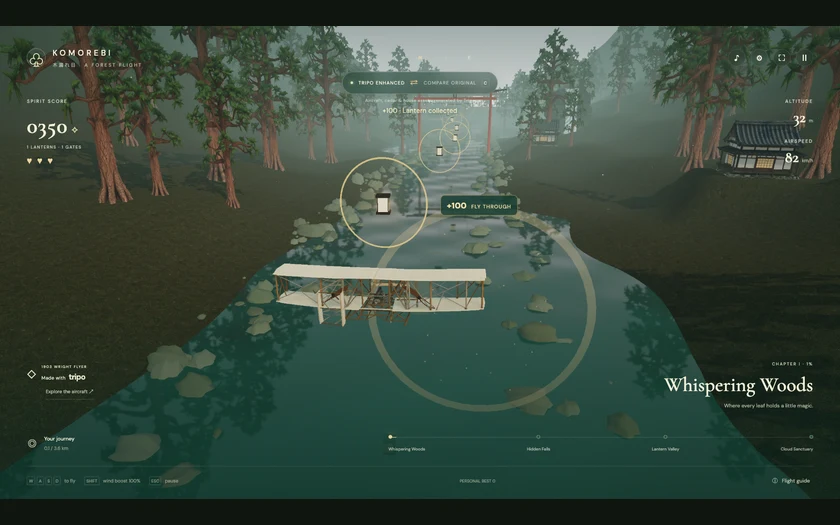</a><br><strong><a href="https://www.tripo3d.ai/vi/3d-prompts/wright-flyer-through-a-japanese-forest-2096467585785286808">Wright Flyer Xuyên Qua Rừng Nhật Bản</a></strong><br><sub><a href="https://x.com/jaredliu_bravo">Jared</a></sub><br><a href="https://www.tripo3d.ai/vi/3d-prompts/wright-flyer-through-a-japanese-forest-2096467585785286808">Prompt →</a></td>
<td width="50%" valign="top"><a href="https://www.tripo3d.ai/vi/3d-prompts/jelly-jungle-3d-browser-game-2081024333120733188">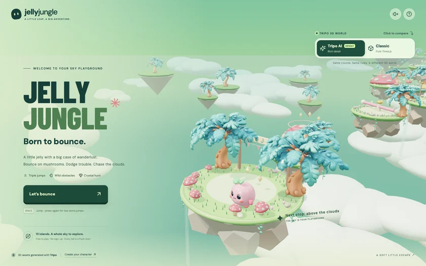</a><br><strong><a href="https://www.tripo3d.ai/vi/3d-prompts/jelly-jungle-3d-browser-game-2081024333120733188">Rừng Kẹo Dẻo: Game đi cảnh 3D</a></strong><br><sub><a href="https://x.com/jaredliu_bravo">Jared</a></sub><br><a href="https://www.tripo3d.ai/vi/3d-prompts/jelly-jungle-3d-browser-game-2081024333120733188">Prompt →</a></td>
</tr>
<tr>
<td width="50%" valign="top"><a href="https://www.tripo3d.ai/vi/3d-prompts/akari-nagoya-rooftop-flame-relay">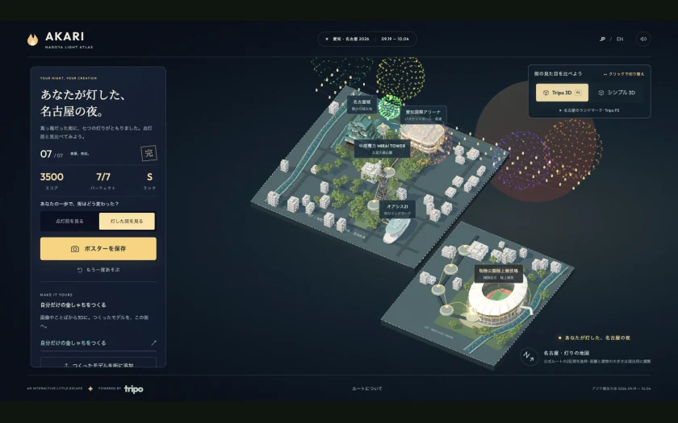</a><br><strong><a href="https://www.tripo3d.ai/vi/3d-prompts/akari-nagoya-rooftop-flame-relay">AKARI: Tiếp lửa trên những sân thượng Nagoya</a></strong><br><sub><a href="https://growthengineer.space/">Jared</a></sub><br><a href="https://www.tripo3d.ai/vi/3d-prompts/akari-nagoya-rooftop-flame-relay">Prompt →</a></td>
<td width="50%" valign="top"><a href="https://www.tripo3d.ai/vi/3d-prompts/cyclops-island-threejs-game">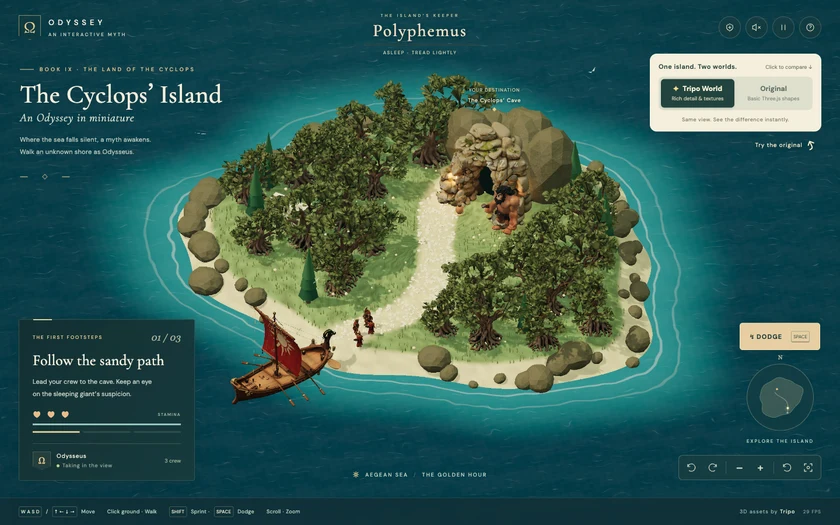</a><br><strong><a href="https://www.tripo3d.ai/vi/3d-prompts/cyclops-island-threejs-game">Hòn đảo của Cyclops</a></strong><br><sub><a href="https://x.com/jaredliu_bravo">Jared</a></sub><br><a href="https://www.tripo3d.ai/vi/3d-prompts/cyclops-island-threejs-game">Prompt →</a></td>
</tr>
</table>

<a id="all-prompts"></a>

## Prompt Astra mới nhất

<details>
<summary>Khám phá ví dụ</summary>

- [Thiên hà dựa trên vật lý quỹ đạo thực tế](#2101055500599054437)
- [Môi trường 3D chân thực như ảnh hoàn chỉnh](#2101224659861590399)
- [Mô hình tương tác 3D động cơ máy bay](#2101271938706685991)
- [Quy trình tạo hoạt ảnh 3D và video mèo võ thuật catfu](#2101310374033428642)
- [Mô hình 3D Waymo Jaguar I-Pace](#2101325346427842909)
- [Thuyền buồm trên vùng nước rộng](#2101616345720787130)
- [Tạo mô hình 3D WALL-E bằng Three.js](#2101687900723106104)
- [Verdant — hòn đảo khủng long 3D tương tác](#2101730386711634251)
- [Website mô hình Mặt Trời 3D tương tác](#2102038136725377200)
- [Game đua xe procedural trên trình duyệt Spline Rush](#2102150615635816866)
- [Bản trình bày thiết kế trực thăng 3D tương tác](#2102215638311694336)
- [Cảnh 3D và video Tháp Tokyo ngày và đêm](#2102276620124062065)
- [Bubble Bay: Đại chiến bóng nước 3D](#2102300855387205871)
- [Game tower defense phong cách Sir, We Have Orc Problems](#2102411087002112256)
- [Nhà ngoại ô hai tầng có nội thất](#2102473710724919614)
- [Game đua xe kart 3D trong một tệp HTML duy nhất](#2102652927177617564)
- [Hoạt ảnh lâu đài thời Trung cổ trên trình duyệt](#2102672926285713456)
- [Orbit Lab: Mô phỏng 3D Mặt Trời, Trái Đất và Mặt Trăng](#2102752217375899659)
- [Lâu đài 3D phong cách châu Âu thời Trung cổ có thể tương tác trong trình duyệt](#2102780850706567390)
- [Bàn cờ 3D tương tác để học các gambit cờ vua](#2102788013902213508)
- [Shader thành phố solarpunk vô tận](#2102826333550133520)
- [Trình mô phỏng làm burger góc nhìn thứ nhất](#2102897258983313712)
- [Cảnh HTML lửa trại giữa sa mạc về đêm siêu chân thực](#2102915300295369208)
- [Codex dạng voxel trong Three.js](#2102956340482289944)
- [Lát cam dẻo 3D tương tác](#2103062348168618280)
- [Hướng Bắc: Hành trình tương tác trên thuyền dài Viking](#2103187935759655167)
- [Trải nghiệm Three.js mùa thu mù sương có thể khám phá](#2103211135214256350)
- [STILLWATER — Trải nghiệm đầm lầy ánh trăng trên trình duyệt](#2103308083242082314)
- [Bối cảnh chiến trường La Mã vào giờ vàng](#2103351755971207251)
- [Thạch Pitaya](#2103432732386664591)
- [Dựng mô hình 3D trang phục cho VRChat](#2103456264785424530)
- [Tạo chuột lang trong Blender](#2103482826519986544)
- [Vườn Nhật phong cách voxel trong Three.js](#2103486103831339269)
- [Cảnh WebGL voxel tàu trong chai](#2103855977376125161)
- [Môi trường làng ven hồ giữa rừng](#2103860776419111285)
- [Mô phỏng bắt tầng đẩy Super Heavy trong Blender](#2103966922127630820)
- [Demo tương tác 3D về đường đi của ánh sáng qua ống kính máy ảnh](#2104077535315144878)
- [Lát dưa hấu thạch 3D tương tác](#2104504957173153951)
- [Game phong cách Genshin và công cụ chỉnh sửa địa hình](#2104531704740512143)
- [Móc chữ J có thể in 3D để thử độ bền](#2104590493191479337)
- [Mô hình 3D tương tác về CRISPR dành cho giáo dục](#2104605522640970208)
- [Chuyến du ngoạn bằng thuyền trong rừng rậm dưới ánh trăng tương tác](#2104613125093998674)
- [Xe thể thao biến hình với chế độ X-quang bung tách](#2104654448878387313)
- [Mắt người 3D độ chi tiết cao](#2104841727496323479)
- [Thời gian, được tháo rời.](#2105009377002299711)
- [Mô hình F-22 Raptor chân thực và video bay trong Godot](#2105027152617918852)
- [Cảnh phóng tên lửa chân thực như phim điện ảnh](#2105047166733746209)
- [Bản render Blender của cầu Golden Gate](#2105278999861526953)
- [Tạo nhân vật Minion 3D trong Blender](#2105298955307303100)
- [Tái tạo cảnh trong Isaac Sim](#2105323534398763307)
- [Sa bàn kim tự tháp 3D thu nhỏ màu vàng](#2105412081692352654)
- [game 3D né thiên thạch](#2105644436659290409)
- [Cảnh thuyền 3D có thể điều khiển trên sông vùng núi](#2106385060106777043)
- [Không gian 3D ngôi nhà có thể tham quan bằng trình duyệt](#2106737391948235164)
- [Tạo trailer điện ảnh cho một trò chơi hư cấu](#2106824464092770455)
- [Game 3D thu thập 10 mảnh sao trên đảo nhỏ về đêm](#2106944804756275690)
- [Nhện bông — Nghiên cứu vật liệu số 015](#2107127712871505976)
- [Banana Jelly](#2107186979502776590)
- [Bách khoa toàn thư tương tác về động vật hoang dã Wild Atlas](#2107479802152472717)
- [Mực ống nhồi bông.](#2107533363808485534)
- [Villa Jelly](#2107617244301664483)
- [Hình ảnh hóa Những thành phố vô hình bằng Three.js](#2107824019999535226)
- [Website 3D cuộn trang cho Lealand Tea](#2107872378218779067)
- [Atoll Jelly: mô hình diorama đầm phá WebGPU tương tác](#2107977531726934288)
- [Phòng thí nghiệm thạch tương tác Three.js với vật lý kéo để bóp méo](#2108096737537929361)
- [Thế giới voxel 3D với một chú bồ nông đang đạp xe](#2108203260058259830)
- [Diorama WebGPU tương tác Pirate Jelly](#2108336208891801999)
- [Màn ra mắt đồng hồ thông minh ORBIT 3D đậm chất điện ảnh](#2108438685184401904)
- [Động cơ phản lực 3D tương tác cho giáo dục](#2108459952683811167)
- [Bản trình bày 3D trực quan chi tiết về AH-64E Apache Guardian](#2108475056082850278)
- [Bàn phím mật ong tương tác](#2108501256067285443)
- [Trải nghiệm xúc xắc dẻo 3D tương tác](#2108505251036774875)
- [Đảo neon bay tương tác](#2108574047948656981)
- [Mô hình tương tác WebGPU Castle Jelly](#2108649845405929924)
- [Photoshop cho Gaussian splat](#2108711089827647965)
- [Mô phỏng vải 3D tương tác trên quả cầu chrome](#2108912938656407888)
- [Nhân vật Mario trong Three.js](#2108976915449012592)
- [Cảnh ô tô 3D chân thực, tương tác trên đường cao tốc](#2108981890493358527)
- [Tidepool Jelly – hệ sinh thái ven biển 3D tương tác](#2109015574177075610)
- [Hình ảnh 3D kỳ ảo bằng Three.js và WebGPU](#2109060292667982172)
- [Game sandbox lái xe thế giới mở low-poly](#2109153428635267345)
- [Mô hình Goblin trong Blender với hoạt ảnh đi bộ](#2109268147068862675)
- [Nghiên cứu vật liệu WebGPU: Chim cánh cụt bông](#2109288662319919127)
- [Trải nghiệm WebGPU tương tác với bạch tuộc nhồi bông](#2109323102912156142)
- [Diorama đền thờ tương tác: Torii lúc triều cường](#2110014604524896392)
- [Làng tuyết trong quả cầu tuyết thạch dẻo tương tác](#2110045415412281495)
- [Ngọn hải đăng đá cũ trên vách đá cheo leo lúc chạng vạng](#2110054195734982817)
- [Game nhiệt đới 3D phong cách Flappy Bird](#2110069699597971828)
- [Mô hình tách rời của một chiếc đồng hồ lấy cảm hứng từ Rolex](#2110070382002921482)
- [Mô hình Ogre trong Blender kèm hoạt ảnh đi bộ](#2110139804805693469)
- [Mô phỏng tương tác 3D về chuột gaming](#2110371046071382042)
- [Mô phỏng quỹ đạo xoắn ốc 3D của Hệ Mặt Trời chuyển động trong Dải Ngân Hà](#2110380365269639613)
- [Trang web hồ cá koi 3D tương tác](#2111817735181332826)
- [Cảnh đêm với tháp đồng hồ steampunk trong three.js](#2112137926922686800)
- [Battle City 3D: Phòng thủ xe tăng vô tận](#battle-city-3d)
- [Crazy Tanks — Pháo binh đảo 3D](#crazy-tanks-3d-island-artillery)
- [Golden Miner: Game khai thác vàng 3D 24 cấp độ](#golden-miner)
- [Biệt thự Thạch rau câu](#jelly-villa)
- [Đèn đỏ, đèn xanh: Trò chơi sinh tồn 3D](#red-light-green-light)
- [TITANIC — Ánh sáng cuối cùng](#titanic-the-last-light)

</details>

<a id="2101055500599054437"></a>

### Thiên hà dựa trên vật lý quỹ đạo thực tế

[Argona](https://x.com/Argona0x) · 2026-09-18

<a href="https://www.tripo3d.ai/vi/3d-prompts/gpt-6-astra-2101055500599054437">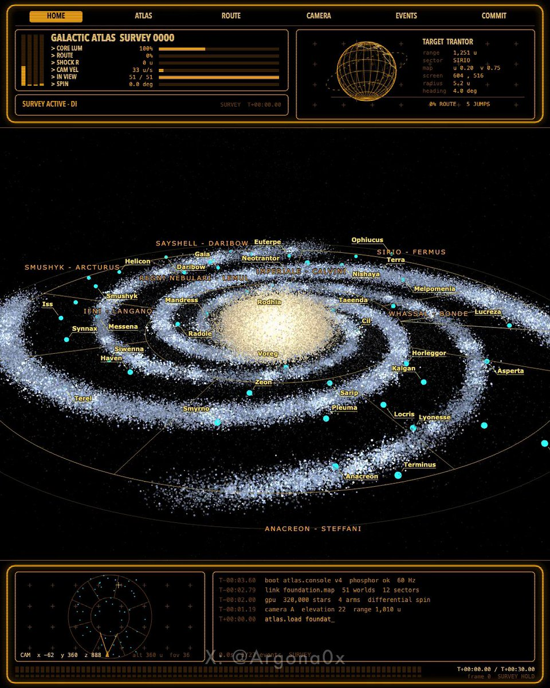</a>

Tác giả giới thiệu prompt GPT-6 Astra một câu này làm đầu vào để mô phỏng một thiên hà có tính xác định và thực hiện chuyến bay dài 30 giây xuyên qua thiên hà đó. Prompt yêu cầu áp dụng vật lý quỹ đạo thực tế và tạo 320.000 ngôi sao.

**Prompt**

```text
một thiên hà dựa trên vật lý quỹ đạo thực tế, 320.000 ngôi sao, một chuyến bay xuyên qua thiên hà, 30 giây
```

[Xem chi tiết ↗](https://www.tripo3d.ai/vi/3d-prompts/gpt-6-astra-2101055500599054437) · [Bài đăng gốc](https://x.com/Argona0x/status/2101055500599054437) · [Về danh sách ví dụ](#all-prompts)

---

<a id="2101224659861590399"></a>

### Môi trường 3D chân thực như ảnh hoàn chỉnh

[Julian Goldie SEO](https://x.com/JulianGoldieSEO) · 2026-09-19

<a href="https://www.tripo3d.ai/vi/3d-prompts/gpt-6-astra-2101224659861590399">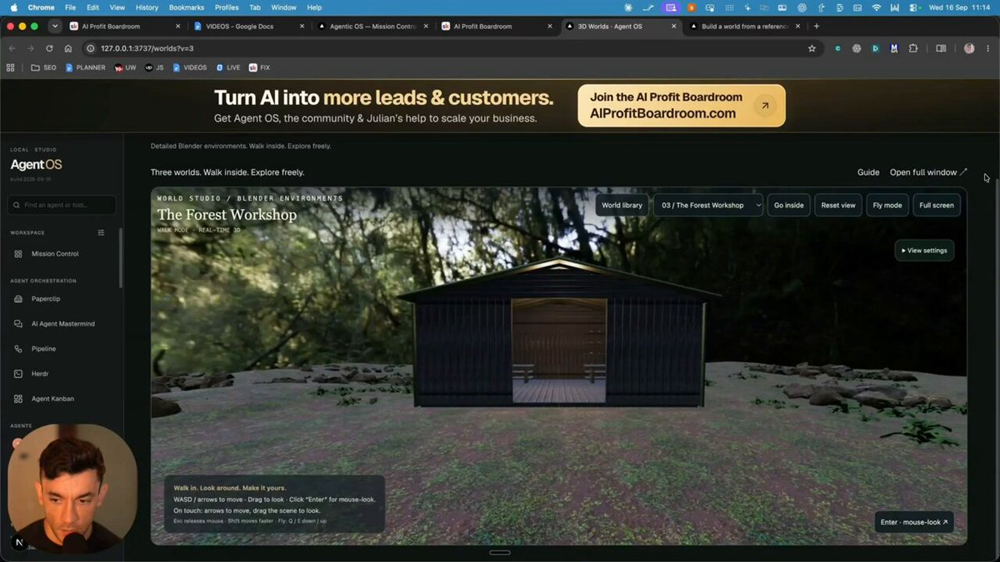</a>

Tạo một môi trường 3D hoàn chỉnh, chân thực như ảnh với ý tưởng mở.

**Prompt**

```text
Dựng một môi trường 3D hoàn chỉnh, chân thực như ảnh. Hãy tạo bất ngờ cho tôi.
```

[Xem chi tiết ↗](https://www.tripo3d.ai/vi/3d-prompts/gpt-6-astra-2101224659861590399) · [Bài đăng gốc](https://x.com/JulianGoldieSEO/status/2101224659861590399) · [Về danh sách ví dụ](#all-prompts)

---

<a id="2101271938706685991"></a>

### Mô hình tương tác 3D động cơ máy bay

[YouWare](https://x.com/YouWareAI) · 2026-09-19

<a href="https://www.tripo3d.ai/vi/3d-prompts/gpt-6-astra-2101271938706685991">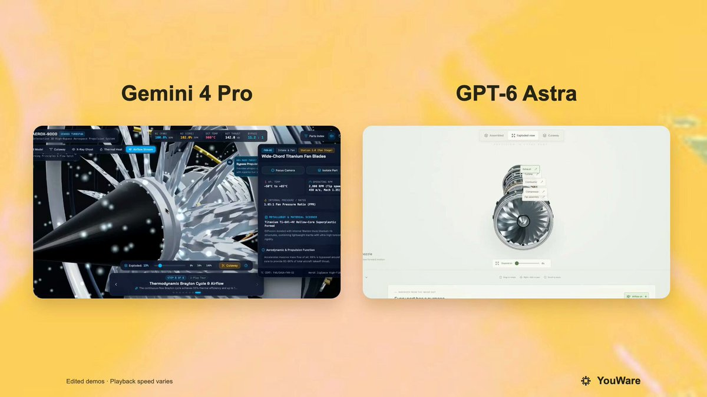</a>

Prompt có thể tái sử dụng do YouWare đăng, dùng để tạo màn hình hiển thị động cơ máy bay 3D tương tác, độ trung thực cao trên web. Prompt yêu cầu mô hình động cơ chi tiết với tương tác tháo rời và chế độ xem tách lớp, thông tin về từng bộ phận khi nhấp hoặc di chuột, cùng các điều khiển camera mượt mà. Bài đăng gốc cho biết prompt này đã được chạy với GPT-6 Astra và Gemini 4 Pro.

**Prompt**

```text
Dùng three.js để xây dựng màn hình hiển thị 3D tương tác của một động cơ máy bay trên trang web.
Vui lòng tham khảo triết lý thiết kế tương tác của Jigspace để tạo mô hình chân thực, được phục dựng với độ trung thực gần 1:1, giữ nguyên đầy đủ chi tiết vật liệu và kết cấu bề mặt như kim loại, đường ống và cánh quạt. Các tính năng tương tác bắt buộc gồm: hoạt ảnh tháo rời theo từng bước, chế độ xem tách lớp các bộ phận, cùng phần mô tả bộ phận và giải thích nguyên lý hiển thị khi nhấp hoặc di chuột.
Nhìn chung, sản phẩm phải hỗ trợ điều khiển camera mượt mà và tương tác người–máy thân thiện, mang lại trải nghiệm liền mạch trên web, đồng thời trình bày đầy đủ cấu trúc và nguyên lý hoạt động của động cơ.
```

[Xem chi tiết ↗](https://www.tripo3d.ai/vi/3d-prompts/gpt-6-astra-2101271938706685991) · [Bài đăng gốc](https://x.com/YouWareAI/status/2101272224435253432) · [Về danh sách ví dụ](#all-prompts)

---

<a id="2101310374033428642"></a>

### Quy trình tạo hoạt ảnh 3D và video mèo võ thuật catfu

[PixVerse](https://x.com/PixVerse) · 2026-09-19

<a href="https://www.tripo3d.ai/vi/3d-prompts/gpt-6-astra-2101310374033428642">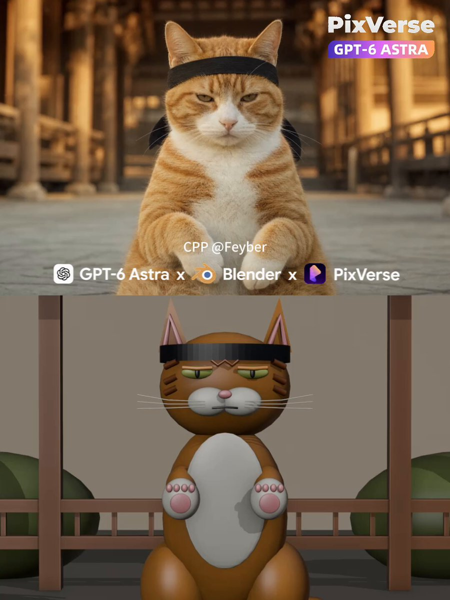</a>

Bình luận đã xác minh của PixVerse cho biết đây là prompt được sử dụng trong Hermes Agent. Bài đăng gốc ghi nhận công sức của nhà sáng tạo PixVerse @woleswoosh với màn trình diễn catfu, đồng thời cho biết tác phẩm được thực hiện bằng GPT-6 Astra + Blender. Prompt yêu cầu một agent dựng các mesh Blender nhẹ và hoạt ảnh cho một chú mèo mướp cứng đờ, điềm tĩnh, đỡ những bàn tay đang lao tới trong sân một ngôi chùa Nhật Bản, kết xuất MP4 tham chiếu chuyển động dài 10 giây, sau đó tạo video 1080p chân thực bằng PixVerse CLI và Seedance 2.5.

**Prompt**

```text
Một cú máy điện ảnh duy nhất, siêu chân thực, dài 10 giây, 16:9, 24fps, máy quay cố định, không cắt cảnh.
Một chú mèo mướp lông vàng cam-trắng (mõm, ngực và bàn chân màu trắng; sọc mướp màu cam với chữ "M" trên trán) ngồi thẳng, chính giữa khung hình, đối diện ống kính trong tư thế võ thuật cứng đờ — ánh mắt phẳng lặng, điềm tĩnh, không chút ấn tượng, mắt lim dim, miệng khép kín, đầu không bao giờ cử động. Nó đeo một chiếc hachimaki màu đen buộc thấp ngang trán, nút thắt ở phía sau, hai tai nhô lên trên dải khăn.
Bối cảnh: sân chùa Nhật Bản truyền thống — các cột gỗ, mái hiên và lan can ấm màu — tan vào hiệu ứng bokeh vàng kem của giờ vàng. Ống kính 85mm, f/1.8, độ sâu trường ảnh cực mỏng, khóa nét vào mắt mèo. Tông màu 3500K ấm áp, ánh sáng chính mềm từ phía trước bên phải, bóng đổ được bổ sáng nhẹ, hạt phim mịn.
HÀNH ĐỘNG: một cánh tay người trần lao vào từ bên trái khung hình, lòng bàn tay mở đẩy nhanh về phía mặt mèo với hiệu ứng nhòe chuyển động rõ rệt; mèo bình thản nâng bàn chân trước bên phải lên đỡ, chặn lòng bàn tay và triệt tiêu đà của đòn đánh — nó đỡ đòn, không tát. Cánh tay quét ngang qua mặt mèo trong một vệt nhòe, sau đó một bàn tay thứ hai chém xuống từ bên phải; mèo hóa giải từng đòn bằng cú chặn bàn chân ngắn và tối giản, thân và đầu hoàn toàn bất động, mắt không rời ống kính. Những bàn tay là bên tấn công — mèo chỉ phản ứng và không hề nao núng. Hai bàn tay liên tục giả động tác rồi rút ra từ cả hai phía; mèo chuyển sang thế thủ boxing bằng hai bàn chân ở ngang ngực, các bàn chân co lại, khuỷu tay khép vào, rồi giữ nguyên tư thế để chờ đợi. Nó bất ngờ tung những đòn phản công nhanh bằng từng bàn chân đơn lẻ, nhòe theo phong cách kung-fu, chặn những bàn tay đang lao tới giữa không trung, đầu vẫn khóa thẳng về phía trước. Cuối cùng, nó đẩy thẳng bàn chân phải vào ống kính, đệm chân màu hồng hướng về máy quay, cho đến khi bàn chân lấp đầy khung hình thành một hình dạng tiền cảnh mềm, mất nét — gương mặt phía sau vẫn sắc nét tuyệt đối, ánh mắt lạnh lùng không đổi.
Chuyển động: tốc độ tự nhiên, hiệu ứng nhòe chuyển động chân thực trên những bàn tay đang bay tới và các cú chặn bàn chân nhanh. Chuyển động phòng thủ của mèo phải tối giản, tiết kiệm và tự nhiên — nó hầu như không cử động; những bàn tay làm tất cả nhưng đều thất bại. Không chuyển động máy quay, không zoom, không chữ.
PHỦ ĐỊNH: chi thừa, bàn chân dính hoặc biến dạng, ngón tay thừa, gương mặt méo mó, dải khăn hòa vào lông, da nhựa, màu quá bão hòa, chữ, phụ đề, logo, hình mờ, cắt cảnh, rung máy, ngôn ngữ cơ thể vui vẻ/ăn mừng, cử chỉ đập tay.
BẢN NGẮN:
Mèo mướp lông vàng cam-trắng đeo hachimaki đen ngồi trong sân chùa Nhật Bản ngập nắng, nhìn thẳng vào máy quay với vẻ tỉnh bơ, 85mm f/1.8, DOF mỏng, giờ vàng, hạt phim. Những bàn tay người chém và đẩy nhanh vào mặt nó từ cả hai phía với hiệu ứng nhòe chuyển động — mèo bình thản đỡ từng đòn bằng cú chặn bàn chân tối giản, đầu không hề cử động. Nó chuyển sang thế thủ kung-fu bằng hai bàn chân, tung những đòn phản công nhanh và nhòe, rồi đẩy bàn chân vào ống kính cho đến khi đệm chân lấp đầy khung hình. Một cú máy cố định duy nhất, 10 giây, 16:9, 24fps, siêu chân thực, không chữ.
Ghi chú nhỏ từ khung hình: tay chủ yếu lao vào từ bên trái (đòn chém từ trên xuống + cú quét ngang), điểm tiếp xúc nằm ở cổ tay/lòng bàn tay — không phải bàn chân chạm bàn chân. Thế thủ bằng hai bàn chân xuất hiện khoảng 4.0-5.6 giây, phản công nhòe ở 5.6-8 giây, kết thúc với bàn chân chạm ống kính ở 8-10 giây. nhiệm vụ của bạn là tạo mô hình 3D bằng Blender MCP, tạo đầu ra 10 giây ở 24fps và kết xuất thành cảnh siêu chân thực bằng pixverse cli, sử dụng seedance 2.5 làm mô hình tạo video
CÁC BƯỚC CỦA AGENT: Kiểm tra Blender MCP, xác thực PixVerse CLI, khả năng của mô hình và số credit hiện có. Thông báo chi phí ước tính và xin phê duyệt chi tiêu trước khi tạo nội dung có tính phí. Chuyển prompt thành bảng nhịp thời gian, dựng các mesh 3D nhẹ cùng hoạt ảnh thông qua Blender MCP chính thức, kết xuất MP4 tham chiếu chuyển động, rồi kiểm tra khung hình, chuyển động, điểm tiếp xúc, thời lượng và tốc độ khung hình. Tạo và kiểm tra riêng một ảnh tham chiếu ngoại hình trước khi gửi yêu cầu tạo video. Dùng ảnh để định hướng nhận diện, phong cách và ánh sáng; dùng video Blender để định hướng chuyển động và nhịp thời gian. Sau khi tạo xong, tải kết quả xuống, xác minh thông số kỹ thuật, kiểm tra các khung hình chính, báo cáo trung thực mọi sai lệch và tính lượng credit thực tế đã sử dụng. Giữ nguyên các tệp gốc; không tự ý chuyển mô hình hoặc tạo lại.
LỆNH GỌI PIXVERSE: Dùng pixverse create image với gpt-image-2.0 để tạo ảnh tham chiếu ngoại hình theo tỷ lệ khung hình đã xác nhận, 1080p, độ chi tiết cao. Sau đó dùng pixverse create reference với mô hình video đã xác nhận, truyền cả hai --images and --videos to để kết hợp ảnh ngoại hình với tham chiếu chuyển động Blender. Với Seedance 2.5, sử dụng --model seedance-2.5 --task-type auto, thời lượng/tỷ lệ khung hình đã xác nhận và --quality 1080p --count 1. Xác minh khả năng hiện tại trước khi gửi yêu cầu, sử dụng các khóa idempotency duy nhất và theo dõi tiến trình qua pixverse task status / pixverse task wait.
ĐẦU RA CUỐI: Trả về video hoàn chỉnh theo tỷ lệ khung hình và thời lượng đã xác nhận, mục tiêu 1080p và 24fps, cùng ảnh tham chiếu ngoại hình, dự án Blender .blend và MP4 tham chiếu chuyển động. Cung cấp đường dẫn cục bộ tuyệt đối hoặc URL tải xuống. Giữ định dạng báo cáo cuối cùng: Video, Ảnh tham chiếu, Mesh + hoạt ảnh Blender, Kiểm tra, Hình ảnh, và Credit đã sử dụng. Báo cáo độ phân giải thực tế, tốc độ khung hình, số lượng khung hình, thời lượng, sai lệch hình ảnh, chi phí credit cho ảnh/video, tổng chi tiêu, số dư còn lại và việc có tạo lại hay không.
```

[Xem chi tiết ↗](https://www.tripo3d.ai/vi/3d-prompts/gpt-6-astra-2101310374033428642) · [Bài đăng gốc](https://x.com/PixVerse/status/2101310387081908606) · [Về danh sách ví dụ](#all-prompts)

---

<a id="2101325346427842909"></a>

### Mô hình 3D Waymo Jaguar I-Pace

[Harshith](https://x.com/HarshithLucky3) · 2026-09-19

<a href="https://www.tripo3d.ai/vi/3d-prompts/gpt-6-astra-2101325346427842909">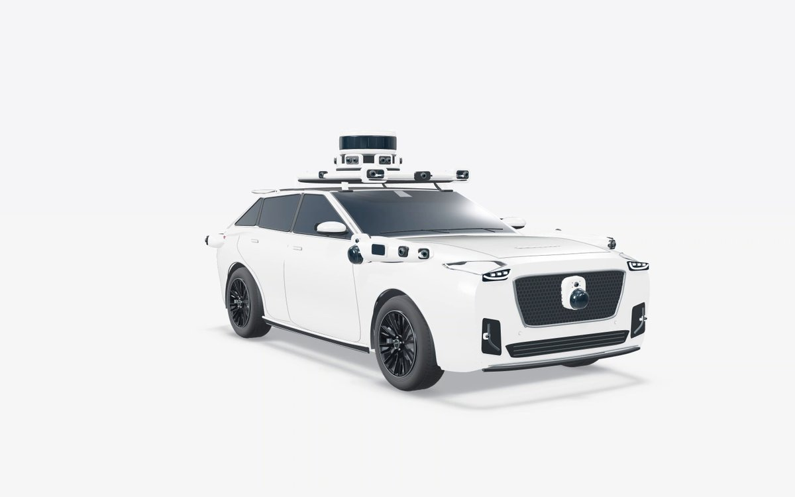</a>

<a href="https://www.tripo3d.ai/vi/3d-prompts/gpt-6-astra-2101325346427842909">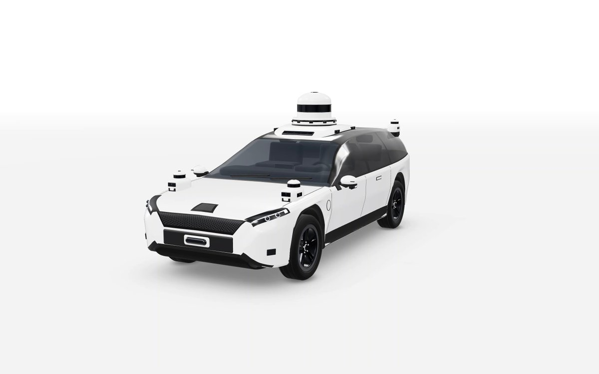</a>

Tác giả cho biết đã sử dụng prompt này với GPT-6 Astra Max trong Codex để tạo mô hình 3D Waymo Jaguar I-Pace bằng Three.js. Họ cho biết không dùng hình ảnh tham chiếu và chiếc xe tạo ra không giống xe thực tế.

**Prompt**

```text
mô hình 3D Waymo Jaguar I-Pace bằng Three.js
```

[Xem chi tiết ↗](https://www.tripo3d.ai/vi/3d-prompts/gpt-6-astra-2101325346427842909) · [Bài đăng gốc](https://x.com/HarshithLucky3/status/2101325346427842909) · [Về danh sách ví dụ](#all-prompts)

---

<a id="2101616345720787130"></a>

### Thuyền buồm trên vùng nước rộng

[www.aicontenders.dev](https://www.aicontenders.dev/) · 2026-09-20

<a href="https://www.tripo3d.ai/vi/3d-prompts/gpt-6-astra-2101616345720787130"></a>

Được đăng trên trang so sánh AIContenders được liên kết và chạy thử với GPT-6-astra cùng các mô hình khác. Bài thử yêu cầu một cảnh thuyền buồm 3D tương tác trong một tệp duy nhất, với mặt nước chuyển động tạo theo quy trình, hai hòn đảo, chuyển động của thuyền phản ứng theo sóng, lộ trình tránh đất liền và camera bám đuổi được làm mượt.

**Prompt**

```text
Tạo một tệp HTML duy nhất với cảnh 3D hiển thị một chiếc thuyền buồm nhỏ di chuyển trên vùng nước rộng, có điều khiển lái trực tiếp và lộ trình đi vòng qua hai hòn đảo dễ nhìn thấy, tương tự các bản demo "trò chơi thuyền" trong những bài kiểm thử mô hình gần đây.

Yêu cầu chức năng:

Bề mặt nước được dựng bằng lưới sóng chuyển động (shader nước tạo theo quy trình, sóng chuyển động, phản xạ ánh sáng thay đổi theo góc nhìn và vệt nước phía sau thuyền), không dùng kết cấu phẳng, tĩnh.
Mô hình thuyền buồm được dựng từ các hình khối đơn giản (thân thuyền, cột buồm, cánh buồm căng theo chiều gió), có chuyển động nhấp nhô và nghiêng nhẹ trên sóng, đồng bộ với chuyển động của mặt nước bên dưới.
Hai hòn đảo riêng biệt được đặt ở các vị trí khác nhau trong cảnh; mỗi đảo có địa hình tạo hình đơn giản (đồi cao, bãi biển, có thể thêm thảm thực vật) và đổ bóng lên vùng nước xung quanh.
Thuyền phải đi theo một tuyến đường thực sự tránh được cả hai hòn đảo (không bao giờ cắt qua đường bao hoặc băng qua phần đất), chuyển hướng mượt mà thay vì nhảy đột ngột giữa các góc.
Camera bám theo thuyền với độ trễ nhẹ (camera bám đuổi được làm mượt), tạo cảm giác rượt đuổi năng động thay vì góc nhìn từ trên xuống gắn cứng với thuyền.
Bầu trời chuyển sắc (chẳng hạn hoàng hôn hoặc xanh ban ngày, tùy mô hình lựa chọn) với ánh nắng hoặc phản xạ ánh sáng trên mặt nước, có hướng nhất quán với bóng đổ trên các hòn đảo.

Yêu cầu kỹ thuật:

Một tệp .html duy nhất; được phép dùng three.js từ cdnjs, không dùng tài nguyên hoặc kết cấu bên ngoài khác; toàn bộ mặt nước và địa hình phải được tạo theo quy trình bằng mã hoặc shader.
Lộ trình vòng qua các hòn đảo có thể là đường đi được lên kế hoạch trước (chẳng hạn đường cong Bezier luồn giữa hai đảo) hoặc cơ chế lái đơn giản phản ứng theo vị trí, tùy mô hình lựa chọn, nhưng không được va chạm với đất liền.
Hoạt ảnh phải chạy mượt trong ít nhất 20 giây, theo vòng lặp hoặc liên tục, đạt tối thiểu 30fps trên một máy tính xách tay thông thường; độ phân giải canvas bị giới hạn ở kích thước cửa sổ và devicePixelRatio không được cao hơn 1.5 để tránh làm quá tải màn hình hiDPI.

Tiêu chí đánh giá chính là mặt nước có tạo cảm giác thuyết phục như chất lỏng đang chuyển động hay không (không chỉ là kết cấu với offset UV động), thuyền có thực sự phản ứng theo sóng hay không và lộ trình vòng qua các hòn đảo có thể hiện sự định hướng có chủ đích thay vì suýt va vào một cách ngẫu nhiên hay không.
```

[Xem chi tiết ↗](https://www.tripo3d.ai/vi/3d-prompts/gpt-6-astra-2101616345720787130) · [Bài đăng gốc](https://www.aicontenders.dev/c/a_TRQpq3LoNVd-M7Xy2DHg) · [Về danh sách ví dụ](#all-prompts)

---

<a id="2101687900723106104"></a>

### Tạo mô hình 3D WALL-E bằng Three.js

[Marcel](https://x.com/marcthecreatorr) · 2026-09-20

<a href="https://www.tripo3d.ai/vi/3d-prompts/gpt-6-astra-2101687900723106104"></a>

Prompt được Marcel chia sẻ, chính xác là prompt họ đã cung cấp cho Astra, yêu cầu tạo mô hình 3D WALL-E bằng Three.js.

**Prompt**

```text
tạo mô hình 3D WALL-E bằng Three.js.
```

[Xem chi tiết ↗](https://www.tripo3d.ai/vi/3d-prompts/gpt-6-astra-2101687900723106104) · [Bài đăng gốc](https://x.com/marcthecreatorr/status/2101687900723106104) · [Về danh sách ví dụ](#all-prompts)

---

<a id="2101730386711634251"></a>

### Verdant — hòn đảo khủng long 3D tương tác

[vib3coded](https://x.com/vib3coded) · 2026-09-20

<a href="https://www.tripo3d.ai/vi/3d-prompts/interactive-3d-dinosaur-island-diorama"></a>

Yêu cầu nguyên văn từ @vib3coded dành cho Verdant, một sa bàn đảo 3D tương tác được xây dựng bằng Three.js và WebGL. Yêu cầu này mô tả những chú khủng long đi lang thang, một thác nước và đầm phá cắt lớp, chuyển động của camera dưới nước, các tương tác cho ăn và ấp trứng, điều khiển môi trường, mưa và nhạc, với đầu ra là một tệp HTML duy nhất sẵn sàng chạy trên trình duyệt.

**Prompt**

```text
tạo Verdant - một sa bàn 3D tương tác được xây dựng bằng Three.js + WebGL

Một hòn đảo xanh tươi với những chú khủng long đi lang thang, một thác nước và đầm phá cắt lớp có một loài bò sát biển đang bơi. Cho đàn khủng long ăn, ấp một chú khủng long con và đưa camera xuống dưới nước

Điều chỉnh thủy triều, gió và thời gian trong ngày, hoặc tạo mưa nhiệt đới trong khi nhạc thư giãn vang lên

Mọi thứ chạy trực tiếp trên trình duyệt của bạn trong một tệp HTML duy nhất
```

[Xem chi tiết ↗](https://www.tripo3d.ai/vi/3d-prompts/interactive-3d-dinosaur-island-diorama) · [Bài đăng gốc](https://x.com/vib3coded/status/2101570806702559235) · [Về danh sách ví dụ](#all-prompts)

---

<a id="2102038136725377200"></a>

### Website mô hình Mặt Trời 3D tương tác

[HIX.AI](https://x.com/HIX_AI_) · 2026-09-21

<a href="https://www.tripo3d.ai/vi/3d-prompts/gpt-6-astra-2102038136725377200"></a>

Tạo một website Three.js tương tác, xoay quanh mô hình Mặt Trời 3D chân thực được dựng bằng một tập lệnh Python trong Blender. Website cho phép xoay Mặt Trời, di chuyển góc nhìn và phóng to để quan sát; có nền không gian vũ trụ cùng thông tin về hệ Mặt Trời; đồng thời cung cấp chế độ xem cấu trúc bên trong tương tác với các lớp của Mặt Trời được gắn nhãn và mô tả.

**Prompt**

```text
Tôi muốn xây dựng một website mô hình Mặt Trời 3D tương tác bằng Three.js.

Trước tiên, hãy viết một tập lệnh Python có thể chạy trực tiếp trong Blender để tạo mô hình Mặt Trời 3D có độ chân thực cao. Mô hình cần dựa trên các đặc điểm vật lý và hình ảnh thực tế của Mặt Trời, bao gồm hình cầu, kết cấu bề mặt, màu sắc, vẻ ngoài giống plasma, các hạt sáng trên bề mặt và bầu khí quyển phát sáng. Mô hình không được trông như một quả cầu màu cam đơn giản. Hãy sử dụng vật liệu, shader, kết cấu bề mặt và hiệu ứng ánh sáng phù hợp để tạo diện mạo Mặt Trời chân thực.

Sau đó, hãy viết đầy đủ mã nguồn website bằng Three.js. Mặt Trời nên chiếm khoảng 80% khu vực hiển thị chính. Người dùng có thể xoay Mặt Trời, di chuyển góc nhìn và phóng to, thu nhỏ. Cảnh cần có ánh sáng chân thực cùng các hiệu ứng phát sáng để Mặt Trời trông sống động và có chiều sâu 3D.

Thêm một nút phóng to để người dùng tiến lại gần Mặt Trời và quan sát các chi tiết trên bề mặt.

Website cũng cần có nội dung cung cấp thông tin về Mặt Trời và vai trò của nó trong hệ Mặt Trời. Nền tổng thể nên là môi trường không gian vũ trụ hoặc thiên hà chân thực.

Ngoài ra, hãy thêm một nút mở chế độ xem cấu trúc bên trong tương tác của Mặt Trời. Chế độ xem này cần hiển thị các lớp chính của Mặt Trời, chẳng hạn như lõi, vùng bức xạ, vùng đối lưu, quang quyển, sắc quyển và nhật hoa. Mỗi lớp cần có nhãn tương ứng cùng một đoạn mô tả ngắn. Tốt nhất là người dùng có thể tương tác với sơ đồ và chọn từng lớp để xem thông tin về lớp đó.

Hãy làm cho website có giao diện hiện đại theo chủ đề không gian, ấn tượng về mặt hình ảnh, giàu thông tin khoa học và tương tác đầy đủ.
```

[Xem chi tiết ↗](https://www.tripo3d.ai/vi/3d-prompts/gpt-6-astra-2102038136725377200) · [Bài đăng gốc](https://x.com/HIX_AI_/status/2102038474752766239) · [Về danh sách ví dụ](#all-prompts)

---

<a id="2102150615635816866"></a>

### Game đua xe procedural trên trình duyệt Spline Rush

[Maharajahu🪢](https://x.com/ToolBraidComp) · 2026-09-21

<a href="https://www.tripo3d.ai/vi/3d-prompts/gpt-6-astra-2102150615635816866"></a>

Prompt nguyên văn do tác giả gốc cung cấp trong bình luận đã xác minh để tạo Spline Rush, một game đua xe Three.js procedural trên trình duyệt với đường đua, đối thủ AI, vật lý, preset đồ họa và âm thanh tổng hợp.

**Prompt**

```text
Xây dựng một game đua xe trên trình duyệt hoàn chỉnh, đạt chất lượng production, có tên Spline Rush bằng phiên bản Three.js mới nhất (ưu tiên WebGPURenderer + TSL khi có thể). 100% procedural: không dùng mô hình, kết cấu bề mặt, tệp âm thanh hay font bên ngoài. Mọi thứ đều được tạo bằng mã trong thời gian chạy.

GAME CỐT LÕI
- 6 đường đua độc đáo với cao độ thay đổi, độ nghiêng thân xe, đường hầm, khúc cua tay áo, các góc cua có tên và quần xã riêng biệt (ven biển ban ngày, núi lúc chạng vạng, sa mạc hoàng hôn, rừng mưa, thành phố neon ban đêm, đường oval tốc độ cao).
- Chế độ Championship (vòng phân hạng + 3 cuộc đua), Time Trial với xe ma, Quick Race.
- 8 đối thủ AI với cá tính riêng, đường chạy tối ưu, điểm phanh, vượt và phòng thủ.
- Kỷ lục vòng đua nhanh nhất, thời gian từng sector, bảng tin sự kiện trực tiếp, camera xem lại.
- Garage: 5 mẫu xe tham số với sơn clearcoat + metal-flake, khe ghép thân vỏ, đèn hoạt động, hệ thống treo chuyển động và các trạng thái hư hỏng.

MỤC TIÊU ĐỒ HỌA (Ultra, tương xứng với RTX 5090 ở 4K)
Renderer: THREE.WebGPURenderer. Pipeline dựa trên vật lý.
Ánh sáng:
- Bầu trời dựa trên vật lý Rayleigh/Mie + trường sao + mặt trăng + mặt trời động điều khiển chu kỳ ngày/đêm hoàn chỉnh.
- Cascaded shadow maps (4 cascade, snap texel ổn định, độ phân giải cao).
- IBL qua PMREM được cập nhật theo thời gian trong ngày.
- Sương mù thể tích + tia sáng xuyên mây + hiệu ứng rung nhiệt.
Vật liệu:
- MeshPhysicalMaterial / node TSL: clearcoat, anisotropy, transmission trên kính, sơn metal-flake, shader mặt đường ướt phản ứng với mưa.
Chuỗi hậu kỳ (RenderPipeline / TSL hoặc thư viện postprocessing):
GTAO hoặc SSAO chất lượng cao → SSR → bloom (Karis) → motion blur (velocity) → DOF → tia sáng xuyên mây → auto-exposure → chỉnh màu + hạt phim + vignette → SMAA hoặc TAA.
Hiệu ứng:
- Pool hạt trên GPU: khói lốp, tia lửa, bụi, nước mưa bắn, cỏ/sỏi văng lên, biến dạng nhiệt.
- Vết trượt lưu lại rồi mờ dần.
- Độ ướt động và phản chiếu vũng nước khi trời mưa.

VẬT LÝ & CẢM GIÁC LÁI
- Mô phỏng fixed-step 120 Hz.
- Hệ thống treo raycast hoặc strut, chuyển tải trọng, lốp combined-slip, ABS/TC, các loại bề mặt (nhựa đường, kerb, cỏ, sỏi, ướt).
- Camera: góc bám đuôi cinematic + góc nhìn qua nắp ca-pô + góc onboard, có rung khi chuyển động và va chạm.

AUDIO
- Web Audio tổng hợp hoàn toàn: động cơ đa lớp theo RPM/tải, tiếng gió, tiếng lốp rít, tiếng rung khi chạy qua kerb, tiếng khán giả, nhạc động.

HỆ THỐNG CHẤT LƯỢNG
- Các preset: Low / Medium / High / Ultra.
- Ultra giả định GPU cấp RTX 5090: 4K, shadow map độ phân giải cao, số lượng hạt tối đa, bật toàn bộ hiệu ứng hậu kỳ, không dùng LOD quá gắt.
- Chất lượng thích ứng có thể tắt bớt hiệu ứng nếu thời gian dựng khung hình vượt mục tiêu.

Bắt đầu bằng một phiên bản đầu tiên có thể chơi được (một đường đua, một xe, ánh sáng cơ bản), sau đó lặp lại và bổ sung từng tính năng đúng như yêu cầu. Đặt mọi thứ trong một dự án HTML/JS (hoặc Vite) gọn gàng duy nhất có thể chạy cục bộ. Chú thích các hệ thống chính. Hãy tạo cảm giác cao cấp, không dễ thương.
```

[Xem chi tiết ↗](https://www.tripo3d.ai/vi/3d-prompts/gpt-6-astra-2102150615635816866) · [Bài đăng gốc](https://x.com/ToolBraidComp/status/2102150671340327384) · [Về danh sách ví dụ](#all-prompts)

---

<a id="2102215638311694336"></a>

### Bản trình bày thiết kế trực thăng 3D tương tác

[Vib3Coded](https://x.com/vib3coded) · 2026-09-22

<a href="https://www.tripo3d.ai/vi/3d-prompts/gpt-6-astra-2102215638311694336"></a>

Tác giả đã chia sẻ prompt này trong phần bình luận cho bài so sánh Grok 4.7 và ChatGPT-6 Astra. Prompt yêu cầu một bản trình bày trực thăng 3D tương tác chạy trên trình duyệt, với hình học dựng theo quy trình, các chi tiết hàng không phong phú, nhiều tùy chọn phối màu, điều khiển rotor, chế độ bay lơ lửng, điều khiển camera và giao diện Three.js/WebGL đáp ứng trên nhiều kích thước màn hình.

**Prompt**

```text
Tạo một cảnh 3D tương tác, chi tiết về một chiếc trực thăng hiện đại trong một tệp HTML duy nhất bằng Three.js và WebGL. Dựng hình học 3D thực sự để có thể quan sát từ mọi góc, không sử dụng hình ảnh.

Phong cách hình ảnh:
Bản trình bày thiết kế hàng không cao cấp với nền studio màu xám nhạt, bệ trưng bày hình tròn, bóng đổ mềm và phản chiếu chân thực.
Trực thăng:

Thân trực thăng mượt mà, thuôn gọn, lấy cảm hứng từ các mẫu trực thăng hạng nhẹ hai động cơ như H145.
Thân màu trắng với phần bụng xanh navy đậm và một đường sọc xanh dương làm điểm nhấn.
Cửa sổ buồng lái cong, phủ màu khói, có phản chiếu và gioăng cửa sổ được lắp khít cẩn thận.
Cửa bên, tay nắm, đường ghép panel, đinh tán, bậc lên xuống và ăng-ten.
Hai khoang động cơ với cửa hút khí, lưới thông gió và cửa xả.
Rotor chính năm cánh với cụm moay-ơ chi tiết, phần cứng liên kết và các thanh liên kết điều khiển góc cánh.
Cần đuôi thuôn nhọn, các cánh ổn định và rotor đuôi có vỏ che, với một khoảng hở xuyên qua vỏ được dựng đúng hình học.
Càng trượt hạ cánh cong, gắn vào thân bằng các thanh đỡ kết cấu.
Đèn dẫn đường và đèn hiệu nhấp nháy.
Mọi bộ phận phải liên kết với nhau về mặt vật lý. Tránh các chi tiết bị lơ lửng, khe hở giữa các phần, cánh rotor xuyên vào thân hoặc cửa sổ nằm lơ lửng phía trên thân.

Tương tác:

Kéo chuột để xoay quanh mô hình, cuộn để phóng to/thu nhỏ và hỗ trợ điều khiển cảm ứng.
Khởi động và dừng cả hai rotor với quá trình tăng tốc và giảm tốc dần.
Điều chỉnh tốc độ rotor.
Chế độ bay lơ lửng: nhẹ nhàng nâng trực thăng khỏi bệ, đung đưa nhẹ trong không trung và hạ xuống êm khi tắt chế độ.
Tự động xoay camera.
Các góc camera cài sẵn ở phía trước, bên hông và đuôi.
Điều khiển đặt lại camera và toàn màn hình.
Ba phối màu: xanh băng hà và trắng, cam cứu hộ và xám graphite.
Giao diện:

Góc trên bên trái: nhãn nhỏ “AERONAUT / OBJECT STUDIES” và tiêu đề lớn “Horizon 05.”
Bên phải: panel gọn chứa thông số kỹ thuật, trạng thái trực thăng, lựa chọn phối màu và tốc độ rotor.
Phía dưới: các nút điều khiển và gợi ý tương tác.
Kiểu chữ tiết chế, đường viền mảnh và khoảng trống rộng rãi. Giữ cho trực thăng không bị che khuất.
Toàn bộ văn bản giao diện phải bằng tiếng Anh.
Yêu cầu kỹ thuật:

Dựng hình học theo quy trình, không tải xuống mô hình trực thăng dựng sẵn.
Sử dụng vật liệu PBR, môi trường phản chiếu studio và bóng đổ mềm.
Bảo đảm hoạt ảnh độc lập với tốc độ khung hình.
Tái sử dụng hình học và vật liệu khi phù hợp, đồng thời giới hạn pixel ratio để tối ưu hiệu năng.
Hỗ trợ bố cục trên máy tính và thiết bị di động, đồng thời giữ toàn bộ sải rotor hiển thị trong khung hình ban đầu.
Nếu có thể, hãy nhúng các thư viện phụ thuộc vào HTML để tệp hoạt động ngoại tuyến.
Hiển thị thông báo dự phòng hữu ích nếu WebGL không khả dụng.
Trước khi hoàn tất, kiểm tra mô hình từ mọi phía, thử mọi điều khiển và kiểm tra lỗi trong console. Đặc biệt chú ý đến silhouette, các liên kết kết cấu, phần kính và cơ cấu rotor.

Bàn giao tệp HTML hoạt động được, không chỉ phần giải thích.
```

[Xem chi tiết ↗](https://www.tripo3d.ai/vi/3d-prompts/gpt-6-astra-2102215638311694336) · [Bài đăng gốc](https://x.com/vib3coded/status/2102217028052377910) · [Về danh sách ví dụ](#all-prompts)

---

<a id="2102276620124062065"></a>

### Cảnh 3D và video Tháp Tokyo ngày và đêm

[Wafffle](https://x.com/wafffle_dev) · 2026-09-22

<a href="https://www.tripo3d.ai/vi/3d-prompts/gpt-6-astra-2102276620124062065"></a>

Hướng dẫn tạo một cảnh có hình học 3D chân thực của Tháp Tokyo, nghiên cứu và tái hiện các đặc điểm kết cấu của tháp cùng không khí khu vực xung quanh, đồng thời thể hiện diện mạo ban ngày và ban đêm. Yêu cầu bàn giao dữ liệu Blender có thể chỉnh sửa, video MP4 dài khoảng 30 giây để đăng trên X, ảnh xem trước và README. Người đăng chia sẻ nội dung này dưới dạng prompt hướng dẫn cho Astra.

**Prompt**

```text
Hãy tạo một tác phẩm 3D ấn tượng lấy Tháp Tokyo làm chủ thể chính, cùng video dài khoảng 30 giây để đăng trên X.

Bạn là giám đốc sản xuất. Hãy tạo các tác vụ phụ cần thiết và giao việc nghiên cứu,制作. Bạn chịu trách nhiệm cụ thể hóa yêu cầu, quản lý tiến độ, kiểm tra sản phẩm, đưa ra yêu cầu chỉnh sửa và tổng hợp kết quả cuối cùng.

【Những gì cần tạo】
Hãy tạo Tháp Tokyo sao cho người xem cảm nhận được độ cao khi ngước nhìn từ mặt đất và độ tinh xảo của hệ kết cấu thép khi đến gần.
Chuẩn bị cả phiên bản ngày và đêm: ban ngày làm nổi bật kết cấu và lớp sơn, ban đêm thể hiện vẻ đẹp của hệ thống chiếu sáng.

Tôi muốn tác phẩm tạo cảm giác như người thực hiện đã quan sát và nghiên cứu kỹ Tháp Tokyo. Không chỉ tái hiện hình dáng tổng thể, hãy nghiên cứu và thể hiện các chi tiết đặc trưng như độ mở của các chân tháp, cách lắp ghép hệ kết cấu thép, đài quan sát và các tòa nhà ở phần chân tháp. Có thể giới hạn khu đô thị xung quanh ở mức đủ để truyền tải quy mô và không khí của vị trí của tháp.

【Quy trình thực hiện】
・Nghiên cứu tài liệu và ảnh chính thức, sau đó xác định các đặc điểm cần tái hiện cùng thứ tự ưu tiên.
・Dựa trên kết quả nghiên cứu, đưa ra hướng dẫn制作 cụ thể cho từng tác vụ phụ.
・Kiểm tra bản xem trước 3D thực tế từ giai đoạn sớm, rồi điều chỉnh hình dáng, bố cục và độ sáng.
・Tự xem các ảnh hoặc video hoàn thiện, phát hiện điểm bất thường hay thiếu sót và yêu cầu chỉnh sửa.
・Tự chủ quyết định các lựa chọn kỹ thuật chi tiết và bố cục quay, rồi tiếp tục thực hiện đến khi hoàn thành.

Không được chỉ dùng nền dán ảnh chụp hoặc ảnh tạo sinh để thay thế; hãy thể hiện bằng hình học 3D thực tế và chuyển động camera. Hãy ghi lại những thông tin đã xác minh được cũng như các phần suy đoán do thiếu tư liệu.

【Video】
Dài khoảng 30 giây. Kết hợp góc ngước nhìn từ mặt đất, cận cảnh hệ kết cấu thép hoặc đài quan sát và góc rộng cho thấy toàn bộ tòa tháp; đồng thời thể hiện sự chuyển đổi giữa ngày và đêm.
Hãy dựa trên mẫu 3D hoàn thiện để tự quyết định cách phân bổ thời lượng và cấu trúc truyền tải sức hấp dẫn tốt nhất; không cần chia giây quá chi tiết.

【Bàn giao】
・Dữ liệu Blender có thể chỉnh sửa
・Video MP4 để đăng trên X
・Ảnh xem trước toàn cảnh và chi tiết ban ngày, ban đêm
・Bản nháp nội dung đăng ngắn
・README ghi rõ nguồn tư liệu, phạm vi tái hiện và kết quả kiểm chứng
```

[Xem chi tiết ↗](https://www.tripo3d.ai/vi/3d-prompts/gpt-6-astra-2102276620124062065) · [Bài đăng gốc](https://x.com/wafffle_dev/status/2102276620124062065) · [Về danh sách ví dụ](#all-prompts)

---

<a id="2102300855387205871"></a>

### Bubble Bay: Đại chiến bóng nước 3D

[jared](https://x.com/jaredliu_bravo) · 2026-09-22

<a href="https://www.tripo3d.ai/vi/3d-prompts/bubble-bay"></a>

<a href="https://www.tripo3d.ai/vi/3d-prompts/bubble-bay"></a>

<a href="https://www.tripo3d.ai/vi/3d-prompts/bubble-bay"></a>

Xây dựng một trận chiến bóng nước 3D với các nhân vật mặc trang phục nguyên bản Langya, Shantao và Tuanli, mô hình P2 có hoạt ảnh, đấu trường Pirate14 và Village10, camera bám theo cự ly gần và camera tổng quan có thể thu phóng, đối thủ AI, trận đấu với mục tiêu 6 lần bắt, tính năng nhập nhân vật tùy chỉnh và nhạc nguyên bản từ ElevenLabs.

**Prompt**

```text
Xây dựng Bubble Bay, một đấu trường bóng nước Three.js có thể chơi được, với phong cách nhân vật mặc trang phục quen thuộc của các game bong bóng kinh điển: đầu to, thân ngắn và khuôn mặt lộ rõ. Mặc định sử dụng các mô hình Tripo chi tiết, kèm công tắc so sánh hình học Three.js rõ ràng nhưng vẫn giữ nguyên trận đấu. Sử dụng ba nhân vật mới: Langya, Shantao và Tuanli. Bám sát các bản tham khảo ý tưởng/mô hình nhân vật mới được cung cấp, giữ nguyên dáng tổng thể, khuôn mặt, màu sắc và trang phục.

Langya là một cậu bé người năng động, đội mũ trùm màu xanh ngọc với một mào sóng ngang liền mạch, cổ áo và cổ tay áo màu cam, quần short xanh navy, giày xanh ngọc đế cam. Shantao là một cô bé người nhỏ nhắn với tóc bob màu mận sẫm, mũ bonnet hồng đào với ba chi tiết cánh hoa ngắn ở mỗi bên, áo khoác xanh bạc hà, quần yếm short màu mận và bốt vàng nhạt. Tuanli là một cậu bé người mũm mĩm, thân hình quả lê bè rộng, đội mũ đệm tròn màu caramel viền mặt màu kem, áo khoác ngắn xanh teal, phần bụng dưới màu kem và bốt xanh navy. Cả ba đều có khuôn mặt trẻ em màu da ấm, mắt bầu dục tối giản màu sẫm và nụ cười nhỏ. Đây là những đứa trẻ trong các bộ trang phục được thiết kế mới; không biến các em thành sinh vật dưới nước theo nghĩa đen và không dùng lại những bộ trang phục nhân vật cũ dễ nhận ra. Tạo riêng từng nhân vật bằng Tripo CLI với tripo-p2 được chỉ định rõ ràng cùng các ảnh mặt trước/mặt sau độc lập, sau đó gắn bộ xương hai chân và skin hợp lệ. Hoạt ảnh đứng yên/chạy/nhảy phải điều khiển các khớp thực tế; kiểm tra chuyển động, chỉnh trọng số cho mũ, giày và cơ thể, đồng thời ghi nhận chính xác nguồn gốc tài sản. Nếu chuyển động được tạo tại chỗ, hãy ghi rõ đó là chuyển động tự tạo.

Tên bản địa hóa: 浪芽 / 랑야 / Langya, 珊桃 / 산타오 / Shantao, 团栗 / 퇀리 / Tuanli. Cấp độ sức chứa/tầm ném/tốc độ ban đầu: 1/1/6, 1/2/5, 2/1/4; giới hạn: 6/7/9, 6/7/8, 9/8/8. Quy đổi tốc độ thành 0.25 + cấp độ*0.8 đơn vị thế giới mỗi giây; mỗi ô rộng 2 đơn vị. Khi chọn một nhân vật, gán hai nhân vật còn lại làm các đối thủ riêng biệt với hồ sơ tương ứng. Giữ nguyên bán kính va chạm trong gameplay, bất kể dáng vẻ mũm mĩm của nhân vật.

Mặc định cung cấp Pirate/Patrit14 kích thước 15x13 và Village10. Giữ các đặc điểm dễ nhận ra: boong tàu màu vàng kim, hàng hóa màu vàng, thùng gỗ, bốn khẩu pháo và cột buồm trung tâm; ngôi làng có bốn khu nhà màu sắc khác nhau, một con đường trung tâm, hàng rào cây và các khối đồ chơi. Dùng bản đồ của nhà phát hành làm tài liệu tham khảo, tự dựng đồ họa khi chạy và ghi chú các lối mở tuyến đường nhỏ cần thiết cho chuyển động 3D liên tục cũng như việc AI tìm đường thoát. Cung cấp vật liệu sáng, bóng đổ, cảnh đại dương, camera bám theo và camera tổng quan rõ ràng.

Một người chơi đối đầu với hai đối thủ AI phối hợp. WASD/phím mũi tên để di chuyển, F đặt một quả bóng nước có thời gian nổ 2,5 giây, Space nhảy lên các nền tảng thực, Shift lướt nhanh, Q/E xoay quanh, V đổi góc nhìn và Escape tạm dừng. Dòng nước hình chữ thập phải tôn trọng chướng ngại vật, phá khối mềm đầu tiên và nối chuỗi các quả bóng. Triển khai cơ chế mắc bẫy, thoát bẫy, bắt đối thủ, hồi sinh; cho phép chọn mục tiêu 3, 6, 9 hoặc 12 lần bắt (mặc định 6), hoặc tính điểm trong 180 giây, kèm màn hình kết quả và chơi lại. Cần hỗ trợ đồng thời cần điều khiển cảm ứng và các nút hành động.

Sử dụng sáu vật phẩm nhặt được do Tripo tạo: bóng bay, thuốc tăng tầm, giày trượt patin, găng tay ném, giày đá và kim cứu hộ. Thùng rơi vật phẩm với xác suất 85%. Tỉ lệ trọng số vật phẩm có điều kiện: 30/30/30/2,5/3,5/4 phần trăm. Găng tay thêm ba lần ném, tối đa sáu lần. G ném một quả bóng ở gần đi tối đa bốn ô qua vật che chắn, giữ nguyên chủ sở hữu và thời gian cháy ban đầu, đồng thời giữ chỗ đáp và hiển thị quỹ đạo. Nếu bóng hết thời gian cháy khi đang bay, nó sẽ đáp xuống và phát nổ. K đẩy bóng trượt cho đến khi bị chặn mà không đặt lại thời gian cháy. X sử dụng kim cứu hộ, bắt đầu từ một kim và tối đa ba kim. Hiển thị rõ kho đồ và các điều khiển khả dụng.

Giao diện người dùng bằng tiếng Trung, tiếng Anh và tiếng Hàn: múi giờ IANA của Trung Quốc đại lục chọn tiếng Trung, Hàn Quốc/Bắc Triều Tiên chọn tiếng Hàn, tất cả khu vực khác, bao gồm Hong Kong/Macao/Đài Loan, chọn tiếng Anh. Lựa chọn thủ công luôn được ưu tiên. Chỉ cho phép tải lên GLB có kết cấu nhúng, không nén tiêu chuẩn, thực sự có skin, tối đa 40 MB và 150k tam giác. Kiểm tra xương, khớp và trọng số; từ chối mô hình tĩnh; dùng hoạt ảnh nhúng nếu có; cung cấp chuyển động khớp cơ bản cho nhân vật hình người được nhận diện khi không có clip. Bộ xương không được nhận diện phải có hoạt ảnh. Giải thích rõ ràng sự khác nhau giữa rigging và animation, cung cấp điều chỉnh hướng 90 độ, xử lý cục bộ ngay trên trình duyệt và gán chỉ số ổn định, cân bằng dựa trên mã băm của tệp.

Dùng chính xác https://studio.tripo3d.ai/?utm_source=satellite_invite&utm_medium=bubble-bay&utm_campaign=create-character cho CTA tạo. Ghi công jared, liên kết tới https://x.com/jaredliu_bravo .

Tích hợp 13 hiệu ứng âm thanh ElevenLabs với chuẩn hóa âm lượng, độ tắt ngắn, khoảng cách/pan, giới hạn đa âm, âm lượng và tắt tiếng: đặt bóng, nổ, thùng, nhặt vật phẩm, vật phẩm hiếm, ném, đáp, mắc bẫy, cứu hộ, nhảy, chiến thắng, thất bại, đá. Tạo hai bản nhạc không lời nguyên bản bằng ElevenLabs music_v2_5, mỗi bản dài 90 giây, phù hợp với bản đồ hải tặc trên biển và khu dân cư đầy nắng. Chuẩn hóa về mục tiêu tiết chế -20 LUFS và crossfade tại điểm lặp. Cho nhạc một thanh âm lượng riêng, đổi bản nhạc theo bản đồ, giảm dần khi tạm dừng và tuân theo chế độ tắt tiếng tổng. Không sao chép nhạc nền của game gốc.

Giữ mã nguồn, dependency, bài kiểm thử và nguồn gốc tài sản độc lập, bên ngoài các ứng dụng trên nền tảng CMS. Đóng gói tài nguyên tĩnh cùng origin và thông báo MIT. Kiểm tra gameplay thực tế trên máy tính và thiết bị cảm ứng, các biến thể tải lên, ngôn ngữ và việc chuyển đổi hình ảnh trong Ego Lite. Tạo một phiên bản đánh giá bất biến, gắn với CMS Web Page 12 hiện có; giữ nguyên bản phát hành đang hoạt động trong khi chờ đánh giá. Chỉ phát hành khi nguồn và quyền sử dụng tài sản được xác nhận trung thực, sau đó kiểm tra URL công khai, mã băm mô hình và hành vi. Bảo toàn lịch sử, đồng thời phân biệt rõ bản ghi CMS đã lưu, bản xem trước và bản phát hành công khai.

Tải tài sản mô hình với thanh tiến trình hiển thị, tối đa ba lượt tải đồng thời, thời gian chờ khi không hoạt động 30 giây và hai lần thử. Giữ lại các lượt tải thành công khi thử lại. Ẩn toàn bộ công tắc tab Tripo / Three.js cho đến khi tất cả mô hình sẵn sàng, sau đó mới hiển thị. Không gắn nhãn các placeholder tải theo quy trình là mô hình Tripo đã tải.


Sử dụng camera bám theo phối cảnh cự ly gần, bắt đầu ở bên ngoài khu vực xuất hiện và hướng về trung tâm đấu trường. Giữ thao tác xoay Q/E, kéo chuột để điều chỉnh góc nghiêng và chế độ tổng quan bằng V. Đặt bảng điểm gọn ở phía trên, công tắc chế độ ở góc trên bên trái và thông báo ngắn gần phía dưới. Ẩn cần điều khiển và các nút cảm ứng lớn trên máy tính dùng chuột, nhưng giữ lại các điều khiển vật phẩm hiếm nhỏ; hỗ trợ thao tác cảm ứng đồng thời gọn trên màn hình hẹp. Thêm shader sóng động với biến thiên độ sâu màu teal, các đảo cát hữu cơ với cây cọ cong và đá, kết cấu vân gỗ và cỏ tinh tế. Bao quanh mỗi nhân vật bị mắc bẫy bằng một quả bóng trong suốt có kích thước phù hợp, viền Fresnel óng ánh, chuyển động lơ lửng nhẹ, các bong bóng nhỏ và gợn nước trên mặt đất. Kiểm tra các đỉnh skin sau khi tạo dáng vừa khít, đặt lại độ nâng khi cứu hộ và kiểm tra việc giải phóng tài nguyên sau nhiều lần chuyển đổi. Tránh các pass transmission tốn kém trên toàn cảnh cho màng nước; giới hạn pixel ratio ở màn hình hẹp ở mức 1.5.


Cung cấp các điều khiển camera Follow / Overview hiển thị rõ ràng và chuyển đổi bằng V. Ở chế độ Overview, hỗ trợ thu phóng từ 100 đến 300 phần trăm bằng các nút +/−, con lăn chuột và thao tác chụm hai ngón tay, kèm kéo bản đồ trong giới hạn và nút đặt lại Fit map. Giữ nguyên mức thu phóng và trận đấu đang diễn ra khi chuyển camera hoặc phiên bản kết xuất. Duy trì các điều khiển vật phẩm hiếm gọn, không chồng lấp bằng tiếng Trung, tiếng Anh và tiếng Hàn.

```

[Xem chi tiết ↗](https://www.tripo3d.ai/vi/3d-prompts/bubble-bay) · [Bài đăng gốc](https://x.com/jaredliu_bravo/status/2102300855387205871) · [Bản demo](https://bubble-bay.tripo.page/) · [Về danh sách ví dụ](#all-prompts)

---

<a id="2102411087002112256"></a>

### Game tower defense phong cách Sir, We Have Orc Problems

[nkz/ぴたすぽ](https://x.com/nikzu_) · 2026-09-22

<a href="https://www.tripo3d.ai/vi/3d-prompts/orc-tower-defense-game"></a>

<a href="https://www.tripo3d.ai/vi/3d-prompts/orc-tower-defense-game"></a>

Prompt người đăng yêu cầu Astra tạo một game tower defense giống Sir, We Have Orc Problems.

**Prompt**

```text
Hãy tạo một game tower defense giống Sir, We Have Orc Problems.
```

[Xem chi tiết ↗](https://www.tripo3d.ai/vi/3d-prompts/orc-tower-defense-game) · [Bài đăng gốc](https://x.com/nikzu_/status/2102411087002112256) · [Về danh sách ví dụ](#all-prompts)

---

<a id="2102473710724919614"></a>

### Nhà ngoại ô hai tầng có nội thất

[Azer](https://x.com/azer0lxm) · 2026-09-22

<a href="https://www.tripo3d.ai/vi/3d-prompts/gpt-6-astra-2102473710724919614"></a>

<a href="https://www.tripo3d.ai/vi/3d-prompts/gpt-6-astra-2102473710724919614"></a>

Prompt do Azer cung cấp yêu cầu tạo mô hình 3D bằng Blender cho một ngôi nhà ngoại ô hai tầng, bao gồm đầy đủ phần nội thất.

**Prompt**

```text
Xin chào. Hãy thiết kế mô hình 3D tốt nhất có thể bằng Blender về một ngôi nhà ngoại ô hai tầng, bao gồm cả nội thất và mọi chi tiết cần thiết.
```

[Xem chi tiết ↗](https://www.tripo3d.ai/vi/3d-prompts/gpt-6-astra-2102473710724919614) · [Bài đăng gốc](https://x.com/azer0lxm/status/2102473781830909995) · [Về danh sách ví dụ](#all-prompts)

---

<a id="2102652927177617564"></a>

### Game đua xe kart 3D trong một tệp HTML duy nhất

[Anshul](https://x.com/realanshull) · 2026-09-23

<a href="https://www.tripo3d.ai/vi/3d-prompts/gpt-6-astra-2102652927177617564"></a>

Một prompt có thể tái sử dụng, được tác giả cho biết đã cung cấp nguyên văn cho GPT Astra 6 và Claude Opus 5.5 để so sánh cách triển khai game đua xe kart 3D của hai mô hình.

**Prompt**

```text
Tạo một game đua xe kart 3D trong một tệp HTML duy nhất.
```

[Xem chi tiết ↗](https://www.tripo3d.ai/vi/3d-prompts/gpt-6-astra-2102652927177617564) · [Bài đăng gốc](https://x.com/realanshull/status/2102652927177617564) · [Về danh sách ví dụ](#all-prompts)

---

<a id="2102672926285713456"></a>

### Hoạt ảnh lâu đài thời Trung cổ trên trình duyệt

[juhapalomaki.fi](https://juhapalomaki.fi/) · 2026-09-23

<a href="https://www.tripo3d.ai/vi/3d-prompts/gpt-6-astra-2102672926285713456"></a>

Cảnh 3D chạy trên trình duyệt, mô tả một lâu đài thời Trung cổ trên ngọn đồi phủ đầy rừng. Máy quay liên tục xoay quanh lâu đài, trong khi lá cờ trên tháp tung bay trong gió. Bài đăng của tác giả được liên kết xác định đây là nhiệm vụ one-shot dùng chung cho GPT-6 Astra high và các mô hình khác đã được thử nghiệm.

**Prompt**

```text
Tạo một hoạt ảnh 3D chạy hoàn toàn trên trình duyệt. Hoạt ảnh có một lâu đài thời Trung cổ nằm trên đỉnh một ngọn đồi giữa khu rừng rộng lớn. Không thêm điều khiển bằng bàn phím; chỉ cần để máy quay xoay quanh lâu đài để có thể quan sát lâu đài từ mọi phía. Trên đỉnh tháp lâu đài phải có một lá cờ tung bay trong gió.

Đầu ra phải chứa tệp index.html; khi chạy tệp này, lâu đài sẽ hiển thị và hoạt ảnh lặp sẽ bắt đầu.
```

[Xem chi tiết ↗](https://www.tripo3d.ai/vi/3d-prompts/gpt-6-astra-2102672926285713456) · [Bài đăng gốc](https://juhapalomaki.fi/blog/castle-model-comparison/) · [Về danh sách ví dụ](#all-prompts)

---

<a id="2102752217375899659"></a>

### Orbit Lab: Mô phỏng 3D Mặt Trời, Trái Đất và Mặt Trăng

[technewsradio.tokyo](https://technewsradio.tokyo/) · 2026-09-23

<a href="https://www.tripo3d.ai/vi/3d-prompts/gpt-6-astra-2102752217375899659"></a>

Đây là yêu cầu dùng để so sánh, được bài viết tại liên kết cho biết là đã đưa vào cả 4 mô hình, trong đó có GPT-6 Astra, Sol và Luna. Hãy triển khai một tác phẩm web mô phỏng 3D mang tính giáo dục bằng Three.js, với Mặt Trời, Trái Đất và Mặt Trăng được tạo theo phương pháp thủ tục, chuyển động quỹ đạo và tự quay, chọn bằng cách nhấp, điều khiển camera, phát lại, điều chỉnh tốc độ, lấy nét và các tính năng tương tự.

**Prompt**

```text
Đây là một thử nghiệm so sánh. Hãy triển khai và hoàn thiện tác phẩm web theo cùng một đặc tả dưới đây trong thư mục làm việc của bạn. Tên sản phẩm là “Orbit Lab”. Sử dụng Three.js 0.186.0 và tải core cùng OrbitControls đúng phiên bản đó (có thể dùng import map từ CDN hoặc npm). Không cần xuất bản hay triển khai.

Yêu cầu:
1. Biểu diễn mô hình 3D của Mặt Trời, Trái Đất và Mặt Trăng bằng hình học và vật liệu tạo theo phương pháp thủ tục. Không sử dụng hình ảnh hoặc tài sản 3D bên ngoài. Dùng Mặt Trời làm nguồn sáng điểm để người dùng có thể phân biệt vùng sáng tối của Trái Đất và Mặt Trăng khi điều khiển camera.
2. Dùng delta time để mô phỏng chuyển động quay quanh Mặt Trời và tự quay của Trái Đất, độ nghiêng trục Trái Đất cũng như chuyển động quay quanh Trái Đất của Mặt Trăng. Trực quan hóa độ nghiêng của các mặt phẳng quỹ đạo, đồng thời hiển thị đường quỹ đạo của Trái Đất và Mặt Trăng. Có thể phóng đại quy mô và tốc độ để phục vụ mục đích giáo dục.
3. Tạo nền sao bằng các số ngẫu nhiên có thể tái lập. Dùng OrbitControls để xoay và thu phóng. Khi nhấp vào một thiên thể, hãy chuyển trạng thái được chọn và bảng thông tin mô tả tương ứng.
4. Cung cấp các tính năng phát/tạm dừng, thanh trượt tốc độ, bật/tắt hiển thị đường quỹ đạo, lấy nét camera vào Mặt Trời/Trái Đất/Mặt Trăng và nút khôi phục trạng thái ban đầu. Có thể phát/tạm dừng và đặt lại bằng bàn phím.
5. Giao diện phải có thể thao tác trên màn hình điện thoại, hiển thị hướng dẫn khi không hỗ trợ WebGL, đáp ứng khi thay đổi kích thước và giới hạn pixel ratio để tránh tải kết xuất quá cao.
6. Viết hướng dẫn khởi chạy và cách thao tác trong README. Nếu có thể, hãy thực sự khởi chạy để kiểm tra hoạt động; nếu không thể, phải nêu rõ lý do. Trong báo cáo hoàn thành, hãy ghi ngắn gọn các tệp đã tạo, các hạng mục đã triển khai và kết quả kiểm tra.

Không đặt câu hỏi giữa chừng; hãy tự đưa ra các phán đoán hợp lý và triển khai đến cùng.
```

[Xem chi tiết ↗](https://www.tripo3d.ai/vi/3d-prompts/gpt-6-astra-2102752217375899659) · [Bài đăng gốc](https://technewsradio.tokyo/lab/gpt6-vs-opus55) · [Về danh sách ví dụ](#all-prompts)

---

<a id="2102780850706567390"></a>

### Lâu đài 3D phong cách châu Âu thời Trung cổ có thể tương tác trong trình duyệt

[もぎ＠ボードゲーム](https://x.com/luxurytax150) · 2026-09-23

<a href="https://www.tripo3d.ai/vi/3d-prompts/gpt-6-astra-2102780850706567390"></a>

<a href="https://www.tripo3d.ai/vi/3d-prompts/gpt-6-astra-2102780850706567390"></a>

Tạo một lâu đài 3D phong cách châu Âu thời Trung cổ có thể tương tác trong trình duyệt, với hào nước, cầu kéo, các tòa tháp, tường đá, cờ và rừng; đồng thời cho phép chuyển đổi giữa ngày và đêm. Ưu tiên tối đa chất lượng và diện mạo của mô hình 3D.

**Prompt**

```text
Tạo một lâu đài 3D phong cách châu Âu thời Trung cổ có thể tương tác trong trình duyệt, bao gồm hào nước, cầu kéo, các tòa tháp, tường đá, cờ, rừng và tính năng chuyển đổi ngày đêm.
Vì đây là một dạng benchmark, hãy ưu tiên tối đa chất lượng mô hình 3D và mức độ trau chuốt hình ảnh.
```

[Xem chi tiết ↗](https://www.tripo3d.ai/vi/3d-prompts/gpt-6-astra-2102780850706567390) · [Bài đăng gốc](https://x.com/luxurytax150/status/2102780850706567390) · [Về danh sách ví dụ](#all-prompts)

---

<a id="2102788013902213508"></a>

### Bàn cờ 3D tương tác để học các gambit cờ vua

[Diogo Santos](https://x.com/diogosantosbr) · 2026-09-23

<a href="https://www.tripo3d.ai/vi/3d-prompts/gpt-6-astra-2102788013902213508"></a>

Prompt được tác giả chia sẻ như “một prompt để bắt đầu” cho một ứng dụng web có bàn cờ 3D tương tác nhằm học các gambit. Tác giả cho biết đã tạo một môi trường 3D và trình bày trong video phần khám phá Gambit Benko, nhưng không khẳng định rõ đây là prompt chính xác được dùng cho kết quả hiển thị.

**Prompt**

```text
Tạo một ứng dụng web có bàn cờ 3D tương tác để học các gambit cờ vua phổ biến. Thêm hoạt ảnh cho các nước đi, điều khiển tiến và lùi, các biến và phần giải thích ý tưởng đằng sau từng khai cuộc.
```

[Xem chi tiết ↗](https://www.tripo3d.ai/vi/3d-prompts/gpt-6-astra-2102788013902213508) · [Bài đăng gốc](https://x.com/diogosantosbr/status/2102788013902213508) · [Về danh sách ví dụ](#all-prompts)

---

<a id="2102826333550133520"></a>

### Shader thành phố solarpunk vô tận

[Jonas Fröller](https://x.com/jonasfroeller) · 2026-09-23

<a href="https://www.tripo3d.ai/vi/3d-prompts/gpt-6-astra-2102826333550133520"></a>

Prompt tạo shader mô tả một thành phố vô tận với những con đường và tòa tháp mang phong cách solarpunk, kèm hiệu ứng gió nhẹ luôn hiển thị, được thiết kế để chạy trên twigl.app.

**Prompt**

```text
Tạo một shader có hình ảnh thú vị, có thể chạy trên twigl-dot-app, mô phỏng một thành phố vô tận với những con đường và tòa tháp mang phong cách solarpunk, cùng hiệu ứng gió nhẹ hiển thị liên tục.
```

[Xem chi tiết ↗](https://www.tripo3d.ai/vi/3d-prompts/gpt-6-astra-2102826333550133520) · [Bài đăng gốc](https://x.com/jonasfroeller/status/2102826333550133520) · [Về danh sách ví dụ](#all-prompts)

---

<a id="2102897258983313712"></a>

### Trình mô phỏng làm burger góc nhìn thứ nhất

[noclipepe](https://x.com/noclipepe) · 2026-09-23

<a href="https://www.tripo3d.ai/vi/3d-prompts/first-person-burger-cooking-simulator"></a>

Prompt mà tác giả bài đăng cho biết họ đã đưa cho ba mô hình, trong đó có GPT-6 Sol và GPT-6 Luna, để tạo một game mô phỏng làm burger góc nhìn thứ nhất.

**Prompt**

```text
tạo một game mô phỏng làm burger góc nhìn thứ nhất.
```

[Xem chi tiết ↗](https://www.tripo3d.ai/vi/3d-prompts/first-person-burger-cooking-simulator) · [Bài đăng gốc](https://x.com/noclipepe/status/2102897258983313712) · [Về danh sách ví dụ](#all-prompts)

---

<a id="2102915300295369208"></a>

### Cảnh HTML lửa trại giữa sa mạc về đêm siêu chân thực

[Nick Gwood](https://x.com/Nixtrodamis) · 2026-09-24

<a href="https://www.tripo3d.ai/vi/3d-prompts/realistic-desert-campfire-interactive-scene"></a>

Prompt do tác giả đăng, được sử dụng để so sánh các harness GPT 6 Sol và Opus 5.5. Prompt yêu cầu một cảnh HTML tương tác duy nhất, mô phỏng lửa trại siêu chân thực giữa sa mạc về đêm, với các khúc gỗ làm chỗ ngồi xung quanh, những ngôi sao có thể nhìn thấy, động vật hoang dã thỉnh thoảng xuất hiện và âm thanh chất lượng cao phù hợp với khung cảnh.

**Prompt**

```text
Không tham chiếu đến bất kỳ tệp nào khác hoặc tác phẩm trước đó. Tác vụ này phải hoàn toàn nguyên bản và không được tạo theo kiểu gian lận dựa trên bất kỳ tác phẩm nào khác ở đây.

Tạo một tệp HTML duy nhất mô phỏng lửa trại đang cháy giữa sa mạc. Bối cảnh là ban đêm và có thể nhìn thấy các vì sao. Xung quanh đống lửa là những gốc cây được bố trí làm chỗ ngồi. Không có người nào trong khung hình. Thỉnh thoảng có thể có các loài động vật hoang dã xuất hiện rồi khuất khỏi tầm nhìn.

Âm thanh cũng phải phù hợp với khung cảnh và có chất lượng cao.
Làm cho mọi thứ siêu chân thực

đặt tên tệp dựa trên model
```

[Xem chi tiết ↗](https://www.tripo3d.ai/vi/3d-prompts/realistic-desert-campfire-interactive-scene) · [Bài đăng gốc](https://x.com/Nixtrodamis/status/2102915567845794029) · [Về danh sách ví dụ](#all-prompts)

---

<a id="2102956340482289944"></a>

### Codex dạng voxel trong Three.js

[Arsh - 16 y/o builder](https://x.com/be_arsh) · 2026-09-24

<a href="https://www.tripo3d.ai/vi/3d-prompts/gpt-6-astra-2102956340482289944"></a>

Một prompt bình luận tác giả có thể tái sử dụng, yêu cầu tạo Codex trong Three.js dưới dạng voxel, dựng hoàn toàn từ đầu mà không dùng skill.

**Prompt**

```text
tự tạo Codex trong Three.js bằng voxel, dựng mọi thứ từ đầu, không dùng bất kỳ skill nào
```

[Xem chi tiết ↗](https://www.tripo3d.ai/vi/3d-prompts/gpt-6-astra-2102956340482289944) · [Bài đăng gốc](https://x.com/be_arsh/status/2102956424120979838) · [Về danh sách ví dụ](#all-prompts)

---

<a id="2103062348168618280"></a>

### Lát cam dẻo 3D tương tác

[Vib3Coded](https://x.com/vib3coded) · 2026-09-24

<a href="https://www.tripo3d.ai/vi/3d-prompts/gpt-6-astra-2103062348168618280"></a>

Tác giả bài đăng đã chia sẻ prompt này trong một bài so sánh Claude Opus 5.5 và ChatGPT-6 Astra. Prompt yêu cầu một mô phỏng vật thể mềm WebGPU độc lập cho lát cam dẻo có thể biến dạng, hỗ trợ tương tác bằng cảm ứng và chuột, hình học tạo theo quy trình, hiển thị bằng shader và các tùy chọn điều khiển mô phỏng.

**Prompt**

```text
Tạo một lát cam dẻo 3D đẹp mắt, có thể tương tác bằng WebGPU. Cung cấp toàn bộ trải nghiệm trong một tệp HTML độc lập duy nhất, với JavaScript và shader WGSL được nhúng.

Đây phải là mô phỏng 3D thời gian thực, không phải video, hình ảnh hay hoạt ảnh lặp.

APPEARANCE

Tạo một lát cam dày hình bán nguyệt với phần tép mọng nước bán trong suốt, tám múi riêng biệt, các màng bên trong mảnh, những bong bóng li ti, một lớp cùi trắng nhạt và vỏ cam mềm.

Tạo vẻ ngoài như kẹo dẻo cao cấp: màu sắc bão hòa, điểm sáng bóng, ánh sáng xuyên qua phần tép, khúc xạ thuyết phục và bóng tiếp xúc mềm. Tránh bloom quá mức, màu bị nhợt hoặc vẻ ngoài như nhựa cứng.

Sử dụng phông nền studio sáng, ấm và giao diện biên tập gọn gàng với nhiều khoảng trắng. Thêm tiêu đề serif in nghiêng cỡ lớn “Citrus Jelly.” Giữ các điều khiển nhỏ gọn và để lát cam luôn hiển thị rõ ràng.

VẬT LÝ VẬT THỂ MỀM

Cảm giác như thạch là yếu tố quan trọng nhất.

- Dùng chuột hoặc ngón tay để nắm bất kỳ phần nào của lát cam.
- Kéo, nhấc, kéo giãn, xoắn rồi thả nó ra.
- Biến dạng phải mang tính cục bộ: kéo một mép sẽ làm phần tép gần đó giãn ra, trong khi phần còn lại chuyển động theo một cách tự nhiên.
- Sau khi thả, lát cam phải rung lắc, vượt quá vị trí cân bằng rồi dần trở lại hình dạng ban đầu.
- Bao gồm trọng lực, quán tính, lực giảm chấn, va chạm với mặt đất và độ nảy mềm.
- Duy trì thể tích ở mức gần đúng và ngăn lưới bị sụp hoặc lộn mặt vào trong.
- Làm phần vỏ cứng hơn phần tép một chút.
- Các múi bên trong, màng và bong bóng phải biến dạng theo mà không trôi ra ngoài thân lát cam.

Sử dụng bộ giải vật thể mềm thể tích ổn định, chẳng hạn lưới tứ diện với các ràng buộc XPBD. Không mô phỏng độ mềm bằng cách chỉ phóng to, thu nhỏ hoặc xoay toàn bộ đối tượng.

CONTROLS

Bao gồm ba thiết lập màu: Cam, Chanh và Ruby.

Thêm:
- Thanh trượt Độ cứng.
- Thanh trượt Lực giảm chấn bên trong.
- Nút “Đẩy nhẹ”.
- Nút Đặt lại.
- Ô chọn Tốc độ 1/4.
- Ô chọn Hiện lưới.
- Nút Tạm dừng/tiếp tục.

Hiển thị các thông số trực tiếp nhỏ cho khối lượng, phần trăm thể tích ở trạng thái nghỉ và động năng.

YÊU CẦU KỸ THUẬT

Sử dụng kết xuất WebGPU thực sự với shader WGSL. Tạo toàn bộ hình học và chi tiết hình ảnh theo quy trình, không dùng mô hình hoặc tệp hình ảnh nhập vào.

Tách độc lập việc cập nhật mô phỏng khỏi tốc độ khung hình kết xuất. Hỗ trợ thiết bị máy tính và thiết bị cảm ứng. Hiển thị thông báo dự phòng rõ ràng nếu WebGPU không khả dụng.

Kiểm thử thao tác kéo mạnh, thả liên tiếp, toàn bộ điều khiển và màn hình hẹp. Khắc phục vật lý không ổn định, hình học bị lỗi và hiện tượng bất thường trong hình ảnh trước khi bàn giao tệp HTML hoàn chỉnh.

Kết quả phải mang lại cảm giác như một thí nghiệm kẹo nhỏ bé, giàu tính tương tác và thực sự thú vị khi chơi.
```

[Xem chi tiết ↗](https://www.tripo3d.ai/vi/3d-prompts/gpt-6-astra-2103062348168618280) · [Bài đăng gốc](https://x.com/vib3coded/status/2103062415533371646) · [Về danh sách ví dụ](#all-prompts)

---

<a id="2103187935759655167"></a>

### Hướng Bắc: Hành trình tương tác trên thuyền dài Viking

[Vib3Coded](https://x.com/vib3coded) · 2026-09-24

<a href="https://www.tripo3d.ai/vi/3d-prompts/viking-longship-fjord-threejs-journey"></a>

Prompt do tác giả cung cấp cho chuyến du hành 3D tương tác độc lập qua vịnh hẹp bằng Three.js và WebGL, trên một chiếc thuyền dài Viking được tái hiện chi tiết. Prompt mô tả môi trường Bắc Âu mang tính điện ảnh, cấu trúc thuyền liên kết vật lý, hoạt ảnh chèo và hiệu ứng tiếp xúc với mặt nước, điều khiển lái và camera, hỗ trợ thiết bị di động, các chế độ chiếu sáng, âm thanh và tài nguyên được nhúng để triển khai.

**Prompt**

```text
Tạo “Northbound” – một hành trình 3D tuyệt đẹp, có tính tương tác qua vịnh hẹp Bắc Âu trên một chiếc thuyền dài Viking được tái hiện chi tiết.

Xây dựng một cảnh thời gian thực thực sự bằng Three.js và WebGL, được cung cấp dưới dạng một tệp HTML độc lập duy nhất. Đây phải là trải nghiệm trình duyệt có thể khám phá, không phải video dựng sẵn hay hình minh họa phẳng.

ĐỊNH HƯỚNG HÌNH ẢNH

Hướng đến một môi trường trau chuốt, mang tính điện ảnh, với vật liệu chân thực, tỷ lệ tự nhiên và bảng màu tiết chế. Tránh phong cách hoạt hình hoặc low-poly.

Một chiếc thuyền dài bằng gỗ lướt qua làn nước xanh lục lam sâu, giữa những vách đá sừng sững, rừng rậm, thác nước và các khu định cư Bắc Âu nhỏ. Sử dụng phối cảnh khí quyển, sương mù nhẹ, bóng đổ mềm và chiều sâu thuyết phục. Hãy tạo ra những góc nhìn đẹp trong suốt hành trình, không chỉ từ vị trí camera ban đầu.

THUYỀN DÀI

Dựng một thân thuyền chi tiết, kín nước, với các ván gỗ chồng lên nhau, thớ gỗ lộ rõ, sườn thuyền, băng ghế và khoang bên trong liền mạch.
Thêm mũi thuyền chạm khắc hình rồng, buồm vải sọc, cột buồm, dây thừng, khiên, vật dụng và những chiếc đèn lồng tỏa ánh sáng ấm.
Đưa vào các hành khách và người chèo Viking có tỷ lệ cân đối, trang phục nhiều lớp, tư thế ngồi thuyết phục và bàn tay đặt gần mái chèo.
Đảm bảo mọi thành phần được kết nối về mặt vật lý. Không để hành khách lơ lửng, phụ kiện giao cắt hoặc xuất hiện khoảng hở nhìn xuyên qua thân thuyền.
Tạo hoạt ảnh mô phỏng độ nổi, chuyển động chúi-ngẩng và lắc ngang tinh tế. Buồm phải phản ứng nhẹ nhàng với gió.

MẶT NƯỚC VÀ CHÈO THUYỀN

Biến mặt nước thành một điểm nhấn hình ảnh trung tâm.

Sử dụng shader tùy chỉnh với phản xạ phẳng, khúc xạ, điểm sáng Fresnel, khả năng hấp thụ phụ thuộc độ sâu, vùng nước nông hiển thị rõ và các lớp gợn sóng bề mặt. Phản xạ phải phản hồi chính xác theo camera chuyển động và điều kiện chiếu sáng thay đổi.

Tạo vệt sóng phía sau thuyền một cách thuyết phục.

Tạo hoạt ảnh cho một chu kỳ chèo hoàn chỉnh: lưỡi mái chèo đi vào nước, kéo về phía sau, nhấc lên khỏi mặt nước rồi trở lại phía trên bề mặt. Đồng bộ chuyển động này với người chèo.

Tạo gợn sóng, bọt nước và các giọt nhỏ tại đúng những điểm lưỡi mái chèo tiếp xúc với nước. Vệt nước phải duy trì trong không gian thế giới và tan dần theo thời gian. Tránh để hiệu ứng xuất hiện khi mái chèo đang ở trên không.

MÔI TRƯỜNG VÀ VẬT LIỆU

Sử dụng địa hình chi tiết, các khối đá có hình dạng bất quy tắc, dáng cây tự nhiên, thân cây phân nhánh và từng cụm lá hoặc kim lá riêng biệt.

Sử dụng vật liệu PBR với các bản đồ normal và roughness cho gỗ, đá và mặt đất. Có thể nhúng các kết cấu bề mặt được cấp phép phù hợp; hãy ghi công khi được yêu cầu.

Đảm bảo địa hình dưới nước tiếp tục liền mạch bên dưới mặt nước. Không để xuất hiện đường nối sáng, khoảng hở ở bờ, thảm thực vật lơ lửng hoặc cây cối cản trở tuyến đường có thể điều khiển.

CONTROLS

A/D hoặc phím mũi tên: điều khiển lái sang trái và phải.
W/S: điều chỉnh tốc độ.
Kéo chuột: quan sát xung quanh.
Cung cấp các chế độ camera bám theo, quỹ đạo và điện ảnh.
Bao gồm chế độ hành trình tự động tùy chọn.
Thêm các điều khiển tạm dừng, đặt lại, toàn màn hình và ẩn giao diện.
Hỗ trợ điều khiển lái và tốc độ bằng cảm ứng trên thiết bị di động.
Ngăn thuyền đi xuyên qua đất liền và đá.

KHÔNG KHÍ VÀ GIAO DIỆN

Cung cấp ba thiết lập chiếu sáng chuyển tiếp mượt mà: Buổi sáng, Nhiều mây và Ánh trăng.

Thêm tùy chọn âm thanh môi trường của nước, gió, chim và tiếng chèo. Âm thanh chỉ được bắt đầu sau khi người dùng tương tác.

Thiết kế giao diện biên tập tối giản: “Northbound.” bằng kiểu chữ serif thanh lịch, nhãn chương tinh tế và thanh điều khiển nhỏ gọn, bán trong suốt. Giữ cho phong cảnh không bị che khuất.

HIỆU NĂNG VÀ TRIỂN KHAI

Sử dụng instancing, ngân sách hình học hợp lý, mức độ chi tiết theo khoảng cách và các mục tiêu phản xạ có kích thước phù hợp. Điều chỉnh chất lượng render theo thiết bị thay vì cam kết một tốc độ khung hình cố định.

Cung cấp một tệp HTML duy nhất với các script và tài nguyên cần thiết được nhúng, để có thể mở trực tiếp trong trình duyệt hiện đại.

Kiểm tra điều khiển lái, các chế độ camera, chuyển cảnh chiếu sáng và hoạt ảnh chèo. Quan sát thuyền từ nhiều góc độ, đồng thời kiểm tra đường bờ từ các góc nhìn thấp. Sửa lỗi giao cắt hình học, hiện tượng bất thường trong phản xạ, độ chói quá mức và lỗi trong console trước khi xem cảnh là hoàn thiện.

Ưu tiên mặt nước thuyết phục, một chiếc thuyền dài được dựng tuyệt đẹp và môi trường nhất quán, thay vì bổ sung thêm nhiều đối tượng.
```

[Xem chi tiết ↗](https://www.tripo3d.ai/vi/3d-prompts/viking-longship-fjord-threejs-journey) · [Bài đăng gốc](https://x.com/vib3coded/status/2103189762672611675) · [Về danh sách ví dụ](#all-prompts)

---

<a id="2103211135214256350"></a>

### Trải nghiệm Three.js mùa thu mù sương có thể khám phá

[Simonas](https://x.com/SimonasLTU1) · 2026-09-24

<a href="https://www.tripo3d.ai/vi/3d-prompts/gpt-6-astra-2103211135214256350"></a>

Tạo một trải nghiệm Three.js có thể khám phá với bầu không khí mù sương, mưa rơi, đậm chất mùa thu, huyền bí và hoài niệm, được triển khai trong một tệp HTML/CSS/JS duy nhất.

**Prompt**

```text
Tôi muốn bạn tạo một trải nghiệm Three.js có thể khám phá trong một tệp HTML/CSS/JS duy nhất, với bầu không khí mù sương, mưa rơi, đậm chất mùa thu, huyền bí và hoài niệm.
```

[Xem chi tiết ↗](https://www.tripo3d.ai/vi/3d-prompts/gpt-6-astra-2103211135214256350) · [Bài đăng gốc](https://x.com/SimonasLTU1/status/2103211135214256350) · [Về danh sách ví dụ](#all-prompts)

---

<a id="2103308083242082314"></a>

### STILLWATER — Trải nghiệm đầm lầy ánh trăng trên trình duyệt

[YouWare](https://x.com/YouWareAI) · 2026-09-25

<a href="https://www.tripo3d.ai/vi/3d-prompts/gpt-6-astra-2103308083242082314"></a>

Một prompt chi tiết do tác giả bài đăng cung cấp trong phần trả lời, dành cho một thế giới đầm lầy tương tác xây dựng bằng Three.js. Prompt mô tả chuyến xuồng cabin trôi có hướng dẫn qua vùng bách ngập nước, mặt nước phản chiếu đậm chất điện ảnh, ánh sáng và sương mù giàu không khí, điều khiển camera bằng thao tác kéo để quan sát cùng các thành phần HUD mang tính biên tập. Kết quả được yêu cầu không có chiến đấu hay các hệ thống gameplay khác.

**Prompt**

```text
Xây dựng một trải nghiệm trên trình duyệt bằng Three.js có tên STILLWATER. Tông màu: một đầm lầy dưới ánh trăng khiến người ta lạc lối. Không phải game có kẻ địch. Không phải hình ảnh siêu chân thực kiểu Unreal. Đây là một thế giới web yên tĩnh, trau chuốt và đắt giá, trong đó phản chiếu trên mặt nước là điểm nhấn. Người xem nên mải ngắm mặt nước lâu đến mức không lành mạnh.

BỐI CẢNH
- Tên địa điểm: THE DEEP SWAMP
- Thời gian trên HUD: 19:26
- Địa danh đầu tiên: Khúc quanh Heron
- Khẩu hiệu bên dưới tên địa điểm: "Hãy chừa lại một khoảng cho thiên nhiên hoang dã."
- Thông báo khám phá khi đến nơi: "Đã khám phá: Khúc quanh Heron"

THẾ GIỚI
Một đầm lầy bách ngập nước vào lúc trăng mọc / chạng vạng muộn.
- Những cây cao, gốc nổi đầu gối, đứng giữa làn nước đen xanh
- Rêu Tây Ban Nha buông thành những dải dài
- Các cụm bèo súng dọc theo bờ
- Kênh nước hẹp quanh co mở ra một khúc cua rộng hơn
- Sương mù thể tích dày đặc, khoảng cách xa màu xanh teal-lục, bầu trời mây tím-hồng
- Mặt trăng sáng với vệt phản chiếu dài, đứt đoạn trên mặt nước
- Vài cánh chim bay ngang bầu trời
- Ánh đèn cabin ấm áp từ con thuyền xuyên qua màn tối

MẶT NƯỚC (đừng làm qua loa)
Đây là nhân vật chính.
- Phản chiếu theo thời gian thực của cây cối, mặt trăng, sương mù và đèn thuyền
- Gợn dập dềnh nhẹ, không phải sóng biển
- Bèo súng nằm trên mặt nước và nhấp nhô
- Bọt ven bờ / nước giàu tannin sẫm màu gần các rễ cây
- Phản chiếu không gian màn hình hoặc phản chiếu phẳng đủ tốt để vệt trăng có cảm giác điện ảnh
- Duy trì 60 fps. Dùng LOD cho cây và foliage được instancing.

THUYỀN
Một chiếc xuồng cabin / thuyền công vụ nhỏ, cũ kỹ vì thời tiết.
- Số hiệu thân tàu 86 ở đuôi
- Cabin trắng, thân xanh đậm, đèn nội thất ấm áp
- Trôi không tải qua kênh, có thể thêm chuyến tham quan chậm có hướng dẫn
- Tốc độ trên HUD khoảng 15.9 KNOTS
- Nhãn chế độ: GUIDED DRIFT
Người chơi có thể quan sát xung quanh. Có thể bám theo thuyền bằng góc máy điện ảnh rượt đuổi / vòng ngang.

CAMERA
- Bắt đầu với góc ba phần tư, nhìn thuyền giữa những hàng cây
- Trôi phía sau đuôi thuyền theo lối nước dưới ánh trăng
- Thỉnh thoảng trượt ngang qua một thân cây ở tiền cảnh
- Kéo để quan sát
- PHOTO MODE tùy chọn
Tạo cảm giác như phim tài liệu về thiên nhiên, không phải FPS.

UI — mang tính biên tập, không giống game
Góc trên bên trái: biểu tượng nhỏ + STILLWATER
Chính giữa phía trên: THE DEEP SWAMP / 19:26, hướng la bàn (ví dụ 314°)
Góc trên bên phải: các biểu tượng tiện ích tối giản
Góc dưới bên trái:
   ĐANG KHÁM PHÁ STILLWATER
   Khúc quanh Heron
   Hãy chừa lại một khoảng cho thiên nhiên hoang dã.
   15.9 KNOTS
   GUIDED DRIFT
Góc dưới bên phải: PHOTO MODE, fps, Tạm dừng
Chính giữa phía dưới: thông báo nhỏ "Đã khám phá: Khúc quanh Heron"
Hàng gợi ý nhỏ: shader / mặt nước / kéo để quan sát / chụp ảnh / động vật hoang dã

Hình ảnh: màu phim tối, xanh lục trầm, mây màu magenta, một điểm sáng từ mặt trăng. Ưu tiên gu thẩm mỹ hơn chủ nghĩa hiện thực. Không dùng GUI debug cồng kềnh.

CÔNG NGHỆ
Three.js trên trình duyệt. Thiên nhiên tạo theo quy trình / instancing. Shader mặt nước tùy chỉnh. Sương mù. Bóng mềm hoặc ánh sáng chạng vạng có cảm giác như được bake. Nếu có thể tự xây dựng thì không dùng asset pack đầm lầy từ marketplace.

KHÔNG thêm chiến đấu, kho đồ, hù dọa bất ngờ hoặc nhiệm vụ truy tìm kho báu. Sau này có thể có thứ gì đó ẩn mình dưới nước — nhưng chưa phải lúc này.
```

[Xem chi tiết ↗](https://www.tripo3d.ai/vi/3d-prompts/gpt-6-astra-2103308083242082314) · [Bài đăng gốc](https://x.com/YouWareAI/status/2103310302993621090) · [Về danh sách ví dụ](#all-prompts)

---

<a id="2103351755971207251"></a>

### Bối cảnh chiến trường La Mã vào giờ vàng

[tonysuri](https://x.com/tonysurix) · 2026-09-25

<a href="https://www.tripo3d.ai/vi/3d-prompts/golden-hour-roman-battlefield-blender-scene"></a>

Một bài tập Blender chi tiết nhằm dựng cảnh chiến trường La Mã chân thực vào giờ vàng dựa trên ảnh ý tưởng được cung cấp. Yêu cầu gồm một đấu trường 1v1 bao quanh bởi các tảng đá lớn, mặt đất có chi tiết cao với bản đồ bump, tạo asset theo quy trình thủ tục khi có thể, skybox bầu trời giờ vàng, bóng đổ gắt, các asset GLB có thể tái sử dụng và bàn giao tệp .blend cùng video timelapse quá trình dựng.

**Prompt**

```text
NHIỆM VỤ
Dựng một bối cảnh chiến trường La Mã vào giờ vàng trong Blender dựa trên ảnh ý tưởng được cung cấp. Được phép sử dụng công cụ tạo sinh. Bạn có thể tạo mô hình 3D cho môi trường và các thành phần của môi trường bằng những công cụ tạo sinh hiện có (Tripo trên https://t.co/JV0K8OtuWC) rồi lắp ráp chúng. Tất cả vẫn phải tạo thành một cảnh thống nhất: tỷ lệ đồng bộ, vật liệu nhất quán và ánh sáng liền mạch. Yêu cầu: Sử dụng bản đồ bump cho mặt đất và giữ cho mặt đất có độ chi tiết cao.
Tạo một khoảng trống hình tròn trên mặt đất, bao quanh bằng các tảng đá lớn để hình thành đấu trường 1v1.
Dựng mọi thứ theo phong cách chân thực.
Tạo asset theo quy trình thủ tục khi có thể.
Tạo skybox cho bầu trời giờ vàng.
Sử dụng bóng đổ gắt.
Tái sử dụng các vật thể (cờ, biểu ngữ, mũ sắt, đá, v.v.). Xuất một tệp GLB cho mỗi vật thể và tái sử dụng các asset đó.
Khớp với ảnh được cung cấp gần nhất và chính xác nhất có thể.
YÊU CẦU VỀ TIMELAPSE
Trong quá trình dựng, sau mỗi lần bổ sung có ý nghĩa (mỗi vật thể mới, lượt áp dụng modifier, bước tạo vật liệu và bước thiết lập ánh sáng), hãy lưu ảnh chụp viewport vào thư mục timelapse/ theo thứ tự và đánh số. Khi hoàn tất, ghép các khung hình đó thành video timelapse ở tốc độ 2 fps (0,5 giây mỗi khung hình) để có thể xem toàn bộ quá trình dựng từ đầu đến cuối. Bàn giao video timelapse cùng các tệp chính.
DELIVERABLES
Tệp .blend, với camera và viewport được thiết lập để góc nhìn khớp chính xác với ảnh gốc.
Video timelapse quá trình dựng.
```

[Xem chi tiết ↗](https://www.tripo3d.ai/vi/3d-prompts/golden-hour-roman-battlefield-blender-scene) · [Bài đăng gốc](https://x.com/tonysurix/status/2103352274269675532) · [Về danh sách ví dụ](#all-prompts)

---

<a id="2103432732386664591"></a>

### Thạch Pitaya

[Vib3Coded](https://x.com/vib3coded) · 2026-09-25

<a href="https://www.tripo3d.ai/vi/3d-prompts/gpt-6-astra-2103432732386664591"></a>

Prompt do tác giả chia sẻ dành cho GPT-6 Astra, nhằm tạo một thử nghiệm vật liệu thạch thanh long 3D tương tác trên trình duyệt. Prompt này mô tả hình học WebGPU dựng theo quy trình, vật liệu dạng kẹo dẻo trong mờ, biến dạng vật thể mềm, các cánh vỏ có thể kéo, hỗ trợ cảm ứng, preset, thông số mô phỏng và giao diện sáng theo phong cách studio.

**Prompt**

```text
Tạo một cảnh 3D tương tác có tên “Pitaya Jelly” — một nửa quả thanh long làm từ thạch mềm, trong mờ. Xây dựng toàn bộ dự án trong một tệp HTML duy nhất bằng tính năng kết xuất WebGPU thực tế và shader WGSL. Không sử dụng mô hình dựng sẵn hoặc nội dung hình ảnh.

APPEARANCE

Một nửa quả thanh long lớn đặt trên bề mặt studio sáng màu, với mặt cắt hướng lên trên.
Vỏ màu hồng phúc bồn tử đậm, lớp cùi trắng ngà mỏng bên trong và phần ruột trắng như ngọc trai.
Khoảng 250 hạt đen nhỏ phân bố tự nhiên trên phần ruột.
12–14 cánh vỏ mọng nước bao quanh quả, chuyển màu từ phần gốc hồng sang đầu xanh lục.
Bề mặt bóng ướt với hiệu ứng khúc xạ ánh sáng, các bong bóng nhỏ bên trong và bóng tiếp xúc mềm.
Vật liệu phải trông như kẹo dẻo mềm, không phải nhựa cứng. Giữ màu sắc bão hòa mà không để vùng sáng bị cháy.

VẬT LÝ VÀ TƯƠNG TÁC

Triển khai biến dạng soft-body thực tế bằng lưới thể tích với các liên kết đàn hồi và ràng buộc bảo toàn thể tích, chẳng hạn như XPBD.
Người dùng có thể dùng chuột hoặc ngón tay để nắm phần ruột, kéo giãn rồi thả ra.
Biến dạng phải tập trung quanh điểm bị nắm thay vì chỉ tịnh tiến toàn bộ vật thể.
Sau khi thả, quả phải lắc lư, rung nhẹ và dần trở về hình dạng ban đầu.
Cho phép kéo từng cánh vỏ riêng lẻ. Cánh vỏ phải mềm hơn phần ruột, có thể uốn cong và bật trở lại nhưng vẫn gắn với quả.
Các hạt phải bám theo bề mặt đang biến dạng, không bay ra ngoài hoặc chìm vào phần ruột.
Giữ mô phỏng ổn định khi kéo mạnh, bảo đảm tiếp xúc với sàn và ngăn các phần tử bị đảo ngược.

THIẾT KẾ HÌNH ẢNH

Sử dụng giao diện studio tối giản, tông sáng với phong cách biên tập: nhiều khoảng trắng, đường viền mảnh, các điều khiển tiết chế và không có chi tiết trang trí thừa.

Góc trên bên trái:
“NGHIÊN CỨU VẬT LIỆU / SỐ 019”
Tiêu đề serif nghiêng cỡ lớn, hiển thị trên hai dòng:
“Pitaya Jelly.”

Bên dưới:
“Một chút hoang dã.”
“Một chút ngọt ngào.”
“Một chú rồng cực mềm.”
Ở bên phải, thêm một bảng nổi có tiêu đề “MẪU VẬT” và chứa:

Nhãn mật độ: ρ 1.04 g/cm³.
Ba thiết lập có sẵn:
Pearl — ruột trắng và vỏ hồng.
Ruby — ruột màu phúc bồn tử và vỏ hồng.
Gold — ruột nhạt màu và vỏ vàng.
Thanh trượt Độ cứng và Độ giảm chấn bên trong, kèm giá trị hiển thị.
Các nút “Chạm nhẹ” và “Đặt lại”.

Các ô chọn “¼ tốc độ” và “Hiện lưới”.

Một nút “Tạm dừng”.
Đồng thời bao gồm:
Một nút toàn màn hình kèm tùy chọn thoát.
Chỉ báo trạng thái “WEBGPU · LIVE”.
Các chỉ số trực tiếp về khối lượng, phần trăm thể tích ở trạng thái nghỉ và động năng.
Một gợi ý tương tác ngắn: “Kéo phần ruột. Kéo một cánh vỏ. Thả ra.”
Một mục có thể thu gọn “Bên trong thí nghiệm” giải thích chính xác cách triển khai.
YÊU CẦU KỸ THUẬT
Bàn giao một tệp độc lập duy nhất có tên pitaya-jelly-webgpu.html.

Sử dụng tính năng kết xuất WebGPU thực tế, không giả lập bằng Canvas 2D.

Tạo toàn bộ hình học bằng phương pháp thủ tục.
Sử dụng khúc xạ có xét đến độ dày, phản xạ Fresnel và ánh sáng studio mềm.
Sử dụng bước thời gian mô phỏng cố định để hành vi nhất quán.
Hỗ trợ tương tác trên máy tính và cảm ứng, với bố cục responsive.
Tránh tái tạo hình học hoặc biên dịch shader tốn kém trong khi kéo.

Hiển thị thông báo dự phòng rõ ràng khi WebGPU không khả dụng.

Kiểm tra thao tác kéo, thả, khôi phục hình dạng, thiết lập có sẵn, đặt lại, tạm dừng, toàn màn hình và bố cục trên thiết bị di động.
Các ưu tiên chính là hành vi giống thạch thuyết phục, vật liệu đẹp mắt và tương tác đã tay. Kết quả phải mang lại cảm giác như một thí nghiệm vật liệu được trau chuốt, có thể chơi và khám phá.
```

[Xem chi tiết ↗](https://www.tripo3d.ai/vi/3d-prompts/gpt-6-astra-2103432732386664591) · [Bài đăng gốc](https://x.com/vib3coded/status/2103433535604265052) · [Về danh sách ví dụ](#all-prompts)

---

<a id="2103456264785424530"></a>

### Dựng mô hình 3D trang phục cho VRChat

[のわ〜る👼🍆🐄](https://x.com/Noir4247) · 2026-09-25

<a href="https://www.tripo3d.ai/vi/3d-prompts/gpt-6-astra-2103456264785424530"></a>

<a href="https://www.tripo3d.ai/vi/3d-prompts/gpt-6-astra-2103456264785424530"></a>

Người đăng cho biết đã dựa trên bản thiết kế được tạo bằng ChatGPT, yêu cầu “Hãy tạo trang phục cho VRChat” và để Astra dựng mô hình trang phục bằng Blender.

**Prompt**

```text
Hãy tạo trang phục cho VRChat
```

[Xem chi tiết ↗](https://www.tripo3d.ai/vi/3d-prompts/gpt-6-astra-2103456264785424530) · [Bài đăng gốc](https://x.com/Noir4247/status/2103456264785424530) · [Về danh sách ví dụ](#all-prompts)

---

<a id="2103482826519986544"></a>

### Tạo chuột lang trong Blender

[かよこ](https://x.com/kayokojoe) · 2026-09-25

<a href="https://www.tripo3d.ai/vi/3d-prompts/gpt-6-astra-2103482826519986544"></a>

Prompt yêu cầu Codex（GPT-6 Astra High）tạo chuột lang mà không cung cấp ảnh tham chiếu.

**Prompt**

```text
Tạo chuột lang trong Blender
```

[Xem chi tiết ↗](https://www.tripo3d.ai/vi/3d-prompts/gpt-6-astra-2103482826519986544) · [Bài đăng gốc](https://x.com/kayokojoe/status/2103482826519986544) · [Về danh sách ví dụ](#all-prompts)

---

<a id="2103486103831339269"></a>

### Vườn Nhật phong cách voxel trong Three.js

[Marcel](https://x.com/marcthecreatorr) · 2026-09-25

<a href="https://www.tripo3d.ai/vi/3d-prompts/gpt-6-astra-2103486103831339269"></a>

Prompt tạo một khu vườn Nhật phong cách voxel có thể tương tác, với một ngôi chùa tháp, những dân làng tí hon và một con rồng đang bay. Tác giả bài đăng cho biết prompt nguyên văn này đã được đưa cho Astra và Space Bunny để so sánh trong một lượt.

**Prompt**

```text
Xây dựng một khu vườn Nhật phong cách voxel chi tiết trong Three.js, với một ngôi chùa tháp, những dân làng tí hon, một con rồng đang bay và các chi tiết tương tác.
```

[Xem chi tiết ↗](https://www.tripo3d.ai/vi/3d-prompts/gpt-6-astra-2103486103831339269) · [Bài đăng gốc](https://x.com/marcthecreatorr/status/2103486103831339269) · [Về danh sách ví dụ](#all-prompts)

---

<a id="2103855977376125161"></a>

### Cảnh WebGL voxel tàu trong chai

[PEP PEPICH](https://x.com/Artless101) · 2026-09-26

<a href="https://www.tripo3d.ai/vi/3d-prompts/gpt-6-astra-2103855977376125161"></a>

Tạo một cảnh nghệ thuật voxel đầy màu sắc và công phu, mô phỏng tàu buồm cùng đại dương bên trong một chiếc chai, với sóng, vật lý được mô phỏng và nhiều đạo cụ hoặc phong cảnh đa dạng. Kết quả cần là một cảnh WebGL có thể chạy từ một tệp HTML duy nhất trong Chrome.

**Prompt**

```text
Thiết kế và tạo một cảnh nghệ thuật voxel thật sáng tạo, công phu và chi tiết, mô phỏng một con tàu tinh xảo đang vượt đại dương bên trong một chiếc chai. Thêm các con sóng và hệ thống vật lý chân thực, đồng thời bao bọc toàn bộ cảnh trong chai. Hãy tạo một cảnh ấn tượng, đa dạng bằng các voxel nhiều màu, vật lý được mô phỏng cùng những đạo cụ và phong cảnh thú vị, tất cả đều nằm bên trong chai. Sử dụng WebGL và bất kỳ thư viện nào cần thiết, nhưng hãy đảm bảo tôi có thể dán toàn bộ mã vào một tệp HTML duy nhất và mở tệp đó trong Chrome
```

[Xem chi tiết ↗](https://www.tripo3d.ai/vi/3d-prompts/gpt-6-astra-2103855977376125161) · [Bài đăng gốc](https://x.com/Artless101/status/2103856049925071141) · [Về danh sách ví dụ](#all-prompts)

---

<a id="2103860776419111285"></a>

### Môi trường làng ven hồ giữa rừng

[Givros](https://x.com/givros) · 2026-09-26

<a href="https://www.tripo3d.ai/vi/3d-prompts/gpt-6-astra-2103860776419111285"></a>

<a href="https://www.tripo3d.ai/vi/3d-prompts/gpt-6-astra-2103860776419111285"></a>

<a href="https://www.tripo3d.ai/vi/3d-prompts/gpt-6-astra-2103860776419111285"></a>

Bản mô tả môi trường 3D để tác giả gốc so sánh Luna Light, Sol Light và Astra Light với cùng một prompt. Mô tả một khu rừng bao quanh hồ nước ở trung tâm, một ngôi nhà bỏ hoang giữa hồ, một ngôi làng Pháp đầy hoa bên hồ và các lối đi kết nối.

**Prompt**

```text
Một khu rừng với hồ nước ở trung tâm. Giữa hồ là một ngôi nhà bỏ hoang. Xung quanh hồ là một ngôi làng Pháp ngập tràn hoa. Các lối đi kết nối những địa điểm quan trọng.
```

[Xem chi tiết ↗](https://www.tripo3d.ai/vi/3d-prompts/gpt-6-astra-2103860776419111285) · [Bài đăng gốc](https://x.com/givros/status/2103860776419111285) · [Về danh sách ví dụ](#all-prompts)

---

<a id="2103966922127630820"></a>

### Mô phỏng bắt tầng đẩy Super Heavy trong Blender

[Vortlyn](https://x.com/Vortlyn) · 2026-09-26

<a href="https://www.tripo3d.ai/vi/3d-prompts/gpt-6-astra-2103966922127630820"></a>

Tạo mô hình Blender bằng mã mô phỏng hệ thống bắt tầng đẩy Super Heavy, không dùng mô hình, kết cấu bề mặt hoặc HDRI tải xuống.

**Prompt**

```text
dựng hệ thống bắt tầng đẩy Super Heavy trong Blender chỉ bằng Python. không dùng mô hình tải xuống, không dùng kết cấu bề mặt hay HDRI, mọi thứ đều được tạo bằng mã
```

[Xem chi tiết ↗](https://www.tripo3d.ai/vi/3d-prompts/gpt-6-astra-2103966922127630820) · [Bài đăng gốc](https://x.com/Vortlyn/status/2103966922127630820) · [Về danh sách ví dụ](#all-prompts)

---

<a id="2104077535315144878"></a>

### Demo tương tác 3D về đường đi của ánh sáng qua ống kính máy ảnh

[noah helms](https://x.com/haonv2) · 2026-09-27

<a href="https://www.tripo3d.ai/vi/3d-prompts/gpt-6-astra-2104077535315144878"></a>

<a href="https://www.tripo3d.ai/vi/3d-prompts/gpt-6-astra-2104077535315144878"></a>

Bản dựng 3D tương tác minh họa cách ánh sáng đi qua ống kính máy ảnh đến cảm biến, trong bối cảnh phong cảnh núi non với thác nước và thảm cỏ xanh. Bài đăng gốc giới thiệu đây là prompt dùng để so sánh Astra-6 và Opus 5.5.

**Prompt**

```text
Tôi muốn bạn tạo một bản dựng 3D tương tác minh họa cách ánh sáng đi qua ống kính máy ảnh và đến cảm biến. Hãy đặt bản demo trong một phong cảnh núi non tuyệt đẹp, với những thác nước và thảm cỏ xanh tươi.
```

[Xem chi tiết ↗](https://www.tripo3d.ai/vi/3d-prompts/gpt-6-astra-2104077535315144878) · [Bài đăng gốc](https://x.com/haonv2/status/2104077535315144878) · [Về danh sách ví dụ](#all-prompts)

---

<a id="2104504957173153951"></a>

### Lát dưa hấu thạch 3D tương tác

[基恩-Keane 🌊](https://x.com/esrhengwu) · 2026-09-28

<a href="https://www.tripo3d.ai/vi/3d-prompts/gpt-6-astra-2104504957173153951"></a>

Tác giả đã công khai trong phần bình luận một prompt dùng để tạo “Melon Jelly”. Prompt yêu cầu xây dựng ngay trong trình duyệt một mô phỏng vật thể mềm là lát dưa hấu thạch 3D, có thể nắm, kéo giãn, bẻ cong và xoắn bằng WebGPU cùng shader WGSL, đồng thời nêu rõ các yêu cầu về vật liệu, vật lý, giao diện và kiểm thử. Bài đăng gốc cho biết Opus 5.5 và GPT-6 Astra lần lượt tạo ra những quả dưa hấu thạch; phần bình luận này cung cấp prompt do tác giả đăng.

**Prompt**

```text
Tạo “Melon Jelly” — một lát dưa hấu thạch 3D tương tác, hoàn thiện về hình ảnh, chạy trực tiếp trong trình duyệt bằng WebGPU và shader WGSL thực thụ.
Cung cấp một tệp HTML duy nhất, tự chứa, với JavaScript và CSS được nhúng bên trong. Đây phải là một mô phỏng 3D tương tác thực sự, không phải ảnh tĩnh, video hay mô phỏng 2D.
DƯA HẤU
Tạo một miếng dưa hấu hình nêm tam giác dày, bo tròn, với:
Phần thịt thạch đỏ ruby trong mờ.
Một lớp nhạt màu, hơi trong mờ nằm giữa phần thịt và vỏ.
Lớp vỏ xanh bóng với các sọc xanh đậm không đều.

Các hạt màu sẫm được mô hình hóa riêng và nằm bên trong cả hai mặt cắt lộ ra.
Các góc bo mềm và độ dày rõ rệt, bắt mắt.
Hãy khiến nó trông như một viên kẹo dẻo cao cấp được chụp trong studio. Nó cần gợi cảm giác mọng nước, mềm mại và gần như có thể ăn được. Giữ màu sắc đậm và giàu sức sống nhưng không để vùng sáng bị cháy sáng.
VẬT LÝ VẬT THỂ MỀM
Sử dụng mô phỏng vật thể mềm theo thể tích, chẳng hạn lưới tứ diện với các ràng buộc đàn hồi và bảo toàn thể tích XPBD.
Người dùng phải có thể:
Nắm phần chóp, một góc, phần thịt hoặc lớp vỏ.
Kéo giãn, bẻ cong, nhấc lên và xoắn nhẹ lát dưa hấu.

Thả ra và quan sát nó rung lắc trước khi dần ổn định.
Lát dưa hấu phải biến dạng rõ rệt tại từng vùng, không chỉ di chuyển hoặc co giãn như một vật thể cứng duy nhất. Làm lớp vỏ cứng hơn phần thịt một chút nhưng vẫn giữ cho toàn bộ lát dưa hấu mềm dẻo.
Duy trì thể tích ở mức hợp lý khi kéo giãn. Ngăn các phần tử bị lộn ngược, chuyển động bùng nổ và sụp đổ vĩnh viễn. Sử dụng bước thời gian mô phỏng cố định và số bước phụ có giới hạn để đảm bảo ổn định.
Sau khi được thả ra, chuyển động phải suy giảm tự nhiên — không bật về ngay lập tức và cũng không dao động mãi.
Giữ các hạt gắn với phần thịt đang biến dạng. Chúng phải di chuyển và xoay theo bề mặt, không được tự trôi độc lập hoặc đứng cố định trong không gian.
Bao gồm tiếp xúc với mặt đất, ma sát nhẹ và độ nảy mềm. Tránh để sàn bị xuyên qua rõ rệt.
RENDERING
Sử dụng WebGPU gốc cùng shader WGSL.
Bao gồm:
Khả năng hấp thụ ánh sáng phụ thuộc vào độ dày.
Khúc xạ xuyên qua lớp thạch.

Phản xạ Fresnel và vùng sáng bóng.
Ánh sáng truyền qua mềm ở các cạnh mỏng.
Chi tiết bên trong tinh tế và một vài bong bóng khí rất nhỏ.

Bóng đổ tiếp xúc mềm bên dưới lát dưa hấu.
Phông nền studio sáng màu, trung tính.
Phần thịt, lớp vỏ nhạt màu và lớp da xanh cần có phản hồi vật liệu riêng biệt. Tránh khiến mọi thứ trông như kính trong suốt hoặc nhựa đục.
Giữ lát dưa hấu đủ lớn và dễ quan sát, với góc máy ba phần tư làm lộ rõ phần thịt, hạt và độ dày.
INTERFACE
Sử dụng bố cục biên tập tối giản với nhiều khoảng trắng, đường viền mảnh, các nút điều khiển tiết chế và không dùng gradient trang trí trong giao diện.
Góc trên bên trái:
“MATERIAL STUDIES / NO. 009”
Một tiêu đề serif in nghiêng cỡ lớn, chia thành hai dòng: “Melon” và “Jelly.”
Chú thích nhỏ:
“A slice of summer.”
“A little wobble.”
“Too soft to share.”
Góc trên bên phải:
Một chỉ báo trạng thái nhỏ hiển thị “WEBGPU · LIVE” khi trình kết xuất đang chạy.

Bảng điều khiển bên phải:
“THE SPECIMEN”
Ba preset màu lấy cảm hứng từ dưa hấu, phối hợp với nhau.
Thanh trượt độ cứng kèm giá trị hiện tại.
Thanh trượt giảm chấn bên trong kèm giá trị hiện tại.
Các nút “Give it a nudge” và “Reset”.
Các ô chọn “¼ speed” và “Show mesh”.

Nút Tạm dừng / Tiếp tục.
Góc dưới bên trái:
Một gợi ý ngắn giải thích rằng có thể nắm và kéo giãn lát dưa hấu.
Các thông số thời gian thực về khối lượng, thể tích tương đối và động năng, được suy ra từ mô phỏng. Mô tả rõ đơn vị minh họa hoặc giá trị gần đúng khi phù hợp.
Góc dưới bên phải:

Một mục có thể thu gọn mang tên “Inside the experiment”, giải thích ngắn gọn về vật lý và quá trình kết xuất.
HÀNH VI VÀ HIỆU NĂNG
Hỗ trợ thao tác bằng chuột và cảm ứng. Sử dụng pointer capture để thao tác kéo vẫn ổn định khi con trỏ rời khỏi vật thể.
Đảm bảo bố cục hoạt động tốt trên máy tính và thiết bị di động, không để các nút điều khiển che lên lát dưa hấu.
Tái sử dụng buffer và tránh dựng lại hình học hoặc biên dịch shader trong lúc kéo. Giữ trải nghiệm tương tác mượt mà và phản hồi nhanh.
Tôn trọng tùy chọn giảm chuyển động. Nếu không có WebGPU, hãy hiển thị giải thích rõ ràng thay vì âm thầm thay thế bằng trình kết xuất giả.
VALIDATION
Kiểm thử thao tác kéo từ nhiều vị trí, kéo giãn mạnh, thả nhiều lần, va chạm với mặt đất, tất cả thanh trượt, preset, tạm dừng, đặt lại và chuyển động chậm.
Kiểm tra để đảm bảo mô hình trở về hình dạng nghỉ ổn định, các hạt vẫn gắn với bề mặt, lưới không bị hỏng và không có lỗi kết xuất.
Ưu tiên chất lượng phản hồi của thạch và ánh sáng. Kết quả cần khiến người dùng muốn tiếp tục nắm và chơi với nó.
```

[Xem chi tiết ↗](https://www.tripo3d.ai/vi/3d-prompts/gpt-6-astra-2104504957173153951) · [Bài đăng gốc](https://x.com/esrhengwu/status/2104505413857415515) · [Về danh sách ví dụ](#all-prompts)

---

<a id="2104531704740512143"></a>

### Game phong cách Genshin và công cụ chỉnh sửa địa hình

[ふぐあい(ふぐおん)](https://x.com/fuguai1) · 2026-09-28

<a href="https://www.tripo3d.ai/vi/3d-prompts/gpt-6-astra-2104531704740512143"></a>

<a href="https://www.tripo3d.ai/vi/3d-prompts/gpt-6-astra-2104531704740512143"></a>

Prompt yêu cầu tạo một game giống Genshin và công cụ cho phép chỉnh sửa địa hình trong game.

**Prompt**

```text
Tạo một game giống Genshin và công cụ cho phép chỉnh sửa địa hình trong game.
```

[Xem chi tiết ↗](https://www.tripo3d.ai/vi/3d-prompts/gpt-6-astra-2104531704740512143) · [Bài đăng gốc](https://x.com/fuguai1/status/2104531704740512143) · [Về danh sách ví dụ](#all-prompts)

---

<a id="2104590493191479337"></a>

### Móc chữ J có thể in 3D để thử độ bền

[Wësche](https://x.com/WescheNex1q) · 2026-09-28

<a href="https://www.tripo3d.ai/vi/3d-prompts/3d-printable-j-hook-openscad-strength-test"></a>

Thiết kế móc chữ J bằng PLA, dạng một chi tiết, để in 3D và thử độ bền. Móc được bằng tay vào thanh thép 8 mm và giữ chốt tải 8 mm, đáp ứng các yêu cầu về kích thước, khối lượng, khả năng giữ chốt và chống trượt. Đầu ra cần là một tệp OpenSCAD hoàn chỉnh, phù hợp để xuất STL.

**Prompt**

```text
Thiết kế một móc chữ J có thể in 3D để thử độ bền.
Móc treo trên một thanh thép 8 mm. Một chốt 8 mm nằm trong miệng móc và tải trọng được treo từ chốt này. Tôi muốn đạt tải trọng phá hủy cao nhất có thể mà không để thanh hoặc chốt bị tuột ra.
Yêu cầu:
- Một chi tiết in duy nhất. Không dùng vít, insert, keo hoặc chi tiết bổ sung.
- Phải kẹp được vào thanh và chốt bằng tay. Không dùng vòng kín.
- Khoảng cách giữa hai tâm vị trí đặt chốt là 40 mm.
- PLA. Khối lượng tối đa 35 g sau khi in.
- Phải nằm gọn trong kích thước 80 x 60 x 25 mm.
- Chốt phải nâng lên ít nhất 10 mm mới có thể thoát ra. Nếu chốt có thể lăn ngang ra ngoài thì thiết kế đó không hợp lệ.
Hãy cung cấp:
1. Giải thích ngắn gọn về hình dạng.
2. Tệp OpenSCAD hoàn chỉnh để tôi biên dịch và xuất STL cho Bambu Studio.
Không cung cấp mã STL. Không cung cấp G-code. Chỉ dùng OpenSCAD. Nếu ý tưởng đầu tiên có thể bị tuột ra, hãy thay thế bằng phương án khác ngay trong cùng câu trả lời.
```

[Xem chi tiết ↗](https://www.tripo3d.ai/vi/3d-prompts/3d-printable-j-hook-openscad-strength-test) · [Bài đăng gốc](https://x.com/WescheNex1q/status/2104590493191479337) · [Về danh sách ví dụ](#all-prompts)

---

<a id="2104605522640970208"></a>

### Mô hình 3D tương tác về CRISPR dành cho giáo dục

[Alejandro](https://x.com/AlejandroRomaan) · 2026-09-28

<a href="https://www.tripo3d.ai/vi/3d-prompts/interactive-crispr-dna-3d-visualization"></a>

<a href="https://www.tripo3d.ai/vi/3d-prompts/interactive-crispr-dna-3d-visualization"></a>

Mô hình 3D tương tác, dễ hiểu về công nghệ DNA CRISPR dành cho giáo dục. Mô hình cần hiển thị một mạch DNA và toàn bộ quy trình chỉnh sửa gen, xác định từng thành phần, đồng thời cho phép người dùng chọn các bộ phận liên quan để tìm hiểu.

**Prompt**

```text
Tạo một mô hình 3D tương tác dành cho giáo dục, minh họa cách công nghệ DNA CRISPR hoạt động. Bạn có thể chọn bất kỳ công nghệ nào, miễn là mô hình rõ ràng, dễ theo dõi và có một mạch DNA; người dùng có thể xem toàn bộ quy trình chỉnh sửa gen, hiểu từng thành phần là gì, chọn bất kỳ bộ phận liên quan nào và tìm hiểu về bộ phận đó.
```

[Xem chi tiết ↗](https://www.tripo3d.ai/vi/3d-prompts/interactive-crispr-dna-3d-visualization) · [Bài đăng gốc](https://x.com/AlejandroRomaan/status/2104605522640970208) · [Về danh sách ví dụ](#all-prompts)

---

<a id="2104613125093998674"></a>

### Chuyến du ngoạn bằng thuyền trong rừng rậm dưới ánh trăng tương tác

[Fazley](https://x.com/itsfazley) · 2026-09-28

<a href="https://www.tripo3d.ai/vi/3d-prompts/moonlit-jungle-boat-ride-threejs-scene"></a>

Trải nghiệm chèo thuyền Three.js toàn màn hình, thích ứng trên một tuyến đường thủy hẹp xuyên qua rừng rậm. Người chơi điều khiển một chiếc thuyền chèo gỗ trống bằng bàn phím hoặc thao tác chạm, với mặt nước chuyển động, hiệu ứng vệt sóng, ánh trăng phản chiếu, âm thanh môi trường và các tùy chọn chuyển đổi giữa đêm trăng, bình minh và mưa.

**Prompt**

```text
Xây dựng trải nghiệm chèo thuyền Three.js toàn màn hình, thích ứng trên một tuyến đường thủy hẹp xuyên qua rừng rậm. Sử dụng camera góc nhìn người thứ ba bám theo một chiếc thuyền chèo gỗ trống có mũi nhọn, mạn thuyền rộng, đuôi thuyền phẳng, sàn và ghế có thể nhìn thấy, không có mái chèo, khoang bên trong khô ráo, thân thuyền hơi chìm trong nước. Cho phép người dùng điều khiển bằng phím WASD hoặc phím mũi tên, cũng như thao tác chạm. Tạo khung cảnh về đêm huyền bí: cây cối màu xanh đậm dày đặc, đa dạng và chân thực ở cả hai bờ, gió nhẹ, trăng tròn chi tiết và ánh trăng đứt quãng phản chiếu trên mặt nước chuyển động. Tạo sóng chuyển động thuyết phục, hình ảnh phản chiếu méo nhẹ của thuyền và cây cối, cùng vệt sóng bám theo đường đi của thuyền rồi tan dần tự nhiên, không dùng các vệt phát sáng cố định hay đường viền hình tròn cứng. Thêm tùy chọn thời tiết giữa đêm trăng, bình minh ấm áp và mưa âm u; ở chế độ mưa, hiển thị các hạt mưa rơi và những gợn sóng va chạm nhỏ, tồn tại trong thời gian ngắn, có hình dạng bị chi phối bởi sóng nước. Thêm âm thanh môi trường tùy chọn, tinh tế, gồm tiếng nước, rừng rậm và mưa. Giữ giao diện tối giản. Kiểm tra hình ảnh, thao tác điều khiển, âm thanh, bộ đếm và cả ba chế độ thời tiết trên máy tính lẫn thiết bị di động.
```

[Xem chi tiết ↗](https://www.tripo3d.ai/vi/3d-prompts/moonlit-jungle-boat-ride-threejs-scene) · [Bài đăng gốc](https://x.com/itsfazley/status/2104613128017522813) · [Về danh sách ví dụ](#all-prompts)

---

<a id="2104654448878387313"></a>

### Xe thể thao biến hình với chế độ X-quang bung tách

[Marcel](https://x.com/marcthecreatorr) · 2026-09-28

<a href="https://www.tripo3d.ai/vi/3d-prompts/transforming-sports-car-robot-exploded-view"></a>

Prompt one-shot do Marcel cung cấp để so sánh GPT-6 Astra và Sonnet 5.5. Prompt yêu cầu một mẫu xe thể thao chi tiết, có tính tương tác, biến hình thành robot hình người và bao gồm chế độ X-quang cùng chế độ bung tách.

**Prompt**

```text
Tạo một mẫu xe thể thao chi tiết có thể biến hình thành robot hình người, với chế độ X-quang và chế độ bung tách tương tác
```

[Xem chi tiết ↗](https://www.tripo3d.ai/vi/3d-prompts/transforming-sports-car-robot-exploded-view) · [Bài đăng gốc](https://x.com/marcthecreatorr/status/2104654448878387313) · [Về danh sách ví dụ](#all-prompts)

---

<a id="2104841727496323479"></a>

### Mắt người 3D độ chi tiết cao

[Simonas](https://x.com/SimonasLTU1) · 2026-09-29

<a href="https://www.tripo3d.ai/vi/3d-prompts/gpt-6-astra-2104841727496323479"></a>

Tạo một tệp HTML/CSS/JS Three.js chạy cục bộ, chứa mô hình mắt người 3D độ chi tiết cao được dựng hoàn toàn từ đầu với diện mạo chân thực như ảnh chụp macro.

**Prompt**

```text
Tạo một tệp HTML/CSS/JS chạy cục bộ bằng Three.js. Dựng mô hình mắt người 3D độ chi tiết cao, có vẻ ngoài chân thực như ảnh macro chụp mắt thật. Mọi thành phần phải được tạo hoàn toàn từ đầu.
```

[Xem chi tiết ↗](https://www.tripo3d.ai/vi/3d-prompts/gpt-6-astra-2104841727496323479) · [Bài đăng gốc](https://x.com/SimonasLTU1/status/2104841727496323479) · [Về danh sách ví dụ](#all-prompts)

---

<a id="2105009377002299711"></a>

### Thời gian, được tháo rời.

[Paruchh](https://x.com/theparuchh) · 2026-09-29

<a href="https://www.tripo3d.ai/vi/3d-prompts/gpt-6-astra-2105009377002299711"></a>

Tạo một chiếc đồng hồ cơ 3D tương tác tự chứa, chạy bằng WebGPU và WGSL. Calibre 01 lên cót tay, không thương hiệu, sử dụng bộ máy Swiss lever được đặc tả chính xác về cơ khí, hiển thị mức dự trữ năng lượng theo thời gian thực, hỗ trợ tương tác lên dây và chế độ bung tách bảy giai đoạn điều khiển bằng thao tác cuộn — đồng hồ vẫn tiếp tục chạy khi đã tháo rời. Trải nghiệm bao gồm kiểm tra từng linh kiện, điều khiển camera, các preset vỏ vàng, kiểm định kỹ thuật và giao diện biên tập lấy cảm hứng từ nhiếp ảnh macro.

**Prompt**

```text
Xây dựng "Time, Undone." — một tệp HTML tự chứa duy nhất (nhúng JS và CSS), chạy một chiếc đồng hồ cơ 3D tương tác thực sự bằng WebGPU + WGSL. Đồng hồ tự bung tách khi người dùng cuộn trang nhưng vẫn tiếp tục chạy. Không dùng thư viện engine 3D; toàn bộ hình học được tạo bằng mã. Đây là số 01 trong một series về những vật thể ai cũng từng thấy từ bên ngoài nhưng gần như chưa ai thấy bên trong.
VẬT THỂ
Một chiếc đồng hồ cơ lên cót tay nguyên bản, không thương hiệu, trong vỏ tròn 40 mm, với bộ máy Swiss lever cổ điển có đường kính khoảng 30 mm.
Bố cục: kim giờ và kim phút ở trung tâm; mặt số phụ chỉ giây nhỏ tại vị trí 6 giờ; núm chỉnh giờ tại vị trí 3 giờ.
Mặt số: màu bạc opaline với họa tiết guilloché tỏa tia mảnh, cọc số nổi đánh bóng, kim dauphine và vạch phút kiểu đường sắt.
Vỏ: kính sapphire phía trước và nắp đáy lộ máy để có thể quan sát bộ máy từ mặt sau.
Không sử dụng tên thương hiệu, logo hay tên calibre có thật ở bất kỳ đâu. Gọi sản phẩm là "Calibre 01".
CƠ CẤU (phải chính xác về mặt cơ khí, không chỉ mang tính trang trí)
Tần số dao động 28.800 vph (bánh xe cân bằng 4 Hz).
Xây dựng một train bánh răng thực với số răng nhất quán:thùng cót 96 răng → pinion bánh trung tâm 12 răng; bánh trung tâm quay một vòng mỗi giờ và mang kim phút;
bánh trung tâm 80 răng → pinion bánh thứ ba 10 răng;
bánh thứ ba 75 răng → pinion bánh thứ tư 10 răng; bánh thứ tư quay một vòng mỗi phút và mang kim giây nhỏ;
bánh thứ tư 84 răng → pinion bánh thoát 7 răng;
bánh thoát 20 răng, quay một vòng mỗi 5 giây.

Bộ truyền dưới mặt số: pinion trung tâm 12 răng → bánh phút 36 răng; pinion phút 10 răng → bánh giờ 40 răng (tỷ số 12:1).
Bộ lên cót: núm chỉnh giờ, trục núm, bánh cót, bánh cóc, cò hãm và lò xo.
Bộ thoát: bánh thoát, càng gạt với hai ngựa ruby và chốt chặn, bánh xe cân bằng với dây tóc và con lăn truyền lực.
Kết cấu: bản máy, cầu thùng cót, cầu train, cầu giữ bánh cân bằng, ổ chân kính ruby và vít nung xanh.
Bánh răng: biên dạng răng cycloidal kiểu đồng hồ, các nan bánh đan chéo, pinion có cánh răng, trục và đầu trục. Khoảng cách tâm được tính từ một module chung để mọi cặp bánh răng ăn khớp chính xác và nhìn thấy rõ khi lắp ráp.
Chuyển động được điều khiển từ MỘT đồng hồ chủ: bánh xe cân bằng dao động theo θ(t) = A·sin(2π·4·t), với biên độ A khoảng 270° khi đầy cót;
ở mỗi nhịp, càng gạt bật qua lại giữa các chốt chặn, bánh thoát tiến nửa răng trong một xung lực ngắn có giảm tốc êm, rồi khóa lại;
mọi bánh còn lại nhích đúng theo tỷ số truyền của bánh thoát;
kim giây nhảy 8 lần mỗi giây; kim phút và kim giờ chuyển động theo train.
Khi tải trang, đặt kim theo giờ địa phương của người xem.

Năng lượng: mức dự trữ khoảng 44 giờ, giảm theo thời gian thực. Biên độ giảm từ 290° xuống 180° khi cót cạn; ở mức 0, đồng hồ dừng và bánh cân bằng lắng dần thay vì đứng khựng.
Lên cót sẽ tăng mức dự trữ, đi kèm chuyển động nhìn thấy được của bánh cóc và cò hãm cùng âm thanh click nhẹ (Web Audio, tắt tiếng cho đến lần tương tác đầu tiên của người dùng).

Cơ cấu tiếp tục chạy ở mọi trạng thái bung tách: bánh răng quay giữa không trung, bánh cân bằng vẫn dao động và kim giây vẫn nhảy.
BUNG TÁCH (điều khiển bằng thao tác cuộn, có các điểm dừng)
Thao tác cuộn trang được ánh xạ thành giá trị tiến độ từ 0 đến 1, chia thành bảy chương. Mỗi chương chuyển êm vào một "điểm dừng" ổn định, tại đó thao tác cuộn tạm thời lắng lại (snap nhẹ, tuyệt đối không khóa cứng). Camera di chuyển mượt giữa các chương.
Các chương:
I. Vỏ: góc nhìn 3/4 phía trước, đồng hồ đang lắp ráp.
II. Mặt số: kính và vành bezel nâng ra; kim và mặt số nâng lên.
III. Bộ truyền: các bánh dưới mặt số tách rời.
IV. Các cầu: đồng hồ lật lại để lộ mặt sau; nắp đáy nâng lên; các cầu và cầu giữ bánh cân bằng nâng lên, cùng các vít lơ lửng ngay phía trên lỗ vít.
V. Train bánh răng: thùng cót, bánh trung tâm, bánh thứ ba và bánh thứ tư tản lên trên dọc theo trục riêng, như một bản vẽ kỹ thuật.
VI. Bộ thoát: bánh thoát, càng gạt và bánh cân bằng tách ra thêm một khoảng, camera tiến gần.
VII. Trái tim: góc nhìn macro vào bánh cân bằng và dây tóc đang dao động, với toàn bộ cột linh kiện bung tách ở phía sau.
Mỗi linh kiện di chuyển theo một trục rõ ràng, chủ yếu là trục riêng của nó hoặc thẳng đứng lên khỏi bản máy. Các linh kiện thuộc cùng một cụm vẫn đi cùng nhau. Không linh kiện nào giao cắt trong quá trình bung tách và không linh kiện nào ra khỏi khung hình.
Các đường dẫn mảnh dạng hairline, có nhãn viết hoa nhỏ và đầu chặn nhỏ, xuất hiện cho những linh kiện chính tại mỗi điểm dừng rồi mờ đi khi chuyển điểm dừng.
INTERACTION
Thao tác cuộn (con lăn, trackpad, vuốt cảm ứng) điều khiển quá trình bung tách.
Kéo trên vùng trống để xoay đồng hồ trong giới hạn cho phép; khi thả, đồng hồ chuyển êm về vị trí ban đầu.
Di chuột lên một linh kiện sẽ viền sáng nhẹ và hiển thị tên linh kiện.
Nhấp vào một linh kiện:linh kiện đó được làm nổi bật, các linh kiện khác giảm sáng còn khoảng 35% và camera chuyển êm để lấy trọn linh kiện;
một thẻ thông tin mở bên cạnh, nối với linh kiện bằng đường dẫn hairline. Thẻ hiển thị: tên; vai trò trong một hoặc hai câu dễ hiểu; một thông tin chính xác (ví dụ: "Bánh thoát · 20 răng · một vòng mỗi 5 giây"); và một giá trị trực tiếp (tốc độ, góc hiện tại hoặc tổng số nhịp đã thực hiện).
Nhấn Esc, nút đóng hoặc nhấp vào vùng trống để quay lại.

Kéo núm chỉnh giờ theo chiều ngang để lên cót (cảm giác như cơ cấu bánh cóc), khi núm đang hiển thị.
Bắt sự kiện con trỏ, chuột và cảm ứng. Chọn đối tượng bằng một lượt render object-ID hoặc phép kiểm tra tia chính xác; không dùng hình cầu bao quanh gần đúng.
KẾT XUẤT (kim loại chân thực, cảm giác nhiếp ảnh macro — không hoạt hình)
Vật liệu PBR, cùng môi trường studio tạo theo quy trình (hộp softbox lớn, đèn dải và nguồn sáng bù ấm, mờ) để tạo phản xạ.
Bề mặt hoàn thiện:các sọc Côtes de Genève trên cầu (specular chải bất đẳng hướng, căn theo hướng sọc);
perlage (vân tròn) trên bản máy;
các cạnh vát đánh bóng gương (anglage) bắt sáng mạnh ở mép;
vít và kim nung xanh bằng hiệu ứng màng mỏng;
chân kính ruby đỏ trong mờ với ánh lấp lánh bên trong;
các linh kiện thép mạ rhodium;
kính sapphire với phản xạ xanh lam tím nhạt và độ dày nhẹ ở cạnh.

Vỏ sử dụng màu vàng đã chọn.
Điểm nhấn: bloom có kiểm soát chỉ trên vùng specular nổi bật; các tia lấp lánh nhỏ trên chân kính và cạnh đánh bóng xuất hiện khi ánh sáng hoặc đồng hồ chuyển động. Sang trọng, không lấp lánh quá mức.
Bóng tiếp xúc mềm, ambient occlusion nhẹ và độ sâu trường ảnh tinh tế bám theo linh kiện đang lấy nét.
Tone mapping kiểu phim, không làm cháy vùng sáng; 4x MSAA hoặc tương đương.
Nền: trắng sứ nhạt với vignette mềm, như một studio chụp ảnh liền mạch. Không ngả vàng, không màu kem.
GIAO DIỆN (quý phái, mang tính biên tập, nhiều khoảng trắng)
Phông chữ: "Bodoni Moda" cho tiêu đề và chữ số, "Jost" cho văn bản giao diện (Google Fonts, có font serif và sans-serif dự phòng). Nhãn viết hoa nhỏ với tracking 0.16em; chữ số dạng bảng.
Màu sắc:màu mực #1B1A17 trên nền sứ;
đường hairline 1px ở mức 15% màu mực;
màu nhấn theo màu vàng đã chọn.

Không dùng gradient trên thành phần giao diện, không đổ bóng nặng, không emoji.
Góc trên bên trái: kicker "OBJECTS, OPENED / NO. 01";
tiêu đề Bodoni lớn trên hai dòng, "Time," / "Undone.";
ba dòng chú thích in nghiêng bằng Bodoni: "Lên cót bằng tay." "Bung tách bằng thao tác cuộn." "Không gì bị che giấu."

Góc trên bên phải: trạng thái "WEBGPU · LIVE" kèm một chấm nhỏ.
Cạnh trái, căn giữa theo chiều dọc: mục lục chương "I. Vỏ", "II. Mặt số", "III. Bộ truyền", "IV. Các cầu", "V. Train bánh răng", "VI. Bộ thoát", "VII. Trái tim". Chương hiện tại được làm nổi bật bằng một đường tiến độ hairline; nhấp vào chương để cuộn đến chương đó.

Panel bên phải "BỘ MÁY":ba preset vỏ: Vàng trắng, Vàng vàng, Vàng hồng, kèm các ô màu kim loại nhỏ;
các chỉ số trực tiếp: Tần số dao động "28.800 vph", Mức dự trữ năng lượng (giờ, kèm thanh mảnh), Biên độ (°), Số nhịp kể từ khi mở;
các nút "Lên cót" và "Đặt theo giờ địa phương";
các checkbox "¼ tốc độ" và "Theo dõi dòng năng lượng". Tính năng theo dõi dòng năng lượng tạo một vệt sáng chậm chạy dọc theo đường truyền năng lượng: dây cót chính → thùng cót → bánh trung tâm → bánh thứ ba → bánh thứ tư → bánh thoát → càng gạt → bánh cân bằng, trong đó mỗi linh kiện phát sáng khi vệt sáng đi qua;
một nút Tạm dừng/Tiếp tục.

Gợi ý ở góc dưới bên trái: "Cuộn để tháo rời. Nhấp vào bất kỳ linh kiện nào để khám phá. Kéo để xoay."
Góc dưới bên phải: mục "Cách hoạt động" có thể thu gọn, giải thích ngắn gọn và chính xác về train bánh răng, bộ thoát, bánh cân bằng và mức dự trữ năng lượng, cùng một ghi chú ngắn về cách trang này kết xuất chúng.
Trên thiết bị di động: canvas chiếm khoảng 65% phía trên màn hình và mục lục chương chuyển thành một hàng ngang gồm các chữ số La Mã. Panel nằm bên dưới; thẻ linh kiện chuyển thành bottom sheet. Không thành phần nào che khuất đồng hồ.
ENGINEERING
Tạo toàn bộ hình học một lần khi khởi động. Dùng instancing cho các linh kiện lặp lại (vít, chân kính và răng khi phù hợp). Mỗi frame chỉ cập nhật transform; không biên dịch shader hoặc xây dựng lại buffer trong lúc tương tác.
Thời gian animation lấy từ một đồng hồ duy nhất, có hệ số tốc độ ¼. Tạm dừng sẽ đóng băng cơ cấu, không phải giao diện.
Tôn trọng prefers-reduced-motion: chuyển chương tức thì, không bay camera, không animation lấp lánh.
Nếu không có WebGPU, hiển thị lời giải thích rõ ràng và được thiết kế chỉn chu. Không dùng trình kết xuất fallback giả.
Xử lý mất thiết bị. Giới hạn pixel ratio ở mức 2. Hướng đến 60 fps trên laptop và trải nghiệm mượt trên điện thoại đời mới.
KIỂM ĐỊNH TRƯỚC KHI BÀN GIAO
Trong mã, assert các tỷ số truyền: kim giây quay một vòng mỗi 60 giây, kim phút một vòng mỗi 3600 giây, kim giờ một vòng mỗi 12 giờ và bánh thoát một vòng mỗi 5 giây. Ghi kết quả kiểm tra vào console.
Mọi cặp bánh răng ăn khớp đều phải có khoảng cách tâm chính xác và nhìn thấy rõ trạng thái ăn khớp khi lắp ráp.
Không linh kiện nào giao cắt với linh kiện khác ở bất kỳ mức tiến độ bung tách nào; không xảy ra z-fighting.
Các điểm dừng khi cuộn, chuyển chương, chọn linh kiện, thẻ thông tin, lên cót, preset, theo dõi dòng năng lượng, tạm dừng, tốc độ ¼ và bố cục di động đều phải hoạt động.
Nội dung thẻ phải chính xác về mặt thuật ngữ và cơ chế đồng hồ.
Không có lỗi trong console.
```

[Xem chi tiết ↗](https://www.tripo3d.ai/vi/3d-prompts/gpt-6-astra-2105009377002299711) · [Bài đăng gốc](https://x.com/theparuchh/status/2105009470292013286) · [Về danh sách ví dụ](#all-prompts)

---

<a id="2105027152617918852"></a>

### Mô hình F-22 Raptor chân thực và video bay trong Godot

[Demetrius Greses Jr](https://x.com/dgresesjr) · 2026-09-29

<a href="https://www.tripo3d.ai/vi/3d-prompts/gpt-6-astra-2105027152617918852"></a>

Prompt so sánh yêu cầu tạo mô hình 3D chân thực của Lockheed Martin F-22 Raptor, sau đó tạo video MP4 dài 60 giây ghi lại máy bay bay trong Godot để đăng lên X. Bài đăng gốc liệt kê 6 Astra trong số các mô hình được so sánh.

**Prompt**

```text
Sử dụng Blender MCP. Hãy tạo cho tôi một mô hình 3D chân thực của Lockheed Martin F-22 Raptor (chỉ phiên bản Mỹ). Sau đó tạo video MP4 dài 60 giây về máy bay này bay trong Godot để tôi có thể đăng lên X.
```

[Xem chi tiết ↗](https://www.tripo3d.ai/vi/3d-prompts/gpt-6-astra-2105027152617918852) · [Bài đăng gốc](https://x.com/dgresesjr/status/2105027152617918852) · [Về danh sách ví dụ](#all-prompts)

---

<a id="2105047166733746209"></a>

### Cảnh phóng tên lửa chân thực như phim điện ảnh

[Matthew Lebo](https://x.com/MatthewLebo_) · 2026-09-29

<a href="https://www.tripo3d.ai/vi/3d-prompts/gpt-6-astra-2105047166733746209"></a>

Prompt có thể tái sử dụng do tác giả bài đăng chia sẻ, sử dụng cùng một nội dung đầu vào chính xác để so sánh GPT-Astra, GPT-6.1-Sol và Claude Opus 5.5. Prompt yêu cầu xây dựng cảnh phóng tên lửa 3D mang phong cách điện ảnh, chân thực như ảnh và có kết cấu bề mặt bằng Three.js.

**Prompt**

```text
Xây dựng một cảnh phóng tên lửa 3D mang phong cách điện ảnh, chân thực như ảnh và có kết cấu bề mặt đẹp mắt bằng Three.js
```

[Xem chi tiết ↗](https://www.tripo3d.ai/vi/3d-prompts/gpt-6-astra-2105047166733746209) · [Bài đăng gốc](https://x.com/MatthewLebo_/status/2105047166733746209) · [Về danh sách ví dụ](#all-prompts)

---

<a id="2105278999861526953"></a>

### Bản render Blender của cầu Golden Gate

[EvoLink.ai](https://x.com/EvoLinkAi) · 2026-09-30

<a href="https://www.tripo3d.ai/vi/3d-prompts/gpt-6-astra-2105278999861526953"></a>

Prompt benchmark do EvoLink.ai chia sẻ để render cầu Golden Gate trong Blender. Prompt này mô tả góc nhìn cực thấp từ vịnh San Francisco, khung cảnh buổi sáng phủ sương, các tháp giàn thép phức tạp, phương tiện giao thông trên cầu được thể hiện chi tiết và những mũi đất ven biển gồ ghề.

**Prompt**

```text
Bản render Blender của cầu Golden Gate. Góc quay bao quát, cực thấp từ mặt vịnh San Francisco, hướng lên các tháp giàn thép đồ sộ và phức tạp vươn xuyên qua bầu trời buổi sáng phủ sương. Mặt cầu rộng trải dài qua toàn bộ nhịp cầu, với vô số phương tiện nhỏ được thể hiện chi tiết, làm nổi bật quy mô hùng vĩ, bề thế của cây cầu giữa những mũi đất ven biển gồ ghề.
```

[Xem chi tiết ↗](https://www.tripo3d.ai/vi/3d-prompts/gpt-6-astra-2105278999861526953) · [Bài đăng gốc](https://x.com/EvoLinkAi/status/2105279002793345069) · [Về danh sách ví dụ](#all-prompts)

---

<a id="2105298955307303100"></a>

### Tạo nhân vật Minion 3D trong Blender

[EvoLink.ai](https://x.com/EvoLinkAi) · 2026-09-30

<a href="https://www.tripo3d.ai/vi/3d-prompts/gpt-6-astra-2105298955307303100"></a>

Prompt của tác giả đã được xác minh, dùng làm bài kiểm tra tạo nhân vật 3D trong Blender cho GPT-6.1 Sol, Sonnet 5.5 và GPT-6 Astra. Prompt yêu cầu một script bpy có thể thực thi để dựng nhân vật phong cách Minion với vật liệu, các thành phần đối xứng, ánh sáng studio và video turntable hình vuông dài năm giây.

**Prompt**

```text
Viết một script Python hoàn chỉnh, có thể thực thi, sử dụng module bpy của Blender để tạo nhân vật Minion 3D, thiết lập hoạt ảnh camera quay turntable 360 độ và render video 5 giây với tỷ lệ 1:1.
Thông số hoạt ảnh & render:

Tốc độ khung hình & thời lượng: Đặt tốc độ khung hình là 30 fps và phạm vi render từ frame 1 đến 150 (chính xác 5 giây).
Tỷ lệ khung hình: Đặt độ phân giải render là 1080x1080 pixel (tỷ lệ vuông 1:1).
Hoạt ảnh camera turntable: Tạo hoạt ảnh cho camera (hoặc một đối tượng empty điều khiển được parent vào camera) để thực hiện chuyển động xoay 360 độ liền mạch quanh Minion trong 150 frame.
Đặt phép nội suy keyframe là LINEAR để bảo đảm chuyển động xoay mượt và có tốc độ không đổi.

Cài đặt đầu ra: Đặt định dạng đầu ra thành video FFmpeg (H.264 / container MP4).
Yêu cầu kỹ thuật & cấu trúc mô hình:
Thân chính: Tạo một mesh dạng viên nang cho thân chính (vật liệu màu vàng, subsurface scattering/độ nhám khoảng 0.3).
Thêm các sợi tóc đen mảnh, thưa trên đỉnh đầu.

Kính & mắt: Dựng kính hai tròng bằng các cylinder/torus được extrude.
Vật liệu gọng kính: Metallic (~0.9), Roughness (~0.2) để mô phỏng nhôm/kim loại xước.
Thêm dây đeo co giãn màu đen quấn quanh thân.
Tạo hai mesh nhãn cầu bên trong gọng kính (lòng trắng, mống mắt nâu, đồng tử bóng).

Trang phục - yếm: Dựng yếm denim bằng hình học mesh riêng hoặc các phần thân được extrude.
Vật liệu: Màu denim xanh, độ nhám cao hơn (~0.6).
Bao gồm dây đeo vai và túi trước ở ngực.

Chi & chi tiết: Thêm tay và chân với bàn tay đeo găng đen cùng giày đen.
Sử dụng Mirror Modifier (bpy.ops.object.modifier_add(type='MIRROR')) khi phù hợp (ví dụ: mắt, gọng kính, tay, dây đeo, chân) để bảo đảm tính đối xứng và code gọn gàng.

Ánh sáng & scene: Thiết lập hệ thống chiếu sáng ba điểm (Key, Fill, Rim), parent vào camera hoặc bố trí đồng đều để ánh sáng nhất quán trong suốt quá trình xoay.
Đặt render engine là Cycles hoặc Eevee với phông nền studio sạch.
Bảo đảm mọi vật liệu đều được tạo bằng Nodes (use_nodes = True).

CHỈ trả về code Python hợp lệ bên trong một khối markdown, không kèm văn bản hoặc phần giải thích markdown nào khác.
```

[Xem chi tiết ↗](https://www.tripo3d.ai/vi/3d-prompts/gpt-6-astra-2105298955307303100) · [Bài đăng gốc](https://x.com/EvoLinkAi/status/2105298964027265295) · [Về danh sách ví dụ](#all-prompts)

---

<a id="2105323534398763307"></a>

### Tái tạo cảnh trong Isaac Sim

[Charles Wong](https://x.com/charleswongzx) · 2026-09-30

<a href="https://www.tripo3d.ai/vi/3d-prompts/gpt-6-astra-2105323534398763307"></a>

Prompt tái tạo cảnh đính kèm trong Isaac Sim để đánh giá chính sách thao tác, không sử dụng Manifold.

**Prompt**

```text
Tái tạo cảnh này trong Isaac Sim nhằm đánh giá chính sách thao tác. Không sử dụng Manifold.
```

[Xem chi tiết ↗](https://www.tripo3d.ai/vi/3d-prompts/gpt-6-astra-2105323534398763307) · [Bài đăng gốc](https://x.com/charleswongzx/status/2105323534398763307) · [Về danh sách ví dụ](#all-prompts)

---

<a id="2105412081692352654"></a>

### Sa bàn kim tự tháp 3D thu nhỏ màu vàng

[demon](https://x.com/demonugc) · 2026-09-30

<a href="https://www.tripo3d.ai/vi/3d-prompts/gpt-6-astra-2105412081692352654"></a>

Prompt do tác giả chia sẻ để so sánh GPT-6 Astra và Fable 5 trên màn hình chia đôi trong 15 giây. Prompt yêu cầu một sa bàn kim tự tháp và đền thờ thu nhỏ màu vàng, với camera chuyển động quanh đồng bộ và hoạt ảnh biến hình kim tự tháp.

**Prompt**

```text
{
  "task": "dựng các kim tự tháp trong không gian 3D. xoay camera",
  "video": { "duration": "15s", "ratio": "16:9", "layout": "màn hình chia đôi, 1 mô hình mỗi bên" },
  "scene": "sa bàn thu nhỏ màu vàng, hiệu ứng tilt-shift, ánh sáng chạng vạng tối, kim tự tháp chạm khắc mượt mà, đền thờ, các kim tự tháp nhỏ, quảng trường nứt vỡ, địa hình đồng mức",
  "animation": "kim tự tháp biến hình từ đáy lên đỉnh, không có công nhân, không có đường dốc, không có khối",
  "camera": "camera chuyển động quanh liên tục 150 độ, đồng bộ ở cả hai bên",
  "overlay": "chỉ tên mô hình + bộ hẹn giờ"
}
```

[Xem chi tiết ↗](https://www.tripo3d.ai/vi/3d-prompts/gpt-6-astra-2105412081692352654) · [Bài đăng gốc](https://x.com/demonugc/status/2105412081692352654) · [Về danh sách ví dụ](#all-prompts)

---

<a id="2105644436659290409"></a>

### game 3D né thiên thạch

[dubspeak.com](https://dubspeak.com/) · 2026-10-01

<a href="https://www.tripo3d.ai/vi/3d-prompts/gpt-6-astra-2105644436659290409"></a>

Bản chép lời DubSpeak được liên kết từ một video gốc của OpenAI, trong đó trích dẫn yêu cầu tạo một game 3D né thiên thạch, di chuyển bằng các phím mũi tên và tăng tốc bằng phím cách.

**Prompt**

```text
Bây giờ, tôi muốn bạn tạo một game 3D, trong đó tôi né các thiên thạch bằng cách dùng các phím mũi tên để di chuyển và dùng phím cách để tăng tốc.
```

[Xem chi tiết ↗](https://www.tripo3d.ai/vi/3d-prompts/gpt-6-astra-2105644436659290409) · [Bài đăng gốc](https://dubspeak.com/gpt-6-astra-intro-20260928-v5/) · [Về danh sách ví dụ](#all-prompts)

---

<a id="2106385060106777043"></a>

### Cảnh thuyền 3D có thể điều khiển trên sông vùng núi

[けんすみ｜海外AI事例編集者](https://x.com/kensumi_ai) · 2026-10-03

<a href="https://www.tripo3d.ai/vi/3d-prompts/mountain-river-boat-interactive-3d-scene"></a>

Đây là hướng dẫn tạo một cảnh 3D bằng three.js, trong đó người dùng chèo thuyền dọc theo một con sông vùng núi ở Nhật Bản. Cảnh cần hỗ trợ điều khiển thuyền bằng các phím mũi tên, chuyển đổi giữa ngày, đêm và mưa, đồng thời làm cho những chiếc đèn lồng ven sông phát sáng vào ban đêm. Người đăng cho biết đã gửi cùng một hướng dẫn này cho GPT-6 Astra một lần.

**Prompt**

```text
Hãy tạo bằng three.js một cảnh 3D, trong đó người dùng chèo thuyền dọc theo một con sông vùng núi ở Nhật Bản. Cho phép điều khiển thuyền bằng các phím mũi tên, chuyển đổi giữa ngày, đêm và mưa, đồng thời làm cho những chiếc đèn lồng ven sông phát sáng vào ban đêm.
```

[Xem chi tiết ↗](https://www.tripo3d.ai/vi/3d-prompts/mountain-river-boat-interactive-3d-scene) · [Bài đăng gốc](https://x.com/kensumi_ai/status/2106385072266084741) · [Về danh sách ví dụ](#all-prompts)

---

<a id="2106737391948235164"></a>

### Không gian 3D ngôi nhà có thể tham quan bằng trình duyệt

[けんすみ｜海外AI事例編集者](https://x.com/kensumi_ai) · 2026-10-04

<a href="https://www.tripo3d.ai/vi/3d-prompts/3d-house-browser-walkthrough"></a>

Hướng dẫn tạo không gian 3D để đi lại và tham quan bên trong ngôi nhà, mở dưới dạng một trang duy nhất trên trình duyệt.

**Prompt**

```text
Hãy tạo một không gian 3D để đi lại và tham quan bên trong ngôi nhà, mở dưới dạng một trang duy nhất trên trình duyệt.
```

[Xem chi tiết ↗](https://www.tripo3d.ai/vi/3d-prompts/3d-house-browser-walkthrough) · [Bài đăng gốc](https://x.com/kensumi_ai/status/2106737391948235164) · [Về danh sách ví dụ](#all-prompts)

---

<a id="2106824464092770455"></a>

### Tạo trailer điện ảnh cho một trò chơi hư cấu

[Paruchh](https://x.com/theparuchh) · 2026-10-04

<a href="https://www.tripo3d.ai/vi/3d-prompts/procedural-game-trailer-blender-animation"></a>

Prompt đầy đủ có chú thích của tác giả để tạo trailer điện ảnh dài 35–40 giây cho một trò chơi hư cấu. Prompt yêu cầu một thế giới 3D được tạo theo quy trình, hoạt ảnh sinh vật hoặc nhân vật, ánh sáng giàu không khí, âm thanh tổng hợp, nhịp dựng theo storyboard, kiểm tra chất lượng và các tệp nguồn Blender/Python có thể tái tạo. Bài đăng gốc cho biết GPT-6 Astra đã tạo trailer được giới thiệu từ prompt này.

**Prompt**

```text
Tạo trailer điện ảnh dài 35–40 giây cho một trò chơi hư cấu, với chất lượng sản xuất như trailer giới thiệu tại The Game Awards

QUY TẮC CHÍNH
Mọi thứ người xem nhìn thấy và nghe thấy phải được tạo bằng code của bạn: hình học, vật liệu, hoạt ảnh, ánh sáng, hạt, tiêu đề, âm nhạc và âm thanh
Không sử dụng mô hình, kết cấu bề mặt, HDRI, hình ảnh, video, âm thanh hoặc font logo có sẵn từ internet
Được phép sử dụng font hệ thống

TOOLS

- Blender (headless, Python/bpy): tạo nội dung theo quy trình bằng Geometry Nodes và shader nodes; tạo hoạt ảnh bằng keyframe và driver
- Kết xuất: EEVEE Next (bloom, volumetric, motion blur, depth of field); chỉ dùng Cycles cho 1–2 cảnh chủ đạo nếu còn thời gian
- Âm thanh: tổng hợp bằng Python (numpy/scipy) hoặc SuperCollider cho âm nhạc, âm thanh môi trường, tiếng va chạm, tiếng vụt, tiếng rung trầm và một tiếng BRAAAM sâu ở cao trào
- Dựng: dùng ffmpeg để biên tập, chỉnh màu, thêm hạt phim, letterbox 2.39:1 và trộn âm thanh

BƯỚC 1: Ý TƯỞNG
Sáng tạo một trò chơi: tên, bối cảnh, xung đột và một điểm nhấn hình ảnh đáng nhớ, chẳng hạn thế giới có những ngọn núi bay hoặc một sinh vật khổng lồ bên dưới tầng mây
Viết nội dung vào CONCEPT.md

BƯỚC 2: STORYBOARD
Lập kế hoạch cho 8–12 cảnh quay kèm timecode trong STORYBOARD.md
Với mỗi cảnh, mô tả những gì nằm trong khung hình, chuyển động máy quay (dolly, crane, orbit, bay xuyên cảnh theo góc nhìn thứ nhất, slow push-in), tiêu cự, ánh sáng và âm thanh
Cấu trúc:

- 0–8 giây: yên tĩnh và giàu không khí, bình minh, các cảnh toàn chậm
- 8–20 giây: nhịp độ tăng dần, chuyển từ ngày sang đêm (bầu trời và bóng đổ time-lapse), những dấu hiệu đầu tiên của mối đe dọa
- 20–32 giây: cao trào, cắt nhanh theo nhịp, quy mô hùng vĩ, hạt, những luồng sáng bùng nổ, một sinh vật hoặc một sự kiện
- 32–35 giây: va chạm, màn hình đen, logo trò chơi có hoạt ảnh
- 35–40 giây: “Coming 2027” và một âm thanh kết thúc nhẹ

BƯỚC 3: THẾ GIỚI VÀ HOẠT ẢNH TRONG BLENDER

- Địa hình theo quy trình (nhiễu + xói mòn), thảm thực vật hoặc tàn tích theo quy trình bằng instancing, nước hoặc mây volumetric
- Ít nhất một hoạt ảnh nhân vật hoặc sinh vật phức tạp: rig xương tạo bằng code, chuyển động đi bộ hoặc vỗ cánh theo quy trình, hoạt ảnh phụ (đuôi, vải, hạt bụi)
- Bầu trời động: Nishita sky hoặc shader tùy chỉnh, mặt trời di chuyển theo cung, các vì sao vào ban đêm
- Không khí: sương mù, tia sáng xuyên mây, bụi trong các chùm sáng, hạt (tia lửa, tro, lá)
- Máy quay: đường cong Bézier mượt, easing, rung máy cầm tay nhẹ do nhiễu điều khiển trong các cảnh động, không dùng chuyển động tuyến tính
- Logo: chữ 3D hoặc biểu trưng theo quy trình với hoạt ảnh lắp ráp và shader phát sáng

BƯỚC 4: ÂM THANH
Đồng bộ âm nhạc với phần dựng: tempo và các điểm nhấn phải khớp với timecode cắt cảnh
Các lớp âm thanh: lớp nền môi trường, bass nhịp, bộ gõ trong cao trào, thiết kế âm thanh cho những sự kiện cụ thể trên màn hình
Bản trộn cuối: stereo, chuẩn hóa ở mức -14 LUFS

BƯỚC 5: KIỂM SOÁT CHẤT LƯỢNG

- Trước tiên, kết xuất bản xem trước độ phân giải thấp cho từng cảnh và 3 khung hình tĩnh mỗi cảnh; tự kiểm tra và đánh giá trung thực về bố cục, ánh sáng, khả năng đọc hiểu và mức độ cao cấp của hình ảnh; chỉnh sửa các cảnh yếu
- Chỉ thực hiện kết xuất cuối sau đó

DELIVERABLES

- trailer.mp4: 1920×1080, 24 fps, H.264, AAC
- Thư mục nguồn: tệp .blend, toàn bộ script tạo nội dung, script âm thanh, script dựng
- https://t.co/vviyxTr1Yi / build.ps1: một lệnh để dựng lại mọi thứ từ đầu
- README.md: ý tưởng, storyboard, mô tả kỹ thuật, thời gian kết xuất

TIÊU CHÍ THÀNH CÔNG
Người xem không có bất kỳ ngữ cảnh nào cũng phải tin đây là trailer của một trò chơi có thật, không phải bản demo kỹ thuật
Ưu tiên: không khí, ánh sáng và nhịp điệu quan trọng hơn số lượng vật thể

Tự chọn công nghệ trong phạm vi các ràng buộc này
Tự chủ làm việc cho đến khi hoàn tất sản phẩm
```

[Xem chi tiết ↗](https://www.tripo3d.ai/vi/3d-prompts/procedural-game-trailer-blender-animation) · [Bài đăng gốc](https://x.com/theparuchh/status/2106825162209497583) · [Về danh sách ví dụ](#all-prompts)

---

<a id="2106944804756275690"></a>

### Game 3D thu thập 10 mảnh sao trên đảo nhỏ về đêm

[けんすみ｜海外AI事例編集者](https://x.com/kensumi_ai) · 2026-10-05

<a href="https://www.tripo3d.ai/vi/3d-prompts/night-island-star-collecting-3d-game"></a>

Prompt tạo game 3D dành cho trình duyệt, trong đó nêu rõ người đăng đã chỉ dẫn GPT-6 Astra tạo một game cho phép người chơi khám phá đảo nhỏ về đêm và thu thập 10 mảnh sao.

**Prompt**

```text
Hãy tạo một game 3D có thể chơi trên trình duyệt dưới dạng một trang duy nhất, trong đó người chơi khám phá một hòn đảo nhỏ về đêm và thu thập 10 mảnh sao.
```

[Xem chi tiết ↗](https://www.tripo3d.ai/vi/3d-prompts/night-island-star-collecting-3d-game) · [Bài đăng gốc](https://x.com/kensumi_ai/status/2106944821818720302) · [Về danh sách ví dụ](#all-prompts)

---

<a id="2107127712871505976"></a>

### Nhện bông — Nghiên cứu vật liệu số 015

[Vib3Coded](https://x.com/vib3coded) · 2026-10-05

<a href="https://www.tripo3d.ai/vi/3d-prompts/webgpu-plush-spider-soft-body-physics"></a>

Tạo một nghiên cứu tương tác về nhện bông, tự chứa và chạy nguyên bản trên WebGPU. Con nhện tạo theo quy trình có vật lý thân mềm và chân lõi dây, lớp lông vỏ có thể chải, cùng các hành vi đi bộ, cuộn mình, treo bằng tơ và vẫy chân; ngoài ra còn có các điều khiển trực tiếp Hand, Finger và Comb. Bài đăng gốc so sánh phiên bản ChatGPT-6 Astra với phiên bản Opus; tác giả đã cung cấp prompt này trong một bình luận đã xác minh.

**Prompt**

```text
Xây dựng "Plush Spider" — Nghiên cứu vật liệu số 015.

Định dạng và phong cách:
- Một tệp HTML duy nhất, tự chứa, chạy trên WebGPU nguyên bản và tạo hoàn toàn theo quy trình (không asset, không thư viện).
- Giữ cùng phong cách biên tập với loạt tác phẩm: tiêu đề serif, bảng mẫu vật bên cạnh, số liệu đọc trực tiếp và ghi chú "Bên trong thí nghiệm".

Mẫu vật: một chú nhện bông đáng yêu ngồi trên bàn.
- Thân là một trường khoảng cách có hướng duy nhất:
  - phần bụng lớn, tròn với các sọc trông như hàng dệt kim;
  - đầu và ngực nhỏ hơn, nép vào phần bụng, với hai má phủ lông mềm;
  - mặt dưới sáng màu hơn.
- Khuôn mặt:
  - hai mắt hạt cườm lớn, bóng trên các đĩa nỉ trắng;
  - một hàng bốn mắt hạt cườm nhỏ phía trên;
  - má ửng hồng, nụ cười thêu và hai chiếc răng nanh nhỏ bằng nỉ.
- Tám chân bông có thể tạo dáng, mỗi bên bốn chân, được khâu dọc theo phần ngực. Chân có sọc như tất, kết thúc bằng các bàn chân nhỏ màu nhạt và có dây lõi bên trong.

Vật lý — thân:
- Thân mềm XPBD trên lưới ô lục giác: khớp hình đồng quay kết hợp với thể tích tứ diện, 60 Hz, 6 bước phụ.
- Trọng lực và ma sát sàn. Mẫu vật luôn giữ được điểm tựa.
- Đồ chơi từ từ tự dựng lại theo hướng mà lần cuối nó đã đi (tư thế có góc yaw).
- Phần bụng phập phồng: hình dạng nghỉ và thể tích nghỉ của các ô nở ra.

Vật lý — chân:
- Mỗi chân là một chuỗi thanh XPBD, kéo dài từ hông nằm trong lưới thân đến ngón chân.
- Một dáng tổng hợp trong hệ tọa độ của thân (ngồi, đứng, treo, cuộn, vẫy) kéo từng điểm về mục tiêu: lực mạnh ở hông và giảm dần về phía ngón chân. Nhờ đó chân giữ được dáng nhưng vẫn chùng xuống và đung đưa.
- Dây lõi bằng nhựa: khi tay bẻ chân vượt quá độ đàn hồi, chính dáng mới sẽ được giữ lại và chân tiếp tục cong cho đến khi bấm "Duỗi chân".
- Các quả cầu chạy theo thân giúp chân không chạm vào thân. Ngón chân bám vào mặt bàn. Ngón tay đẩy chân sang một bên.
- Kéo chân xa hơn tầm với sẽ kéo cả con nhện theo phần hông đó.

Hành vi:
- Đi bộ:
  - thân nâng lên trên các chân nhờ bộ điều khiển độ cao;
  - được dẫn về phía mục tiêu bằng lực kéo nhẹ và xoay mặt về phía mục tiêu;
  - ngón chân được kéo về các điểm đặt chân trên mặt bàn;
  - dáng đi xen kẽ bốn chân và bốn chân: nhóm tụt lại xa nhất sẽ được nâng lên, đặt xuống phía trước theo một cung nhỏ;
  - thỉnh thoảng tự đi lang thang.
- Cuộn mình (bằng nút hoặc chạm nhẹ bằng ngón tay): chân ôm qua lưng, nhện lăn tránh khỏi điểm chạm như một quả bóng (không có điểm tựa, không có lực cản lăn), rồi duỗi ra và tự dựng lại.
- Treo bằng tơ:
  - một sợi tơ đàn hồi chỉ có thể kéo, từ điểm neo cao phía trên đến một vùng trên lưng;
  - nhện được cuộn lên khỏi mặt bàn, đung đưa khi bị đẩy và dùng chân quạt trong không khí;
  - nhấn lần nữa để hạ nhện trở lại mặt bàn.
- Vẫy: một chân trước được nâng lên và ngoe nguẩy.
- Với công cụ Finger, nhện sẽ chạy lăng xăng đến chỗ ngón tay.

Kết xuất:
- Lông vỏ: lớp nền cộng với N lớp vỏ được tạo instancing, alpha-to-coverage dưới MSAA 4×.
  - Hướng nằm của lông được truyền theo gradient biến dạng, với độ trễ đầu lông do lò xo giảm chấn.
  - Highlight Kajiya–Kay, độ bóng nhung và công cụ chải lông.
- Các vùng được tô trong không gian nghỉ: sọc bụng, mặt dưới sáng màu, lớp lông ngắn quanh các đĩa mắt bằng nỉ, má, rãnh nụ cười và đường may quanh hông.
- Chân được vẽ lại ở mỗi khung hình dưới dạng ống bông:
  - quét dọc theo đường cong Catmull–Rom đi qua từng thanh, với hệ khung truyền song song;
  - đầu gối hơi phồng và bàn chân nhỏ bo tròn;
  - màu phân dải và lớp lông ngắn hơn.
- Một sợi tơ mảnh lấp lánh.
- Bóng đổ mềm từ đèn chính PCSS, che khuất tiếp xúc trên sàn studio và ánh xạ tông màu Khronos PBR Neutral.
- WGSL an toàn với NaN: pow và smoothstep được giới hạn, post được giới hạn.

Giao diện:
- Công cụ:
  - Hand: nâng và ép thân, hoặc nắm rồi bẻ chân;
  - Finger: nhện đi theo ngón tay và sẽ cuộn mình khi bị chạm;
  - Comb: chải lớp lông.
- Nút: Walk, Hang on silk, Curl up, Wave, Straighten legs, Smooth fur, Reset.
- Thanh trượt: Stuffing, Pile, Wire (từ mềm rũ đến cứng).
- Bảng màu: Midnight (màu mận sẫm với sọc tím nhạt), Tangerine (màu cam với sọc nâu), Moss (màu xanh lá với sọc vàng).
- Số liệu: khối lượng, phần trăm thể tích so với trạng thái nghỉ, số bước đã đi và độ dài sợi tơ tính bằng cm.
- Xoay quanh và thu phóng; bố cục xếp chồng thích ứng trên điện thoại; chất lượng thích ứng; hỗ trợ giảm chuyển động.
```

[Xem chi tiết ↗](https://www.tripo3d.ai/vi/3d-prompts/webgpu-plush-spider-soft-body-physics) · [Bài đăng gốc](https://x.com/vib3coded/status/2107128017503830119) · [Về danh sách ví dụ](#all-prompts)

---

<a id="2107186979502776590"></a>

### Banana Jelly

[NinjaCodex](https://x.com/N1njaCodex) · 2026-10-05

<a href="https://www.tripo3d.ai/vi/3d-prompts/webgpu-banana-jelly-physics-simulation"></a>

Nghiên cứu tương tác về vật liệu WebGPU, tái hiện một bụi chuối sum suê bằng thạch trong mờ. Tác giả cung cấp prompt này trong một bình luận về màn so sánh giữa Claude Opus 5.5 và ChatGPT-6 Astra; prompt mô tả hình học cây được tạo theo quy trình, chuyển động dựa trên vật lý, chuối có thể tách rời, cơ chế bóc vỏ khi va chạm, điều khiển bảng màu và tương tác bằng cảm ứng/con trỏ.

**Prompt**

```text
Tạo "Banana Jelly" — một tệp HTML độc lập duy nhất (không yêu cầu bên ngoài, không thư viện, không cần build khi chạy) bằng WebGPU thuần + WGSL. Đây là một tác phẩm trong chuỗi biên tập "MATERIAL STUDIES": một bụi chuối được mô phỏng vật lý, trong đó mọi bộ phận đều được dựng như thạch màu trong mờ. Mô phỏng bằng JS, render bằng WebGPU; trang phải luôn mượt (mô phỏng < 2 ms/khung hình).

TRANG / BỐ CỤC (biên tập, giấy tông ấm)
- Nền giấy #ece9e3 chuyển dần sang sàn tối hơn một chút; mực #241f1d; màu nhấn #c99a06 (vàng chuối); đường kẻ mảnh #d5d0c8.
- Góc trên bên trái: dòng nhãn chữ hoa nhỏ "MATERIAL STUDIES", H1 serif in nghiêng thật lớn "Banana / Jelly." (xếp chồng Iowan Old Style / Palatino / Georgia), một đường kẻ ngắn, chú thích "Một chút đung đưa. Một chút trượt rơi. Cả một nải chuối."
- Viên nhãn ở góc trên bên phải: chấm xanh + "WEBGPU · LIVE" (hoặc "WebGPU · Unavailable").
- Bảng kính nổi bên phải (rgba giấy, viền 1px):
  • "THE TREE": nút tối "Shake the tree" với thanh tiến trình vàng mảnh bên dưới; dòng đếm "On the bunch 31 · Fallen 0 · Peeled 0" (các số dùng font mono dạng bảng).
  • "PALETTE": ba nút mẫu màu, mỗi nút có một quả cầu thạch bóng — Cavendish (vàng), Red Dacca (đỏ-tím), Blue Java (xanh phấn).
  • Thanh trượt: Firmness 50, Internal damping 40, Breeze 30 (giá trị hiển thị bằng font mono nhỏ ở bên phải).
  • Các nút: Reset · Pause · Reset view.
- Góc dưới bên trái: "HOW TO HOLD IT", dòng in nghiêng "Lắc nải chuối. Đung đưa bắp chuối. Ném mạnh một quả." và một dòng xám nhỏ: "Kéo một lá hoặc cuống để bẻ cong · kéo một quả chuối ra rồi ném — tiếp đất mạnh sẽ làm vỏ bung ra · kéo bắp chuối màu tím để đung đưa · kéo vùng trống hoặc kéo chuột phải để xoay quanh · cuộn hoặc chụm để thu phóng".
- Trên màn hình rộng, căn giữa cây trong dải trống giữa phần đầu trang và bảng điều khiển (dịch phép chiếu, điều chỉnh khoảng cách). Trên di động: bảng điều khiển trở thành bottom sheet (mặc định đóng, chạm để mở; khung nhìn 3D trượt lên để cây vẫn hiển thị), kéo cảm ứng để xoay, chụm để thu phóng. Tuyệt đối không cho cuộn trang.
- Thẻ dự phòng nếu thiếu navigator.gpu hoặc adapter: "Banana Jelly." + phần giải thích, viên nhãn hiển thị "WebGPU · Unavailable". Không có lỗi/cảnh báo nào trong console.

CÂY (phải SUM SUÊ — nhiều lá lớn, không bao giờ thưa hoặc trụi)
- Một đế/đĩa thạch kem tròn, thấp và bóng; cây mọc từ chính giữa.
- Thân giả: cao khoảng 1.42, 9 đoạn, bán kính 0.158→0.106, hơi nghiêng ra xa nải chuối.
- Tán: 15 lá bản lớn xoắn theo góc vàng (2.39996 rad). Lá non gần như dựng thẳng; lá già vươn cong ra ngoài và rủ xuống (độ cao 1.22→0.02 rad theo tuổi). Dài 1.15–1.7, rộng ≈0.3·scale, đường viền phiến sin^0.38, hơi gấp hình chữ V/cúp qua gân giữa, có vài khe rách do gió dạng nêm thuôn (không quá nhiều), mép hơi gợn, đầu lá già ngả vàng nhẹ.
- Hai cây con (chồi bên) ở gốc, mỗi cây có 4 lá nhỏ hơn.
- Cuống nải: mọc từ đỉnh tán, hơi vươn lên, cong qua rồi rủ thẳng xuống (10 đoạn, dài 1.18), sau đó là một đoạn cổ mảnh và HEART — nụ hình giọt nước màu tím mận sẫm (hoa bắp chuối) tạo từ các lá bắc chồng lên nhau, với một hoặc hai lá bắc nâng lên/cuộn ngược.
- 5 tầng chuối dọc theo cuống rủ, xòe về các phía khác nhau (bước phương vị 2.2 rad), số lượng 7,7,6,6,5 = 31 quả, phần gần đỉnh hơi lớn hơn. Mỗi quả chuối: cung cong giải tích, tiết diện có gờ (gần ngũ giác), đầu cuống thuôn tối màu và đầu quả sẫm màu, cong hướng lên phía ánh sáng; có vài đốm tàn nhang sẫm thưa.

SIMULATION
- Toàn bộ cây là một cây nút với động lực học dựa trên vị trí ở tần số cố định 240 Hz (4 vòng lặp bộ giải): ràng buộc độ dài + ràng buộc uốn hướng về hướng nghỉ được lưu tương đối so với frame cha (các frame quaternion vận chuyển song song). Độ cứng thay đổi theo cấp (thân cứng, gân giữa lá đàn hồi, cuống mềm dẻo, cổ mềm).
- Trọng lực tác động: mỗi nút mang trọng lượng của lá/chuối gắn với nó. Bù trước tư thế nghỉ (lặp 3 lần: ổn định, đo độ rủ, uốn trước hướng nghỉ) để khi chịu đầy đủ tải, cây nằm chính xác theo hình dạng thiết kế; khi chuối rơi, nải nhẹ hơn sẽ nâng lên một chút. Thay đổi tải được làm mượt, không xảy ra tức thời.
- Ổn định im lặng trong 2,5 giây khi tải lại/đặt lại (không rách trong lúc ổn định).
- Gió: lực nhiễu mượt tác động lên các nút lá (luồng gió truyền qua tán), được điều chỉnh theo thanh trượt; Breeze 0 = hoàn toàn đứng yên.
- Phiến lá và mọi mesh đều được skin trên GPU từ storage buffer chứa vị trí + frame của các nút (mỗi đỉnh: hai nút, một phân số và một offset trong frame).
- Chuối trên nải treo từ nút tầng bằng lò xo lắc nhỏ có giảm chấn (tần số 3.2+2.2·firm Hz, độ giảm chấn lấy từ thanh trượt).
- Tách quả: theo dõi gia tốc đã làm mượt của từng tầng; một quả chuối rời ra khi gia tốc vượt quá độ bền của nó (≈ 11+5·firm, thay đổi theo từng quả), với độ mỏi tích lũy sau nhiều lần lắc và thời gian hồi ngắn cho mỗi tầng — lắc phải làm chuối rơi dần (mỗi lần lắc vài quả), tuyệt đối không rơi cả nải cùng lúc.
- "Shake the tree" áp dụng chuyển động lắc kéo dài vài giây lên thân, kèm thanh tiến trình.
- Chuối rời là vật thể cứng (3 hình cầu dọc theo cung) với va chạm bằng xung lực và ma sát với đế, sàn, thân và các quả khác; ngủ khi đứng yên; giới hạn tốc độ.
- Vỏ CHỈ bung khi va chạm: nếu chuối rời va vào bề mặt với tốc độ pháp tuyến trước va chạm lớn hơn khoảng 5.4+1.2·firm, vỏ sẽ bung. Rơi khỏi nải hoặc thả nhẹ không làm vỏ bung. Khi bung = vỏ tách thành 4 dải từ đầu quả, gập ngược quanh một bản lề gần cuống (gập theo cung rồi chuyển thành đoạn thẳng, rủ xuống dưới trọng lực, mỗi dải có sai khác nhẹ), để lộ phần ruột kem trong mờ. Tăng bộ đếm "Peeled".

TƯƠNG TÁC (con trỏ + cảm ứng)
- Chọn chuối trên nải: kéo quả sẽ làm giãn điểm gắn; khi độ giãn vượt khoảng 0.075 và được giữ trong chốc lát, quả sẽ bật khỏi nải vào tay bạn (chỉ quả đó); không cho phép kéo nải đi quá xa (giới hạn độ dịch chuyển khi giữ, quả đang giữ không kéo nải). Thả ra theo vận tốc của con trỏ để ném.
- Kéo bắp chuối màu tím: làm cuống đung đưa như con lắc và tiếp tục đung đưa sau khi thả; chuyển động này không được làm chuối rơi.
- Kéo lá hoặc thân: làm chúng cong, rồi bật trở lại khi thả.
- Kéo vùng trống / kéo chuột phải: xoay quanh; bánh xe/chụm: thu phóng; Reset view khôi phục camera (az 0.55, el 0.2, FOV 36°).
- Firmness thay đổi độ cứng, độ bền khi tách và ngưỡng bung vỏ; Internal damping thay đổi độ giảm chấn khi lắc/đung đưa; Pause đóng băng thời gian; Reset mọc lại toàn bộ nải.

RENDER — diện mạo thạch
- Mọi thứ đều là thạch: hấp thụ Beer–Lambert theo độ dày (sigma RGB theo từng vật liệu), tán xạ dưới bề mặt có wrap, khúc xạ môi trường studio mềm, viền Fresnel + phản xạ đặc sắc nét, phát sáng nhẹ bên trong; lá là thạch mỏng trong mờ với gân/gân giữa sáng khi ngược sáng và màu đậm hơn về phía mép.
- Lá trong mờ qua OIT weighted-blended; chuối/thân/bắp chuối là thạch gần đục, có depth.
- Bóng màu: render bản đồ truyền sáng từ nguồn sáng (lá nhuộm bóng xanh, chuối nhuộm bóng vàng), làm mờ rồi chiếu lên đế và sàn — một bóng màu dài, mềm đổ sang phải.
- Bảng màu (thay trực tiếp mọi sắc màu):
  • Cavendish — vỏ vàng sáng (tint 1.0,0.8,0.08), đầu xanh, ruột kem, lá xanh tươi (0.22,0.66,0.08), thân màu ô liu, bắp chuối tím mận sẫm, đế kem.
  • Red Dacca — vỏ đỏ đỏ tía (0.82,0.1,0.16), ruột đào nhạt, lá xanh ấm hơn một chút, thân đỏ, đế phớt hồng.
  • Blue Java — vỏ xanh lam phấn-xanh teal (0.56,0.8,0.86), ruột trắng như "kem", lá xanh lam-xanh lục, đế xanh xám lạnh.

QA (Chromium chạy headless với SwiftShader WebGPU)
- Cung cấp hook debug (window.__bj: advance, shake, pick, project, setPalette, reset, setPause, counts) và xác minh: lúc bắt đầu có đủ nải 31 quả; ≥20 lá; không có gì rơi khi ở trạng thái chờ; gió làm lá chuyển động và Breeze 0 thì đứng yên; lắc làm một số chuối rơi nhưng không bóc vỏ; quả rơi dừng lại; bộ đếm cập nhật; reset khôi phục; chuối bị kéo sẽ chỉ bật ra một mình; tiếp đất mạnh làm bong vỏ, thả nhẹ thì không; bắp chuối đung đưa như con lắc mà không làm quả rơi; lá cong và bật trở lại; bảng màu/thanh trượt/tạm dừng/xoay/thu phóng hoạt động; kiểm thử tải không có NaN; chi phí mô phỏng < 5 ms; không có yêu cầu mạng; không lỗi console; bottom sheet trên di động + cảm ứng; thẻ dự phòng.
```

[Xem chi tiết ↗](https://www.tripo3d.ai/vi/3d-prompts/webgpu-banana-jelly-physics-simulation) · [Bài đăng gốc](https://x.com/N1njaCodex/status/2107187133173678156) · [Về danh sách ví dụ](#all-prompts)

---

<a id="2107479802152472717"></a>

### Bách khoa toàn thư tương tác về động vật hoang dã Wild Atlas

[IamAlam](https://x.com/_IamAlam) · 2026-10-06

<a href="https://www.tripo3d.ai/vi/3d-prompts/wildlife-encyclopedia-interactive-3d-animal-viewer"></a>

Tạo một bách khoa toàn thư tương tác cao cấp về động vật hoang dã, với năm góc nhìn động vật được kết xuất đồng bộ, các thẻ động vật có thể chọn, chuyển động xoay chậm, hỗ trợ kéo để xoay, tính năng xem cận cảnh và bảng thông tin động vật tự động cập nhật.

**Prompt**

```text
Xây dựng một ứng dụng web bách khoa toàn thư tương tác cao cấp về động vật hoang dã có tên “Wild Atlas.”

Thiết kế toàn bộ giao diện trước khi tạo bất kỳ loài động vật nào:
- Nền màu kem dịu
- Điểm nhấn xanh xô thơm
- Tiêu đề serif thanh lịch
- Thanh bên trái tối giản
- Hàng thẻ “Sinh vật nổi bật” nằm ngang ở phía trên
- Khu vực lớn ở trung tâm dành cho một sinh vật 3D xoay chậm
- Bảng thông tin bên phải, cập nhật theo từng loài (tên, thẻ, đặc điểm chính, môi trường sống)
- Một dòng chú thích ngắn bên dưới sinh vật
- Ánh sáng studio dịu, bóng đổ nhẹ, chuyển động thư thái
- Bố cục 16:9, chuyển cảnh mượt mà

Sau đó, tạo năm loài động vật chủ đạo thành một bộ đồng nhất. Tạo từng loài một trong góc nhìn chính diện hoặc ba phần tư, sử dụng cùng hệ thống ánh sáng, nền và mức độ chi tiết để tạo cảm giác như một bộ sưu tập thống nhất. Bao gồm gấu trúc đỏ, tắc kè hoa và ba loài động vật đặc trưng khác do bạn lựa chọn.

Để tạo trải nghiệm tương tác, hãy thêm:
- Các thẻ động vật có thể nhấp để thay đổi sinh vật ở trung tâm
- Chuyển động xoay 360° chậm cho loài vật đang được chọn
- Bảng thông tin bên phải, cập nhật tên, thẻ, đặc điểm chính và môi trường sống
- Một chú thích bên dưới mỗi sinh vật
- Chuyển cảnh mượt mà giữa các lựa chọn

Sử dụng các góc nhìn sinh vật kiểu turntable được kết xuất (chỉ cần hỗ trợ kéo để xoay và xem cận cảnh; không cần dựng thành một cảnh 3D hoàn chỉnh). Giữ phong cách cao cấp, tĩnh lặng và giống một bách khoa toàn thư. Khi hoàn tất, hãy xuất bản dưới dạng một trang web riêng tư có thể sử dụng được.
```

[Xem chi tiết ↗](https://www.tripo3d.ai/vi/3d-prompts/wildlife-encyclopedia-interactive-3d-animal-viewer) · [Bài đăng gốc](https://x.com/_IamAlam/status/2107480596926939638) · [Về danh sách ví dụ](#all-prompts)

---

<a id="2107533363808485534"></a>

### Mực ống nhồi bông.

[Vib3Coded](https://x.com/vib3coded) · 2026-10-06

<a href="https://www.tripo3d.ai/vi/3d-prompts/webgpu-plush-squid-soft-body-physics"></a>

Tác giả bài đăng đã cung cấp một prompt cho nghiên cứu tương tác về mực ống đồ chơi nhồi bông bằng WebGPU, được triển khai trong một tệp HTML độc lập. Prompt mô tả một chú mực ống tạo theo quy trình, chuyển động dựa trên vật thể mềm và vải, các công cụ bàn tay, ngón tay và lược phản hồi tương tác, hành vi phun tia nước và giật mình, cùng giao diện bảng mẫu mang phong cách biên tập.

**Prompt**

```text
Tạo "Mực ống nhồi bông." — một nghiên cứu WebGPU tương tác về mực ống đồ chơi nhồi bông dưới dạng MỘT tệp HTML độc lập (WebGPU/WGSL gốc, không thư viện, không kết cấu bề mặt, không mạng).

SPECIMEN
- Một trường khoảng cách có hướng: phần thân hình ngư lôi mềm, thuôn dần đến đầu tròn; hai vây tam giác dày, phồng tạo thành hình mũi tên ở chóp; đầu tròn có cổ áo và một chỏm tay nhỏ bên dưới.
- Đôi mắt an toàn bằng thủy tinh bóng lớn ở hai bên đầu, nụ cười thêu, má ửng hồng; bụng nhạt màu hơn; các đốm sắc tố mềm trên thân và vây.
- Tám tay mực nhồi bông và hai xúc tu dài rủ xuống từ chỏm: các dải vải XPBD (co giãn/cắt/trượt/uốn + liên kết uốn dài + dây neo) được vẽ thành các ống nhồi bông thuôn dần; xúc tu thu nhỏ thành cuống rồi phình thành chùy; các đĩa giác hút bằng nỉ xếp thành những hàng so le trên mọi mặt trong.
- Lông minky ngắn dưới dạng các lớp vỏ (alpha-to-coverage, 4× MSAA) có độ trễ/đung đưa; ba lô màu nhuộm: San hô, Ngọc trai, Mực.

VẬT LÝ & HÀNH VI
- Thân = khớp hình dạng ô lục giác XPBD + thể tích tứ diện, nổi trung tính trong môi trường đặc sánh chuyển động chậm; các tay được khâu vào những điểm nằm trong mạng lưới và không xuyên vào thân nhờ SDF.
- Cơ bắp không xương: phần thân hô hấp và co lại bằng cách thay đổi hình dạng nghỉ của các ô; vây vỗ bằng cách uốn các ô vây thành hình thang; một lực kéo tư thế yếu xoay thân về hướng đang nhắm.
- Phun tia nước: xoay thân về một hướng, phồng lên (hút nước vào), siết mạnh một lần → lao đi với phần thân dẫn trước, các tay streaming ra phía sau, lướt trên những chiếc vây gợn sóng, xoay về tư thế thẳng đứng rồi trôi về vị trí ban đầu. "Lang thang" thỉnh thoảng tự thực hiện hành động này.
- Đánh: cả hai xúc tu vung các chùy sang một bên, ra phía trước nó, giữ nguyên rồi kéo trở lại. Giật mình: các đốm sẫm màu nở ra và nó phun tia nước lao xa khỏi người xem.
- Công cụ: Bàn tay (nắm và vung phần thân, kéo một tay hoặc xúc tu; xoắn bằng con lăn/cuộn hoặc ngón tay thứ hai), Ngón tay (đưa ra và giữ nguyên, rồi nhấn: các xúc tu đánh vào đó, còn các tay quấn quanh và bám chặt), Lược (vuốt lớp lông).

GIAO DIỆN
- Bố cục studio phong cách biên tập: "Nghiên cứu vật liệu / Số 017", dòng serif nghiêng lớn "Mực ống nhồi bông.", chú thích ngắn, nhãn trạng thái trực tiếp, bảng mẫu (công cụ, ô màu nhuộm, phần nhồi, lớp lông, nhịp thở; Phun tia, Đánh, Giật mình, Làm mượt lông, Đặt lại, Tạm dừng; Lang thang, tốc độ ¼, Lưới), các chỉ số (khối lượng, % thể tích, số lần phun tia, số tay đang bám), ghi chú; xoay quanh/thu phóng; bố cục xếp chồng cho thiết bị di động; thẻ dự phòng WebGPU.
```

[Xem chi tiết ↗](https://www.tripo3d.ai/vi/3d-prompts/webgpu-plush-squid-soft-body-physics) · [Bài đăng gốc](https://x.com/vib3coded/status/2107533605945635233) · [Về danh sách ví dụ](#all-prompts)

---

<a id="2107617244301664483"></a>

### Villa Jelly

[Vib3Coded](https://x.com/vib3coded) · 2026-10-06

<a href="https://www.tripo3d.ai/vi/3d-prompts/webgpu-tropical-villa-jelly-island-diorama"></a>

Một diorama 3D tương tác WebGPU tự chứa về hòn đảo thạch rau câu: biệt thự nhiệt đới hiện đại, đầm phá, hàng cọ, đồ chơi nổi và một chiếc thuyền tự hành. Người dùng có thể khuấy và nghiêng biển thạch, đổi màu hương vị, ném đồ vật, bẻ cong cây cọ, kéo thuyền và xoay quanh cảnh.

**Prompt**

```text
Xây dựng "Villa Jelly" — một tệp HTML độc lập duy nhất (không yêu cầu bên ngoài, không thư viện), sử dụng WebGPU gốc + WGSL và mô phỏng bằng JS thuần. Tác phẩm thuộc series diorama thạch tương tác mang tính biên tập "NGHIÊN CỨU VẬT LIỆU". Cảnh: một khối thạch vuông được cắt lộ, bên trong là hòn đảo nhiệt đới với biệt thự trắng hiện đại ở phía sau và đầm phá màu ngọc lam ôm lấy hai cạnh phía trước, như một diorama bất động sản thu nhỏ — nhưng biển là một khối thạch rung lắc, với các lớp sọc kẹo nhìn thấy qua những mặt cắt. Phải chạy mượt (mô phỏng ≈3 ms/khung hình).

TRANG / BỐ CỤC (biên tập trên nền giấy ấm)
- Giấy #ece9e3, mực #241f1d, đường kẻ #d5d0c8, màu nhấn #17a39b (ngọc lam). Serif italic cho phần hiển thị (Iowan Old Style / Palatino / Georgia), sans cho UI, số dùng monospace.
- Góc trên bên trái: dòng nhãn nhỏ "NGHIÊN CỨU VẬT LIỆU", H1 italic cỡ lớn "Villa / Jelly.", đường kẻ ngắn, chú thích "Một ngôi nhà trắng, mười cây cọ, một chiếc thuyền không bao giờ đứng yên và một mặt biển luôn rung lắc trở lại."
- Viên trạng thái ở góc trên bên phải: chấm xanh lá + "WEBGPU · ĐANG CHẠY" (các trạng thái Tạm dừng / Không khả dụng).
- Bảng kính bên phải:
  • "BIỂN": ba nút tối nằm trên một hàng — "Bóng bãi biển", "Vịt cao su", "Sao biển" (mỗi nút thả một vật xuống đầm phá từ trên cao); thanh đo màu nhấn mảnh cho biết độ sôi động của biển; bộ đếm "Nổi · Chìm · Dạt bờ".
  • "HƯƠNG VỊ": ba ô màu với những viên thạch bóng — Ngọc lam (mặc định), Curaçao (xanh lam rực), Raspberry (hồng).
  • Thanh trượt: Độ cứng 50, Giảm chấn sóng 30, Thủy triều 0 (±10 cm).
  • Đặt lại · Tạm dừng · Đặt lại góc nhìn.
- Góc dưới bên trái "CÁCH CHƠI": dòng italic "Khuấy biển. Nghiêng khối. Ném một chú vịt." + dòng chữ xám nhỏ: "Kéo trên mặt nước để tạo sóng và xem thuyền lướt theo · kéo cạnh bên của khối để nghiêng và làm đầm phá sóng sánh · nắm thuyền để điều khiển, thả ra để thuyền tiếp tục chạy · nhặt một quả bóng, chú vịt hoặc sao biển rồi ném đi · kéo cây cọ để bẻ cong · kéo vùng trống hoặc kéo chuột phải để xoay quanh · cuộn hoặc chụm để thu phóng".
- Đặt diorama ở giữa khoảng trống giữa tiêu đề đầu trang và bảng điều khiển. Trên di động: bảng chuyển thành sheet ở cuối màn hình (thanh "Điều khiển", mặc định đóng), xoay bằng cảm ứng, chụm để thu phóng, không cuộn trang. Thẻ dự phòng "Villa Jelly." nếu thiếu WebGPU/bộ điều hợp. Không có lỗi console.

DIORAMA (khối 5.2 × 5.2, mực nước biển 1.3)
- Địa hình dạng heightfield: đảo chiếm khoảng 60% phía sau của ô; đường bờ gợn sóng chạy dọc các cạnh +z và +x (góc trước bo tròn theo soft-max), tạo thành đầm phá hình chữ L dọc hai cạnh hướng về camera (camera từ góc trước, az ≈0.74, el ≈0.5, FOV 34°).
- Mặt cắt từ biển vào đất liền: đáy đầm phá sâu khoảng ≈0.5 với gợn cát → dốc bãi ngắn → dải bãi cát hẹp → bờ cát dốc đứng → cao nguyên cỏ nâng cao (+0.455). Cỏ có vệt máy cắt, hơi bóng như thạch chanh; các phiến lát sáng màu cho sân trong, một dải sân hiên phía trước mảng kính và lối đi tới cầu thang.
- Các mặt cắt của khối: lớp màu kẹo (đá gốc chocolate, đất sét caramel, dải vỏ bạc hà/xanh/hồng tùy hương vị, cát vanilla, cát ướt dưới biển; bên dưới bãi cỏ là đất tối rồi đến dải cỏ xanh trên cùng) với các hạt sỏi lấm tấm bị ép vào. Các mặt cắt của biển là những vách thạch trong mờ, có đường mực nước sáng và đường góc mềm; có thể nhìn thấy đáy biển và các lớp địa chất xuyên qua chúng.
- Biệt thự (trắng, hiện đại, dạng khối): bệ đá; tầng trệt với mặt tiền kính tối toàn chiều cao, chia bởi các đố trắng; cánh gara với cửa nan tối; sàn tầng kéo về phía trước thành ban công trên bốn cột trắng thanh mảnh với lan can kim loại tối; tầng trên có dải kính dài; tường vây trắng ở đầu bên trái; mái trắng mỏng nhô ra với phần lõm màu xám, cùng một hộp mái nhỏ. Kính tối phản chiếu softbox của studio, phía sau là căn phòng ấm màu và thiếu sáng.
- Pergola trên sân trong: bốn cột kim loại tối, dầm, mái vải canvas màu be võng xuống và phập phồng trong gió; sofa ngoài trời hình chữ L có đệm, bàn thấp và thảm.
- Cầu thang trắng có tường chắn hai bên, đi từ bãi cỏ xuống theo bờ dốc tới bãi biển; hai đèn sân vườn ở phía trên.
- Bãi biển: ô trắng (viền vỏ sò, phấp phới), hai ghế nằm trắng, kayak đỏ có mái chèo; bụi cỏ biển; đá trên bờ dốc, bãi biển và đáy đầm phá.
- Thảm thực vật XANH TƯƠI (rất quan trọng — không có cây thưa, trơ trụi): 10 cây cọ cao với thân màu caramel-gummy có các vòng đốt (gốc phình, dáng cong nghiêng) và tán đầy đặn gồm 16 tàu lá kép cong vút mỗi cây (30 cặp lá chét, gập hình chữ V, vuốt về phía ngọn, lá non dựng đứng, lá già rủ xuống), cùng 2 tàu lá khô màu rơm rủ xuống; hàng chục bụi cây gummy gồ ghề dọc mép bãi cỏ và quanh nhà, một số có hoa hồng/đỏ/trắng.

VẬT LÝ (giống "Island Jelly")
- Biển: mô phỏng nước nông tuyến tính trên lưới so le 168² ở 120 Hz, tốc độ sóng √(g·depth), khiến sóng chậm lại và dốc hơn ở vùng nông, thêm một hạng sức căng bề mặt nhỏ để tạo gợn thạch đàn hồi, thanh trượt giảm chấn, hiệu chỉnh mực trung bình; thanh trượt thủy triều thay đổi mực nước và vùng bị ướt.
- Khối: kéo cạnh bên để nghiêng (lò xo–giảm chấn, tối đa khoảng ~0.17 rad); trọng lực trong mặt phẳng khiến biển dồn về phía thấp và ổn định lại; mặt trên của thạch bị trượt và ép biến dạng theo quán tính; mọi thứ bên trong bị làm rung trong vertex shader.
- Khuấy bằng ngón tay: kéo trên mặt nước để đẩy các hõm chuyển động tạo thành sóng.
- Vật thể nổi (các hình cầu cứng trong hệ tọa độ khối, 240 Hz): lực nổi theo pháp tuyến bề mặt, lực cản thạch đặc kéo về phía dòng chảy, thể tích chiếm chỗ được trả lại cho biển ở mỗi khung hình (tự tạo gợn); khi rơi xuống tạo hõm nước kèm bong bóng và bọt, các bong bóng khí nhỏ lơ lửng trong thạch. Va chạm với địa hình, thân cọ, các khối của biệt thự, nhau và thuyền.
  • Bóng bãi biển: r 0.085, rất nhẹ, nổi cao, nảy và lướt, có thể lăn; sáu múi màu (đỏ, xanh lam, vàng) với chỏm trắng, vinyl bóng.
  • Vịt cao su: nổi nửa chìm, luôn tự lật đứng đầu hướng lên (căn theo pháp tuyến bề mặt hoặc mặt đất), thân vàng, mỏ cam, mắt đen.
  • Sao biển: chìm chậm, lướt xuống xuyên qua thạch, nằm phẳng trên đáy; màu san hô/hồng/tím với các núm phủ đường.
  Trạng thái ban đầu: một quả bóng trên bãi biển, một quả trên bãi cỏ, hai chú vịt đang nổi, hai sao biển nằm trên đáy đầm phá.
- Cây cọ: mỗi tán có một lò xo bẻ cong 2D, chịu tác động của gió, độ nghiêng của khối và thao tác kéo của người dùng; vertex shader bẻ cong thân (∝t²) và làm đầu tàu lá rung phấp phới.

THUYỀN (tự chạy)
- Thuyền du lịch ban ngày nhỏ màu trắng (thân dài khoảng 0.62 theo tỷ lệ): thân chữ V sâu được dựng hình, đáy và sọc mạn màu xanh navy, boong trắng, sàn buồng lái bằng gỗ teak, ghế băng phía sau, ghế điều khiển, cabin thấp với kính chắn gió nghiêng tối màu và cửa sổ bên, mui cứng trắng trên các cột thanh mảnh, hai động cơ ngoài tối màu, lan can mũi bằng thép không gỉ.
- Nổi trên mô phỏng: 8 điểm trên thân cho độ nhún/ngẩng/nghiêng theo bề mặt cục bộ (rãnh riêng được giới hạn để không thể chìm vào đó), mũi ngẩng khi tăng tốc, nghiêng khi vào cua; trong mặt phẳng: bị đẩy (có giới hạn) xuống các sườn sóng, bị dòng chảy kéo, lực cản dọc thấp và lực cản ngang cao (do sống thuyền), bị phạt địa hình nếu chạm cát, bật ra khỏi thành khối.
- Tự lái: pure-pursuit quanh một vòng đường đua khép kín theo đầm phá hình chữ L (chạy ra theo làn ngoài, vòng qua góc, quay đầu chữ U, trở lại theo làn trong), giảm tốc khi vào cua, tốc độ hành trình ≈0.78 u/s, không bao giờ mắc cạn.
- Thuyền đẩy nước khi di chuyển → tạo vệt sóng thực trong mô phỏng sóng, chạy ngược lên bãi biển; thêm trường bọt: vệt trắng dạng ren từ đuôi, đường bọt hai bên và tia bắn ở mũi, mờ dần trong vài giây.
- Người dùng có thể nắm và kéo thuyền bằng mũi qua mặt nước; khi thả ra, thuyền tìm điểm gần nhất trên vòng đường đua rồi tiếp tục chạy. Thuyền gạt các chú vịt/quả bóng nổi sang bên.

RENDERING
- Các lượt render: shadow map của mặt trời (mọi vật), caustics (khúc xạ một lưới qua sóng xuống đáy, độ sáng theo mức thay đổi diện tích tam giác), cảnh opaque với bộ đệm khoảng cách, mặt sau của biển, sau đó là biển thạch trên một bản sao của cảnh: hấp thụ Beer–Lambert theo độ dài đường truyền (sigma theo hương vị), màu tán xạ, khúc xạ, các tia sáng caustics, phản xạ Fresnel kiểu studio, điểm lóe của mặt trời, bọt ren ven bờ tràn lên cát, trường bọt do vệt sóng/tia nước, điểm sáng viền. Mặt sàn dưới khối nhận bóng màu có các đốm caustics.
- Ánh sáng studio mềm: phông giấy, softbox lớn phía trước-trái, dải sáng mát phía sau; ánh sáng môi trường bán cầu; tone shoulder + dither.
- Vật liệu: bề mặt render sơn mờ và đá, kính tối phản chiếu, gel-coat/kim loại bóng, canvas trong mờ, bụi cây và tàu lá cọ gummy trong mờ (phát sáng khi ngược sáng), đá mờ lấm tấm.
- Hương vị thay đổi sigma/màu tint của nước và màu các lớp địa chất: Turquoise (sigma ≈ 2.1/0.36/0.5, tint 0.07/0.46/0.42), Curaçao (2.7/1.05/0.26, tint 0.02/0.2/0.52), Raspberry (0.34/2.2/1.25, tint 0.44/0.05/0.17).

KIỂM TRA QA (Chromium headless + SwiftShader)
- Hook debug window.__vj (world, boat, bodies, water, block, advance, drop, pick, project, setPalette, reset, setPause, freeze flag). Xác minh: 6 vật thể ban đầu và bộ đếm 2/2/2; đã dựng biệt thự + 10 cây cọ; thuyền chạy ít nhất ≥6 đơn vị trong 14 giây mà không mắc cạn và để lại bọt + sóng; trạng thái chờ ổn định; bóng thả xuống nổi cao, vịt đứng thẳng, sao biển chìm phẳng; UI bộ đếm khớp; khuấy tạo sóng rồi lắng xuống; nghiêng khối khiến biển dồn về phía thấp rồi ổn định; có thể nắm, kéo thuyền và để thuyền tiếp tục hành trình; bóng ném xuống biển sẽ nhấp nhô, vịt đặt lên bãi biển vẫn ngồi thẳng; cây cọ bẻ cong; hương vị, thanh trượt, tạm dừng, xoay quanh, thu phóng; kiểm tra tải cao không có NaN; mô phỏng < 5 ms/khung hình; không có yêu cầu mạng; không có lỗi console; không cuộn trang; sheet trên di động + cảm ứng; dự phòng WebGPU.
```

[Xem chi tiết ↗](https://www.tripo3d.ai/vi/3d-prompts/webgpu-tropical-villa-jelly-island-diorama) · [Bài đăng gốc](https://x.com/vib3coded/status/2107617476473164210) · [Về danh sách ví dụ](#all-prompts)

---

<a id="2107824019999535226"></a>

### Hình ảnh hóa Những thành phố vô hình bằng Three.js

[quesma.com](https://quesma.com/) · 2026-10-07

<a href="https://www.tripo3d.ai/vi/3d-prompts/invisible-cities-threejs-interactive-visualization"></a>

Bài viết được liên kết của Piotr Migdał cho biết ông đã đưa prompt này cho GPT-6 Astra trong Codex để tạo một hình ảnh hóa Three.js tương tác về Những thành phố vô hình của Italo Calvino.

**Prompt**

```text
Tạo một hình ảnh hóa bằng three.js (pnpm) cho toàn bộ Những thành phố vô hình của Italo Calvino. Đừng đặt câu hỏi; đây là nhiệm vụ thực hiện một lần. Bạn có 6 giờ làm việc, hãy tận dụng khoảng thời gian đó cho đến khi sản phẩm trở thành một kiệt tác.
```

[Xem chi tiết ↗](https://www.tripo3d.ai/vi/3d-prompts/invisible-cities-threejs-interactive-visualization) · [Bài đăng gốc](https://quesma.com/blog/invisible-cities-one-shot/) · [Về danh sách ví dụ](#all-prompts)

---

<a id="2107872378218779067"></a>

### Website 3D cuộn trang cho Lealand Tea

[Baretto (tiny.host)⚡](https://x.com/_baretto) · 2026-10-07

<a href="https://www.tripo3d.ai/vi/3d-prompts/lealand-tea-scroll-driven-3d-website"></a>

Prompt xây dựng website trà 3D tương tác cao cấp, điều khiển bằng thao tác cuộn, với tách trà lơ lửng, hoạt ảnh rót trà, góc máy lao xuống phần trà màu hổ phách, menu tương tác cho matcha, trà jasmine và hojicha, cùng không gian quán cà phê sống động.

**Prompt**

```text
Tạo một website 3D cao cấp cho Lealand Tea, với trải nghiệm điều khiển bằng thao tác cuộn. Sử dụng nền kem sáng, nhận diện màu xanh lá rừng, ánh nắng ấm, kiểu chữ thanh lịch và nội dung tối giản.

Tâm điểm là một tách trà 3D chân thực đang lơ lửng. Khi người dùng cuộn trang, nắp tách nâng lên, trà được rót vào bên trong, rồi camera mượt mà di chuyển qua miệng tách và lao xuống lòng tách. Dòng trà màu hổ phách xoáy chuyển, phủ kín màn hình với phản chiếu chân thực, gợn sóng và làn hơi nước nhẹ. Tiếp tục cuộn để camera lùi ra, hé lộ các lựa chọn matcha, trà jasmine và hojicha trong menu 3D tương tác, sau đó chuyển sang không gian nội thất quán cà phê sống động.

Hãy tạo cảm giác như một hoạt ảnh sản phẩm điện ảnh liền mạch, không phải các phần tĩnh tách rời. Giữ thiết kế gọn gàng, trau chuốt, thích ứng tốt trên mọi thiết bị và giàu chiều sâu hình ảnh, với chuyển động mượt mà cùng vật liệu chân thực.
```

[Xem chi tiết ↗](https://www.tripo3d.ai/vi/3d-prompts/lealand-tea-scroll-driven-3d-website) · [Bài đăng gốc](https://x.com/_baretto/status/2107872380047569238) · [Về danh sách ví dụ](#all-prompts)

---

<a id="2107977531726934288"></a>

### Atoll Jelly: mô hình diorama đầm phá WebGPU tương tác

[Vib3Coded](https://x.com/vib3coded) · 2026-10-07

<a href="https://www.tripo3d.ai/vi/3d-prompts/atoll-jelly-interactive-webgpu-lagoon"></a>

Prompt tạo một mô hình diorama đầm phá thạch rau câu WebGPU tương tác, tự chứa, lấy bối cảnh tại Maldives. Mô hình gồm khu nghỉ dưỡng trên đảo nhỏ, các bungalow trên mặt nước, thủy phi cơ với chu trình bay và hạ cánh hoàn chỉnh, cá rạn san hô và cá đuối, phao vòng nổi, mô phỏng vùng nước nông cùng điều khiển xoay cảnh bằng cảm ứng.

**Prompt**

```text
Tạo "Atoll Jelly" — một tệp HTML tự chứa duy nhất, dùng WebGPU gốc + WGSL, mô phỏng bằng JS thuần, không gọi tài nguyên bên ngoài. Đây là một tác phẩm trong series diorama thạch rau câu tương tác "MATERIAL STUDIES": một khối cắt vuông của đầm phá màu ngọc lam ở Maldives, với đảo nhỏ có hàng cọ, cầu tàu bungalow trên mặt nước, một thủy phi cơ tự vận hành theo chu kỳ ngày, và sinh vật rạn san hô bên dưới lớp thạch.

TRANG: nền giấy ấm (#ece9e3), mực #241f1d, màu nhấn #12a2a6, H1 serif nghiêng "Atoll / Jelly.", dòng nhãn nhỏ "MATERIAL STUDIES", chú thích "Sáu bungalow trên cọc, một thủy phi cơ đến rồi đi, cùng những cá đuối đại bàng lướt qua lớp thạch bên dưới." Nhãn trạng thái "WEBGPU · LIVE". Bảng kính bên phải: "THE LAGOON" với ba nút tối "Seaplane", "Feed the fish", "Float ring", một thanh đo mảnh, bộ đếm "Landings · Fed · Afloat"; các ô màu "FLAVOUR" Turquoise / Sapphire / Lime; thanh trượt Firmness, Wave damping, Tide (±10 cm); Reset · Pause · Reset view. Góc dưới bên trái "HOW TO PLAY": "Khuấy đầm phá. Cho cá ăn. Tiễn thủy phi cơ lên đường." + một dòng màu xám hướng dẫn thao tác. Bảng điều khiển dưới trên di động, xoay cảnh/chụm bằng cảm ứng, thẻ dự phòng WebGPU, không cuộn, không có lỗi console.

CẢNH (khối 5.2², mực nước biển 1.3): đầm phá cát trắng sâu khoảng 0.3, dốc xuống một "hố xanh" sâu gần góc trước; tám cụm san hô (dạng gò) phủ san hô não, san hô cành và quạt biển màu hồng/tím/cam/vàng/xanh teal, đung đưa nhẹ; một đảo cát ở góc sau bên trái (vành bãi biển, mô đất thấp có cây, bụi cây như kẹo dẻo, hai ô che nắng lợp lá với ghế nằm) cùng 8 cây dừa sum suê (mỗi cây 16 tàu lá kép cong + các tàu lá khô rủ xuống); một sảnh mở dưới mái tranh lớn kiểu mái bốn dốc. Cầu tàu ván trên các cọc mảnh chạy chéo từ đảo qua đầm phá, có các cột đèn thấp; năm bungalow nhô ra ở hai bên xen kẽ, thêm một bungalow lớn hơn ở cuối cầu: sàn ván trên cọc, chòi gỗ sáng màu với cửa kính hướng ra biển, mái tranh bốn dốc (kết cấu rơm theo dải), hồ ngâm, hai ghế nằm, thang thép xuống nước. Một phao cầu tàu thủy phi cơ nổi với mái che tranh nhỏ, nối với bãi biển phía nam của đảo bằng lối đi trên cọc. Các mặt cắt của khối hiển thị các lớp màu như kẹo (cát, dải vỏ sò, caramel, chocolate) bên dưới những vách thạch trong mờ.

NƯỚC (theo kiểu "Island Jelly"): mô phỏng vùng nước nông tuyến tính (lưới so le 168², 120 Hz, vận tốc sóng √(g·depth), sức căng bề mặt nhỏ, giảm chấn), khuấy bằng ngón tay, nghiêng khối làm nước sóng sánh, các vật thể nổi đẩy thể tích bị chiếm chỗ trở lại biển, tạo hố nước bắn + bong bóng, trường bọt (nước trắng nhạt dần và tạo vân), caustics, tia sáng, khúc xạ, hấp thụ màu theo Beer–Lambert, viền bọt dọc bờ.

THỦY PHI CƠ (máy bay phao hai động cơ: thân trắng với đường trang trí teal, cánh cao có đầu cánh teal, thanh chống, hai phao, cánh quạt 3 lá quay trong vertex shader): một chu kỳ ngày cố định — chờ tại phao cầu tàu → xoay 180° trên phao → chạy ra → chạy đà cất cánh (tung nước) → leo cao → bay theo đường đua vòng quanh diorama ở độ cao khoảng 3.1 và nghiêng cánh → tiếp cận → chạm nước tạo hố, bọt trắng và cú giật → chạy đà hạ cánh → quay đầu → chạy về phao cầu tàu. Trên mặt nước, máy bay lướt trên lớp thạch: bốn điểm lấy mẫu phao xác định độ cao, góc chúi và góc nghiêng; các phao đẩy thể tích vào mô phỏng (tạo vệt sóng) và bọt. Nút "Seaplane": nếu đang chờ thì khởi hành ngay, hoặc rút ngắn vòng bay để hạ cánh sớm. Đếm số lần hạ cánh.

SINH VẬT RẠN SAN HÔ: 42 cá thể boid thuộc bốn nhóm màu (cá đuôi gai vàng, thân xanh đuôi vàng, sọc đen-trắng, cam với các vạch trắng), bơi theo đàn cùng loài, lang thang, luôn ở trong vùng nước (không chạm đáy, dưới mặt nước, tránh vùng quá nông, bên trong khối), đuôi vẫy trong vertex shader; 3 cá đuối đại bàng có đốm lướt gần đáy, vây đập theo sóng và đuôi roi. Ngón tay chạm nước, bất kỳ tia nước bắn nào hoặc phao của thủy phi cơ lướt qua đều làm chúng tản ra. "Feed the fish" rải 16 viên thức ăn nổi rồi chìm; cá và cá đuối tìm đến ăn (được tính vào mục Fed).

PHAO VÒNG: phao vòng bơm hơi sọc màu như kẹo (hồng / cam / xanh dương với trắng) — nhẹ, nổi cao, nằm phẳng trên sóng, được giảm chấn để không bao giờ bật khỏi lớp thạch, bị thủy phi cơ đẩy sang bên; có thể nhặt và ném; cũng có thể đáp xuống sàn bungalow và bãi biển.

KIỂM TRA: móc window.__aj; kiểm tra toàn bộ chu kỳ thủy phi cơ và một lần hạ cánh, độ cao > 2.8, phao bám theo mặt nước, bọt + sóng khi chạm nước, cá luôn ở trong nước, thao tác cho ăn thu hút cá và thức ăn được ăn hết, ngón tay làm tản đàn cá, phao vòng nổi phẳng, khuấy tạo sóng rồi tắt dần, nghiêng khối làm nước sánh rồi ổn định, các tuỳ chọn màu/thanh trượt/tạm dừng/xoay/thu phóng, kiểm thử tải cao, mô phỏng < 5 ms, không có kết nối mạng, không lỗi, trên di động, thẻ dự phòng.
```

[Xem chi tiết ↗](https://www.tripo3d.ai/vi/3d-prompts/atoll-jelly-interactive-webgpu-lagoon) · [Bài đăng gốc](https://x.com/vib3coded/status/2107977713415864782) · [Về danh sách ví dụ](#all-prompts)

---

<a id="2108096737537929361"></a>

### Phòng thí nghiệm thạch tương tác Three.js với vật lý kéo để bóp méo

[AIHubmix](https://x.com/AiHubMix) · 2026-10-08

<a href="https://www.tripo3d.ai/vi/3d-prompts/interactive-threejs-jelly-lab-physics"></a>

Một bài đăng benchmark cho biết cùng một prompt đã được chạy trên Haiku 5.5, Haiku 4.5 và GPT‑6 Luna. Kết quả được yêu cầu là một phòng thí nghiệm thạch tương tác Three.js với biến dạng cục bộ và vật lý kéo để bóp méo.

**Prompt**

```text
xây dựng một phòng thí nghiệm thạch tương tác Three.js với biến dạng cục bộ &amp; vật lý kéo để bóp méo
```

[Xem chi tiết ↗](https://www.tripo3d.ai/vi/3d-prompts/interactive-threejs-jelly-lab-physics) · [Bài đăng gốc](https://x.com/AiHubMix/status/2108096737537929361) · [Về danh sách ví dụ](#all-prompts)

---

<a id="2108203260058259830"></a>

### Thế giới voxel 3D với một chú bồ nông đang đạp xe

[filipe](https://x.com/filicroval) · 2026-10-08

<a href="https://www.tripo3d.ai/vi/3d-prompts/pelican-riding-bike-voxel-world"></a>

Một bài đăng so sánh cho biết đây là cùng một prompt đã được sử dụng với Haiku 5.5 và GPT-6 Luna. Prompt yêu cầu tạo một thế giới voxel 3D với hình ảnh chú bồ nông đang đạp xe.

**Prompt**

```text
Tạo một thế giới voxel 3D với một chú bồ nông đang đạp xe, chất lượng tốt nhất có thể.
```

[Xem chi tiết ↗](https://www.tripo3d.ai/vi/3d-prompts/pelican-riding-bike-voxel-world) · [Bài đăng gốc](https://x.com/filicroval/status/2108203260058259830) · [Về danh sách ví dụ](#all-prompts)

---

<a id="2108336208891801999"></a>

### Diorama WebGPU tương tác Pirate Jelly

[Vib3Coded](https://x.com/vib3coded) · 2026-10-08

<a href="https://www.tripo3d.ai/vi/3d-prompts/pirate-jelly-interactive-webgpu-diorama"></a>

Một diorama thạch procedural tương tác về vịnh hải tặc, hoạt động độc lập: một khối biển trong mờ phân lớp bao quanh đảo nhiệt đới, đá đầu lâu, tàu hải tặc neo đậu, trại bên bờ biển và xác tàu chìm. Tác phẩm bao gồm mô phỏng nước nông và vật thể cứng, tương tác trực tiếp với vật thể, điều khiển thời gian trong ngày và giao diện WebGPU mang tính biên tập.

**Prompt**

```text
Tạo một trang WebGPU/WGSL tương tác, hoạt động độc lập, có tên "Pirate Jelly" — thuộc series "Material Studies" về các diorama thạch. Chỉ dùng một tệp HTML, không dùng model, kết cấu bề mặt, font hoặc thư viện bên ngoài; mọi thứ đều được tạo procedural. Giao diện tiếng Anh.

BỐ CỤC & HÌNH ẢNH
- Một khối biển thạch trong mờ hình vuông (≈5.2 × 5.2 đơn vị) đặt trên sàn studio giấy; camera nhìn vào góc trước ở góc khoảng 27°. Các mặt cắt của khối thể hiện những lớp màu như kẹo (đá nền chocolate, đất sét caramel, dải vỏ sò, cát vanilla); mặt biển và các vách khúc xạ, nhuộm màu những gì phía sau, với hiệu ứng caustic trên đáy biển, các tia sáng, bóng caustic pha màu trên sàn, viền bọt ren dọc bờ và đường meniscus sáng trên các cạnh cắt.
- Một đảo nhiệt đới nhỏ ở phía sau: bãi cát, vịnh hướng về phía người xem, mô đất rừng rậm phủ rêu với khoảng 9 cây cọ dạng gummy (thân caramel có các vòng, tàu lá trong mờ lay động), bụi gummy gồ ghề có hoa, dương xỉ, cỏ biển và đá quanh bờ.
- ĐÁ ĐẦU LÂU ở mũi phía tây của đảo, đứng trong vùng nước nông: một chiếc đầu lâu hoạt hình được điêu khắc bằng trường khoảng cách có dấu (signed-distance field), gồm hộp sọ, gò má, hàm, hốc mắt sâu, mũi hình trái tim, vết nứt trên đỉnh, các lớp đá và nhiễu, rêu trên đầu cùng một dải ướt ở mực nước; tạo mesh bằng surface nets. Hai hàng răng dạng hộp riêng biệt được cắm vào nụ cười đã tạc. Ban đêm, các hốc mắt phát sáng như hang động được thắp nến.
- Một TÀU HẢI TẶC neo đậu trước đảo, nhìn chếch ba phần tư từ phía đuôi tàu: thân tàu màu đen với dải cửa pháo màu vàng đất, đáy đỏ, các cửa pháo có đại bác, boong lái nâng cao với cửa sổ đuôi tàu phát sáng và đèn đuôi; ba cột buồm (buồm vuông và buồm trên cùng ở cột trước và cột chính, buồm gaff ở cột sau, buồm jib nối với cần mũi), dây chằng và dây néo, cùng cờ Jolly Roger (đầu lâu và xương chéo được vẽ procedural trong shader) bay về phía đuôi. Xích neo chạy từ mũi tàu xuống xuyên qua lớp thạch đến chiếc neo nằm trên đáy biển.
- Khu trại trên bãi biển trong vịnh: một đống lửa trại (vòng đá, lều teepee bằng các khúc gỗ có đầu phát sáng, than hồng, giá ba chân treo nồi, hai khúc gỗ làm ghế), rương kho báu viền sắt dưới một cây cọ nghiêng với nắp bản lề và đống vàng, đá quý bên trong, xẻng trong đống cát, thùng, hòm gỗ, kim tự tháp đạn tròn, chai rum, thuyền chèo được kéo lên bờ với mũi nằm trên cát và một dấu "X" khắc trên cát.
- Dưới đáy biển: nửa mũi của một xác tàu cũ nằm nghiêng, lộ các sườn tàu, cột buồm gãy nằm bên cạnh, rong bẹ đung đưa, vài đồng doubloon và bong bóng mắc trong lớp thạch.

SIMULATION
- Sóng nước nông tuyến tính trên lưới so le, có thêm một chút sức căng bề mặt (thạch đàn hồi); có thể nghiêng khối để nước biển sóng sánh và lớp thạch lắc lư (biến dạng shear + squash).
- Tàu nổi trên 10 điểm lực nổi (nhấp nhô, chúi, nghiêng), bị đẩy bởi gió ngoài khơi đổi hướng nhẹ, được giữ bằng dây neo đàn hồi ở mũi và tự xoay theo hướng gió. Thể tích nước bị tàu chiếm chỗ được hoàn trả cho biển, tạo ra vệt sóng.
- Vật thể cứng: đạn đại bác (đặc, bay theo cung gọn, tạo hố lõm, chìm rồi lăn trên sàn), thùng (nổi nghiêng sang một bên), doubloon (rơi lượn rồi nằm phẳng). Tất cả tương tác với biển (lực nổi, lực cản, nước bắn, bong bóng), địa hình, đầu lâu, đạo cụ, thân cây cọ và thân tàu.
- Một hệ thống hạt: ngọn lửa (cộng màu), than hồng, khói gỗ, chớp đầu nòng, khói súng trắng, nước biển bắn, bụi cát, ánh lấp lánh của vàng trên rương mở và đom đóm ban đêm.

INTERACTION
- Chạm vào tàu → khai hỏa khẩu pháo tiếp theo ở mạn hướng về phía người xem (đạn, chớp lửa, khói, thân tàu giật nghiêng). Kéo tàu → kéo tàu ngược dây neo; thả ra → tàu trôi về neo.
- Chạm vào rương → nắp bật mở/đóng với độ nảy; vàng lấp lánh. Chạm vào lửa → lửa bùng lên và bắn tia lửa. Chạm vào dấu X → ba đồng doubloon bật ra khỏi cát.
- Kéo trên mặt nước để tạo sóng; kéo một mặt của khối để nghiêng khối; nhặt và ném bóng, thùng hoặc xu; kéo cây cọ để làm cong; kéo vùng trống hoặc kéo chuột phải để xoay camera; lăn con lăn hoặc chụm để zoom.

THỜI GIAN TRONG NGÀY
- Một thanh trượt từ Buổi trưa → Buổi chiều → Giờ vàng → Hoàng hôn → Chạng vạng → Ban đêm → Nửa đêm. Mặt trời hạ thấp và ánh sáng ấm hơn, phông nền chuyển sang màu đào, sau đó mặt trăng thay thế (ánh xanh lam dịu), các vì sao xuất hiện trên phông nền, giao diện trang chuyển sang chủ đề tối và lửa trại trở thành nguồn sáng chính: một đèn điểm chập chờn làm ấm cát, cây cọ, cánh buồm và vàng, phản chiếu trên mặt nước, đồng thời chiếu sáng khói từ bên dưới. Cửa sổ đuôi tàu và đèn cũng phát sáng.

GIAO DIỆN (mang tính biên tập, giống series)
- Tiêu đề đầu trang ở góc trên trái: dòng nhãn nhỏ "MATERIAL STUDIES", tiêu đề serif nghiêng lớn "Pirate / Jelly.", kèm một câu giới thiệu ngắn.
- Nhãn trạng thái (WebGPU · Đang chạy / Tạm dừng / Không khả dụng).
- Bảng kính bên phải: "The cove" — các nút Bắn đại bác / Doubloon / Thùng, đồng hồ đo độ sinh động, bộ đếm Shots · Afloat · Sunk; "Flavour" — các bảng màu thạch Turquoise, Rum (hổ phách), Kraken (tím violet); các thanh trượt Firmness, Wave damping, Time of day; Reset / Pause / Reset view.
- Dòng "How to play" ở góc dưới trái kèm hướng dẫn ngắn. Phím Space khai hỏa đại bác.
- Trên di động: bảng chuyển thành bottom sheet; vuốt để xoay camera và chụm để zoom.
- Thẻ dự phòng khi WebGPU (hoặc adapter) không khả dụng. Tôn trọng tùy chọn prefers-reduced-motion.
```

[Xem chi tiết ↗](https://www.tripo3d.ai/vi/3d-prompts/pirate-jelly-interactive-webgpu-diorama) · [Bài đăng gốc](https://x.com/vib3coded/status/2108336611796615233) · [Về danh sách ví dụ](#all-prompts)

---

<a id="2108438685184401904"></a>

### Màn ra mắt đồng hồ thông minh ORBIT 3D đậm chất điện ảnh

[Maker Evan](https://x.com/maker_evan) · 2026-10-09

<a href="https://www.tripo3d.ai/vi/3d-prompts/orbit-smartwatch-3d-product-reveal"></a>

Prompt cho một video ra mắt sản phẩm 3D đậm chất điện ảnh dài 12 giây, giới thiệu đồng hồ thông minh ORBIT. Tác giả cho biết đây cũng là prompt được dùng trong một bài so sánh bốn mô hình, bao gồm GPT-6 Astra.

**Prompt**

```text
Video ra mắt sản phẩm 3D đậm chất điện ảnh dài 12 giây cho đồng hồ thông minh ORBIT
```

[Xem chi tiết ↗](https://www.tripo3d.ai/vi/3d-prompts/orbit-smartwatch-3d-product-reveal) · [Bài đăng gốc](https://x.com/maker_evan/status/2108438685184401904) · [Về danh sách ví dụ](#all-prompts)

---

<a id="2108459952683811167"></a>

### Động cơ phản lực 3D tương tác cho giáo dục

[Maker Evan](https://x.com/maker_evan) · 2026-10-09

<a href="https://www.tripo3d.ai/vi/3d-prompts/interactive-educational-3d-jet-engine"></a>

Prompt có thể tái sử dụng do tác giả chính trích dẫn để tạo động cơ phản lực 3D tương tác phục vụ giáo dục trên trình duyệt. Bài đăng cho biết cùng một prompt đã được chạy với GPT-6 Astra và Claude Opus 5.5.

**Prompt**

```text
Xây dựng động cơ phản lực 3D tương tác phục vụ giáo dục trên trình duyệt
```

[Xem chi tiết ↗](https://www.tripo3d.ai/vi/3d-prompts/interactive-educational-3d-jet-engine) · [Bài đăng gốc](https://x.com/maker_evan/status/2108459952683811167) · [Về danh sách ví dụ](#all-prompts)

---

<a id="2108475056082850278"></a>

### Bản trình bày 3D trực quan chi tiết về AH-64E Apache Guardian

[Maker Evan](https://x.com/maker_evan) · 2026-10-09

<a href="https://www.tripo3d.ai/vi/3d-prompts/ah-64e-apache-guardian-3d-presentation"></a>

Một bài đăng so sánh cho biết cùng một prompt đã được chạy bằng GPT-6 Astra và Claude Opus 5.5. Prompt yêu cầu tạo bản trình bày 3D trực quan chi tiết về trực thăng AH-64E Apache Guardian.

**Prompt**

```text
Tạo bản trình bày 3D trực quan chi tiết về AH-64E Apache Guardian
```

[Xem chi tiết ↗](https://www.tripo3d.ai/vi/3d-prompts/ah-64e-apache-guardian-3d-presentation) · [Bài đăng gốc](https://x.com/maker_evan/status/2108475056082850278) · [Về danh sách ví dụ](#all-prompts)

---

<a id="2108501256067285443"></a>

### Bàn phím mật ong tương tác

[Harry Jackson](https://x.com/keydol123) · 2026-10-09

<a href="https://www.tripo3d.ai/vi/3d-prompts/interactive-honey-keyboard"></a>

Tạo một bàn phím tương tác làm từ mật ong. Bài đăng gốc xác định đây là cùng một prompt được dùng để so sánh với ứng dụng GPT-6 Astra được liên kết.

**Prompt**

```text
Tạo một bàn phím tương tác làm từ mật ong.
```

[Xem chi tiết ↗](https://www.tripo3d.ai/vi/3d-prompts/interactive-honey-keyboard) · [Bài đăng gốc](https://x.com/keydol123/status/2108501256067285443) · [Về danh sách ví dụ](#all-prompts)

---

<a id="2108505251036774875"></a>

### Trải nghiệm xúc xắc dẻo 3D tương tác

[Maker Evan](https://x.com/maker_evan) · 2026-10-09

<a href="https://www.tripo3d.ai/vi/3d-prompts/interactive-3d-gummy-dice-experience"></a>

Trải nghiệm xúc xắc dẻo 3D tương tác trên trình duyệt. Tác giả gốc cho biết đã sử dụng cùng một prompt với GPT-6 Astra và Claude Opus 5.5.

**Prompt**

```text
Tạo trải nghiệm xúc xắc dẻo 3D tương tác trên trình duyệt
```

[Xem chi tiết ↗](https://www.tripo3d.ai/vi/3d-prompts/interactive-3d-gummy-dice-experience) · [Bài đăng gốc](https://x.com/maker_evan/status/2108505251036774875) · [Về danh sách ví dụ](#all-prompts)

---

<a id="2108574047948656981"></a>

### Đảo neon bay tương tác

[Fazley](https://x.com/itsfazley) · 2026-10-09

<a href="https://www.tripo3d.ai/vi/3d-prompts/floating-neon-island-interactive-3d-scene"></a>

Prompt do tác giả cung cấp để xây dựng một cảnh 3D tương tác hoàn chỉnh bằng Three.js và Vite: một hòn đảo bay được tạo hình theo quy trình, có cỏ, vách đá, cây neon, hạt phát sáng, sương mù khí quyển, ánh sáng điện ảnh, chuyển động xoay chậm và hiệu ứng thị sai của camera điều khiển bằng chuột. Bài đăng cho biết cùng một prompt đã được so sánh trên hai mô hình.

**Prompt**

```text
Xây dựng một cảnh 3D tương tác đẹp mắt bằng Three.js, JavaScript và Vite.

Ý tưởng: Một hòn đảo neon bay

Tạo một hòn đảo nhỏ lơ lửng trong không gian tối.

Yêu cầu:
Một hòn đảo bay được tạo từ hình học quy trình, có cỏ trên bề mặt và các vách đá.
Một cây neon phát sáng ở trung tâm, với những tán lá phát xạ chuyển động.
Các hạt phát sáng nhỏ lơ lửng xung quanh hòn đảo.
Nền đầy sao với sương mù khí quyển nhẹ.
Ánh sáng, bóng đổ, hiệu ứng che khuất môi trường và hiệu ứng bloom chân thực.
Hòn đảo xoay chậm với chuyển động mượt mà, tự nhiên.
Camera chuyển động theo chuột, tạo hiệu ứng thị sai nhẹ.
Giao diện tối giản hiển thị tiêu đề “HÒN ĐẢO CUỐI CÙNG” và một hướng dẫn ngắn: “Kéo để khám phá.”
Bố cục tương thích, hoạt động tốt trên máy tính và thiết bị di động.

Định hướng hình ảnh
Hướng đến phong cách bóng bẩy, điện ảnh, đậm chất game. Sử dụng nền xanh navy tối, các điểm nhấn neon màu cyan và tím, cùng ánh sáng khí quyển dịu.

Ràng buộc kỹ thuật
Sử dụng Three.js với Vite.
Tạo toàn bộ hình học theo quy trình. Không sử dụng mô hình 3D bên ngoài hoặc tài sản trả phí.
Giữ mã nguồn sạch sẽ và có tổ chức.
Đảm bảo cảnh chạy mượt trên các trình duyệt hiện đại.
Bao gồm mọi hướng dẫn thiết lập cần thiết.

Ưu tiên: chất lượng hình ảnh, chuyển động mượt mà và định hướng mỹ thuật nhất quán. Tránh tạo cảm giác như một bản demo chung chung. Hãy khiến cảnh này giống một thế giới thu nhỏ trong một tựa game indie.

Xây dựng dự án hoàn chỉnh, có thể chạy được thay vì chỉ giải thích cách tạo dự án.
```

[Xem chi tiết ↗](https://www.tripo3d.ai/vi/3d-prompts/floating-neon-island-interactive-3d-scene) · [Bài đăng gốc](https://x.com/itsfazley/status/2108574052294017509) · [Về danh sách ví dụ](#all-prompts)

---

<a id="2108649845405929924"></a>

### Mô hình tương tác WebGPU Castle Jelly

[Vib3Coded](https://x.com/vib3coded) · 2026-10-09

<a href="https://www.tripo3d.ai/vi/3d-prompts/castle-jelly-interactive-webgpu-diorama"></a>

Tác giả cung cấp prompt này trong một bình luận đã xác minh để so sánh GPT-6 Astra và Claude với cùng một prompt. Prompt yêu cầu tạo một mô hình tương tác WebGPU về hồ thạch dẻo, với lâu đài trên vách đá bước ra từ truyện cổ tích, địa hình đá kẹo nhiều lớp, mô phỏng vật lý thác nước, một chiếc thuyền buồm và các điều khiển cảm ứng để kích hoạt pháo hoa, di chuyển cầu, thả tiền xu, tạo sóng và thay đổi thời gian trong ngày.

**Prompt**

```text
Tạo một trang WebGPU "nghiên cứu vật liệu" dạng tệp đơn có tên "Castle Jelly", theo phong cách loạt mô hình thạch dẻo của tôi (Pirate Jelly / Island Jelly): một khối hồ thạch dẻo rung lắc hình vuông đặt trên bàn trong xưởng giấy, các mặt cắt để lộ những lớp kẹo, tiêu đề chữ serif in nghiêng "Castle / Jelly.", bảng điều khiển bằng kính ở bên phải, dòng "How to play" ở góc dưới bên trái, giao diện bằng tiếng Anh, bố cục bottom sheet trên thiết bị di động.
Mô hình: một lâu đài bước ra từ truyện cổ tích trên vách đá. Phía sau bên trái khối là một cao nguyên, mặt trước là vách đá dựng đứng với các lớp đá sọc như kẹo (các lớp địa tầng dạng bánh nhiều lớp khớp với những mặt cắt của khối, một bãi đá vụn nằm dưới hồ), được tạo lưới từ SDF bằng surface nets, phủ rêu ở những phần hướng lên trên. Trên bãi cỏ: một lâu đài màu kem với các tháp tròn, mái chóp bóng màu hồng/tử đinh hương/xanh dương, chóp mái mạ vàng, cờ hiệu phấp phới, tường có merlon, đại sảnh, cửa sổ vòm (kính tối vào ban ngày, ánh đèn vào ban đêm), nhà cổng có cầu kéo, lò than cạnh cổng, những cây thông dẻo, bụi cây nở hoa và lau sậy. Một dòng sông trồi lên từ mạch nước, chảy qua cổng bên dưới cầu kéo rồi đổ khỏi mép thành thác nước, uốn cong rơi xuống hồ thạch dẻo — và tiếp tục chảy bên trong lớp thạch: một cột nước tơi dần, các bong bóng bị dòng nước đẩy xuống rồi nổi lên, những sợi dòng chảy sáng rực tuôn dọc đáy hồ. Thác nước nện xuống mặt hồ (sóng nước nông, bọt, nước bắn và sương). Một chiếc thuyền buồm hoàng gia nhỏ (thân thuyền xanh dương, buồm trắng, cờ hiệu vương miện) đi vòng quanh hồ.
Tương tác: Pháo hoa (tên lửa phóng từ các tháp, những chùm sáng nhiều màu chiếu sáng lâu đài và hồ; tự động kích hoạt vào ban đêm), Hạ/Nâng cầu, Chào mừng hoàng gia (tàu khai hỏa, nước bắn tung tóe), Tiền xu ước nguyện (thả xuống hồ nước bên dưới thác); chạm vào một tòa tháp / cổng / lò than / con tàu, kéo mặt nước để tạo sóng, nghiêng khối, ném tiền xu và bóng, uốn những cây thông. Thanh trượt: Độ cứng, Thác nước (lưu lượng), Độ tắt dần của sóng, Thời gian trong ngày (trưa → hoàng hôn → đêm đầy sao). Biến thể: Glacier, Rose, Lilac. Bóng đổ, caustics, khúc xạ xuyên qua lớp thạch dẻo, mô phỏng vật lý theo bước thời gian cố định.
```

[Xem chi tiết ↗](https://www.tripo3d.ai/vi/3d-prompts/castle-jelly-interactive-webgpu-diorama) · [Bài đăng gốc](https://x.com/vib3coded/status/2108649989098594707) · [Về danh sách ví dụ](#all-prompts)

---

<a id="2108711089827647965"></a>

### Photoshop cho Gaussian splat

[duck engineer](https://x.com/equacc) · 2026-10-10

<a href="https://www.tripo3d.ai/vi/3d-prompts/photoshop-like-gaussian-splat-editor"></a>

Yêu cầu xây dựng một trình chỉnh sửa Gaussian splat tương tác, có trải nghiệm tương tự Photoshop. Tác giả cho biết họ đã đề nghị Astra thực hiện dự án này chỉ trong một buổi tối.

**Prompt**

```text
này, hãy xây dựng Photoshop cho Gaussian splat vì https://t.co/y592QAHMZH là chưa đủ
```

[Xem chi tiết ↗](https://www.tripo3d.ai/vi/3d-prompts/photoshop-like-gaussian-splat-editor) · [Bài đăng gốc](https://x.com/equacc/status/2108711089827647965) · [Về danh sách ví dụ](#all-prompts)

---

<a id="2108912938656407888"></a>

### Mô phỏng vải 3D tương tác trên quả cầu chrome

[EvoLink.ai](https://x.com/EvoLinkAi) · 2026-10-10

<a href="https://www.tripo3d.ai/vi/3d-prompts/interactive-cloth-simulation-chrome-sphere"></a>

Prompt do EvoLink.ai đăng trong phần bình luận của tác giả, dành cho một mô phỏng vải 3D tương tác chạy trên trình duyệt. Prompt này mô tả một tấm vải satin đỏ san hô rơi và phủ vật lý lên quả cầu chrome, với sáu mật độ lưới được ghi nhãn trung thực từ 4 đến 4.096 quad, một màn trình diễn tất định kéo dài 24 giây và các điều khiển kéo vải trực tiếp.

**Prompt**

```text
Xây dựng một mô phỏng vải 3D tương tác, hoàn thiện chỉn chu để so sánh trực quan giữa các mô hình lập trình AI.

Hình ảnh trung tâm: một tấm vải hình vuông rơi xuống quả cầu chrome đứng yên. Lặp lại chính xác cú rơi này với các lưới vải ngày càng dày, cho thấy biến dạng thay đổi như thế nào.

Tạo một ứng dụng trình duyệt hoạt động bằng Three.js và TypeScript/JavaScript. Triển khai và chạy ứng dụng trong workspace hiện tại. Tự hoàn thiện dự án, kiểm thử và sửa lỗi trước khi kết thúc.

ĐỊNH HƯỚNG HÌNH ẢNH

Hướng đến một hoạt ảnh 3D cao cấp, cuốn hút một cách lạ thường: một chủ thể lớn, dễ nhìn, chất liệu vải đẹp, tiếp xúc thuyết phục và ánh sáng studio tiết chế.

Sử dụng bố cục 16:9. Bản ghi hoàn thiện sẽ được xếp cùng hai bản ghi khác trong một video dọc 9:16, vì vậy mọi thứ phải vẫn dễ đọc khi thu nhỏ còn một phần ba màn hình điện thoại.

Bối cảnh:
- Một quả cầu chrome đánh bóng đứng yên phía trên sàn màu than đậm, bề mặt mờ.
- Một tấm vải satin đỏ san hô đậm, hình vuông, được treo nằm ngang phía trên quả cầu.
- Chiều dài mỗi cạnh vải xấp xỉ 2,6 lần đường kính quả cầu để các mép có thể phủ xuống quanh quả cầu.
- Một đèn chính lớn, mềm; đèn bù dịu; và đèn viền tinh tế.
- Các vùng phản xạ studio rộng giúp bề mặt chrome dễ nhận biết.
- Bóng tiếp xúc mềm và các nếp gấp rõ ràng.
- Nền tối tiết chế, tạo độ tách biệt rõ giữa vải, quả cầu và sàn.

Vải phải trông như satin dệt, không phải cao su, chất lỏng, lá kim loại hay nhựa. Dùng kết cấu bề mặt tinh tế và độ bóng vừa phải. Kết xuất chính xác cả hai mặt.

Chọn góc máy cố định, hơi nâng cao, theo phối cảnh ba phần tư để nhìn thấy phần đỉnh quả cầu và các mép vải buông xuống. Giữ chủ thể lớn nhưng chừa đủ khoảng trống cho cú rơi ban đầu.

Không xoay camera trong màn trình diễn tự động. Không thêm bảng điều khiển trang trí, nhận diện thương hiệu, tên mô hình, màn hình chào mở đầu hoặc văn bản không cần thiết.

MÔ PHỎNG VẢI THỰC

Sử dụng mô phỏng vật lý thời gian thực. Bộ giải động lực học dựa trên vị trí hoặc động lực học dựa trên vị trí mở rộng đều phù hợp, nhưng hãy chọn phương án có thể triển khai ổn định và đạt hiệu năng tốt.

Chuyển động phải phát sinh từ trọng lực, các ràng buộc và xử lý va chạm.

Không được:
- Thay vải bằng video quay sẵn.
- Dùng sóng shader hoặc hoạt ảnh đỉnh dựng sẵn để thay cho mô phỏng.
- Hoạt ảnh hóa các đỉnh hướng đến một hình dạng phủ đã tính trước.
- Hiển thị số mặt tùy ý, không liên quan đến lưới.
- Thay bằng vải độ phân giải cao trong khi hiển thị nhãn độ phân giải thấp.

Hãy triển khai:
- Trọng lực.
- Các ràng buộc cấu trúc chống kéo giãn.
- Khả năng chống xô lệch.
- Khả năng chống uốn.
- Giảm chấn.
- Va chạm ổn định với quả cầu và sàn.
- Một khoảng đệm va chạm nhỏ để ngăn giao cắt nhìn thấy được mà không khiến vải bị lơ lửng.
- Nhịp mô phỏng nhất quán, không phụ thuộc vào tốc độ khung hình kết xuất.

Khi được thả, vải hoàn toàn tự do: không ghim các góc.

Sử dụng cùng kích thước vật lý và các thuộc tính vật liệu mục tiêu ở mọi mật độ lưới. Tính đến khoảng cách giữa các đỉnh khi thiết lập khối lượng và ràng buộc, để việc thay đổi mật độ lưới không làm thay đổi tùy tiện tổng khối lượng hoặc độ cứng của vải.

Sử dụng cùng một thiết lập ban đầu tất định ở mọi cấp độ. Có thể dùng một độ lệch hoặc góc xoay cố định nhỏ so với quả cầu để tạo các nếp gấp bất đối xứng đẹp mắt, nhưng phải giữ nguyên qua mọi lần chạy.

Ưu tiên ngăn vải xuyên qua quả cầu. Ở độ phân giải lưới thô, chỉ kiểm tra các đỉnh là chưa đủ: một cạnh hoặc tam giác có thể giao với quả cầu trong khi các đỉnh vẫn nằm bên ngoài. Hãy xử lý vấn đề này trong phạm vi thực tế có thể, không che giấu lỗi bằng cách đặt camera.

Cho phép lưới thô trông đúng là lưới thô. Độ phân giải cao hơn phải tự nhiên cho thấy biến dạng chi tiết hơn, không được tạo ra “cải thiện” giả tạo.

ĐỘ PHÂN GIẢI LƯỚI VÀ GHI NHÃN TRUNG THỰC

Sử dụng các lưới mô phỏng hình vuông sau:

2 × 2 ô = 4 quad
4 × 4 ô = 16 quad
8 × 8 ô = 64 quad
16 × 16 ô = 256 quad
32 × 32 ô = 1.024 quad
64 × 64 ô = 4.096 quad

Mỗi quad được kết xuất thành hai tam giác.

Nhãn lớn trong bản ghi phải hiển thị:
“4 MẶT”
“16 MẶT”
“64 MẶT”
“256 MẶT”
“1.024 MẶT”
“4.096 MẶT”

Thêm một phụ đề nhỏ, nhất quán:
“lưới quad”

Trong phần điều khiển mở rộng, hiển thị chính xác số quad, tam giác và đỉnh. Tính các số này từ lưới đang hoạt động.

Không thêm phép chia nhỏ ẩn làm sai lệch độ phân giải đang hiển thị. Có thể dùng đổ bóng mượt, nhưng hình học nhìn thấy của vải phải khớp với lưới đã chọn.

MÀN TRÌNH DIỄN TỰ ĐỘNG — CHÍNH XÁC 24 GIÂY

Thêm nút “Màn trình diễn” để bắt đầu một chuỗi tất định.

Sáu giai đoạn, mỗi giai đoạn chính xác bốn giây:

1. 4 mặt
2. 16 mặt
3. 64 mặt
4. 256 mặt
5. 1.024 mặt
6. 4.096 mặt

Với mỗi giai đoạn:
- 0,25 giây đầu: đặt lại vải về đúng vị trí treo ban đầu và hiển thị số lượng mới.
- 3,75 giây tiếp theo: thả vải rồi mô phỏng quá trình rơi và phủ xuống.
- Đặt lại ngay sang giai đoạn tiếp theo, không có màn hình tải hoặc chuyển cảnh dài.

Tạo sẵn hoặc chuẩn bị các tài nguyên cần thiết để việc chuyển độ phân giải không gây ra khoảng dừng đáng chú ý.

Giữ nguyên camera, ánh sáng, màu vải, vị trí đối tượng và tỷ lệ thời gian mô phỏng trong suốt quá trình.

Không làm chậm mô phỏng ở độ phân giải cao hơn để duy trì tốc độ khung hình. Hãy tối ưu bộ giải thay vào đó.

Khi kết thúc, giữ lại cảnh cuối và cho phép tương tác. Cung cấp nút phát lại bằng một cú nhấp.

INTERACTION

Ngoài màn trình diễn tự động, hỗ trợ:
- Chọn bất kỳ độ phân giải lưới nào.
- Thả/đặt lại vải.
- Tạm dừng/tiếp tục.
- Bật/tắt lớp phủ wireframe tinh tế.
- Nắm và kéo vải bằng chuột hoặc thao tác chạm.
- Thả vải để mô phỏng bình thường tiếp tục.

Việc kéo phải tạm thời tạo ràng buộc cho vùng được nắm, không dịch chuyển toàn bộ vải tức thời. Giới hạn thao tác kéo để mô phỏng luôn ổn định.

Việc chuyển độ phân giải phải thay thế vải sạch sẽ và đặt lại trạng thái của nó.

Cung cấp chế độ ghi hình ẩn các điều khiển và con trỏ khi không hoạt động, chỉ để lại cảnh và nhãn số mặt nhỏ gọn. Nhãn phải giữ nguyên đúng vị trí ở mọi giai đoạn.

Làm cho cảnh chính có khả năng thích ứng, với bố cục ghi hình 16:9 đáng tin cậy. Tránh thanh cuộn và nội dung bị cắt.

KỸ THUẬT VÀ HIỆU NĂNG

Sử dụng các công cụ và dependency có sẵn trong workspace. Hoan nghênh vật liệu tạo thủ tục và ánh sáng môi trường; tránh phụ thuộc vào các URL tài nguyên bên ngoài thiếu ổn định.

Hướng đến phát lại mượt trên máy tính để bàn ở 60 fps, với mục tiêu tối thiểu 30 fps ở độ phân giải cao nhất. Đo hiệu năng trên trình duyệt thực tế nếu có thể. Không tuyên bố tốc độ khung hình chưa được đo.

Sử dụng bước thời gian mô phỏng cố định, số bước phụ phù hợp và cấu trúc dữ liệu hiệu quả. Tránh cấp phát bộ nhớ không cần thiết ở mỗi khung hình.

Xử lý các trường hợp:
- Bắt đầu màn trình diễn nhiều lần.
- Đặt lại trong khi đang mô phỏng.
- Chuyển độ phân giải trong khi tương tác.
- Thả con trỏ bên ngoài canvas.
- Thay đổi kích thước cửa sổ.
- Dọn dẹp hình học và bộ xử lý sự kiện đã được thay thế.

Nếu hiệu năng trở thành vấn đề, hãy tối ưu trước khi giảm chất lượng hình ảnh. Không âm thầm giảm độ phân giải lưới được yêu cầu.

PRIORITIES

1. Vật lý vải hoạt động và tiếp xúc thuyết phục với quả cầu.
2. Vải và ánh sáng đẹp, dễ quan sát.
3. Màn trình diễn 24 giây đồng bộ, đáng tin cậy.
4. Hiệu năng mượt mà.
5. Điều khiển tối giản, có chức năng.

Giữ phạm vi tập trung. Không dành thời gian xây dựng UI không liên quan hoặc các cảnh bổ sung.

VALIDATION

Trước khi hoàn tất:
- Chạy ứng dụng.
- Xác minh mọi số lượng lưới.
- Chạy toàn bộ màn trình diễn.
- Kiểm tra va chạm ở độ phân giải thấp cũng như các nếp gấp ở độ phân giải cao.
- Kiểm thử đặt lại, phát lại, wireframe và thao tác kéo.
- Kiểm tra bố cục ghi hình 16:9.
- Kiểm tra lỗi trình duyệt nếu có công cụ trình duyệt.
- Sửa các vấn đề phát hiện được.

Nếu không thể kiểm tra trực quan trình duyệt, hãy nói rõ điều đó thay vì tuyên bố đã xác minh bằng mắt.

Kết thúc bằng một phần tóm tắt ngắn:
- Cách khởi chạy ứng dụng.
- Cách bắt đầu màn trình diễn và chế độ ghi hình.
- Những gì đã kiểm thử.
- Các giới hạn còn lại, nếu có.

Bàn giao ứng dụng hoạt động được, không chỉ một kế hoạch triển khai.

Lấy cảm hứng từ @noclipepe

Sử dụng API Haiku 5.5 trong agent của bạn:

https://t.co/BmU7fO6uOJ
```

[Xem chi tiết ↗](https://www.tripo3d.ai/vi/3d-prompts/interactive-cloth-simulation-chrome-sphere) · [Bài đăng gốc](https://x.com/EvoLinkAi/status/2108912941328154844) · [Về danh sách ví dụ](#all-prompts)

---

<a id="2108976915449012592"></a>

### Nhân vật Mario trong Three.js

[eliancode](https://x.com/eliancodex) · 2026-10-10

<a href="https://www.tripo3d.ai/vi/3d-prompts/mario-character-threejs-model"></a>

<a href="https://www.tripo3d.ai/vi/3d-prompts/mario-character-threejs-model"></a>

<a href="https://www.tripo3d.ai/vi/3d-prompts/mario-character-threejs-model"></a>

Prompt tái tạo Mario dưới dạng nhân vật 3D trong Three.js, sử dụng một tệp HTML độc lập duy nhất và không có tài nguyên bên ngoài. Tác giả phần gốc giới thiệu đây là prompt dùng để so sánh GPT-6 Luna High với Grok 4.7 High.

**Prompt**

```text
Tái tạo Mario (nhân vật, không phải trò chơi) bằng Three.js. Sử dụng một tệp HTML duy nhất, không dùng tài nguyên bên ngoài.
```

[Xem chi tiết ↗](https://www.tripo3d.ai/vi/3d-prompts/mario-character-threejs-model) · [Bài đăng gốc](https://x.com/eliancodex/status/2108976915449012592) · [Về danh sách ví dụ](#all-prompts)

---

<a id="2108981890493358527"></a>

### Cảnh ô tô 3D chân thực, tương tác trên đường cao tốc

[sgarlen](https://x.com/sgarlen01) · 2026-10-10

<a href="https://www.tripo3d.ai/vi/3d-prompts/interactive-realistic-highway-car-scene"></a>

Một prompt nguyên văn một dòng của tác giả, được dùng để so sánh GPT Astra và Opus 5.5 với cùng một prompt. Prompt yêu cầu tạo cảnh 3D chân thực, có tính tương tác, mô phỏng ô tô chạy tốc độ cao trên đường cao tốc. Các chi tiết đầu ra được liệt kê trong bài đăng không thuộc prompt.

**Prompt**

```text
tạo một cảnh 3D chân thực về một chiếc ô tô chạy tốc độ cao trên đường cao tốc và cho phép người dùng tương tác
```

[Xem chi tiết ↗](https://www.tripo3d.ai/vi/3d-prompts/interactive-realistic-highway-car-scene) · [Bài đăng gốc](https://x.com/sgarlen01/status/2108981890493358527) · [Về danh sách ví dụ](#all-prompts)

---

<a id="2109015574177075610"></a>

### Tidepool Jelly – hệ sinh thái ven biển 3D tương tác

[Vib3Coded](https://x.com/vib3coded) · 2026-10-10

<a href="https://www.tripo3d.ai/vi/3d-prompts/tidepool-jelly-interactive-3d-ecosystem"></a>

Prompt do tác giả đăng để tạo một hệ sinh thái bãi thủy triều 3D tương tác với chủ đề sứa: một mảng bờ biển dạng cắt lớp lơ lửng, thủy triều chuyển động, mặt nước phản ứng, sinh vật biển giống thạch, thẻ thông tin sinh vật, điều khiển camera và các thiết lập môi trường có thể điều chỉnh. Bài đăng gốc cho biết prompt này đã được so sánh giữa ChatGPT-6 Astra và Claude Opus 5.5.

**Prompt**

```text
Tạo “Tidepool Jelly” – một hệ sinh thái ven biển 3D thu nhỏ, tương tác, trong đó mọi thứ đều có cảm giác mềm mại, dẻo quánh và được làm từ thạch trong mờ.
Hiển thị một lát cắt bờ biển dạng cắt lớp, nhìn từ trên xuống, lơ lửng trên nền trắng ngà ấm. Bao gồm các lớp cát và đá bên dưới bề mặt, vùng nước nông màu xanh ngọc, các hồ thủy triều đầy đá, sỏi tròn, vỏ sò và những mảng cây xanh ven biển nhỏ. Sử dụng camera trực giao với các điều khiển xoay quanh và thu phóng.
Biến mặt nước thành điểm nhấn của cảnh: tạo sóng thuyết phục, gợn nước lan tỏa, phản chiếu, khúc xạ, caustic dưới nước và bờ biển ướt. Tạo hoạt ảnh thủy triều lên xuống, làm các hồ đầy rồi rút cạn. Khi nhấp hoặc kéo qua mặt nước, người dùng phải tạo được các gợn nước cục bộ và chúng sẽ tự nhiên mờ dần.
Bố trí các sinh vật biển dạng thạch có hoạt ảnh trong hồ: cua nhỏ, sao biển, hải quỳ, ốc, trai, tôm và cá nhỏ. Tạo chuyển động và hành vi riêng cho từng loài. Cua bò lách quanh các tảng đá, hải quỳ đung đưa theo dòng nước, ốc bò chậm rãi và cá bơi thành các nhóm lỏng. Cơ thể của chúng phải khẽ lắc lư và biến dạng khi di chuyển.
Cho phép người dùng nhấp vào một sinh vật để camera lấy nét vào đó và hiển thị thẻ thông tin loài nhỏ gọn. Cho phép các tương tác nhẹ nhàng kích hoạt phản ứng mềm dẻo, sau đó hình dạng trở lại ban đầu một cách mượt mà.
Thêm một bảng điều khiển gọn gàng, tối giản với:
Độ cao thủy triều và chu kỳ thủy triều tự động.
Cường độ sóng và độ trong của nước.
Độ mềm của thạch.
Ánh sáng ngày và đêm.
Nút bật/tắt hiển thị từng loài.
Nút tạm dừng, đặt lại và ngẫu nhiên hóa hệ sinh thái.
Vào ban đêm, bổ sung hiệu ứng phát quang sinh học tinh tế trong nước và ở một số sinh vật được chọn.
Sử dụng kiểu chữ biên tập thanh lịch, khoảng trắng thoáng và phong cách giao diện tiết chế. Đặt tiêu đề “Tidepool Jelly” ở góc trên bên trái và các nút điều khiển ở bên phải. Cảnh phải chiếm phần lớn màn hình.
Xây dựng một trải nghiệm trình duyệt hoạt động đầy đủ bằng Three.js và dùng shader tùy chỉnh khi hữu ích. Ưu tiên mặt nước đẹp mắt, chuyển động sinh vật đáng tin, vật liệu thạch giàu cảm giác chạm và hiệu năng mượt mà. Tất cả điều khiển phải hoạt động. Tránh bản mô phỏng tĩnh, tài nguyên thay thế và các thành phần giao diện quá khổ.
```

[Xem chi tiết ↗](https://www.tripo3d.ai/vi/3d-prompts/tidepool-jelly-interactive-3d-ecosystem) · [Bài đăng gốc](https://x.com/vib3coded/status/2109016138030141473) · [Về danh sách ví dụ](#all-prompts)

---

<a id="2109060292667982172"></a>

### Hình ảnh 3D kỳ ảo bằng Three.js và WebGPU

[ashe](https://x.com/ashebytes) · 2026-10-10

<a href="https://www.tripo3d.ai/vi/3d-prompts/trippy-threejs-webgpu-3d-visual"></a>

Một đề xuất prompt được đăng cho Astra hoặc Opus 5.5, yêu cầu tạo hình ảnh 3D kỳ ảo, giàu trí tưởng tượng bằng Three.js và WebGPU. Bài đăng giới thiệu đây là prompt trực quan hóa tổng quát, không phải đầu vào đã được xác nhận cho phần giải thích Navier–Stokes được liên kết.

**Prompt**

```text
Bạn có thể tạo cho tôi một hình ảnh thực sự ảo giác bằng Three.js và WebGPU để phô diễn khả năng 3D của mình không? Hãy tạo bất kỳ điều gì kỳ ảo và ngộ nghĩnh nảy ra trong đầu bạn... bạn có thể đặt nó vào https://t.co/QLGn7mQK6h
```

[Xem chi tiết ↗](https://www.tripo3d.ai/vi/3d-prompts/trippy-threejs-webgpu-3d-visual) · [Bài đăng gốc](https://x.com/ashebytes/status/2109060292667982172) · [Về danh sách ví dụ](#all-prompts)

---

<a id="2109153428635267345"></a>

### Game sandbox lái xe thế giới mở low-poly

[nitzan.games](https://nitzan.games/) · 2026-10-11

<a href="https://www.tripo3d.ai/vi/3d-prompts/low-poly-open-world-driving-game"></a>

Một game lái xe thế giới mở hoàn chỉnh trên trình duyệt, lấy bối cảnh thành phố low-poly đầy màu sắc dưới ánh nắng. Người chơi có thể đi bộ, lấy bất kỳ chiếc xe nào, lái nhanh qua dòng xe cộ, đâm và phá hỏng xe, bỏ xe rồi lấy một chiếc khác. Trang thử nghiệm được liên kết, do Nitzan thực hiện và bài đăng gốc chia sẻ, xác định đây là prompt chung được dùng cho Astra 6 và các bản dựng tác nhân khác.

**Prompt**

```text
Xây dựng một game sandbox lái xe thế giới mở hoàn chỉnh, trau chuốt trên trình duyệt.

Bạn được đưa vào một thành phố nhỏ, đầy màu sắc và ngập nắng. Bạn đi bộ, đánh cắp gần như bất kỳ chiếc xe nào nhìn thấy, phóng quá nhanh qua dòng xe cộ, đâm xe, phá hỏng xe, bước ra, đánh cắp một chiếc khác rồi tiếp tục. Vòng lặp đó chính là toàn bộ trò chơi. Không có nhiệm vụ, vũ khí, cảnh sát, người đi bộ, cốt truyện hay âm nhạc.

Định hướng hình ảnh: các hình khối low-poly với bề mặt phẳng, sạch, đổ bóng phẳng và không có nhiễu kết cấu bề mặt. Silhouette rõ ràng, dễ nhận biết; tỷ lệ được cường điệu hóa; một thời điểm trong ngày nhất quán với những bóng đổ dài, ấm. Màu sắc và tỷ lệ đảm nhiệm vai trò mà chi tiết bề mặt sẽ đảm nhiệm trong một game chân thực.

Đây là một tác vụ tự động. Đừng dừng lại ở mức “chạy được”. Hãy lập kế hoạch, xây dựng, chạy, chụp ảnh màn hình, đánh giá chúng như một người kiểm duyệt khó tính, sửa lỗi và lặp lại — cho đến khi sản phẩm thể hiện đúng một game hoàn thiện, không phải bản mẫu kỹ thuật.

Các công cụ đánh giá tự động sẽ kiểm tra bản dựng của bạn mà không có người giám sát. Xây dựng cách để chạy game, chụp ảnh và kiểm tra game — cho họ cũng như cho chính bạn — là một phần của tác vụ. Sẽ không có checklist nào được cung cấp; chính bạn phải đặt ra tiêu chuẩn chất lượng.
```

[Xem chi tiết ↗](https://www.tripo3d.ai/vi/3d-prompts/low-poly-open-world-driving-game) · [Bài đăng gốc](https://nitzan.games/OneShotGTA.html) · [Về danh sách ví dụ](#all-prompts)

---

<a id="2109268147068862675"></a>

### Mô hình Goblin trong Blender với hoạt ảnh đi bộ

[Cong Le](https://x.com/CongLe) · 2026-10-11

<a href="https://www.tripo3d.ai/vi/3d-prompts/goblin-blender-walking-animation"></a>

Prompt benchmark dùng chung, yêu cầu tạo một goblin trong Blender kèm hoạt ảnh đi bộ. Tác giả gốc cho biết GPT-6 Astra là một trong sáu mô hình được cung cấp cùng một đề bài trong các phiên làm việc mới kéo dài 15 phút.

**Prompt**

```text
Tạo một goblin trong Blender (kèm hoạt ảnh đi bộ).
```

[Xem chi tiết ↗](https://www.tripo3d.ai/vi/3d-prompts/goblin-blender-walking-animation) · [Bài đăng gốc](https://x.com/CongLe/status/2109268147068862675) · [Về danh sách ví dụ](#all-prompts)

---

<a id="2109288662319919127"></a>

### Nghiên cứu vật liệu WebGPU: Chim cánh cụt bông

[Vib3Coded](https://x.com/vib3coded) · 2026-10-11

<a href="https://www.tripo3d.ai/vi/3d-prompts/interactive-plush-penguin-webgpu-material-study"></a>

Trang nghiên cứu vật liệu 3D tương tác bằng WebGPU cho một chú chim cánh cụt con bằng bông, gói gọn trong một tệp. Prompt này mô tả thân nhồi bông tạo lưới bằng SDF, vây bằng vải, vật lý thân mềm XPBD, lớp lông vỏ có thể chải, tương tác cảm ứng, hành vi di chuyển, các điều khiển vật liệu, bảng màu và giao diện biên tập đáp ứng. Tác giả gốc giới thiệu đây là prompt dùng chung cho GPT-6 Astra và Claude Opus 5.5.

**Prompt**

```text
Xây dựng một trang “nghiên cứu vật liệu” bằng WebGPU, gói gọn trong một tệp, có tên “Plush Penguin”: bố cục studio phong cách biên tập, tiêu đề serif nghiêng cỡ lớn “Plush / Penguin.”, dòng dẫn “Material Studies / No. 016”, chú thích “A fluffy egg on two felt feet. It waddles, it toboggans, it falls over — and always gets back up.”, chip trạng thái trực tiếp, bảng mẫu ở bên phải, hàng số liệu (Mass, Volume, Steps, Slide in cm), cùng phần ghi chú có thể thu gọn “Inside the experiment”. Giao diện bằng tiếng Anh, hoạt động tốt trên thiết bị di động.

Đồ chơi: một chú chim cánh cụt con bằng bông, tròn trịa — thân nhồi bông hình quả trứng được tạo thành một lưới SDF duy nhất với các lưới bề mặt, phần mũ và lưng màu tối, mặt và bụng bông xù màu nhạt, đôi mắt kính an toàn bóng loáng, chiếc mỏ nhỏ bằng nỉ, má hồng và hai bàn chân nỉ phẳng. Vây của nó là các mảnh vải riêng biệt (vải hạt được khâu vào những điểm gắn nằm trong thân), có thể rũ xuống, vỗ và kéo giãn.

Vật lý: thân mềm XPBD trên mạng lục giác (các ô khớp hình dạng kết hợp với bảo toàn thể tích tứ diện, hiển thị thể tích theo thời gian thực), được bọc theo lưới và đứng trên một mặt bàn có ma sát Coulomb. Di chuyển theo tư thế: một lực kéo nhẹ toàn thân về hình dạng nghỉ được chuyển thành hướng di chuyển và truyền theo trọng tâm, để phần bông nhồi tạo ra chuyển động. Hành vi: Waddle (lắc sang hai bên, nhấc từng chân rồi đặt xuống phía trước), Belly slide (nhảy nhẹ, đổ người về phía trước xuống bụng rồi trượt trên mặt bàn, sau đó lắc người đứng dậy), Flap (vỗ cánh vui vẻ và nhảy vài lần), Topple (ngã ngửa, ngã sấp hoặc ngã sang bên rồi tự lắc đứng thẳng, có vượt quá đà), Smooth fur, Reset. Finger: nó sẽ lạch bạch đi đến ngón tay của bạn; đẩy nó và nó sẽ ngã. Hand: nhấc nó lên, bóp nó, kéo một bên vây và nó sẽ đi theo.

Lông: lông vỏ thời gian thực với alpha-to-coverage — lớp lông tơ dài, bông xù trên thân và ngắn hơn trên mặt, có thể chải bằng công cụ Comb (chải ngược chiều lông thì tối hơn, chải xuôi thì bóng hơn). Thanh trượt: Stuffing, Pile (mm), Table (ma sát nỉ ↔ băng, để nó trượt xa hơn trên băng). Bảng màu: Chick, Classic, Little blue. Tùy chọn tốc độ ¼ và lưới, Pause. 60 fps.
```

[Xem chi tiết ↗](https://www.tripo3d.ai/vi/3d-prompts/interactive-plush-penguin-webgpu-material-study) · [Bài đăng gốc](https://x.com/vib3coded/status/2109288858701455535) · [Về danh sách ví dụ](#all-prompts)

---

<a id="2109323102912156142"></a>

### Trải nghiệm WebGPU tương tác với bạch tuộc nhồi bông

[shmopix](https://x.com/shmopixbzn) · 2026-10-11

<a href="https://www.tripo3d.ai/vi/3d-prompts/interactive-plush-octopus-webgpu-experience"></a>

Tạo trải nghiệm 3D tương tác với bạch tuộc nhồi bông, phản hồi tốt và nằm trong một tệp duy nhất, gồm đồ chơi nhung tạo theo quy trình, biến dạng vật thể mềm, thao tác với các xúc tu, chải lông, hành vi, bảng màu, điều khiển và chế độ dự phòng WebGL 2. Tác giả đã cung cấp prompt này trong một bình luận đã được xác minh.

**Prompt**

```text
Xây dựng “Plush Octopus”, một trải nghiệm WebGPU tương tác trong một tệp duy nhất, có chế độ dự phòng WebGL 2.
Thiết kế: Dùng nền màu ngà ấm, các điểm nhấn san hô trầm và xanh sage, đường viền mảnh, khoảng trắng thoáng và tiêu đề serif in nghiêng cỡ lớn: “Plush / Octopus.” Thêm dòng giới thiệu nhỏ “Material Studies / No. 022.” Giữ lượng chữ ở mức tối thiểu và giao diện bằng tiếng Anh. Không dùng nhận diện thương hiệu của studio. Đặt bạch tuộc ở bên trái và bảng điều khiển gọn ở bên phải. Bố cục phải thích ứng với thiết bị di động.
Bạch tuộc: Tạo toàn bộ đồ chơi theo quy trình—không dùng mô hình 3D nhập vào. Tạo phần thân mềm rũ nhẹ, tám xúc tu thuôn dần và cuộn cong, đôi mắt nút với mí sụp, một ống siphon nhỏ ở bên hông và hai hàng giác hút màu kem bên dưới mỗi xúc tu. Dùng shader nhung mềm với lớp lông có hướng nhẹ và các gợn ửng màu dịu. Tránh các đốm gắt hoặc nhiễu bề mặt chớp nháy.
Vật lý: Tạo cảm giác như một món đồ nhồi bông hơi căng, mềm dẻo như thạch. Phần thân phải có thể bị ép dẹt, bè sang hai bên nhưng vẫn bảo toàn thể tích, rồi lắc nhẹ trong thời gian ngắn sau khi thả. Dùng lưới bề mặt được điều khiển bởi lattice vật thể mềm XPBD. Giữ biến dạng tập trung để không tạo ra chuyển động ngang ngoài ý muốn. Các xúc tu phải uốn mượt và giữ dáng như dây mềm, với ràng buộc chiều dài ổn định ngay cả khi kéo nhanh. Bao gồm trọng lực, ma sát với sàn và độ bám có thể bị phá vỡ của các giác hút.
Tương tác:
Bàn tay: Nhấc, ép dẹt, thả và uốn từng xúc tu. Các xúc tu đang được giữ sẽ từ từ quấn quanh bàn tay.
Ngón tay: Thu hút một xúc tu; chạm vào phần thân khiến bạch tuộc giật mình và nhợt màu trong chốc lát.
Bàn chải: Vuốt lớp nhung để thay đổi hướng lông.
Thao tác: Crawl, Hide, Reach, Blush, Smooth nap, Reset.
Thanh trượt: Stuffing, Wire stiffness, Grip.
Bảng màu: Coral, Dusk, Sea glass.
Thêm nút chuyển tốc độ một phần tư và nút bật/tắt lưới, chỉ báo trạng thái trực tiếp cùng các thông số gọn cho Mass, Volume, Grip và Blushes.
Hoạt ảnh và kết xuất: Thêm chuyển động thở chậm, chớp mắt thỉnh thoảng và chuyển động độc lập ở đầu xúc tu. Dùng các bước mô phỏng cố định, nội suy khi kết xuất và các hành vi được trộn mượt. Chuyển động phải tự nhiên ổn định, không lắc liên tục, giật cục, kéo giãn hoặc lật khung ống.
Kết xuất một vùng bóng mềm, liền mạch trên sàn, bám theo thân và các xúc tu. Ngăn các dấu bóng tròn dễ thấy, các mảng tối do chồng lấn và lỗi chiều sâu. Bóng phải mở rộng và nhạt dần khi bạch tuộc nhấc lên.
Xuất một tệp HTML tự chứa duy nhất. Hướng đến tốc độ mượt 60 fps trên các thiết bị đủ mạnh và kiểm tra độ ổn định khi chờ, kéo xúc tu đến giới hạn, ép-dẹt rồi thả, nhấc lên, chuyển đổi hành vi và thao tác trên thiết bị di động.
```

[Xem chi tiết ↗](https://www.tripo3d.ai/vi/3d-prompts/interactive-plush-octopus-webgpu-experience) · [Bài đăng gốc](https://x.com/shmopixbzn/status/2109323105617281235) · [Về danh sách ví dụ](#all-prompts)

---

<a id="2110014604524896392"></a>

### Diorama đền thờ tương tác: Torii lúc triều cường

[Vib3Coded](https://x.com/vib3coded) · 2026-10-13

<a href="https://www.tripo3d.ai/vi/3d-prompts/torii-high-tide-interactive-shrine-diorama"></a>

Tạo một diorama WebGL Three.js dạng procedural, gói trong một tệp duy nhất, mô phỏng một đảo đền thờ Nhật Bản thu nhỏ với cổng torii, các tòa đền, tháp năm tầng, thảm thực vật theo mùa, cá koi, mặt nước thủy triều chân thực, giao diện biên tập đáp ứng và các điều khiển tương tác cho mực triều, mùa, thời gian, sóng và thiết lập mặt nước.

**Prompt**

```text
Xây dựng một diorama WebGL tương tác trong một tệp duy nhất (một index.html, không cần bước build), dùng Three.js r160 được nạp qua import map từ https://t.co/lj8MfmK18g, cùng OrbitControls và BufferGeometryUtils (mergeVertices, mergeGeometries) từ three/examples/jsm. Mọi thứ đều được tạo procedural — không dùng mô hình hay kết cấu bề mặt bên ngoài.

CONCEPT
"Torii lúc triều cường": một đảo đền thờ Nhật Bản thu nhỏ lấy cảm hứng từ Itsukushima, nằm trong khối nước trong suốt kích thước 10×10 với các cạnh bo tròn (bán kính góc đứng khoảng 0.6, bán kính mép trên khoảng 0.26), đặt trên một đế mỏng màu cát, trên nền giấy washi màu ấm với bóng sàn mềm dần biến mất theo khoảng cách (để bóng dài lúc chạng vạng không kéo vệt ngang trang).

ĐỊA HÌNH (heightfield khoảng 400×400, cắt theo khối bo tròn, có “skirt” ở biên để mặt cắt vẫn nhìn thấy xuyên qua nước)
- Làm việc trong hệ tọa độ cục bộ hướng về camera (u = ngang, v = hướng về người xem).
- Một ngọn đồi hình vòm phủ rừng ở phía sau (cao khoảng 2.4), một sân đền cát thấp dưới chân đồi, rồi một bãi triều rộng thoải dần ở phía trước (từ khoảng -0.06 xuống -0.46), hạ xuống khoảng -1.0 ở phía trước và hai bên.
- Hai mũi đất granite nhiều đá bao quanh vịnh, mỗi mũi có 1–2 cây thông kiểu bonsai nghiêng mình (thân phân đoạn + tán dẹt theo từng tầng).
- Một khoảng đất phẳng bên sườn đồi dành cho tháp năm tầng.
- Shader địa hình: đá granite trên các sườn dốc (lốm đốm, dải ướt sẫm màu ngay trên mực nước, phần bên dưới sẫm màu vì tảo), cát có vệt ướt, cát bãi triều ướt sẫm màu hơn bên dưới mốc triều cường, rêu/cỏ trên đồi và thành từng mảng trên sân đền, tuyết trên các bề mặt hướng lên vào mùa đông, caustics procedural động dưới nước. AO đường chân trời được bake trên CPU theo từng đỉnh, kết hợp làm tối theo độ che phủ của tán cây.

KIẾN TRÚC (gộp mọi thứ thành một mesh có màu theo đỉnh + một mesh “glow” phát sáng; viết một Builder nhỏ để thêm hộp, hình trụ, hình cầu/hình học tùy chỉnh với màu và phép biến đổi, sau đó dùng mergeGeometries)
- Cổng torii kiểu Ryōbu đứng trong vịnh trên trục của đền (cao khoảng 1.9): hai trụ chính màu son thuôn dần với lớp bọc chân màu đen, bốn chân sode-bashira đỡ cổng có chóp đen và mỗi chân có hai dầm nối, dầm nuki giằng ngang, thanh chống trung tâm với biển tối màu, shimaki và kasagi cong (hình đùn với hai đầu vểnh lên) phủ một lớp đen bên trên. Các trụ phải kết thúc bên trong shimaki, không xuyên qua kasagi.
- Đền dựng trên cọc phía trên bãi triều: sàn ván (có dải khe giữa các ván và dầm mép tối màu) trên lưới cọc gỗ kéo xuống đáy biển; một chính điện và một tiền điện nhỏ hơn (tường trắng, trụ và dầm giằng màu son, các tấm mặt trước kiểu shoji = tấm phát sáng phía sau lớp song mảnh tối màu), một sân thấp phía trước với lan can màu son, cùng hai hành lang có mái màu son trên cọc chạy ngang rồi vòng trở lại bờ.
- Mái: bộ tạo mái bốn phía với biên dạng lõm và các góc hiên hất lên (mặt trên màu nâu vỏ bách tối, mặt dưới gỗ ấm, diềm viền màu nhạt, chóp nóc màu đen).
- Tháp năm tầng trên khoảng đất trống của đồi: bệ đá, tường trắng với trụ màu son, tầng đấu củng, các mái xòe nhỏ dần theo chiều cao, chóp đồng có các vòng.
- Đèn đá tōrō trên sân đền và sân trước (đế lục giác, thân, hộp lửa với cửa sổ phát sáng, mái nhỏ, viên ngọc).

VEGETATION
- Khoảng 4–5 nghìn khối tán cây (InstancedMesh gồm các icosphere có biến dạng nhiễu theo đỉnh + bump trong fragment shader), gom thành 2–4 khối cho mỗi cây, AO theo từng instance dựa trên sự che khuất của cây lân cận, phần ngọn sáng hơn.
- Bốn loại thông qua thuộc tính instance: cây lá rộng, anh đào, phong, thông (tán dẹt). Cây anh đào tập trung ở phần thấp của đồi và gồm 5 cây điểm nhấn có thân nhìn thấy trên sân đền; thông chiếm ưu thế trên đỉnh đồi và các mũi đất.
- Màu sắc lấy từ các uniform bảng màu tối/sáng theo từng loại, được JS phối trộn qua các mùa.

MÙA (chu kỳ 0..4 = xuân, hạ, thu, đông; chuyển cảnh động từ nút trên dock)
- Mùa xuân: hoa anh đào hồng, cánh hoa rơi. Mùa hè: xanh tươi rậm rạp, không có hạt. Mùa thu: phong đỏ, cây lá rộng cam/vàng, lá phong rơi. Mùa đông: các khối cây lá rụng màu nâu trơ cành hơn, thu nhỏ khoảng 38%, tuyết trên ngọn tán, mái, sàn, đá và mặt đất; tuyết rơi rồi tan ngay trên mặt nước.

MẶT NƯỚC (chân thực, không giống thạch rau câu)
- Quy trình: cảnh đục → render target HalfFloat có MSAA với DepthTexture; sao chép sang target thứ hai, sau đó vẽ mặt nước bằng ShaderMaterial tùy chỉnh thực hiện kiểm tra độ sâu thủ công; tiếp đến là các hạt nổi; cuối cùng là pass toàn màn hình với tone mapping ACES, sRGB và hiệu ứng tilt-shift nhẹ. Canvas trong suốt phủ lên nền CSS.
- Màu sắc dựa trên độ dày thực: tái dựng độ sâu phía sau mỗi pixel mặt nước, hấp thụ theo Beer–Lambert hướng tới màu tán xạ sâu được suy ra từ màu nước người dùng (nhạt trên bãi triều, xanh ở vùng sâu; các vách bên có độ dài đường truyền lớn hơn để thể hiện chúng là một thể tích nước).
- Khúc xạ trong không gian màn hình, phản chiếu bầu trời theo Fresnel, ánh lấp lánh mặt trời từ các pháp tuyến chi tiết nhỏ chuyển động.
- Phản chiếu trong không gian màn hình (khoảng 26 bước ray-march dựa trên depth buffer, ít hơn trên thiết bị di động) để cổng torii, đền và đèn sáng phản chiếu trên mặt nước.
- Gợn sóng: phương trình sóng GPU trên render target HalfFloat ping-pong 256×256, bước cố định 60 Hz, texture mặt nạ đất liền để sóng phản xạ khỏi bờ. Chuyển động con trỏ tạo các giọt hình viên nang dọc theo đường đi; một cú nhấp tạo tia nước bắn.
- Bọt ven bờ chỉ xuất hiện khi địa hình gần mực nước VÀ có độ dốc thoải (không tạo viền trắng quanh vách đá, cọc hay trụ torii); độ rộng dải bọt được điều chỉnh theo độ dốc và bị nhiễu phá vỡ.
- Thủy triều: một nút gạt trên dock chuyển động giữa triều cường (0) và triều rút (-0.55): mép khối nước di chuyển và các mặt bên giãn ra; khi triều rút, toàn bộ bãi triều lộ ra và cổng torii đứng trên cát ướt.

HẠT (cánh hoa / lá / tuyết, khoảng 700 quad instanced, mô phỏng trên CPU)
- Sinh ra từ các khối tán anh đào (mùa xuân), khối tán cây lá rụng (mùa thu) hoặc bầu trời (mùa đông); chúng chao lượn khi rơi; gió giật thổi từ đảo về phía vịnh để đưa chúng ra mặt nước.
- Khi chạm đất: trên mặt nước, chúng chuyển thành vật thể nổi (vertex shader nâng chúng theo đúng độ cao gợn + sóng của mặt nước), trôi chậm, bị đẩy bởi chuyển động con trỏ và cuốn đi bởi tia nước do cú nhấp tạo ra, mắc lại khi triều rút, nổi trở lại khi triều dâng; trên đất liền, chúng nằm yên và mờ dần.
- Hình dạng được vẽ trong fragment shader: cánh hoa khuyết, lá phong năm thùy, đĩa tuyết mềm. Kiểm tra độ sâu thủ công dựa trên depth của cảnh.

KOI
- 7 cá koi (thân tạo bằng lathe + đuôi quạt chẻ đôi + vây ngực, đã gộp), InstancedMesh với chuyển động uốn khi bơi trong vertex shader và hoa văn procedural theo từng loại (kohaku, sanke, showa, ogon, cam trơn). Chúng bơi lang thang, tránh vùng nước nông và thành khối, chạy khỏi con trỏ và các tia nước. Được render bên dưới mặt nước để bị khúc xạ và nhuộm màu.

THỜI GIAN TRONG NGÀY (thanh trượt, hiển thị như đồng hồ từ 11:00 đến khoảng 19:10)
- Độ cao, màu sắc và cường độ mặt trời, màu sắc bán cầu cùng phản chiếu bầu trời trên mặt nước thay đổi từ giữa trưa đến giờ vàng; khi gần chạng vạng, các tấm shoji và đèn phát sáng (emissive), đồng thời ba đèn điểm ấm chiếu sáng ngôi đền, sân trước và cổng torii.

GIAO DIỆN (biên tập, tối giản, tiếng Anh)
Thương hiệu "shiosai°" với biểu tượng torii nhỏ, tiêu đề "A gate that / stands in the sea.", dòng dẫn "Shrine and tide, in miniature", chú thích dọc "A study of tide and seasons", nhãn địa điểm "Shrine Cove · 34°16′ N · 132°19′ E", dock nổi dạng viên thuốc (reset, chu kỳ mùa với tên mùa hiện tại, nút gạt High tide / Low tide, Tune, fullscreen), gợi ý và chỉ số FPS thích ứng cùng thông tin "Season · time" ở chân trang, bảng cài đặt dạng kính (mùa, thời gian trong ngày, cánh hoa rơi; màu nước, mực triều, độ cao sóng, cường độ gợn, độ trong, caustics; phương vị mặt trời, tilt-shift), và thẻ "How it's made". Điểm nhấn màu son, giao diện sáng và tối qua các token CSS, đáp ứng tới 390 px (bảng chuyển thành sheet ở cạnh dưới), tôn trọng prefers-reduced-motion, tỷ lệ pixel thích ứng và chế độ nhẹ hơn cho thiết bị cảm ứng. Mở đầu: mặt nước lấp đầy khối trong khi camera từ từ tiến vào.
```

[Xem chi tiết ↗](https://www.tripo3d.ai/vi/3d-prompts/torii-high-tide-interactive-shrine-diorama) · [Bài đăng gốc](https://x.com/vib3coded/status/2110014758548078979) · [Về danh sách ví dụ](#all-prompts)

---

<a id="2110045415412281495"></a>

### Làng tuyết trong quả cầu tuyết thạch dẻo tương tác

[Paruchh](https://x.com/theparuchh) · 2026-10-13

<a href="https://www.tripo3d.ai/vi/3d-prompts/interactive-jelly-snow-globe-village"></a>

Prompt hoàn chỉnh do tác giả cung cấp cho một quả cầu tuyết tương tác Three.js độc lập: ngôi làng mùa đông bằng thạch dẻo có thể lắc, chuyển sang chế độ ban đêm, khám phá từ bên trong và thả xuống bàn. Bài đăng gốc đặt nhiệm vụ trong bối cảnh so sánh GPT-6 Astra, còn bình luận của tác giả chỉ nêu rõ video được tạo bằng Sonnet 5.5; không có cơ sở để khẳng định video đính kèm là đầu ra của GPT-6 Astra.

**Prompt**

```text
LẮC KỸ

Tạo một tệp HTML độc lập duy nhất, shake-well.html: một quả cầu tuyết bằng kính đặt trên bàn, bên trong là ngôi làng mùa đông tí hon làm từ thạch dẻo. Chỉ dùng thiết kế nguyên bản: không dùng thương hiệu, logo, nhân vật hoặc chữ từ sản phẩm có thật. Mở tệp và kiểm tra để đảm bảo tệp chạy được trước khi hoàn tất.

CHỈ DÙNG THREE.JS
- Toàn bộ phần kết xuất phải đi qua Three.js: import chính xác three@0.180.0 từ CDN bằng import map và sử dụng WebGLRenderer
- Chỉ dùng Three.js và các addon chính thức của thư viện (three/addons: OrbitControls, EffectComposer, bloom, depth of field, RoomEnvironment, v.v.). Không dùng thư viện nào khác
- Không viết mã WebGL hoặc WebGPU thô: không dùng getContext, không gọi gl trực tiếp. Chỉ dùng shader tùy chỉnh thông qua material của Three.js (ShaderMaterial hoặc onBeforeCompile)
- Toàn bộ vật lý và chuyển động phải do bạn tự viết bằng JavaScript thuần. Không dùng thư viện vật lý, mô hình hoặc kết cấu bề mặt bên ngoài; toàn bộ hình học và vật liệu phải được tạo theo thủ tục

BƯỚC ĐẦU TIÊN, TRƯỚC MỌI THỨ
Chạy một lệnh shell để tạo ID phiên duy nhất và thời gian hiện tại, rồi lưu cả hai vào run-log.txt cạnh tệp HTML. In ID phiên đúng một lần trong câu trả lời. Bạn sẽ cần ID này ở cuối để tìm nhật ký phiên của chính mình.
Sau mỗi bước lớn (quả cầu, ngôi làng, căn phòng, từng món đồ chơi, bản demo), hãy đọc nhật ký phiên và nối tổng số token lũy kế cùng thời gian hiện tại vào run-log.txt. Nếu ngữ cảnh bị rút gọn, các mốc kiểm tra này sẽ lưu lại phần sử dụng trước đó.

Hình ảnh là ưu tiên hàng đầu. Sản phẩm phải trông như ảnh chụp quảng cáo cao cấp của một món đồ sưu tầm thủ công.

QUẢ CẦU
- Một quả cầu kính lớn đặt trên đế gỗ óc chó sẫm màu tiện tròn, có vòng đồng thau chải mảnh. Kính hoàn toàn trong suốt và dày ở các mép, với hai vệt phản sáng hình chữ nhật mềm như trong studio và một viền sáng mảnh tại vùng kính cong khuất dần
- Quả cầu chứa đầy chất lỏng trong suốt. Ngôi làng nhìn qua quả cầu được phóng đại nhẹ như qua thấu kính thật và bị bẻ cong ở các mép
- Một bong bóng khí nhỏ mắc ở điểm cao nhất và luôn trượt về vị trí cao nhất khi quả cầu nghiêng
- Khoảng 6000 bông tuyết trắng lơ lửng bên trong, cùng vài trăm hạt kim tuyến vàng nhỏ lấp lánh khi xoay về phía ánh sáng

NGÔI LÀNG (toàn bộ làm bằng thạch dẻo)
- Một ngọn đồi tuyết nhỏ phủ kín đáy quả cầu. Mọi tòa nhà, cây cối và nhân vật đều là thạch dẻo trong mờ bóng loáng, giống kẹo dẻo: đỏ mâm xôi, cam quýt, vàng chanh, xanh bạc hà, xanh việt quất, tím nho. Ánh sáng xuyên qua và phát sáng dịu bên trong, tạo các điểm phản sáng ướt sắc nét cùng vài bong bóng khí đông lạnh tí hon trong mỗi chi tiết
- 8 đến 10 ngôi nhà nhỏ có mái dốc, cửa sổ tròn và ống khói, bố trí quanh một quảng trường nhỏ. Ở trung tâm là tháp đồng hồ có chuông và mặt đồng hồ tròn
- Một ao băng bằng thạch dẻo xanh lam nhạt đã đóng băng, có ba vận động viên trượt băng tí hon lướt theo các vòng chậm. Một con suối với cây cầu vòm. Một người tuyết. Một vòng cây thông thạch dẻo xanh đậm phủ đầu tuyết trắng
- Một đoàn tàu thạch dẻo tí hon (đầu máy và ba toa, đèn pha tròn) chạy mãi trên đường ray vòng quanh ngôi làng
- Tuyết trên mái nhà và mặt đất mềm, trắng mờ như đường bột, tạo tương phản với thạch dẻo bóng loáng

CĂN PHÒNG
- Bình yên và gọn gàng, mang phong cách studio. Mặt bàn gỗ ấm màu, bóng đổ tiếp xúc mềm bên dưới đế, phông nền xanh lam bụi tối với vài đốm sáng bokeh ấm, out-focus ở xa phía sau
- Đèn chính ấm từ phía trên bên trái, đèn bù lạnh từ bên phải, đèn viền làm nổi đường bao của kính
- Quả cầu nằm chính giữa và chiếm khoảng 70% chiều cao khung hình. Hình ảnh phải hiển thị tốt khi cắt vuông và khi cắt dọc 9:16. Hậu cảnh luôn mềm để làm nổi bật quả cầu

ĐỒ CHƠI (các nút dạng viên thuốc nhỏ ở dưới cùng, UI tối giản, phím 1 đến 5)
1. Lắc. Quả cầu giật và nghiêng, tuyết bùng lên thành một trận bão xoáy, các ngôi nhà thạch dẻo lắc trễ một nhịp (những ngôi cao lắc mạnh hơn), rồi mọi thứ lắng xuống. Bạn cũng có thể lắc bằng tay: kéo trên quả cầu, kéo mạnh hơn sẽ tạo cú lắc mạnh hơn. Kéo ở nơi khác để xoay quanh quỹ đạo
2. Ban đêm. Căn phòng chuyển dần sang xanh lam sẫm. Cửa sổ, đèn lồng dọc lối đi, mặt đồng hồ và đèn pha tàu bật sáng, phát ánh sáng ấm xuyên qua thạch dẻo. Quả cầu biến thành một chiếc đèn lồng và hắt một vùng sáng ấm dịu xuống mặt bàn bên dưới
3. Vào bên trong. Máy quay lao vào quả cầu, xuyên qua kính với một gợn khúc xạ ngắn rồi hạ xuống quảng trường làng ở độ cao của một cư dân tí hon. Tuyết rơi quanh bạn, những ngôi nhà thạch dẻo vươn cao phía trên, đoàn tàu chạy ngang qua. Nhìn lên: mái vòm kính cong và phía ngoài là căn phòng khổng lồ bị biến dạng. Kéo để nhìn xung quanh, dùng WASD để đi quanh quảng trường. Khi đang ở bên trong, nhấn Lắc: một bàn chân mèo xám mềm khổng lồ chạm vào kính từ bên ngoài, mờ và đồ sộ, khiến cả thế giới chao đảo. Nút này chuyển thành Ra ngoài
4. Thả (chỉ dùng khi ở bên ngoài). Quả cầu nhấc khỏi đế lên cao bằng chiều cao một bàn tay rồi rơi xuống bàn. Kính vỡ thành các mảnh cong, chất lỏng bắn tung tóe về phía máy quay, một vài giọt bám lên ống kính và từ từ chảy xuống màn hình. Các ngôi nhà thạch dẻo bật ra, lắc lư nhưng vẫn nguyên vẹn. Tuyết tràn khắp mặt bàn. Đoàn tàu tí hon vẫn chạy vòng tròn trên bàn. Chuông reo một lần
5. Đặt lại

VẬT LÝ (chân thực nhưng nhẹ)
- Tuyết: mỗi bông rơi với vận tốc giới hạn chậm riêng và bị chất lỏng cuốn theo. Chất lỏng trễ lại so với kính khi quả cầu chuyển động, vì vậy cú lắc tạo ra một dòng xoáy tắt dần theo thời gian. Các bông tuyết rơi xuống mái nhà và mặt đất sẽ nằm yên ở đó, rồi được nhấc lên lại ở lần lắc tiếp theo. Lắng hoàn toàn trong khoảng 15 đến 20 giây
- Thạch dẻo: mỗi vật thể là một lò xo giảm chấn (nghiêng, co và kéo giãn) được điều khiển bởi gia tốc của quả cầu. Vật càng cao và càng mềm thì lắc càng mạnh. Lắng trong khoảng 2 giây
- Thả: dùng trọng lực thực cho cú rơi, các mảnh vỡ cứng đơn giản, chất lỏng dưới dạng hạt, thạch dẻo co lại và nảy lên khi va chạm
- 60 fps trên máy tính xách tay thông thường

CHỜ VÀ DEMO
- Khi tải: ban ngày, tuyết đã lắng, camera tự động xoay chậm quanh quả cầu. Chỉ riêng chế độ này cũng phải hoạt động như một cảnh giới thiệu sản phẩm đẹp mắt dài 20 giây
- Nhấn D để chạy một bản demo cố định với seed ngẫu nhiên cố định, để mọi lần chạy đều giống hệt nhau. Các nút sáng lên khi được nhấn để người xem thấy điều gì xảy ra:
  0 giây: xoay chậm
  5 giây: Lắc
  12 giây: Ban đêm
  18 giây: Vào bên trong, nhìn quanh quảng trường, đoàn tàu chạy qua
  26 giây: nhìn lên mái vòm và căn phòng khổng lồ
  29 giây: bàn chân mèo chạm vào kính
  36 giây: Ra ngoài
  40 giây: Thả
  44 đến 52 giây: từ từ tiến gần xác quả cầu, các giọt nước chảy xuống ống kính

BƯỚC CUỐI: THỜI GIAN THỰC VÀ CHI PHÍ API
Thực hiện việc này ở bước cuối cùng, ngay trước câu trả lời cuối. Dùng số liệu thực từ nhật ký phiên của chính bạn, không ước tính.

1. Tìm nhật ký phiên trên ổ đĩa: tệp có chứa ID phiên của bạn
- Claude (Claude Code, Cowork): tệp .jsonl trong ~/.claude/projects/. Nhật ký của các tác vụ phụ, nếu có, có thể nằm trong thư mục con cùng tên; hãy đưa chúng vào
- Codex: các tệp rollout .jsonl trong ~/.codex/sessions/
2. Thời gian: tính từ dấu thời gian đầu tiên đến dấu thời gian cuối cùng trong nhật ký. Nếu nhật ký không có dấu thời gian, dùng thời gian bắt đầu trong run-log.txt đến hiện tại
3. Token
- Nhật ký Claude: mọi phản hồi API đều có message.usage với input_tokens, cache_creation_input_tokens (tách thành 5 phút và 1 giờ trong cache_creation nếu có), cache_read_input_tokens và output_tokens. Cùng một phản hồi được lặp lại trên nhiều dòng, mỗi dòng tương ứng với một content block, vì vậy chỉ tính mỗi message id một lần
- Nhật ký Codex: lấy tổng token_count lũy kế cuối cùng. Input được lưu trong bộ nhớ đệm thường đã nằm trong input, còn token suy luận được tính vào output: không tính trùng bất kỳ mục nào
4. Tính giá cho từng request theo bảng dưới đây. Với model không có trong bảng, dùng trang giá chính thức của nhà cung cấp và đưa URL vào

GIÁ, USD trên một triệu token (Claude API, https://t.co/MumWcfinp3, kiểm tra ngày 12 tháng 10 năm 2026)
model | input | ghi bộ nhớ đệm 5 phút | ghi bộ nhớ đệm 1 giờ | đọc bộ nhớ đệm | output
Opus 5.5 | 4 | 5 | 8 | 0.20 | 20
Sonnet 5.5 | 2 | 2.50 | 4 | 0.10 | 10
Haiku 5.5, prompt tối đa 100k | 0.10 | 0.125 | 0.20 | 0.01 | 0.50
Haiku 5.5, prompt trên 100k | 0.50 | 0.625 | 1 | 0.05 | 2.50
- Bậc giá của Haiku được quyết định cho từng request: kích thước prompt = số token input + token ghi bộ nhớ đệm + token đọc bộ nhớ đệm của request đó
- Nếu usage hiển thị tốc độ "fast" (chỉ Opus): input 8 USD, output 40 USD. Nếu inference_geo là "us": nhân mọi giá trị với 1.1

5. Nếu nhật ký đã bị rút gọn và thiếu thông tin sử dụng trước đó, lấy thông tin đó từ các mốc kiểm tra trong run-log.txt rồi cộng vào phần còn lại trong nhật ký, không tính trùng bất kỳ mục nào
6. Lưu cost-report.txt cạnh tệp HTML và dán nội dung vào câu trả lời cuối:
MODEL: tên model chính xác lấy từ nhật ký
TIME: X giờ Y phút (dấu thời gian bắt đầu và kết thúc)
API REQUESTS: số phản hồi duy nhất
TOKENS: input / ghi bộ nhớ đệm 5 phút / ghi bộ nhớ đệm 1 giờ / đọc bộ nhớ đệm / output
COST: chi phí theo từng hạng mục và TỔNG
SOURCE: đường dẫn đến tệp nhật ký, cộng thêm run-log.txt nếu đã dùng các mốc kiểm tra
Nếu không tìm thấy nhật ký, đánh dấu mọi con số là ESTIMATE và giải thích cách bạn tính. Lưu ý rằng chính câu trả lời cuối này chưa có trong nhật ký.

Ngoài ra, trong câu trả lời cuối hãy có một báo cáo ngắn: phần vật lý nào là thật, phần nào được giả lập, các con số chính (số bông tuyết, số vật thể, thời gian lắng, kích thước tệp, phiên bản Three.js và renderer).
```

[Xem chi tiết ↗](https://www.tripo3d.ai/vi/3d-prompts/interactive-jelly-snow-globe-village) · [Bài đăng gốc](https://x.com/theparuchh/status/2110046350142235020) · [Về danh sách ví dụ](#all-prompts)

---

<a id="2110054195734982817"></a>

### Ngọn hải đăng đá cũ trên vách đá cheo leo lúc chạng vạng

[JOH](https://x.com/JeurgenHubatsch) · 2026-10-13

<a href="https://www.tripo3d.ai/vi/3d-prompts/old-stone-lighthouse-dusk-threejs-scene"></a>

Prompt một lần do tác giả bài đăng chia sẻ cho cả Gemini 4 Argon và GPT-6 Astra. Prompt yêu cầu tạo một cảnh Three.js trong một tệp index.html, với ngọn hải đăng đá cũ lúc chạng vạng, chùm sáng xoay, nhà người gác hải đăng, lối mòn quanh co, sóng vỗ vào đá và những chú mòng biển.

**Prompt**

```text
ngọn hải đăng đá cũ trên vách đá cheo leo lúc chạng vạng, chùm sáng xoay, nhà người gác hải đăng, lối mòn quanh co, sóng vỗ vào đá, mòng biển. một tệp index.html, Three.js
```

[Xem chi tiết ↗](https://www.tripo3d.ai/vi/3d-prompts/old-stone-lighthouse-dusk-threejs-scene) · [Bài đăng gốc](https://x.com/JeurgenHubatsch/status/2110054584769302982) · [Về danh sách ví dụ](#all-prompts)

---

<a id="2110069699597971828"></a>

### Game nhiệt đới 3D phong cách Flappy Bird

[Ivana](https://x.com/ivanainai) · 2026-10-13

<a href="https://www.tripo3d.ai/vi/3d-prompts/tropical-3d-flappy-bird-game"></a>

Prompt Three.js/WebGL hoàn chỉnh để tạo một game 3D phong cách Flappy Bird, góc nhìn ngang, có thể chơi được trong một tệp HTML duy nhất. Prompt này quy định môi trường ven biển nhiệt đới đầy màu sắc, chú chim vàng chuyển động độc đáo, cách tạo ống có tính quyết định, các giá trị vật lý cố định, điều khiển thủ công, tính điểm, va chạm, cơ chế chơi lại và chế độ Auto Demo.

**Prompt**

```text
Xây dựng một game 3D phong cách Flappy Bird hoàn chỉnh, có thể chơi được, trong MỘT tệp HTML đầy đủ và có thể sao chép-dán, sử dụng Three.js/WebGL.

Tạo một chú chim và môi trường nguyên bản, nhiều màu sắc. Game phải đẹp khi chụp màn hình và cho cảm giác điều khiển nhạy khi chơi.

Chỉ trả về toàn bộ HTML bên trong MỘT khối mã html có hàng rào. Mã phải bắt đầu bằng <!DOCTYPE html> và kết thúc bằng </html>. Bao gồm toàn bộ CSS và JavaScript. Không cung cấp phần giải thích, đoạn mã rời hoặc tệp bổ sung.

ĐỊNH HƯỚNG HÌNH ẢNH

Tạo một thế giới ven biển nhiệt đới tươi sáng, rực rỡ với biển màu xanh ngọc, ánh nắng ấm áp, mây trắng mềm mại, các hòn đảo ở xa và chiều sâu khí quyển tinh tế.

Giữ tiền cảnh sắc nét và bão hòa màu. Sắp xếp hậu cảnh có chiều sâu thị sai nhẹ nhàng, đồng thời để chú chim và chướng ngại vật luôn dễ quan sát.

Nhân vật chính là một chú chim 3D màu vàng óng đáng yêu, có mỏ cam, đôi mắt biểu cảm, đôi cánh nhỏ chuyển động và các lông đuôi được tạo hình riêng. Hãy khiến nhân vật có cảm giác như được thiết kế cẩn thận cho một game.

Tạo chuyển động vỗ cánh, chuyển động cơ thể nhẹ và thay đổi mượt mà góc thân khi bay lên hoặc rơi xuống.

Chướng ngại vật là các ống màu xanh ngọc lục bảo bóng loáng, có vành bo tròn lớn, độ dày rõ ràng, bóng đổ thuyết phục và vùng bắt sáng đẹp. Chúng phải thể hiện rõ là các vật thể đặc, với một khoảng trống có thể bay qua.

Sử dụng ánh sáng tinh tế, hình học mượt mà, bóng đổ mềm và hiệu ứng phản chiếu vừa phải. Duy trì độ tương phản mạnh giữa chú chim vàng, các ống xanh lá và môi trường xanh dương.

Màn hình mở đầu phải ngay lập tức hiển thị thế giới hoàn chỉnh, chú chim và một số ống. Giữ giao diện nhỏ gọn, sạch sẽ.

GAMEPLAY

Sử dụng mặt phẳng chơi góc nhìn ngang với hình học 3D và chiều sâu thực. Giữ camera cố định để dễ phán đoán các khoảng trống và va chạm.

Nhấp chuột, chạm màn hình hoặc nhấn Space sẽ khiến chú chim vỗ cánh bay lên. Trọng lực kéo chim xuống giữa các lần vỗ cánh.

Các ống di chuyển về phía chú chim với tốc độ không đổi. Mỗi cặp có một khoảng trống ở độ cao khác nhau. Cộng chính xác một điểm khi chim bay thành công qua một cặp ống.

Va vào ống, mặt đất hoặc ranh giới phía trên của khu vực chơi sẽ kết thúc lượt chơi. Hiển thị phản hồi va chạm ngắn gọn, rõ ràng và một bảng Game Over với điểm cuối cùng cùng nút Restart hoạt động.

Restart phải đặt lại chú chim, các ống, điểm số, chuỗi chướng ngại vật và trạng thái mô phỏng mà không tải lại trang.

Sử dụng chính xác các tham số gameplay sau:

Vị trí chim: x = -4.5.
Bán kính va chạm của chim: 0.35 đơn vị thế giới.
Ranh giới dọc của khu vực chơi: y = -5.4 và +5.4.
Trọng lực: 18 đơn vị thế giới trên giây bình phương, hướng xuống.
Mỗi lần vỗ cánh đặt vận tốc hướng lên thành 6.8 đơn vị thế giới trên giây.
Tốc độ di chuyển của ống: 3 đơn vị thế giới trên giây.
Độ rộng ống: 1.2 đơn vị thế giới.
Kích thước khoảng trống theo chiều dọc: 3.4 đơn vị thế giới.
Khoảng cách theo chiều ngang giữa các cặp ống: 5.5 đơn vị thế giới.
Tâm khoảng trống thay đổi trong khoảng y = -2 đến +2.

Sử dụng bước thời gian mô phỏng cố định và kiểm tra va chạm tương ứng với thân chim hiển thị cùng hình học của ống.

Tạo chiều cao chướng ngại vật theo cách có tính quyết định bằng một bộ sinh số ngẫu nhiên có seed riêng, bắt đầu với seed 42. Restart phải tạo lại đúng cùng một chuỗi chướng ngại vật. Tính ngẫu nhiên mang tính trang trí không được ảnh hưởng đến chuỗi này.

TỰ ĐỘNG TRÌNH DIỄN

Cung cấp ba điều khiển nhỏ: Play, Auto Demo và Restart.

Auto Demo phải tự động chơi chính game thực tế. Bộ điều khiển chỉ được phép thực hiện cùng một thao tác vỗ cánh mà người chơi có thể sử dụng.

Chế độ này phải sử dụng cùng trọng lực, chướng ngại vật, cơ chế phát hiện va chạm và cách tính điểm như khi chơi thủ công. Không được di chuyển trực tiếp chú chim, vô hiệu hóa va chạm hoặc khiến chim bất tử.

Hướng đến một màn trình diễn mượt mà, dễ theo dõi, kéo dài ít nhất 20 giây. Nếu bộ điều khiển thất bại, hãy hiển thị trạng thái Game Over thực tế.

Nhấn D sẽ đặt lại game và bắt đầu Auto Demo từ đầu.

Cung cấp nút chuyển đổi Hide UI để ẩn menu và các nút nhưng vẫn giữ điểm số. Tính năng này dành cho việc quay màn hình sạch, không có giao diện thừa.

YÊU CẦU KỸ THUẬT

Cung cấp một tệp HTML có thể mở trực tiếp trong trình duyệt máy tính mà không cần cài đặt hay bước build. Có thể import Three.js từ CDN được ghim phiên bản.

Tạo toàn bộ asset hiển thị bằng code. Không sử dụng model nhập ngoài, tệp hình ảnh, sprite Flappy Bird nguyên bản hoặc font bên ngoài.

Thiết kế chủ yếu cho viewport vuông 1080 × 1080, đồng thời hỗ trợ thay đổi kích thước linh hoạt. Giữ chú chim và các chướng ngại vật đang tiến đến luôn hiển thị trong suốt lượt chơi.

Hướng đến khả năng kết xuất sắc nét và chuyển động mượt ở 60 fps. Tạm dừng mô phỏng khi tab trình duyệt bị ẩn để lúc quay lại không xảy ra bước nhảy đột ngột.

Nếu có công cụ trình duyệt, hãy kiểm tra kết quả đã kết xuất và thử thao tác vỗ cánh thủ công, tính điểm, va chạm với ống, va chạm với ranh giới, Restart và Auto Demo.

Ưu tiên hình ảnh đẹp, điều khiển nhạy, va chạm chính xác và một game thực sự có thể chơi được.

Chỉ trả về toàn bộ HTML trong một khối mã html có hàng rào.
```

[Xem chi tiết ↗](https://www.tripo3d.ai/vi/3d-prompts/tropical-3d-flappy-bird-game) · [Bài đăng gốc](https://x.com/ivanainai/status/2110073220946592038) · [Về danh sách ví dụ](#all-prompts)

---

<a id="2110070382002921482"></a>

### Mô hình tách rời của một chiếc đồng hồ lấy cảm hứng từ Rolex

[bluumik](https://x.com/bluumik) · 2026-10-13

<a href="https://www.tripo3d.ai/vi/3d-prompts/exploded-rolex-inspired-watch-visualization"></a>

Một prompt được bluumik giới thiệu, chính là yêu cầu gồm bảy từ được đưa cho GPT-6 và Opus 5.5. Prompt này yêu cầu tạo hình ảnh trực quan về một chiếc đồng hồ ở dạng tách rời; bài đăng mô tả kết quả của GPT-6 là một trang web tương tác màu xanh lục đậm, nơi các bộ phận đồng hồ tách ra và lơ lửng trong không trung.

**Prompt**

```text
Mô hình tách rời của một chiếc đồng hồ lấy cảm hứng từ Rolex.
```

[Xem chi tiết ↗](https://www.tripo3d.ai/vi/3d-prompts/exploded-rolex-inspired-watch-visualization) · [Bài đăng gốc](https://x.com/bluumik/status/2110070382002921482) · [Về danh sách ví dụ](#all-prompts)

---

<a id="2110139804805693469"></a>

### Mô hình Ogre trong Blender kèm hoạt ảnh đi bộ

[Cong Le](https://x.com/CongLe) · 2026-10-13

<a href="https://www.tripo3d.ai/vi/3d-prompts/ogre-blender-model-walking-animation"></a>

Bản mô tả có thể tái sử dụng để tạo Ogre trong Blender cùng hoạt ảnh đi bộ. Tác giả gốc cho biết đã sử dụng chính bản mô tả này trong các phiên làm việc mới kéo dài 15 phút trên năm mô hình AI, bao gồm GPT-6 Astra.

**Prompt**

```text
Tạo Ogre trong Blender (kèm hoạt ảnh đi bộ).
```

[Xem chi tiết ↗](https://www.tripo3d.ai/vi/3d-prompts/ogre-blender-model-walking-animation) · [Bài đăng gốc](https://x.com/CongLe/status/2110139804805693469) · [Về danh sách ví dụ](#all-prompts)

---

<a id="2110371046071382042"></a>

### Mô phỏng tương tác 3D về chuột gaming

[shmopix](https://x.com/shmopixbzn) · 2026-10-14

<a href="https://www.tripo3d.ai/vi/3d-prompts/interactive-3d-gaming-mouse-explainer"></a>

Tác giả gốc gắn nhãn phần văn bản được trích dẫn là prompt và giới thiệu một mô phỏng tương tác 3D về chuột Superlight. Yêu cầu là minh họa cách chuột gaming hoạt động, từ tay người dùng đến máy tính.

**Prompt**

```text
cho tôi xem chuột gaming hoạt động như thế nào, từ tay tôi đến máy tính
```

[Xem chi tiết ↗](https://www.tripo3d.ai/vi/3d-prompts/interactive-3d-gaming-mouse-explainer) · [Bài đăng gốc](https://x.com/shmopixbzn/status/2110371046071382042) · [Về danh sách ví dụ](#all-prompts)

---

<a id="2110380365269639613"></a>

### Mô phỏng quỹ đạo xoắn ốc 3D của Hệ Mặt Trời chuyển động trong Dải Ngân Hà

[AI TANUKI（AIたぬき）](https://x.com/ecsamuraigold) · 2026-10-14

<a href="https://www.tripo3d.ai/vi/3d-prompts/solar-system-3d-screw-orbit-simulation"></a>

Prompt này yêu cầu tạo một hoạt ảnh 3D tương tác trong một tệp HTML duy nhất, mô phỏng Mặt Trời tiến về phía trước trong Dải Ngân Hà cùng 8 hành tinh quay quanh trên một mặt phẳng hoàng đạo nghiêng khoảng 60° so với hướng chuyển động. Prompt cũng chỉ định các vệt xoắn ốc của từng hành tinh, bầu trời sao, đường dẫn quỹ đạo, màn hình dạng sóng nhìn từ bên cạnh, HUD hiển thị tốc độ và số vòng quay, cùng các thao tác điều khiển camera và phát lại. Tác giả đã thử chủ đề này với nhiều model khác nhau rồi đăng prompt trong phần bình luận.

**Prompt**

```text
Hãy tạo một hoạt ảnh 3D mô phỏng Mặt Trời di chuyển trong Dải Ngân Hà với tốc độ khoảng 220 km/s và 8 hành tinh của Hệ Mặt Trời quay quanh Mặt Trời theo dạng xoắn ốc trong không gian 3D, đồng thời cho phép xem bản xem trước trong Artifacts bằng một tệp HTML duy nhất (HTML5 Canvas hoặc Three.js).

【Yêu cầu về trực quan hóa và mô hình vật lý】
1. Chuyển động của Mặt Trời và độ nghiêng của mặt phẳng hoàng đạo (quan trọng)
   - Mặt Trời phải liên tục tiến về phía trước trong Dải Ngân Hà dọc theo vector hướng chuyển động (trục có mũi tên màu vàng kim).
   - Mặt phẳng quỹ đạo của các hành tinh (mặt phẳng hoàng đạo) phải cùng tiến về phía trước với Mặt Trời trong khi vẫn giữ nguyên một mặt phẳng nghiêng khoảng 60° so với hướng chuyển động của Mặt Trời (các hành tinh không bị kéo chậm lại phía sau Mặt Trời theo dạng hình nón, mà luôn vừa quay quanh trên cùng mặt phẳng nghiêng với Mặt Trời vừa tiến về phía trước, tạo thành quỹ đạo xoắn ốc như cái mở nút chai trong không gian 3D).
   - Tại vị trí hiện tại của Mặt Trời, hiển thị bán trong suốt vòng dẫn hướng của mặt phẳng hoàng đạo nghiêng khoảng 60° (các đường tròn quỹ đạo của từng hành tinh) cùng các trục chữ thập.

2. 8 hành tinh và quỹ đạo xoắn ốc 3D (quỹ đạo dạng vít)
   - Hiển thị 8 hành tinh: Sao Thủy, Sao Kim, Trái Đất (＋Mặt Trăng), Sao Hỏa, Sao Mộc, Sao Thổ (＋vành đai), Sao Thiên Vương và Sao Hải Vương.
   - Thiết lập cân bằng chu kỳ dựa trên các định luật Kepler: các hành tinh phía trong có chu kỳ quỹ đạo ngắn hơn và tạo thành đường xoắn có bước nhỏ, còn các hành tinh phía ngoài tạo thành đường xoắn thoải hơn với bước lớn hơn.
   - Giữ lại trong không gian các vệt xoắn ốc 3D rực rỡ nối những vị trí trước đó của từng hành tinh (dải ruy-băng hoặc đường nét mờ dần về phía đuôi).
   - Hiển thị nhãn tiếng Nhật bên cạnh từng hành tinh (太陽, 水星, 金星, 地球, 火星, 木星, 土星, 天王星, 海王星).
   - Đặt các ngôi sao chuyển động (starfield) và các vòng dẫn hướng chiều sâu hình trụ ở hậu cảnh để truyền tải cảm giác đang di chuyển trong không gian thiên hà.

3. Bố cục màn hình và các panel UI (giao diện tối, bố cục 16:9)
   - Khu vực bên trái đến trung tâm (khung nhìn 3D chính):
     - Ở góc trên bên trái, hiển thị tiêu đề “Hệ Mặt Trời chuyển động trong Dải Ngân Hà: Mô phỏng quỹ đạo xoắn ốc 3D” và phụ đề “Các hành tinh quay quanh trên mặt phẳng hoàng đạo nghiêng khoảng 60° đuổi theo Mặt Trời đang di chuyển với tốc độ khoảng 220 km/s, tạo thành quỹ đạo xoắn ốc trong không gian 3D”.
     - Ở góc dưới bên trái, hiển thị huy hiệu giải thích “Điểm cần lưu ý: Các hành tinh không bị kéo chậm lại phía sau Mặt Trời. Vì cùng tiến về phía trước với Mặt Trời trên cùng một mặt phẳng (mặt phẳng hoàng đạo) nghiêng khoảng 60° so với hướng chuyển động, chúng tạo thành quỹ đạo xoắn ốc giống cái mở nút chai (dạng vít) khi quan sát trong toàn bộ không gian 3D.”
   - Khu vực bên phải (panel thông tin HUD):
     - Phía trên: Tạo khung màn hình phụ “Dạng sóng xoắn nhìn từ bên cạnh (hình chiếu cạnh)” và vẽ theo thời gian thực dạng sóng hình sin mà các hành tinh tạo ra khi dao động lên xuống so với trục chuyển động của Mặt Trời (đường ngang).
     - Ở giữa: Hiển thị bộ đếm theo thời gian thực cho “Tốc độ quay quanh Dải Ngân Hà của Mặt Trời: khoảng 220 km/s” và “Quãng đường di chuyển trong không gian thiên hà (đơn vị triệu km, quy đổi theo số năm Trái Đất)”.
     - Phía dưới: Với từng trong 8 hành tinh, hiển thị chấm màu, tên (tiếng Nhật và tiếng Anh), tốc độ quỹ đạo trung bình thực tế (từ 47,4 km/s của Sao Thủy đến 5,4 km/s của Sao Hải Vương), tổng số vòng đã quay (〇〇 vòng) và thanh tiến trình của vòng hiện tại.

4. Điều khiển tương tác
   - Cho phép xoay tự do góc nhìn camera 3D bằng cách kéo chuột và phóng to/thu nhỏ bằng con lăn (camera luôn bám theo Mặt Trời đang tiến về phía trước).
   - Thêm nút phát/tạm dừng, thanh trượt tốc độ mô phỏng và nút đặt lại góc nhìn camera.
```

[Xem chi tiết ↗](https://www.tripo3d.ai/vi/3d-prompts/solar-system-3d-screw-orbit-simulation) · [Bài đăng gốc](https://x.com/ecsamuraigold/status/2110381109494354145) · [Về danh sách ví dụ](#all-prompts)

---

<a id="2111817735181332826"></a>

### Trang web hồ cá koi 3D tương tác

[Harry Jackson](https://x.com/keydol123) · 2026-10-18

<a href="https://www.tripo3d.ai/vi/3d-prompts/interactive-3d-koi-pond-website"></a>

Một prompt mà tác giả bài đăng cho biết đã được đưa cho GPT Astra 6 và Claude Opus 5.5 cùng giải một thử thách, yêu cầu tạo một trang web hồ cá koi 3D tương tác và đẹp mắt.

**Prompt**

```text
Xây dựng một trang web hồ cá koi 3D đẹp mắt, có tính tương tác.
```

[Xem chi tiết ↗](https://www.tripo3d.ai/vi/3d-prompts/interactive-3d-koi-pond-website) · [Bài đăng gốc](https://x.com/keydol123/status/2111817735181332826) · [Về danh sách ví dụ](#all-prompts)

---

<a id="2112137926922686800"></a>

### Cảnh đêm với tháp đồng hồ steampunk trong three.js

[AgentSky](https://x.com/agentsky_dev) · 2026-10-19

<a href="https://www.tripo3d.ai/vi/3d-prompts/steampunk-clock-tower-threejs-night-scene"></a>

Tác giả chia sẻ prompt này để người đọc tự chạy với GPT-6 Astra hoặc các agent được nêu tên khác. Prompt yêu cầu tạo một cảnh đêm three.js độc lập, với tháp đồng hồ steampunk nằm trên một thành phố phủ sương, khinh khí cầu bằng đồng bay vòng quanh, mặt đồng hồ hiển thị giờ hiện tại, sương mù, hệ thống chiếu sáng và camera tự động xoay quanh cảnh.

**Prompt**

```text
Tạo một cảnh đêm 3D bằng three.js dưới dạng một tệp duy nhất là index.html trong thư mục hiện tại.

Cảnh: một tháp đồng hồ steampunk sừng sững trên một thành phố nhỏ phủ sương vào ban đêm. Một khinh khí cầu bằng đồng có cánh quạt đang quay từ từ bay vòng quanh tòa tháp. Ánh trăng, những ô cửa sổ phát sáng ấm áp, mặt đồng hồ phát sáng với kim chỉ đúng giờ hiện tại, sương mù hoặc mây trôi dạt, cùng chuyển động camera tự động xoay chậm quanh cảnh để cảnh luôn sống động mà không cần thao tác.

Quy tắc:
- Chỉ tải three.js từ https://unpkg.com/three@0.170.0/ (ES modules thông qua import map). Không dùng tệp bên ngoài nào khác; hãy dựng mọi mô hình bằng các hình khối nguyên thủy của three.js trong mã.
- Cảnh phải hiển thị ngay khi tải trang và tiếp tục hoạt ảnh với tốc độ khung hình mượt.

Khi hoàn tất, hãy chạy máy chủ cho thư mục này ở chế độ nền để máy chủ vẫn hoạt động sau khi bạn kết thúc:
nohup python3 -m http.server 8000 >/dev/null 2>&1 &
Sau đó trả lời bằng một dòng cho biết bạn đã dựng gì.
```

[Xem chi tiết ↗](https://www.tripo3d.ai/vi/3d-prompts/steampunk-clock-tower-threejs-night-scene) · [Bài đăng gốc](https://x.com/agentsky_dev/status/2112137931498688982) · [Về danh sách ví dụ](#all-prompts)

---

<a id="battle-city-3d"></a>

### Battle City 3D: Phòng thủ xe tăng vô tận

[jared](https://x.com/jaredliu_bravo) · 2026-09-22

<a href="https://www.tripo3d.ai/vi/3d-prompts/battle-city-3d"></a>

Bảo vệ đại bàng trên những chiến trường cỏ, tuyết và công nghiệp bất tận, hoặc trong 35 bản đồ kinh điển. Thu thập mười vật tư và đánh bại những xe tăng hạng nặng của địch—chúng cần trúng bốn phát mới bị tiêu diệt.

**Prompt**

```text
1. Mục tiêu dự án
Xây dựng Battle City 3D, một game phòng thủ bằng xe tăng trên trình duyệt, lấy cảm hứng từ phiên bản Famicom kinh điển năm 1985. Người chơi điều khiển xe tăng, tiêu diệt một đợt 20 kẻ địch, thu thập vật phẩm tiếp tế và bảo vệ sở chỉ huy đại bàng. Tái dựng phiên bản 3D phối cảnh hiện tại như trong tư liệu tham chiếu, bao gồm chiến dịch vô tận có seed và 35 bố cục kinh điển có thể chọn. Giữ nguyên luật arcade dễ nắm bắt, đồng thời tạo chiều sâu thực cho xe tăng, tường và cảnh vật.

2. Phong cách hình ảnh
Sử dụng Three.js PerspectiveCamera với trường nhìn 60 độ. Góc nhìn mặc định trên chiến trường đặt phía sau và cao hơn người chơi, cách khoảng 13 đơn vị thế giới ở độ cao 0,43 radian. Bám mượt theo vị trí và một điểm phía trước xe tăng; không tự động xoay camera khi xe tăng đổi hướng. Cung cấp góc nhìn chiến thuật cao hơn, xoay camera thủ công bằng thao tác kéo và phóng to bằng con lăn. Sử dụng bốn trục chính của bản đồ cho việc di chuyển và bắn. Sau khi xoay camera, ánh xạ các phím định hướng tới hướng chính gần nhất xét theo camera; không bao giờ biến thao tác bàn phím thành di chuyển chéo. Cập nhật ngay hướng thân xe để khớp với hướng bắn, đồng thời căn chỉnh độ cao của đạn và tia chớp đầu nòng theo khẩu pháo thực tế của từng mẫu xe.
Sử dụng xe tăng bánh xích bám mặt đất, tháp pháo kim loại, gạch đất nung, khối thép tối màu, nước xanh, thảm thực vật thấp và băng phản chiếu. Kéo dài mặt đất vượt ra ngoài khu vực chơi, tiếp nối bằng cây cối, các tòa nhà đổ nát và màn sương. Dùng ánh sáng định hướng ấm, bóng mềm, ánh sáng môi trường bổ trợ, tone mapping ACES cùng hiệu ứng chớp đầu nòng, giật lùi, tia lửa và mảnh vỡ nảy ở mức tiết chế. Tuyết thay đổi bảng màu mặt đất và cây cối; các màn công nghiệp ưu tiên thép và những tòa nhà đổ nát.
Đóng khung game bằng giao diện điều khiển màu xanh ô-liu tối, hành động chính màu vàng ấm, điểm số, số mạng dùng chung, biểu tượng kẻ địch còn lại, tên màn và radar. Đặt nút chuyển mô hình Tripo 3D / Three.js lớn phía trên chiến trường, hiển thị chế độ đang chọn và bản xem trước xe tăng xoay. Sử dụng hướng dẫn vật phẩm tiếp tế minh họa đã bản địa hóa cùng các chỉ báo hiệu ứng theo thời gian. Giữ khu vực chơi và các điều khiển cảm ứng thiết yếu hiển thị trên màn hình hẹp.

3. Thế giới và cảnh
Biểu diễn chiến trường dưới dạng lưới 26 × 26 ô, với nửa bề rộng va chạm của xe tăng là 0,72. Đặt đại bàng tại (13,25), bao quanh bằng hệ phòng thủ gạch hình chữ U có thể phá hủy. Vị trí xuất hiện của người chơi là (9,25) và (17,25); cổng kẻ địch là (1,1), (13,1) và (25,1).
Cung cấp hai chiến dịch: toàn bộ 35 bố cục kinh điển với bảng đợt 20 kẻ địch tương ứng, và trình tạo vô tận dựa trên seed, luân phiên các biome đồng cỏ, tuyết và công nghiệp. Tạo các hành lang liên thông đủ rộng cho toàn bộ thân xe, với lối nối có thể đi qua giữa vị trí xuất hiện của người chơi, cổng kẻ địch và các vị trí vật phẩm. Bổ sung vật cản thép ở trung tâm theo kiểu so le để ngăn làn bắn thẳng từ điểm xuất hiện tới đại bàng, nhưng vẫn giữ lối đi ngang giữa các phố. Cho phép chọn biome bắt đầu hoặc màn kinh điển, cũng như tạo lại một bản đồ ngẫu nhiên. Mang seed lượt chơi, điểm số, số mạng và nâng cấp của người chơi còn sống sang màn tiếp theo.
Gạch có thể phá hủy; khối thép chặn đạn thường và xe tăng; nước chặn xe tăng nhưng cho đạn đi qua; thảm thực vật che khuất mẫu kẻ địch; băng làm giảm độ bám. Giữ môi trường ở xa chỉ mang tính trang trí, tách biệt khỏi va chạm gameplay.

4. Danh mục tài sản
Sử dụng các slot mô hình 3D ổn định, có thể thay thế độc lập sau đây. Ưu tiên người chơi, kẻ địch, xe tăng hạng nặng và đại bàng, sau đó là toàn bộ mười mẫu vật phẩm tiếp tế. Đặt chân mỗi tài sản tại điểm thấp nhất, đồng thời chuẩn hóa hướng, tâm và tỷ lệ. Tái sử dụng template thay vì tải một mô hình cho từng kẻ địch.
- player: xe tăng bánh xích màu vàng mù tạt, có tháp pháo dễ nhận biết và pháo hướng về phía trước; dùng cho xe tăng người chơi, với màu vòng riêng cho người chơi thứ hai.
- enemy: xe tăng địch bánh xích nhỏ gọn, tái sử dụng với các sắc màu khác nhau cho biến thể cơ bản, nhanh và mạnh.
- heavy: xe tăng bọc thép rõ ràng nặng hơn, dùng mesh riêng với kẻ địch tiêu chuẩn, bên trên có bốn đoạn giáp nhìn thấy được.
- eagle: tượng đại bàng vàng kim loại trên bệ sở chỉ huy.
- pickup-star: ngôi sao nâng cấp vàng năm cánh.
- pickup-helmet: mũ bảo hộ quân sự dùng để tạo lá chắn tạm thời.
- pickup-clock: đồng hồ dễ nhận biết dùng để đóng băng chuyển động của kẻ địch.
- pickup-shovel: xẻng dùng để gia cố sở chỉ huy.
- pickup-life: xe tăng thu nhỏ đại diện cho một mạng thêm.
- pickup-grenade: lựu đạn cầm tay dùng để tiêu diệt kẻ địch đang hoạt động.
- pickup-ammo: thùng đạn dùng để bắn nhanh.
- pickup-repair: hộp dụng cụ sửa chữa dùng để phục hồi giáp.
- pickup-magnet: nam châm móng ngựa dùng để thu thập vật phẩm từ xa.
- pickup-boost: pin năng lượng dùng để tăng tốc tạm thời.
- environment-building: tòa nhà căn hộ đổ nát, phong hóa, Tripo P2.0, ngân sách yêu cầu 1.800 tam giác.
- environment-tree: cây thông không đều, có thân cây nhìn thấy rõ, Tripo P2.0, ngân sách yêu cầu 1.100 tam giác.
- environment-bush: bụi cây lá thấp và các cụm cỏ, Tripo P2.0, ngân sách yêu cầu 650 tam giác.
Hiển thị vật phẩm tiếp tế dưới dạng mô hình có thể nhặt, xoay và lơ lửng, với vòng màu và ảnh thu nhỏ hướng dẫn tương ứng. Hiển thị các tòa nhà, cây và bụi lặp lại bằng các instance hình học/vật liệu dùng chung. Đặt gốc tòa nhà và cây chạm mặt đất; chôn nhẹ phần đáy bụi cây để hòa vào địa hình. Thêm tuyết trên các bề mặt hướng lên trong màn tuyết. Giữ tường theo ô, nước, băng, mesh đạn, UI, đèn, hạt và proxy va chạm ở dạng tạo bằng code. Tạo hoạt ảnh nước bằng sóng chảy trong không gian thế giới, pháp tuyến thay đổi và độ dịch chuyển bề mặt nhỏ, liên tục giữa các ô liền kề. Phiên bản Tripo sử dụng 17 mô hình được tạo; phiên bản so sánh chuyển cả xe tăng lẫn môi trường sang hình học dựng bằng code với cùng luật chơi và va chạm. Cả hai đều được render bằng Three.js.

5. Gameplay và phản hồi
Hỗ trợ chơi đơn và co-op cục bộ hai người với tổng cộng ba mạng dùng chung. Chơi đơn dùng WASD hoặc phím mũi tên và Space/J để bắn. Trong co-op, người chơi một dùng WASD và Space/J; người chơi hai dùng phím mũi tên và Enter/Numpad 0. P/Escape để tạm dừng; C đổi camera; 1/2 chọn chế độ mô hình. Trên màn hình cảm ứng, cho phép giữ đồng thời nút điều hướng và nút bắn, giải phóng thao tác khi con trỏ bị hủy, đồng thời hiển thị các hành động tạm dừng, tiếp tục, sang màn kế tiếp và chơi lại mà không cần cuộn.
Tốc độ người chơi là 4,2 đơn vị mỗi giây, hoặc 6,3 khi tăng tốc. Kẻ địch gồm loại cơ bản, nhanh, mạnh và hạng nặng; xe tăng hạng nặng có bốn điểm trúng đạn và sống sót sau ba lần trúng đạn đầu tiên khi không có lá chắn. Dùng tối đa bốn kẻ địch đồng thời trong chơi đơn và sáu trong co-op, xuất hiện theo từng đợt lệch nhau. Tiêu diệt từng loại lần lượt được 100, 200, 300 hoặc 400 điểm; nhặt bất kỳ vật phẩm tiếp tế nào được 500 điểm. Hoàn thành màn sau khi tiêu diệt 20 kẻ địch. Thua khi đại bàng bị phá hủy hoặc tổng mạng dùng chung cạn và không còn người chơi nào sống sót. Cung cấp tùy chọn chơi lại ngay, tiến trình sang màn kế tiếp rõ ràng và điểm cao nhất được lưu cục bộ.
Triển khai đủ mười loại vật phẩm tiếp tế: ngôi sao nâng cấp qua ba cấp (đạn nhanh hơn, hai viên đạn đồng thời, rồi đạn phá thép); mũ tạo lá chắn trong 12 giây; đồng hồ đóng băng kẻ địch trong 9 giây; xẻng gia cố căn cứ trong 16 giây; xe tăng mini thêm một mạng; lựu đạn tiêu diệt kẻ địch đang hoạt động; đạn dược cho phép bắn nhanh trong 14 giây với tối đa bốn viên đạn đang hoạt động; sửa chữa thêm hai điểm giáp, tối đa ba điểm; nam châm thu thập vật phẩm đang nhìn thấy trong phạm vi năm đơn vị suốt 20 giây; tăng tốc kéo dài 12 giây. Mô hình vật phẩm tiếp tế tồn tại 25 giây và xuất hiện tại các vị trí có thể tiếp cận, với một bộ bài được xáo trộn để thay đổi loại vật phẩm. Việc thu thập bằng nam châm phải tuân thủ các vật cản đặc.
Sử dụng các sample kiểu NES đã thu thập cho đoạn mở màn dài 4,333 giây, tiếng bắn, tiếng di chuyển và không hoạt động, va chạm với gạch/thép, vụ nổ của kẻ địch/người chơi, xuất hiện và thu thập vật phẩm tiếp tế, mạng thêm, trúng giáp, băng, tạm dừng và game over. Dự án hiện tại sử dụng 15 cue OGG từ JustoSenka/BattleCity, commit 3a07004ba8e53baea74ff70d2ecc22b017eb9b20. Giữ nguyên thông tin ghi công và thông báo giấy phép của repository; mô tả chúng là âm thanh remake được thu thập, không tuyên bố đây là bản thu phần cứng chính xác tuyệt đối từng bit. Mở khóa âm thanh sau thao tác của người dùng, căn chỉnh gain của sample, cung cấp điều khiển âm lượng/tắt tiếng và đồng bộ âm thanh với sự kiện. Không thêm nhạc chiến đấu liên tục không liên quan.

6. Triển khai kỹ thuật
Sử dụng TypeScript, Three.js 0.180.0 và Vite 7, với package.json và lockfile độc lập. Giữ mô phỏng độc lập với render, chạy ở 120 Hz. Dùng AABB đặc cho thân xe, chuyển động tách theo trục, xử lý biên và tách các xe tăng, cùng quét liên tục theo tiếp xúc gần nhất của đạn, bao gồm va chạm do chuyển động tương đối giữa các viên đạn đối địch. Đạn xuất phát từ thân xe và quét về phía trước để ngăn xuyên tường ở cự ly cực gần. Thêm gia tốc/giảm tốc trên băng và trọng lực với các cú nảy giảm dần cho mảnh vỡ. Đây là vật lý mặt đất kiểu arcade, không phải mô phỏng hệ thống treo.
Tải tài sản GLB cùng nguồn qua GLTFLoader. Giữ proxy va chạm độc lập với hình học tài sản. Runtime hiện tại sử dụng thuộc tính lượng tử hóa và texture WebP (1024 px cho xe và căn cứ; 512 px cho vật phẩm tiếp tế và môi trường), không đơn giản hóa hình học và không dùng bộ giải mã WASM. Giới hạn tải ở bốn worker, sử dụng URL có phiên bản theo hash và các range 256 KiB với thời gian chờ 20 giây, tối đa ba lần thử cho mỗi range. Mở khóa chơi sau khi bốn mô hình cốt lõi và âm thanh đã sẵn sàng; tải tài sản vật phẩm tiếp tế và môi trường ở chế độ nền, chỉ tạo những loại vật phẩm có mô hình đã sẵn sàng. Việc chuyển chế độ mô hình phải giữ nguyên trạng thái gameplay.
Cung cấp UI bằng tiếng Anh, tiếng Trung giản thể, tiếng Nhật và tiếng Hàn. Chọn mặc định theo ngôn ngữ thiết bị, ngoại trừ zh-TW, zh-HK, zh-MO và zh-Hant mặc định là tiếng Anh; lưu lựa chọn ngôn ngữ rõ ràng của người dùng. Hỗ trợ bàn phím, con trỏ trên máy tính và cảm ứng đa điểm, đồng thời tạm dừng khi mất focus. Giữ toàn bộ tài sản, thông tin ghi công và script có thể tái tạo cục bộ trong project nguồn, đồng thời đóng gói thư mục dist tĩnh không chứa thông tin xác thực riêng tư hoặc phụ thuộc backend runtime.

7. Tiêu chí hoàn thành
Bàn giao source có thể chỉnh sửa, nguồn gốc tài sản và thông báo giấy phép, quy trình phát triển/build bằng npm cùng bản preview tĩnh có thể chơi được. Xác minh scene Tripo mặc định, phần so sánh mô hình, tất cả biome, xe tăng hạng nặng chịu đủ bốn lần trúng đạn, mọi hiệu ứng vật phẩm tiếp tế, tạm dừng/tiếp tục, thất bại/chơi lại và tiến trình màn. Kiểm thử 1.000 bản đồ có seed về khả năng kết nối theo bề rộng thân xe và vị trí xuất hiện an toàn, cùng toàn bộ bản đồ kinh điển, hiện tượng xuyên tường, bắn chéo, tách xe tăng, quán tính trên băng, thao tác tương đối với camera ở nhiều góc yaw và chuyển chế độ có bảo toàn trạng thái. Xác thực UI đã bản địa hóa và điều khiển hai ngón trên màn hình hẹp, không tuyên bố đã kiểm thử trên thiết bị thật nếu chỉ dùng mô phỏng. So sánh các frame bắt đầu và giao chiến thực tế với hình ảnh/video tham chiếu; xác nhận cả 17 mô hình và 15 cue âm thanh đều tải được. Xuất bản qua quy trình CMS Web Page hiện có và xác minh trang công khai cuối cùng, thay vì xem một bản ghi CMS đã lưu là triển khai hoàn tất.

```

[Xem chi tiết ↗](https://www.tripo3d.ai/vi/3d-prompts/battle-city-3d) · [Bản demo](https://battle-city-3d.tripo.page/) · [Về danh sách ví dụ](#all-prompts)

---

<a id="crazy-tanks-3d-island-artillery"></a>

### Crazy Tanks — Pháo binh đảo 3D

[jared](https://x.com/jaredliu_bravo) · 2026-09-24

<a href="https://www.tripo3d.ai/vi/3d-prompts/crazy-tanks-3d-island-artillery"></a>

Ngắm bắn, đọc hướng gió và nạp lực từ 0 trong trận pháo binh trên đảo 3D hoàn toàn. Chọn một trong sáu loại đạn, tạo những hố sâu và sống sót giữa hỗn loạn ngày càng tăng.

**Prompt**

```text
1. Mục tiêu dự án
Xây dựng Crazy Tanks — Wild Tides, một game pháo binh theo lượt có thể chơi được và thực sự ba chiều trên một hòn đảo nhiệt đới. Người chơi điều khiển một xe tăng nhỏ, đọc hướng gió, canh thời điểm nạp lực từ 0 và định hình lại chiến trường bằng đạn pháo. Hỗ trợ chơi đơn đấu với AI và chơi chuyền lượt cục bộ, với chế độ mặc định ba xe tăng hỗn chiến và tùy chọn đấu tay đôi giữa hai xe. Xe tăng cuối cùng còn sống sẽ chiến thắng. Sử dụng gameplay và ảnh chụp màn hình tham chiếu hiện tại làm mục tiêu hình ảnh.

2. Phong cách hình ảnh
Sử dụng camera phối cảnh và hình học 3D có thể xoay tự do, không dùng sprite phẳng hay góc nhìn ngang cố định. Tạo một tiểu cảnh mô hình thu nhỏ dưới nắng, với các xe tăng bo tròn màu ngọc bích, cam san hô và xanh tím, cát màu kem, cỏ xanh nhạt, nước xanh ngọc phản chiếu, bóng mềm và lớp sương khí quyển nhẹ ở xa. Giữ nguyên dáng viền riêng biệt của ba xe tăng cùng các nòng pháo tương ứng. Đặt một bảng giáp/trạng thái tròn nhỏ màu kem phía trên chiến trường và một bảng điều khiển bo tròn màu xanh teal đậm bên dưới. Màu vàng biểu thị lực tham chiếu và thao tác khai hỏa; màu mint biểu thị lực nạp thực tế và trạng thái phe ta. Đặt nút chuyển giao diện Tripo / Three.js ở vị trí nổi bật phía trên, mặc định dùng asset Tripo. Khi chuyển giao diện, phải giữ nguyên trạng thái trận đấu và vật lý. Sử dụng các nét gạch teal mảnh, cách đều trong không gian màn hình và vòng tròn tiếp đất tiết chế; không phản chiếu đồ họa ngắm bắn xuống mặt nước.

3. Thế giới và bối cảnh
Sử dụng một hòn đảo địa hình độ cao có thể phá hủy, kích thước xấp xỉ 260 × 184 mét, được bao quanh bởi đại dương ở một mực nước biển cố định. Đặt các xe tăng ban đầu cách xa nhau trên nền đất ổn định; rải đá, cây cọ, xương rồng và các thùng tiếp tế có thể thu thập. Những đảo nhỏ trang trí tạo chiều sâu cho hậu cảnh và không được thay thế địa hình chính có thể phá hủy. Vụ nổ làm biến dạng bề mặt và có thể đào xuống dưới mực nước biển. Giữ màu bờ biển và bọt nước trên cùng một mặt nước để tránh các mặt phẳng chồng lấn và hiện tượng nhấp nháy. Chiếu số xe tăng từ vị trí trong thế giới ở mọi khung hình được render. Cung cấp góc nhìn toàn bộ quỹ đạo, xe tăng, xoay quanh và chiến thuật từ trên cao. Góc nhìn quỹ đạo phải đưa xe tăng khai hỏa, đường cong và điểm tiếp đất ước tính vào khoảng trống giữa HUD và bảng điều khiển. Trước mỗi phát bắn, hiển thị xe tăng khai hỏa trong khoảng 0,8 giây, dừng lại ở nòng pháo rồi bám theo đạn. Tương tác camera thủ công sẽ hủy chế độ bám theo điện ảnh.

4. Danh mục asset
Sử dụng các vị trí model ổn định và cho phép truy cập riêng từng model thay thế:
- jade-body: thân xe tăng bánh xích màu xanh lá bo tròn, hình khiên; thân mặc định của người chơi. jade-cannon: nòng pháo jade tương ứng, có lòng nòng tối màu và điểm nhấn vàng, được điều khiển khớp độc lập.
- ember-body: thân xe bọc giáp nhọn màu cam san hô, dáng cơ khí thấp. ember-cannon: nòng pháo màu cam dài hơn tương ứng, với đầu nòng tối màu.
- bolt-body: thân xe bánh xích công nghiệp màu xanh tím, giáp ghép góc cạnh. bolt-cannon: nòng pháo xanh dày tương ứng.
- shell: đạn pháo bằng đồng thau, đầu thuôn tối màu và điểm nhấn cyan. Tái sử dụng với màu và tỷ lệ riêng theo từng vũ khí.
- crate: thùng tiếp tế bọc giáp màu vàng, ký hiệu cyan và các góc gia cố; thu thập để nhận 20 giáp, tối đa 100.
- rock: cụm đá sa thạch bo tròn màu ấm; lặp lại với nhiều tỷ lệ khác nhau và dùng proxy va chạm riêng.
- palm: thân cây cong và tán lá xanh nhiều lớp; lặp lại làm thảm thực vật trên đảo.
- cactus: cây xương rồng xanh nhỏ gọn với các chi tiết hoa nhỏ; lặp lại trên địa hình khô.
- islet: đảo nền tròn phủ cỏ, viền đá/cát màu nhạt; lặp lại ở phía ngoài đấu trường.
Ưu tiên ba cặp thân/nòng tương ứng, sau đó đến đạn/thùng và các vật thể môi trường. Giữ biến dạng địa hình, đại dương, bọt nước, lửa, khói, sóng xung kích, mảnh vỡ, đồ họa ngắm bắn, ánh sáng, UI và proxy va chạm ở dạng thủ tục. Các bộ phận thân và nòng tương ứng dùng chung một thiết kế tham chiếu và tỷ lệ. Đặt pivot của nòng tại khớp cơ khí, căn trục trước theo +X và dùng đầu nòng hiển thị làm điểm phóng vật lý. Thân xe bám theo độ dốc bằng quaternion; hướng ngắm của tháp pháo vẫn là hướng trong không gian thế giới. Giữ nguyên texture PBR nguồn và các đường nối UV. Tách model tải xuống ở độ phân giải đầy đủ khỏi bản sao tối ưu hóa cho runtime game; thông tin tham chiếu và nguồn gốc file phải xác định đúng nguồn tạo.

5. Gameplay và phản hồi
Mỗi xe tăng còn hoạt động nhận 18 mét quãng đường di chuyển khi lượt bắt đầu. WASD và pad di chuyển theo tương quan với màn hình; phím mũi tên và pad ngắm điều chỉnh phương vị và góc nâng. Thanh trượt cung cấp phương vị, góc nâng 10–80 độ và lực tham chiếu 0–100. Chọn đối thủ chỉ khiến xe quay mặt về phía đó; không được tự giải bài toán bắn.
Cung teal ước tính lực tham chiếu đã chọn khi KHÔNG có gió. Giữ cố định mức tham chiếu và dấu mốc vàng trong lúc nạp. Nhấn giữ Fire, Space hoặc Enter trên nút Fire đang được focus để bắt đầu lực thực tế từ 0 mỗi lần; tăng 18 điểm phần trăm mỗi giây, giữ ở mức 100 và chỉ khai hỏa đúng một lần khi thả nút, sử dụng lực thực tế tại thời điểm đó. Chạm nhanh sẽ bắn một phát yếu. Dải vàng trong phạm vi 3 điểm phần trăm chỉ là phản hồi hình ảnh, không tự làm tròn hay hiệu chỉnh ngầm. Hủy khi con trỏ bị hủy, cửa sổ mất focus hoặc trang không còn hiển thị. Khóa thay đổi di chuyển, mục tiêu và ngắm trong lúc nạp. Điều khiển bàn phím của input dạng range không được đồng thời xoay tháp pháo. Lực 0 biểu thị tốc độ phóng thấp nhất, không phải viên đạn đứng yên.
Mũi tên và các vệt gió trôi nhìn thấy cho biết hướng gió đẩy viên đạn. Gắn nhãn cường độ gió và mét trên giây; nhấp vào thẻ gió để xem giải thích. Gió thổi sang trái nghĩa là người chơi nên ngắm lệch sang phải một chút. Gió mạnh hơn và thời gian bay lâu hơn sẽ tạo độ lệch lớn hơn. Gió giữ nguyên trong suốt một phát bắn và thay đổi sau mỗi lượt. Không bao giờ tự động bù gió trong phần xem trước của người chơi. Chỉ dự đoán gần đúng điểm tiếp đất trên địa hình; không hứa hẹn va chạm với xe tăng/đá, tách cụm hay bật nảy trong phần xem trước.
Cung cấp sáu loại đạn: HE không giới hạn; đạn chùm tách thành năm bom con rơi xuống; Seismic tạo hố rộng tối đa 28 mét và sâu 13 mét; đạn ricochet nảy hai lần; mỗi xe tăng có một viên Cataclysm, tạo hố rộng tối đa 46 mét và sâu 22 mét; và Incendiary để lại vùng lửa bán kính 12 mét. Lửa gây 8 sát thương ở cuối mỗi một trong sáu lần kết thúc hành động; ra khỏi vùng lửa sẽ tránh được sát thương và các vùng chồng lấn không cộng dồn. Nước biển dập tắt lửa. Toàn bộ xe tăng, bao gồm cả nòng đã nâng, bị loại ngay lập tức khi chìm hoàn toàn dưới nước. Hiển thị sát thương thực tế, lượng giáp mất đi, địa hình sụp lở, nước bắn và kết quả bị loại.
Sử dụng các lớp cầu lửa, vòng xung kích mở rộng, tia lửa phát sáng, mảnh đạn đạo, bụi và khói cùng hiệu ứng rung camera tiết chế. Sử dụng nhạc và âm thanh gốc do ElevenLabs cung cấp cho pháo, va chạm, ricochet, vụ nổ lớn, lửa và nước bắn. Bao gồm nút bật/tắt âm thanh, tạm dừng/tiếp tục, hướng dẫn, chơi lại và quay về menu. Trong lúc đạn đang bay hoặc AI đang đến lượt, cung cấp tùy chọn Back to my turn: chạy nhanh mô phỏng với cùng bước thời gian cố định và giữ nguyên mọi kết quả về sát thương, địa hình và mối nguy. Không bao giờ bỏ qua lượt nhập của người chơi cục bộ.

6. Triển khai kỹ thuật
Sử dụng Three.js với ES modules và Vite, font được đóng gói cục bộ, Web Audio cho hiệu ứng và phần tử audio HTML cho nhạc lặp. Giữ tài nguyên cùng origin và hỗ trợ bản build tĩnh. Sử dụng renderer phối cảnh với khử răng cưa, ngân sách hợp lý cho bóng và hậu kỳ, đồng thời giải phóng đúng cách hình học/vật liệu tạm thời. Phân biệt phần trang trí của model với va chạm gameplay.
Giữ vật lý xác định, độc lập với quá trình render, dùng đơn vị mét/giây, gia tốc trọng trường 9.81 m/s² và bước cố định 1/120 giây. Sử dụng va chạm quét liên tục cho đạn tốc độ cao với mặt đất, nước, xe tăng và đá; áp dụng xung lực vụ nổ cùng trọng lực lên xe tăng bị hất. Tính vị trí phóng từ transform nòng riêng của từng xe tăng. Chế độ phát bình thường và tua nhanh phải gọi cùng các hàm cập nhật mô phỏng. Sát thương và phản ứng với gió là luật game được cách điệu, không phải trình mô phỏng vụ nổ kỹ thuật.
Hỗ trợ UI tiếng Trung, tiếng Anh, tiếng Nhật và tiếng Hàn. Ban đầu chọn theo ngôn ngữ thiết bị; thiết bị tại Hong Kong, Macau, Đài Loan và thiết bị dùng tiếng Trung phồn thể mặc định chọn tiếng Anh. Ghi nhớ lựa chọn rõ ràng của người dùng và cho phép hiển thị bộ chọn ngôn ngữ. Hỗ trợ bố cục desktop, điện thoại dọc và màn hình ngang thấp; menu trên màn hình ngắn có thể cuộn, vùng chạm đủ lớn, bảng điều khiển có thể thu gọn và không để các nút chồng lấn. Không yêu cầu nhập bằng bàn phím trên thiết bị cảm ứng. Đưa các hàm thay đổi state và hỗ trợ ngắm chỉ dùng khi phát triển ra khỏi bản production.

7. Tiêu chí hoàn thiện
Bàn giao source project độc lập có thể chỉnh sửa, lockfile, hướng dẫn npm dev/build và bản preview tĩnh hoạt động. Bám sát ảnh chụp màn hình và video gameplay hiện tại, bao gồm bảng trạng thái màu kem, dấu mốc tham chiếu vàng cố định, lực thực tế bắt đầu từ 0 và cách trình bày xe tăng/hòn đảo 3D hoàn toàn. Kiểm tra lần khởi chạy đầu tiên, tải model, một chu kỳ lượt hoàn chỉnh, hành vi của từng loại đạn, tạm dừng, chơi lại và kết quả thắng/thua thực tế. Xác nhận chuyển giao diện vẫn giữ nguyên state, đồng thời thao tác hủy bằng bàn phím/cảm ứng không gây khai hỏa. Trong một phát bắn kiểm thử rõ ràng khi không có gió, thả nút ở lực tham chiếu phải tiếp đất gần vòng tròn tham chiếu; gió ngang ngược chiều phải làm viên đạn thực tế lệch thấy rõ trong khi vòng tròn đó không đổi. Kiểm tra hoạt động ở 30/60/144 Hz, va chạm tốc độ cao, hố sâu, thời điểm lửa tắt, loại xe khi chìm hoàn toàn và sự tương đương kết quả lượt giữa chế độ bình thường/tua nhanh. Kiểm tra bố cục desktop và màn hình hẹp ở cả bốn ngôn ngữ; phân biệt việc giả lập trình duyệt với kiểm thử trên thiết bị thật. Xác thực trang đã triển khai và media liên kết, không chỉ bản build cục bộ.

```

[Xem chi tiết ↗](https://www.tripo3d.ai/vi/3d-prompts/crazy-tanks-3d-island-artillery) · [Bản demo](https://super-tanks-aftershock.tripo.page/) · [Về danh sách ví dụ](#all-prompts)

---

<a id="golden-miner"></a>

### Golden Miner: Game khai thác vàng 3D 24 cấp độ

[jared](https://x.com/jaredliu_bravo) · 2026-10-11

<a href="https://www.tripo3d.ai/vi/3d-prompts/golden-miner"></a>

<a href="https://www.tripo3d.ai/vi/3d-prompts/golden-miner"></a>

<a href="https://www.tripo3d.ai/vi/3d-prompts/golden-miner"></a>

<a href="https://www.tripo3d.ai/vi/3d-prompts/golden-miner"></a>

<a href="https://www.tripo3d.ai/vi/3d-prompts/golden-miner"></a>

Xây dựng game khai thác vàng 3D một nút với 24 cấp độ, bốn vùng hang động, các vụ nổ liên hoàn, rương bí ẩn, thử thách hằng ngày và điều khiển cảm ứng giữ để ngắm.

**Prompt**

```text
# Golden Miner — chuyến phiêu lưu khai thác 3D một nút

## 1. Mục tiêu dự án
Xây dựng một game trình duyệt hoàn chỉnh, có thể chơi được, mang tên Golden Miner. Người chơi điều khiển một móng vuốt khai mỏ đung đưa, canh thời điểm phóng và kéo kho báu ra khỏi mỏ cắt lớp trước khi hết giờ. Trọng tâm là quyết định về thời điểm và mục tiêu, không phải thao tác phức tạp. Phát hành chiến dịch 24 cấp độ qua bốn vùng khai mỏ, một thử thách hằng ngày có tính xác định và một chế độ vô tận. Tái hiện bản demo Golden Miner hiện tại trên thiết bị di động trước, thay vì phiên bản cũ chỉ có ba cấp độ. Đây là bản triển khai nguyên bản của một cơ chế game khai mỏ quen thuộc, không phải yêu cầu tái sử dụng hình ảnh hay mã nguồn của game khác.

## 2. Định hướng hình ảnh
Sử dụng camera phối cảnh Three.js hướng vào một mỏ thu nhỏ với góc nghiêng nhẹ xuống dưới. Thế giới game phải chiếm phần lớn màn hình. Một sàn gỗ chống ngang phía trên mỏ; người đào vàng đứng bên trái tời trung tâm, còn xe goòng chất đầy quặng nằm bên phải. Một sợi cáp nhìn thấy rõ nối tời với móng vuốt đang chuyển động. Vàng, tinh thể, đá, thuốc nổ, rương và một thánh tích được phân bố trong phần đất lộ ra bên dưới.

Dùng màu vàng ấm trên nền xanh rêu tối ở Gilded Hollow; xanh băng và cyan ở Glacier Grotto; đồng cháy và cam ở Ember Foundry; tím violet và tím lavender ở Amethyst Abyss. Sử dụng các hình khối được điêu khắc, mang vẻ như vẽ tay, với silhouette dễ đọc, điểm nhấn vàng kim loại, gỗ thô, sắt sờn, bóng mềm, ánh đèn lồng, bụi thưa và các tia lấp lánh kho báu ngắn. Thêm hạt hiệu ứng va chạm vừa phải, rung camera nhẹ, chuyển động xoay của tời và chuyển động tinh tế của người đào vàng. Không phủ cảnh bằng bloom quá mức hoặc sidebar marketing lớn.

Trong lúc chơi, chỉ đặt chỉ báo cấp độ nhỏ gọn, thanh đo kho báu/mục tiêu và đồng hồ đếm ngược phía trên mỏ. Đặt nút thuốc nổ và thả nhỏ bên dưới; phím tắt chỉ là gợi ý phụ. Giữ công tắc so sánh Tripo/Three.js hiển thị rõ ở phía trên cùng. Màn hình mở đầu có thể dùng một thẻ mời trong suốt nhỏ phủ lên mỏ. Dùng ảnh chụp màn hình desktop và dọc đính kèm làm tài liệu tham khảo bố cục; đó là ảnh của phiên bản hiện tại, không phải concept art.

## 3. Thế giới và tiến trình
Tạo bốn vùng, mỗi vùng sáu cấp độ. Luân phiên trọng tâm cấp độ giữa khai mỏ cân bằng, nhiều vàng, vỉa thuốc nổ, tinh thể cộng thêm thời gian, rương bí ẩn và thánh tích cổ đại. Dùng cách sắp xếp có seed với bố cục ban đầu gồm 20 vật phẩm không chồng lấn; xáo trộn loại vật phẩm trong các hàng theo độ sâu và đối xứng một số bố cục đã chọn để các cấp độ sau không trở thành những bàn chơi giống hệt nhau chỉ đổi tên.

Với cấp độ chiến dịch L đánh số từ 0 đến 23, đặt mục tiêu là 650 + floor(L / 6) × 300 + (L modulo 6) × 130. Cho 12 cấp độ đầu 60 giây và các cấp độ sau 68 giây. Mục tiêu tăng dần trong từng vùng; khi bắt đầu vùng mới, độ khó có thể được đặt lại. Giới thiệu TNT từ cấp độ 3, rương từ cấp độ 5 và tinh thể chuyển động nhẹ từ cấp độ 7. Đảm bảo mọi bàn chơi đều có thể thắng bằng thao tác bình thường và có đủ kho báu dễ tiếp cận.

Bản đồ hiển thị đủ 24 cấp độ, tên vùng, số sao kiếm được và các cấp độ tương lai đang khóa. Hoàn thành một cấp độ chiến dịch sẽ mở khóa cấp tiếp theo. Chế độ hằng ngày dùng ngày UTC làm seed, một bàn chơi hằng ngày dùng chung, mục tiêu $1,900 và 75 giây; làm mới seed lúc 00:00 UTC. Chế độ này chỉ có thành tích tốt nhất hằng ngày lưu trên thiết bị, không có bảng xếp hạng trực tuyến hư cấu. Chế độ vô tận có thể truy cập từ trại hoặc sau cấp độ 24, đồng thời giữ nguyên các nâng cấp; sau chiến dịch, thay đổi vùng và seed, dùng 70 giây và tăng mục tiêu từ $2,300 lên mức trần $3,100.

## 4. Danh mục asset và các slot thay thế
Giữ ổn định bốn slot model độc lập này. Mỗi slot cần một phiên bản procedural tương ứng và một GLB tự chứa có thể thay thế. Chia sẻ hình học, vật liệu và kết cấu bề mặt giữa các instance lặp lại. Chuẩn hóa hướng và tỷ lệ của model nhập vào ngay tại ranh giới slot; không viết lại gameplay khi thay model.

- `miner`: một người lùn đào vàng lớn tuổi, thấp đậm, có bộ râu bạc lớn, mũ bảo hộ bằng đồng thau gắn đèn đội đầu, áo xanh teal, quần yếm da nâu, ủng nặng và cuốc ngắn. Đặt nhân vật trên sàn phía trên, bên trái tời, quay mặt về phía người chơi. Giữ nguyên silhouette đầy đủ của đầu bên dưới xà trên phía sau. Đây là slot nhân vật cần ưu tiên thay thế cao nhất.
- `cart`: một xe goòng bằng gỗ óc chó phong hóa, chất đầy vàng, có đai sắt đen, bu-lông và bốn bánh xe ray có vành. Đặt xe trên đường ray phía trên bên phải, hơi xoay theo góc ba phần tư. Chỉ dùng một model, không gắn sẵn nền đất hay đường ray xung quanh.
- `gold`: một cục vàng dạng hạt không đều, bo tròn, có các mặt góc cạnh được điêu khắc, điểm nhấn kim loại vàng đậm và các khe tối màu. Tái sử dụng ở nhiều tỷ lệ nhỏ và lớn trong khắp mỏ. Bán kính va chạm phải độc lập với độ chi tiết của lưới hiển thị.
- `crystal`: một cụm tinh thể lục giác turquoise/xanh lam sắc nhọn, có độ cao khác nhau, mọc trên một phần gốc tối màu nhỏ. Tái sử dụng cho cả đá quý đứng yên và chuyển động. Đảm bảo cụm tinh thể dễ nhìn trong mọi vùng mà không cần render transmission tốn kém.

Giữ `rock`, `tnt`, `chest` và `relic` ở dạng procedural trong phiên bản này: một tảng đá xám low-poly; ba thỏi thuốc nổ đỏ rõ ràng có đai sắt và dây cháy; một chiếc rương gỗ nhỏ gọn có đai và khóa bằng đồng thau; và một thánh tích vàng nhiều mặt với vòng quỹ đạo tối màu cùng chi tiết cyan. Cache các template này thay vì cấp phát mesh mới cho mỗi lần bắn.

Đồng thời giữ phiến đất cắt lớp, các mép đá phân tầng, khung và thanh giằng gỗ, sàn ván, đường ray, phụ kiện đèn lồng, cuộn dây thừng, tời, cáp, ngón móng vuốt, bu-lông, bụi, hạt hiệu ứng, ánh sáng, HUD và proxy va chạm do code điều khiển. Đây là hạ tầng cảnh, không phải các nhiệm vụ bắt buộc tạo thêm model. Bản demo hiện tại đã dùng bốn slot nhân vật/đạo cụ được tạo; hãy duy trì chất lượng hình ảnh đó đồng thời giữ chế độ so sánh.

## 5. Điều khiển, luật chơi và phản hồi
Móng vuốt tự động đung đưa. Chạm/nhấp vào mỏ hoặc nhấn Space/Down để phóng; móng vuốt sẽ tự động quay về. Giữ con trỏ hoặc Space sẽ làm chậm tốc độ ngắm xuống còn 22% tốc độ đung đưa bình thường; thả ra để phóng. Đồng hồ đếm ngược vẫn chạy trong lúc ngắm. Bỏ qua các lệnh phóng bổ sung khi móng vuốt đang vươn ra hoặc quay về. Thao tác chạm bị hủy phải hủy việc ngắm mà không phóng. Dùng pointer capture để thao tác chạm giữ tiếp tục ổn định khi ngón tay rời khỏi điểm tiếp xúc ban đầu.

Dùng các giá trị cơ bản và trọng số kéo tương đối sau: vàng nhỏ $95 / 1.1; vàng lớn $220 / 2.25; tinh thể $250 / 0.8; đá $15 / 3.1; rương $190 / 1.35; thánh tích $550 / 3. Tinh thể cộng thêm 3 giây. Hàng nặng được kéo về chậm hơn. Rương còn trao một phần thưởng được seed: $220, 8 giây hoặc 2 thuốc nổ. TNT phát nổ khi va chạm, phá hủy đá xung quanh, thu kho báu lân cận với 75% giá trị và có thể kích hoạt TNT gần đó chính xác một lần cho mỗi quả; TNT không phải vật phẩm có thể mang về.

Các lần bắt kho báu có giá trị liên tiếp nhận hệ số 1.0×, 1.2×, 1.4×, sau đó tối đa 1.6×. Bốn lần bắt có giá trị sẽ nạp 7 giây Gold Fever: giá trị 2× và tốc độ kéo về 1.9×. Bắt trượt, bắt đá hoặc dùng thuốc nổ thủ công sẽ phá chuỗi thông thường và chuỗi nạp. Bắt đầu với 3 thuốc nổ; B/Up hoặc nút thuốc nổ sẽ loại bỏ kho báu đang được giữ. Không bao giờ tiêu hao thuốc nổ khi móng vuốt đang trống.

Hoàn thành cấp độ khi kho báu kéo về đạt mục tiêu. Nếu hết thời gian, cho phép móng vuốt đã phóng hoàn tất hành trình quay về và tính kho báu một lần trước khi quyết định kết quả. Hiển thị các trạng thái thành công, thất bại, chơi lại và chiến thắng cuối cùng. Chơi lại sẽ giữ nguyên nâng cấp và phát lại cùng cấp độ có seed, không tính kho báu thất bại hai lần.

Giữa các cấp độ chiến dịch đã hoàn thành, cung cấp một lựa chọn miễn phí: tời nhanh hơn 13%, tối đa 3.2×; giá trị kho báu cao hơn 8%, tối đa 1.65×; hoặc 3 thuốc nổ, tối đa 12. Trao một sao khi hoàn thành, thêm một sao nếu còn ít nhất 25% thời gian và sao thứ ba nếu độ chính xác bắt đạt ít nhất 75% đồng thời còn 40% thời gian.

Dùng âm thanh tổng hợp ngắn cho phóng, va chạm, vàng, tinh thể, vụ nổ, đếm ngược và kết quả. Chỉ mở khóa âm thanh sau thao tác của người dùng và cung cấp nút tắt tiếng. Tạm dừng bằng P/Escape hoặc nút hiển thị; tự động tạm dừng khi trang bị ẩn. Tạm dừng phải đóng băng đồng hồ, vật phẩm chuyển động và móng vuốt. Dùng thông báo ngắn đã bản địa hóa, số tiền thưởng nổi và thanh Gold Fever nhỏ gọn thay vì hướng dẫn xâm lấn.

## 6. Yêu cầu kỹ thuật và di động
Dùng các module JavaScript thuần, render WebGL bằng Three.js, GLTFLoader và Vite để build tĩnh. Tách mô phỏng xác định khỏi render, UI, âm thanh và lưu trữ. Dùng va chạm đoạn thẳng/quỹ đạo quét để ngăn hiện tượng xuyên vật thể, cùng các bước mô phỏng có giới hạn. Trạng thái vật phẩm của mô phỏng phải là nguồn dữ liệu chính xác trong cả hai chế độ hình ảnh.

Mặc định dùng model Tripo sau khi tải xong. Chế độ Three.js hiển thị bằng một nút sẽ thay bốn slot model bằng hình học procedural mà không thay đổi cấp độ, điểm số, bộ đếm giờ, kho báu đang giữ, thuốc nổ hay trạng thái nâng cấp. Nếu model lỗi, hãy thông báo trung thực và giữ cho Classic vẫn chơi được. Đóng gói model và dependency cục bộ cùng bản build; tuyệt đối không đưa key tạo sinh hoặc thông tin xác thực CMS vào trình duyệt.

Hỗ trợ tiếng Anh, tiếng Trung giản thể và tiếng Tây Ban Nha. Khớp với tùy chọn ngôn ngữ của trình duyệt, bao gồm các biến thể theo khu vực, và quay về tiếng Anh khi không có bản phù hợp; ghi nhớ lựa chọn thủ công rõ ràng của người dùng. Bản địa hóa bản đồ, nâng cấp, kết quả, trợ giúp, phản hồi khi chuyển model và thông tin thử thách hằng ngày.

Màn hình dọc là bố cục mỏ được điều chỉnh riêng, không phải canvas desktop thu nhỏ. Reflow vật lý và cảnh cùng nhau thành một giếng mỏ hẹp, sâu hơn, đồng thời giữ đúng tỷ lệ đạo cụ. Áp dụng tỷ lệ dọc từ các tọa độ gốc ổn định, không dùng các vị trí đã bị scale trước đó. Trì hoãn thay đổi bố cục do xoay thiết bị cho đến khi móng vuốt đang di chuyển hoàn tất hành trình quay về, giữ nguyên kho báu. Kích thước các điều khiển cảm ứng chính tối thiểu 44px và tôn trọng safe-area inset. Cung cấp trạng thái focus rõ ràng, giới hạn focus trong modal, độ tương phản dễ đọc, hỗ trợ giảm chuyển động và không để tràn ngang.

Lưu cục bộ các cấp độ đã mở khóa, số sao, kho báu tốt nhất, 14 kỷ lục tốt nhất hằng ngày gần nhất, ngôn ngữ và cài đặt âm thanh. Khôi phục an toàn khi bộ nhớ không khả dụng hoặc bị hỏng. Không ám chỉ có lưu trên cloud hay lưu trạng thái của kho báu đang kéo dở. Tải lại chỉ khôi phục quyền truy cập vào các cấp độ đã mở khóa, không khôi phục chính xác mô phỏng đang chạy hay trạng thái trang bị.

Gộp các mesh tĩnh dùng vật liệu tương thích; tái sử dụng tài nguyên model và pool hạt cố định; dùng shadow map vừa phải, giới hạn device-pixel ratio với khả năng giảm thích ứng và không dùng post-processing toàn màn hình không cần thiết. Dừng render khi trang bị ẩn. Đo hành vi frame thực tế và độ ổn định bộ nhớ; không bao giờ đánh đồng thời gian gửi lệnh render của CPU với toàn bộ thời gian frame GPU hoặc hứa hẹn 60 FPS trên mọi thiết bị.

## 7. Nghiệm thu và bàn giao
Bàn giao source có thể chỉnh sửa, dependency đã khóa, lệnh phát triển/build được ghi rõ và bản preview tĩnh hoạt động. Kiểm thử 24 cấp độ chiến dịch, khả năng lặp lại của seed hằng ngày, phần tiếp nối vô tận, mọi phần thưởng từ rương, chuỗi TNT, Gold Fever, nâng cấp, tổng điểm khi chơi lại, tạm dừng, khôi phục bộ nhớ và cả ba ngôn ngữ.

So sánh trực quan tiêu đề, lúc chơi bình thường, từng vùng, bản đồ, nâng cấp, thất bại và chiến thắng với tài liệu tham khảo được cung cấp. Xác minh thao tác bắt thật bằng bàn phím và thao tác giữ/thả cảm ứng, bố cục dọc và ngang, xoay thiết bị khi đang kéo kho báu về và việc chuyển model nhiều lần mà không làm tăng tài nguyên. Ghi nhãn riêng các bài kiểm thử di động giả lập và trên thiết bị thật. Giữ demo công khai và mã bàn giao cùng một phiên bản; không có cảnh khai mỏ chỉ mô phỏng UI, điều khiển placeholder, bảng xếp hạng cloud bịa đặt, bắt buộc đăng ký hoặc sidebar marketing không liên quan.

```

[Xem chi tiết ↗](https://www.tripo3d.ai/vi/3d-prompts/golden-miner) · [Bài đăng gốc](https://golden-miner.tripo.page/) · [Bản demo](https://golden-miner.tripo.page/) · [Về danh sách ví dụ](#all-prompts)

---

<a id="jelly-villa"></a>

### Biệt thự Thạch rau câu

[jared](https://x.com/jaredliu_bravo) · 2026-10-08

<a href="https://www.tripo3d.ai/vi/3d-prompts/jelly-villa"></a>

<a href="https://www.tripo3d.ai/vi/3d-prompts/jelly-villa"></a>

<a href="https://www.tripo3d.ai/vi/3d-prompts/jelly-villa"></a>

<a href="https://www.tripo3d.ai/vi/3d-prompts/jelly-villa"></a>

<a href="https://www.tripo3d.ai/vi/3d-prompts/jelly-villa"></a>

Khuấy vùng biển thạch lấp lánh như đá quý, kéo một chiếc du thuyền thu nhỏ và uốn những hàng cọ quanh biệt thự nhiệt đới. Chuyển qua lại giữa khung cảnh dựng bằng mã và các mô hình biệt thự, du thuyền Tripo P2 chân thực trong cùng một hòn đảo sống động.

**Prompt**

```text
1. Mục tiêu dự án
Xây dựng “Jelly Villa”, một thiên đường nhiệt đới thu nhỏ có tính tương tác trên một khối thạch trong mờ được cắt lộ mặt. Khách tham quan có thể khuấy đầm phá, kéo một du thuyền thu nhỏ, thả đồ chơi bãi biển, uốn cây cọ và làm nghiêng hòn đảo. Bối cảnh cần mang cảm giác như một mô hình kiến trúc thanh lịch bất ngờ sống dậy. Đây là bản remix độc lập của jared dựa trên tham chiếu Villa Jelly của Vib3Coded, sử dụng các tài sản biệt thự và du thuyền Tripo P2 thực tế. Ghi công jared bằng https://x.com/jaredliu_bravo và giữ một liên kết riêng “Inspired by Vib3Coded” đến tác phẩm gốc. Không được trình bày video của tác giả tham chiếu như bản ghi hình của bản remix này.

2. Phong cách hình ảnh và đối chiếu
Dùng video tham chiếu để xác lập khối vuông, góc máy nâng chéo, đầm phá hình chữ L, cao nguyên trồng cây phía sau, ngôi nhà hiện đại màu trắng, hàng cọ sum suê, các lớp mặt cắt lộ ra và con thuyền chuyển động nhẹ. Hãy tái tạo những mối tương quan này thay vì tạo một hòn đảo chung chung. Bản remix cuối sử dụng Three.js/WebGL2 thay vì triển khai WebGPU gốc, để có thể tải tài sản GLB thực qua quy trình chuẩn của trình duyệt.
Dùng nền giấy ấm quanh mã #edeae3, chữ màu than ô liu đậm, đường phân cách mảnh và các điểm nhấn xanh thường xuân tiết chế. Đặt tiêu đề lớn kiểu serif Georgia “Jelly / Villa.” ở góc trên bên trái, với dòng thứ hai in nghiêng. Giữ mô hình diorama ở trung tâm làm chủ thể chính, chừa khoảng thở quanh các cạnh, đặt một bảng điều khiển nhỏ bên phải và hướng dẫn ngắn gọn, yên tĩnh ở phía dưới. UI bằng tiếng Anh. Camera chính nhìn từ x dương và z dương, với trường nhìn phối cảnh 34 độ. Dùng ánh nắng ấm dịu, ánh sáng bổ trợ mát, ánh sáng môi trường kiểu studio, bóng đổ chân thực, các vật thể bám nền và tone mapping kiểu phim. Giữ sự khác biệt rõ ràng giữa các bề mặt kính, vữa sơn, gỗ teak, cát, gelcoat, kim loại và lá. Tránh tán lá nhợt nhạt và mặt nước phẳng, đục.
Đặt một điều khiển Before / Compare / After dễ nhận thấy phía trên mô hình. Before dùng một biệt thự dựng bằng procedural được trang trí đầy đủ và một du thuyền procedural. After chỉ thay hai nhóm đối tượng đó bằng các tài sản Tripo thực tế. Compare hiển thị cả hai trong màn hình chia đôi có thể kéo, sử dụng chính xác cùng camera, thời điểm animation, địa hình, cây cọ, mặt nước, ánh sáng và trạng thái đồ chơi. Gắn nhãn trung thực cho hai phía: “Before · Code-built” và “After · Tripo 3D”. Khi kéo thanh chia, cảnh không được reset. Mặc định chuyển sang After khi mô hình tải xong; vẫn phải giữ phương án dự phòng hiển thị cùng trạng thái đang tải/lỗi trung thực nếu tài sản không khả dụng.

3. Thế giới và môi trường
Khối có kích thước 5.2 × 5.2 đơn vị cảnh. Mặt trên là một trường độ cao liên tục: đáy đầm phá gần 0.35, mực nước mặc định 1.04 và cao nguyên trồng cây gần 1.50. Giữ hòn đảo ở phần phía sau; đầm phá nối liền chạy dọc theo hai cạnh hướng ra phía trước. Tạo bờ cát hơi bất quy tắc và bờ dốc mượt, với cầu thang dẫn từ bãi cỏ xuống bãi biển. Các mặt cắt vuông để lộ những lớp chocolate, caramel, vanilla và bạc hà mỏng, xen các hạt sỏi nhỏ. Các mặt nước dọc trong suốt nằm phía trên những lớp này, với viền meniscus tinh tế. Mặt nước và các mặt cắt của nó phải phản hồi theo cùng bảng màu.
Đặt biệt thự phía sau sân hiên đá sáng màu, cùng đèn vườn, bụi hoa thấp, bãi cỏ có sọc nhẹ, đá rải rác và cỏ bãi biển. Bố trí chính xác mười cây cọ dừa có thể uốn riêng quanh biệt thự, vẫn để kiến trúc nhìn rõ giữa các tán cây. Mỗi cây có thân cong chia đốt, quả dừa và tán đầy đủ với các tàu lá kép hình lông chim vươn cong, không phải chỉ vài chiếc lá tam giác phẳng. Thêm một ô che nắng màu kem có viền vỏ sò, hai ghế nằm, một kayak màu đỏ đất nung và mái chèo gần bờ. Tỷ lệ của chúng phải luôn nhỏ hơn và nhường vị trí cho ngôi nhà.
Dùng một tuyến đường liên tục qua đầm phá cho du thuyền: làn ngoài, góc bo tròn, quay lại theo làn trong và các vòng chữ U nhẹ. Giữ thân thuyền cách xa bờ và các vách vuông. Địa hình và mặt nước vẫn phải được tạo bằng procedural để có thể biến dạng và phản ứng; không thay toàn bộ hòn đảo bằng một mesh tĩnh duy nhất.

4. Danh mục tài sản và các slot ổn định
- biệt thự: một khu nghỉ dưỡng nhiệt đới hiện đại màu trắng, mái phẳng phân tầng, mặt tiền kính tối màu, khung mảnh, ban công, chân đế bằng đá và sân hiên có mái che được bài trí nội thất. Biệt thự nằm trên sân hiên phía sau và là tài sản thay thế chính. Giữ nguyên thiết kế đã import cùng toàn bộ map vật liệu. Đặt vừa và tiếp đất mô hình trong slot biệt thự được đặt tên, kiểm tra mặt tiền trước theo camera và cầu thang. Mô hình Tripo được bàn giao có ba tầng mặt tiền; không được tuyên bố đây là bản sao chính xác của ngôi nhà tham chiếu.
- du thuyền: một du thuyền dạo biển nhỏ gọn màu trắng-xanh navy, thân nhọn, ghế cockpit màu kem, boong teak, kính chắn gió, mui cứng mảnh, lan can mũi và hai động cơ outboard. Tài sản được tải độc lập và di chuyển quanh đầm phá. Chuẩn hóa chiều dài, xác minh hướng mũi thuyền, căn đường nước và giữ nguyên chi tiết texture. Before và After dùng chung một phép biến đổi chuyển động và cùng cách lấy mẫu lực nổi.
- cây cọ: mười cây cọ dựng bằng code, với các lò xo uốn có thể chọn riêng và các nhóm hình học/vật liệu dùng chung. Tái sử dụng các bộ phận tĩnh đã gộp để tăng hiệu quả render.
- vật thể bãi biển: ô che nắng, ghế nằm, kayak, mái chèo, đá, cỏ, đèn, lát nền và bụi cây tạo bằng procedural. Hình học và chi tiết vật liệu của chúng phải giống hệt nhau ở cả hai chế độ đối chiếu.
- đồ chơi: các nhóm bóng bãi biển sọc, vịt cao su màu vàng và sao biển màu san hô có thể tái sử dụng. Bắt đầu với hai quả bóng trên bờ, hai chú vịt nổi trên nước và hai con sao biển dưới đáy đầm phá.
- mặt nước, địa hình, bọt, các lớp địa chất, ánh sáng và UI: vẫn được tạo bằng code. Xử lý các proxy va chạm và tương tác độc lập với chi tiết mô hình được tạo để hiển thị.
Biệt thự và du thuyền là các tài sản text-to-model Tripo P2 thực tế, được tải từ các tệp GLB cùng origin. Giữ prompt tạo và nguồn gốc thực của chúng cùng dự án, tách biệt khỏi đặc tả tái tạo này. Không thay mesh chi tiết bằng hình ảnh hoặc billboard, và không tuyên bố cảnh quan procedural được Tripo tạo ra.

5. Tương tác và phản hồi
Kéo trên mặt nước để tạo các hõm và gợn sóng chuyển động; thả ra để chúng lan tỏa dần. Triển khai một trường sóng sai phân hữu hạn có giới hạn, được giảm chấn ở bờ, với độ cứng và độ giảm chấn phụ thuộc tham số. Thêm các gợn bề mặt animation nhỏ, sắc độ chiều sâu trông như khúc xạ, highlight specular mượt, màu phụ thuộc độ sâu và các đốm bọt phía sau mềm; không được suy ra pháp tuyến mặt nước từ đạo hàm màn hình theo từng tam giác hoặc phủ các mẫu đường lặp lại. Mô tả đây là mô phỏng mặt nước thời gian thực mang tính nghệ thuật, không phải tuyên bố về độ chính xác vật lý của chất lưu.
Kéo hòn đảo hoặc mặt cắt của nó để làm toàn bộ cảnh bị xô lệch và nén lại. Neo phần đế và dùng một trường đàn hồi phi tuyến dùng chung cho địa hình, mặt nước, mặt cắt, kiến trúc, thực vật và bóng đổ. Khi thả ra, chuyển động bật quá đà phải được giảm chấn. Một nút “Give the island a wobble” hiển thị rõ sẽ tạo hiệu ứng tương tự. Giữ hình học mặt bên của nước cao hơn đáy địa hình cục bộ để các mặt đồng phẳng không bị nhấp nháy. Việc lấy mẫu mặt nước và tọa độ con trỏ phải dùng cùng một lưới không phản chiếu, với độ cao và pháp tuyến nội suy mượt. Kéo một cây cọ để uốn cong, sau đó thả ra để cây trở về bằng lò xo cùng một làn gió nhẹ khi không tương tác.
Du thuyền tự động di chuyển quanh tuyến khép kín với tốc độ khoảng 0.38–0.48 đơn vị cảnh mỗi giây. Lấy mẫu bề mặt sóng để điều khiển chuyển động nhấp nhô và chúi/ngóc, thêm độ lắc ngang vừa phải, đồng thời phát xung lực lên nước và bọt phai dần phía sau đuôi thuyền. Cho phép khách tham quan nắm và kéo thuyền qua vùng nước có thể di chuyển; giữ độ lệch khi nắm và bám theo mục tiêu quán tính đã giảm chấn. Khi thả, giữ nguyên vị trí và vận tốc thực tế, sau đó chuyển hướng mượt về tuyến đường. Tuyệt đối không dịch chuyển tức thời đến một điểm trên tuyến. Dùng proxy khoảng hở thân thuyền độc lập, cơ chế trượt theo bờ, tốc độ có giới hạn, hướng chuyển động mượt và lực nổi lò xo bốn điểm để thao tác kéo chậm, nhanh hoặc ngược chiều vẫn ổn định. Thuyền sẽ đẩy các đồ chơi nổi gần đó sang bên.
Các nút thả sẽ thêm một quả bóng bãi biển, một chú vịt hoặc một con sao biển từ phía trên. Bóng nổi cao, vịt luôn đứng thẳng và sao biển chìm xuống đáy biển. Đồ chơi tạo tia nước và gợn sóng khi chạm mặt nước. Hỗ trợ kéo và thả đồ chơi, trọng lực, chuyển động nổi có giảm chấn, tiếp xúc địa hình và giới hạn theo vách. Tính Afloat, Sunk và Ashore dựa trên trạng thái thực của vật thể. Giới hạn tổng số đồ chơi ở 40, tự loại bỏ đồ chơi cũ nhất để thao tác lặp lại vẫn phản hồi nhanh.
Cung cấp các bảng màu Turquoise, Curaçao và Raspberry; độ cứng thạch 10–100, mặc định 50; damping 5–90, mặc định 30; thủy triều -10 đến +10 cm, mặc định bằng không. Reset khôi phục đồ chơi, vật lý và các giá trị mặc định. Pause đóng băng thế giới mô phỏng và Resume tiếp tục. Reset view khôi phục khung hình. Orbit bằng cách kéo vùng trống hoặc kéo chuột phải; cuộn hoặc chụm để zoom. Trên màn hình hẹp, giữ hòn đảo dễ sử dụng và thu gọn các điều khiển phía sau thanh “Make some waves” ở dưới cùng. Tránh cuộn ngang hoặc cuộn trang.
Âm thanh nền đại dương được tổng hợp cục bộ và chỉ bắt đầu sau thao tác của người dùng. Bao gồm công tắc Sound off/on rõ ràng. Cung cấp chế độ toàn màn hình khi được phép và tính năng xuất bưu thiếp PNG trên desktop. Giữ một liên kết rõ ràng “Make this paradise yours” đến workspace tạo nội dung của Tripo, kèm các tham số ghi công jelly-villa, mở trong tab mới.

6. Triển khai kỹ thuật
Dùng dự án Vite + JavaScript + Three.js độc lập, có package lock riêng và không yêu cầu server hay secret đối với trình duyệt. Đóng gói JavaScript, style, tệp GLB và mọi tài nguyên runtime trên cùng origin. Dùng GLTFLoader cho từng slot mô hình, OrbitControls cho đầu vào camera và renderer dựa trên vật lý với môi trường studio cùng shadow map. Giữ UI dưới dạng HTML có khả năng truy cập, nằm phía trên canvas toàn màn hình. Không phụ thuộc vào script CDN bên thứ ba, code thực thi inline, yêu cầu texture bên ngoài hoặc URL mô hình có chữ ký trong runtime.
Chuẩn hóa giới hạn GLB mà không thay đổi các bản gốc riêng tư; giữ map, pháp tuyến và UV. Ghi lại mọi phép xoay, scale hoặc nén tại runtime. Gộp cảnh tĩnh, từng cây cọ, mô hình procedural và đồ chơi thành các batch vật liệu phù hợp để hạn chế draw call; tránh các pass truyền sáng tốn kém và drawing buffer luôn được duy trì; giới hạn pixel ratio, lưới sóng và hạt bọt, đồng thời kiểm tra tốc độ khung hình thực tế thay vì hứa hẹn 60 fps trên mọi thiết bị. Dùng requestAnimationFrame với delta time có giới hạn, các substep mô phỏng cố định, đầu vào giảm chấn và kiểm tra số hữu hạn. Đóng băng animation khi Pause; việc thay đổi chế độ đối chiếu không được tạo lại hoặc mô phỏng lại cảnh.
Hiển thị một giao diện debug nhỏ cho trạng thái hiện tại, mức sẵn sàng của tài sản, phép chiếu camera, năng lượng mặt nước, đồ chơi, vị trí thuyền, pause, bảng màu và chế độ đối chiếu. Giao diện này dùng để xác thực, không thay thế cho việc kiểm thử con trỏ và cảm ứng thực tế. Giữ các tệp tài sản gốc và nguồn gốc riêng tư cho các lượt tải catalog có kiểm soát; chỉ đưa các bản sao runtime cần thiết vào bản build tĩnh.

7. Tiêu chí hoàn thành
Bàn giao dự án nguồn có thể chỉnh sửa, kèm lệnh cài đặt/build/start, bản build tĩnh production và bản demo công khai hoạt động. Xác minh bố cục lấy cảm hứng từ tham chiếu, hàng cọ sum suê, các lớp mặt cắt rõ ràng, biệt thự tiếp đất đúng cách và du thuyền căn chỉnh đúng từ camera thực tế. Kiểm thử Before, After và thanh chia đối chiếu đã di chuyển, với trạng thái cảnh dùng chung khớp nhau. Xác nhận cả hai GLB tải được với hình học thực và texture nhúng.
Thực hiện các thao tác khuấy, làm nghiêng, kéo cây cọ, kéo thuyền và tiếp tục hành trình, thả/kéo đồ chơi, kiểm đếm, tất cả bảng màu và thanh trượt, Reset, Pause/Resume, orbit/zoom, bảng điều khiển trên thiết bị di động, âm thanh tùy chọn, toàn màn hình, bưu thiếp và liên kết tạo nội dung. Chạy kiểm tra thuyền nhiều vòng, kéo thuyền liên tục ở tốc độ chậm/nhanh/ngược, kéo tại bờ và biên giới, tính liên tục khi thả, biến dạng đảo khi giữ, chuyển động bật quá đà, thiết lập sóng cực trị và thả đồ chơi lặp lại. Kiểm tra cận cảnh mặt nước, cả bốn mặt và các góc nhìn phía sau để phát hiện highlight tam giác, z-fighting, lỗ hổng, bất ổn hoặc tăng trưởng không giới hạn. Kiểm thử đầu vào con trỏ/cảm ứng thực tế cùng các bài kiểm tra hồi quy vật lý. Kiểm tra ảnh chụp desktop và màn hình hẹp, cũng như lỗi console/network. Xác thực các tương tác tương tự sau khi triển khai và bên trong iframe của trang prompt công khai. Báo cáo trung thực kết quả đo được và giới hạn thiết bị.
Xuất bản prompt jelly-villa mới, ghi công jared, ghi tác giả gốc trong mục Remix from, liên kết Web Page đã xuất bản, sử dụng ảnh chụp màn hình remix hiện tại và mọi bản ghi hiện tại, đồng thời chỉ giữ video tham chiếu làm bằng chứng nguồn. Hoàn tất tiêu đề, mô tả, Meta và metadata tài sản trong CMS theo ngôn ngữ địa phương. Cải tiến Tripo dễ nhận thấy phải là biệt thự và du thuyền có chi tiết cao, trong khi thế giới xung quanh được giữ nguyên.

```

[Xem chi tiết ↗](https://www.tripo3d.ai/vi/3d-prompts/jelly-villa) · [Bản demo](https://jelly-villa.tripo.page/) · [Về danh sách ví dụ](#all-prompts)

---

<a id="red-light-green-light"></a>

### Đèn đỏ, đèn xanh: Trò chơi sinh tồn 3D

[jared](https://x.com/jaredliu_bravo) · 2026-10-12

<a href="https://www.tripo3d.ai/vi/3d-prompts/red-light-green-light"></a>

<a href="https://www.tripo3d.ai/vi/3d-prompts/red-light-green-light"></a>

<a href="https://www.tripo3d.ai/vi/3d-prompts/red-light-green-light"></a>

<a href="https://www.tripo3d.ai/vi/3d-prompts/red-light-green-light"></a>

<a href="https://www.tripo3d.ai/vi/3d-prompts/red-light-green-light"></a>

<a href="https://www.tripo3d.ai/vi/3d-prompts/red-light-green-light"></a>

Đua với búp bê khổng lồ và những lính gác có vũ trang trong trò chơi dừng–chạy nghẹt thở kéo dài 42 giây. Bứt tốc, quản lý thể lực, đứng im khi đèn đỏ và so sánh các nhân vật tạo theo quy tắc với mô hình Tripo thật.

**Prompt**

```text
1. Mục tiêu dự án
Xây dựng Red Light, Green Light, một trò chơi sinh tồn 3D một người chơi trong sân chơi, lấy cảm hứng từ thử thách dừng–chạy quen thuộc. Người chơi là thí sinh 456, đua với 23 thí sinh AI cục bộ trong đấu trường dài 62 mét và hoàn thành trong 42 giây. Giữ một phím hoặc nút duy nhất để tiến lên; thả ra là dừng ngay lập tức. Mỗi lượt chỉ có một mạng. Hãy tạo trò chơi có thể chơi được, không phải bản mô phỏng hay cảnh quay dựng sẵn. Đây là trò chơi độc lập, không phải sản phẩm liên kết chính thức với chương trình truyền hình.

2. Định hướng hình ảnh và phân cấp màn hình
Dùng Three.js với góc nhìn điện ảnh từ ngôi thứ ba: cát ấm màu bụi, tường hồng phai cao với các mảng chân tường xanh bạc hà và đồi vẽ trang trí, tháp canh, cây trơ cành, búp bê khổng lồ màu cam–vàng phía sau vạch đích, các bộ đồ thể thao màu xanh teal và lính gác đeo mặt nạ màu hồng. Ánh sáng vàng định hướng, bóng tiếp xúc mềm, sương mù vừa phải, vạch làn bằng phấn và một lớp bụi thưa tạo chiều sâu mà không cần hậu kỳ nặng. Đấu trường phải lấp đầy khung nhìn. Đặt tiêu đề dễ nhận biết ở góc dưới bên trái màn hình mở đầu và giữ phần hướng dẫn ngắn gọn. Khi chơi, hiển thị bộ đếm thời gian/số người còn sống nhỏ gọn, tín hiệu màu và chữ ở trung tâm, tiến độ cùng một nút nhấn-giữ để chạy. Không thay thế phần chơi bằng các bảng chữ quá lớn. Điều chỉnh bố cục dọc mà không kéo giãn khung nhìn 3D.

3. Di chuyển, bứt tốc và phán định dừng
Giữ Space, W, phím mũi tên lên hoặc nút chạy để di chuyển. A/D hoặc mũi tên trái/phải dùng để điều hướng nhưng không bắt buộc. Giữ Shift để bứt tốc; trên màn hình cảm ứng, giữ nút rồi vuốt lên hơn 38 pixel để bứt tốc, đồng thời kéo ngang để điều hướng. Tốc độ thường là 3,6 mét/giây; tốc độ bứt tốc là 5,65 mét/giây trước các phần thưởng chuỗi nhỏ. Bứt tốc làm tiêu hao thể lực; dừng lại sẽ hồi thể lực. Khi kiệt sức, không thể bứt tốc cho đến khi thể lực hồi đủ. Thả lệnh tiến sẽ dừng ngay lập tức, không có quán tính ẩn. Hủy mọi chuyển động/bứt tốc khi tạm dừng, mất tiêu điểm, thay giao diện ngôn ngữ, chuyển kiểu renderer, chơi lại và ở trạng thái kết thúc. Theo dõi chính xác nhiều phím được nhấn đồng thời và một con trỏ đang hoạt động.

4. Nhịp độ và hệ quả của ván chơi
Triển khai các trạng thái sẵn sàng, đếm ngược, đang chơi, tạm dừng, hấp hối, thua và thắng. Đếm ngược ba giây bắt đầu một ván kéo dài 42 giây. Luân phiên các khoảng chạy màu xanh lá, cảnh báo chuyển màu hổ phách hiển thị rõ ràng và giai đoạn giám sát màu đỏ. Khoảng xanh đầu tiên kéo dài 3,4 giây; các khoảng xanh sau thay đổi và ngắn dần khi ván tiến triển. Màu hổ phách kéo dài 0,65–0,95 giây và không bao giờ biến mất mà không cảnh báo. Màu đỏ kéo dài khoảng 2,1–3,35 giây. Búp bê bắt đầu quay trong giai đoạn hổ phách và đối mặt với các thí sinh khi đèn đỏ. Sau một khoảng ân hạn ngắn khi đèn đỏ chuyển trạng thái, chuyển động tiếp diễn sẽ làm đầy chỉ báo phát hiện hiển thị trên màn hình và kích hoạt phát súng của lính gác. Không được ngẫu nhiên hạ người chơi đang đứng yên. Hết giờ cũng loại người chơi. Hiển thị chuỗi camera trúng đạn/ngã ngắn 1,65 giây trước khi hiện kết quả, sau đó cho chơi lại ngay lập tức. Vượt qua vạch đích là an toàn.

5. Căng thẳng, đối thủ và phần thưởng
Cho 23 thí sinh AI có tốc độ và thời gian phản ứng độc lập. Một thí sinh phản ứng chậm ở gần phải vi phạm ngay lần đèn đỏ đầu tiên và bị bắn, qua đó thể hiện mối đe dọa mà không dàn dựng việc người chơi thua. Những sai lầm về sau kích hoạt các đợt loại trừ có giới hạn. Hướng một lính gác có vũ trang ở gần về phía từng mục tiêu thực tế, căn điểm xuất phát của phát bắn với nòng súng, hiển thị chớp lóe hình ngôi sao ngắn ở đầu nòng, vệt đạn mảnh, bụi va chạm nhẹ và cảnh ngã không mang tính đồ họa. Dùng pool hiệu ứng có thể tái sử dụng gồm tám vị trí. Dừng trong 0,34 giây cuối trước khi đèn đỏ sẽ nhận điểm dừng hoàn hảo, tăng chuỗi và hồi một ít thể lực. 18 giây cuối làm tăng cảm giác gấp gáp về âm thanh/hình ảnh. Giữ các quy tắc xác định bằng seed để kiểm thử, nhưng trong lúc chơi bình thường hãy thay đổi theo từng lượt.

6. Nhân vật Tripo thật và so sánh với nhân vật tạo theo quy tắc
Mặc định dùng các tài sản GLB thật do Tripo P2 tạo: búp bê sân chơi, thí sinh màu teal với các clip xương idle/chạy/chiến thắng và một lính gác đeo mặt nạ có vũ trang. Giữ nguyên nguồn gốc của mô hình và tái sử dụng các bản gốc được cung cấp; không cần thiết thì không tạo lại tài sản tương đương. Chuẩn hóa trục hướng về phía trước, tỷ lệ và căn chỉnh bàn chân với mặt sàn. Xoay đầu búp bê độc lập. Giữ nhân vật chính được skin đầy đủ; xử lý theo lô các đối thủ ở xa bằng các instance tư thế đã bake dùng chung và bảo đảm chúng đứng im chính xác khi đèn đỏ. Cung cấp nút chuyển đổi Three.js / Tripo nổi bật ở chính giữa phía trên để thay đổi diện mạo nhân vật ngay lập tức mà không đặt lại khoảng cách, thời gian, điểm số hay ván chơi. Chế độ Three.js dùng các thí sinh, búp bê và lính gác có vũ trang được tạo từ hình học có khớp nối. Cả hai chế độ đều dùng Three.js; không được khiến người dùng hiểu rằng toàn bộ môi trường do Tripo tạo ra.

7. Âm thanh và khả năng tiếp cận
Dùng Web Audio tổng hợp cho âm cảnh báo, nhịp tim căng thẳng, tiếng bước chân, tiếng súng định hướng và tiếng vọng ngắn, âm báo dừng hoàn hảo và âm thanh chiến thắng. Chỉ mở khóa âm thanh sau khi người dùng tương tác, giới hạn biên độ để tránh clipping và cung cấp tùy chọn tắt tiếng. Ý nghĩa đỏ/xanh phải được thể hiện bằng cả từ ngữ lẫn màu sắc. Cung cấp chế độ giảm chuyển động, tắt chớp sáng/rung camera nhưng vẫn giữ kết quả dễ hiểu. Hỗ trợ thao tác bằng bàn phím, phần cài đặt gọn, tạm dừng/tiếp tục và khôi phục lỗi rõ ràng. Khi tài sản bị lỗi, phải hiển thị rõ việc chuyển sang chế độ tạo theo quy tắc, giữ cho trò chơi vẫn chơi được và cung cấp tùy chọn thử lại.

8. Ngôn ngữ, lưu trữ và tác giả
Bao gồm giao diện đầy đủ bằng tiếng Anh, tiếng Trung giản thể và tiếng Tây Ban Nha. Ở lần truy cập đầu tiên, chọn ngôn ngữ trình duyệt được hỗ trợ đầu tiên, nếu không có thì dùng tiếng Anh; lưu lựa chọn thủ công trên thiết bị này. Bản địa hóa hướng dẫn, trạng thái, thể lực, lỗi và kết quả. Tiêu đề: Red Light, Green Light / 一二三，木头人 / Luz roja, luz verde. Lưu kỷ lục cá nhân trên thiết bị, không tạo bảng xếp hạng toàn cầu giả. Ghi công jared với https://x.com/jaredliu_bravo. Không cần đăng ký, thanh toán, chơi nhiều người hay tải mô hình tùy chỉnh để chơi.

9. Kỹ thuật, hiệu năng và tiêu chí nghiệm thu
Dùng dự án Vite/Three.js độc lập với lockfile và các script/font/GLB cùng nguồn được đóng gói. Không đưa API key hoặc URL ký tạm thời vào bản build. Chia sẻ texture/vật liệu, gộp kiến trúc tĩnh, dùng instance cho các đạo cụ lặp lại và tư thế đám đông, điều chỉnh linh hoạt pixel ratio và giới hạn số lần cập nhật bóng. Tách riêng logic trò chơi, bộ điều khiển đầu vào, scene, hiệu ứng chiến đấu, âm thanh, bản địa hóa và UI. Kiểm thử khả năng thắng với seed, cạn/hồi thể lực khi bứt tốc, dừng chính xác, tính công bằng của phát hiện, về đích an toàn, hết giờ/chết/chơi lại, thời gian khi tạm dừng, quyền sở hữu nhiều phím/con trỏ và bản dịch. Sau đó xác minh trên trình duyệt thật: mở trò chơi, bứt tốc, cảnh báo đèn đỏ và phát súng, chết, thắng, chơi lại, cả hai chế độ nhân vật, điều khiển dọc, âm thanh và lỗi tài nguyên. Đo thời gian khung hình thực tế thay vì tuyên bố 60 FPS chỉ dựa trên cấu hình. Tạo một bản ghi gameplay thời gian thực mượt dài 20–60 giây và ít nhất bốn ảnh chụp màn hình trạng thái thực; công khai phương thức ghi canvas/HUD. Xác minh riêng trò chơi đã triển khai cuối cùng, khả năng phát/tua trên phương tiện công khai và chính sách xem trước/tải xuống tài sản trong CMS.

```

[Xem chi tiết ↗](https://www.tripo3d.ai/vi/3d-prompts/red-light-green-light) · [Bản demo](https://red-light-green-light.tripo.page/) · [Về danh sách ví dụ](#all-prompts)

---

<a id="titanic-the-last-light"></a>

### TITANIC — Ánh sáng cuối cùng

[jared](https://x.com/jaredliu_bravo) · 2026-09-20

<a href="https://www.tripo3d.ai/vi/3d-prompts/titanic-the-last-light">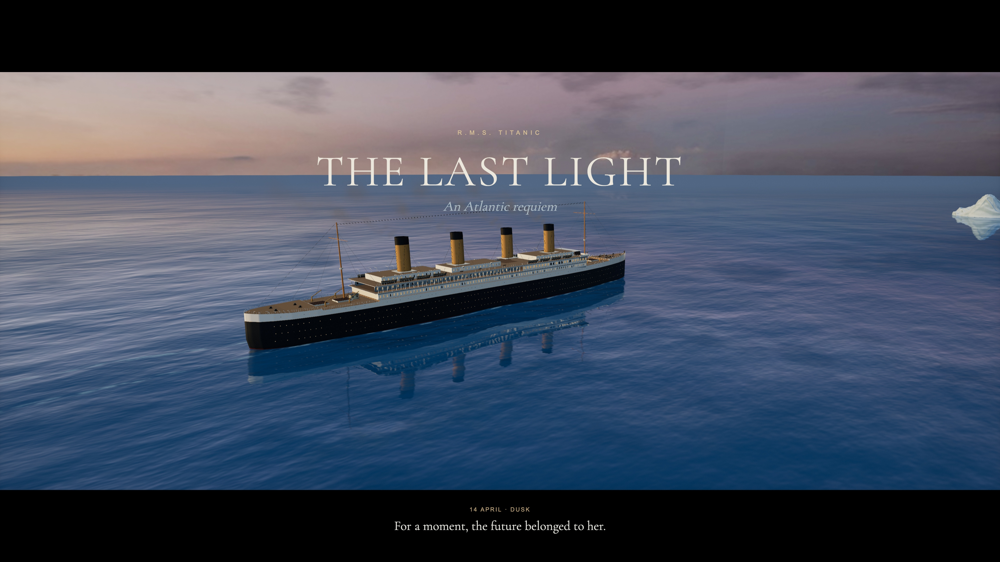</a>

Một chuyến du hành điện ảnh dài 4:24 qua Titanic, với Đại Tây Dương xanh thẳm, chân dung nhân vật, cảnh hạ xuồng cứu sinh có chuyển động theo thực tế và một thế giới sống động để khám phá.

**Prompt**

```text
1. Mục tiêu dự án
Tạo TITANIC — THE LAST LIGHT: một hành trình điện ảnh tương tác dài 264 giây, từ hoàng hôn cuối cùng của con tàu, qua va chạm, sơ tán và chìm xuống, đến lễ tưởng niệm lúc bình minh. Khách tham quan xem một bộ phim được dàn dựng, khám phá thế giới 3D chuyển động, chuyển đến một chương, lưu ảnh tĩnh hoặc tải xuống toàn bộ phim. Trình bày đây là một diễn giải nghệ thuật, không tuyên bố độ chính xác pháp y hay mối liên hệ chính thức nào.

2. Định hướng hình ảnh
Sử dụng bảng màu điện ảnh tiết chế: ánh đèn tàu màu kem ấm và hổ phách trên nền xanh Atlantic đậm, sau đó chuyển sang đêm tối đầy sao và bình minh mát lạnh. Dựng cảnh phối cảnh với bố cục phim 2.39:1, bloom mềm, hạt nhiễu tinh tế và vignette. Dùng depth of field cho các chân dung nhân vật và cảnh bình minh, đồng thời giữ các hạt từ pháo hiệu cứu nạn sắc nét. Tạo màu thân đại dương xanh đậm, các đợt sóng trong world space, normal ripple nhỏ hơn có mipmap và phản xạ Fresnel; màu hoàng hôn chủ yếu chỉ xuất hiện trong ánh sáng phản chiếu. Dùng các dải wake gắn với thân tàu, bám theo cùng độ biến dạng của đại dương, với đầu mềm và bọt biển đứt đoạn. Lặp texture panorama theo chiều ngang mà không tạo điểm gián đoạn fract, nhằm tránh đường nối dọc trên bầu trời và các vệt phản chiếu. Tránh shading vùng nước nông màu cam, các gợn sóng nhỏ đồng nhất và decal bọt phát sáng hình tròn. Xóa các mặt trên mái ẩn bị chồng lấn để tránh xung đột độ sâu; đặt camera near plane phù hợp với khoảng cách của từng cảnh. Trong lúc chìm, giảm dần ánh sáng cửa sổ một cách đơn điệu thay vì thêm hiện tượng nhấp nháy tần số cao. Dùng tiêu đề serif trầm, các nút điều khiển song ngữ Anh/Trung và một timeline hẹp dọc cạnh dưới.

3. Thế giới, địa lý và biên tập camera
Sử dụng một hệ tọa độ liên tục với con tàu dài 269 mét, mũi tàu hướng về +X và một tảng băng cố định tại (275, 0, 57). Con tàu tiến lên, chạm tảng băng ở giây 96.727, trôi thêm đến khi dừng lại, rồi chìm theo phần mũi và phần đuôi. Giữ tảng băng xuất hiện cho đến đoạn kết và nhìn thấy trong bố cục bình minh. Giữ sáu chương bắt đầu tại các mốc 0, 63, 110, 163, 211 và 241 giây.

Xây dựng 23 shot có chủ đích. Phân cảnh ôm ở mũi tàu kéo dài từ giây 29–61: một shot thiết lập cảnh tiếp cận, một chân dung đôi cận cảnh, một góc nhìn từ phía sau hướng ra biển và một chân dung chếch. Đặt Rose ở phía trước và Jack phía sau cô tại chóp mũi tàu, cả hai cùng hướng mắt ra ngoài mũi tàu. Duy trì ánh sáng hoàng hôn xuyên suốt chuỗi shot. Từ giây 127–158, dùng ba shot gắn với transform thế giới thực của một xuồng cứu sinh: rời boong xuồng, cận cảnh hơn về hành khách và dây treo, rồi tiếp cận mặt nước. Tiếp nối bằng các shot sơ tán toàn cảnh, tàu nghiêng, nứt gãy và chìm. Khi bình minh, cho thấy những chiếc xuồng còn sống sót với tảng băng ở xa, sau đó là tiêu đề tưởng niệm tiết chế.

4. Danh mục tài sản
- titanic-vessel: dựng cấu trúc chính dài 269 mét trong Blender với các boong hở liên tục, forecastle đóng kín, các tầng promenade, bốn ống khói rỗng nghiêng, thân trên màu đen và thân dưới màu đỏ. Dùng vành tròn thực cho 864 ô cửa sổ tròn và khung cho 360 cửa sổ. Chỉ cho phép emission trên các vật liệu kính thực tế. Batch vật liệu và tách tại x=-32 để phục vụ cảnh chìm. Thêm cột buồm, rigging, davit, dây hạ, chân vịt bằng đồng và bánh lái. Tạo companionway P2 với cửa gỗ teak và chi tiết đồng thau, chuẩn hóa rồi tái sử dụng hai lần trên boong đã biên soạn. Giữ nguyên transform của node khi lắp ráp GLB.
- atlantic-iceberg: một tảng băng xanh-trắng bất quy tắc, bị xói mòn, với các lớp sương giá, độ roughness biến thiên, normal map tiết chế và đường tiếp nước thuyết phục. Đây là một đối tượng địa lý cố định.
- lifeboat: một xuồng cứu sinh chèo tay của White Star với vỏ gỗ trắng, be chắn mạn tối màu, ghế băng và mái chèo, được instancing thành mười sáu xuồng chuyển động độc lập.
- bow-embrace: một tài sản nhân vật đôi tách biệt, lấy cảm hứng từ phục trang và tư thế trong bộ phim năm 1997 được yêu cầu: Rose tóc nâu đỏ, mặc đồ màu navy/ngà và choàng khăn có họa tiết, hai tay dang rộng; Jack đứng ngay phía sau, mặc áo khoác tối màu và sơ mi ngà. Tạo ảnh tham chiếu toàn thân rõ nét trước khi chuyển đổi sang H v3.1, giữ đầu, cổ, vai và trang phục của mỗi nhân vật nhất quán. Tinh chỉnh Rose bằng một ảnh tham chiếu cận cảnh riêng và donor chi tiết khuôn mặt H: căn chỉnh mắt, mũi, môi và cằm, chuyển hình dáng và màu cục bộ sang mesh toàn thân liên tục, rồi blend và retouch phần chuyển tiếp UV. Với Jack, tạo một chân dung rõ nét với màu da tự nhiên, mắt và môi rõ ràng. Giữ trọn đầu và phần cổ trên, căn chỉnh hướng nhìn và tỷ lệ với body H, cho phần cổ dưới ôm khớp rồi weld cả hai boundary loop. Bake và retouch vùng chuyển tiếp cổ hẹp mà không làm phẳng chi tiết khuôn mặt. Chỉnh lại dáng đứng và điểm tiếp xúc bàn tay trong Blender. Kiểm tra các góc nhìn trước, bên và sau để phát hiện vệt tối, đường nối texture, lỗ thủng, mép bị cắt và giao cắt trang phục. Dùng shading riêng cho da và vải. Giữ biểu cảm nền tự nhiên cùng chuyển động tiết chế của cơ thể và vải; không tạo cảm giác đang có facial animation rig nếu thực tế chưa triển khai rig đó.
- seated-woman và seated-man: các model hành khách trưởng thành riêng biệt, mặc trang phục năm 1912 và áo phao bằng nút bần màu nhạt, ngồi co gối, hai tay đặt trên đùi. Chia sẻ geometry và vật liệu giữa các xuồng; thay đổi nhẹ vị trí và hướng. Dùng số lượng instance trên từng xuồng có thể hoàn nguyên để điều khiển việc lên xuồng.

Dùng Blender cho tàu chính, Tripo P2.0 cho companionway trên boong, tảng băng, xuồng và hành khách đang ngồi, còn H v3.1 cho hai nhân vật chính toàn thân và các tinh chỉnh chân dung cận cảnh. Giữ đại dương, chuyển sắc bầu trời, các vì sao, ánh sáng, khói, pháo hiệu cứu nạn, bọt biển, tia nước và mảnh vỡ ở dạng hiệu ứng cảnh. Cung cấp các biến thể model web nhẹ hơn với texture nén, đồng thời giữ lại tài sản nguồn chi tiết để chỉnh sửa. Dùng cùng một cặp nhân vật chính đã được tối ưu và phê duyệt cho website và bản xuất phim offline.

5. Phát lại và phản hồi
Hiển thị tiến trình tải thực cho các tài sản thiết yếu của tàu, xuồng, bầu trời và normal của biển. Bật nút mở đầu khi cảnh đầu tiên sẵn sàng; trì hoãn các model và nhạc còn lại. Nếu model nhân vật hoặc tảng băng bắt buộc tải chậm, hãy giữ ở ranh giới cảnh đó và tiếp tục khi model sẵn sàng thay vì âm thầm bỏ qua shot. Âm thanh bắt đầu sau khi người dùng tương tác.

Timeline phải hỗ trợ tua tới/tua lui và kéo nhanh mà không đặt lại về 0. Giữ nguyên trạng thái phát/tạm dừng và tắt tiếng khi tua; không để đồng hồ âm thanh cũ ghi đè lên vị trí được yêu cầu. Phục vụ byte range cho MP3 và MP4. Điều hướng chương phải có mục truy cập trực tiếp đến phân cảnh ôm ở mũi tàu tại giây 29 và hạ xuồng cứu sinh tại giây 127; các mục này khôi phục camera của đạo diễn đồng thời giữ nguyên trạng thái phát.

Cho phép khám phá bằng orbit, kéo và zoom trong khi thế giới, con tàu và nhạc nền vẫn tiếp tục. Bám theo chuyển động tịnh tiến của tàu mà không giật hướng nhìn. Trạng thái tạm dừng hoạt động độc lập; khi quay lại phim, giữ nguyên thời gian hiện tại. Space phát/tạm dừng, phím mũi tên nhảy 10 giây, M bật/tắt âm thanh, E bật/tắt chế độ khám phá và F mở toàn màn hình. Hỗ trợ orbit/pinch cảm ứng và chạm vào timeline.

Các xuồng bắt đầu ở trạng thái trống. Hành khách lên xuồng theo từng nhóm lệch thời gian sau giây 112 và hoàn tất trước khi từng xuồng hạ xuống. Dây chạy giữa các davit đang chuyển động và các điểm gắn thực tế trên xuồng, sau đó biến mất khi được thả. Tua ngược phải khôi phục số hành khách và trạng thái dây ở thời điểm trước đó. Va chạm phải đồng bộ rung thân tàu/camera, mảnh băng, tia nước do cọ xát và âm thanh thoáng qua của thép/băng. Pháo hiệu cứu nạn dùng các ngôi sao cháy màu trắng, vệt ngắn riêng lẻ, trọng lực, lực cản và khói mờ dần. Nhiễu động khi chìm là các mảng bất quy tắc bám theo sóng và suy giảm từ từ; phân bổ tia nước dọc theo đúng đường tiếp nước của đuôi tàu, tuyệt đối không phát ra từ một điểm fountain ở xa.

6. Triển khai kỹ thuật và sản phẩm bàn giao
Sử dụng Vite, các module JavaScript và Three.js với animation dựa trên thời gian mang tính xác định. Tách camera/timeline, tài sản tàu, nhân vật, môi trường, hiệu ứng và trạng thái sẵn sàng của cảnh. Dùng cùng một mô hình thời gian cho phát lại trên web, tua và capture offline. Giới hạn render web trong ngân sách pixel, phản xạ và bóng được xác định rõ; dành ambient occlusion nặng hơn cho profile offline. Biên dịch và giải mã tài sản mà không có bước prewarm khởi động dài gây chặn. Host script, model, hình ảnh, font và âm thanh trên cùng origin, đồng thời không đưa secret vào bản build tĩnh.

Dùng nhạc nền nguyên bản và Foley trả phí từ ElevenLabs: một bản thu tiếng huýt sáo pháo hoa tự nhiên hoàn chỉnh, được tách đúng tại thời điểm pháo nổ trên không thành đoạn bay lên và tiếng nổ sắc kèm đuôi lách tách, cùng âm thanh tiếp xúc và cọ xát thép/băng, dây xuồng cứu sinh và tiếp nước, biến dạng/nứt thân tàu, và chuyển động nước do đuôi tàu tạo ra. Xuất các file WAV nguồn, giữ lại prompt/lịch sử và ID, rồi biên tập thành các cue theo thời gian. Căn thời điểm phóng tại các giây 119, 151 và 183, với pháo nổ trên không sau đó 3.15 giây. Giữ nguyên attack của tiếng nổ ban đầu và hạ nhẹ nhạc giao hưởng trong thời gian ngắn. Duy trì ambience yên tĩnh của biển, gió và động cơ bên dưới bản mix. Không đưa soundtrack của bộ phim tham chiếu vào website công khai hoặc phim tải xuống nếu chưa được cấp phép. Ghi rõ nguồn tài sản và âm thanh thực tế thay vì mô tả phương án dự phòng như một tài sản do dịch vụ tạo ra.

Cung cấp bản xuất xác định gồm 6,336 frame ở 3840×2160 và 24 fps với ba mẫu theo thời gian, tiêu đề tiếng Anh được burn-in và hình ảnh letterbox 2.39:1. Mã hóa bản master 4K H.264/AAC và bản web 1080p dưới 100 MiB, cả hai dài 264 giây với âm thanh stereo 48 kHz. Giữ tùy chọn phụ đề Trung/Anh, master âm thanh và source có thể chỉnh sửa. Phát hành bản build tĩnh thông qua dịch vụ hosting Web Pages của CMS hiện có, không thêm ứng dụng nền tảng hoặc Worker theo từng trang.

7. Tiêu chí nghiệm thu
Kiểm tra cảnh mở đầu, cả hai chân dung nhân vật, va chạm, pháo hiệu cứu nạn, cả ba shot hạ xuồng, cảnh nứt gãy, cảnh đuôi tàu biến mất và bình minh. Kiểm tra để chắc chắn tảng băng không biến mất ở giây 244, biển thể hiện đúng màu xanh đậm, cảnh chìm không có các vòng trắng đều đặn, nhân vật vẫn xuất hiện trong các shot đã biên soạn, dây xuồng/hành khách luôn thẳng hàng trong suốt quá trình hạ xuồng. Kiểm thử việc tải model trễ, tua tới/tua lui, scrub nhanh, tạm dừng/tắt tiếng, khám phá động, truy cập trực tiếp các cảnh cận và mô phỏng thao tác cảm ứng. Xác minh từng frame đã xuất, giải mã đầy đủ cả hai bộ phim, đối chiếu file tải xuống thực tế trên trình duyệt với file bàn giao, đồng thời xác minh bản build công khai và liên kết CMS. Phân biệt việc giả lập thiết bị di động trên trình duyệt với kiểm thử trên điện thoại thật.

```

[Xem chi tiết ↗](https://www.tripo3d.ai/vi/3d-prompts/titanic-the-last-light) · [Bản demo](https://titanic-the-last-light.tripo.page/) · [Về danh sách ví dụ](#all-prompts)

---

<table align="center">
<tr><td align="center">
<br>
<p><strong><a href="https://www.tripo3d.ai/vi/3d-prompts/models/gpt-6-astra?utm_source=github&amp;utm_medium=referral&amp;utm_campaign=awesome_astra_prompts&amp;utm_content=catalog_bottom">Xem toàn bộ 355 ví dụ trên trang chính thức →</a></strong></p>
<p><sub>Để README trên GitHub hiển thị mượt mà, chỉ 100 ví dụ mới nhất được trình bày tại đây.</sub></p>
<br>
</td></tr>
</table>
